# 用500块租来的40平小屋，我是怎么把自己做成稳定变现的📕家居博主的

# 这篇内容比较长，是我反复打磨出来的经验帖。我想用它告诉大家，如何借助自己现有的住处起步做家居博主，并最终实现持续性的变现。做博主没有先来后到，关键在于你什么时候开始行动。下面我会用零基础的角度，把做家居博主的底层逻辑拆开讲，希望你看完之后能有“原来家居也能这么玩”的顿悟。

# 一、我的来龙去脉

大家好，我是柠檬。

到现在为止，我全职做📕已经三年，全网粉丝破10万。大号主打阅读、女性成长和个人IP，目前8万粉；小号是家居号，已破万。

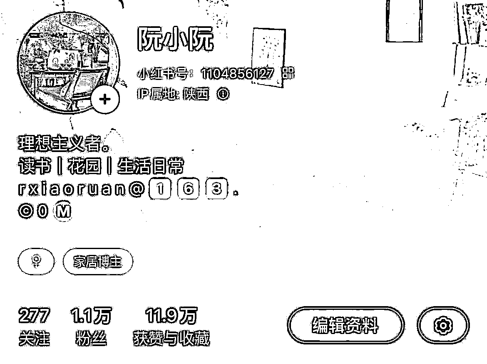

四年前，女儿一岁半，我正处在白天上班晚上带娃的循环里。早上出门她还没醒，晚上到家她已经睡了。状态很压抑，这段经历也成了我想要改变的[content]

# 用500元租来的40㎡小屋，我是怎么把自己做成稳定变现的📕家居博主的

# 以下内容篇幅较长，是我长期沉淀后的实操分享。我希望能教会大家如何依托自己的居住空间起步做家居博主，并实现可长期变现的结果。做这件事没有所谓的最佳时机，决定权在你何时开始行动。下面我会从零基础视角出发，把家居博主的底层逻辑讲清楚，让你读完后产生“原来家居博主还能这样做”的感觉。

# 一、个人介绍

你好，我是柠檬。

目前我全职做📕三年，全网粉丝10万+。主号聚焦阅读、女性成长和个人IP，有8万粉；副号家居号也已过万。

四年前女儿一岁半时，我长期处于白天上班晚上带娃的状态。早上出门时她还没醒，晚上回家她已睡着，很煎熬。这段经历促使我决心改变。

我开始尝试📕，先后试过美食、穿搭、亲子Vlog等方向，却始终找不到稳定心气，数据也没明显突破。

直到偶然发现分享书籍也能做博主，我确定了方向。连续日更近20天后，第一篇爆文出现，涨粉3000+。从此开启博主生涯。这期间我仍在上班，写作拍摄的时间只能挤在午休和女儿入睡之后。半年后粉丝达到2万，博主收入超过主业，于是我辞职成为自由职业者。

当时女儿已上幼儿园，我顺势搬家，花500元额外租了一间公租房，把工作与生活分开。就在这间40平的出租屋里，我有了新的身份——家居博主。账号以软装布置分享为主，搭着“出租屋改造”的话题，数据一路向好。更让我意外的是，家居赛道的变现能力远超粉丝高出8倍的读书号。

（刚搬进来的出租屋就是这样）

大件如沙发、柜子、冰箱、床垫、茶几、书架，小件如香薰、咖啡机、扫地机器人、电风扇、地毯，甚至锅碗瓢盆，都经历了多次品牌合作。品类覆盖家具家电到日用百货，合作资源源源不断。

就靠这个账号，我累计完成上千次广告合作，产品价值加稿费变现超40万。

很多人担心前期要自费购置家具软装，投入不小。实际上我的做法是靠接到的合作产品逐步布置起来的。早期改造的实拍我整理了一些：

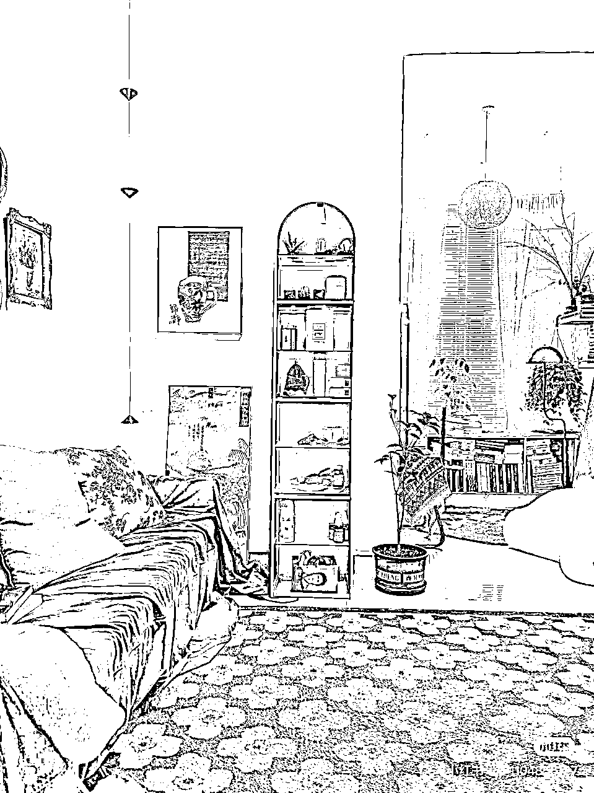

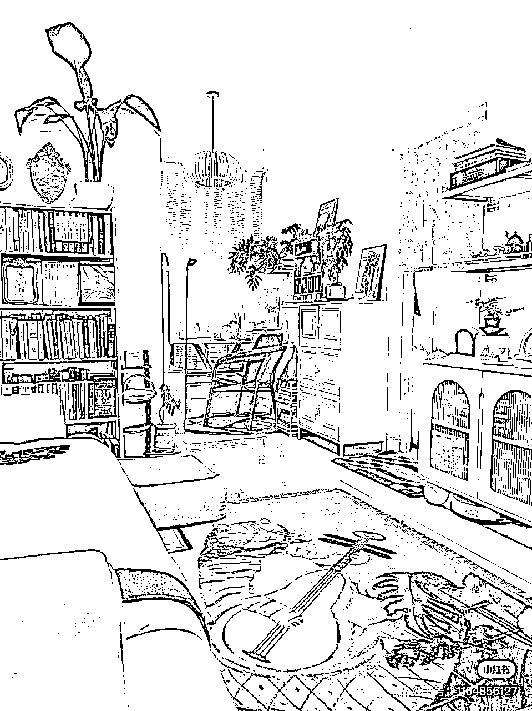

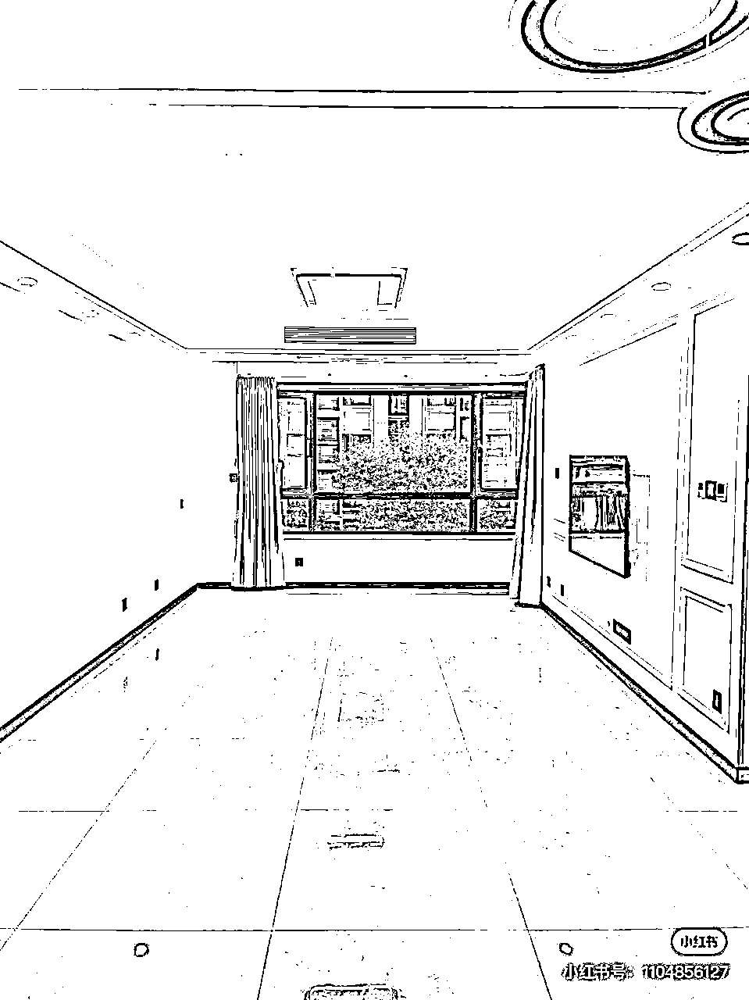

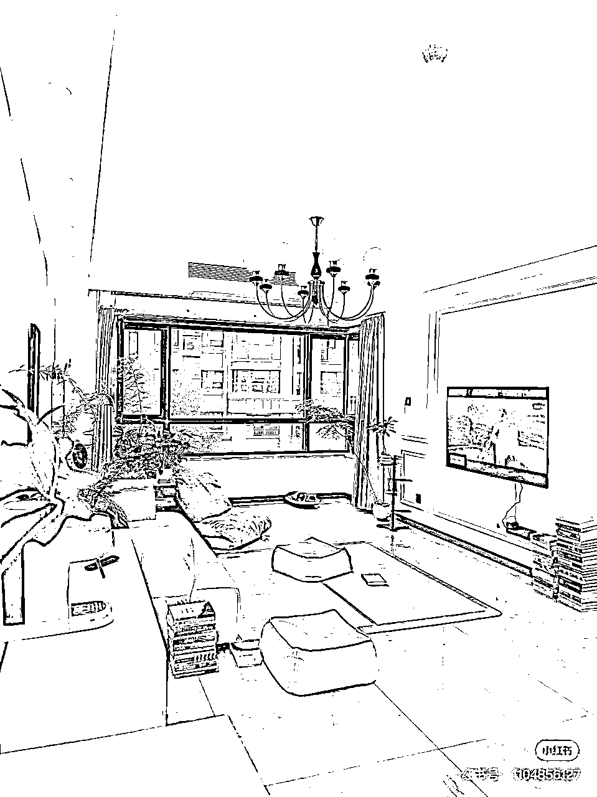

（上图为初期出租屋样貌，以及2024年中旬搬家后的新场景）

同样的改造思路换个场地再做一次依然有效，而且我是在同一个账号内完成切换，并未影响商业转化。

每一次焕新使用的家具软装，几乎都是合作拿到的产品。肉眼可见的吊灯、台灯、床垫、沙发、地毯、柜子，甚至书籍和绿植，地上铺的软垫也都是合作款。

我用合作来的物品打造了一个又一个具备商业价值的场景。这并非靠我天生审美或运营能力，而是家居场景自带的带货潜力，决定了生活化的空间天然囊括了衣食住用几乎所有品类。

# 二、能拿到这些成绩的四个关键点

## 1、核心逻辑

家居赛道的底层逻辑很清晰：分享软装布置思路、输出硬装干货经验、营造住所的氛围感。抓住这三点，基本就掌握了内容核心。拍摄也极度垂直，因为场景固定，来回拍家里的不同空间即可，变的只是选题和文案，对素人非常友好。

我入局家居的契机，是给自己租了500元的工作室后不想浪费空间，于是开了个专门发家居内容的号。一间空荡的40平，在无任何家具的情况下边改造边接单，正因前后反差明显，才容易形成看点。

对普通素人来说，只要有自己的住所就能复制。关键在于如何为家居场景找到流量钩子。一旦找到，变现会顺理成章。

## 2、环境

新手最容易被环境卡住：到底拍什么？

其实大家把起号想得太难了。刷到的账号都是成熟期，审美和变现都无可挑剔，所以没开始就被吓退——我家太丑、我审美不行、拍不出来、品牌会找我吗？

环境问题无法一蹴而就，但可以从细节展示入手。拍不到的区域就藏起来，学会遮丑。比如卧室能收拾出来就先拍卧室，别一上来就拍客厅。区域是可以逐步扩张的，随着审美提升，呈现力自然变好。

我当初只从卧室开始拍，直到想接沙发这类大件，才把场景扩展到客厅。所以先顾好当下能拍的，哪怕只是角落、一张书桌。利用环境，而不是被环境限制。

## 3、心态

做自媒体，数据折磨是常态，焦虑不可避免。心态决定留存率。

我见过发一篇就抱怨不火的人，也见过做一年仍无起色的人。前者太急，后者太松。数据有波动很正常，心态也要有弹性但别过山车。三篇笔记持续低迷就该复盘换选题；但三篇就否定自己是自杀行为。任何事都有过程，要允许它发生。

深耕内容、沉住气，才是自媒体的生存法则。

## 4、坚持

探索新事物像种花，需要时间浇灌。不要因短期无果就放弃。

📕曾流行一句话：100篇内必出爆文。

所以别输在第99篇。坚持本身就能淘汰掉大半竞争对手。慢一点走，总比停下来好。行动起来，你会从小白到入门，再到专业。

# 三、新手入门准备

## 1、了解📕家居赛道

选定平台和赛道，就要吃透这个赛道在平台上的表现。所以前期要在📕大量浏览不同家居风格，掌握风格特点、色彩搭配、常用元素，学习收纳技巧、空间布局、软装搭配等基础知识，为后续创作储备素材。

搜索时下拉词都是可用的关键词参考，也可以按兴趣直接关键词检索，快速找到目标账号和内容。

## 2、学习拍摄剪辑

掌握基础摄影知识：构图、光线运用、色彩搭配、字幕添加、基础操作。我常用的修图工具：黄油相机，80%的📕字体都有；醒图，主要用来调色。

类似教程在📕很多，自行搜索学习即可，对起号足够用。

## 3、设备准备

拍摄设备：iPhone X以上完全够用；安卓手机，华为系列我用过，如今3000+价位的手机像素基本过关，无需纠结型号。会用相机当然是加分项，想拍视频可配三脚架，提升出片质量。

我做博主前三年全靠手机拍摄，直到去年才开始接触相机。对素人而言手机就够了，别纠结设备，有什么用什么即可，设备不是核心。

还有个常见问题：做📕需要电脑吗？基本不需要。📕没有电脑客户端，只有网页版，发笔记和直播手机就能完成。只有批量上传电商商品时才可能用到电脑，其它场景手机完全够用。

## 4、账号准备

用手机号注册📕，完善真实信息，取一个简洁好记且与家居相关的用户名。头像清晰有辨识度，可用个人氛围照或家居风格图。

案例参考：

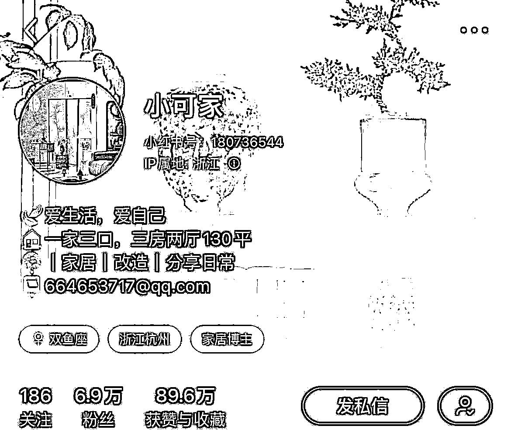

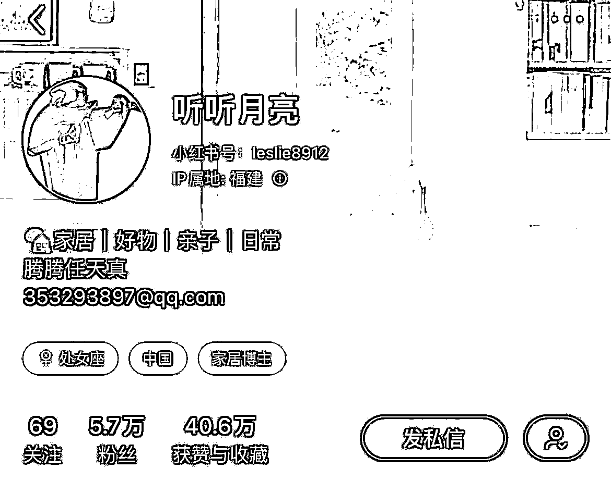

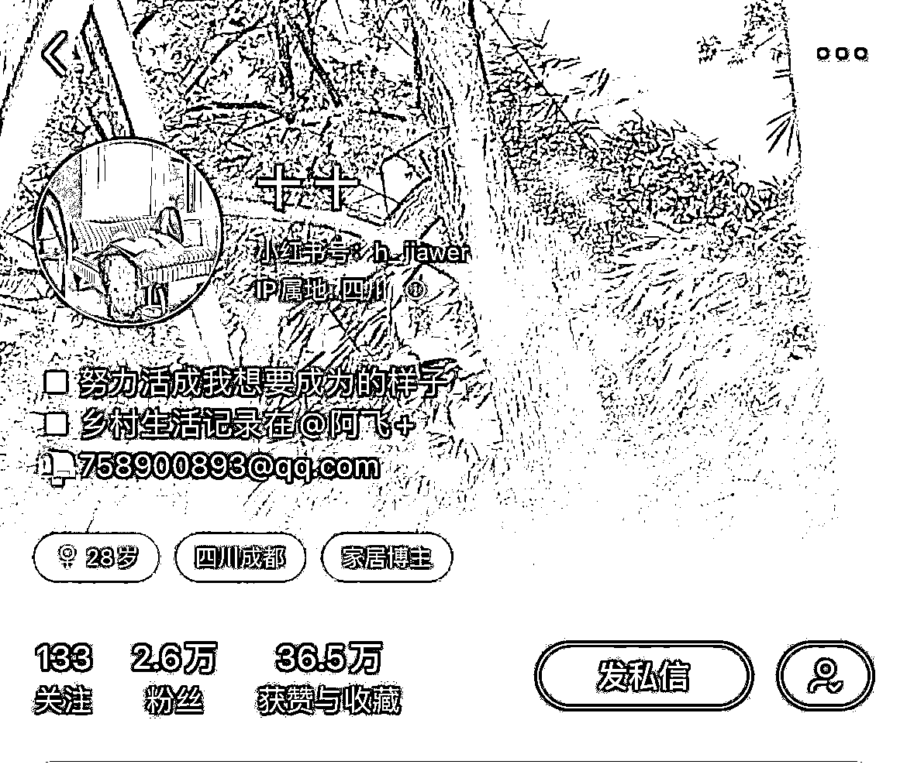

### 1、昵称

可结合自身优势、标签、人设、兴趣取名，也可取个好记的名字，让人一眼知道你做什么。

### 2、简介

按定位撰写，不用复杂，说明账号分享内容即可。记得带上邮箱，家居号只要有数据商家就会主动找你。我曾在发三篇笔记时就接到投影仪合作，稿费120元。

### 3、头像

可用真人照片，也可用风格图，清晰即可。

## 5、场景布置

按账号定位准备基础家居装饰，如假绿植、装饰画、抱枕、地毯等，打造不同拍摄场景。选择合适的拍摄空间：客厅、卧室、书房，保持整洁、光线充足，便于随时拍摄。

https://www.xiaohongshu.com/discovery/item/62dcdec5000000001c016133?source=webshare&xhsshare=pc_web&xsec_token=ABFTbUN8Nl_YIm7ujqiIAR_VQSTe8Dxh04eNgaVQuj3H8=&xsec_source=pc_share

这是我第一篇笔记链接，可供参考。其实布置并不出彩，我利用了夏日炙热和门帘被风吹动的氛围感，配上舒缓音乐，整体很舒服。

所以要善于发现场景中的可用亮点，巧妙利用，有了噱头就好办了。

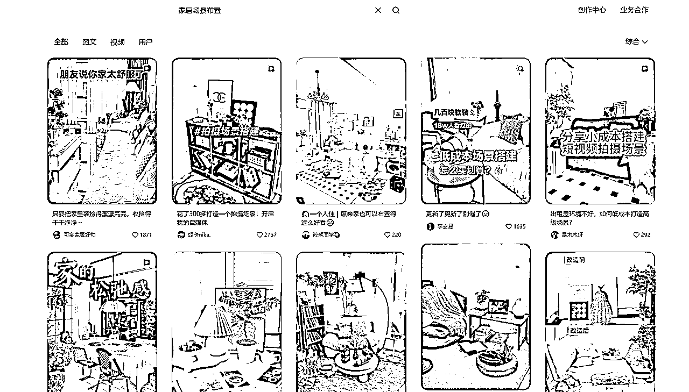

没灵感就去📕找同类型场景，模仿打造即可。

## 6、确定风格定位

思考细分方向：小户型改造、旧房翻新、家居好物推荐、特定风格设计等。明确内容特色：实用干货风、温馨治愈风、田园复古风等。

要用好现有家居资源，按实际风格做定位，风格与定位不匹配怎么做都难，注意顺势而为。

适合普通人起号的定位举例：

### 1、一间出租屋

可从4平米氛围角落起号，也可从卧室起步。卧室只要有出片的四件套加一个氛围配饰就够了，上手简单。

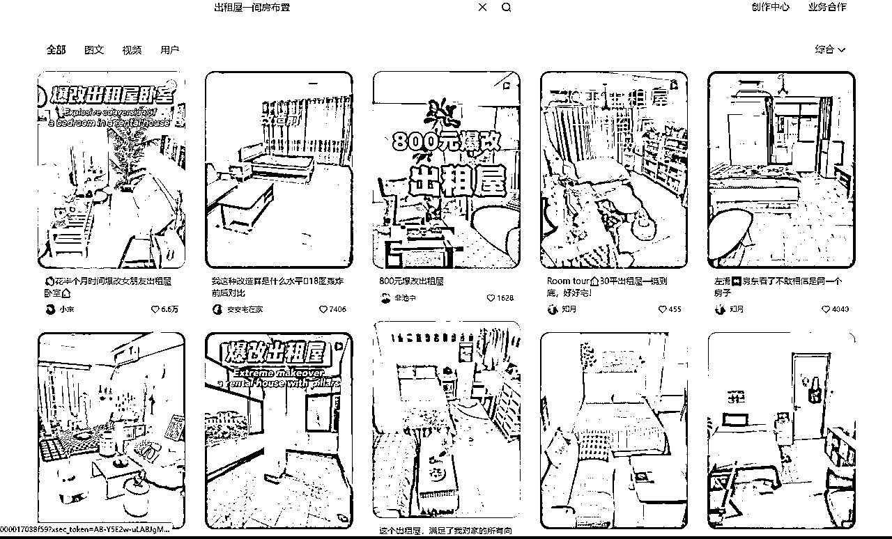

### 2、老破小

自带改造噱头。改造不是等完美后再发，而是从决定做博主那天起就开始记录，哪怕前期很丑。账号呈现动态过程，等爆文出现，粉丝会爆发。

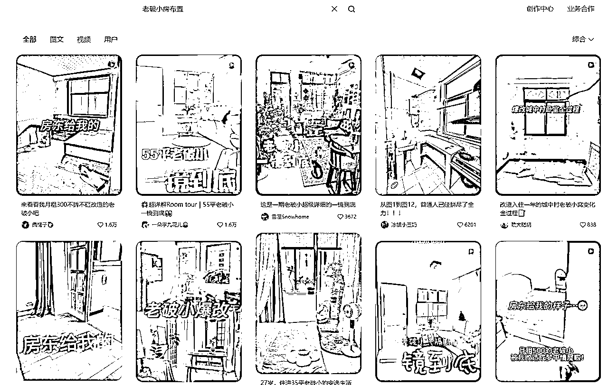

### 3、农村自建房

利用“农村生活”噱头，自然营造田园氛围。如今很多人怀念农村生活，不用刻意改造，拍接地气的日常即可吸粉。

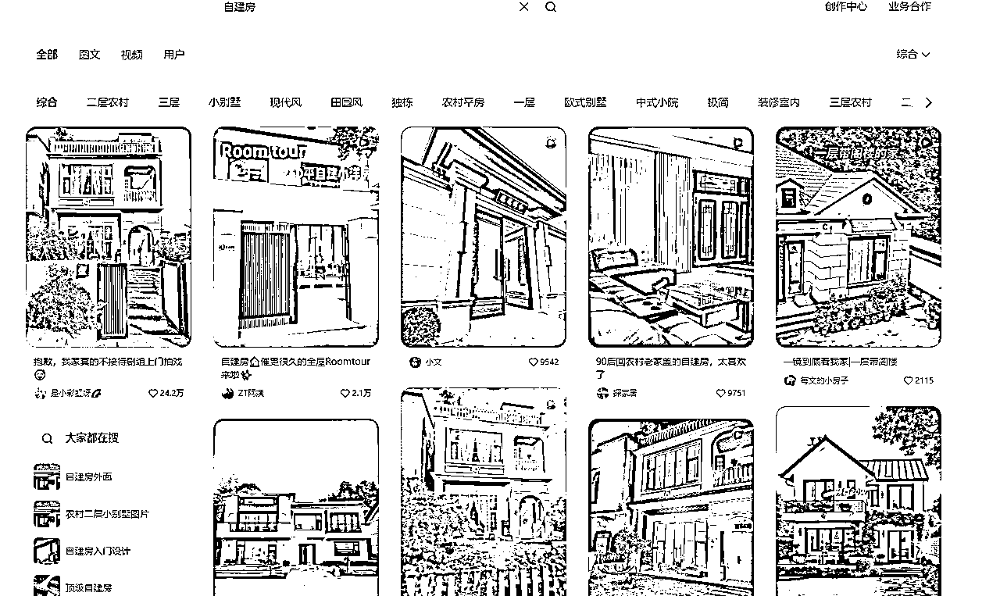

### 4、硬装阶段

建议用视频起号，选题选干货经验和避坑指南，务必写清房屋信息：面积、花费、布局。装修进程推进，账号容易接到合作，且能无缝衔接到软装，进而节省装修软装成本。

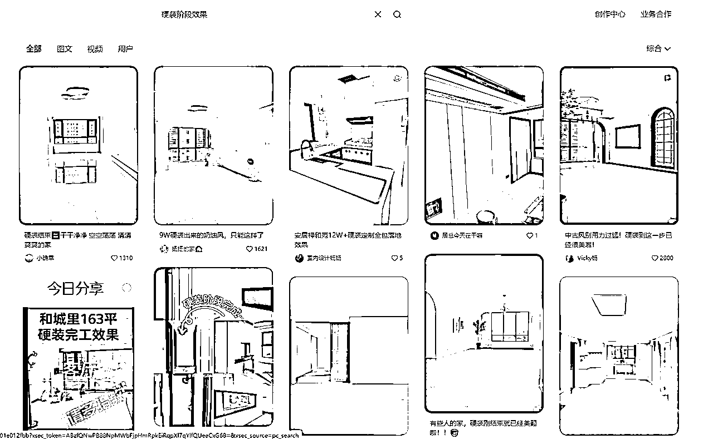

### 5、精装房

📕上大部分成熟家居号都是这种“完美的家”呈现。普通新手不适合模仿，除非自家硬装审美高且软装拍摄都不错。摸索一段时间后，账号最终都会趋向于此种形式。全屋展示是变现潜力最大的形态。

# 四、新手实操指南

## 1、拍摄与光线技巧

#### 1、自然光黄金时段

上午10点前/下午4点后为柔光期拍摄，避免正午强光导致过曝或阴影重。

可提前看天气预报安排拍摄，多次摸索家里光线最佳时刻。一周内集中拍摄，便于掌握光线，也避免反复整理家务。

我起号时曾为了等门帘被风吹动，等上好几个小时，吹动也就几分钟，时机很重要。

阴天可用透光纱帘+暖光台灯模拟柔光，色温建议20-30营造温馨感。下图为对比图，我偏爱这种调性，大部分照片会尽量调成暖色调。

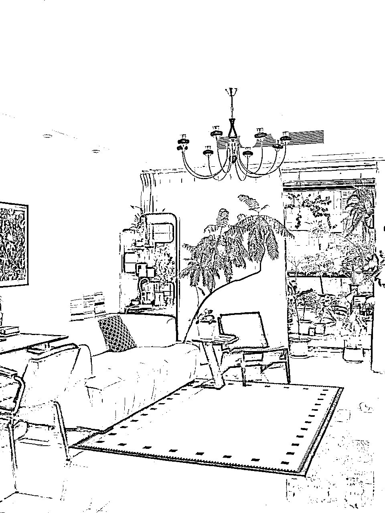

（原图） （修图效果）

（曝光27 鲜明的56）

根据实际光线调整参数

🔸光感+32

🔸亮度+27

🔸自然饱和度-10

🔸阴影+10

🔸色温+15

🔸锐化+40

以上为醒图参数，可按需调整。

天气无法保证每天充足光线，也不建议依赖天气出片，阴雨天难以保障素材。因此后期可在手机相册编辑或使用修图软件，通过参数调节补救。

#### 2、分层照明法

主光源+辅助光源+装饰光源叠加，提升空间层次感。傍晚拍摄更出感觉，尽量在画面中加入不同元素的光线。

拍摄时关闭不入境的灯具，避免光线杂乱。灯光运用可参考📕案例。我也是拍着摸索，灯光不好就开，画面单调就加台灯。

#### 3、低成本补光方案

白墙/白纸板DIY反光板，解决侧光拍摄的面部阴影。

阴雨天用手机环形灯50元内+纸巾盒改装柔光罩，模拟自然光。

## 2、构图与角度技巧

#### 快速构图法

打开相机网格线，将主体放在左下/右下交叉点，避免头重脚轻。

俯拍法：1米高度拍摄餐桌/茶几，放大桌面细节。视频演示了我平常的拍摄方式，用iPhone即可，构图对了后期修图就能出片。

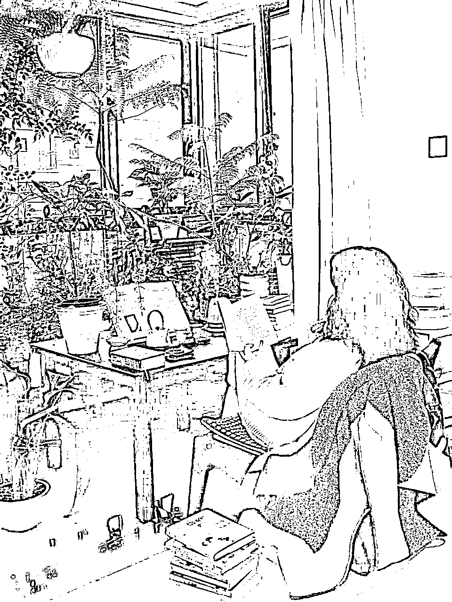

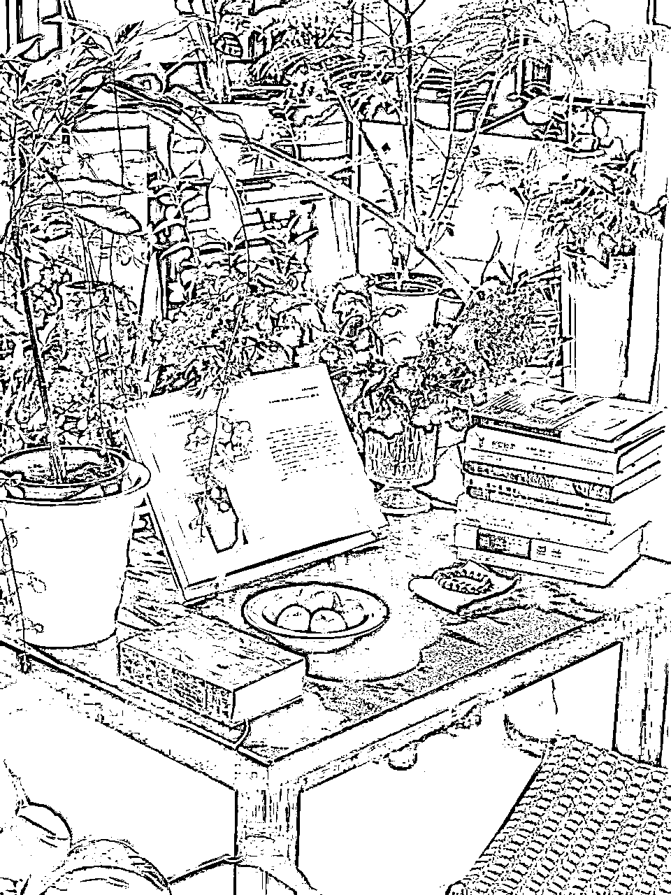

（拍摄效果图）

#### 引导线与留白

利用窗帘褶皱、地板木纹作视觉引导线。

留白比例控制在30%以内，避免画面空洞。

下图为简单留白与构图示例：

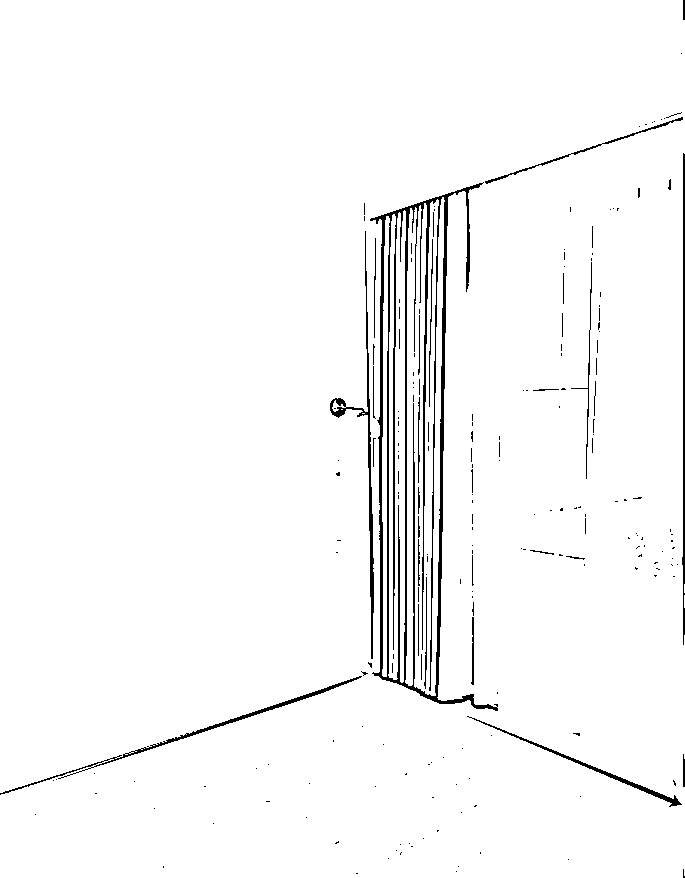

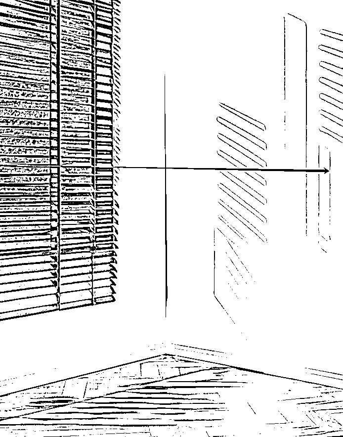

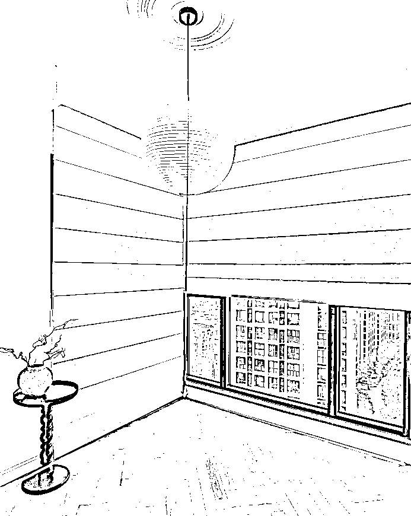

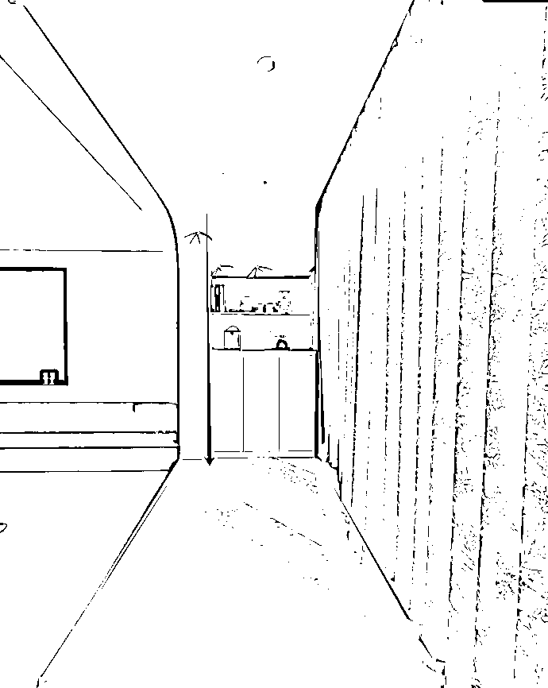

## 3、道具与背景布置

#### 1、基础要求

家居整洁、色调统一，极简风更易出片。利用沙发毯、绿植、香薰等小物件提升氛围感。

#### 2、光线要求

无自然光时，使用暖黄光摄影灯如TIR透镜灯营造温馨感。

做家居类自媒体，画面氛围永远是第一位的。别只靠头顶一盏灯，试着用射灯和落地灯做辅助照明，把色温调到27-35之间，整个空间立刻会多一层温暖的气质。手机用户拍照时，记得打开“人像模式”，焦外的背景一虚化，主体就被衬托出来了。

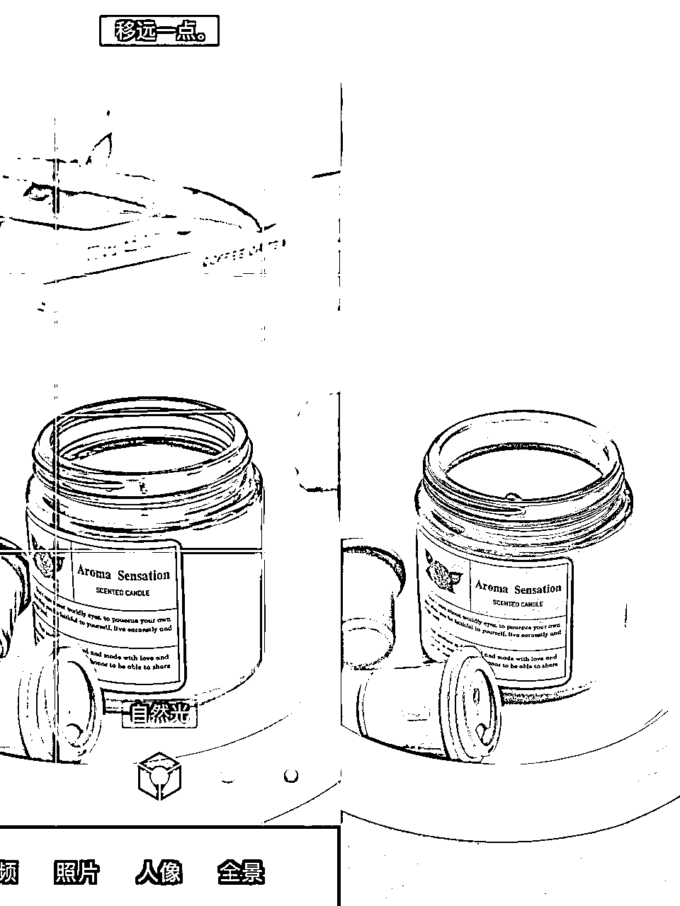

## 3. 拍摄角度与构图

特写镜头适合低角度去捕捉，比如餐具的纹理和细节；想拍出空间的完整感，可以选择14-24mm的广角端，或者直接用手机镜头拉近到1x-1.6x。构图可以试试三分法，把画面拆成三层：靠近镜头的位置放绿植，中间区域摆家具，最后面用墙面装饰来收尾，纵深感和层次感都会自然浮现。

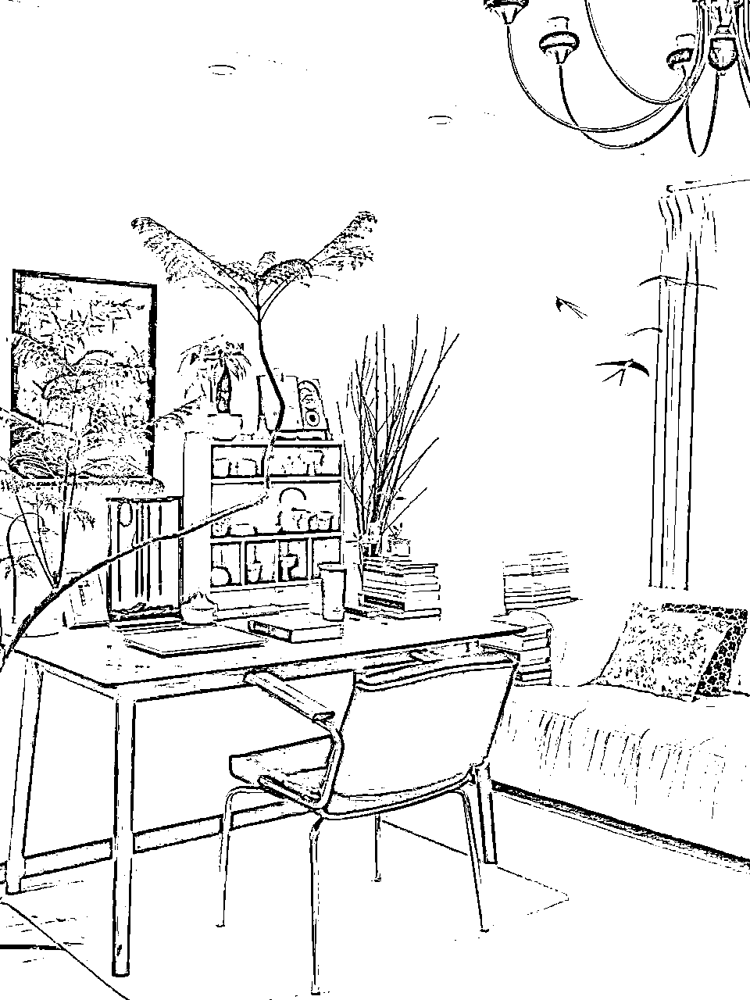

## 4. 账号定位与对标账号拆解

定位的第一步是做减法。不要一上来就谈“家居”这个大词，要往细了扎：出租屋改造、收纳技巧、软装搭配，选准一个切口，比泛泛而谈有效得多。

标签体系可以分成五类来搭建：
- 基础通用型：#家居灵感# #软装搭配# #装修干货# #家居好物# #租房改造#，目标是覆盖平台的基础流量池，适配80%的内容。
- 场景化型：#小户型改造# #卧室布置# #厨房收纳# #阳台改造# #旧房翻新#，专门响应有具体需求的用户。
- 人群属性型：#租房党必看# #独居女生# #新手小白# #北漂生活# #租房改造#，用来强化人设，提升粉丝的归属感。
- 热点趋势型：#断舍离# #侘寂风# #奶油风# #极简生活# #早春焕新#，跟着平台的热点流量走。
- 品牌合作型：#宜家好物# #网易严选# #名创优品# #原创设计# #家居带货#，相当于给品牌方递了一张名片。

对标账号怎么挑？优先看粉丝量在1-5万之间、近期才做起来的新号。重点研究他们的内容配比，比如好物分享类占三成、改造实录类占五成。还要观察他们的广告形式，是图文挂商品还是视频口播，以及合作品牌的类型，这些都能给你提供参考。

## 5. 爆款选题策略

找选题最省力的办法，就是打开📕搜索栏，看系统自动弹出的下拉词——“小户型收纳”“房屋改造”这些词背后，全是用户真实的需求。

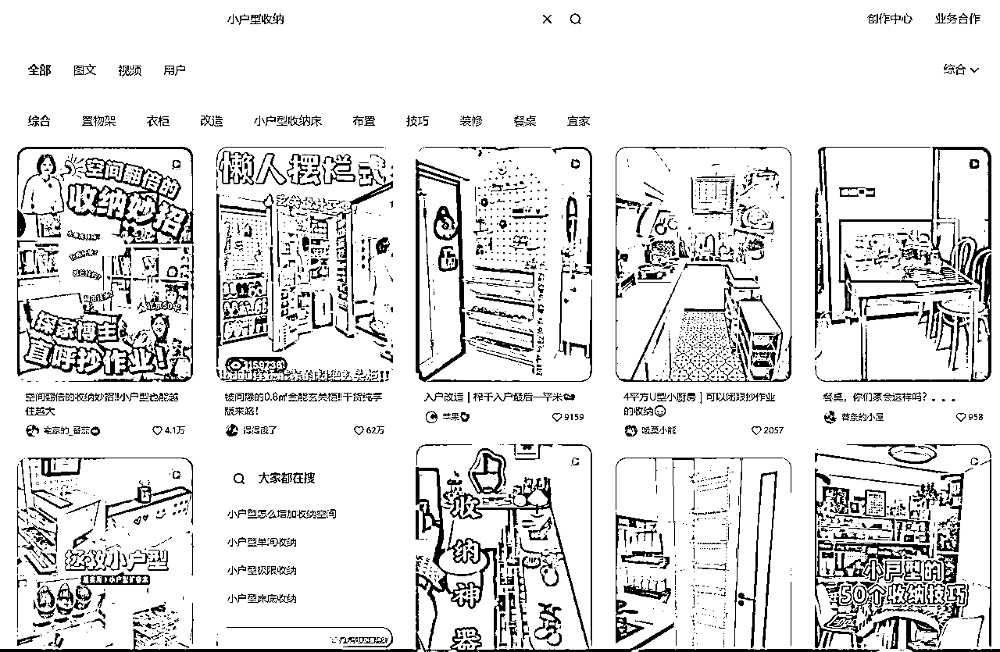

想避开同质化，可以试试冷门方向，比如家居技巧、独居安全这类内容，反而容易跑出来。

或者把选题做成系列，比如“一周改造一个角落”，让用户产生追更的期待，粘性自然就上来了。

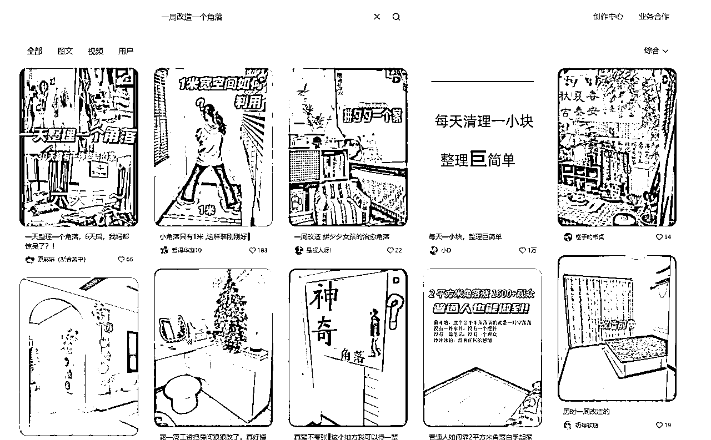

## 6. 标题公式

给你几个验证过好用的公式：
- 「普通人做家居博主X天的真实收入」
- 「被问爆的XX链接！附尺寸/价格清单」
- 「抄作业！跟着博主学XX元改造出租屋」

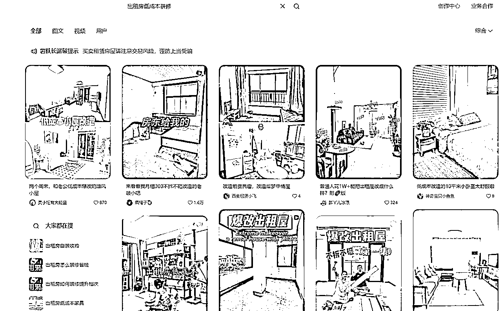

爆款标题其实是可以反复利用的。前期起号阶段，最简单的办法就是找一篇内容和你的高度契合的爆文，直接把标题拿过来，改几个字甚至完全不动。你去看那些模仿爆文的账号，标题都长得大差不差，这就是捷径。

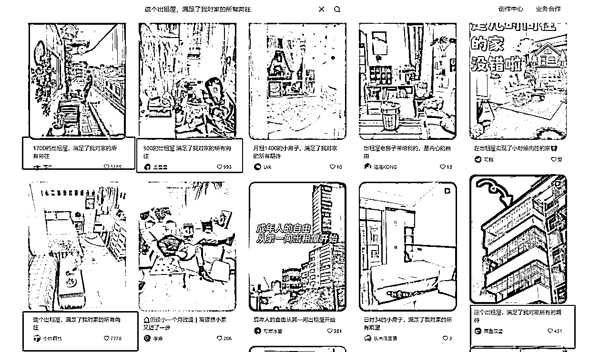

## 7. 素材拍摄与内容管理

拍摄要讲究规划。我习惯每周集中拍两次，每次花2-3小时，一次能囤出15-20条素材。同一个房间，记得拆解着拍：全景、中景、特写一样不落。比如拍书桌，先拍整体布局，再拍文具细节，最后补一个灯光效果。

素材的规格也有要求：横屏视频保持16:9，竖屏封面用3:4，原始构图千万不要随便裁，留给后期充足的空间。拍视频还有一个隐性好处——可以弱化文案表达，这对不擅长写文案的新手特别友好。前期要多角度尝试，先用数据去测试哪类封面更受欢迎。拍摄时间尽量选有阳光或者有风的时候，氛围感会自然而然地出来。

## 8. 后期制作技巧

我修图习惯用“醒图”，参数很固定：亮度加10、对比度加5、饱和度减3，再叠一层“胶片”滤镜。文字排版选楷体，配浅灰色边框，关键信息用橙色高亮。剪视频的时候，加一个转场音效，比如“唰”的那一声，配合向左运镜的手感。每5秒插入一个缩放或画中画特效，展示产品时局部放大到120%就很抓人。当然，这些参数都取决于原始素材的质量——如果真能一镜到底，加上音乐和滤镜就够了。

# 五、高变现经验总结

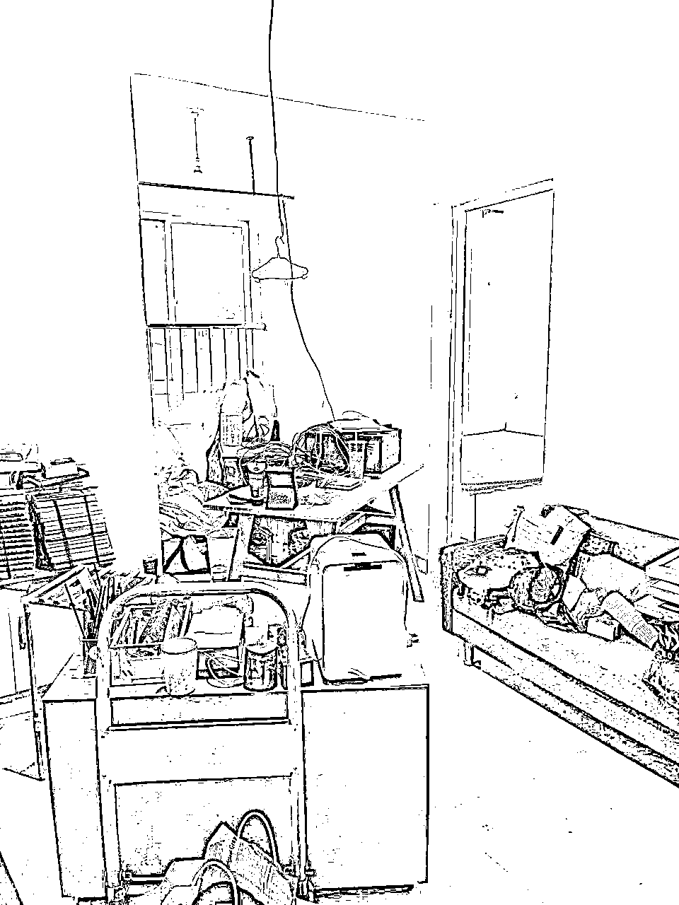

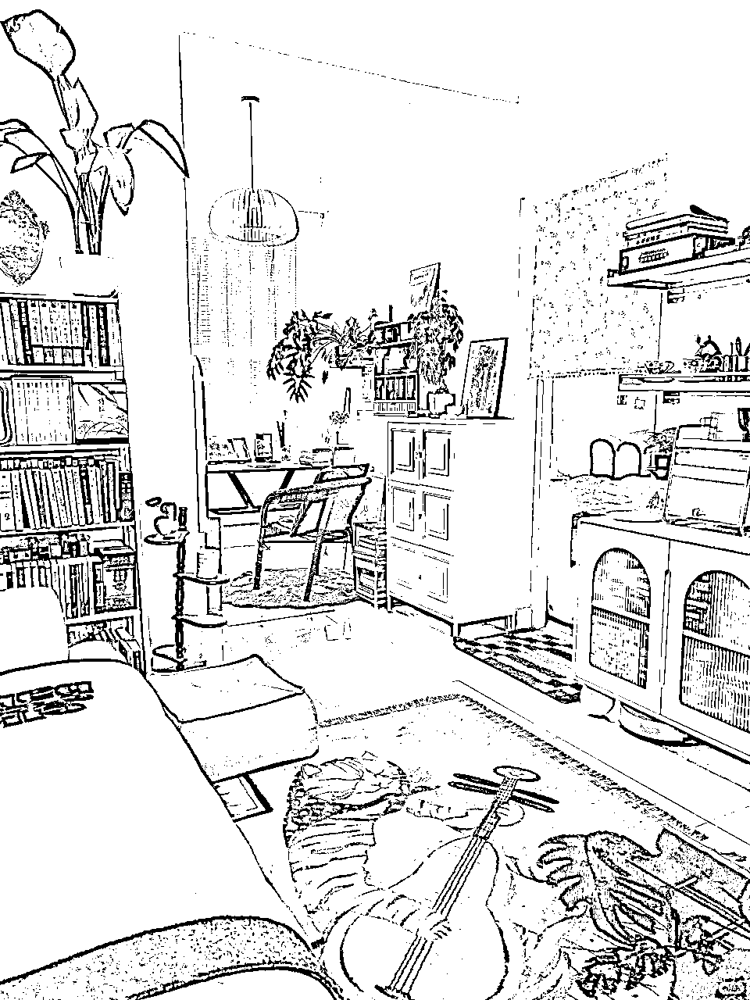

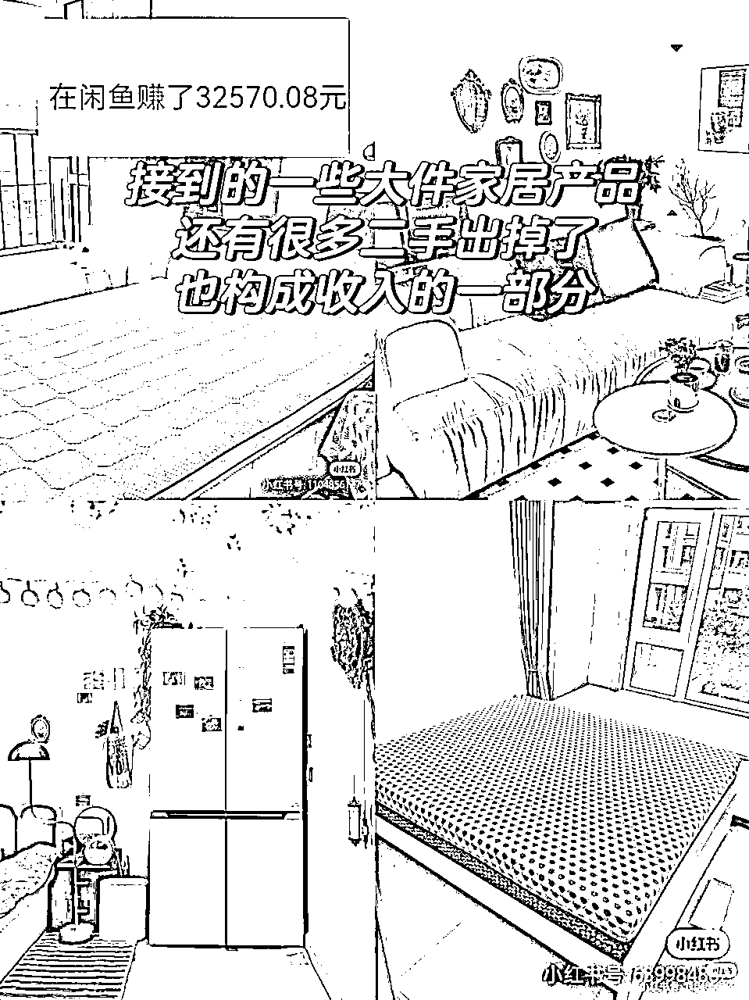

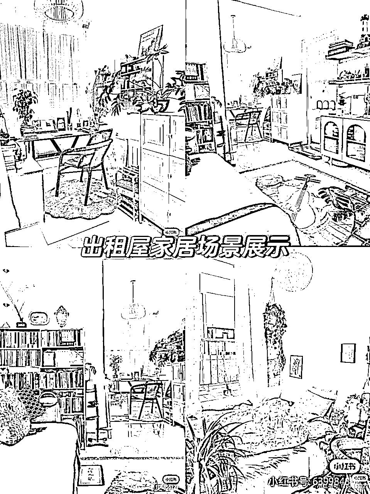

很多人看到我改造完的工作室出租屋，第一反应是：你先把房子装得这么好看，所以才能接到广告、才有变现能力。但真不是这样。你眼前能看到的沙发、柜子、书架、地毯，全部来自品牌方的合作赠送，并不是我先自掏腰包买来布置好、才开始做家居号的。我最初做这个号就是冲着接家居产品去的，一个连家具都舍不得买的人，怎么会花钱先装修？

那为什么我能在这么短时间内改造成功？原因是我把读书号上的经验搬了过来——对手里现成的合作资源主动出击，把自己推销出去，主动去谈。当然，还有个客观条件：家居赛道是最近两年才跑出来的黑马，品牌方对博主的需求量非常大。

他们的合作力度有多夸张？上万的冰箱、大几千的床垫、沙发、柜子，说送就送，稿费另算。我从粉丝还没过100就开始接广告，当时单篇稿费150。如今粉丝快破万，单篇报价已经到2000多。我那个8.2万粉的读书号报价5500，粉丝量差了8倍，但变现潜力已经很接近了。

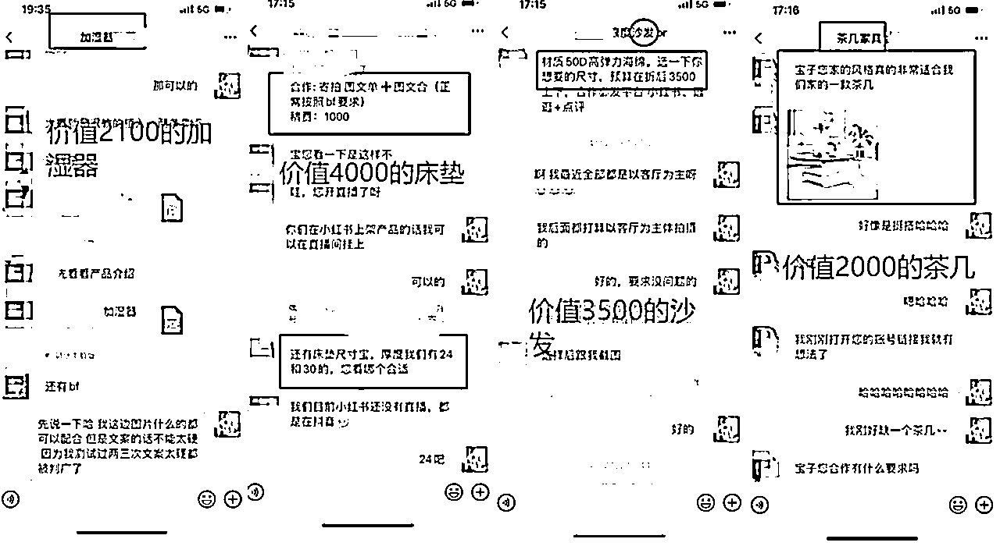

看到这个潜力之后，我马上把客厅也纳入拍摄范围，结果接到的合作肉眼可见地变多了。而且只要第一次合作数据好，品牌方基本都会复投，慢慢就变成了长期合作，以后有新品上市，还能第一时间拿到手。再加上家居产品本身单价不低，用完之后放到闲鱼上转卖，又是一笔回血。

算下来，我做博主快4年了，但真正的集中变现出现在最近两年。核心转变在于：我开始用商业思维经营账号，知道怎么把号做得更有品牌方看得上的价值，也学会把自己当作产品去营销，把一个副业当成正经工作来运营。

（上面是我开始做博主后每一年的收入明细）

看着逐年上升的数字，我明白了一个道理：不是先把账号做大了再去想怎么赚钱，而是在动手做账号之前，就要想清楚这个号怎么用来赚钱。

# 六、我做📕的契机，也许能给你一些启发

我做自媒体的起点，是很多女性都会遇到的两难——家庭和事业。那段日子确实煎熬，但也正是那种难以忍受的状态，逼着我开始折腾和改变。

从读不完的书，到接不完的家具家电产品，做博主让我积累了上千次带货和接广的经验。后来我又和朋友合伙做电商，管过十几个人的小公司，运营过几十个矩阵账号。给我底气和魄力的，恰恰是这段做博主的经历。

一个人活成了一支队伍，同时做三个赛道，不断地把之前的主业技能用出来，也用爱好反哺每个领域，最后都拿到了结果。现在回头看，我并不是踩中了自媒体红利，而是想到什么就马上去做——这股行动力，才是我拿到结果的关键。如果你也有爱好，也有被人认可过的技能，不妨动起来试试，说不定会有意外的收获。

# 七、为什么会选择读书和家居这两个赛道？

一句话总结：没什么赛道比它们更适合普通人起步了。尤其家居，门槛比读书还低。很多人以为做家居博主必须先有一间漂亮的大房子，能拍出精美的照片才行，其实完全不是。无论你的房子是买的还是租的，无论颜值高低，只要你有住的地方，就能做出一个家居账号。老破小、农村自建房，甚至还在装修阶段的毛坯房，都可以用来接广变现。

做账号拼的就是差异感。当满屏都是奶油风和精装房时，有反差感的内容反而更容易出圈。数据只要漂亮，品牌方自然会找上门。在📕，家居的变现能力非常强，也是这两年才异军突起的黑马赛道，最难得的是，它不太在意粉丝数量。

你可以想象一个场景：你刚好在装修，这时候一个地板品牌找过来，你的装修过程就能不动声色地成为广告位。品牌方想要的是自然无痕又长久的传播，而你不仅能免费用上地板、省下人工费，还能拿到一笔不错的稿费。这就是家居赛道的变现理念——深度无痕植入，博主和品牌方各取所需，实现双赢。

家居赛道以图片为主、文字为辅，这种形态决定了它特别好上手。所以你会发现，家居博主很少是全职做的，基本都是用业余时间在运营，拍几张图就是一篇笔记，几乎不需要额外投入整块时间。

# 八、分享一些掏心窝子的话

从月入5000的职场女性，到保底月入3万的全职博主，我的蜕变其实也发生在很多自媒体人身上。我们都是普通人，因为自媒体这个契机，命运开始发生转动。

前几天有个学员跟我说：保持优秀的状态，优秀就会成为一种习惯。她说她不想在乡村里做一个普通的家庭主妇，女性不该被环境和年龄定义。自媒体让她学会了如何表达自己、销售自己，她依然是原来的她，只是多了自信。听到这段话，我特别有共鸣。自媒体带给我的也远不止收入和物质，它让我意识到人是无所不能的，只是很多时候被工作困住了。就像我看到的那句话：人一旦上班，就会停止思考，大脑只会被动接受本职工作的信息，而外界所有的未知探索，都不会发生在办公室。

8小时内求生存，8小时外求发展。用好下班后的时间，自媒体也许正是你意想不到的出路。

共勉。