500元租来的40平出租屋，也能成为小红书变现利器？我把全套方法摊开讲

很多人觉得，家居博主必须有精装房、审美在线、还会拍照。但我想说，真不是这样。我是柠檬，全职做小红书三年，全网粉丝10w+，大号以读书、女性成长和个人IP为主，目前8万粉；小号家居号也过了万。最让我意外的是，这个家居号，是在一间月租500元的公租房里做起来的。

四年前，女儿一岁半，我过着白天上班、晚上带娃的日子。经常是早上出门她还没醒，晚上八点到家她已经睡着了。这种状态让我非常煎熬，也正是那段日子，让我下定决心去改变。

我试过美食、穿搭、亲子vlog，一直没能坚定方向，数据也没有太大突破。后来偶然发现读过的书也可以分享，感觉终于找到了想做的事。日更二十天左右，爆了一条笔记，涨粉3000+。那段时间我还在上班，写作和拍摄都靠着午休、以及哄睡女儿后的时间硬挤出来。半年后粉丝到2万，做博主的收入超过主业，我果断辞职，开始了自由职业。

女儿上幼儿园后，借着搬家的机会，我额外花500元租了一间40平的公租房，目的就是让工作和生活彻底分开。没想到，这个空荡荡的小房间，成了我内容创业的新起点。我在里面做起了家居号，主要分享软装布置和“出租屋改造”，数据走势比预想中好太多。更让我惊讶的是，家居号接广告的变现能力，远远超过了那个粉丝量高出它8倍的读书号。

刚搬进来的时候，屋子里基本没什么家具。后来大到沙发、柜子、冰箱、床垫、茶几、书架，小到香薰、咖啡机、扫地机器人、电风扇、地毯，甚至连锅碗瓢盆，都有品牌方找我合作。接到的合作产品不计其数，累计下来上千次，产品价值加稿费变现40W+。很多人以为前期要自己花很多钱布置，其实我的房子，就是靠这些合作产品一点点填满的。

后来换了新场景，我还是用同样的思路重新做了一遍，结果依然成立。改造中用的每一样东西，吊灯、台灯、床垫、沙发、地毯、柜子、书、绿植，甚至地上的软垫，都是品牌方寄来的合作样品。一个能持续变现的家居场景，不只是靠博主的审美和运营能力，更重要的是家居这个场景本身，就藏在我们的日常里，几乎能涵盖所有生活消费品。

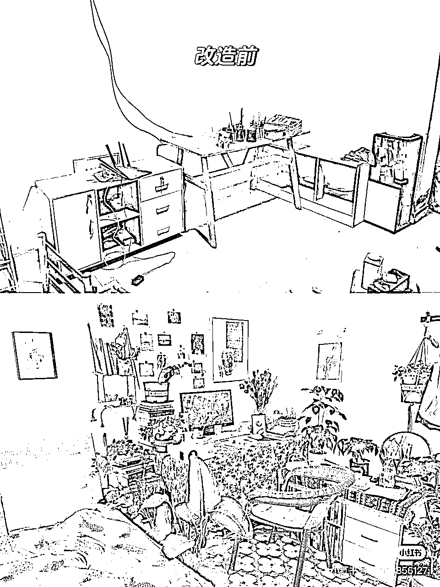
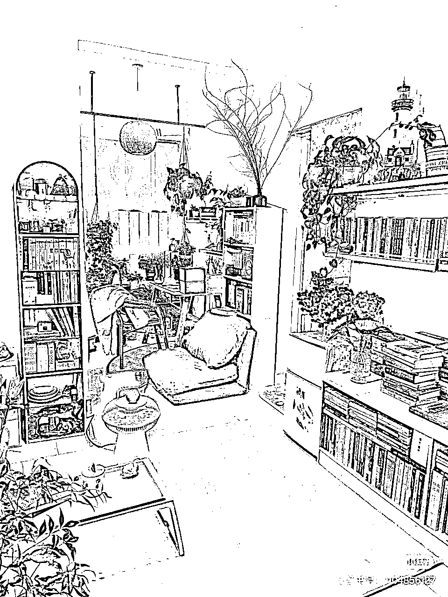

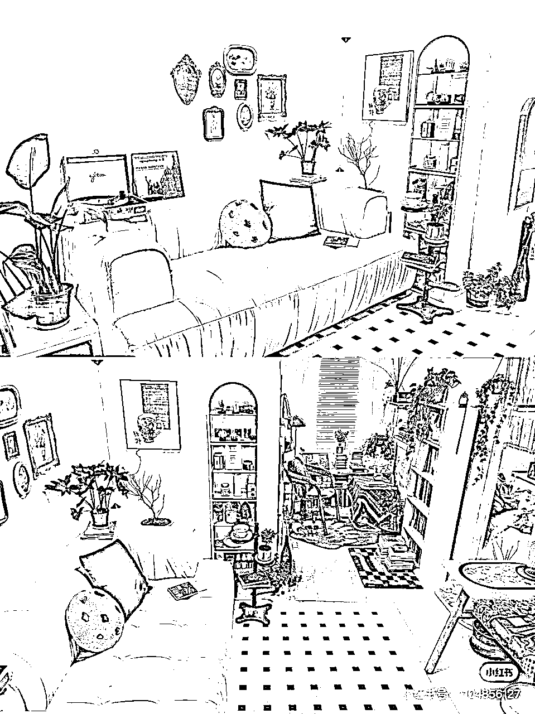
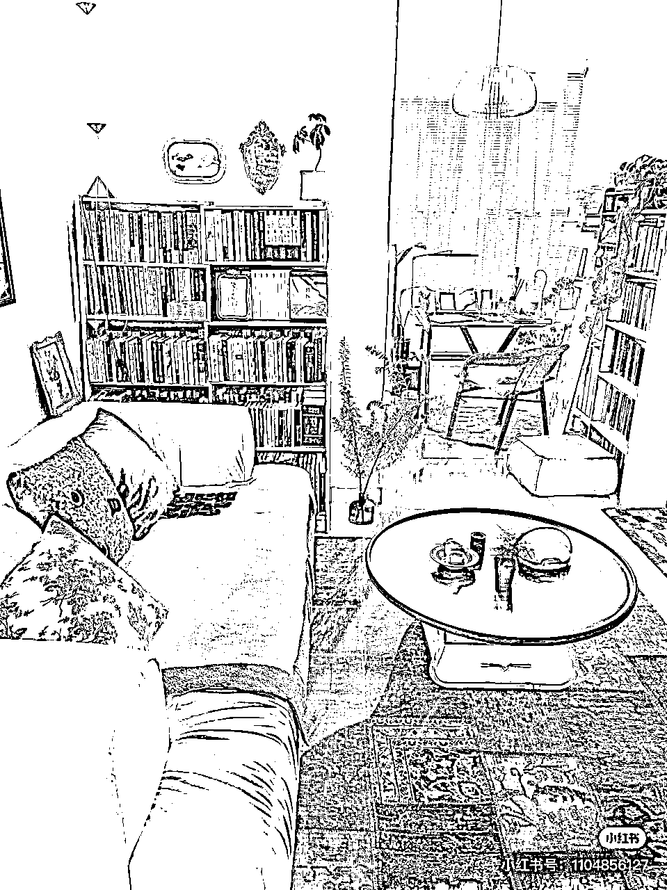

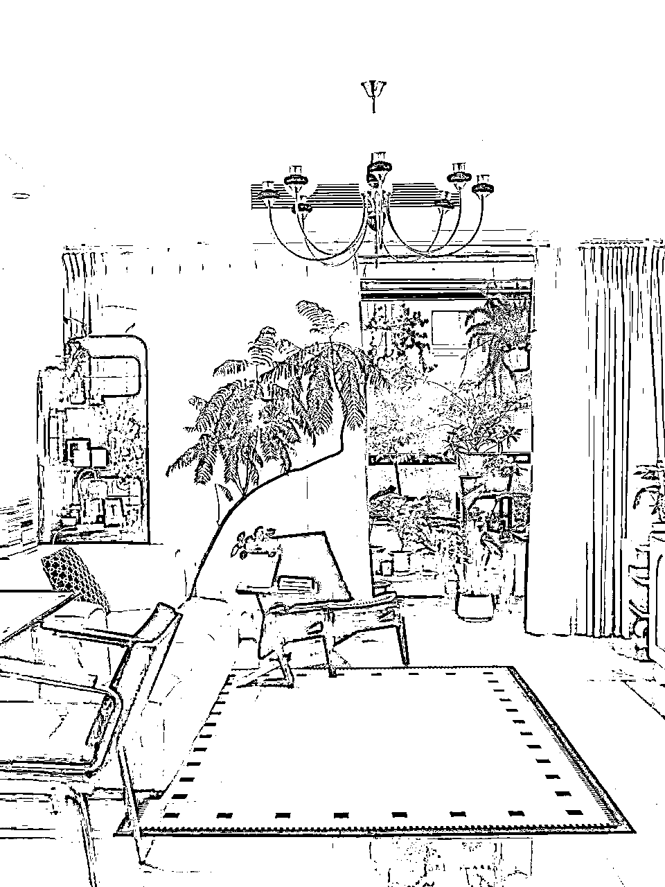

能拿到这个结果，我总结下来，其实靠的是这四件事。

一、看懂家居赛道的核心逻辑
家居赛道的底层逻辑很简单：软装分享、硬装干货、日常氛围感，抓住这三样，内容方向基本就清晰了。拍摄也很垂直，场景固定，来回拍的无非是家里的不同角落，真正要换的是文案和选题。对素人来说，这比穿搭、美妆那种需要频繁换景的赛道友好太多了。

我当时租下这间空房，是觉得既然租金花了，就不能浪费空间。于是一边布置一边接广，一边记录“从无到有”的变化。空房改造的前后差异，本身就是最好的看点。普通人只要有一个住所，完全能复制这套模式，关键在于你能不能给自家场景找到一个噱头。找到流量密码，变现就是水到渠成的事。

二、别被环境困住
新手最容易卡在环境上：房子不够好看、审美不够好、拍不出高级感、品牌看不上我……这些想法很容易在起号前就劝退自己。但你知道吗？你刷到的成熟账号，已经经过了很长时间的积累，才看起来那么完美。新手不需要一步到位，先学会“遮丑”。哪里拍不了，就不拍哪里；卧室能见人，就先不碰客厅。一点点扩展自己的拍摄范围，审美和布置能力也会跟着变强。

我也是从卧室开始拍的，直到后来想接沙发这种大件，才把镜头扩展到客厅。所以，不用想太远，当下能拍什么就拍什么，哪怕只是一张小书桌、一个小角落。环境是用来利用的，不是用来限制你的。

三、心态要稳
做自媒体的人，几乎都要被数据扒一层皮。发出去没人看，数据跌得离谱，心态崩是很正常的。但往往最后被淘汰的，不是能力不够的人，而是心态先垮的人。

我见过只发了一篇笔记就抱怨“怎么还不火”的，也见过做了整整一年依旧没起色，却始终不肯改变的。前者太着急，后者太淡定。数据有起伏是常态，你可以焦虑，但不能被焦虑绑架。连续三篇数据低迷，就该去找新选题、调整方向；但才发三篇就抱怨平台难做，那就还没搞懂这行的运转规律。做内容就是要沉下心，允许一切发生。

四、撑到第100篇
探索新领域就像种花，你得给它时间。小红书上流行过一句话：100篇内必出爆文。很多人却倒在第99篇上。坚持这件事，本身就能帮你淘汰掉一大半竞争对手。走慢一点没关系，往前走就比原地不动强。从小白到入门，从入门到专业，都是在持续行动中慢慢长出来的。

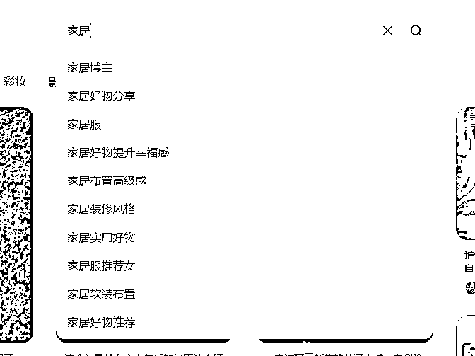

新手具体该怎么准备？我从六个步骤讲透。

第一步，吃透小红书家居赛道。选定平台和赛道之后，一定要先把别人怎么玩摸清楚。去搜不同的家居风格，了解它们的特点、配色、常见元素；再学学收纳、空间布局、软装搭配的基本原则。搜索框里的下拉词，其实都是现成的选题参考。按自己感兴趣的方向去搜，就能快速找到值得对标的账号。

第二步，学拍摄和剪辑。不用一上来就学太深的课程，先掌握构图、光线、色彩、加字幕这些基础操作。我自己常用的P图软件是黄油相机和醒图，前者上面的花字模板很全，后者我主要用来调色。小红书上这类教程很多，边搜边学边练就行。

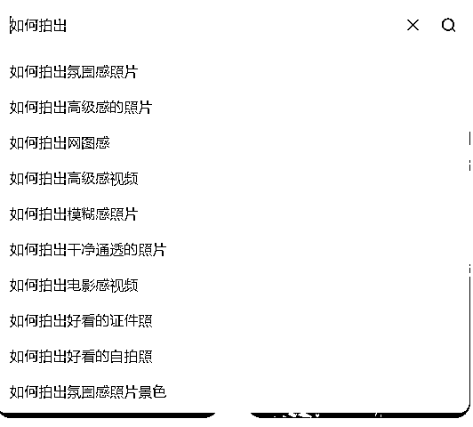

第三步，设备真不用焦虑。苹果X往上、或者三千元以上的安卓手机，像素都够用。会相机的人当然加分，但手机完全够撑起初期创作。我自己做博主的前三年一直用手机，去年才开始学相机。如果拍视频，可以配个三脚架，画面更稳，出片率更高。还有人问是不是一定要买电脑？其实不需要。小红书没有电脑客户端，日常发笔记、开直播，手机就能完成。只有电商账号要批量上架商品时，用电脑才更方便。

第四步，把账号基础打好。用手机号注册小红书，个人信息填完整，昵称最好简洁好记、带一点家居属性，头像要清晰有辨识度，可以用自己的氛围感照片或家居风格图片。简介不用太复杂，写清楚账号会分享什么内容就行。但有一个关键项：一定要留邮箱。商家只要看到你有数据，就可能来谈合作。我记得自己接的第一个合作是投影仪，当时才发了三篇笔记，稿费就有120元。

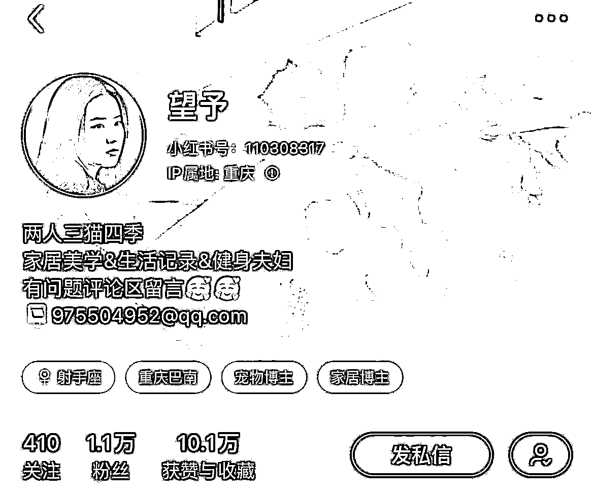

第五步，布置拍摄场景。不需要囤一堆道具，假绿植、装饰画、抱枕、地毯，就能搭出不同氛围。选一个合适的空间，客厅、卧室、书房都可以，保持整洁明亮，随时能开拍。我发第一篇笔记时，场景里没有多特别的布置，只用了盛夏的光和一阵风吹起的门帘，再配上一段舒缓的音乐，整个画面就很舒服。所以，学会放大现有场景里的亮点，氛围感比堆砌更重要。

第六步，确定自己的风格定位。不要脱离实际去硬凹人设，一定要结合你真实的生活状态，顺势而为。适合普通人的起号方向有很多：一间出租屋，可以先布置一个四平米的氛围角落，或者从卧室入手，一套好看的四件套加一件氛围感配饰就够了；老破小，自带改造话题，别等改造完才拍，而是从你决定做博主的那一刻就开始记录，哪怕前期很丑，账号也始终在动态更新里，等爆文出现时，前面的过程都会成为故事；农村自建房，天然有田园感，加上很多人对农村生活的向往，你只需要拍接地气的日常，就会有人想看；正在硬装的房子，适合用视频记录进度，方向可以是干货和避坑指南，最好把面积、花费、布局写清楚，随着装修进推进，合作会主动找上门，还能无缝衔接软装期；精装房虽然很美，但大部分成熟家居博主都长这样，不太适合新手直接模仿，除非你本身的硬装审美、软装搭配和拍摄能力都在线。不过话说回来，全屋展示的变现天花板最高，等走到成熟阶段，账号最终也大多会往这个方向收敛。

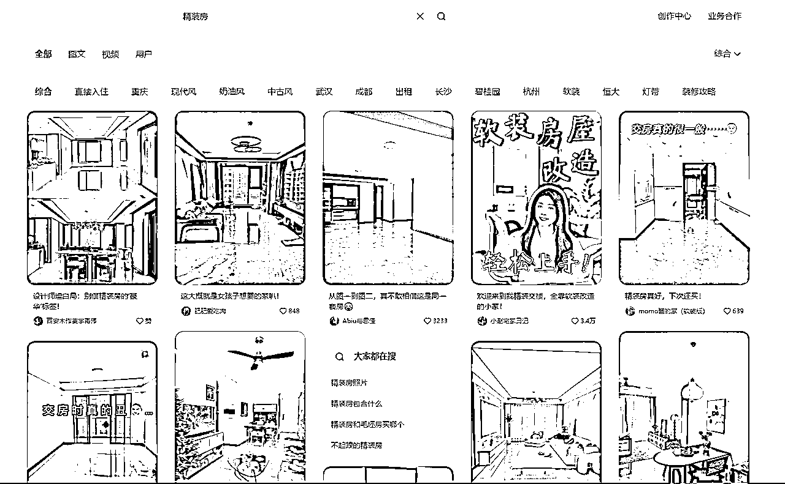

最后，分享几个我亲测好用的实操技巧。

关于光线，最舒服的黄金拍摄时段是上午10点前和下午4点后，尽量避开正午的强光。你可以看天气预报安排拍摄，反复摸索出自家采光最好的时间，然后一周集中拍完，省时也省力。我起号那会儿，为了等风把门帘吹起来，经常一等就是几个小时，因为那个画面可能只有几分钟，时机太重要了。阴天光线不足时，用透光纱帘加暖光台灯，色温调到20到30左右，能模拟出柔光效果。这是我常用来修图的醒图参数：光感+32，亮度+27，自然饱和度-10，阴影+10，色温+15，锐化+40。具体数值还是要按实际情况调，思路就是往明亮、柔和、清晰的方向走。不要完全依赖天气，后期修图能帮你稳住很多素材。

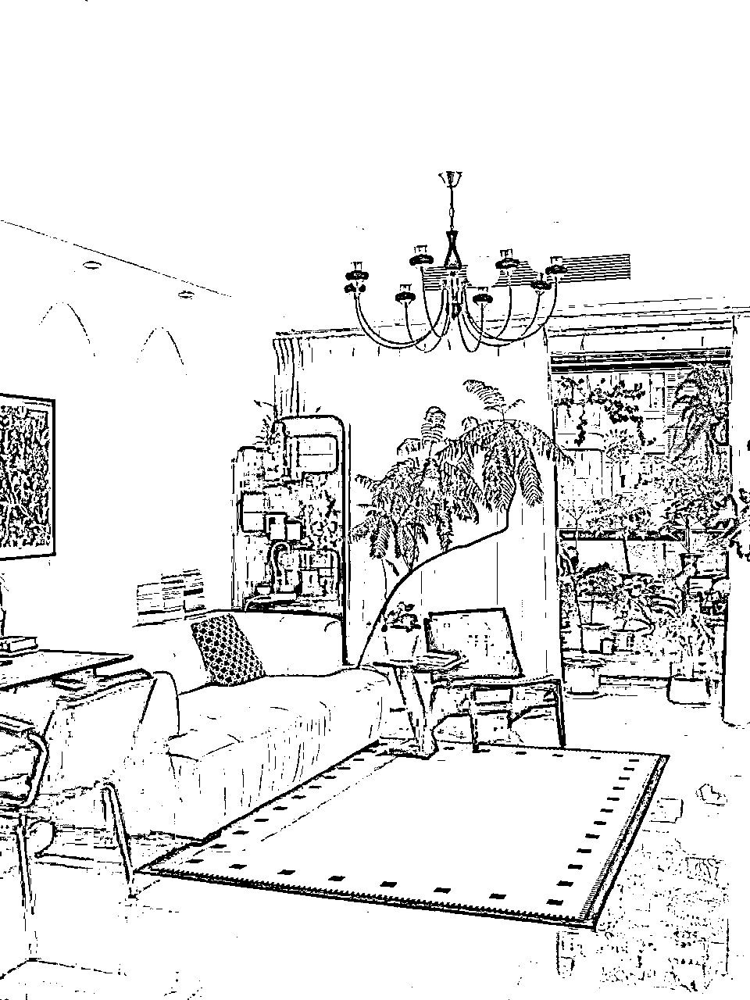

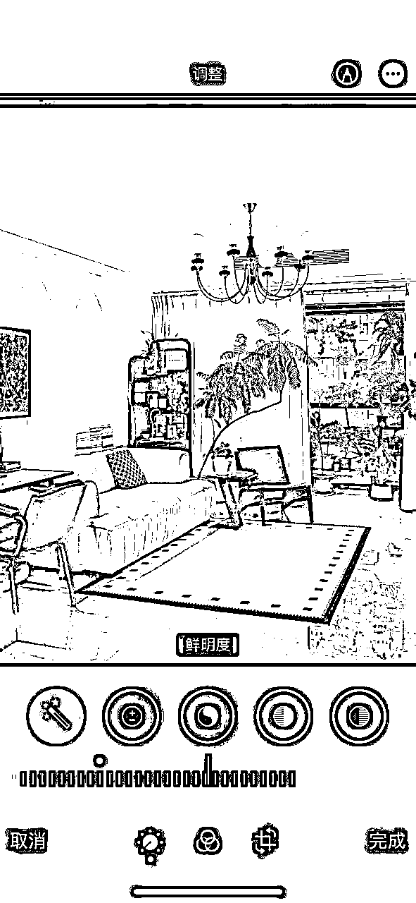
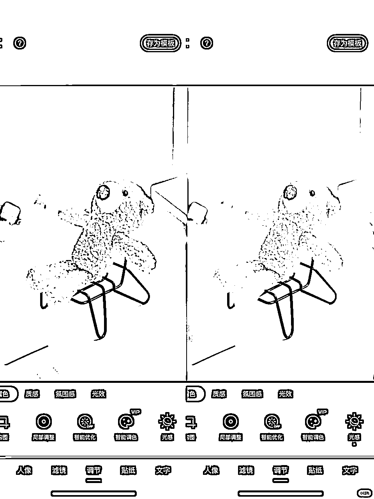

除了自然光，还可以用分层照明法：主光源、辅助光源、装饰光源层层叠加，傍晚开灯拍，空间会更有层次。拍摄时记得把不入镜的灯关掉，避免光线杂乱。关于灯光怎么打，小红书有很多案例可以参考，我也是在一次次开灯、关灯、加灯中慢慢摸索出感觉的。

低成本补光也很简单：用白墙或白纸板DIY反光板，就能解决侧光拍摄时的阴影问题；阴雨天用几十块钱的手机环形灯，再配合纸巾盒改装柔光罩，也能模拟自然光效果。

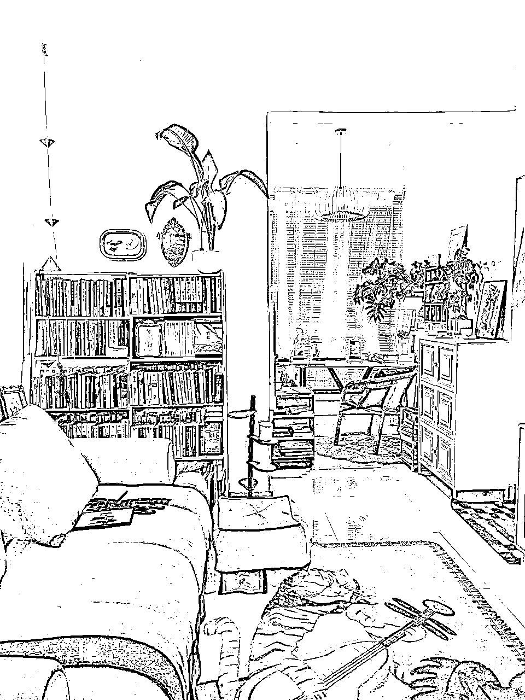
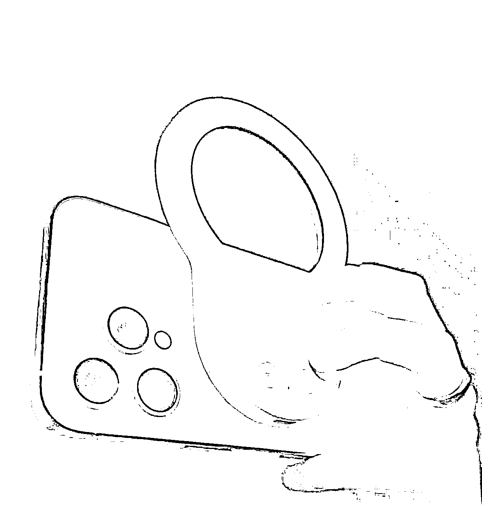

构图方面，打开手机相机的网格线，把主体放在左下或右下交叉点，画面就会比较平衡。拍餐桌、茶几这类场景，可以从一米左右高度俯拍，把桌面细节放大，效果很出片。窗帘的褶皱、地板的木纹，都可以拿来当视觉引导线；留白比例控制在三成以内，画面干净又不会显得空。这些基础构图技巧组合起来，就是一套很稳定的出片模板。

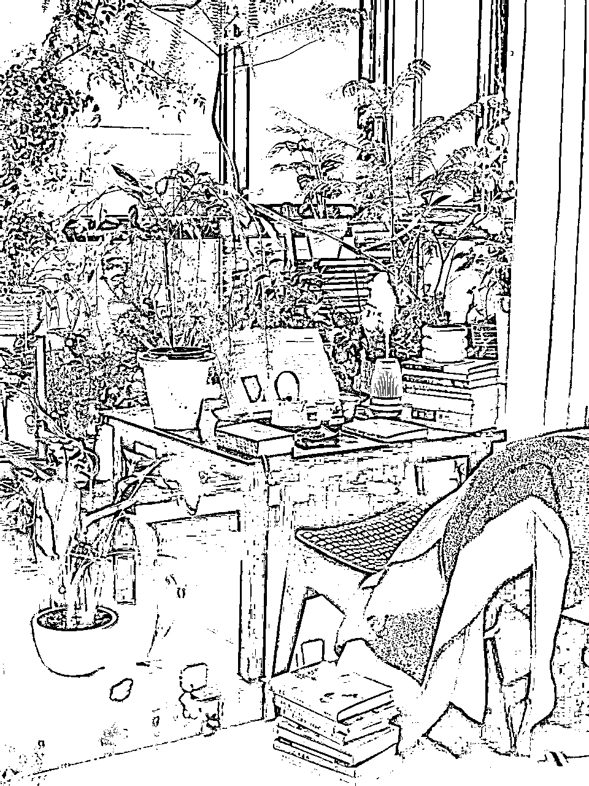
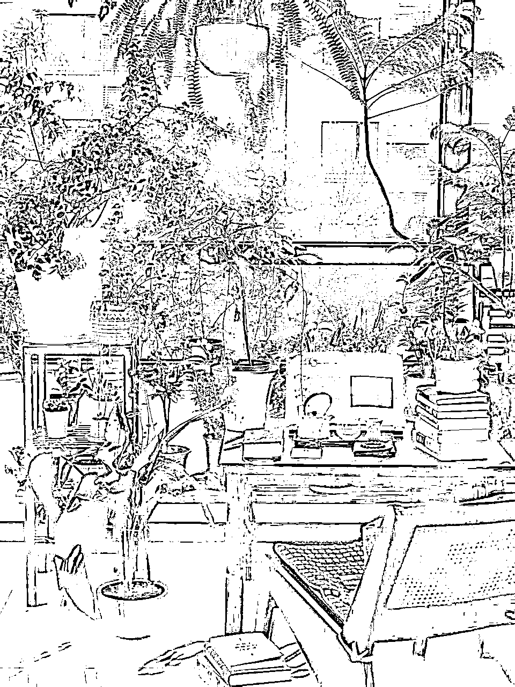

最后是道具和背景。家里保持整洁，色调统一，极简风格最容易出片。沙发毯、绿植、香薰这些小物件，能瞬间提升画面氛围感。没有自然光的时候，就用暖黄光摄影灯，一盏TIR透镜灯就能让出租屋角落变得很有温度。

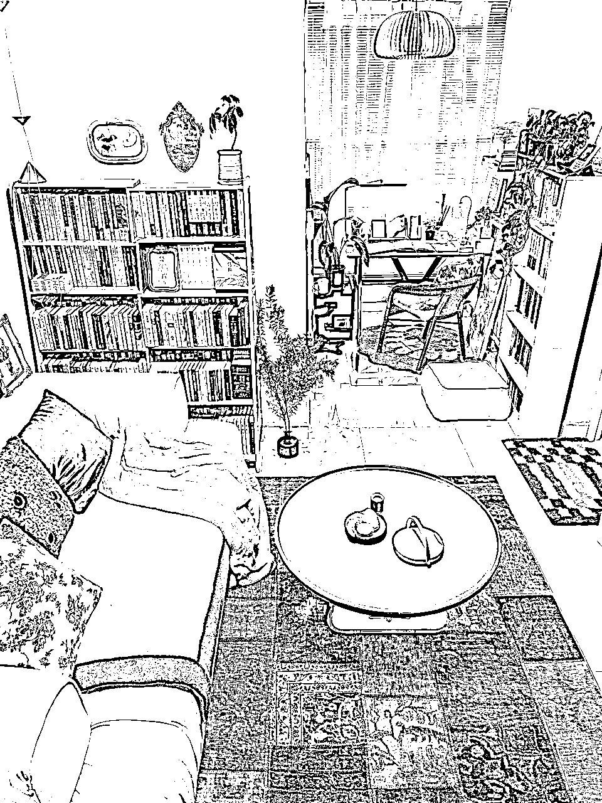

做家居博主这件事，真的不挑房子，也不挑人。500块的出租屋可以，你的卧室也可以。只要愿意从现在开始，一边行动一边调整，账号、流量和合作，都会慢慢长出来。

希望这篇攻略能帮你少走一些弯路，也祝你早日拥有属于自己的氛围感角落。

先把基础拍摄做好，画面质感会立刻提升。

灯光方面，可以用射灯和落地灯进行辅助补光，色温建议控制在27—35之间，让空间看起来更自然、更有氛围。使用手机拍摄时，打开“人像模式”虚化背景，能够进一步突出主体。

#### 3、拍摄角度与画面布局

细节画面可以尝试低机位拍摄，比如餐具、摆件等局部特写；表现完整空间时，可以使用14—24mm广角镜头，也可以将手机焦段拉近至1x—1.6x，增强画面的整体感。

构图上推荐使用三分法：前景放置绿植，中景呈现家具，背景交代墙面装饰。这样安排层次清晰，画面也不容易显得杂乱。

## 4、账号定位与竞品账号分析

#### 1、先确定账号方向

家居内容一定要有明确的细分领域，例如出租屋改造、空间收纳、软装搭配等。不要什么都拍、什么都讲，否则用户很难记住你的特点。

#### 2、关键词和标签参考

可以围绕这些方向进行组合：

「老破小改造」「极简租房布置」「中式老洋房」「农村自建房」

1.  基础类标签

*   #家居灵感# #软装搭配# #装修干货# #家居好物# #租房改造#

*   作用：进入平台基础流量池，绝大多数家居内容都可以使用。

1.  场景类标签

*   #小户型改造# #卧室布置# #厨房收纳# #阳台改造# #旧房翻新#

*   作用：精准对应用户正在面对的具体空间和需求。

1.  人群类标签

*   #租房党必看# #独居女生# #新手小白# #北漂生活# #租房改造#

*   作用：强化账号人设，让目标用户更容易产生代入感。

1.  趋势类标签

*   #断舍离# #侘寂风# #奶油风# #极简生活# #早春焕新#

*   作用：借助平台正在流行的生活方式和装修风格获得额外曝光。

1.  商业合作类标签

*   #宜家好物# #网易严选# #名创优品# #原创设计# #家居带货#

*   作用：让品牌方更直观看到你的内容方向，增加合作机会。

#### 3、如何寻找适合参考的账号

粉丝规模方面，建议优先研究1万—5万粉、且近期仍在持续涨粉的账号。

内容层面，重点拆解它们的爆款类型，比如好物分享占比多少、改造记录占比多少；商业层面，则要观察广告是通过图文挂商品，还是通过视频口播植入，同时记录它们合作过的品牌类型。

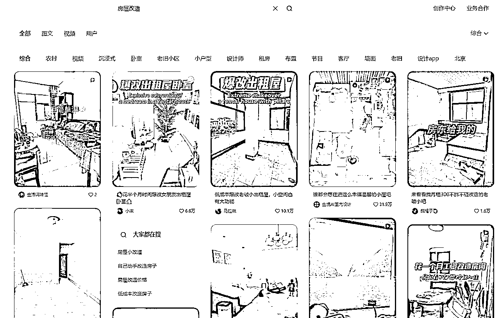

除了常见的改造和好物内容，也可以从技巧分享、独居安全等相对小众的方向切入，寻找差异化突破口。

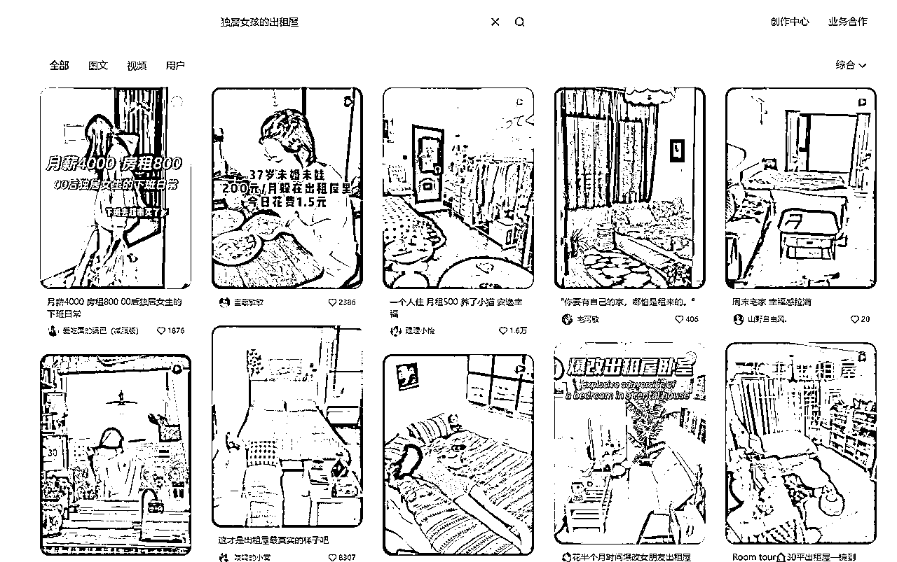

还可以把内容做成连续栏目，例如“一周改造一个角落”，通过持续更新培养用户的追更习惯。

## 6、标题写法参考

可以尝试以下几种标题结构：

「普通人做家居博主X天，真实赚了多少钱」

「被问到爆的XX同款，尺寸和价格一次整理」

「直接抄作业，跟着博主用XX元改造出租屋」

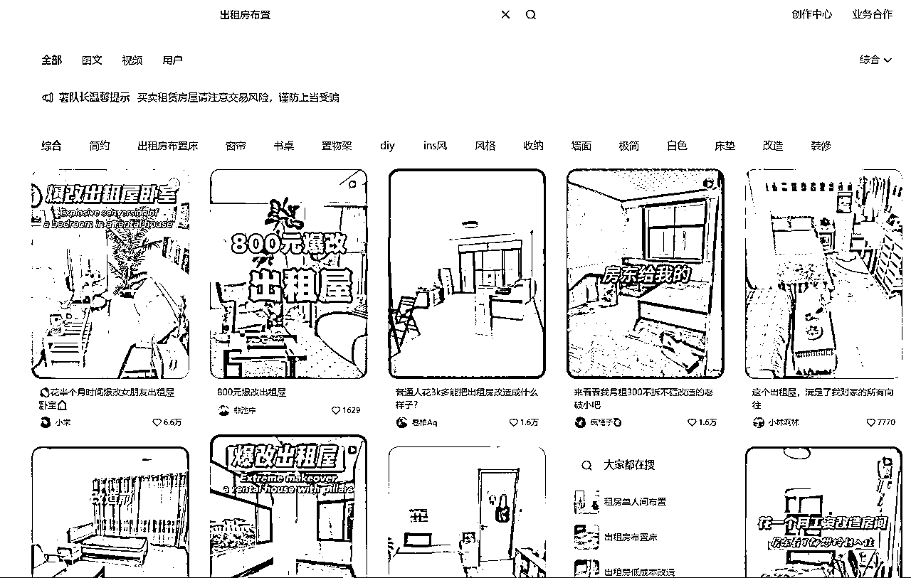

标题不一定每次都要重新发明。账号初期，一个简单有效的做法，就是参考已经验证过的爆款标题，再根据自己的内容做轻微调整，甚至保持原结构不变。当然，前提是你的内容必须和标题高度匹配。很多爆文的模仿案例，标题套路往往一眼就能看出相似之处。

## 7、拍摄计划与素材整理

#### 1、提前规划拍摄

建议每周集中拍摄两次，每次用时约2—3小时，争取一次性拍出15—20条可备用素材。

同一个场景不要只拍一个角度，可以同时准备远景、中景和近景。例如拍书桌时，先记录整体布置，再拍文具细节，最后补充灯光开启后的效果。

#### 2、素材格式建议

视频可以同时保留横屏16:9素材和竖屏3:4封面素材，尽量保存原始构图，方便后续二次裁剪。

相比单独写长文案，视频拍摄对新手更友好，可以用画面承担一部分表达压力。前期建议多尝试不同机位和角度，再通过封面数据判断哪种画面更受欢迎。

拍摄时优先选择有阳光、或有微风的时段，光影和空气流动会让内容更具生活感与氛围感。

## 8、后期处理方法

基础修图可以使用“醒图”，参考参数为：亮度增加10、对比度增加5、饱和度降低3，再叠加轻微的“胶片”效果。

文字部分可以使用楷体，搭配浅灰色边框；重要信息则用橙色突出，帮助用户快速抓住重点。

视频剪辑中，可以加入简单的转场音效，例如配合向左移动镜头加入“唰”的声音。

展示产品时，每隔一段时间加入局部放大或画中画效果，例如将重点区域放大到120%，增强观看节奏。

当然，后期参数并不是固定答案，最终还是要根据原始画面的质量来调整。如果拍摄本身足够稳定、光线和构图都到位，甚至可以直接一镜到底，只补充音乐和滤镜即可。

# 五、关于高变现的一些经验

很多人看到我工作室出租屋的改造前后对比，可能会认为：正是因为房间变得漂亮，才有了后来的品牌合作和商业收入。

但实际情况恰恰相反。

客厅里的沙发、柜子、书架，甚至脚边那块地毯，几乎都是通过品牌合作获得的，并不是我先花钱把房子布置好，再开始运营家居账号。

我做家居号的初衷，本来就是为了争取家居产品合作。一个连家具都舍不得主动购买的人，很难一开始就投入大量资金去完成整屋改造。

那为什么我能在较短时间内把空间逐步搭建起来？

核心方法，来自我之前运营读书号时积累的经验：不要被动等待资源，而要主动把自己推销出去，拿着现有优势去争取合作。

当然，家居也是近两年才快速崛起的赛道，品牌对内容创作者的需求本身就很旺盛。上万元的冰箱、几千元的床垫、沙发和柜子，都有机会通过合作获得，而且稿费并不会因此取消。

我在粉丝还不到100时就开始接广告，当时一篇内容的稿费是150元。后来账号接近1万粉，我越来越确定，家居赛道并不是单纯看粉丝数量，更看内容数据。

目前我的读书号有8.2万粉，单篇合作报价约5500元；而家居号虽然刚过1万粉，合作报价也已经达到2000元以上。粉丝量差距明显，但家居账号的商业成长空间非常可观。

意识到家居内容的变现潜力后，我又把拍摄区域从工作室扩展到了客厅。拍摄空间变大，能够承接的品牌类型也随之增加。

更重要的是，只要第一次合作的数据表现不错，品牌方往往愿意继续投放。合作次数多了，就可能发展成长期关系，品牌推出新品时，也会优先安排合作。

此外，家居产品本身价格较高，合作结束后还可以通过闲鱼进行二次转卖，这也能带来一部分额外收益。

虽然我做博主已经接近4年，但真正实现较大规模变现，其实是在最近两年。因为我开始用商业化的思维运营账号，懂得如何提升内容价值，也更明白应该怎样主动营销自己，把副业当成一项认真经营的工作。

（以上为开始做博主后每一年的收入明细）

收入逐年增加之后，我终于想明白了一件事：

不是账号做起来以后，才开始考虑怎么赚钱；而是在决定做账号之前，就应该先想清楚未来准备如何利用它实现收益。

# 六、我为什么开始做小红书，也许能给你一点参考

前面提到过，我最初接触自媒体，是因为无法接受女性在家庭与事业之间不断被迫取舍的状态。正是那种难以忍受的困境，推动我开始尝试改变。

从过去读不完的书，到后来接触大量家具家电合作，做博主让我积累了上千次广告和带货经验。

在运营账号的同时，我还和朋友一起做过电商项目，管理过十几人的小团队，也运营过几十个矩阵账号。支撑我迈出这些步子的，正是做自媒体过程中不断获得的实践经验。

后来，我逐渐学会让一个人承担一支团队的功能：同时经营三个赛道，把原本擅长的自媒体运营能力发挥到极致，再结合个人兴趣，分别在不同方向上持续拿到结果。

现在回头看，我不一定是单纯赶上了自媒体红利，更重要的是，想到就去做、遇到机会就快速行动的习惯，让我一步步走到了今天。

所以，如果你也有长期坚持的爱好，或者曾经被别人认可过的能力，不妨认真把它利用起来。只要开始行动，往往会收获原本没有预料到的结果。

# 七、为什么我选择读书和家居两个方向？

简单来说，这两个赛道都非常适合普通人入场。

家居账号的启动门槛，甚至比读书账号还低。很多人以为，做家居博主必须拥有宽敞漂亮的大房子，实际上并非如此。

房子可以是买来的，也可以是租来的；空间可以是精装，也可以不够美观。只要你有一个可以生活的地方，就能围绕它做内容。

老破小、农村自建房，甚至尚未完工的毛坯房，都可以成为账号特色，也都有机会通过内容获得品牌合作。

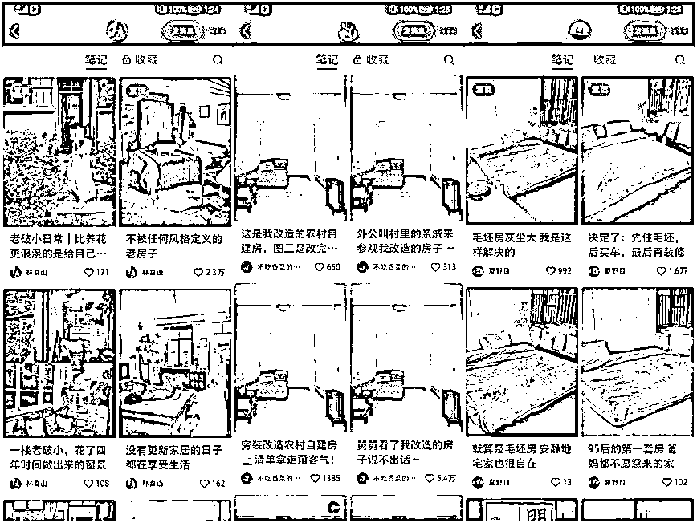

家居内容最重要的不是“标准答案”，而是辨识度。比起满平台重复出现的奶油风和精装风，有明显反差的房子反而更容易引起关注。

只要内容数据表现好，就不用担心没有品牌主动联系。家居是近两年快速成长的商业赛道，而且在不少合作中，品牌更看重内容效果，而不是单纯的粉丝数量。

比如你正在装修，恰好有地板品牌找你合作，这类产品可以自然地融入真实装修过程，不需要生硬地插入广告。

品牌方希望获得的是自然、持续、可信的曝光；创作者则可以节省地板和施工成本，同时获得合作费用。双方通过真实场景完成长期、无痕的内容植入，正是家居赛道的核心商业模式。

另外，家居内容通常以图片为主，配合简洁文字就能完成一篇笔记，制作成本和时间投入都相对可控。因此，很多家居博主并不是全职创作，而是利用业余时间更新，几张照片也可以构成一篇完整内容。

# 八、一些想认真告诉你的话

从月收入5000元的职场女性，到收入相对稳定、保底达到3万元的全职博主，我的变化并不是个例，也像是许多自媒体创作者共同经历的成长。

我们都是普通人，只是因为抓住了自媒体这个机会，人生开始出现新的可能。

前几天，一位学员对我说：

“先让自己保持优秀，优秀慢慢就会变成习惯。我一直不愿意把自己限定为乡村里的普通家庭主妇。女性不应该被环境和年龄框住。自媒体让我学会表达自己、展示自己，也学会销售自己的能力。我还是原来的我，只是比以前更有自信了。”

这段话让我非常有共鸣。

自媒体带来的不只是收入变化，也不只是生活条件改善。它让我重新意识到，一个人的可能性远比想象中更大。很多时候，我们只是被固定工作束缚住了，日复一日接收与本职相关的信息，却没有时间探索外面的世界。

白天用8小时维持生活，剩下的时间用来拓展人生。认真利用下班后的时间，自媒体也许会成为你没有预料到的另一条路。

共勉。