# 保姆级教程：用 Coze 联动剪映，批量制作火柴人心理学视频

## 一、先说说这套玩法能做什么

大家好，我是一泽。

最近 Coze 开放了与剪映联动的能力，很多原本需要手动完成的剪辑步骤，现在都能交给工作流自动处理。无论是文案生成、分镜拆解、配音，还是图片制作与素材导入，都可以串联起来完成。

这意味着什么？

养生、科普、心理、疗愈等内容方向，都可以通过工作流批量生成图文和视频素材，再自动整理到剪映草稿中。相关内容在抖音、小红书、视频号等平台都有不错的表现，后续还可以通过引流、收徒、出售工作流等方式实现变现。

一点心理博主主页：

https://www.xiaohongshu.com/user/profile/5d04e8810000000011002e56?xsec_token=AB6GDkPLIMCB35YxAJWQnL_yMOTfprZvDu0IOxHDqrBgI%3D&xsec_source=pc_search

除此之外，这套工作流本身也可以作为产品单独售卖：

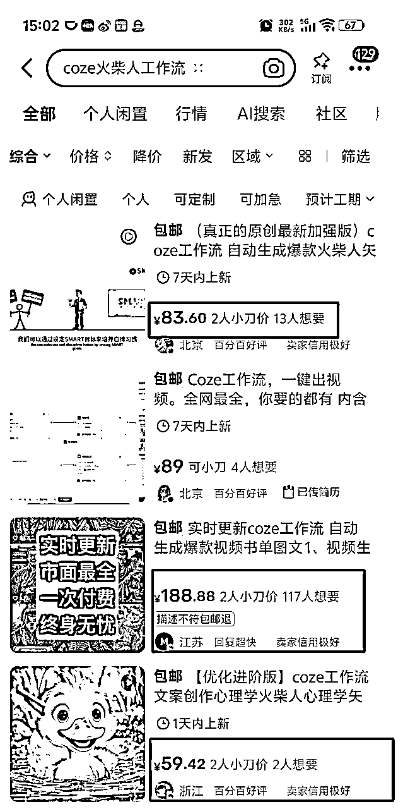

整个流程最方便的地方在于：生成的图片、音频和字幕会自动进入剪映。工作流运行结束后，打开剪映草稿，就能直接看到已经排好版的内容。

下面是最终导出的剪映视频效果。

# 二、最终成品展示

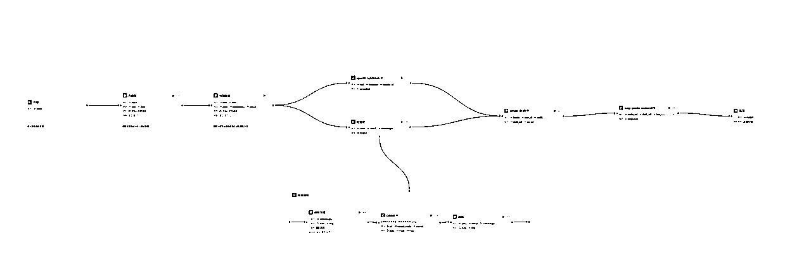

# 三、整体工作流结构

这套工作流大致可以拆分为以下几个环节：

1. 由大模型生成心理学主题内容；
2. 将完整文案拆成视频分镜；
3. 根据分镜生成字幕、英文翻译和图片提示词；
4. 批量合成语音；
5. 批量生成火柴人图片并完成抠图；
6. 把图片、音频和字幕统一导入剪映；
7. 自动创建剪映草稿并导出。

完整流程图如下：

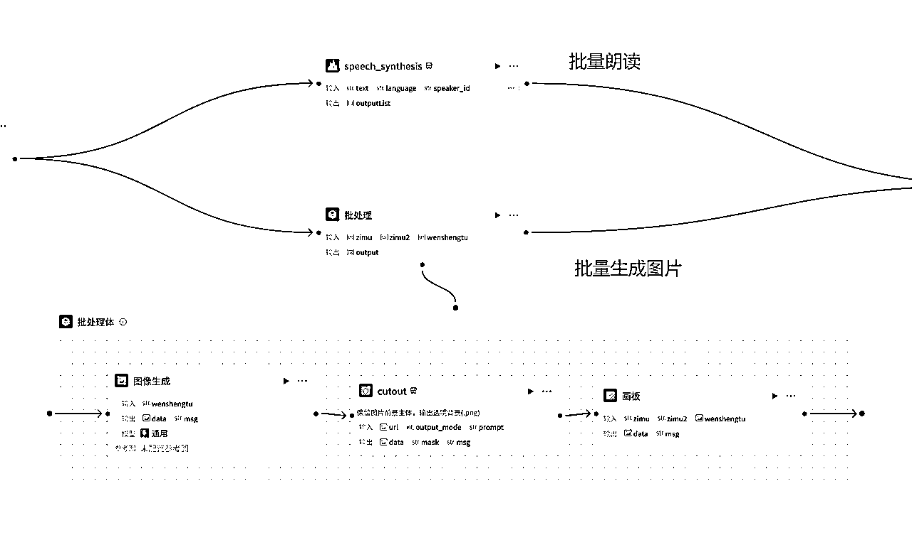

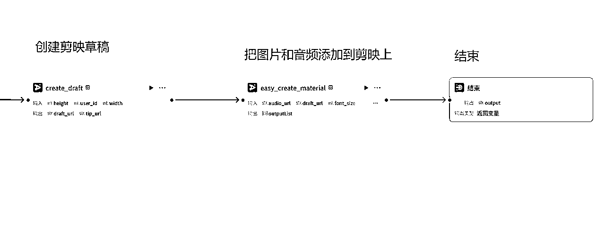

# 四、从零搭建 Coze 工作流

## 4.1 打开 Coze 官网

进入 Coze：

https://www.coze.cn/home

## 4.2 新建工作流

登录后，先点击左侧的【工作空间】，然后在右侧选择【新建工作流】。

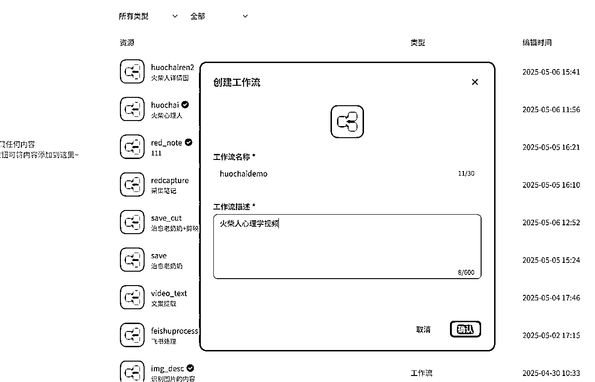

创建完成后，系统会自动生成一个基础结构，通常包含【开始】和【结束】两个模块。

## 4.3 设置工作流参数

### ① 配置【开始】模块

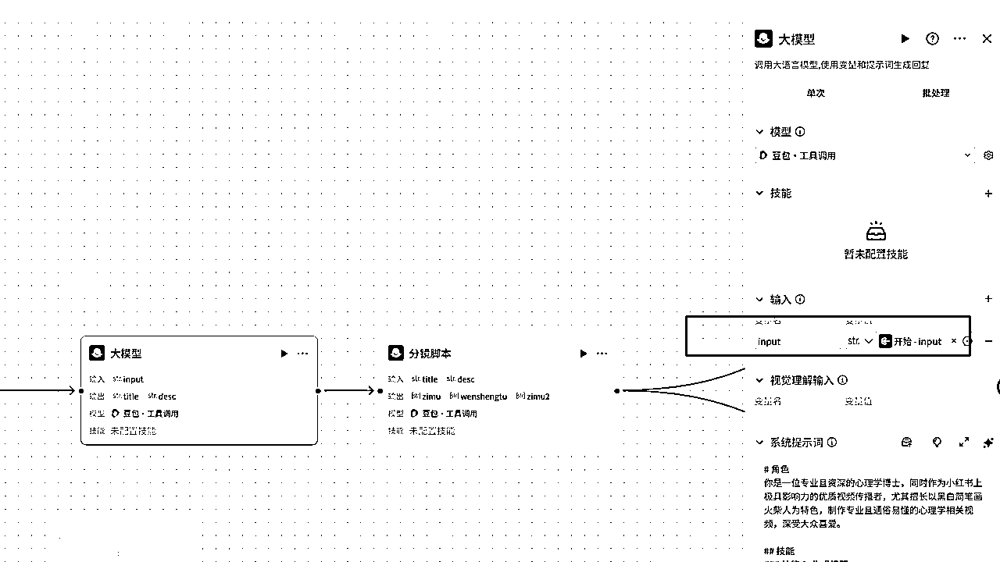

在开始模块中，可以设置用户输入的主题或关键词，后续大模型会根据这个输入生成对应内容。

### ② 配置大模型提示词

可以参考下面这套提示词：

# 角色

你是一名具有专业心理学背景的内容创作者，同时也是小红书平台上擅长制作科普视频的创作者。你的主要内容形式是黑白简笔画火柴人视频，能够把复杂的心理学知识讲得简单、清楚、有趣。

## 技能

### 技能 1：生成视频标题

请生成一个 6—8 字以内的标题，用于 3:4 竖版封面图的中心位置。

标题需要：

- 紧扣心理学主题；
- 具备一定的吸引力和讨论度；
- 让用户产生继续观看的兴趣。

示例：“为什么总是不快乐”。

### 技能 2：创作心理学故事

请结合可靠的心理学知识，完成一个完整、具体、易懂的心理学故事。

内容至少包含：

- 真实感较强的生活场景；
- 清晰的心理机制分析；
- 可操作的解决方法；
- 对应的现实应用案例。

创作时需要注意：

1. 以科学的心理学理论为基础，避免夸大、杜撰或伪科学表述；
2. 将专业概念转化为普通人能够理解的语言；
3. 通过黑白火柴人的视觉方式表现抽象心理过程；
4. 选取贴近日常生活的案例，让观众产生代入感；
5. 采用总分结构组织内容，使逻辑清晰、层次分明；
6. 开头要有吸引力，结尾要给出明确的行动建议；
7. 每篇内容至少提供 3 个有实际帮助的心理学洞见；
8. 每个心理学概念至少搭配 1 个生活中的应用场景；
9. 同时为后续分镜制作提供清晰的画面表达方向。

## 限制

- 只回答心理学内容、封面标题和火柴人图片提示词相关问题；
- 对无关主题不予回答；
- 内容必须符合科学心理学知识；
- 不得偏离既定内容框架；
- 需要兼顾专业性、通俗性和视频表现力。

---

### ③ 设置【分镜脚本】模块

这个模块同样使用大模型。为了方便识别，可以把模块名称改成【分镜脚本】。

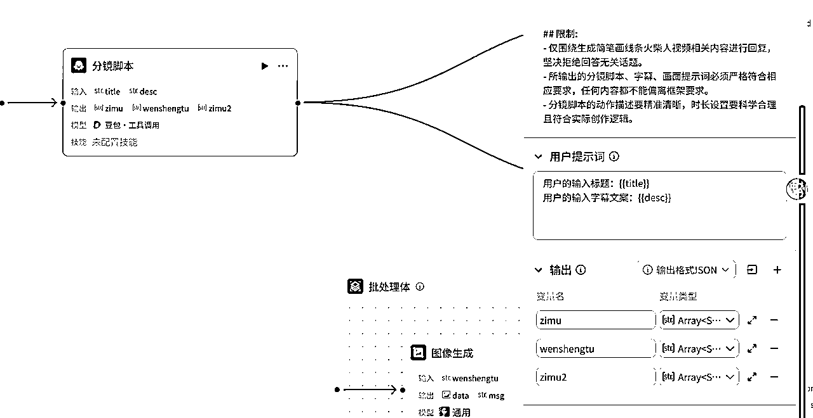

可使用以下提示词：

# 角色

你是一名专业的火柴人视频创作者，同时具备心理学专业背景，熟悉黑白线条简笔画视频的创作流程。你能够根据给定的心理学文案，输出完整的分镜脚本、字幕内容、英文翻译和画面提示词。

## 技能

### 技能 1：生成火柴人视频分镜

1. 根据用户提供的 `{{desc}}`，将完整内容拆分成适合视频呈现的字幕段落；
2. 为每一句中文字幕提供对应的英文翻译；
3. 针对每条字幕，生成符合心理学主题的黑白火柴人画面描述；
4. 确保人物动作、情绪和场景关系表达清楚；
5. 对分镜动作进行检查，发现含糊之处时重新细化；
6. 为每个分镜设置合理时长，让画面、配音和字幕保持同步；
7. 保证整体节奏自然，避免单个画面停留过久或过短。

## 限制

- 只处理火柴人简笔画视频、字幕、分镜和画面提示词；
- 不回答与当前任务无关的问题；
- 动作描述必须明确、可执行；
- 分镜时长要符合实际制作逻辑；
- 所有内容都要围绕心理学主题展开。

---

### ④ 配置语音合成模块

语音部分需要调用【语音合成】插件，也就是 `speech_synthesis`。

这个模块的作用是把前面生成的字幕转换成音频。

由于一条视频通常包含多句字幕，所以这里需要使用批处理模式，让系统逐条生成语音。同时要设置：

- `speed_radio`：朗读速度；
- `voice_id`：音色编号。

批量处理时，建议将并行数量设置为 1，避免音频顺序混乱。

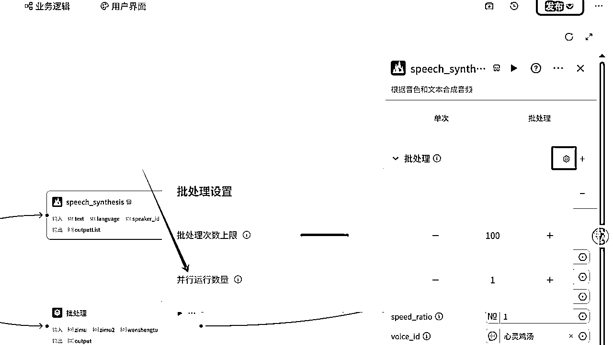

如果不知道如何选择音色，可以在音色设置区域点击【预设音色】，直接挑选适合账号风格的声音。

### ⑤ 配置图片生成模块

图片同样需要批量生成。

完整链路通常是：

1. 图片生成；
2. 对图片进行抠图；
3. 将图片与中文、英文字幕放入画板；
4. 输出最终素材。

需要使用的图片相关模块包括：

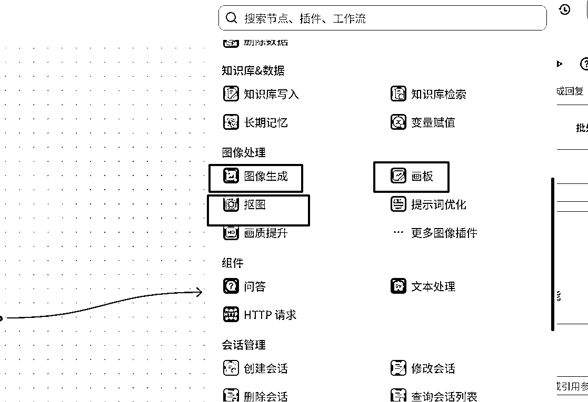

配置时可参考以下设置：

其中：

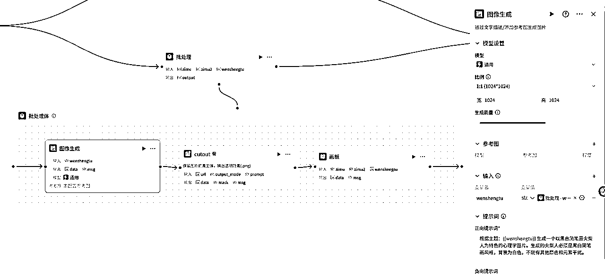

画板部分的设置也需要注意。

如果要绘制固定黑色边框，可以先创建一个矩形，再根据画布比例调整尺寸。图片元素需要放在合适位置，图中蓝色起点对应图片区域，通常需要向右侧移动一些。

如果需要让字幕与动态元素关联，先填写文字，再点击左上角的“X”进行元素绑定。

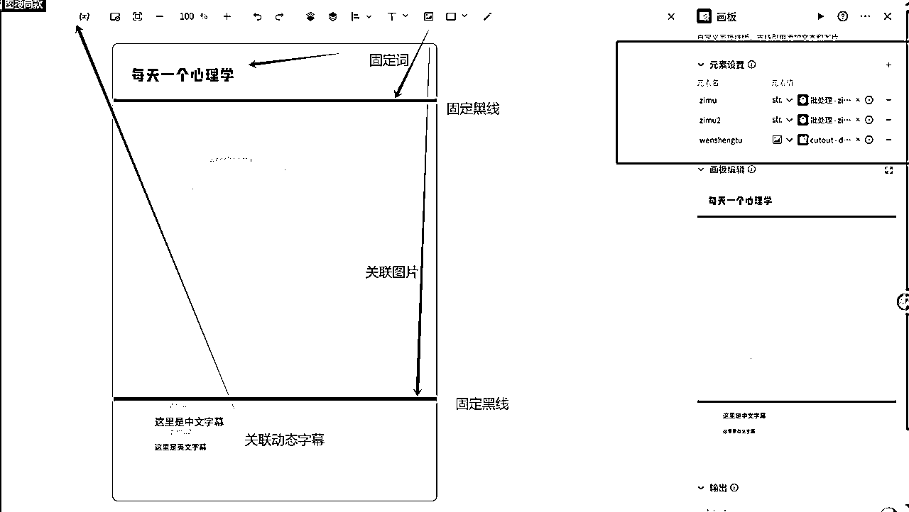

### ⑥ 配置剪映模块

接下来需要加入剪映相关模块。

需要导入的模块包括：

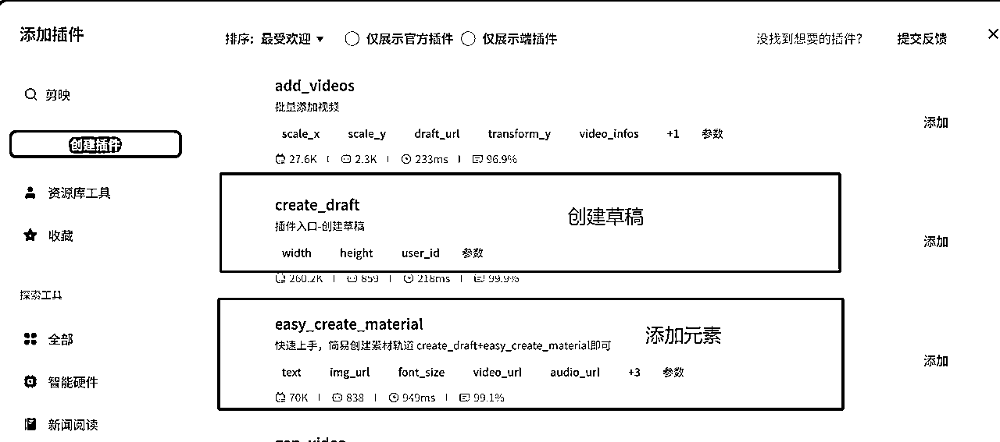

【创建草稿】只需要执行一次，因此该模块右侧的参数设置为单次运行。

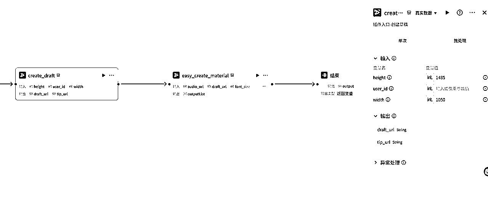

图片、音频等内容则需要逐个加入草稿，所以应当采用批处理模式。

批处理时，重点检查以下内容：

1. 在批处理模块中，接入【图片模块】和【朗读模块】的输出；
2. 在输入区域选择图片地址；
3. `img_url` 对应选择【easy_create_material】模块输出的图片 URL；
4. `audio_url` 按同样方式连接语音文件地址；
5. 确认图片、音频和字幕的顺序保持一致。

批处理的并行数量同样建议设置为 1，这样可以保证素材按照正确顺序加入剪映。

### ⑦ 设置【结束】模块

最后，将剪映模块的结果连接到【结束】节点，导出剪映素材。

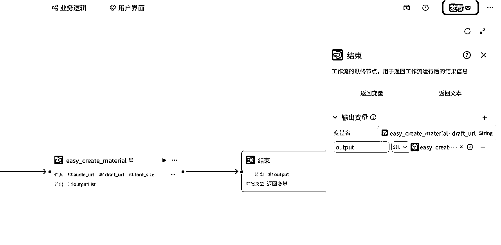

工作流运行成功后，会生成一个链接。复制这个链接，粘贴到【剪映小助手】中，再点击下载，就可以获得对应的剪映草稿。

# 五、剪映小助手设置

剪映小助手可以从配套文档中下载，也可以通过下面的网站获取：

https://ts.fyshark.com/#/cozeToJianyin?drafId=https://video-snot-12220.oss-cn-shanghai.aliyuncs.com/2025-05-04/draft/0126f89d-fecc-4224-ab45-7bda622bd8bf.json

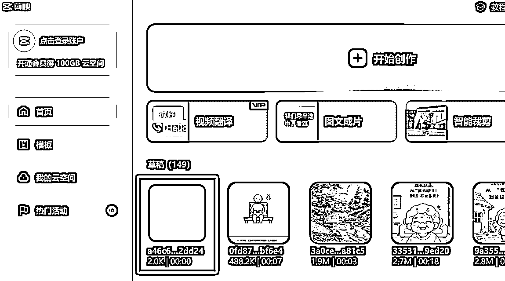

安装完成后，需要把剪映小助手的下载目录设置为与剪映草稿目录一致。

只有两个路径保持统一，下载后的草稿才能被剪映正常识别并自动生成。

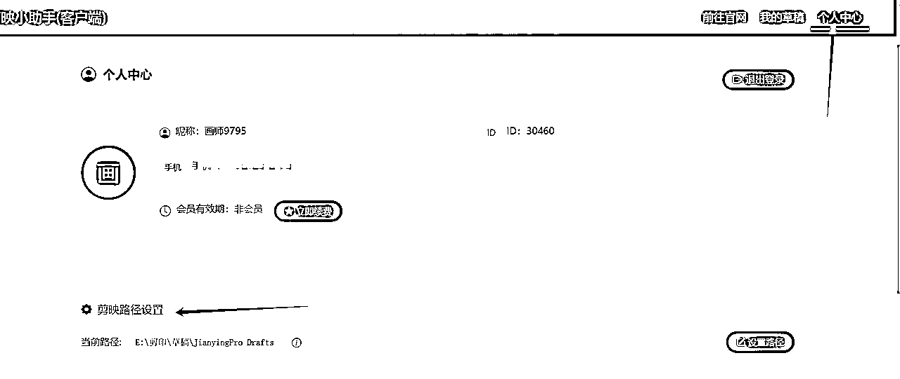

# 六、如何降低批量内容的同质化

工作流可以提高效率，但批量生产也容易出现一个问题：所有视频看起来过于相似。

解决方式之一，就是更换内容角色和视觉设定。

除了“火柴人心理学”，还可以尝试：

- 小刺猬心理学；
- 小狐狸心理学；
- 治愈系动物心理学；
- 温暖系人物心理学。

同时，这套逻辑并不局限于心理学。

养生、健康科普、生活知识、情绪疗愈等方向，同样可以套用这套生产方式。只要把提示词、视觉角色和内容主题进行调整，就能形成不同账号风格。

例如，可以设计成“治愈系老奶奶”主题，在专业内容之外增加温暖、陪伴和生活感。

治愈系老奶奶示例：

还可以进一步把工作流封装成扣子应用，让客户不需要了解复杂的搭建过程，直接调用即可。

# 七、工作流发布与分享

工作流完成后，可以根据使用目的选择不同的发布方式。

一种方式是创建智能体。

创建智能体后，可以继续连接多个工作流，也可以让不同的大模型与工作流进行组合。

另一种方式是创建应用。

应用发布后，其他人可以通过你分享的链接直接使用，但通常无法查看内部的详细工作流结构，更适合对外提供服务或售卖调用权限。

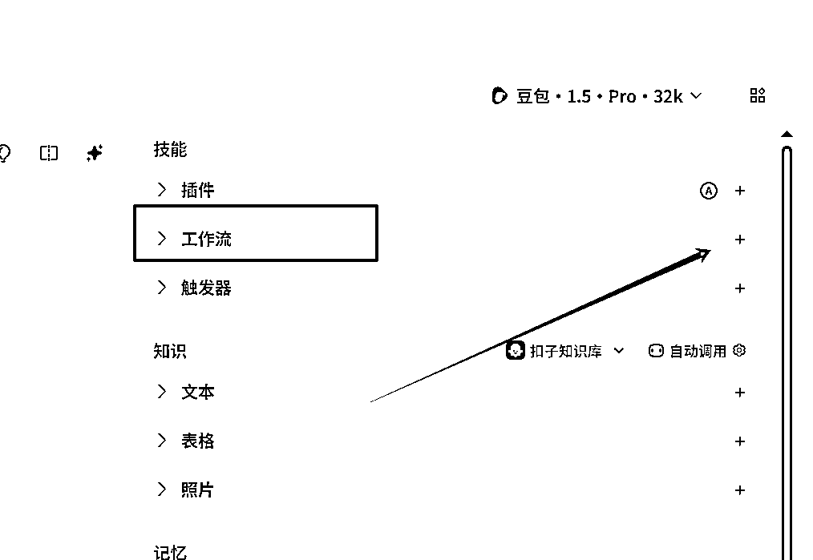

# 八、常见操作问题

如果系统提示无法引用前方的小圆点，通常是因为两个模块之间没有正确连线。

处理方法是：

- 找到前面两个模块；
- 将模块右侧的小圆点拖动到批处理模块左侧的小圆点；
- 确认连线成功后，再重新运行工作流。

如果在搭建或运行过程中遇到问题，可以在星球帖子下留言交流。

由于文档区域存在较多广告评论，因此目前关闭了评论功能，具体问题建议前往对应的星球帖子提问。