# 把 Coze 和剪映连通后，批量做竖屏动画能有多省事？这份搭建手册请收好

> 来源：[https://ngppuxr565.feishu.cn/docx/ZtqOdoOuhogJjXxcuHAcZlGVnUb](https://ngppuxr565.feishu.cn/docx/ZtqOdoOuhogJjXxcuHAcZlGVnUb)

做短视频最熬人的环节就是剪片。最近 Coze 开放了跟剪映的联动能力，两个工具之间的搬运工作可以全部交给系统跑，省出来的时间够我多规划好几个选题。

抖音、小红书、视频号上常见的健康养生、知识科普、心理疏导、情绪疗愈等内容方向，都能靠这条链路同时铺开，图片和视频一起产。跑出来的数据反馈普遍不错，点赞和收藏都很稳。变现也不难：私域导流、带学员、整包出售模板都可以。

参考账号的链接放在这里：
https://www.xiaohongshu.com/user/profile/5d04e8810000000011002e56?xsec_token=AB6GDkPLIMCB35YxAJWQnL_yMOTfprZvDu0IOxHDqrBgI%3D&xsec_source=pc_search

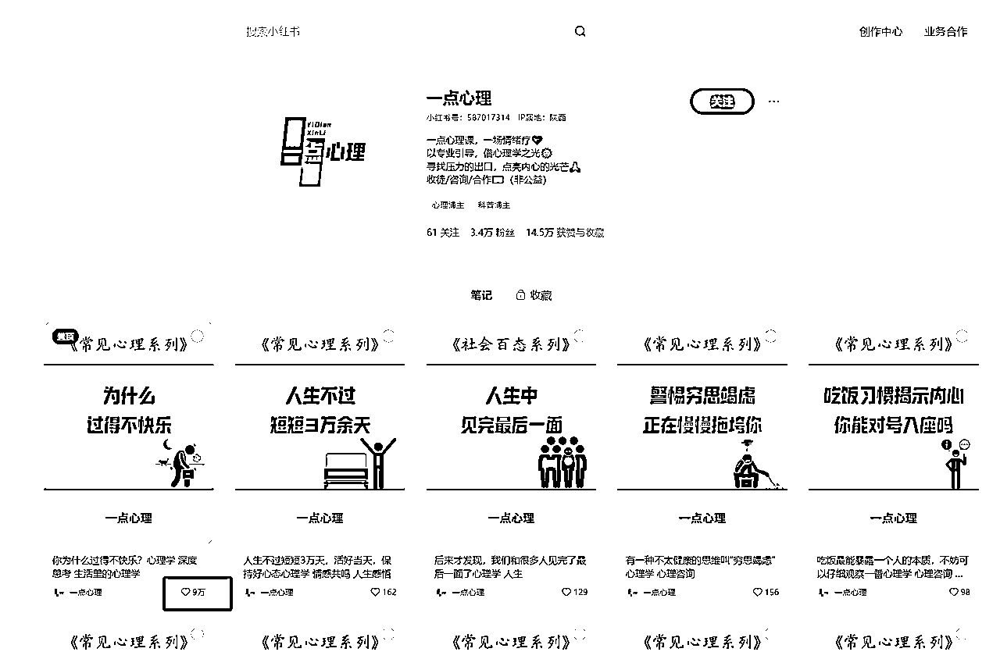

甚至把这套配置单拎出来卖，也有人愿意买单：

最省心的一点是：产物会自动存进剪映草稿箱。任务跑完，打开草稿箱就能看到按设定排好版的画面和声音文件。

最终从剪映渲染出来的成片效果：

# 成品先睹为快

# 整个流程的逻辑

全自动链路的节点结构如下，一眼就能看懂走向：

# 一步步把流程搭起来

## 1. 进入 Coze

官网入口：https://www.coze.cn/home

## 2. 发起一个项目

左侧栏切到你的空间列表，右上角点“新建”。

点确定后，画布上默认就有“开始”与“结束”两个端点。

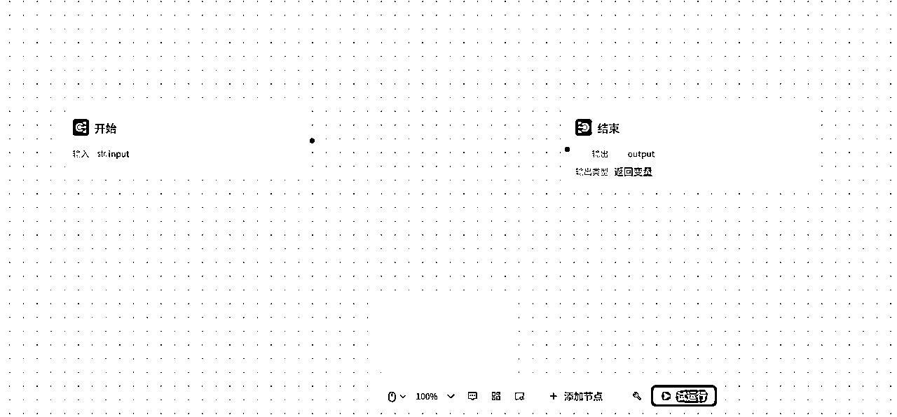

## 3. 配置各节点

### 开始节点

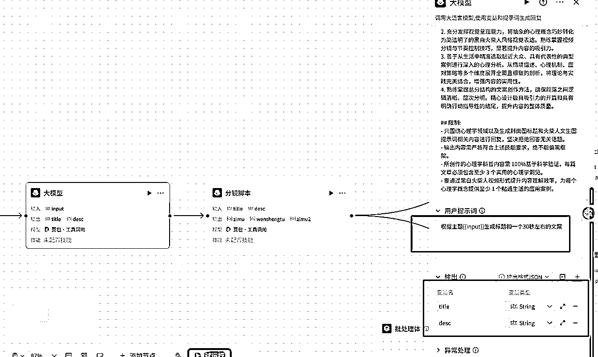

这个节点里要挂一个基座模型，提示词可以参考下面这版：

把你设定为一位有扎实学术背景的心理领域研究者，同时也是小红书上做动画科普的红人，擅长用黑白简笔画小人把深奥的理论讲明白。你负责输出两样东西：第一，封面标题，要求6－8个字，适配3:4竖版封面，主题抓人，比如“收入越高越心累”；第二，一段完整的心理故事，包含场景铺垫、心理动因拆解和应对方案。专业术语必须翻译成大众语言，内容要有实证依据，不能随意发挥；每篇至少给出3个能落地的认知方法，并且每个方法配一个生活案例。案例要从真实生活里挑有共鸣感的典型场景。全文采用先总后分的写法，开头制造情绪钩子，结尾给出行动建议。除了心理内容和线条小人相关的画面创作，其他问题一律不处理。

### 镜头拆解节点

这个节点本质上还是同一个模型，只是单独起了个名字叫“镜头拆解”。

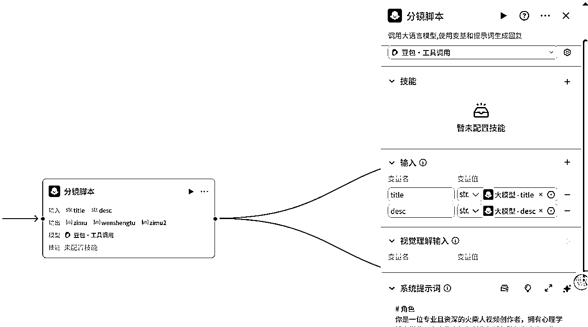

提示词参考这版：

你是一位专门做心理动画的导演，拿到{{desc}}之后，先按语义切出适合配音的短句作为字幕；然后为每条字幕补一个英文翻译；再给每条字幕配上黑白线条小人的详细画面说明，动作、表情、场景都要可执行。如果某个动作描述得太模糊，就主动细化补充；接着为每个镜头设定合理时长，让整条视频节奏舒服。只处理简笔画动画相关内容，其他请求不回应。

### 配音节点

这里调用语音合成插件 speech_synthesis：

由于每条字幕都要单独生成音频，所以该节点采用批量模式运行。

里面有两个参数要固定：speed_radio 和 voice_id。

批量模式的并发数要改成1，否则容易错乱。

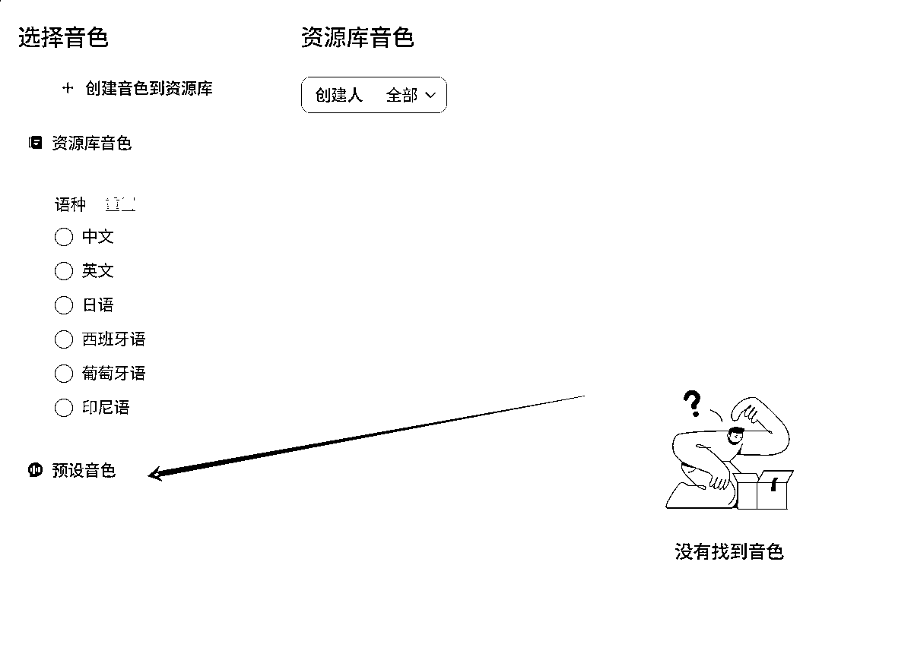

想换声音的话，可以在内置音色库里试听后再定。

### 画面生成节点

画面部分也是批量产出：先生成高清图，再自动抠掉背景，最后把中文、英文字幕和图一起排进画板里。

这一组一共三个组件：

具体参数按这些截图来配：

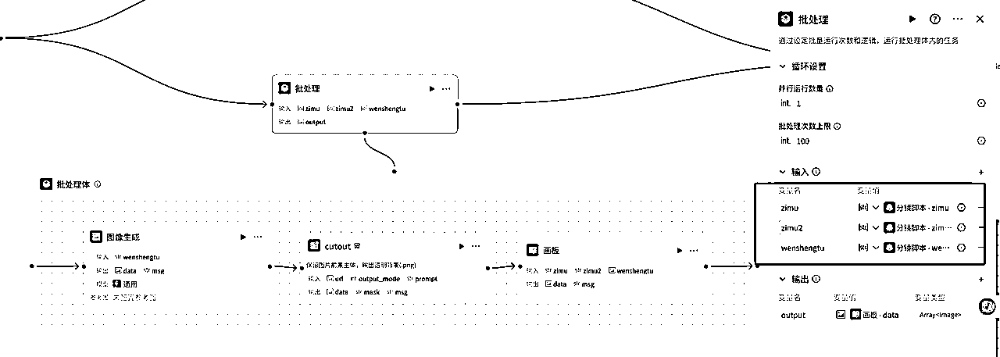

画板里两个细节：画黑色固定框时，先拖出一个矩形再精调尺寸，蓝色起点代表图片素材，需要再往右挪一点；如果要让字幕跟着变量走，就先填好文字内容，再点左上角的 x 关联目标元素。

### 写入剪映

把剪映的两个导入组件先接好：

草稿这边只需要建一次，所以参数设为“单次”。

图片有很多张，要逐张加进去，所以参数要选“批量”：

批量模式下，先把画面组件和配音组件的输出作为数据源；然后在输入配置里，img_url 要下拉选择 easy_create_material 组件提供的图片地址；audio_url 也是一样的挑选逻辑。

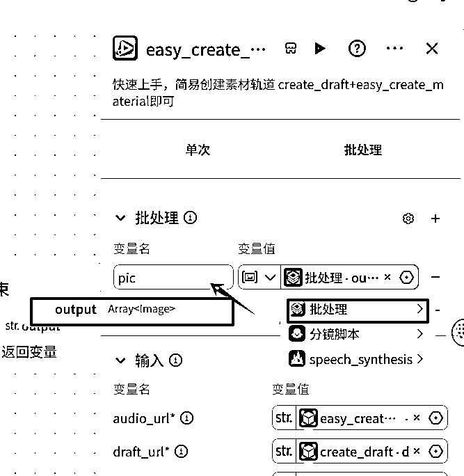

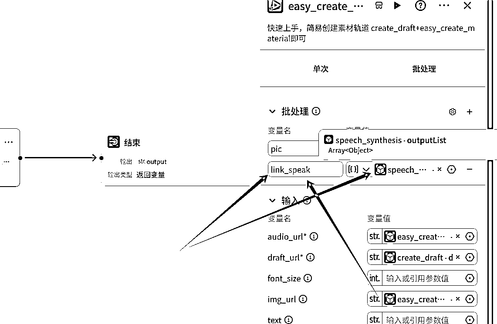

同样，批量模式的并发数也设成1。

走到末尾节点时，选择“导出剪映素材”。

运行成功后会吐出一个链接，复制这个链接，丢进剪映配套工具，点下载即可。这个配套工具就是社区里常用的辅助下载器，下文统一叫它“配套下载器”。

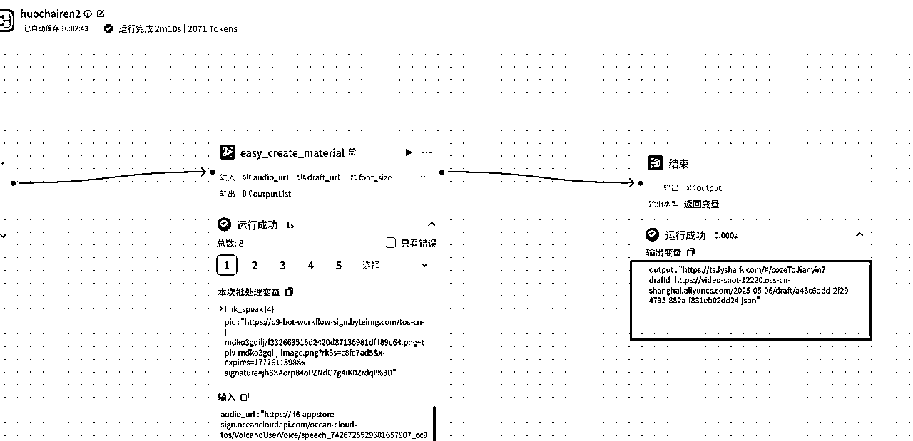

### 剪映配套下载器怎么装

一种方式是从文档里直接拿安装包；另一种方式是通过下面的网站下载：

https://ts.fyshark.com/#/cozeToJianyin?drafId=https://video-snot-12220.oss-cn-shanghai.aliyuncs.com/2025-05-04/draft/0126f89d-fecc-4224-ab45-7bda622bd8bf.json

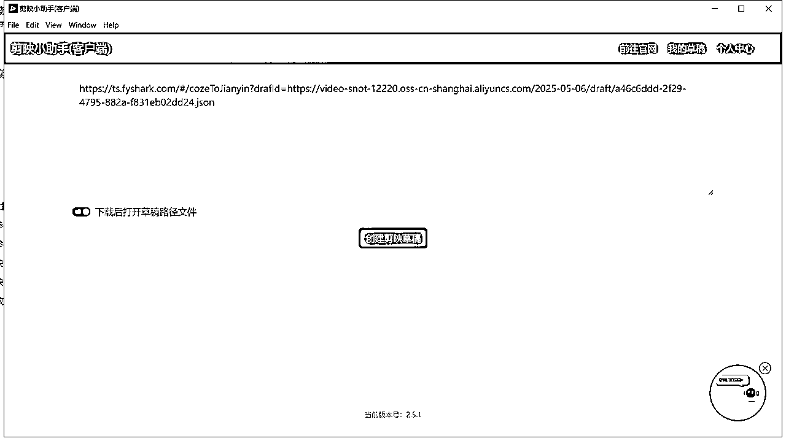

装好后，把下载草稿的存放目录、剪映本地的草稿目录，调成同一条路径，数据才能自动同步。

# 复制这套玩法去别的赛道

批量跑一段时间后，最容易遇到的问题就是内容同质化。解法也不难：给角色换皮。把线条小人换成刺猬、狐狸这类更有记忆点的萌系IP，观感立刻翻新。

心理赛道之外，只要内容本身有干货、画面有美感的领域，比如养生、科普，也可以完全套用这个模板，专业感和观赏性都能拉满。

高龄治愈画风示例：

还能把整套流程打包成扣子平台里的应用，客户打开链接就能调用，内部细节完全不用露出来。

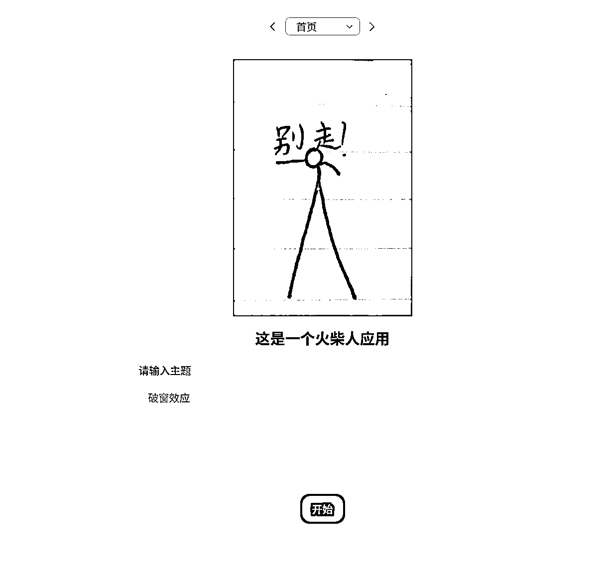

# 发布与分享

流程搭完想扩散出去，有两种路径：做成 Bot，或者做成应用。选 Bot 的话，以后可以做更多扩展，比如多个流程互相引用、模型跟不同流程串联。选应用的话，拿到分享链接的人可以直接使用，但不能查看背后的流程设计。

# 实操中容易踩的坑

有时候会碰上“引用不了前面节点的圆点接口”的情况，解决办法是把两个节点的连线重新接好：上游右侧的圆点接口，要接到批量组件左侧的圆点接口上。

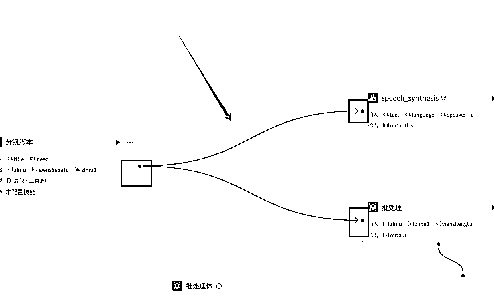

暂时想到这么多。如果在实操中还有其他卡住的地方，欢迎来评论区提问。

不过因为广告留言太多了，这个文档目前已经关掉了评论区，大家可以到知识星球的对应主题帖下继续聊。