# 保姆级攻略：Coze 牵手剪映，批量做出火柴人心理学视频

大家好，我是一泽。

Coze 最近打通了和剪映的联动，原来那些重复又占时间的剪辑操作，现在能交给流程自动完成，省下大把时间专心做项目。

抖音、小红书、视频号上，养生、科普、心理、疗愈等赛道，都能用这套方式批量产出图片和视频。数据通常不错，点赞收藏都很能打，变现可以做引流、收徒、卖工作流。

先看一个参考账号，“一点心理”的博主主页：

https://www.xiaohongshu.com/user/profile/5d04e8810000000011002e56?xsec_token=AB6GDkPLIMCB35YxAJWQnL_yMOTfprZvDu0IOxHDqrBgI%3D&xsec_source=pc_search

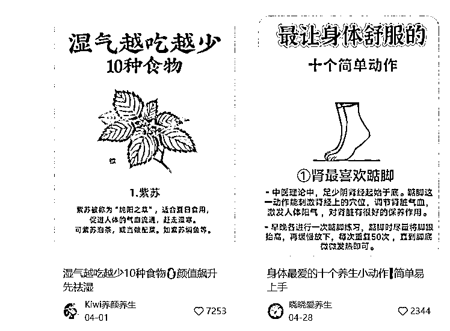

这套工作流本身也可以拿来出售：

最方便的是，产出素材会自动进剪映，打开草稿就能看到排好的图片和音频：

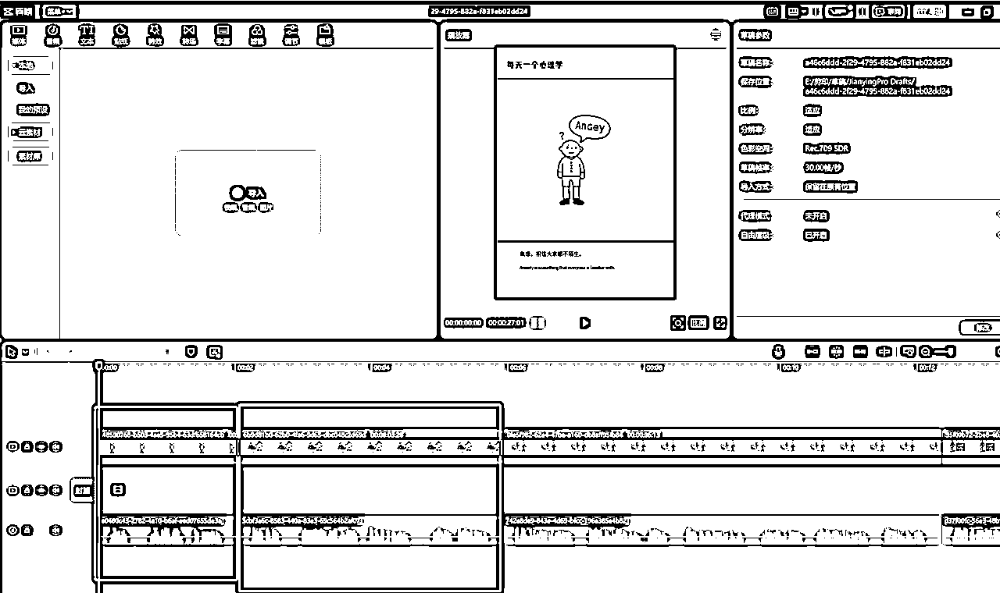

剪映导出成品的效果：

## 一、先看工作流全貌

整体流程示意图：

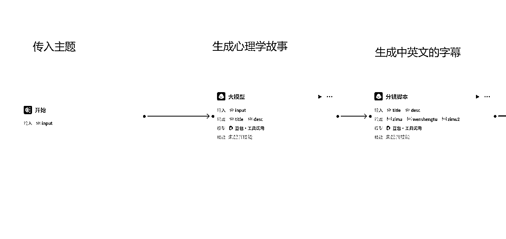

## 二、动手制作

### 1. 去 Coze 创建工作流

官方入口：https://www.coze.cn/home

进入后，先点左侧“工作空间”，再点右侧“新建工作流”：

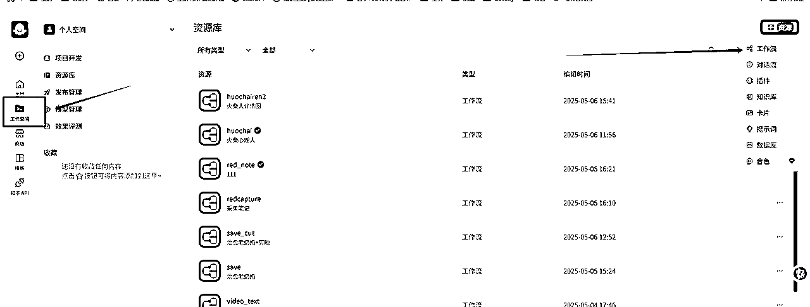

创建后会自动出现“开始”和“结束”模块：

### 2. 配置“开始”模块

参数设置如下：

提示词的核心设定是：扮演专业资深的心理学博士，同时是小红书上极具影响力的视频创作者，擅长用黑白简笔画火柴人，把心理学讲得通俗又有趣。需要做到：

- 生成一个 6-8 字、适合 3:4 竖版封面图中间的标题，要扣住心理学主题，有吸引力；
- 创作完整生动的心理学故事，包含清晰的情境描述、心理机制分析和实用应对策略；
- 把抽象的专业概念，转成大众容易接受的表达，保持科学严谨；
- 用黑白火柴人风格呈现画面，注意分镜和节奏；
- 从生活中选典型案例，按总分结构写，开篇抓人，结尾给行动指引；
- 只聊心理学；内容要有科学依据，每篇至少给出 3 个心理学洞见，每个概念至少配 1 个生活应用案例。

### 3. 配置“分镜脚本”模块

这个模块和上面用的其实是同一个大模型，只是我给它改名叫“分镜脚本”：

提示词里要让它扮演“心理学博士 + 火柴人视频创作者”，能根据关键词产出高质量分镜脚本。重点包括：

- 从用户给的描述中拆出字幕内容；
- 给每句字幕生成对应的英文翻译；
- 为每句内容生成黑白简笔画火柴人的画面描述词；
- 检查动作描述是否清晰，不清晰要继续细化；
- 合理设置分镜时长，让视频节奏流畅；
- 只围绕火柴人视频内容输出，不跑题。

### 4. 配置“语音朗读”模块

这里调用“语音合成”插件 speech_synthesis：

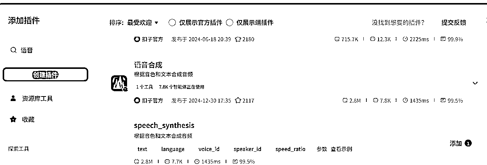

因为分镜脚本会输出很多条字幕，所以朗读要用批处理，同时设置朗读速率 speed_radio 和音色 voice_id：

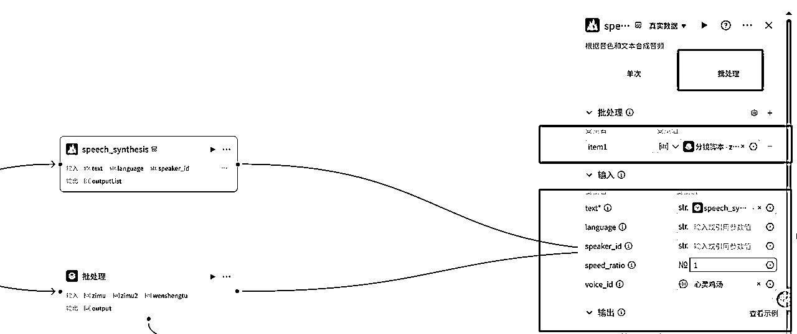

注意：批处理并行数量要设为 1。

音色可以点“预设音色”来选择：

### 5. 配置“图片生成”模块

图片也要批量生成。流程是：图像生成模块 → cutout 抠图模块 → 把中英文字幕和图片放到画板上：

具体参数设置：

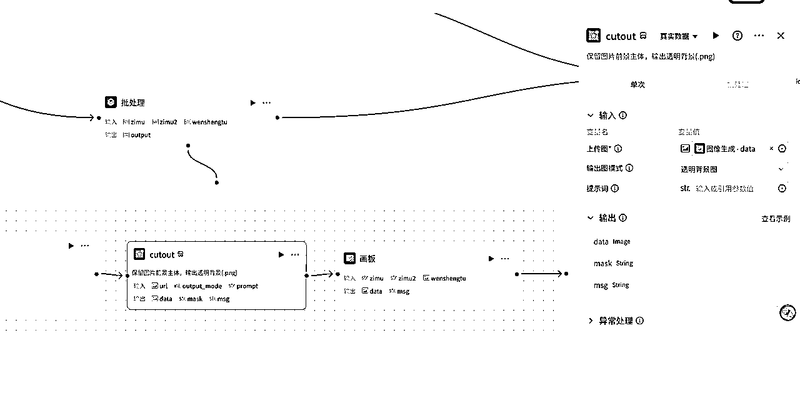
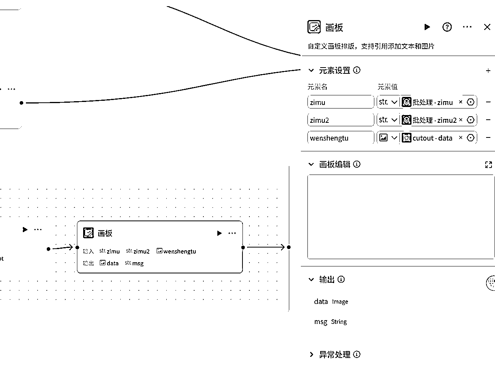

画板设置有两个要点：

- 固定黑线画法：直接画一个矩形框，再调整尺寸。注意图中蓝色起点是图片，要往右移一个位置；
- 关联动态字幕：填好文字后，点左上角的“x”来关联元素。

### 6. 配置剪映模块

导入模块后，要注意单次还是批处理：

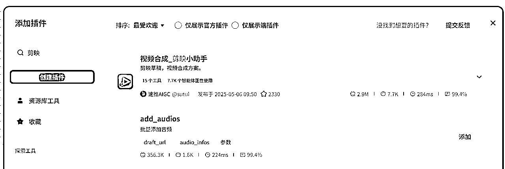

创建草稿只需要一次，所以右侧参数用“单次”：

图片是多图素材，要挨个添加，所以右侧参数用“批处理”：

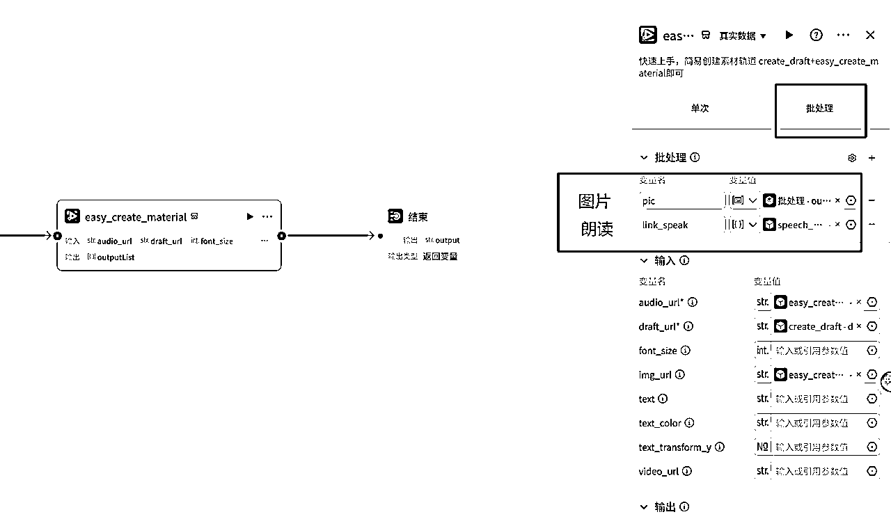

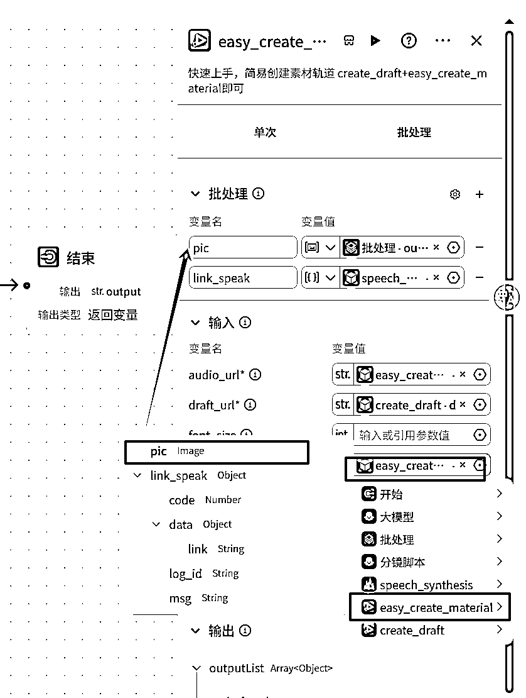

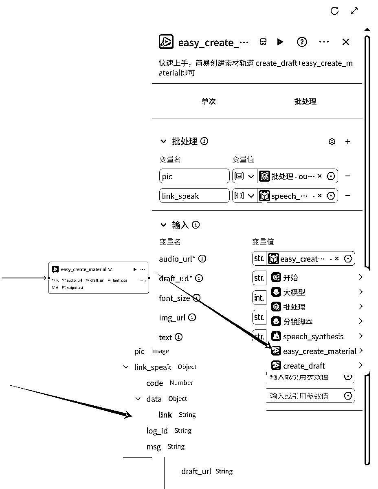

批处理时，要在【批处理】里导入【图片模块】和【朗读模块】的输出素材；输入部分的 img_url，要选 easy_create_material 模块返回的图片 url，audio_url 同理。

同时，并行数量也要记得设为 1：

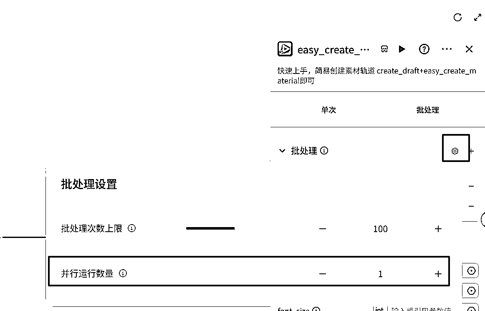

最后的“结束”模块负责导出剪映素材：

运行成功后，会生成一个链接，复制到剪映小助手，点下载就能拿到草稿：

### 7. 安装剪映小助手

剪映小助手可以从文档下载，也可以从官网下载：

https://ts.fyshark.com/#/cozeToJianyin?drafId=https://video-snot-12220.oss-cn-shanghai.aliyuncs.com/2025-05-04/draft/0126f89d-fecc-4224-ab45-7bda622bd8bf.json

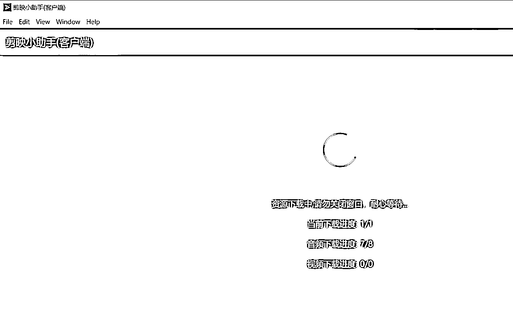

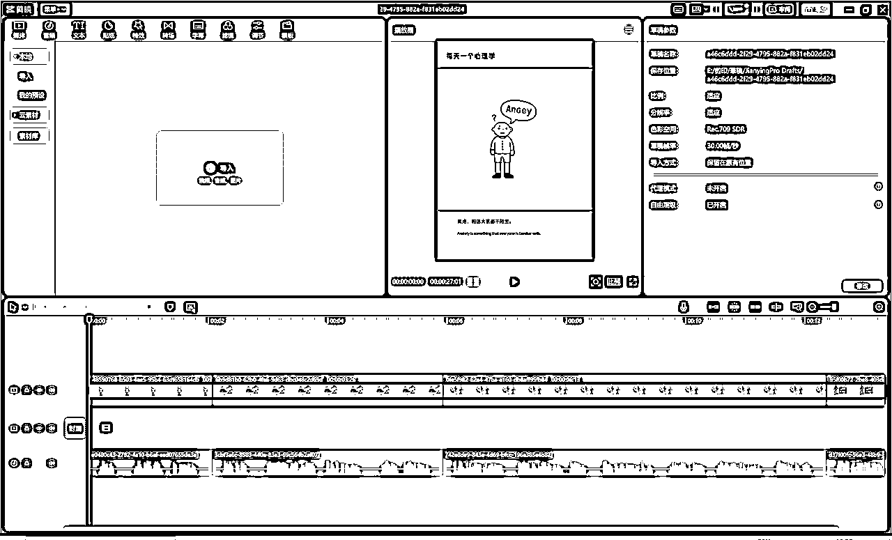

安装完成后，要把小助手的草稿下载路径设置为和剪映的草稿路径一致，才能自动生成：

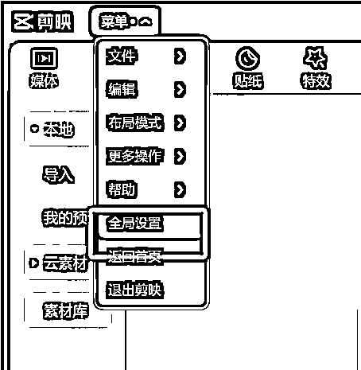
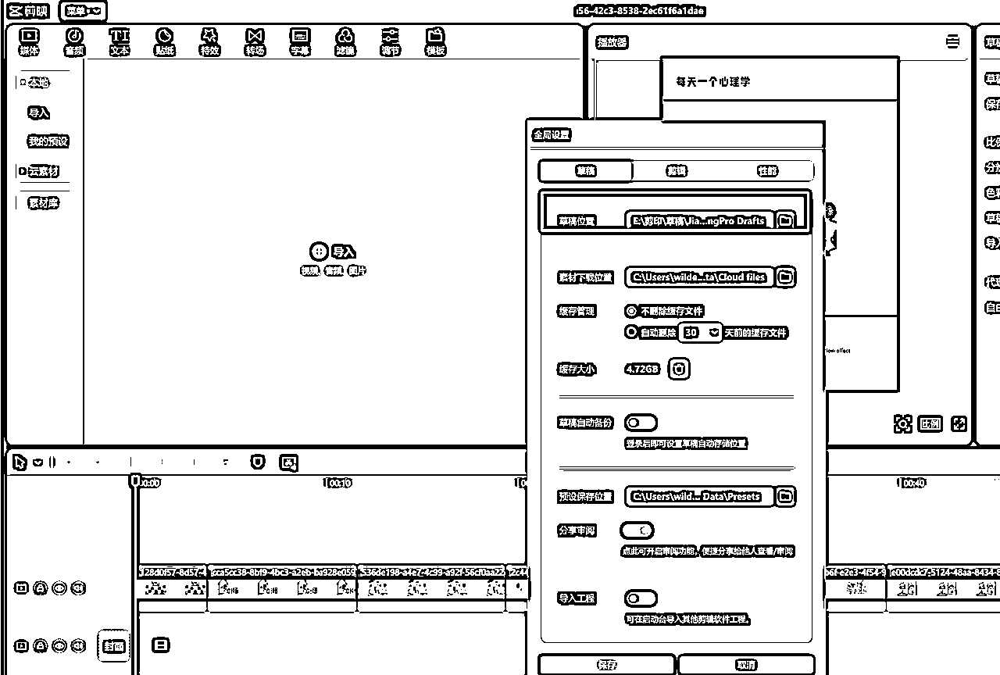

## 三、扩展玩法

批量生产最大的问题，就是内容容易同质化。怎么避免？

除了火柴人心理学，你完全可以改成“小刺猬心理学”“小狐狸心理学”等等。

不一定要局限在心理学，养生赛道、科普赛道同样可以用这套做法，专业感加美感直接拉满：

像这样“治愈系老奶奶”：

也可以直接做成扣子应用，让客户一键调用：

## 四、如何发布和分享

工作流完成后，想分享出去，可以选“智能体”或“应用”：

- 选智能体：可以做多工作流联动，也可以让大模型联动工作流；
- 选应用：别人通过分享链接直接使用，但看不到内部详细流程。

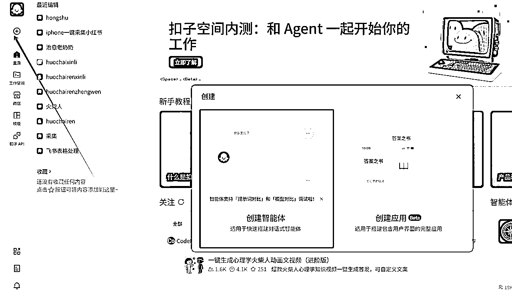

## 五、常见问题

如果出现无法引用前方小圆点的情况，需要把两个模块的线连起来：模块右边的小圆点，要连到批处理左边的小圆点：

实操中遇到问题可以在评论里提问。不过这个文档因为广告评论太多，已经禁止评论了，想讨论的话可以去星球帖子里留言。