# 2025做小红书本地生活，盯利润比盯规模更实在

不知道你最近有没有留意，打开小红书，内容风向已经和从前大不相同。早些年这里是美妆穿搭、明星八卦和海外游记的地盘，如今不论男女，用户都习惯在这里查同城吃喝、找周末消遣、挑美甲店、搜亲子场馆。人到了陌生城市，落地第一件事往往是点开它，看看周边有什么值得去的地方。这个变化透露出一个清晰信号：本地生活服务在小红书上，仍是一片远未饱和的蓝海。对经营线下门店的老板们而言，它正在成为绕开传统点评平台、以极低成本捕获高意向客户的新入口。

先摆几组数据。平台月活跃用户约4亿，其中七成会使用搜索；所有搜索里，98%属于用户自发发起，而非平台推送引导；新注册用户里，首日就动用搜索功能的占到42%。搜索场景带动的成交额同比翻了14倍，与消费挂钩的检索量上涨五成。换句话说，小红书早已跳出“单纯种草”的定位，成了相当一部分人下单前的最后一道参考。越来越多面向年轻女性客群的零售商加码投放，也正是平台体量攀升的底层动力。可以说，它既是日常生活的工具书，也是消费选择的导航仪。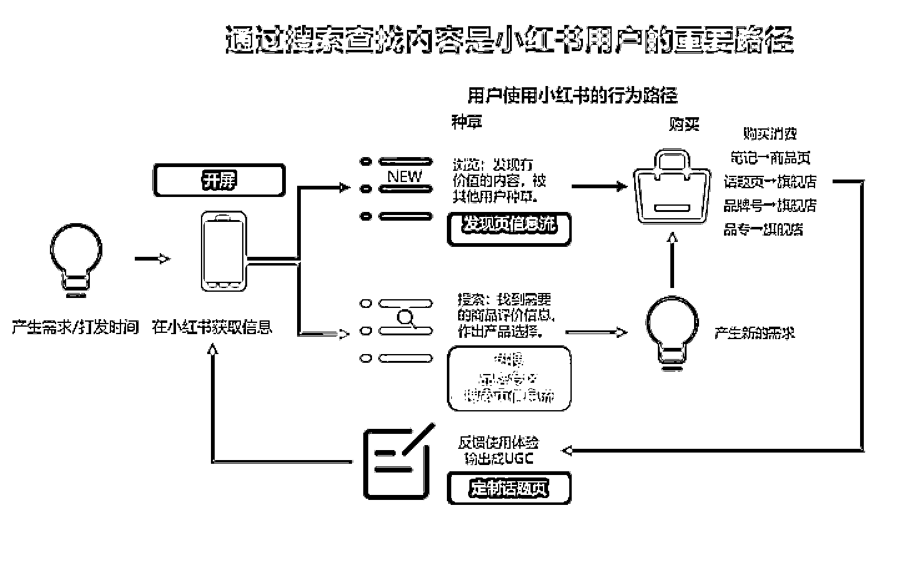

简单交代下背景：我是富贵，长安文化CEO，团队扎根杭州。2019年我进入小红书护肤领域，把单个产品线从零推到年销售额破亿；2020年转战抖音电商，商务团队对接过上万名食品类创作者，拿下杂粮细分榜首位；2024年起主攻小红书本地生活，目前每天获取的线索量超过两千条，手里直营十家健身与康复门店。此前我们帮护肤品牌积累过四万篇站内收录内容，双十一期间全渠道卖出两千多万；多个账号跨品类快速起盘并完成变现，素人账号池规模三千以上。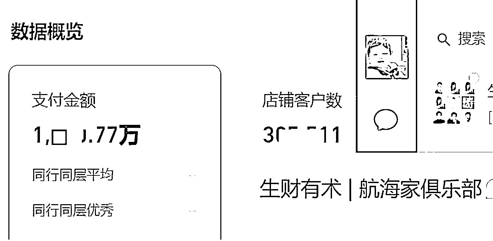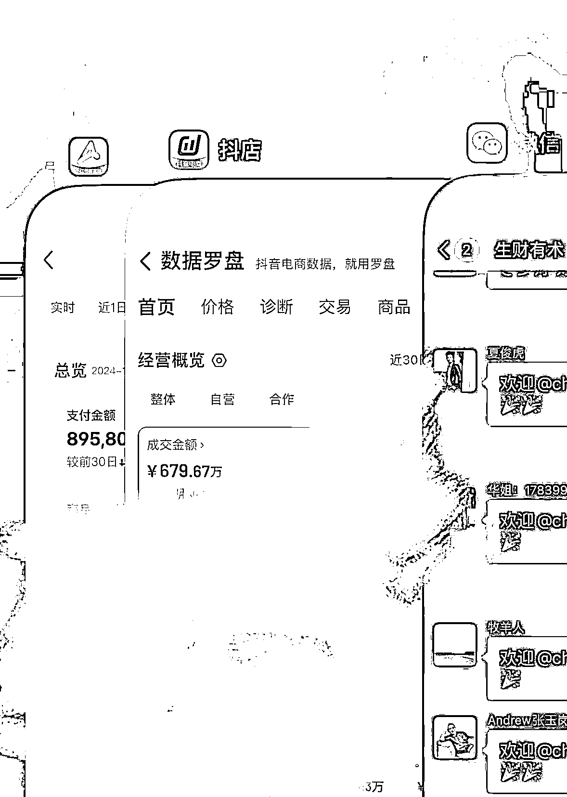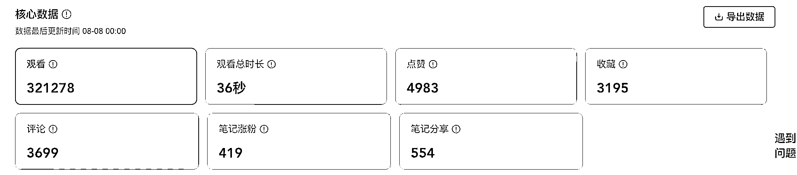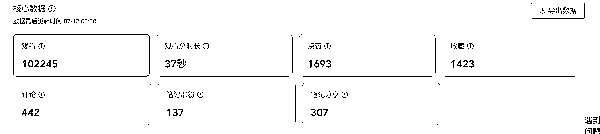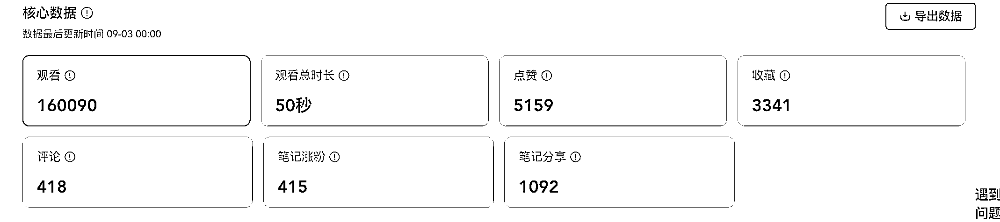

我们骨子里是家流量公司，完整经历了抖音到小红书的平台轮换。制造爆款对我们不算难事，真正棘手的是流量涌来后如何稳住变现。电商赛道拥挤到令人窒息，涌入抖音和小红书卖货的人越来越多，正面硬拼没有胜算，我索性选择抽身。平台业务大致分三块：生态、电商、线索。抛开电商、品牌方和流量倒卖这些路径，还剩什么可做？答案是线索型生意——客单价高、产品非标准化、依赖强信任、复购空间近乎无限。2024年一位朋友在山东做女装，用电商那套铺量宣传的手法，28天收回成本。这给了我启发：把电商的打法下沉到本地服务，等于降维重打一遍。

同年平台正式迈入付费流量时代。我们切入本地生活后，先拿合伙人的健身门店试水。爆款产出速度很快，可限流来得更快。那时我才醒悟，做本地生意也得先“交学费”。于是一面亲自摸索投放，一面请教圈内成熟玩家。大约三十天后，我们的开口成本压到大盘均值的一半。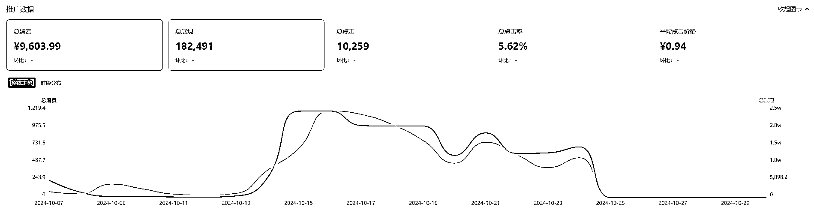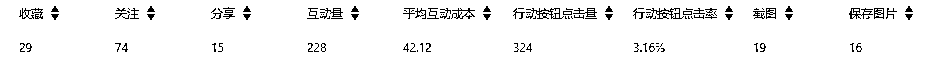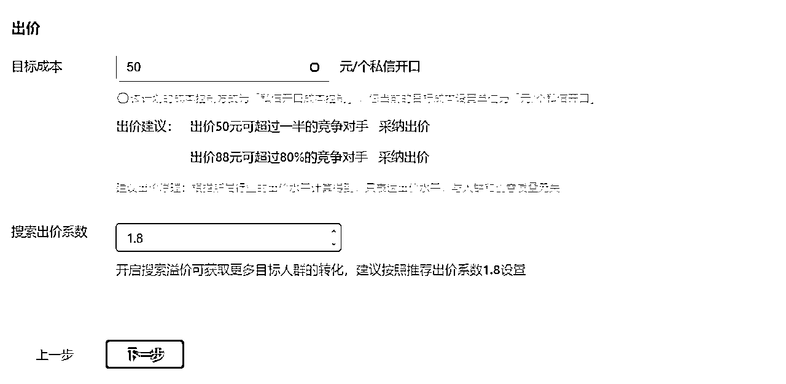

不过，压低开口并非我们的终极目标。一位朋友讲过，靠自然流吃饭，一半因为你擅长内容和素材，另一半原因说白了是预算有限。对聚光投放而言，真正决定成败的是线索的精准度。我们投K12教育人群时，那些一两块钱就能进来的开口，多半是冲着占便宜来的，属于无效线索。眼下我们一天开十个蓝V，能带来两千多进粉。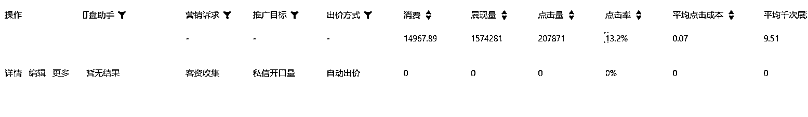 真正的难点在后端承接。同一家健身门店，两篇笔记各自引来一百条私信，一篇最终变现二十万，另一篇苦撑两个月连五千都没收回。所以外面那些教人死磕开口价的课程，我看不出意义。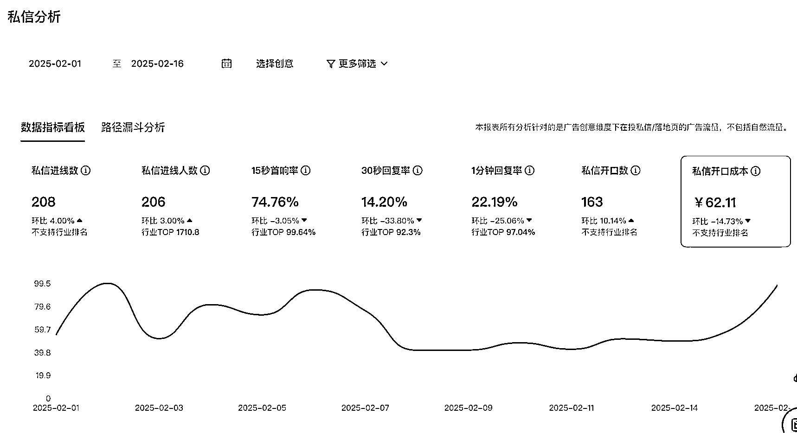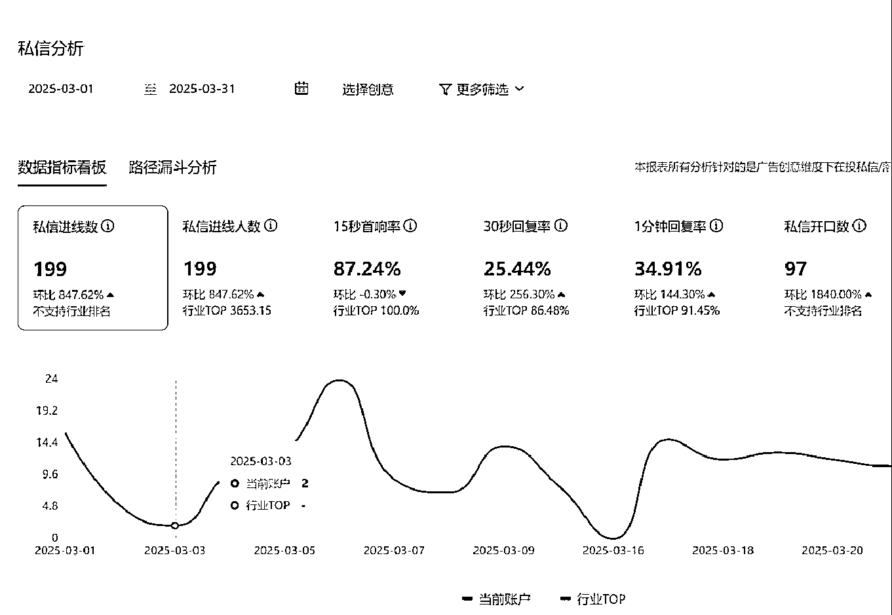 开口便宜没有用，我们要的是到店成交。哪怕把单价压到一块钱，进来的人群消费力参差不齐，照样推动不了转化。因此开口略贵也值得用，前端粉丝是十元还是五十元并不打紧，后端有没有承接力、私域里能不能在转化周期内完成成交，才是关键。

具体执行，我分几层讲。

第一层，锁定上百个同行样本，持续盯盘，吃透爆款规律。新红、灰豚、千瓜这类工具，操作逻辑大同小异。早年我爱在各种软件上充值，后来索性直接开聚光取词。把竞品在投的词、高点击词、冷门蓝海词拎出来，顺着行业词、词推词、上下游关联词不断延展。任何一条赛道，用户真正高频检索的词其实有限，多数不超过两百个。将它们嵌进封面、标题和正文，一篇能吃很久长尾流量的笔记就有了雏形。

聚光词包本质是平台给的一套关键词合集，服务于更精准的投放与内容制作。里面的词可按品牌、品类、功能、场景、受众人群来归类，用于锁定目标群体。若发现进店流量跑偏，就要靠商业干预做进阶定向。以“减肥”为例，系统会给出上下游拓词和行业潜力词，比如“小基数”。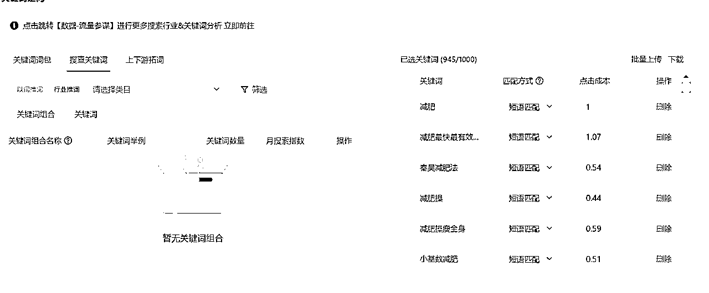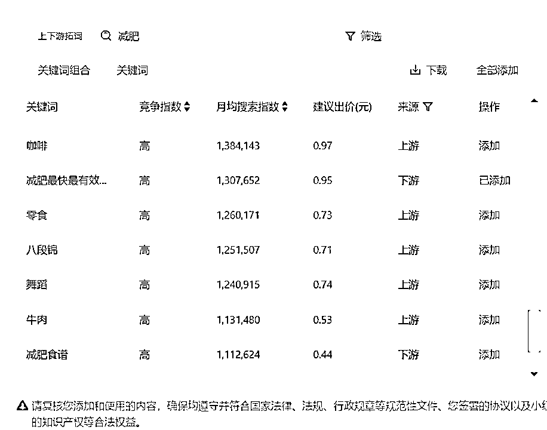 随后筛出“小基数”方向五十篇自然流爆款，交由矩阵账号跟进仿写。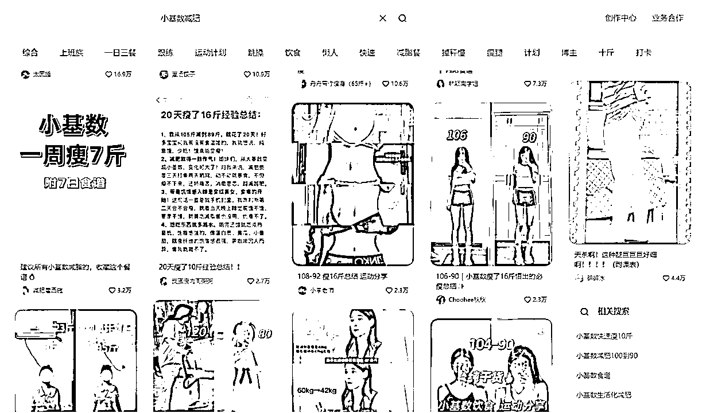

再举一例。我们有位客户专做脊柱侧弯，已做到细分第一，还在医院落地临床项目，平台表现同样亮眼。这类偏医疗的内容属于平台高危模板，怎么按行业词继续产出？在电脑端搜索“脊柱侧弯”，观察综合结果前八条。排头通常是丁香医生这类大号，但大号自带粉丝底盘，发什么都有人捧场，除封面外几乎无可借鉴。这也解释了三方工具为何热衷“低粉爆文”——大号流量靠存量粉丝，内容本身未必具备爆款基因。

日常操作中，一名组长配两名组员，每人盯二十到三十个对标号，用小号关注，每两小时扫一遍同行动态。发现哪篇内容数据抬头，立即从自有素材库里调出同类笔记，迅速跟进借势。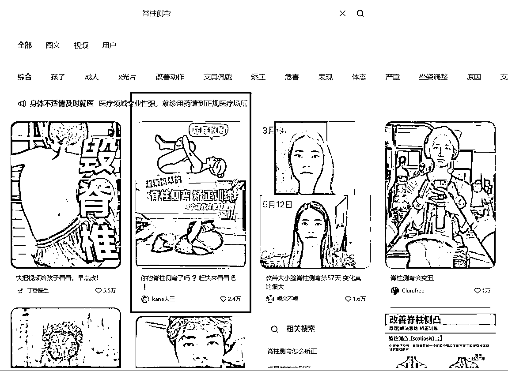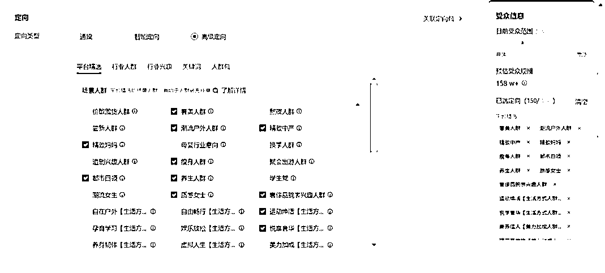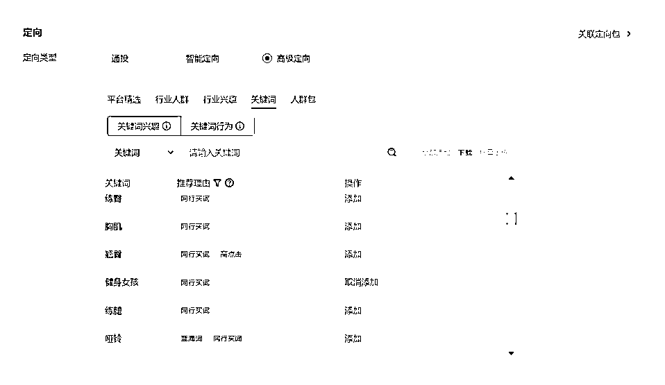

聚光词包再补充一句：它是一组关键词的聚合，服务于精准投放。可按品牌、品类、功能、场景、受众拆分，配合定向人群使用。流量跑偏时，就靠商业干预做进阶定向。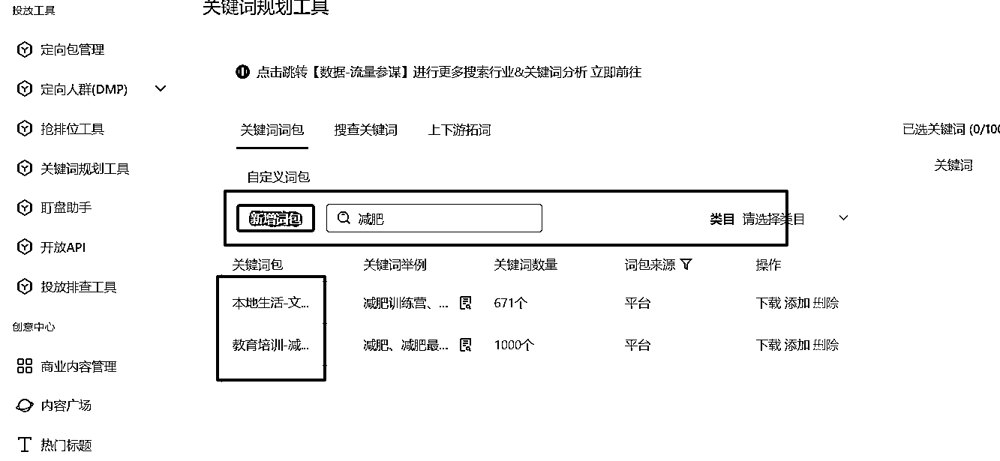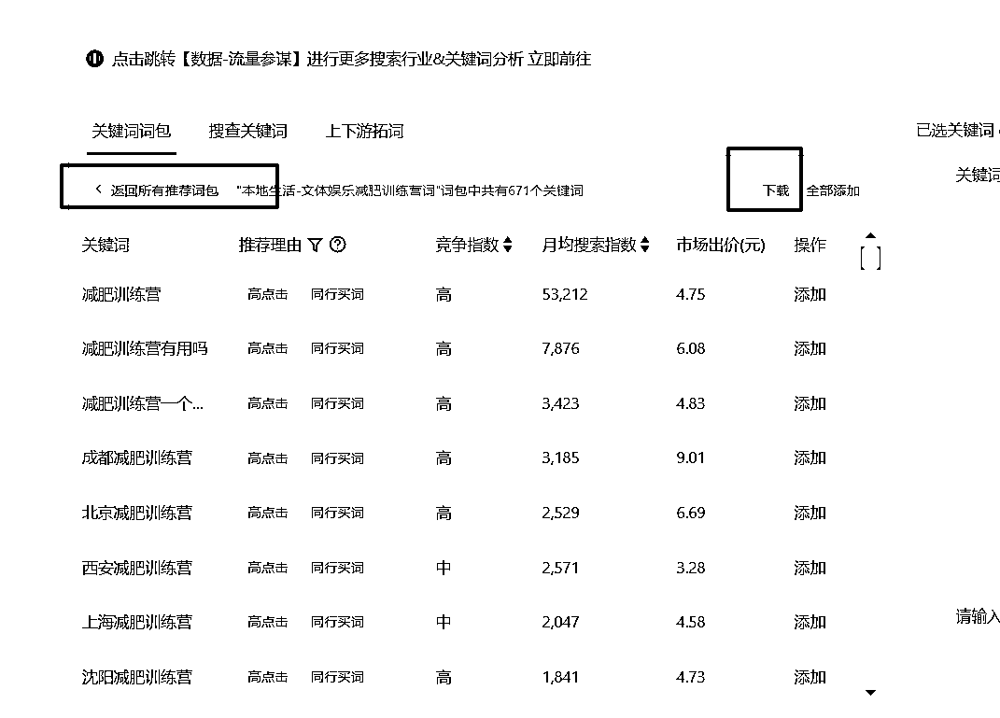

矩阵层面，能在平台长期运营的SPU才是真正的核心资产。浅层入口来自发现页、同城页和视频流；深层入口包括搜索、关注和活动H5。深度阅读指十秒基础停留与完整读完；深度互动则是收藏、截图、存图、评论求推荐或询价。平心而论，这里的女性用户礼貌又可爱，对性价比的执念也不重，算得上当下社区氛围最好的一批人。

小红书用的是反漏斗逻辑：A1认知人群、A2触达人群、A3互动人群、A4购买人群。抖音漏斗侧重内容发布初期的爆发，短时间点赞评论转发够猛就会被继续推流；小红书反漏斗则把种草属性和长线搜索价值放在更重的位置。一篇内容刚发时反响平平，但用户日后产生需求，会主动搜索把它翻出来。好比一篇目的地攻略，发布时只打动少数人，等到假期临近或有人规划行程，它就会被反复检索。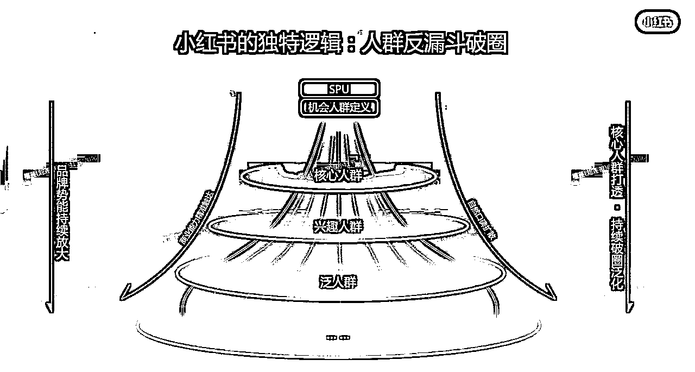

团队怎么配置？我们采用（1+3）×N的模型。拿赚钱那期线下航海夜校举例，我恰好在广州出差，受邀参加晚间聚餐，觉得方向有意思，就拉了个小分队试水。按一带二的方式，配五十个账号，提前三天囤好素材，首篇笔记上线后四十八小时便收获五百条客资。组长要在一到三天内领着成员把基础素材库搭起来，统一对“好笔记”的判断标准，测出优质样本，挑出爆文种子，明确接下来的内容走向。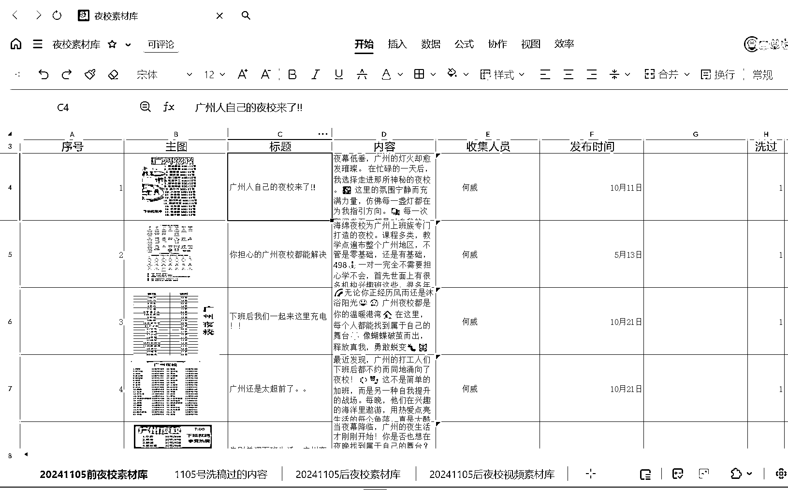 封面、标题、正文、话题标签、评论区都要帮组员打磨，封面尤其关键，直接牵动站内点击率、CPC与CPE成本。五十篇笔记铺完后，单篇数据一目了然。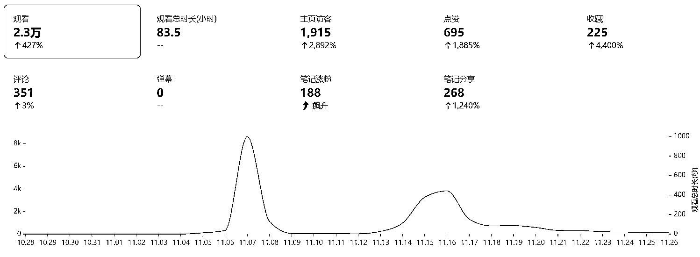 两天后的进线情况更为可观。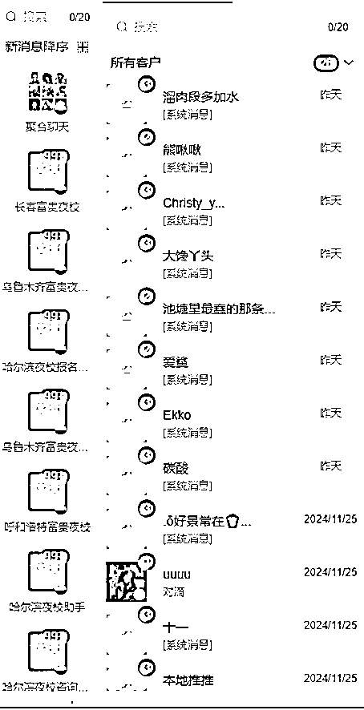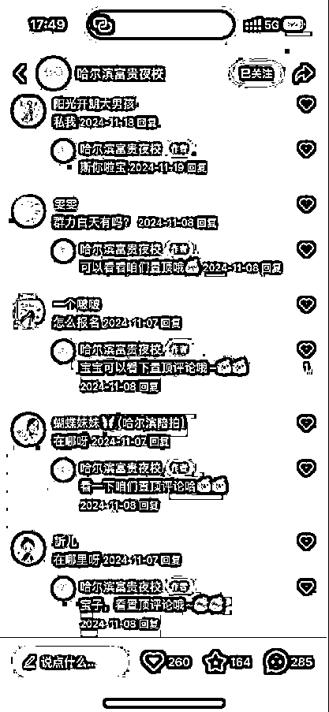

这套组合常踩四个坑：一是对行业优质笔记的标准模糊；二是对自身内容水准缺乏判断；三是后续产出方向不明；四是产量难以规模化提升。一条赛道的内容小组，就是一名组长带两三名成员完成笔记分发与投放。私域后端每天必须做数据复盘，涵盖单粉成本、单粉产出、回本周期、单个销售客服的人效。同一赛道不同模板在后端分流后横向比对，让数据说话，而非凭直觉拍板。

最后聊AI。今年开年，公司上下全面拥抱AI。从抖音跨越到小红书，支撑我们跨平台存活的其实是判断力——判断某件事是否非做不可，若是，再难也得推进。学AI的出发点不是省钱，而是提效。二十来人的团队，怎么干出十倍产出？市面上从文本生成、图像生成到提示词调优的课程，我几乎都自费报过。学费交得够多，坑踩得够深，手感自然就来了。AI是把屠龙刀，会用的人握在手里，凭刀气就能上阵；不会用的人，拿到的不过是把西瓜刀。目前团队在文本、图像、提示词优化上仍在持续打磨。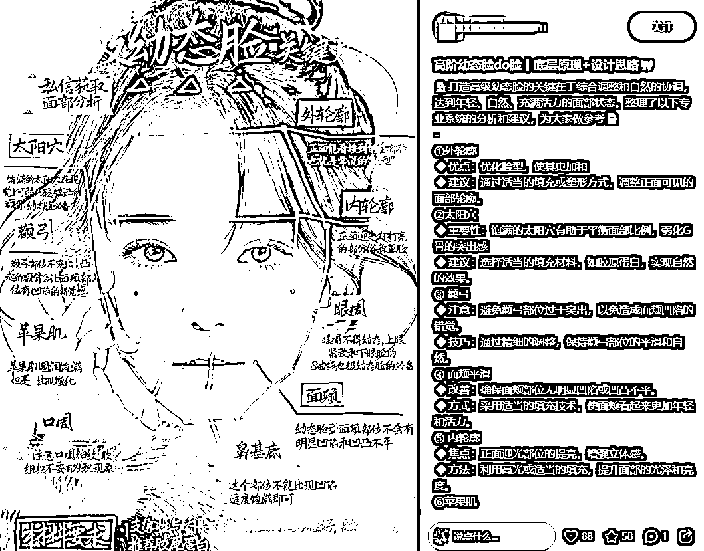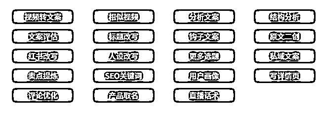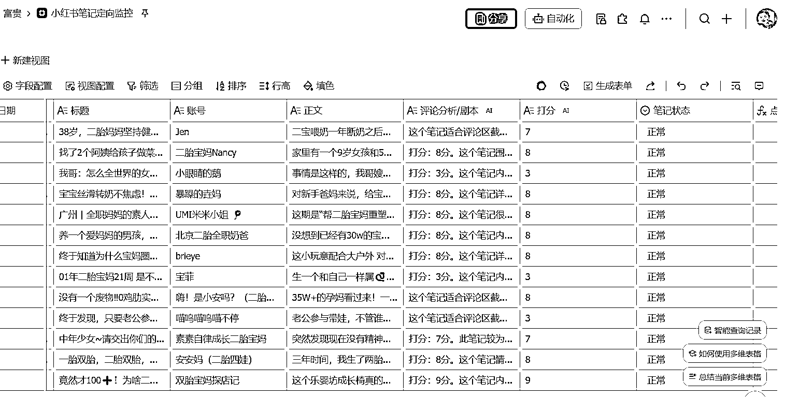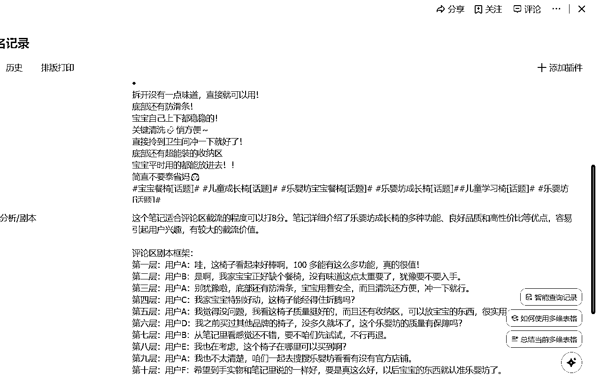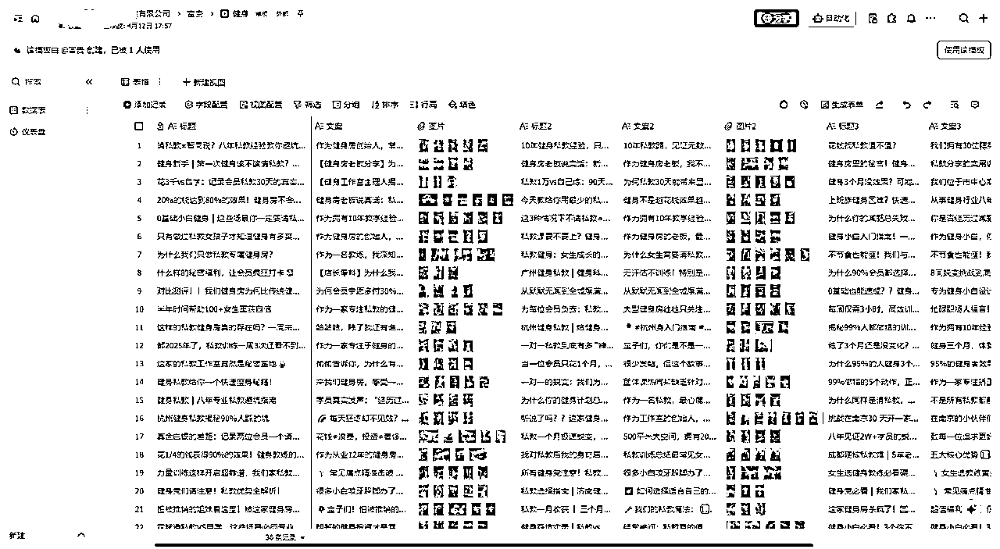

收个尾。做项目如同种地，有其生长节律与内在章法。我们这群流量玩家，做的事无非是用一套打法把庄稼某个阶段的成长过程压缩。好处是起势猛，别人三年收成，我们半年就见果。坏处是，果实落地后，很多人忘了回归商业本源，要么盲目铺摊子另起项目，要么一遇挫折就胡乱出招。于我而言，唯有持续学习、心存敬畏。借用涛哥那句话：这个年头，要么有慧根，要么会跟人。去年加入赚钱，航海家带来的认知升级非常大。感谢赚钱，愿大家赚钱有术。更多细节我会在航海家6月7日广州流量大会现场和朋友们聊，听说圈友也能报名，有兴趣的欢迎来现场找我玩！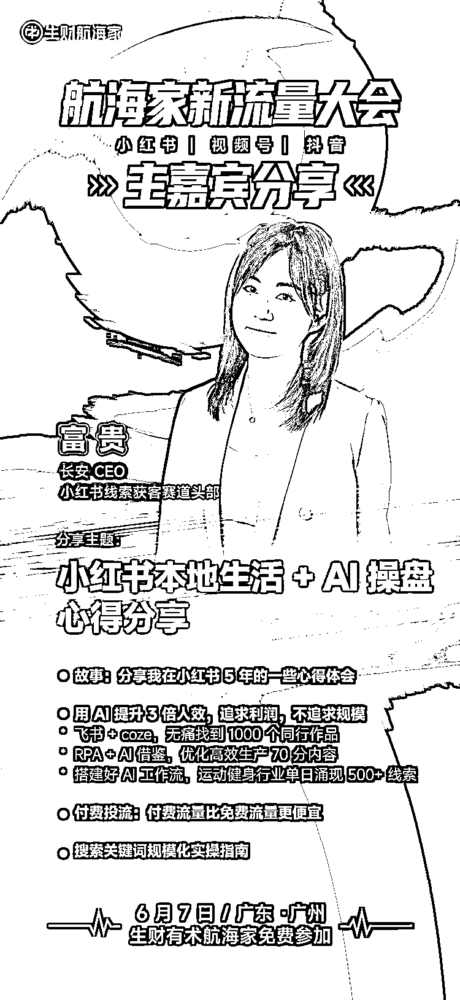