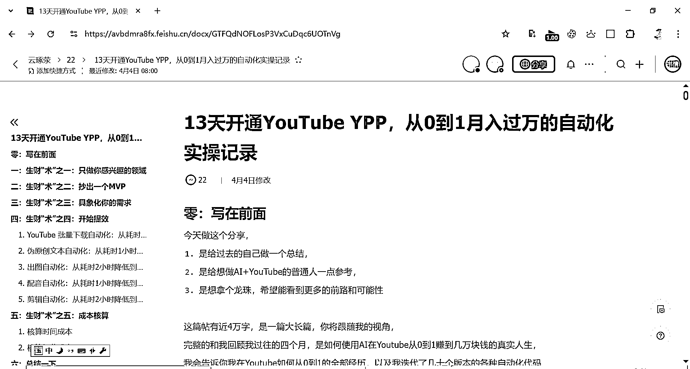
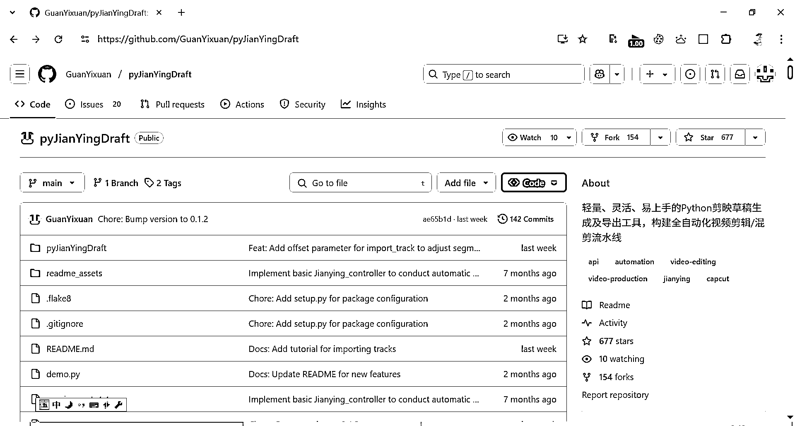
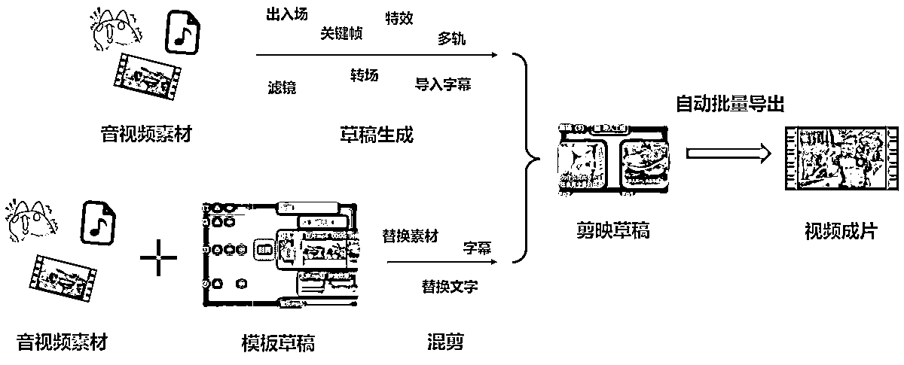
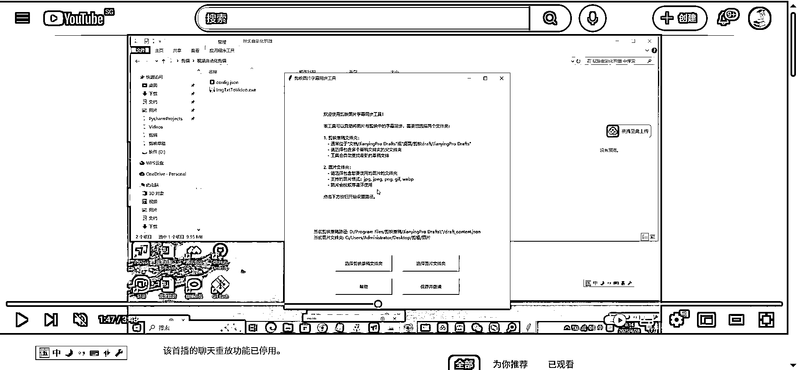
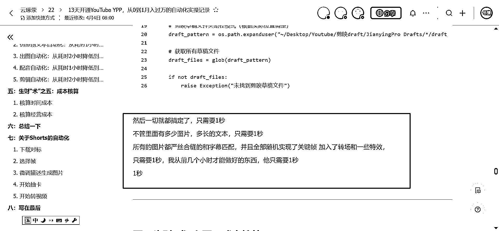
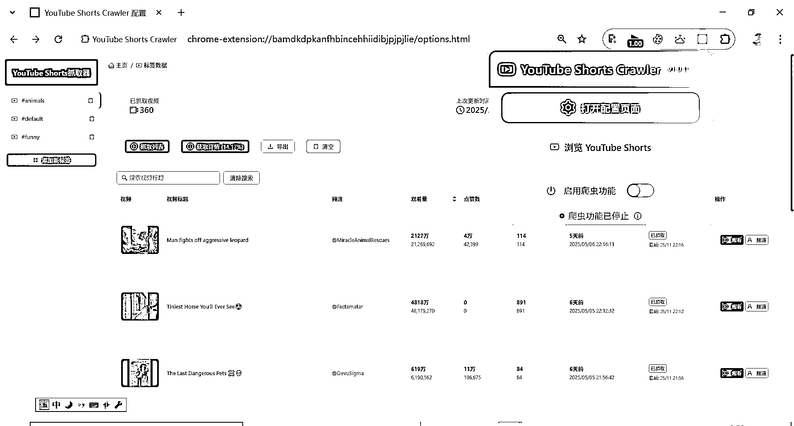
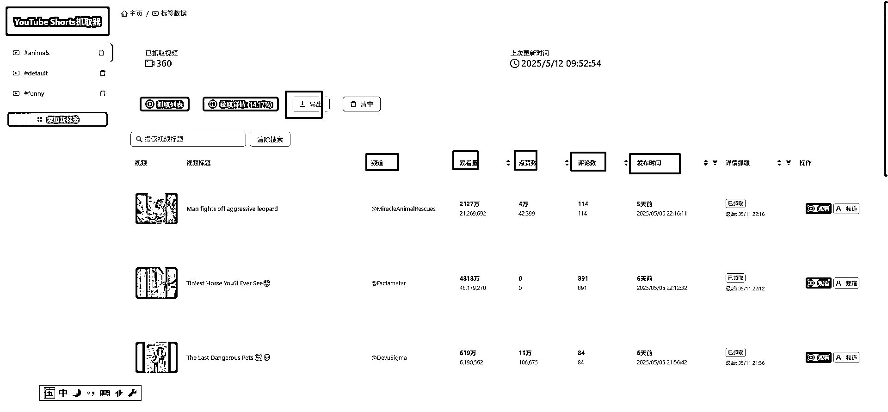
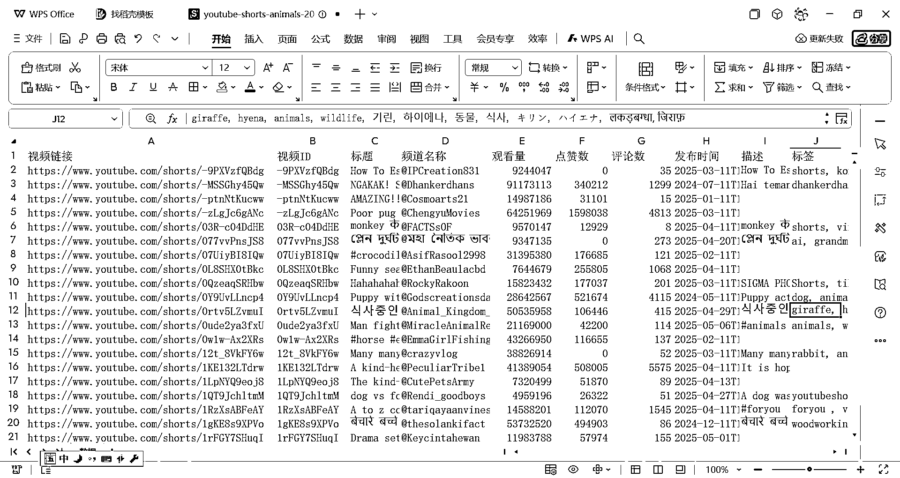

# (42 赞) 对圈友飞书笔记《13 天拿下 YouTube YPP，从零到月入破万的自动化实操》的一些补充

> 原文：[`www.yuque.com/for_lazy/zhoubao/csc3u3f2wbtdtzcg`](https://www.yuque.com/for_lazy/zhoubao/csc3u3f2wbtdtzcg)

## (42 赞) 对圈友飞书笔记《13 天拿下 YouTube YPP，从零到月入破万的自动化实操》的一些补充

作者： 书情小跟班

日期：2025-05-12

最近圈内 Zero 发布的这份飞书文档讨论度非常高，具体情况见下图

我顺着思路在 github 上搜了搜，发现了下面这个开源仓库

仓库链接是： [pyJianYingDraft](https://github.com/GuanYixuan/pyJianYingDraft)[`github.com/GuanYixuan/pyJianYingDraft`](https://github.com/GuanYixuan/pyJianYingDraft)

**  **一个轻巧好用、上手快的 Python 剪映草稿生成与导出工具，能用来搭建全自动的视频剪辑与混剪流程

写下这篇分享，也是想感谢 Zero 的思路启发。因为飞书文档里无法直接复制代码，所以想复现的朋友可以去

**[`github.com/GuanYixuan/pyJianYingDraft`](https://github.com/GuanYixuan/pyJianYianDraft) **自行拉取代码运行。

我本身也是做开发的，还真把它跑通了，赚钱的氛围真的很棒，利他分享的文化感同身受

再次感谢 Zero 的启发，让我打开了全新的视角

近期我还赶制出了下图所示的小工具

这个小插件支持按 #标签 进行检索，检索结果会展示频道名称、观看量、点赞数、评论数、发布时间等信息，并且自带导出功能

导出的样式如下

如果有圈友觉得有用，可以先点个赞。有需求的话我后续会开放使用。是否长期免费我不承诺，万一反响太好可能会转为付费，毕竟赚钱讲究明码标价不伤感情。

* * *

评论区：

L!N/林林/小林 : 你简直赚钱的油管男神