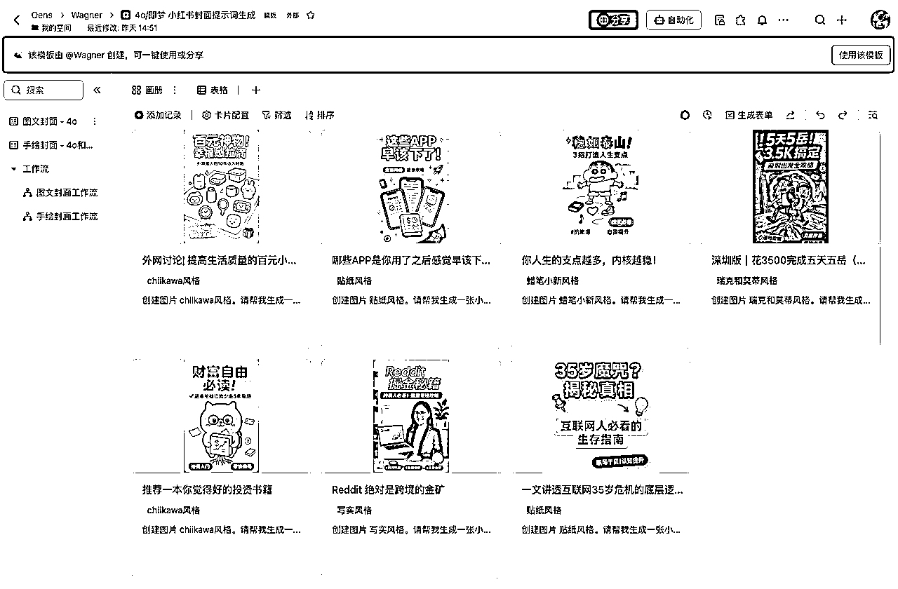
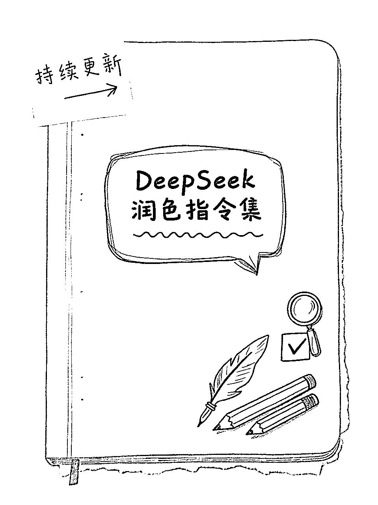
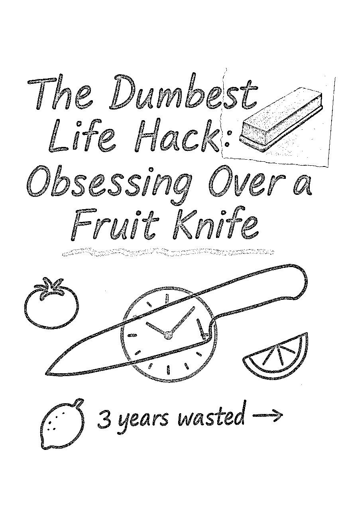
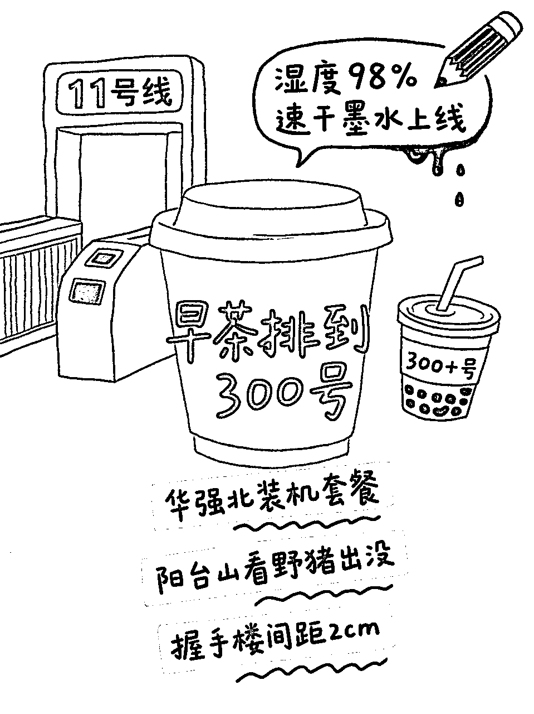
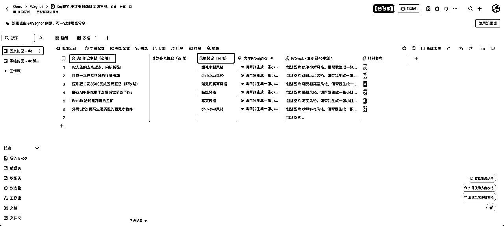
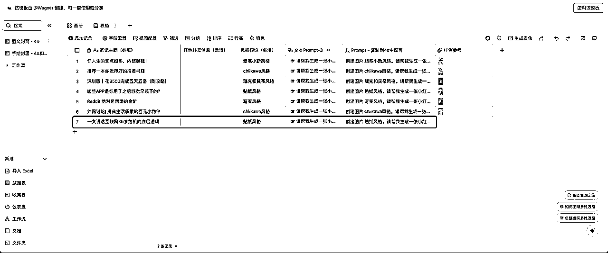
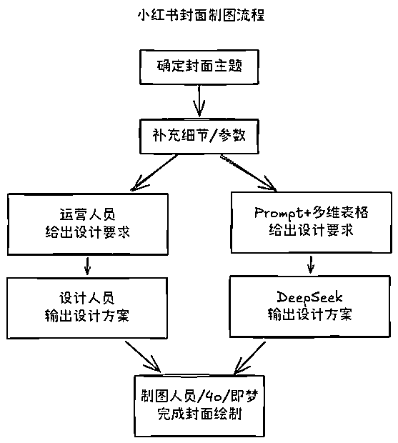
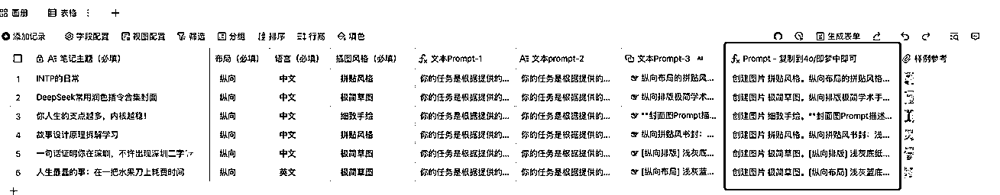

在龙哥盟社群里，大家聊起AI落地，最常见的吐槽就是：单点能跑通，一放量就失控。输出质量忽高忽低，同一个提示词多跑几次，出来的图一张比一张离谱；有时候一分钟就出图，却要花一小时去调提示词。这种感觉，就像手里有把好枪，却总是瞄不准靶心。

深圳AI公司技术合伙人伍十七，分享了一套把“乱跑”的AI管起来的实战方法：用飞书多维表格+DeepSeek搭建小红书封面生成流水线。他有个很关键的观点：AI不该被当成辅助工具，它本身就是生产力。想让它稳定干活，得像带新人那样给它立规矩——先给SOP，再定过程指标和结果指标，关键节点还要有检查。

先看成果。这套流程已经封装成飞书模版，拿到就能直接用。封面风格主要有两类：一类是图文型封面，另一类是手绘型封面。

具体怎么用？三步走：第一步，在表格里选一个封面类型，输入笔记主题和相关必填信息；第二步，等DeepSeek根据这些信息自动生成一段绘图prompt，把prompt复制到GPT4o或即梦就可以开始生图，不满意的话重新生成几次就好。

为什么这套流程能稳定输出？秘密在于把AI当成一个有明确岗位的“虚拟员工”。一个刚入职的新人，如果不知道岗位职责、工作流程、交付标准，肯定做不出合格结果。Prompt、RAG、Workflow这些技术，说到底都是在做同一件事：怎么把一个或一群AI管好。所以，先把工作拆成SOP，再给AI分工。

以小红书封面为例，完整流程可以拆解成多个步骤，每步都有明确的任务和输出要求。伍十七用三个角色来对应：运营人员=多维表格+Prompt，设计人员=DeepSeek，制图人员=4o/即梦。

拆解一下手绘封面的落地过程：先定义四个必填字段——笔记主题、布局、语言、插图风格```
你的任务是根据提供的主题、排版布局、语言、色彩方案和插图风格，生成一个结构化、视觉上引人注目的封面图。

在生成prompt时，请严格遵循以下指南：
### 布局:
明确选择一种: **横向** 或 **纵向** 排版，这里排版方向为{{布局}}。确保布局平衡，保持良好的可读性。
### 文字风格:
- **字体大小**:适中、工整的手写风格，便于阅读。
- **主标题**:加粗，使用较大的手写字体，醒目展示。
- **子要点**:使用常规墨水清晰书写，结构分明，注意间距和分支线条的排布。
### 色彩与重点标记:
- **主要内容**:使用浅色背景高亮显示，或采用独特的波浪线(~)下划线突出，具体根据{{色彩方案}}执行。
- **强调笔记**:使用不同颜色的墨水书写，以实现醒目区分，具体颜色按照{{色彩方案}}确定。
### 插图:
包含一个中央插图，插图风格为{{插图风格}}（细致的手绘图、极简风格草图，或拼贴风格的注释照片提取图）。在笔记周围策略性地放置小型相关草图或涂鸦。允许在插图上直接用钢笔风格涂鸦或标注，以营造随意自然的感觉。
### 注释与随笔记录:
模拟记号笔风格的注释、修正、趣味涂鸦、箭头和随手标注，增强视觉互动感。可选地整合与主题相关的拼贴式照片提取图，并附带注释或涂鸦。
### 语言准确性(严格):
若使用 {{语言}}，必须严格遵循公认词典与标准语法规则。若使用复杂书写系统如中文:
- 必须核对每个汉字的正确性、标准用法与准确笔顺。
- 避免使用非标准变体，务必严格确认准确性后再定稿。
```，把它们放进多维表格里；然后写一个concatenate函数，把这些字段拼成一段完整文本，作为prompt-1；接下来不是让DeepSeek直接生图，而是先让它理解主题，再按照要求产出绘图prompt```
CONCATENATE("你的任务是根据提供的主题、排版布局、语言、色彩方案和插图风格，生成一个结构化、视觉上引人注目的封面图prompt。
以下是用户定义设置：
<主题>
「", [笔记主题（必填）], "」
主题>
<排版方向>
",[布局（必填）],"
排版方向>
<语言>
",[语言（必填）],"
语言>
<色彩方案>
{{色彩方案}}
色彩方案>
<插图风格>
",[插图风格（必填）],"
插图风格>

在生成prompt时，请严格遵循以下指南：
### 布局:
明确选择一种: **横向** 或 **纵向** 排版，这里排版方向为{{布局}}。确保布局平衡，保持良好的可读性。
### 文字风格:
- **字体大小**:适中、工整的手写风格，便于阅读。
- **主标题**:加粗，使用较大的手写字体，醒目展示。
- **子要点**:使用常规墨水清晰书写，结构分明，注意间距和分支线条的排布。
### 色彩与重点标记:
- **主要内容**:使用浅色背景高亮显示，或采用独特的波浪线(~)下划线突出，具体根据{{色彩方案}}执行。
- **强调笔记**:使用不同颜色的墨水书写，以实现醒目区分，具体颜色按照{{色彩方案}}确定。
### 插图:
包含一个中央插图，插图风格为{{插图风格}}（细致的手绘图、极简风格草图，或拼贴风格的注释照片提取图）。在笔记周围策略性地放置小型相关草图或涂鸦。允许在插图上直接用钢笔风格涂鸦或标注，以营造随意自然的感觉。
### 注释与随笔记录:
模拟记号笔风格的注释、修正、趣味涂鸦、箭头和随手标注，增强视觉互动感。可选地整合与主题相关的拼贴式照片提取图，并附带注释或涂鸦。
### 语言准确性(严格):
若使用 {{语言}}，必须严格遵循公认词典与标准语法规则。若使用复杂书写系统如中文:
- 必须核对每个汉字的正确性、标准用法与准确笔顺。
- 避免使用非标准变体，务必严格确认准确性后再定稿。
请现在开始生成prompt。")
```；同时，多维表格的工作流会检查信息完整性，只有所有必填项都填好，任务才会自动进入下一环节，并向prompt2中写入新内容；然后给DeepSeek定义好岗位职责，再用公式约束它的输出结构，保证生成的prompt能直接被下游工具使用```
"创建图片 "&[插图风格（必填）]&"。"&[文本Prompt-3.输出结果]
```；最后，把这段prompt丢给4o或即梦，一张合格的小红书封面就出来了。

这套方法的本质，是把人对工作流程的管理经验，复制到AI身上。它当然不只是用来做封面，凡是已经SOP化、流程化的工作，都可以用类似思路交给AI去做。如果你也在探索AI落地，不妨试一下：把AI当成员工，给它一套清晰的SOP。这可能是最有价值的实践。

希望这篇分享能给你一些启发，让你的AI从“偶尔惊艳”变成“稳定交付”。