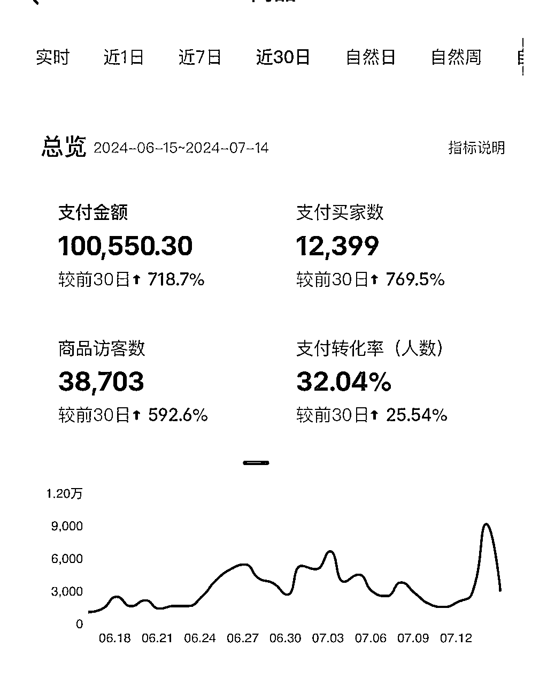
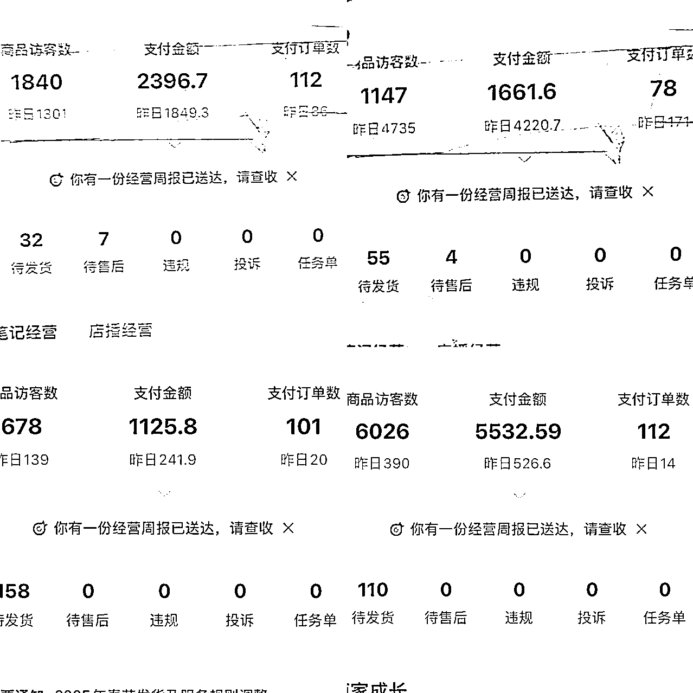
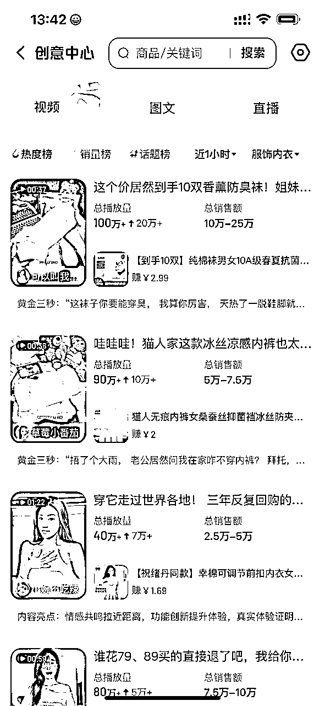
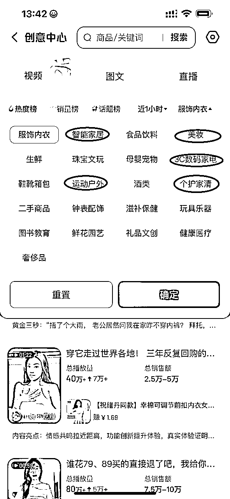
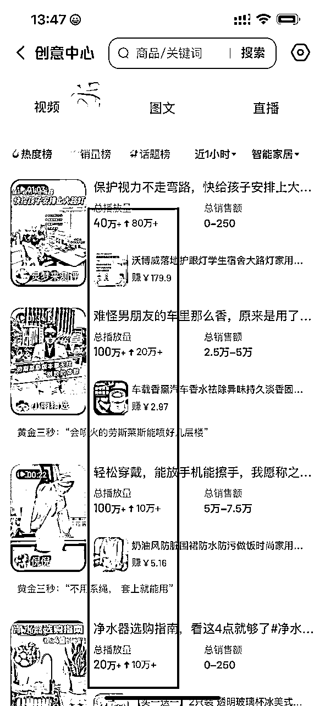
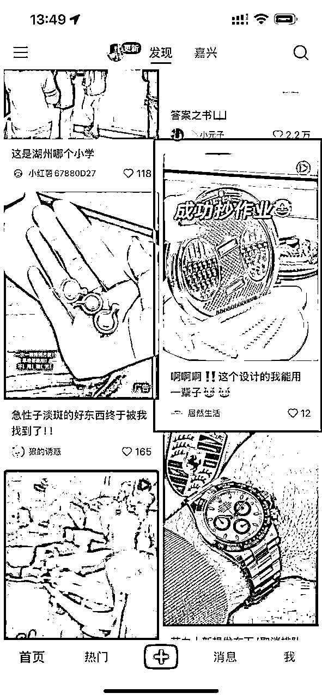
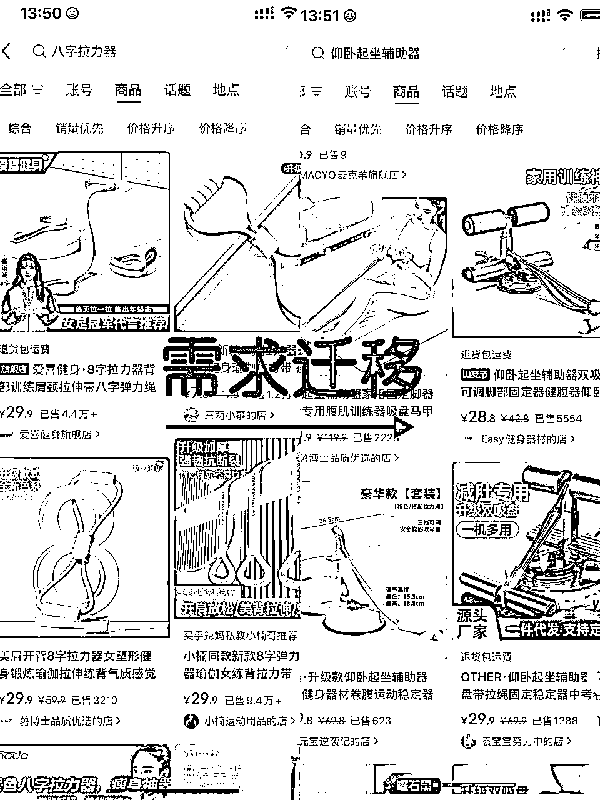
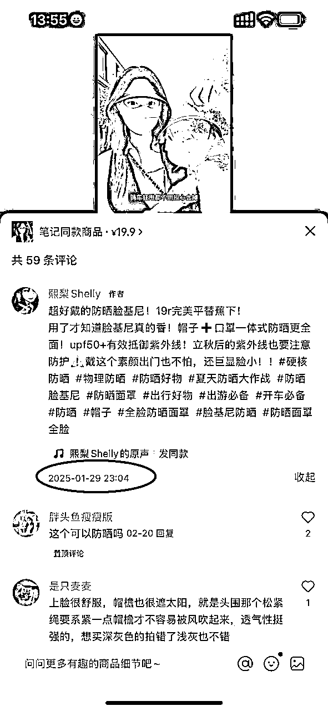

# 04届大学生入局小红书电商，我是怎么连着找到几个爆品的？

> 来源：[https://ncnzfd0tar04.feishu.cn/docx/IanKdnesXolen0xSLr3cVjBRnTc](https://ncnzfd0tar04.feishu.cn/docx/IanKdnesXolen0xSLr3cVjBRnTc)

大家好，我是小加里奥。04年的大三在读生，加入赚钱半年。去年5月开始深耕小红书电商，操盘过多个账号，累计GMV超25万，净利润超10万。

一年前我就是个整天刷手机不听课的普通大学生，觉得大学课太多条条框框，特别压抑。也正因为闲不住，去年开始想给自己找一条新路子。

24年从朋友那儿听说了这个赛道，当时对内容电商基本零认知，只是凭着一腔冲劲硬上了。前期踩了不少坑，但入场一个月就首爆，短短一个多月就做到1.7万单，拿到人生第一桶金。接着加入赚钱，后面几个月慢慢沉淀出了自己的打法，心态也稳了不少，现在依然在小红书电商这条路上持续深耕。

今天主要聊聊我在小红书电商里最看重的几个环节，以及我个人的选品思路。内容很通俗，也有不少心理层面的点，新手也能看懂。希望能帮到更多刚起步的人。

目录：
1、小红书电商要出结果，关键在哪些环节
2、选品决定成败——我是怎么不断捞到爆品的
3、做小红书电商的底层逻辑
4、结语

# 一、小红书电商要出结果，关键在哪些环节

小红书电商的模式很清晰：开店上架商品，用笔记去带货。现在主流的形式就是混剪和原创实拍，闭环都在站内，非常适合个人玩家，而且红利期还没结束。

## 1. 选品
在我看来这是重中之重。自然流下，选对了品，随便发个视频都能有转化；选错了品，再怎么精修剪辑，上限也很有限。

## 2. 测品
小红书是真·千人千面。同一个品在不同账号上的表现天差地别。比如报恩雨伞，我第一个号发了好几条都没破500播放，换到第二个号第一条就4K+。所以核心是找到和账号最匹配的品和笔记模板。

## 3. 供应商和售后
靠谱的供应商有两个标准：质量稳定，售后响应快。质量不过关容易反复被客诉、差评、退货。售后处理要快、态度要好，能补就补，别跟买家反复拉扯。负反馈一旦积累，流量和心态都会崩，最好提前规避。

# 二、选品定生死——我是怎么不断捞到爆品的

小红书上能不能打起来，选品占七成。选到好品不难，难的是能不能在合适的时机打爆。

时间窗口排第一。很多人在品已经卷爆了才跟进，等你入场，遍地都是同行，坚持两周就放弃了。然后继续去撸新品，回头又看到老品还在爆，懊悔不已。

前面两种方法主要是帮你快速熟悉小红书的选品逻辑，后面两种则是提升前瞻性，让你在品还没卷之前就卡位，爆率会高很多。

## 1. 抖音创意中心反向选品法
抖音的爆品迁移到小红书的概率很高。

抖音开通带货后点进创意中心就能选品，榜单类目很多。新手建议重点看：智能家居、户外运动、美妆、个护家清、3C数码家电。

以智能家居为例往下滑，就是近一小时的爆款带货榜单。

如果对小红书人群喜好不熟，可以先把播放过万的视频对应的商品全部去小红书搜一遍，类目能看就全看一遍。

看两点：有没有低粉高赞视频，商品主页有没有高销量链接。没有就放弃，有就评估制作难度能不能自己复刻。

这个动作大概3-5天能完成，能帮你快速建立对小红书爆品的体感。如果你是副业，没太多时间剪辑拍摄，这个阶段尤其重要，否则后面很容易因惰性而漏掉好品。

之后要养成每天2-3次打开创意中心刷15-30分钟的习惯。做小红书，时间就是钱，先吃螃蟹的人往往就是赢家。

## 2. 小红书低粉爆款追踪法
跟近期低粉爆款，能大幅提升中奖率。

在站内刷到粉丝<3000但销量>500的电商号，把内容刷一遍并关注。系统会根据你的偏好持续推同类低粉爆款，把这些品记下来。

低粉号的养成需要10天左右，这期间尽量别刷娱乐内容，否则推荐池会被污染。我一个号养废了因为刷太多娱乐，另一个号只刷低粉，平均每天能筛出3个可测品。

如果当下看到这个品且一周内有爆的迹象，可以直接跟。如果这个账号已经卖爆过多个品，说明他品感不错，可以持续盯他的上新，跟量就跟，成功率更高。

## 3. 精准定位——需求迁移法
有人会问，创意中心的东西太多了刷不过来怎么办？

答案是：抓需求，不抓品。品会变，需求不会变。

小红书用户画像偏年轻女性，全年核心需求相对稳定。举几个例子：想脸好看，会买按摩梳；想瘦，会买八字拉力器、脚蹬拉力器、壶铃；想头发好，会买卷发棒、鬃毛梳、松塔梳。

品千变万化，需求是固定的。看到八字拉力器=变瘦需求，当仰卧起坐辅助器在创意中心出现，第一时间搜小红书，有热度有销量就跟，这个时候同行大多还没反应过来。

老品也有复爆的机会。如果一个品几个月前在抖音爆过，现在创意中心重新出现，并且视频流量持续2天以上，就去小红书搜一搜。需求还在，新素材出现，就有机会再爆。小红书上这种老品新爆的案例很多。

如果小红书没热度没销量，就先放观察清单，每3天搜一次。

## 4. 精准定位——季节周期选品法
小红书用户有明显的季节刚需，每年循环。

比如夏天要防晒面罩，冬天要羽绒服清洁湿巾。防晒面罩每年夏季都是刚需，创意中心2月开始爆，小红书同步爆发。2月布局，比5、6月入场胜率高很多。

遇到这类品有两个实操思路：
1. 品在创意中心出现，小红书去年爆过或款式相近，先列重点观察，每天刷一次；
2. 已有低粉账号近期打爆，强烈建议直接试，入场时间仅次于去年就坚持下来的老玩家。

# 三、做小红书电商的核心

## 1. 自信是起步
项目本身不难，为什么很多人卡住？核心是自我怀疑。怀疑账号、怀疑选品，最后怠惰、摆烂。

做的时候要不断告诉自己：我一定能爆单。当你相信结果，结果会朝你靠近，反之亦然。

## 2. 用数量对冲概率
自信后要靠执行力。一个月的10个品测爆率远高于3个，一个品发100条的打爆率远高于20条。多开几个号，每天重复这套动作，离成功就不远了。

## 3. 别内耗
大部分人半途而废是因为情绪崩了，不是项目不行。

“播放好低不想干了”、“号被封了气死了”、“打了几个品没起来红利是不是没了”。这些情绪很正常，但不能停。迅速调整心态，进入下一步操作，停滞才是最贵的。

做项目本质是“道+术”，心法对了，成功率并不低。

# 四、结语

特别感谢赚钱给年轻人搭建的平台，也感谢刀姐@小刀一路的指点和陪伴。

这是我第一次在赚钱分享实操，我相信小红书电商没有捷径，只有持续的高质量执行。只要开始，并且坚持，什么时候入局都不晚。下一篇我会详细拆解测品的方法，感兴趣的可以继续关注。