见字如面，我是天豪。

过去一个月，我和近20位圈友一起，以东莞为据点，打响了「同城直播发售」在广东市场的一仗。这次我既是带队教练，也是交付操盘手。最终，我们东莞团队成交了70家实体商家，完成交付50多家；我自己在兼顾团队陪跑的同时，挤出时间交付了4家机构，个人收入4万+。

先说下背景。我之前在房地产营销板块待过，后来为了真正看懂线下商家的经营痛点，又扎进了本地生活服务。身边的朋友喜欢叫我“销冠”，但这一路走过来，我越来越清楚：只懂签单不够，还要懂交付、懂落地。

为什么选择东莞？因为这里不仅是我定居的城市，更是一座典型的新一线城市，消费人群密集，中小商户扎堆，正是同城生意最好的土壤。

而为什么选择「同城直播发售」？是因为我看到了线下实体商家真正的困境：线上流量被几个大平台垄断，算法一变，生意就受影响；线下成本高企，客人却越来越不确定。商家缺的不是一次促销，而是一条属于自己的获客、留存、复购的转化链路。

这个项目有几个点很打动我：

- 它切中的是真实痛点——服务的对象是真正缺流量、缺运营能力的中小商家；
- 它自带商业闭环——从引流到变现，全流程可控，数据可回收；
- 它给普通人一条路——不拼资源、不拼背景，拼的是执行力和学习力。

所以我加入，不是追风口，是因为它真的能解决实体生意的问题。

---

## 一、市场在回暖，但商家的流量焦虑更明显了

2025年4月，中国零售业景气指数（CRPI）为50.5%，仍然处于扩张区间。其中租赁经营类指数回升到52.7%，商品经营类指数也重新回到50.1%的荣枯线上方。

这些数字背后，是线下服务类商家正在重新找增长方式。我们接触的客户，覆盖了餐饮、教育、女性消费、体验服务等多个行业，比如连锁酒家、自助餐、火锅烤肉、少儿艺培、文化课、兴趣班、美容医美、瑜伽、健身房、婚纱摄影、口腔门诊等等。

他们大多数有不错的产品力，但线上引流能力几乎为零。

拿教育行业来说，家长很看重教学质量和师资，但效果难以量化，课程费用又高，招生渠道也很有限；体验行业同样头疼，健身房续费率低、教练不稳定；婚纱摄影风格同质化严重，淡旺季落差大，到店核销率低；礼服租赁还要面对同行价格战……

说到底，商家需要的不是一次性买量，而是能持续运转的转化系统：既能引流，也能沉淀客户，还能复购、滚雪球。

这就是我们做这件事的意义——不是帮商家做一场简单的活动，而是帮他们真正把获客系统建立起来，让他们有利润。

---

## 二、操盘手到底在做什么？

很多人以为操盘手就是到店执行，其实远远不止。

我们会把商家分成两大类来打。

**第一类：高复购类，比如教培、健身、瑜伽。**

这类商家的客户会反复购买，所以我们用这套组合拳：

- 先建立家长社群或会员社群；
- 用视频号直播做裂变，通过朋友圈预约、群内通知、社群互动把人引到直播间；
- 再设置签到、礼品区、体验环节、测评讲解等线下转化动作；
- 最后帮商家建立自己的直播IP，固定开播，让流量持续进来。

**第二类：低复购高客单类，比如婚纱、摄影、口腔。**

这类商家要的是精准的一次性成交客户，所以我们换一套打法：

- 在抖音做本地大场直播，打造真实场景，展示专业度；
- 配合本地投流和社群落地页，用ROI控制成本；
- 再通过后端客服话术提高转化，优化到店率和成单率。

在整个交付过程中，我们不是“外包执行团队”，而是把方法教给商家，让他们在我们离开后，依然能自己跑起来。

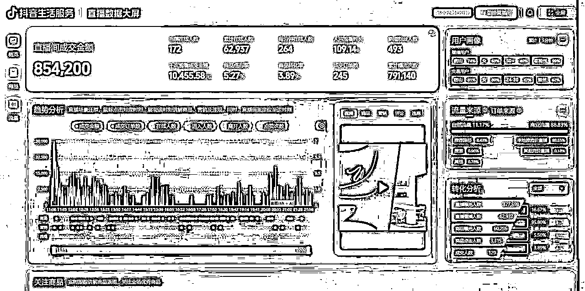
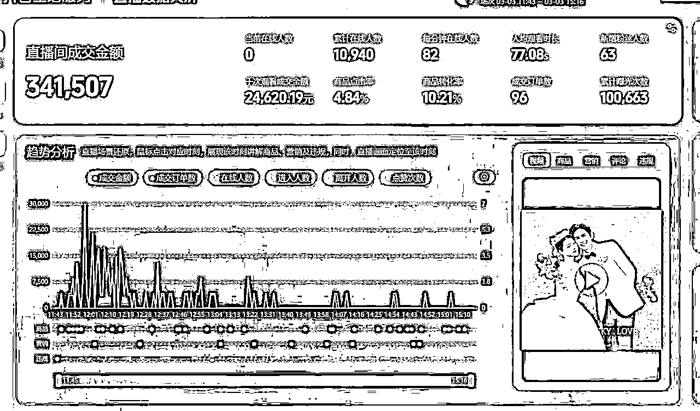

---

## 三、一场教培机构的引流+转化拆解

先交代一个行业背景：教培行业政策调整后，文化课补习收缩，艺术培训反而遍地开花。我们随便在东莞一看，少儿艺培机构就有6000多家。

这次案例，是一家位于东莞镇上的少儿篮球培训机构。机构面积不大，老板很有教育情怀，但完全不懂线上引流。

教培机构的客户，基本都在校区周边3公里范围内。而且这些家长之间天然有联系：同学妈妈推荐另一位同学妈妈，成交概率会更高。所以我们没有选择抖音，而是选择了微信视频号。

为什么？因为视频号自带社交关系属性，不用跨平台跳转，能够一层层穿透朋友圈关系网。这比在抖音里大海捞针要高效得多。

我们的第一步是：**社群裂变+预约直播**。

先从机构现有的学生里，筛选出35位粘性最高的家长，一键拉群（这个人数不需要对方同意就能直接建群）。然后用红包+礼品组成邀约激励，让大家开始第一轮裂变。

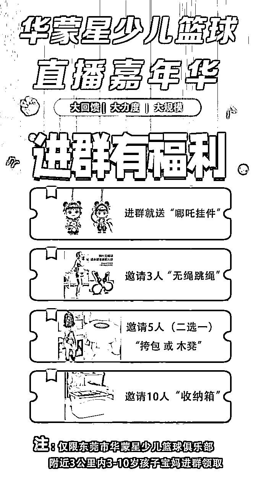

两轮裂变下来，校区已经收获了一批新的潜在客户资源。

紧接着，我们让这批已经被活动调动起来的新老用户，一起去预约机构的直播间。这样可以给直播间奠定基础人数，让开播时的数据不至于太难堪。

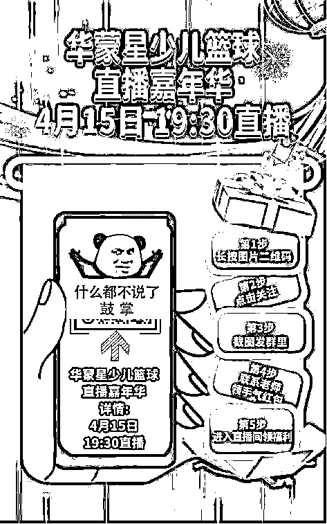

更关键的是，这批预约用户自带清晰的用户画像：IP在广东东莞道滘镇、孩子年龄主要集中在3-12岁、多数是80后90后宝妈、平时也会刷孩子学习相关的内容。有了这些种子用户，平台的推荐就会更加精准，帮我们撬动更多同城流量。

直播期间，我们会引导观众分享直播间送好礼，每隔10分钟做一轮福袋抽奖，把停留时长拉起来；再通过展示联系方式、引导私信等方式，把同城新用户沉淀到机构私域，为后续成交做准备。

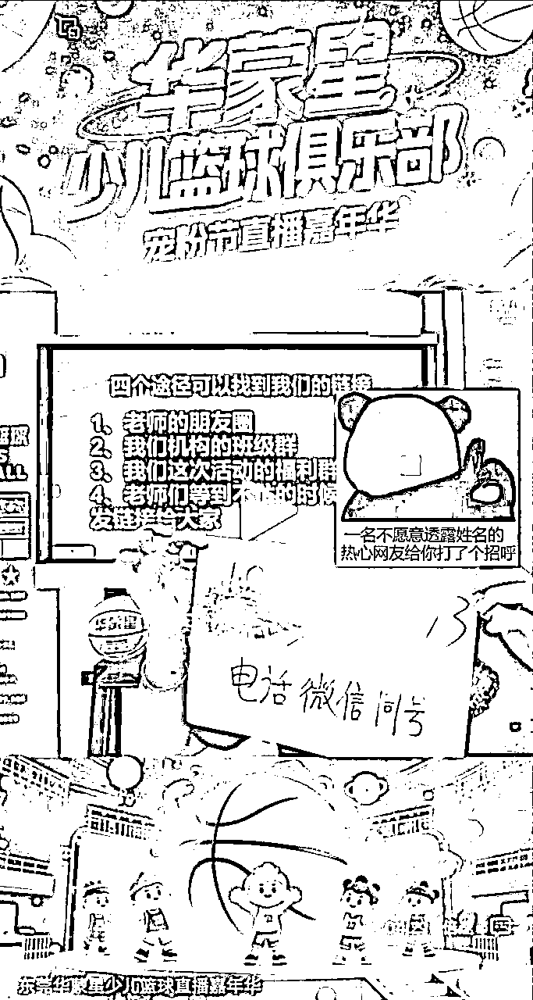
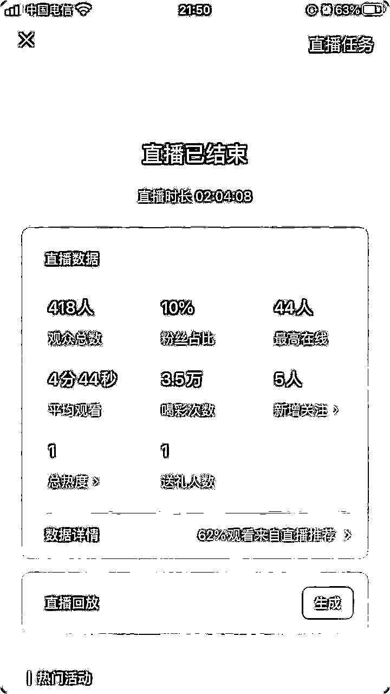
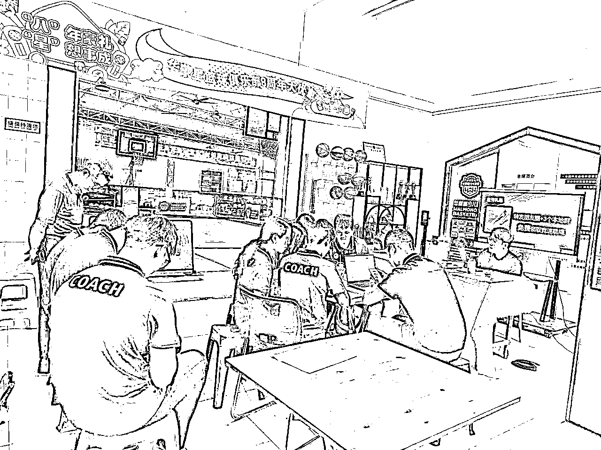
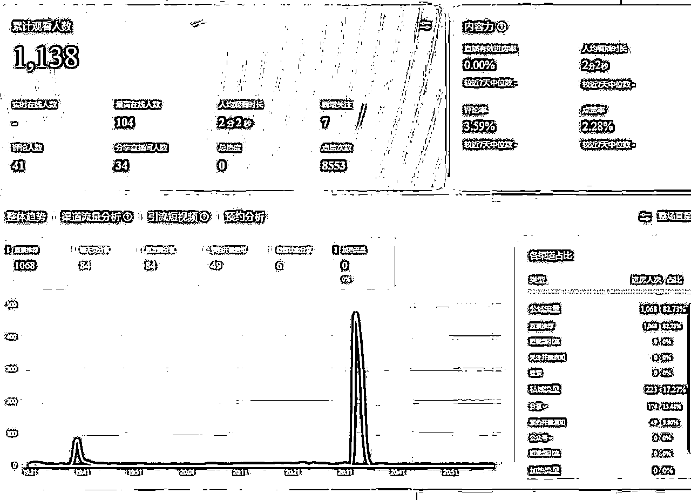

这一套下来，机构不仅获得了以往没有的曝光，拿到了新客资，家长参与活动的积极性也明显提高，老师和家长的沟通成本大大降低。

产生购买之后，还有一波关键的拼团裂变。这个动作主要发生在私域，操盘手需要现场根据SOP流程，带动校区老师一起配合，积极和家长沟通，引导他们继续拉人。

拿这家少儿篮球机构举例：直播结束当晚，报名量只有30多单，新生和老生比例是1:1。

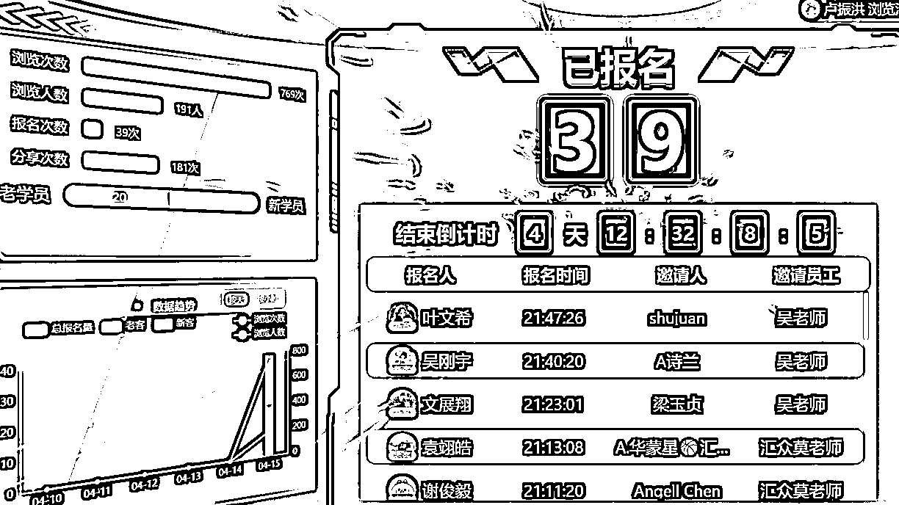

看起来好像还行？但这所机构在校学生大概有100人，正常来说报名量至少到50%才算健康。

于是我在校区驻场两天，盯着后台数据做针对性调整：根据不同的成团人数，对家长进行差异化沟通；给每个新报名客户准备专属的分享裂变海报和文案，让家长可以“无脑转发”；对单独报名的家长，一个个打电话沟通；对2人团、3人团，则重点挖掘手里资源比较丰富的家长。

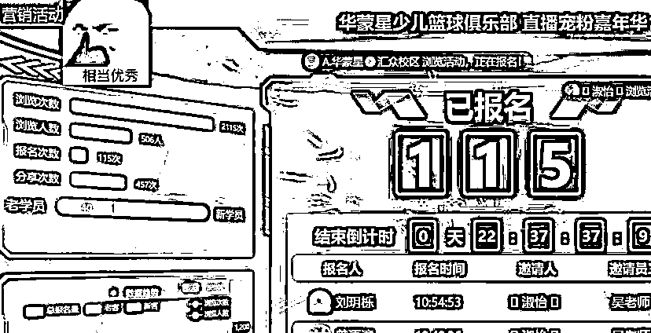

调整之后，数据很快就变了。这家机构非常满意，第一场还没完全结束，老板就现场拍板，让我去帮他另一家校区也做一场。

说完引流，再聊转化。

引流产品客单价通常比较低，真正的利润在后端。以一家书法美术类机构为例，我们做的是“无体验转化”——在学生正式上体验课之前，就用专业话术邀约家长，以“到店领礼品+免费测评”为由，把客户约到线下的周末活动现场。

活动当天，现场设置签到区、测评区、谈单区、礼品区等功能区域，再根据不同老师的专业程度和沟通能力，把合适的人放在合适的位置上。通过完整的动线设计和环境氛围，让家长在没上体验课前就完成报课。

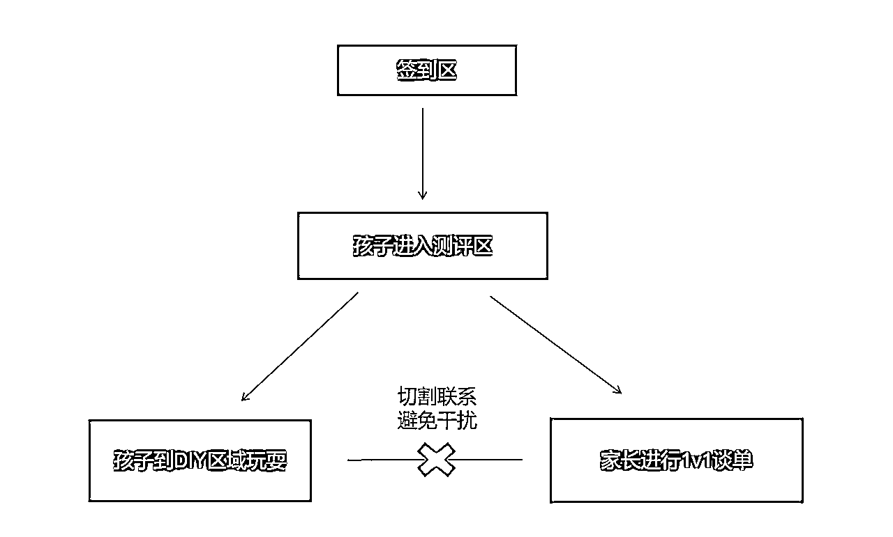

这样操作下来，到店转化率基本都能做到30%以上。再叠加校区后期课中、结课后30%左右的转化率，一场活动的整体转化率，可以做到60%甚至更高。

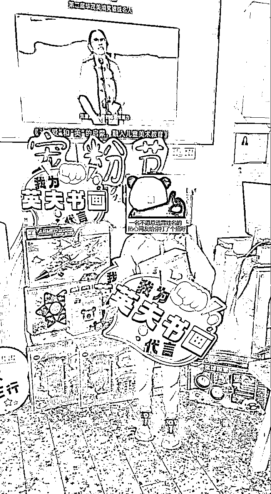

---

## 四、我实际交付了什么？又赚到了什么？

这个月，我交付了4家机构：少儿美术书法、声乐乐器、少儿篮球，还有一家青少年宫综合体。平均每家机构交付时间在3天左右，个人收益4万多。

说实话，这还是我在兼顾团队陪跑的同时抽空做出来的。如果全身心扑在交付上，订单量至少还能再翻一番。而且我现在交付的还是少儿艺培板块，实际上餐饮、婚摄、美业、口腔这些类目，操盘手经过系统培训和实战之后都可以交付，收入天花板还有很大空间。

另外，目前前端获客主要靠抖音中心化投流打客资，每天都有大量新线索进来，再由前端销转完成筛选转化，所以派给操盘手的订单是稳定的，不用担心“没活干”。

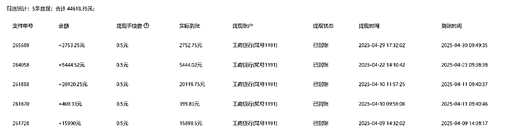

除了钱，还有更值钱的东西——综合能力。

我给自己总结了六个收获：

1. **懂流量**。知道什么类目的机构适合什么引流方式。比如少儿艺培，我们只做视频号，不做抖音，核心原因是抖音精准本地推流的投产比太低。与其花高成本买一批未必能转化的客资，不如基于老带新逻辑，用视频号的社交穿透力做爆破。

2. **懂业务**。教培、婚纱、餐饮、美业……每个行业主流的获客渠道是什么，营销预算大概多少，痛点在哪里，都会越做越有体感。

3. **会统筹**。操盘手更像一个专家顾问，到店后要快速了解每个团队成员的工作属性和性格特点，然后排兵布阵，把效率拉满。

4. **对数据敏感**。操盘交付就是跟数据打交道：投流费用带来的ROI实时变化、拼团裂变的新老比、成团人数……数据是指导下一动作的关键信号。

5. **问题处理能力**。商家会有疑惑，前端沟通也可能出现信息不对等，甚至会有客诉。交付老师要在现场临危不乱，耐心沟通，找到问题背后的真实需求。

6. **关系维护能力**。这个月交付的4个订单里，有3家都在活动期间给我推荐了新客户，其中不乏大客户。这些推荐过来的客户，成交概率远高于新开发的客户。

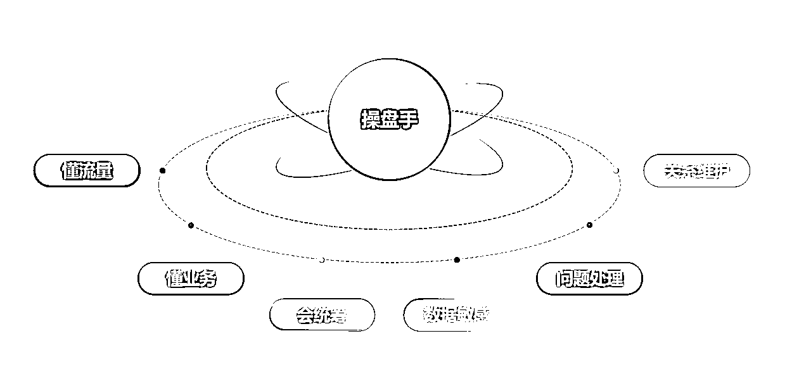

交付期间，不仅要表现出足够的专业度，还要愿意顺手帮机构解决一些经营问题，跟校区老师做好客情。信任一旦建立，转介绍就会源源不断。

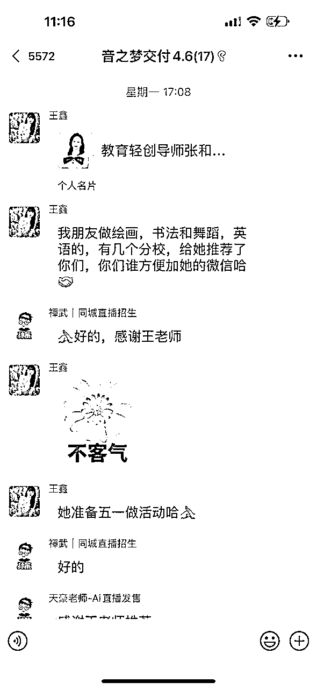
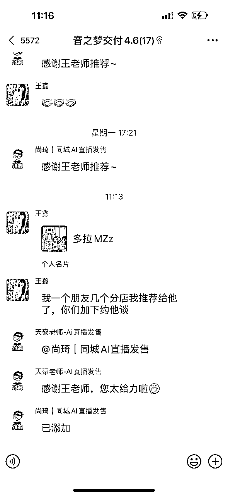

---

## 五、为什么我能快速上手？

一个月前，我还在做前端商务和客资销转，凭什么能马上转型做操盘交付？

我复盘下来，主要靠两点。

**第一，干中学。**

团队里的人大概分两类：一类目标清晰、自驱力强，愿意主动承担没做过的事，把每一次实战都当成学习机会；另一类则希望有标准参考，每一步都被安排得明明白白，否则就不知道怎么办。

龙哥老师有段话说得很准确：很多人不是能力不够，而是思维方式卡在了“做题家模式”里——总希望事情有标准答案，有教材、有模板、有路径，照着抄最稳。

但真正的成长，只能靠“干中学”。我在开始做交付之前，也只是跟着带教老师完整跑过一遍流程而已。不同的是，我会把整个方案框架理解透、消化掉，然后告诉自己：剩下的，在实践中摸索。

每次交付，我都会认真观察每个动作落地后商家产生的变化，理解SOP背后设计的逻辑，真正吃透方案，而不是当一个套公式的执行机器。

**第二，保持思考。**

比如在教培机构交付过程中，我会想，如何更好地调动私域的积极性。我的做法是：先用试探性的活动话术做第一轮触达，凡是正向回复的，就让老师拉进一个重点维护群。最后这个群里的，全是活跃度最高的“鲶鱼用户”，他们在拉新、报名、拼团的过程中也是最积极的一批人。

每一个优秀操盘手，都是在一场场交付中不断思考、总结，再反推优化出属于自己的SOP。

---

说实话，同城直播发售不是什么风口神话，它是一套把本地生意重新做一遍的底层能力。

如果你也是实体商家，正在为流量焦虑；如果你想进入这个赛道，又不知道从哪开始——希望这篇复盘能给你一点参考。

我是天豪，期待和你交流。

很多人以为，操盘交付的终点是把SOP跑通就够了，但真正做过的人都知道，每一次交付都是一次“排雷”过程。

没有哪场交付能一上来就满分。哪怕你前期把社群裂变、文案、直播间引流动作都设计得再细，真正跑起来还是会暴露新问题。这些问题往往藏在每一个看似不起眼的环节里——一条文案的钩子、一次裂变的海报、直播中某个引流设置，甚至一场私聊的话术节奏。

别怕暴露问题，怕的是问题被重复踩第二遍。更好的做法是：在自己的SOP副本里直接做备注，记录下调整动作以及背后的思考逻辑。当同一个优化方向在多次测试中稳定带来正向效果时，再把它同步给团队。这套“边交付、边优化、边沉淀”的打法，不只适合教培，婚纱摄影、餐饮、美业、健身、瑜伽普拉提等本地实体类目同样适用。

还有一件事比内部复盘更重要：听客户怎么说。

客户是最好的检验员。就像一家公司的市场部永远比研发部更早感知到消费者的态度，一线人员拿到的反馈，往往就是产品迭代最真实的信号。

当年雷军还在金山的时候，软件做出来卖得不好。他没有坐在办公室里看数据，而是直接跑到中关村那些卖光碟的电脑店，跟销售人员一起站店卖软件。正是在这个过程中，他发现产品操作太繁琐、用户根本找不到安装指引，随即立刻调整。这个细节，直接改变了产品的命运。

所以，当客户在交付中告诉我们“这个操作流程效率低，老师负担重”时，不要觉得是抱怨，那是需求。把这些痛点一一记录下来，去思考能不能用AI+RPA的方式重构工作流。一旦这串流程跑通且可复用，它甚至不是一个内部工具，而是一个有商业价值的产品。

回到我们目前在做的事——“同城直播发售”这条路，我们已经迭代了一套与半年前完全不同的架构。

现在的客资主要靠抖音投流获取，采用统一中心化投放，销转团队负责新客资的转化，客户成交后，订单会自动派发给全国各地参与操盘交付的老师。

交付老师能覆盖的类目非常广，不局限于教培、艺培，还包括婚纱摄影、餐饮、美业、健身房、瑜伽普拉提等。与此同时，公司会指导并辅助交付老师搭建自己的个人IP账号。因为交付过程本身就是一座素材富矿，把每次实战中产生的新素材通过“扒爆款+二创”的方式持续输出给账号，内容和交付就形成了正向循环。

交付老师可以选择全职投入，也可以作为副业兼职。比如你在广州，恰好有本地订单需要交付，而你又有时间，这个单子三天左右就能带来一笔很可观的收入。

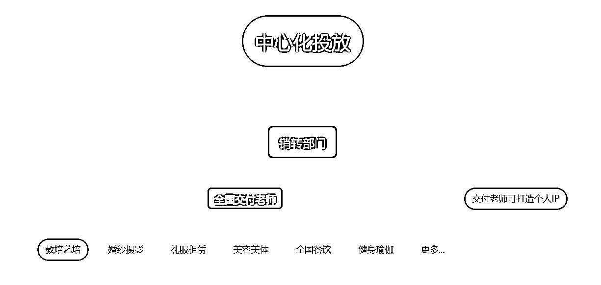

这片市场的体量远比大多数人想象中大。作为操盘手老师，随着案例累积，你会越来越懂各行各业的商业生态，成为他们在流量获客上真正认可的专家。就像涛哥说的，这件事穿越时间周期，是一条长线事业，而不是你随手试一下的众多项目之一。如果你愿意和我们一起深耕，它大概率不会让你失望。

聊完项目，说说我自己。

写这篇内容的时候，4.18刚过不久，我也刚完成赚钱的续费。进入赚钱有术之前，我不太相信一个社群能改变人的轨迹。这一年里，我参加过视频号口播带货航海，也跟过Web3航海、同城发售航海。也有过一段迷茫期——刚从房地产出来的时候，整个人像和互联网脱了节，以前那套传统营销打法忽然变得不管用了。

直到我在大量的帖子里和航海项目中看到孙策老师的「同城直播发售」，我做出了一个决定：屏蔽其他项目信息。

不是因为冲动，而是在充分分析市场后，我认定同城直播发售有极大的市场空间。为了让自己的认知更扎实，我入职了广东本地一家头部的本地生活公司，在近一年时间里，把同城实体、本地生活的底层逻辑摸了个透。去年10月，新一期同城发售航海启动，我辞职加入了这个项目。

现在正值4.18刚过，估计圈里也有不少和我当初一样刚进来的新朋友。以我自己的经历，想给你们三条建议：

第一，多去看航海项目和航海手册，认真评估是否适合自己；
第二，一旦锁定方向，就大胆去尝试，一边泡精华帖，一边坚定实践；
第三，不要追求你做过多少个项目，要追求在某个项目上的深耕深度——跑通了，才能放大。

最后，真的非常感谢赚钱有术，感谢同城直播发售项目，也要感谢孙策老师。

如果你也愿意脚踏实地，愿意从0到1去学，愿意为自己的结果负责，欢迎你加入我们。

祝你在这个喧嚣的世界里，找到属于你的价值感与掌控力。

江湖再见。

——天豪

祝大家都赚钱有术，八方来财。