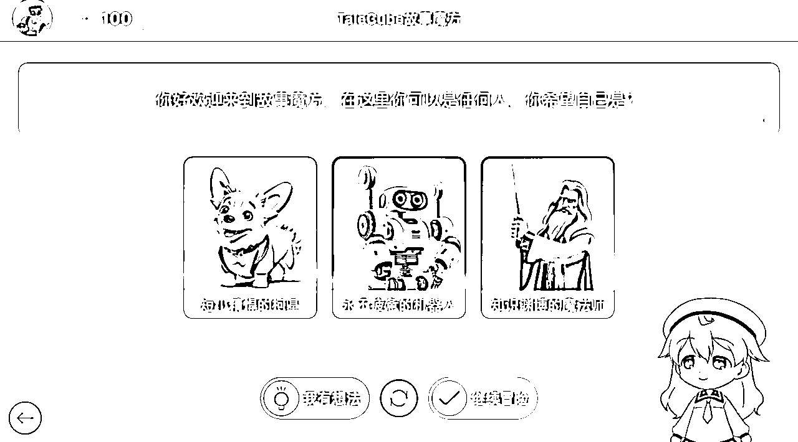
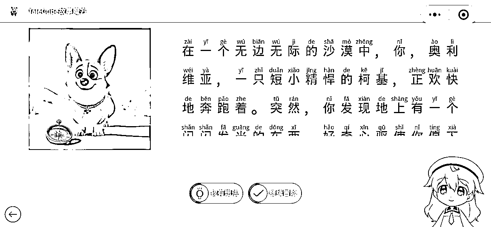
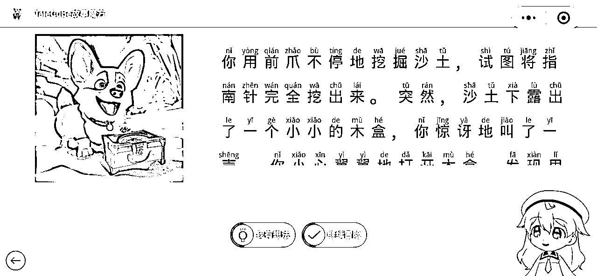
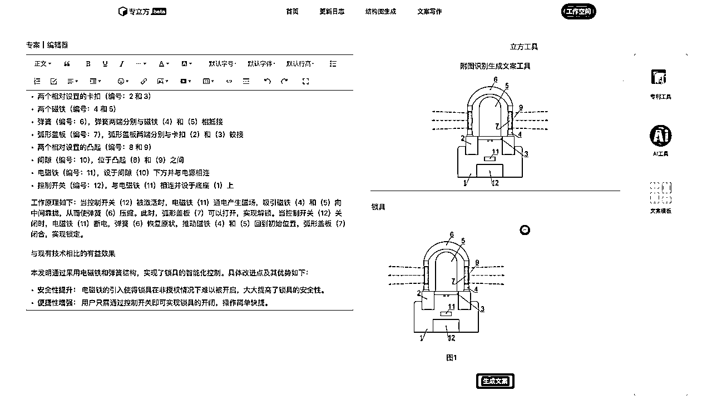
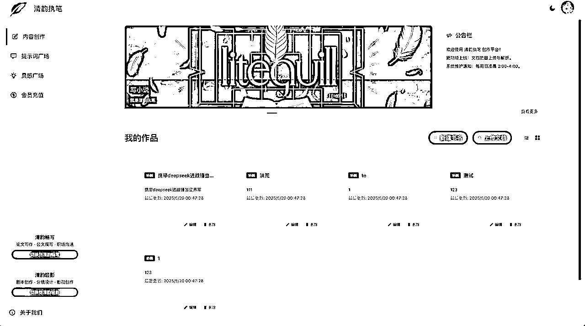
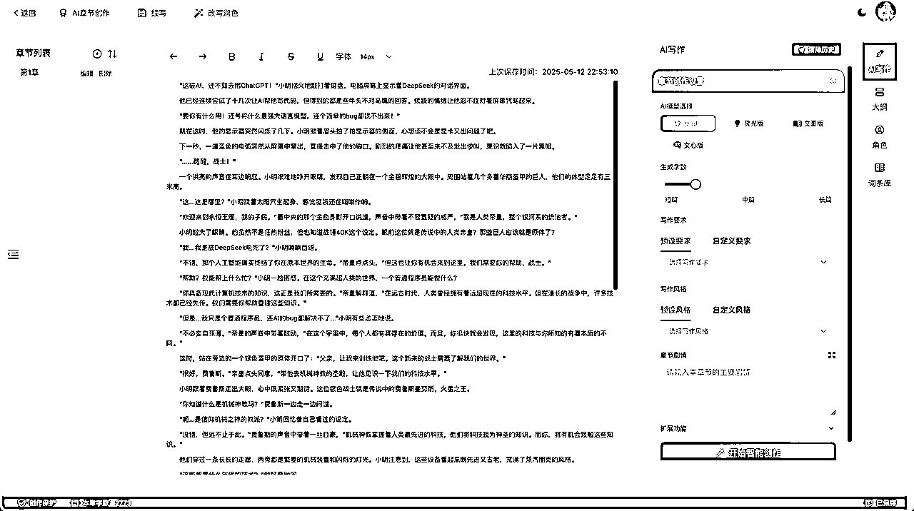

# 程序员4个月AI卖铲实录：产品没人用、功能全白做，我把弯路走成了经验

大家好，我是cyrus，一个只会写代码的普通人。今年4月18日加入了赚钱有术，而早在加入之前，我就已经在“AI卖铲子”这条路上扑腾了。很遗憾，直到现在，我依然没有一个拿得出手的产品，甚至经常把平台做到“门可罗雀”的地步。比起圈里那些月入六位数的大佬，我的成绩单确实够惨的。可偏偏我是个执行力很强的人，每次看到风口就想冲进去开发工具，结果往往是：做的产品既飘忽又泛化，短时间看不到钱，长时间又耗不起。

作为一个对商业一窍不通的技术人，我想把自己这段并不光鲜的经历摊开来聊聊。如果能引发一些共鸣，或者链接到同频的圈友，那就值了。欢迎拍砖交流。

## 那些年我做的“铲子”

先快速过一遍我过去折腾过的项目，大多已经凉了，但它们至少证明了我卖铲子的决心：

CSGO市场的捡漏机器人——扒饰品价格，算合成概率，幻想低买高卖。

故事魔方——闯关式AI绘本创作，加上2D数字人讲解，想让小朋友自己做出作品。

专立方——拿别的专利参考图，用AI对结构进行重新想象，试着做出新东西。

AI魔镜复刻——从国外视频里学来的玩法，线下搭了一套装置做展示。

写作平台litequill——这个后面会详细讲。

## 为什么非要挤AI卖铲子的独木桥？

刚进赚钱那阵，我整个人是懵的。刷精华帖刷到眼花：AI创作、跨境电商、抖音带货、知识付费……每个赛道都有人赚到钱，但仔细一看，很多对我这种技术人并不友好。要么要砸钱，要么要出镜（我极度社恐），要么得会写文案、懂营销。这三样我全不沾。

但AI不一样。我本来就是计算机专业出身，虽然学校只教了前后端，机器学习、深度学习是我自己扒网课啃出来的。从GPT-2时期我就开始关注，一直到DeepSeek火起来，我意识到：机会来了。程序员不就该在技术变革的时候卖铲子吗？何况我全栈能力都有，门槛相对低。于是我一头扎进AI创作，打算边学边做。

## 从0到1的AI创作平台：最痛的一课

这里重点聊聊litequill这个写作平台。

一开始，我犯了典型的技术人思维错误：以为产品做得好，用户就会自己来。现实很快打脸。1月到4月，我主要在学习、试错、研究市面上主流的AI写作工具，分析它们的功能和商业模式。我一心想做一个“ALL-IN-ONE”的创作平台，先搭了第一个demo——AI网文写作助手，功能非常初级。

demo完成后，我满怀期待地等用户涌进来。结果，一片寂静。根本没人知道这个产品，自然也没人用。那一刻我才真正明白：开发产品只是创业的极小一部分，找到用户、解决他们真正的痛点才是核心。

小伙伴建议我去直播、做切片，我一口回绝。我觉得直播观众大多是看小说的，不是写小说的，而且我一直把AI写作定义为帮作者提效的工具，读者不是目标用户。

我开始重新审视产品定位。我一直以为，AI写作就是帮作者提升效率、简化流程。但我忽略了一个问题：我真的了解网文作者吗？他们的痛点是什么？他们真的需要AI吗？

这时候我已经加入了赚钱，于是开始翻AI写作的精华帖，看航海贴，加了好几个领航员，还花钱报了写作课。准确说，是我让女朋友去学的。她写了两个短篇，竟然被签约了，但长篇写不下去。最后课学完了，上架的短篇一分钱没赚。

我开始怀疑：难道写作的尽头是卖课？那些卖课的赚得盆满钵满，跟着学的基本没成绩。当然也有人在晒收入、晒签约，看起来网文是个好副业。但也许是我没研究透，也许只是幸存者偏差。总之我陷入了迷茫，不知道这件事到底算不算一门好生意。

## 线下组局：被建议冲昏头脑的代价

4月底，杭州搞了个2050活动，很多大佬都来了。正好有人组了AI写作的线下局，我去了。在局上我演示了自己的平台和之前做的产品，不少人表现出兴趣：“你这个AI写作，现在有什么新功能？”“现在主要做网文、短篇、长篇。”“现在都卷大模型了，你这场景太窄了。论文检测做不做？AI润色呢？短视频脚本可是风口，赶紧布局！”“论文查重和润色是学生刚需，毕业季流量很大！”

当时我一听，觉得天啊，太有道理了！回来就跟打了鸡血一样，拉着小团队拼命加功能：论文AI检测、文本润色、短视频脚本自动生成……能想到的全排上期。五一假期天天熬夜，就盼着新功能上线能惊艳全场。

结果被泼了一大盆冷水。功能是陆续上了，但用起来一言难尽。论文AI检测，用户反馈说有时还不如免费工具准，界面提示也不清楚。文本润色，要么改得前言不搭后语，要么改了等于没改，用户试一下就跑了。这些功能最后成了典型的鸡肋：扔了可惜，留着又没用。投入了大量时间精力，用户不买账，活跃度没起来，bug倒是堆了不少。

为什么？我事后反思，有两个核心原因：

第一，需求理解偏差，缺乏深度调研。那些在局上听到的需求，更多是“我觉得你需要”，不是用户真正的痛点。我们没有沉下心去研究用户到底在什么场景下需要、需要什么效果，就盲目上马。这就像看到隔壁火锅店生意好，也不管自己能不能吃辣，先把红油锅底备上了。

第二，技术与应用脱节，对AI能力的边界认识不清。AI写作虽然火，但现阶段不是万能的。我们想当然地以为AI能轻松搞定深度润色、创意脚本，实际技术上还差得远。太乐观了，把AI当成了万能许愿机，以为许个愿就能实现。

在这些功能反响平平之后，我才后知后觉地意识到，自己可能有个更大的问题：不太会总结。圈友的建议当时听都很有道理，也都记在了小本本上，但我就是没法把它们和平台的实际结合起来，提炼成能落地的方案。感觉像听了很多场高分讲座，合上笔记就忘了怎么应用。

每当后台数据惨淡，或者看到用户抱怨，我就在心里打问号：最初的需求判断是不是就歪了？功能的定义是不是压根不对？那种感觉，很像是闷头使劲，却总是没打准。现在想想，真正卡住我的，或许不是写代码的能力，而是把零散信息消化成有效决策的能力。

有些道理，光听真的没用，得亲自摔个跟头才懂。回头看，当初那些“看着很美”的功能规划，其实从一开始就没落到实地上。

## 一些关于长期主义的纠结

虽然我已经决定把这个平台当长期项目来做，心里也做好了打持久战的准备，对短期收益看得很淡（毕竟之前做过爬虫、外包，那种按时计酬的活，赚多少一目了然，很难有增量，容易陷入瞎忙的怪圈），但焦虑一点没少，反而更复杂。

焦虑之一：长期是多久？一年？三年？五年？如果我投入大量时间精力，几年后发现方向错了，或者市场变了，那沉没成本不只是钱，更是机会和时间。钱亏了能赚，时间过去了就回不来了。

焦虑之二：价值的衡量。不看短期收益，那看什么？用户数？功能深度？品牌影响力？这些目标都没有金钱那么明确的刻度。今天觉得功能质量提升是价值，明天又觉得用户增长才是价值。标准摇摆，人就会迷失，因为看不到显性结果而自我怀疑。

焦虑之三：机会成本。把精力放在长期项目上，意味着放弃那些回报更快的机会。看到别人在别的赛道短期起飞，我也动摇过：是不是选了一条更难的路？坚持值不值得？这种比较虽然不理性，但总是不请自来。

还有一层焦虑，是关于打造“系统”的压力。当我不再只是出卖时间，而是要搭建一个持续运转的东西时，要考虑的层面陡然增多：内容定位、用户体验、运营维护、持续迭代……这比接一个单子复杂太多。我怕自己眼高手低，想法很好，执行力跟不上。

所以，即便嘴上说着“不看重短期回报”，内心却一直承受着对未来不确定性、能力怀疑、机会成本权衡带来的压力。这种焦虑不像明天赚不到钱那么直接，但更深沉、更磨人。也许这就是选择长期价值之路必然要付出的代价吧。

好在，它也在提醒我：要不断思考和调整，确保自己没有偏离航向太远，确保自己真的在积累和成长，而不是单纯消耗时间。这篇复盘，是我跟自己的对话，愿未来的路能走得更坚定。