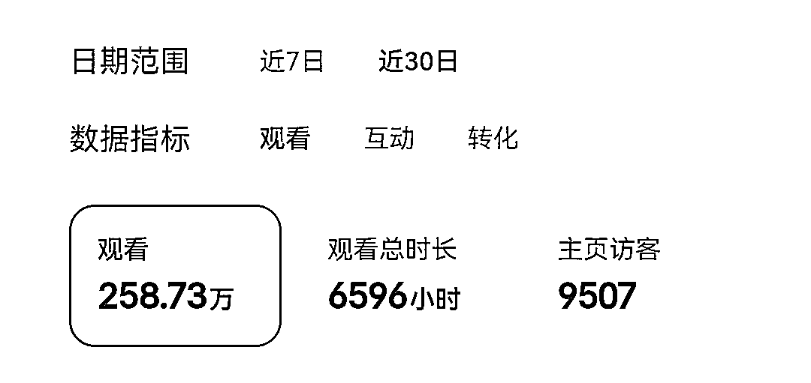
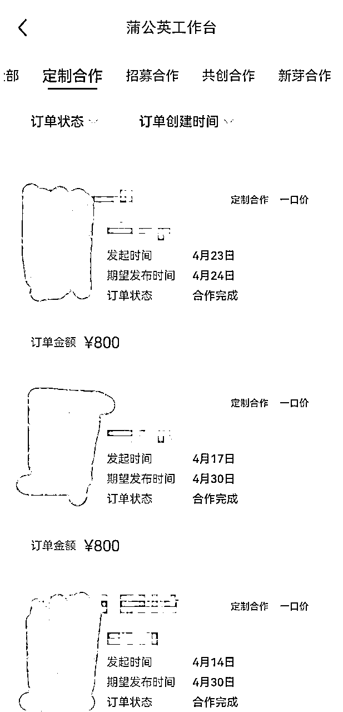
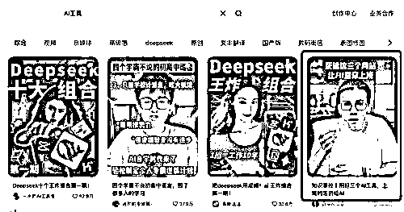
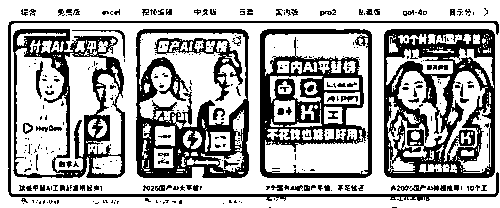
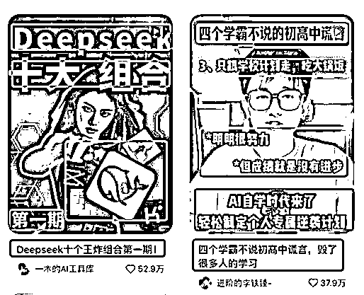
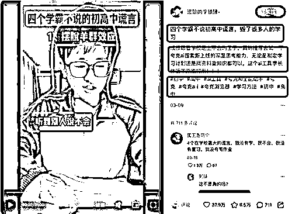

# 一个人靠AI做自媒体航海，0基础起步，6天变现，我是怎么跑通的？

> 来源：[https://qq8alk00fg.feishu.cn/docx/WyGydQ4XroPMS2xgjaIcyT4wnWh](https://qq8alk00fg.feishu.cn/docx/WyGydQ4XroPMS2xgjaIcyT4wnWh)

# 🤖️ 为什么入局

三月航海期间，听龙哥在直播里提到：“现在新人想进AI赛道，最省力的就是做AI自媒体，机会窗口还在。”这句话点醒了我，在此先谢谢@龙哥老师~ 后来在星球里刷到一条异常信号，有位伙伴说做了几天AI账号，几十个粉丝就被递来商单了。我立刻觉得该试一试了。

当时三月航海已过半，我对AI几乎一窍不通，只会拿它当个高级搜索引擎。于是我把赚钱里所有关于自媒体、AI自媒体的干货帖子翻了一遍，照着航海手册直接上手。

目前的战绩是这样的：

✅ 0粉冷启动，3天就开通了蒲公英，3周不到涨到9000+；

✅ 第3天就产出第一条百万播放，账号累计播放已破258w，后面会说明里头的坑；

✅ 第6天拿到第一单，到现在累计接了4单，都是挑价格相对靠谱的，中间也踩过坑，后面也会讲。

特别感谢@龙哥给了我启动的思路和信心。也非常感恩@婧婧，我拿到首单时她立刻语音手把手教我怎么把一单的价值拉满，从谈判到交付注意事项条条都是干货，我还没完全做到位，后面会一项项补齐。

感谢@小鱼，帖子发出后从新手视角帮我提了不少修改建议，降低阅读门槛，我都已优化。还有我的鱼丸@李李，加班帮我改文案配图，让内容更易读，直观多了，真的很感谢。

下面按我的实操路径拆开讲：账号定位、找对标、找爆款、复刻爆款、接商单，希望你能直接抄作业。

# 一、账号定位📍

航海手册里对定位的分类讲得很细。我结合自己AI零基础、兴趣点、想走的变现方式，以及希望短时间出结果的需求，先筛出了两个大方向：AI工具分享 和 热点趋势解读。

接下来需要判断两种定位的变现难度和天花板，于是我让AI做了个粗颗粒度的对比分析。基于这份调研报告，再结合自己的情况，我最终锁定了AI工具分享+商单变现这个赛道，并快速跑出了结果。

P.s. 这一步看似慢，其实是定基调的关键，别跳过。

# 二、找对标 ✍️

在赚钱的帖子里学了方法后，我总结了一套找对标的筛选逻辑：

1. 必须挑能赚钱的账号对标，尤其是变现模式跟你目标一致的，越像越好，学起来快。⚠️ 数据好看不等于能变现，粉丝多、做得精美也可能接不到单，这种就别学。

2. 优先找低粉但有爆款的。我的标准是：粉丝1万以上且近2个月起号，或粉丝1万以下近1个月起号。不是时间长就不能学，只是为了挑更优秀的老师，起号更快。

3. 笔记少但数据好的优先。笔记20~30条以内就有不错成绩的，说明选题力强，可以直接跟爆款跑。

4. 制作成本要低。前期别盲目上设备和场景，压力大容易跑偏；剪辑太复杂，新手要同时学内容和技巧，时间成本翻倍。

5. 至少定1个主对标+N个副对标。主对标用来拆选题、内容结构、封面标题、节奏；副对标用来批量找选题。

我自己的量化参考是：

✅ 商单频率最好一周≥1条

✅ 起号1~2个月内就能变现的

✅ 主对标粉丝在5000~20000之间，副对标看爆款即可

✅ 至少有5条千赞以上的作品

做对这一步，成功率基本就到七八成了。

# 三、找爆款 📚

前两步做到位，选题库基本就出来了。

具体做法：先扒主对标的万赞和千赞笔记，再扒万粉以内副对标的万赞笔记，两周的选题量就有了。

直接给你几个被市场验证过的方向：

工具小合集，真人出镜混剪都容易爆

直接平铺直叙的工具大合集

付费工具vs平替对比，图文和视频都能爆

类似的形态很多，定位和对标找准后，选题会自己冒出来。

# 四、复刻爆款 🔔

初期就是像素级拆解：画面构图、灯光、人物表情语速语调动作、封面排版字体字号配色标题话题、内容框架和爆点，全部照做。等有几条爆款和变现后，再慢慢加上个人风格做差异化。

⚠️ 选题一定要做复盘。爆款是会重复的，要搞清楚它解决了什么问题、给谁看、切入点在哪，这样才能举一反三，批量生产。

⚠️ 前期模仿时内容上要留一手，避免被对标方投诉。保留爆款的核心卖点，同时在信息密度上做加法。比如他讲“deepseek能聊天”，你就讲“deepseek能聊天+豆包能生图+可灵能生视频”。差异够大，平台也不会限流，账号更安全。

新号建议精力允许就一天三更，提升被推概率。

# 五、接商单 💰

拿到商单后立刻确认需求：交付形式是图文还是视频，截止时间是什么时候，然后先出脚本给甲方过。脚本要全面清晰，减少来回沟通成本。

我现在用的脚本模板基本一次就能通过，这里也分享思路：

要点有三点：

1、沟通要礼貌不卑不亢，消息及时响应。合作顺畅，甲方一般会复投。

2、关于跨平台分发和作品授权，要具体情况具体谈。适当可以作为增值权益给到，但如果报价本身就不高，自己已经做了额外加成，对方还想白嫖，就委婉拒绝也没关系，不用有负担。我就拒绝过，后来对方还是找我复投了。

3、报价的坑：我早期粉丝从1000涨到5000时，想着保持上次200的价格显得稳重，结果客户反而在原价基础上继续压价。复盘下来两点教训：

第一，谈判时别主动让步，每让一步最好换对方让一步，才能守住权益。

第二，客户天生有砍价欲望，要预留空间。每次报价都要基于最新数据重新谈，别怕麻烦，否则吃亏的是自己。

📝 最后说一个数据陷阱。开头提到的258万播放、赞藏几十万，确实漂亮，但我踩过坑：别被泛流量爆款迷惑。新号需要爆款破圈没错，但不能只做泛流量，要同时做精准爆款，也就是我们常说的“伪装广告”。

以AI工具为例，最吸甲方的爆款是演示工具如何提升学习和工作效率，直接展示操作过程。目标人群自然是大学生和想提升效率的职场人。那就要思考：这两类人群现在在焦虑什么、需要什么、痛点在哪？围绕这些做内容，品牌方才愿意持续投放。

以上就是我的全过程，希望对你有帮助，祝也在AI赛道尽快拿到结果～😉❤️