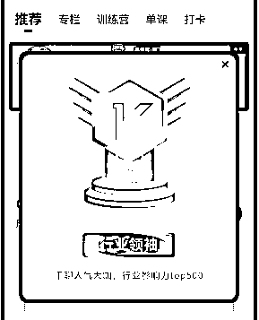

# 把“中介思维”变成提效机器：我的AI讲课赚钱新打法

哈喽，我是领飞。

一个喜欢潜水思考的航海家。我的核心赚钱逻辑就一个字：整合。

之前那篇被加精的【倒爷中介发财术】很多人有印象。我当时喊话要写满108个中介思维案例，现在只写到第22个。去年身体垮了一次，停滞了好久，迷茫期里有圈友留言说要把文章拿去给上大学的儿子看，说真的挺触动我的。

三月份参加航海家线下聚会，被各路AI高手的用法震到了。对我而言，现在阶段最实在的就是先用AI把自己武装起来，把个人效率拉满。

顺带提一句，我平时活儿基本都在讲台上。整合是我的赚钱基本功，卖课是我的变现放大器。千聊影响力榜我进了TOP500，核心关键词七年保持第一。 
顺便求个活儿：有大佬怕上台、缺线上讲师，我随时待命。

说实话我极度讨厌写文章。宁可站着讲一节课，也不想对着电脑敲几千字。很多课程我都是临场发挥，讲完了大纲自然就有了。实在没时间也只提前列几个大标题和小点。

我以前验证过一个能力：给我一份PPT，我能立刻把它讲成一堂课。早期靠这个给团队做外聘讲师赚外快。现在有了AI加持，这项即兴讲课的能力可以玩出更多花样。

就拿正在写的【108个中介思维发财术】来说。

**传统做法是什么样的？**

一个选题前，先坐在电脑前发呆琢磨，再一点点打字排版。搞完一篇文章至少两三个小时，脑子被榨干。课程就更不用说了。

其实我写出的东西，未必比AI强。AI擅长重构选题逻辑，有了我的初稿打底，AI产出的版本反而更丰满、更完整。下面才是重点。

**我的AI打法长这样：**

直接拿选题去🛰️里跟【文章传输助手】聊天，用语音一段一段地讲。过程跟写文章差不多，只是说比写省力太多。当然前提是你脑子里得有料，不然也讲不下去。

讲完一段段语音后，它自动拼成一堂课的音频，转成文字后拼成一篇文章初稿。

这里有个关键点：直接拼接出来的文字是不能用的，必须梳理。

怎么梳理，完全看你想要什么效果：

第一种，内容一字不改，只做去口语化润色；
第二种，整体框架保留，按我的原意把逻辑理顺；
第三种，允许在原内容基础上重组，让表达更清晰有条理。

我的实操是这样的：

先把所有语音流合成一段完整稿，然后丢给【腾讯元宝】，提示词就是：“把以上内容整理成一篇👸号文章，要求知识点一个不少，可适当补充案例，字数控制在3000字左右。”

最有意思的是，元宝现在有两个引擎：hunyuan和deepseek。可以同时得到两个版本。神奇的是，两版都不会跑偏我的原意，合并一下效果更扎实。

**这套流程暴露的需求就是机会：**

1. 把零散的🛰️语音自动合成一条完整音频，别让我手动剪；
2. 把零散语音自动转成文字并汇总成文档；
3. 文档一键AI整理成标准文章；
4. 语音一键优化成可发布的课程音频；
5. 文章+音频自动打包成课程产品。

带团队的负责人最需要这种能力，把碎片化的分享用AI智能体沉淀、复用、裂变。做智能体的朋友，这真的是个可以做起来的产品方向。

最后分享我近期的效率升级感悟，同时也给想要找项目的朋友抛三个我正在落地的中介思维案例：

第一个：【AI智能体中介发财术】用搬运+整合模式，如何把别人的工具做成自己的年入百万生意。

第二个：【AI提示词中介发财术】这是一条能做五年的复利赛道，专做提示词中介月入十万。

第三个：【地图掘金中介发财术】用5号员工法+笨办法，半年沉淀两万个精准私域客户。

详细拆解我放在飞书里了：
[`x87o4rv4xr.feishu.cn/docx/NlLydJhSaoTFRAx4yQtcaSH6nSf?from=from_copylink`](https://x87o4rv4xr.feishu.cn/docx/NlLydJhSaoTFRAx4yQtcaSH6nSf?from=from_copylink)