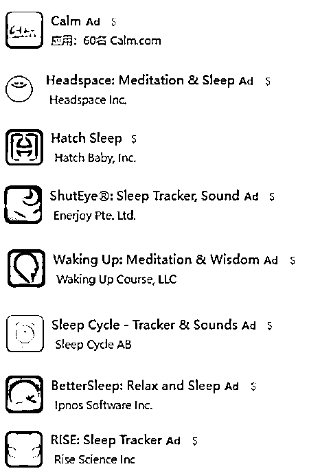
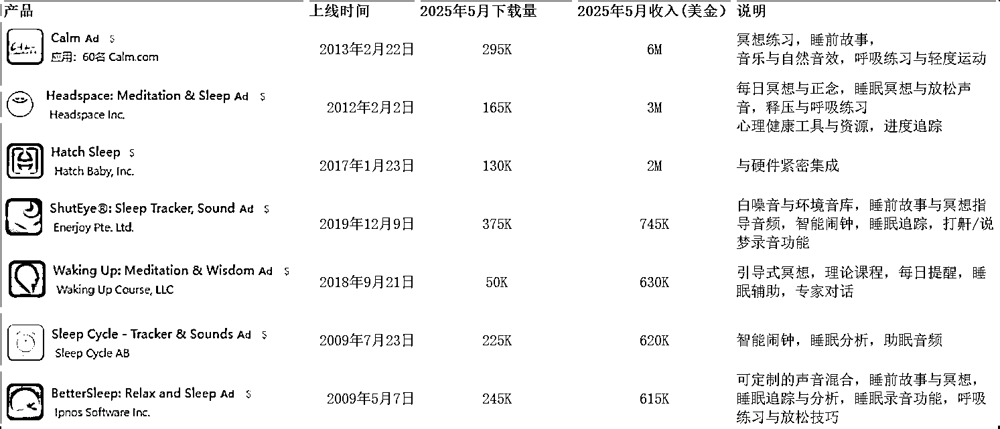
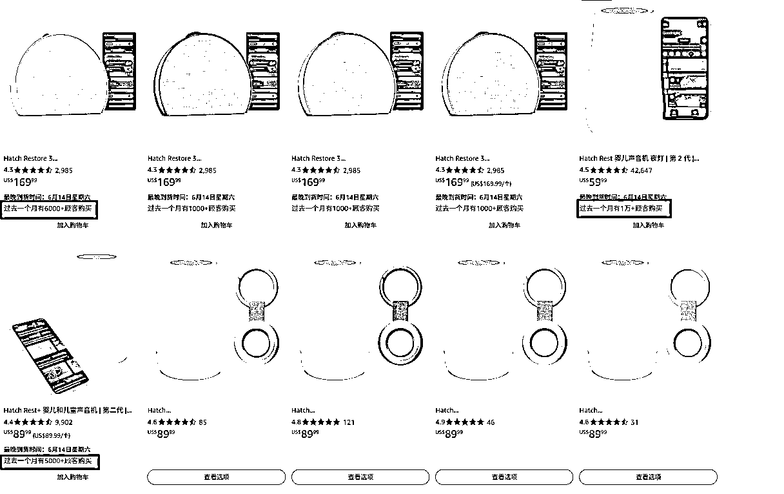
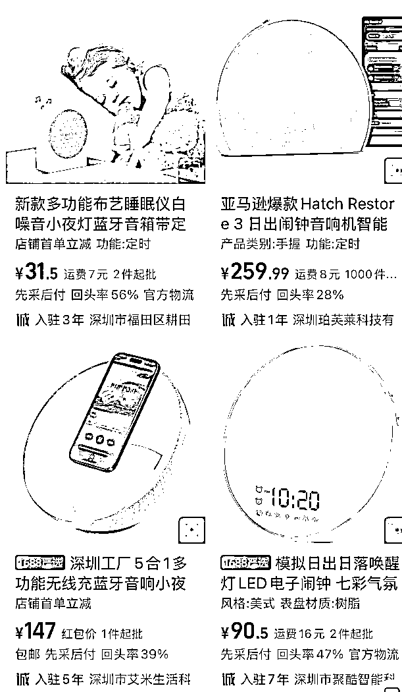
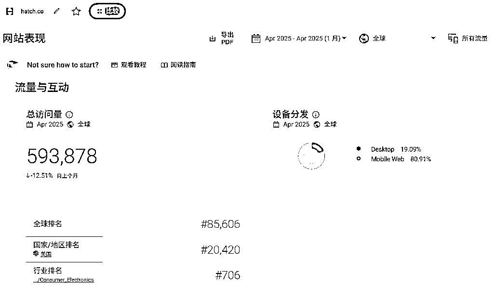
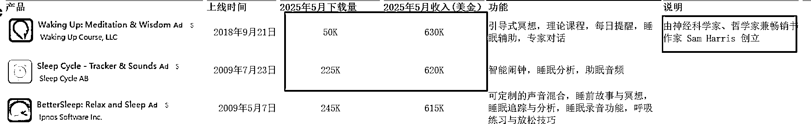

# App 出海的新增长路径：从跨境电商切入，让硬件带动软件

应用出海，正在变得越来越难。

我是特里莎，长期关注 App 出海，最近也在思考跨境电商与应用产品结合的可能性。今天想借一个案例，聊聊开发者能否跳出应用商店和广告投放的旧框架，找到新的增长入口。

## App 获客，为什么越来越吃力？

过去，用户想找一款应用，通常会打开 App Store 或 Google Play 搜索。现在，他们也可能直接向 ChatGPT 提问，获取解决方案。用户的搜索习惯变了，应用商店不再是唯一入口，原本属于 App 的注意力也被其他渠道分走。

与此同时，应用商店的自然曝光空间越来越有限。以 App Store 为例，搜索结果中广告位置增多，想要获得展示，开发者往往要投入 ASA。产品即便口碑不错，也未必能靠自然流量被用户发现。

平台推荐机制也更偏向已有成绩和信任基础的开发者。谷歌会给优秀应用和开发者更多扶持，苹果的编辑推荐也常常流向知名产品。对新团队而言，获得关注的难度随之增加。这背后并不难理解：应用数量庞大，编辑的精力有限，也需要尽量选择熟悉、可靠的合作对象。

如果转而依靠 Facebook、Google、TikTok 等平台买量，团队又要面对持续上涨的广告成本和不理想的投资回报。单纯靠竞价获取用户，越来越难支撑健康的增长。

在这样的环境下，是否可以从应用商店之外寻找流量？Hatch Sleep 提供了一个值得研究的方向。

## Hatch Sleep：先卖睡眠硬件，再带动 App 增长

观察健康与健美类应用榜单，会发现不少产品都在熟悉的赛道里竞争：内容、音频、AI 功能相似，头部产品又常常拥有苹果推荐、获奖经历或充足的买量预算。

Hatch Sleep 的做法则不同。它没有把增长完全押在 App 分发和广告投放上，而是先通过电商渠道销售智能睡眠设备，再让购买者使用配套 App。硬件成为入口，App 承担后续服务和订阅，形成了“销售设备、获取用户、促进留存、推动续费”的增长链条。

从榜单数据来看，Hatch Sleep 是其中少数没有投放 ASA 的产品之一。根据点点数据，其应用内购月收入约为 200 万美元；Sensor Tower 的估算则约为 100 万美元。无论采用哪组口径，它的收入都仅次于 Calm 和 Headspace——这两款产品不仅运营多年，也曾获得苹果奖项。

与许多依靠买量驱动的睡眠应用相比，Hatch Sleep 的收入表现也更稳定。买量型产品的营收往往会随着投放规模起伏，而 Hatch 在过去几年呈现出持续增长的趋势。

Hatch 的产品将智能硬件与睡眠应用结合。公司早期重点布局独立站和亚马逊等电商渠道，销售智能睡眠灯。消费者买回设备后，需要通过 App 设置并使用相关功能，于是硬件销售自然转化为应用下载和后续订阅。

据 Modern Retail 报道，Hatch 在 2023 年的销售额约为 1.4 亿美元，也是亚马逊平台上增长迅速的品牌之一。

至于产品的生产来源和价格，原文作者将相关信息作为知识星球福利分享，答案展示在 1688 平台截图中。

Hatch 的独立站每月访问量约 59 万，留存率为 42%。

## 电商不只是卖货，也能成为 App 的增长渠道

在应用商店流量趋于饱和、获客成本不断上涨的情况下，Hatch 的模式带来了几方面启发。

### 1. 不必把分发完全交给应用商店

用户可以通过亚马逊、品牌独立站、社交媒体或育儿博主认识产品，购买硬件后再下载 App。应用是产品体验的一部分，却不必独自承担获客任务。

### 2. 内容和口碑可以持续带来用户

Hatch 主打睡眠训练系统，在 TikTok 上有视频获得约 2000 万次播放，用户生成内容超过 50 万条。亚马逊商品评价中，也有消费者提到 App 与硬件搭配使用的体验。社交传播和商品口碑，因而都可能转化为应用流量。

### 3. 让一笔获客投入服务多个收入来源

购买硬件的用户也是潜在订阅者。电商推广所带来的用户，不只贡献设备销售，也可能为 App 带来长期收入。这样一来，推广成本可以由硬件与订阅共同承担，而非完全依赖 App 广告或单一电商利润。

### 4. 软硬件协同，延长用户使用周期

Hatch 通过非手机设备营造睡前使用习惯。硬件帮助用户持续使用 App；App 则可以更新内容，增加设备的长期价值。相比单纯的软件功能，这种组合更容易建立使用仪式感，也有助于留存和续费。

此外，来自真实硬件交互的数据，可能比用户简单填写的睡眠评分更有参考意义，也为未来结合 AI 提供了基础。

Hatch 独立站每月约 59 万访问量，来源包括自然搜索、社交平台和部分广告投放，用户主要来自美国。

### 5. 网站和电商广告的数据，可能更便于优化

iOS 隐私政策变化给 App 广告归因和投放分析带来不少挑战。相比之下，独立站和亚马逊广告的投放数据，或许能让团队更清楚地观察转化表现，进而优化 ROI。对部分团队来说，直接经营网站或电商渠道，也能减少对 App 广告链路的依赖。

## 普通开发者可以从中借鉴什么？

**第一，别让应用商店成为唯一的增长入口。**

除了榜单和搜索广告，还可以探索跨境电商、独立站、内容平台，或其他能够触达目标用户的渠道。Hatch 选择了硬件，其他团队也可以尝试 AI、内容、IP 等方式，找到 App 生态之外的用户来源。

睡眠应用榜单里，还有一个依靠个人 IP 获得成功的例子：Waking Up。它由神经科学家、哲学家兼畅销书作者 Sam Harris 创立，月收入约 63 万美元，RPD（收入除以下载量）超过 12 美元。 这说明，个人影响力也有机会转化为产品增长。

**第二，软硬件组合有助于建立信任和提升留存。**

硬件可以成为用户认识品牌、开始使用服务的实体入口。用户卸载一款 App，只需轻点几下；但处理一件花钱买来的设备，通常需要更多考虑。硬件与软件相互配合，也能让用户更深入地使用产品。

**第三，思考 AI 如何进入真实生活场景。**

随着大模型能力发展，Hatch 未来或许可以从睡眠设备进一步升级为智能助手，例如提供语音交互、个性化睡眠建议，或更细致地理解用户情绪。智能硬件则能成为 AI 进入家庭的终端，让服务在具体场景中发挥作用。

因此，App 与硬件的结合，还有机会发展成 AI+IoT 平台，并通过长期订阅提升用户价值。对于创业者来说，“硬件切入、软件留存、AI 升级”可能比单独做一款 App 或一台设备更具延展性。

## 结语：别只在拥挤的赛道里争流量

当应用商店流量集中、广告价格不断走高，寻找新的入口就显得格外重要。并不是所有团队都能打造爆款 App，但可以尝试建立自己的流量来源和商业闭环。

Hatch Sleep 的案例说明，硬件、电商和 App 并非彼此割裂。把产品、渠道和收入方式组合起来，或许能让一次用户触达产生多重价值。今天值得关注的增长思路，不只是把流量买进来，而是让同一份流量能够持续创造收益。