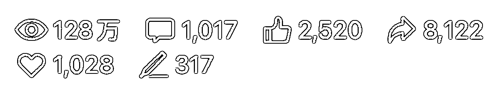

写了整整 8 年公众号，我栽过的跟头，估计比大多数人写过的文章还多。

有一段日子，我每周逼自己输出 3 篇，持续了半年，结果篇篇阅读量在 3000 上下打转，关注数几乎纹丝不动。那会儿我真怀疑过：也许我压根就不是吃这碗饭的料？

直到 2025 年，我把自己这几年的稿子翻出来，认认真真做了次复盘。

这才猛然发现：我压根没搞懂什么叫真正的“爆文”。

那些动辄 10 万+、能持续吸粉和变现的爆款，背后根本不是玄学，而是一套看得见、学得会的底层公式。当我依照这套逻辑，彻底重建了自己的写作思路后，连续拿下 30 篇 10 万+，一个月涨了 2000 多位读者，还顺利锁定了第一批铁粉，从此打开了变现的大门。

先放一下我第一篇爆文的数据：

接下来，我会把这套爆文底层公式，掰开揉碎了讲清楚。不讲虚头巴脑的大道理，只讲能直接上手用的硬核方法。

### 一、动笔之前，先想明白这 3 个问题

每篇爆文的起点，从来不是“我想写点什么”，而是：

**1. 我这篇文章，到底写给谁？**

目标读者决定了你的用词、讲故事的方式，以及情绪从哪切入。

● 如果你瞄的是职场年轻人，那“如何处理好办公室人际关系”就太隔靴搔痒了，他们不痛。

● 他们真正的痛，是“每天机械打卡，生活一眼望到头”。

这才是一篇文章真正能引发共鸣的起点。

**2. 这群人心里最焦虑的是什么？**

稍微列几个常见的焦虑模板：

● 刚裸辞的人：怕下个月收入没着落

● 想转行的人：愁自己没经验、不知道往哪走

● 自由职业者：时间自由了，心里却没底

● 写作新手：每天勤快更新，月底一看钱包空空

写爆文，本质上就是狠狠戳中他们最担心的那个点。

**3. 你这篇文章，能替他们解决什么？**

别急着“讲道理”，要老老实实“给方案”。

打个比方：

● 对自由职业者说：怎么靠个人品牌，稳稳月入 3 万+

● 对想转行的人说：如何拿写作当跳板，彻底告别 996

● 对写了很多没效果的人说：写了 100 篇还没人看？你缺的是这 3 个公式……

### 二、大部分爆文，赢在选题这一步

很多人写不出爆款，根子不在文笔，而在选题太淡、太泛、太没冲击力。

直接看这组对比：

选题有个万能公式：

👉 **强情绪 + 反常识 + 明确人群 + 高冲突感**

给你几个拿来就能套的例子：

● **反转式**：我越不逼自己写，反而越赚钱

● **冲突式**：我拼尽全力，却一无所获（为什么越努力越没结果？）

● **钩子式**：想稳定搞钱？真不能只靠自律（那靠什么？）

每天抽出一点时间，建一个“选题池”表格，随手记下 1~3 个灵感，一个月下来就有 30 多个方向，再也不用对着空白文档发愁。

（说实话，能坚持做这件事的人凤毛麟角，但凡是坚持住的，都离爆文不远了。）

第二篇爆文的数据，也放出来给你感受下：

### 三、爆文的结构公式：黄金 3 段式

我带的学员，最初写出第一篇 10 万+，靠的都是这一套模板。

**1. 开头：钩子三连**

目标只有一个：**3 秒内抓住读者的目光！**

● 提问式：你是不是也经常有这种感觉……？

● 冲突式：辞职半年，副业月入 3 万，但我反而更慌了

● 对话式：朋友一脸惊讶地问我：你当真靠写字养活自己了？

开头最怕的就是“今天我来分享一个……”。没人关心你想分享啥，读者只关心“这跟我有什么关系”。

**2. 正文：案例 + 方法 + 情绪共鸣**

建议按“问题—方案—情绪升华”的节奏来推进。

比如：

● 先抛问题：我写了 100 篇，阅读还是上不去，到底差在哪？

● 再给方案：后来换上了这套结构，篇篇都能跑出好数据

● 接着上案例：把故事讲透，把情绪顶到高点

● 最后补 1~2 组数据，给可信度加码

走到这一步，读者已经“看懂了、被打动了、也拿到方法了”，就差一个漂亮的收尾。

**3. 结尾：高能收尾 + 行动召唤**

别再用“愿你我越来越好”这种软绵绵的鸡汤收场，太没劲了。

正确的姿势是：

● 情绪往上托：哪怕你今天写得还很烂，也别轻易放手，因为你只差一个方法

● 行动推一把：如果你想把这套爆文结构学扎实，我整理了一份写作手册，公众号后台回复【爆文】就能领

**钩子 + 行动召唤，就是涨粉利器。**

这是我的第三篇爆文数据：

### 四、涨粉和变现的真相，藏在“钩子”里

爆文的转化公式说白了就一条：

👉 **阅读量 × 转化率 = 收获的粉丝数**

阅读量靠标题，转化率靠钩子。

你需要在正文里悄悄放一个“诱饵”：

● 比如：「我做了一张表格，每天花 1 分钟就能定好选题，关注后私信我，免费送你」

● 或者：「我把 10 万+文章的写作结构整理成了一份资料，后台回复‘公式’就能领走」

这才是一篇文章能真正带来转化的关键。

涨粉从来不靠运气，而是靠精密设计。每一篇爆文的背后，全是细节堆积出来的。

### 五、总结：爆文写作的底层公式

整套东西其实是一个闭环系统：

1. **选题公式**：强情绪 + 精准痛点 + 反常识冲突

2. **结构公式**：钩子开头 + 干货正文 + 情绪结尾

3. **钩子设计**：在文中自然埋下诱饵，引导关注和私信

4. **用户转化**：精准人群 + 精准情绪 + 有用信息 = 可持续沉淀的铁粉

这套打法，我在实战中反复验证过，带出了无数篇 10 万+，你同样可以拿来复制。

这是第四篇爆文数据：

**真心希望你，不是那个“写了很多却始终没人看见”的人，而是下一个，被别人当作范本去模仿的存在。**

（想联系何老师，可以找鱼丸）