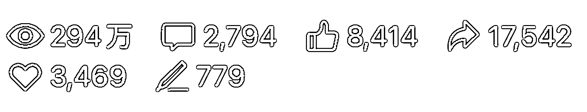
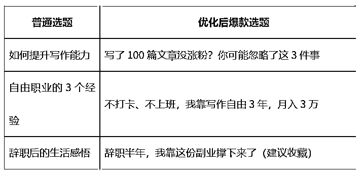
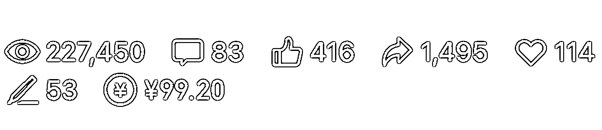

做过八年公号内容，栽过的跟头数不过来。

最灰暗那半年，每周固定更三篇，篇篇打开量三千上下，粉丝几乎纹丝不动。我一度怀疑自己根本没有写作天赋。

2025年的一场彻查，让我看清一件事——过去我只是在凭感觉写字，根本不知道爆款内容是可以被拆解、被复制、被系统生产出来的。

从那时起，我按新方法重建了创作流程，三十篇十万加接连出现，月均涨粉两千多，也收获了第一拨愿意付费的老读者。

先看一张跑出十万加的数据截图：

今天这篇，我就把这条“爆款生产线”的每个环节摊开讲：没有玄学，每一步都能直接照做。

动笔前，先解决三个问题。

任何爆款的起点都不是“我想写什么”，而是“我到底在替谁说话”。

读者是谁，你的语气、故事和情绪表达就跟着谁来。

比如，给二十多岁的打工人看，就别写“如何经营职场关系”，那太温和了。他们更愿意点开的是：“每天挤早高峰去上班，工资全搭进房租和生活费，自由早不知道丢哪儿去了。”

第二个要回答的问题：他们现在最怕、最慌、最担心的是什么？

刚离了职的人怕收入断掉；准备换赛道的人怕选错路；在家办公的人怕时间有了却抓不住；天天码字的新手，忙活三十天，月底一看收入还是零蛋。

爆款内容对准的不是大众，而是某个人群心里那根最绷紧的弦。

第三个问题：读完之后，他们能带走什么？

少讲大道理，多给操作步骤。

想让人掏钱买课，就告诉他怎么三个月搭起个人IP；想帮人摆脱加班，就写清楚如何用下班后的两小时做内容副业；想救写作新手，就列出他们写了上百篇却没水花的三个原因。

太多人出不了爆款，不是笔力差，而是题目选得太普通、太泛，一点记忆点都没有。

看下面的对照，就明白差别在哪里：

把内容选材的核心浓缩成四组词：情绪浓度高、观点反常规、人群指向准、张力和矛盾足够强。

直接套用的三种模式：

翻转式：越不勉强自己写，收益反而稳定增加。

矛盾式：明明做了所有正确的事，结局却一塌糊涂。

悬念式：高收入这事，真不是靠自律，还能靠什么？

平时准备一张灵感收集表，每天随手填两三个选题，攒上三十天，至少六十个备选方向，再也不会对着空白页发呆。

能这么做的人极少，可一旦熬住，爆款只是时间问题。

再放一篇当时的数据：

文章骨架，按黄金三段来搭：开头三秒留人，中段有理有据，结尾推人一把。

开头的三秒留人，有三种简单好用的句式。

直接抛问题：“你有没有过‘努力一年，账户余额还在原地打转’的瞬间？”

制造对立：“离开公司半年，靠接单每月能进账三万块，可我却比以前更慌。”

引用对话：“有朋友当面问我：‘靠写字赚钱，真能养活自己吗？’”

开头最避讳的，是“今天我想分享”这种告别式开场。读者不关心你要分享什么，只关心内容跟自己是否相关。

中段按“问题—方案—共鸣”推进：

先点明问题：写了几百篇内容，却连一个忠实读者都没攒下，症结在哪儿？

再讲方法：调整了文章结构以后，几乎篇篇都有数据反馈。

再讲一个身边人的故事，把情绪托到高处。

再补一两组数字，让判断有支撑。

到这一步，读者心里已经有了“懂了的快感+被触动的热感+能带走的实用感”，收尾就顺理成章。

结尾两条铁律：情绪状态必须向上走，行动指令必须给得具体。

别用“祝你前程似锦”这种祝福语收场，读者没有行动感。

要写：“你写不好，也许只差一套方法。我把整理好的手册做成了PDF，点关注，发消息‘模板’，直接领。”

钩子加上明确指令，才是涨粉加速器。

这一篇的数据也稳定在这个区间：

涨粉与变现的关键，不在正文写了多少，而在于你为读者留没留“下一步”。

一条内容的粉丝转化等式可以简化成：曝光量×沉淀率=新增关注。

曝光量靠标题撑起来，沉淀率靠文里的“诱饵”拉起来。

所谓诱饵，就是给读者的一个回馈：一种是把“选题规划表”当赠品，每天六十秒就能填完，发私信‘表格’就送；另一种是把拆解文档当赠品，在对话里输入‘结构’就能拿。

这些设计不是投机，是让内容真正产生复利的基础。

整套动作串起来，就是一条循环链路：

选材时：情绪浓度够，瞄准最痛的那一点，再用反常规制造张力。

成稿时：开头抓人，中间给货，结尾带情绪。

引流时：在行文里顺势埋下加关注、发消息的由头。

转化时：对的人+对的痛点+有用的内容，才能把路人变成真正的忠粉。

这套打法，我反复验证过很多年，也从学员的十万加里一次次得到验证。你可以不信，但试一次，很可能就回不去了。

愿你成为那个“每次更新都有人等着看”的人，而不是“写了一大堆，阅读依旧惨淡”的人。

最后再晒一次最新数据：

（想深入了解，可以联系鱼丸。）

留言区：

素商：作者的实战经验太实用了，码住！[赞]