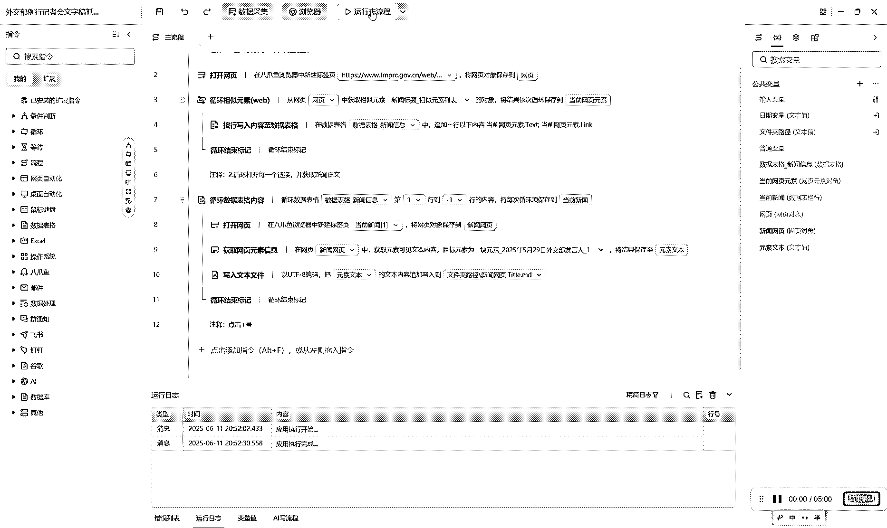

# 用八爪鱼 RPA 搞定外交知识库自动维护的实操记录
作者：龙哥

## 用八爪鱼 RPA 搞定外交知识库自动维护的实操记录

作者： 小查

日期：2025-06-12

## 前言

最近在担任龙哥盟 AI 知识库航海的教练，和社群伙伴交流时反复被问到同一个痛点——**知识库要怎样才能低成本、高频率地保持新鲜？能否做到无人值守地自行更新？**

恰好这段时间在研究机器人流程自动化，我脑中冒出一个想法：**借助 RPA，让知识库的更新维护整条线跑起来。**

于是挑了外交部例行记者会官网做试验场。目标很明确：**每日自动抓取新发布的记者会文本，自动导入 ima 知识库，形成可检索、可对话的外交资讯库。** 下面分享完整走法，文末附上我做好的应用链接，大家可直接体验。

## 用到的工具

### 八爪鱼 RPA

本次选用的是市面上用户量较大的可视化 RPA 产品。零代码、拖拽式搭建，适合普通人做网页抓取与批量自动化。先到官网下载安装，完成注册登录即可使用。

### ima 知识库

知识库选用腾讯出品的 ima。我此前在上面搭建了二十多个共享库，这次新建主题为“外交部例行记者会”，专门收纳从官网抓取的例行记者会实录。

## 案例一：历史记者会文本批量采集

### 需求拆解

外交部网站自 2021 年 3 月起归档了全部例行记者会文字稿，版式简洁统一：总览页是历次会议的目录，每场会议对应一个独立新闻页，页内为当天完整问答。

网站入口：
*   外交部例行记者会总览 [`www.fmprc.gov.cn/web/fyrbt_673021/jzhsl_673025/index.shtml`](https://www.fmprc.gov.cn/web/fyrbt_673021/jzhsl_673025/index.shtml)

*   单场示例页 2025 年 6 月 11 日 [`www.fmprc.gov.cn/web/fyrbt_673021/jzhsl_673025/202506/t20250611_11645752.shtml`](https://www.fmprc.gov.cn/web/fyrbt_673021/jzhsl_673025/202506/t20250611_11645752.shtml)

我的第一步是先把存量吃完：**把官网上的全部历史稿一次性抓到本地，按“标题名.md”存档，为后续入库做准备。**

### 流程构建

#### （1）建任务、填地址
打开八爪鱼 RPA，进入“应用”-“新建应用”，起一个新流程。

#### （2）搭建抓取逻辑
做 RPA 要先理清总思路，再逐层细化。此案例分为三段：

*   用八爪鱼浏览器打开例行记者会总览页，亦可换成 Chrome 并装插件；
*   用循环相似元素把总览页上所有单场新闻链接批量捕获，暂存到数据表；
*   再用一次循环，逐条打开数据表中的链接，抓取正文并导出到本地文件。

关键在于理解循环机制，以及如何用数据表承接中间链接。作为新手，我也是对照社区资料和请教同行才搞明白。

具体指令如下：

先用八爪鱼浏览器打开总览页，保存到变量“网页”。变量可理解为流程中的临时缓存。

随后创建循环相似元素，通过窗口捕获把总览页上一串单场新闻链接抓出来，存入“当前网页元素”变量，再把每场的标题与链接写入数据表。

接着创建数据表循环，逐条打开表内链接并捕获全文，保存到“元素文本”变量。最后把文本写入本地新建文件夹，文件名沿用新闻标题，格式为 md。

运行反馈：

目标达成。

因历史量大，我先批量下载到本地，再统一手动上传 ima。点击几下即可完成入库。

## 案例二：日增量自动抓取并上传 ima

### 需求拆解
案例一处理了存量，日更的记者会怎么办？于是再搭一套流程，目标是：**RPA 访问记者会页面抓取当日新增内容，并自动写入 ima 知识库，让库持续自增长。** 不仅要落地文件，还要完成上传动作。

### 流程构建
主要分两块：

*   RPA 打开最新一天的单场新闻页，抓取内容保存为本地文档；
*   RPA 以人机交互方式操作 ima，完成上传按钮点击、文件选择等动作。

#### （1）抓最新新闻到本地
沿用案例一的思路，打开指定日期的单场页，捕获正文保存为 md。

#### （2）模拟人工上传
这里采用桌面自动化，让 RPA 像人一样定位窗口、点击控件，逐步执行。每个动作都要拆解成 RPA 能识别的指令，才能保证稳定。

这也体现了八爪鱼这类工具的延展性：不只玩浏览器，还能操控本地软件、操作系统与办公程序，场景面被大幅打开。

实话说，这套人机模拟方式有点笨，步骤一多就容易因找不到控件而中断，需要反复微调。目前对 RPA 的理解还不够深，后续会继续研究社区案例寻找更优解。

效果演示：

## 整体启发与可迁移玩法

### 自动化带来的效率感
通过本案例能明显感受到，用八爪鱼 RPA 做数据采集、整理与入库，**把大量重复手工操作压缩到极致。** 配置好流程后，它就成了“信息搬运工”。只要来源结构清晰、格式固定，基本都能快速复用。

### 场景迁移
吃透思路后，可以延展到**财经资讯、企业公告、法规政策、学术动态**等领域，为个人或团队打造专属问答库。举例：金融从业者批量抓上市公司公告，教师每日自动收集教研新规，做法相通。

我建好的 ima 库已可直接问询记者会相关内容。

### 八爪鱼应用市场
官方近期上线了应用市场，**提供上千个现成 RPA 模板与自动化方案**，覆盖数据采集、电商、社媒、新媒体运营等。举例：

*   📕数据抓取与内容监控
*   电商商品比价、评价抓取
*   🛰️群资料整理
*   招聘信息采集
*   短视频热门评论收集

新手可直接搜索需求下载模板再做微调，无需从零起步，上手效率很高。

## 结语：快速入门 RPA 的三点体会

这两天下来，我总结出三条比较实用的入门建议：

> *   从真实需求出发，在解决问题里边学边做；
> *   多翻官方社区与帮助文档，借鉴他人经验少走弯路；
> *   直接找一个接近的模板改写，站在前人肩膀上更快。

我把本次摸索的两个应用免费公开，供有需要的朋友参考：

外交部例行记者会新闻文字稿历史全量数据抓取 jiao-bu-li-xing-ji-zhe-hui-wen-zi-gao-zhua-qu--li-shi-quan-liang?ref=WxXg1c)  <[`rpa.bazhuayu.com/appstore/app/dev_n6y-jc/wai-jiao-bu-li-xing-ji-zhe-`](https://rpa.bazhuayu.com/appstore/app/dev_n6y-jc/wai-jiao-bu-li-xing-ji-zhe-) hui-wen-zi-gao-zhua-qu--li-shi-quan-liang?ref=WxXg1c>

外交部例行记者会新闻文字稿最新一天数据抓取并上传到 ima jiao-bu-li-xing-ji-zhe-hui-wen-zi-gao-zhua-qu--li-shi-quan-liang?ref=WxXg1c)  <[`rpa.bazhuayu.com/appstore/app/dev_n6y-jc/wai-jiao-bu-li-xing-ji-zhe-`](https://rpa.bazhuayu.com/appstore/app/dev_n6y-jc/wai-jiao-bu-li-xing-ji-zhe-) hui-mei-ri-wen-zi-gao-zhua-qu-bing-zi-dong-shang-chuan-zhiima?ref=WxXg1c>

欢迎结合自身场景大胆尝试。即便不懂代码，借助 RPA 与知识库工具，也能把信息采集与管理做得高效，把重复低价值的环节交给机器，自己聚焦思考与创造。

有更好做法的朋友，欢迎留言交流！