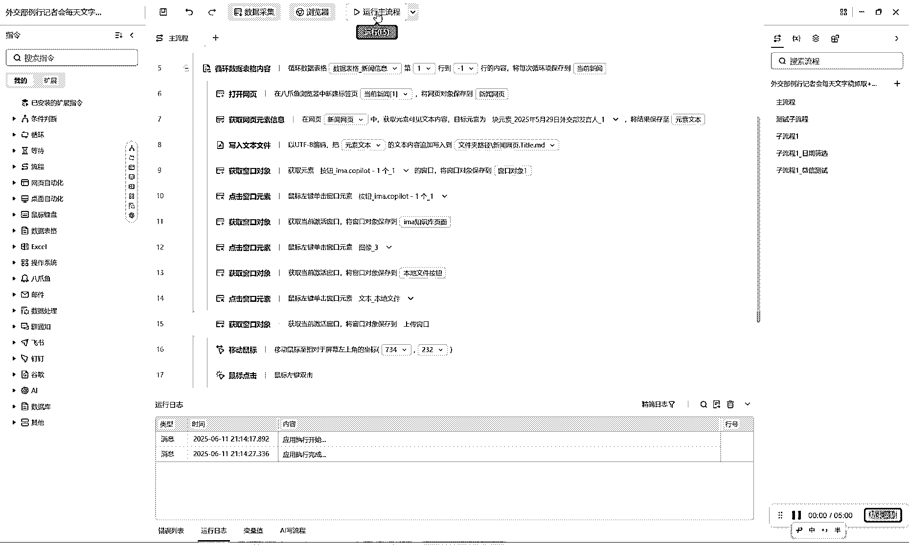

最近在带一个 AI 知识库航海项目时，有圈友问我：知识库的日常更新太费人力了，有没有办法让它自己“跑”起来？这个问题一下子戳中了我。正好那阵子我在琢磨 RPA（机器人流程自动化），于是干脆拿外交部例行记者会网站练了个手——用八爪鱼 RPA 每天自动抓最新的记者会文字稿，再自动传进 ima 知识库，做一个能查、能问的外交信息库。

这个实战走下来，效果还不错。下面把完整思路和操作过程拆给你看，末尾也放了两个现成的应用链接，你可以直接拿去用。

---

## 用到的两个工具

- **八爪鱼 RPA**：一款可视化、零代码的自动化流程搭建工具，适合不会写代码的普通用户，常用于网页数据抓取、批量重复操作。
- **ima 知识库**：腾讯出品的一款知识库管理软件。我已经在上面建了 20 多个共享知识库，这次新建的主题是“外交部例行记者会”。

---

## 案例一：历史文字稿全量批量采集

外交部官网把 2021 年 3 月以来的每次记者会都单独生成一个新闻页，主页则是所有单场新闻的索引列表，结构非常清晰，很适合 RPA 自动提取。

目标：把网站上所有历史稿件一次性抓下来，以「标题.md」的格式保存到本地，为后面导入知识库做准备。

主要流程分三步：

1. 用八爪鱼浏览器（或装了插件的 Chrome）打开记者会主页。
2. 建一个“循环相似元素”，把主页上所有单场新闻的标题和链接抓进数据表格。
3. 再建一个循环，遍历表格里的每个链接，打开单场页面，抓取全文并保存为本地 md 文件。

一开始我也懵，尤其是“数据表格存链接再二轮循环”这个思路。作为 RPA 小白，我翻了不少社区文档和案例，又请教了有经验的朋友才理顺。关键是理解“变量”和“循环”的配合——变量就相当于过程中的临时仓库。

具体指令拆开看：

- 用八爪鱼浏览器打开记者会主页，将页面存为变量“网页”。
- 通过“窗口捕获”把首页上一排单场新闻链接捕获为相似元素，存入变量“当前网页元素”。
- 再将每场新闻的标题和链接依次写入数据表格。
- 最后创建数据表格循环，逐个打开链接、抓取全文，并保存到本地文件夹，文件名用标题命名，格式为 md。

运行结果相当完美，历史存量一次搞定。

由于是批量抓历史，我采取“先全部下载、再统一上传”的方式。上传到 ima 这一步，暂时手动点几下鼠标就行。

---

## 案例二：每日增量自动采集 + 自动上传知识库

历史问题解决了，新的问题是：以后每天新增的记者会内容怎么办？总不能天天手动跑一遍。所以我又搭了一个 RPA 应用，目标是：让 RPA 每天自动访问记者会页面、抓取最新一天的内容并保存到本地，然后自动上传到 ima 知识库，实现持续更新。

这个案例分两大步：

1. 打开最新一天的单场新闻页面，抓取内容并保存为本地 md 文件。
2. 让 RPA 模拟人的操作，操作 ima 桌面端——点击上传按钮、选择文件、完成上传。

第 1 步跟案例一类似，只是定位到最新一天的单页即可。

第 2 步则是典型的“模拟人工”思路：把人的每一步动作拆解成 RPA 指令，获取窗口对象、点击窗口对象，一步步推进。这里也让我意识到，八爪鱼这类 RPA 不只是能操作网页——只要是电脑上的本地软件、Office 办公软件、操作系统，它都能“伸手”操作，想象空间一下就打开了。

说实话，这种“模拟人操作”的方式感觉还是有点笨，尤其步骤多的时候，每次运行都有一定概率失败（比如找不到按钮），需要回头调整参数。目前我对 RPA 的理解还比较浅，还没找到更优解法，后续打算继续看社区文档和别人的案例。

不过最终效果还是达到了，你看：

---

## 一些启发：这套玩法能复制到哪里？

### 自动化采集，省掉重复劳动

这次实践最直接的体会是：用八爪鱼 RPA 做信息抓取、整理、入库，**省掉了大量重复又繁琐的人工操作**。只要用鼠标拖拖拽拽配好流程，就等于雇了一个“信息搬运工”。不仅外交部网站适用，几乎所有结构清晰、领域固定的数据源都能快速适配。

### 换个场景，就能建更多知识库

只要掌握了这个思路，完全可以把方法迁移到**财经资讯、企业公告、法律法规、学术动态**等领域，给自己或团队定制专属问答库。比如金融分析师可以批量抓上市公司公告，老师可以每天自动收集教研政策——方法都是通用的。

我建的这个“外交部例行记者会”知识库，现在就可以直接提问，比如问某天发布会上的具体表态。

### 应用市场：不用从零开始搭

八爪鱼官方最近上线了“应用市场”，里面有**成百上千个现成的 RPA 模板**，覆盖数据采集、电商、社媒、新媒体运营等场景，比如：

- 小红书数据采集、内容监控
- 电商商品自动比价、评价抓取
- 微信群数据整理
- 招聘信息爬取
- 短视频热门评论收集

新手想用什么功能，直接去市场搜关键词，下载后改一改就能用，上手速度飞快。

---

## 最后：给新手的三个入门诀窍

这两天的实践让我总结出三条经验：

1. 从自己的真实需求出发，边做边学，别光看理论。
2. 多看官方社区的帮助文档和别人的案例，站在前人的肩膀上。
3. 直接找一个相似需求的现成模板，改造成适合自己的应用，是最快的路子。

这次我做的两个应用也免费分享出来了：

- 外交部例行记者会文字稿历史全量抓取：链接见评论区/原文
- 外交部例行记者会最新一天抓取并自动上传到 ima：链接见评论区/原文

真的建议大家都去试一试。哪怕完全不懂代码，用 RPA 加知识库的组合，也能把自己工作里那些重复、枯燥、低价值的环节交给自动化，把时间留给思考和创造。

如果你有更好的玩法或实践经验，欢迎留言交流。一起把 RPA 和 AI 用起来，让信息真正产生价值。