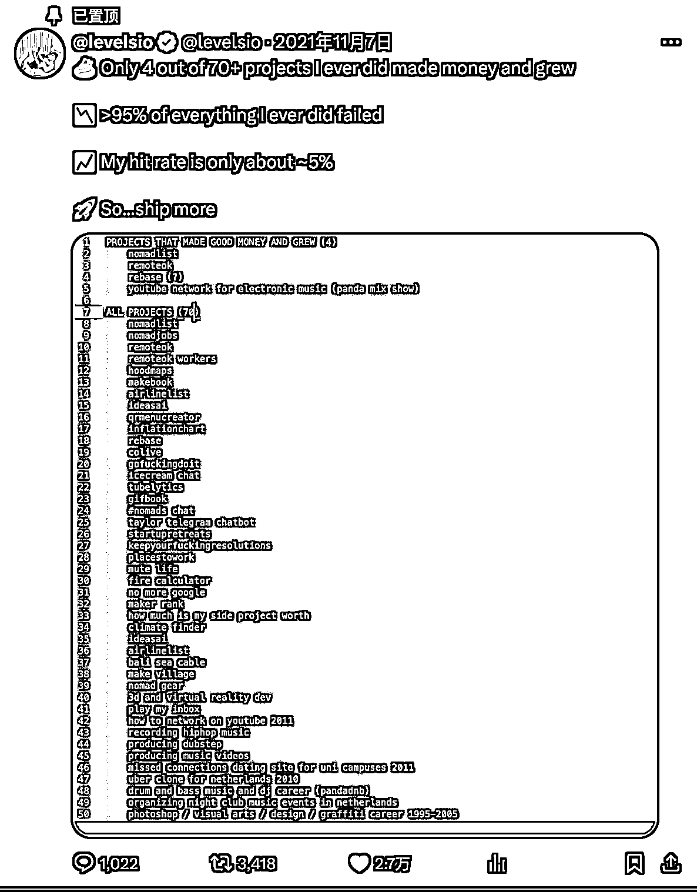
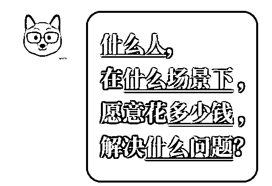
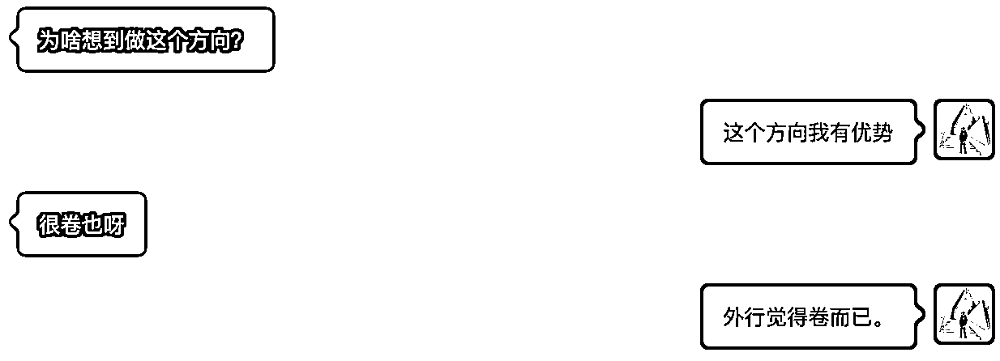

# (精华帖)(567 赞)如何让产品更容易成功？

## (精华帖)(567 赞)如何提高做产品的成功率？

作者： 刘小排

日期：2025-05-25

大家好，我是刘小排。

这篇笔记里讲的内容，我过去几个月在龙哥盟的直播间、SCAI 实验室开业现场、哥飞的北京聚会里，都零碎讲过。今天把思路串起来，整理成一篇完整的分享。

首先请记住，做海外产品本质上是数量博弈。做很多事都一样。独立开发者里公认的大神 Pieter Levels，产品的命中率也就 5% 左右。要靠做得多来摊薄失败概率，这是基本功，没什么好争论的。

AI 出现后，产品开发的成本被拉低了好几个量级。两三年前我还在说，一个 MVP 做下来一个周末就够了，甚至一天能搞定。那篇帖子帮到过很多人。当时听起来像吹牛，现在有了 ChatGPT 和 Cursor 回头再看，会发现今天的 MVP 周期已经压缩到半天到一天。学完我课程的前三节，零编程基础也能把花里胡哨的点子做成可跑的原型。

数量的问题，今天基本已经不是问题了。

真正值得深挖的是：在保证产出数量的前提下，怎么让单款产品的成活率上去。

我作为产品经理，一直在琢磨这个命题。世上不少创业者的逆天战绩里有运气成分，能一辈子做很多个完全不同品类、个个都爆款的人极少。

对我启发最大的是杜国楹老师。

可能这个名字不算家喻户晓，但他的产品你一定用过。20 多年前，20 多岁的杜国楹靠“背背佳”一炮而红，这款产品到现在还在卖。之后二十多年里，他连续做出了“好记星”、“E 人 E 本”、“8848 手机”、“小罐茶”等爆品，命中率堪称 100%。

我反复研读他的访谈、书籍和课程，他的产品方法论彻底改写了我的思路，也显著提升了我的成功率。

我提炼出两条核心心法：

**第一，需求倒做。**

**第二，顺势而为。**

# 一、需求倒做

很多做产品的人，尤其是技术背景强或者做 AI 自媒体的，习惯先看到一个新技术或一个好 Prompt，然后想着“套个壳就能成”。这是一种供给侧思维，直觉上很顺。

即便是两年前的“大模型六小虎”，集结了国内顶尖的技术人才，也大多是从技术供给出发，最后都撞到了天花板。

杜国楹的做法正好相反。所谓需求倒做，是把开发顺序整个倒过来。

先锁定核心需求，再设计产品，再执行开发，最后匹配独特的渠道。

核心需求点 → 产品设计 → 产品开发 → 独特渠道

我们拿故事来讲。

“背背佳”当时洞察到了什么？家长希望孩子上课写作业时能坐得端正，而这个需求在当时全球都没有好的解法。

锁定这个**核心需求点** 后，杜国楹去找解决方案。1997 年，他花 5000 元从天津大学物理学教授袁兵手里拿下技术方案，更名“背背佳”，8 月就上线。1998 年销售额冲到 4.5 亿元。

1997 年的背背佳主打电视购物渠道，正好对准中小学生和家长，这个**独特渠道** 是为人群定制的。

到现在它依旧热销，经历了至少三轮**核心技术** 升级，目标人群也随时代迁移。2023 年后，背背佳转向健身人群、久坐白领，讲的是“体态管理”，渠道也换成了抖音和京东自营。

卖了二十八年的产品。

它长青的秘诀不是砸钱打广告。每年央视的标王很多，能常青的只有背背佳、脑白金等极少数。核心是它真解决了真需求。

现在有人拿着一个平平无奇、没有增量价值、解决不了核心痛点的产品网站来问我要流量，我真的答不上来。我怀疑全世界也没人知道怎么推。这种想靠渠道神器把烂产品推上去的想法，很天真。

更触动我的是小罐茶的故事。背背佳证明了需求倒做在功能型消费品的威力，小罐茶则把这套打法搬到了高感性、强文化的中国茶品类。

2012 年杜国楹发现茶是大生意，3000 多亿的市场却没有一个 10 亿级的品牌。

当时茶的痛点非常具体：

第一，价格不透明。收到的明前龙井，不知道值 500 还是 5000，甚至 50000。外行眼里贵茶和普通茶几乎无差别。

第二，冲泡不标准。用手捏一撮茶叶，3.5g 还是 4.3g 全看手感，而且没人洗手。

第三，品质不稳定。同一家卖家，年年味道不一样。

这些中国人习以为常的“怪事”，恰恰就是**核心需求点**。

找到痛点后反向**设计产品** 、**开发产品**。小罐茶的形态大家都见过：全国统一价，解决定价焦虑；4g 一罐，像咖啡胶囊一样一次一泡，锁鲜且量化，降低学习成本；工业化生产保证稳定。

想清楚了产品，再去匹配渠道。它是礼品经济，就把礼品渠道打透。

这才是好产品。

我常说，

产品 = 一个具体问题的解决方案

**好** 产品 = 一个具体问题的**优雅** 的解决方案

在 AI 领域，我把它总结成一个填空题：*什么人* ，在 *什么场景* 下，愿意 *花多少钱* ，解决 *什么问题* ？

赚钱的老朋友枸杞还帮我做了个微信表情：

当你看到新技术、新 API、新套壳玩法，[`t.zsxq.com/E4uYn`](https://t.zsxq.com/E4uYn) ，先别自嗨，先问自己能不能填满这个空。

刷榜单时 [`t.zsxq.com/EUnJL`](https://t.zsxq.com/EUnJL) ，别直接抄，先去拆解榜单产品是怎么填好这个空的，找到它的真需求，然后围绕它设计**差异化** 的方案。

先填空再做产品的，比拍脑袋做产品的人，胜率高太多。

口诀：先有用户，再做产品

# 二、顺势而为

这里的“势”分两层：你的**优势**，和时代的**趋势**。

杜国楹认为**优势**比趋势更重要，我完全认同。

### 1. 优势

我能做海外 AI 产品出点成绩，正是因为这就是我的优势。我在猎豹移动时做过日活过千万的海外 App，做了十年海外 App。2016 年 AlphaGo 之后公司拥抱 AI，我也做了九年 AI。

直播时我提自己做了 9 年 AI，有人说“ChatGPT 才 3 年，吹牛”。这恰说明 AI 产品不是他们的优势。^∇^

我是小学四年级开始写代码，十年海外 App、九年 AI，再加上热爱做产品和研究前沿论文，让我能把海外 AI 产品做成优势。

从 2022 年 Q2 开始做文生图，到今天已经三年，踩过无数坑，文生图也成了我的优势。

2025 年 1 月我做 Raphael AI [`raphael.app`](https://raphael.app) 时，文生图文生图套壳已经是红海。对大多数人来说没人投，对我来说我知道自己在做什么，最后也拿到了不错的结果。做之前，大佬们觉得我傻，但优势在我。

这是我的优势，不是别人的。

有同学问我“老师给我几个 idea 吧”。我给了他我 list 里很想做的点子，他沉默后问“还有吗？”，我继续给，直到他发现一个都做不了，尴尬离开。

因为我的 idea 都是基于自身优势的，别人很难复制。

比如枸杞同学，他在 AWS 电商领域扎根很深，能看到很多没被解决的问题。传统行业变化慢、竞争小，这就是他的蓝海。

赚钱 AI 实验室的 Web3 工具题，17 个人都能做出来，但只有一个人能做成盈利产品，因为他之前靠 Web3 赚到过八位数，Web3 工具是他的优势，现在正在内测。

实验室里还有位朋友，目标用户是设计师，他有设计师背景。我可以启发他，但不敢下判断，因为这正是他的优势，我的劣势。

每个人都带着独特的 buff 来。ACM Finalist、顶尖大学教授、建筑设计师、心理学专家、抖音本地生活操盘手、prompt 专家、知识产权公司创始人、工业 AI 视觉创业者、区块链作者……

我一直劝大家别跟风抄榜单，要从自己的专业优势出发。心理学背景就做心理学 AI，知识产权背景就做知识产权 AI，用优势打劣势，壁垒才高。

坐拥名门心理学背景，为什么要去做同质化套壳比外链数？这不是暴殄天物吗？

有圈友说“小排学就是做自己”。我也不知道排学是什么，但那一刻我觉得总结得挺准。

在优势区击球，是最重要的顺势而为。

### 二、趋势

**趋势一： 海外 AI 产品投放利润会被不断稀释。**

原理很简单。很多做跨境电商的老手，比如赚钱圈的 Albert、佳境，他们在电商里打出来了。现在他们把投放团队和独立站经验搬到 AI 产品，卖虚拟软件比卖实体还省成本。投放战打起来，终局就是利润变薄，像电商一样从暴利变微利。

应对：没有投放优势就别硬拼。我不做投放，既不是我的优势，也相信好产品会自传播，而自传播恰恰是我的优势。

**趋势二：大模型能力变强，会吃掉大量套壳产品的价值。**

假设小明和小张，两年前同时入场文生图。小明卷了两年 ComfyUI，小张躺平两年。2025 年 5 月谁做图更好？一样好。因为小张直接用 lovart.ai 就能做出吊打 ComfyUI 的效果，还不用学 prompt 工程。

ComfyUI 套壳的价值正在被新一代模型侵蚀，而 lovart.ai 的团队正是吃过 ComfyUI 红利后自我颠覆的团队。

应对：做那种模型越强产品越强的产品。

比如 Cursor。2023 年 2 月我就推荐给二两，当时觉得难用。真正火是在 2024 年 8 月 Anthropic 发布 claude-3.5-sonet 之后。模型变强，Cursor 变强。

Cursor 是大模型的朋友！

**趋势三：交付过程的产品会消失，主流是交付结果的产品。**

AI 不再卖工具，而是卖收益。AI 助理时代要直接交付结果。

红杉给出三条判断标准：

1. 能不能零人工介入、零抽卡，直接交付确定性结果？
2. 能不能量化产出？省 3 小时还是 10 小时？赚 3 美元还是 10 美元？
3. 能不能自我迭代越来越聪明？

参考 5 月红杉 AI 峰会纪要。按这个标准，连 Manus 目前都还不够完美，成功率对我来说也就六七成，更像玩具。

我更看好垂直细分直接交付结果的产品，比 Manus 更看好 Lovart.ai。

Lucas 问我下一个产品是什么，我的答案就是一个细分垂直领域，针对非常具体的工作类别，直接交付结果，按红杉的三条标准来设计。

**趋势四：产品供给会极度膨胀**

以前做产品需要程序员，现在人人都是程序员。我自己的课程第一期就有 960 人报名做 AI 工具产品。课程、孵化器、社群都在推。

未来几个月供给会爆炸，没有差异化和独特价值的产品必死。

应对方法：

1. 在自己的优势区击球！做自己！
2. 可以考虑卖铲子。
3. 比拼获客效率，而不是技术能力。

# 总结

1. 需求倒做。先有用户，再做产品。
2. 洞察需求的基本公式： *什么人* ，在 *什么场景* 下，愿意 *花多少钱* ，解决 *什么问题* ？
3. 很多问题在等一个好产品。只有在你的优势领域击球，才能发现它们。
4. 大胆做自己，从优势出发，洞察待解决问题，设计优雅的解决方案。
5. 能顺应时代趋势，能事半功倍。

* * *

很久没写这么长的东西了，谢谢你看到这里。

期待你的好产品。

* * *

评论区：

郁郁 : 先点赞[强][强][强]

寻宝 uni : 前排

四喜 : 先赞后收藏再深入理解

Tim : 先赞后看

Joker : 小排老师 作为 0 基础正在努力克服第一章遇到的问题，但是我相信有一天我可以的！

黄金号 : 这么多前排 真要命

啊吹(不二) : 大家都太卷了～

博子 : 努力做到一周内能够做出精致版的任意产品