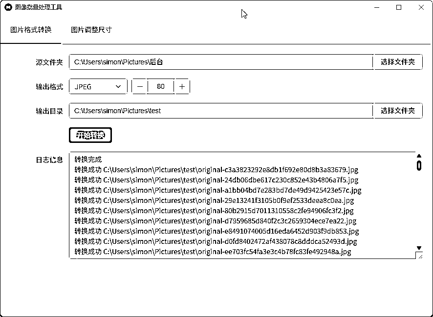
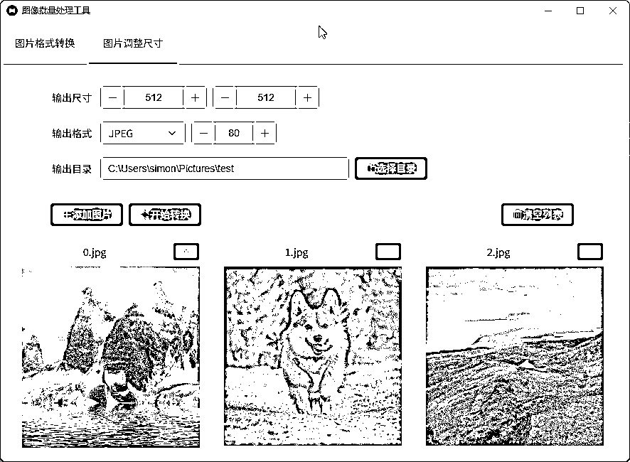
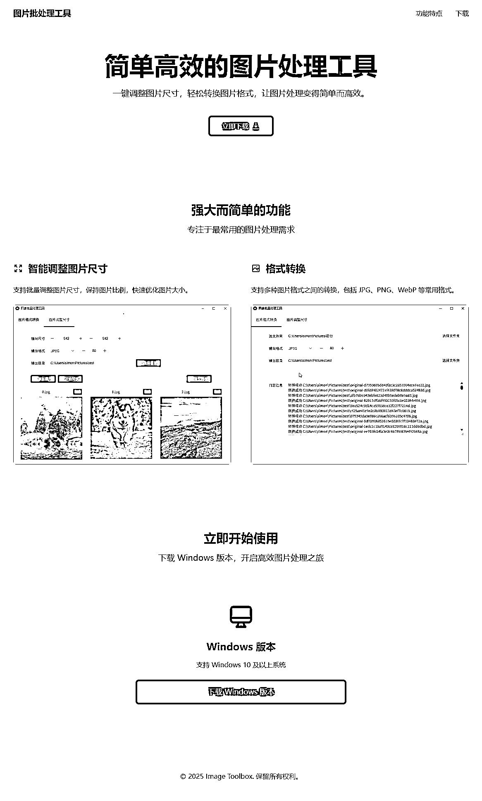

平时需要批量处理图片时，我总在找趁手的工具，可试来试去都不太满意。这次干脆让 Cursor 来代劳，从零写了一个桌面端图片批量处理工具，只花了两小时，连宣传下载页也顺手做了出来。

经过一系列细节调整，最终的成品长这样：

技术底座是 Wails，逻辑层交给 Go，界面层用 Vue3 配合 Element Plus 搭建。最初给 Cursor 的指令，就是围绕这套技术栈来，同时要求项目命名为“图片批量处理工具”；此外所有代码一律配上注释，目录结构也做了清晰划分——前端 src 下分出了 components、pages、router、stores、utils、assets 等模块，根目录里还有 main.go 和 app.go。

整个工具提供了两个核心能力：批量改格式和批量调尺寸。

- 格式转换：选定图片所在的文件夹，设定目标格式（JPG/PNG），按需调整 JPG 画质，再选择输出目录，点击“开始转换”即可完成批量处理。
- 尺寸调整：填好目标尺寸，挑好输出格式与 JPG 质量，用“添加图片”和“移除图片”按钮维护文件列表，最后按下“开始调整”就能全部搞定。

顶部菜单栏负责在“格式转换”与“尺寸调整”两个页面之间切换，用起来非常顺手。

工具做完后，我决定把它分享出去，于是又请 Cursor 帮忙写一个静态宣传下载页，在页面上挂出下载链接。具体安排是：宣传页文件输出到 web/index.html，两张功能截图放进 web\images 目录；页面采用简洁的 HTML 结构，样式由 Tailwind CSS 的 CDN 引入；图标引用在线矢量图标库，且不能带背景色块、底板或外框；配图使用开源图库 Unsplash 的图片链接。

设计风格上，我提出的要求是：优雅极简，同时不失功能感——留白控制得很舒服，交互细节经得起推敲，画面比例也养眼；响应式布局让内容区域能灵活适配，手机上打开时，核心功能要放在最显眼的位置。

最终宣传页效果如下：

目前这款工具仅兼容 Windows 10/11 的 64 位系统，感兴趣可以直接访问体验地址：

http://image-toolbox.app.yesiming.com/