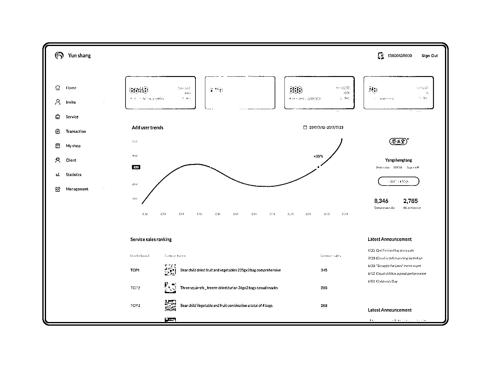
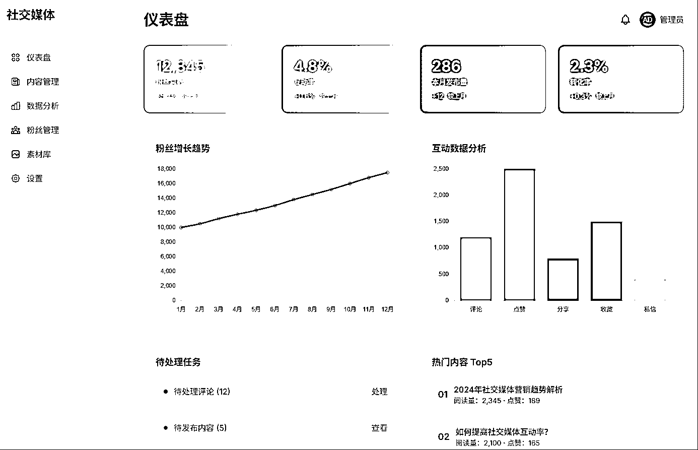
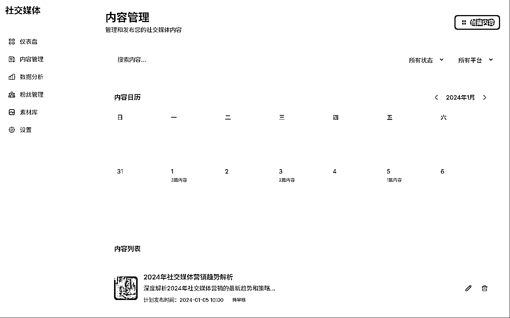
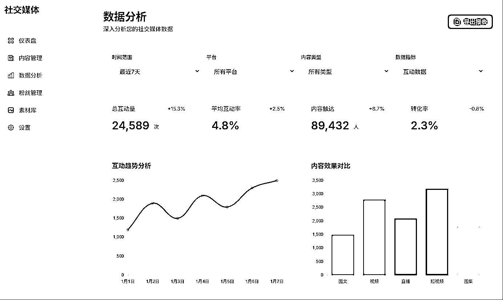
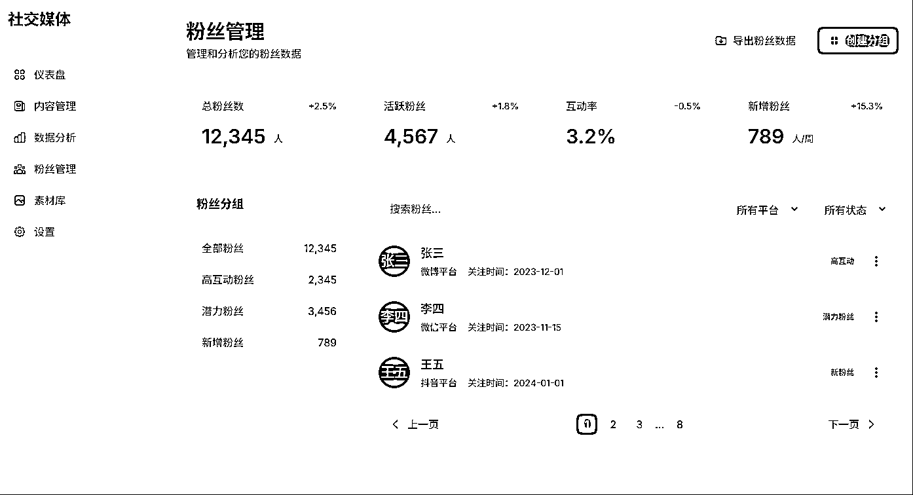
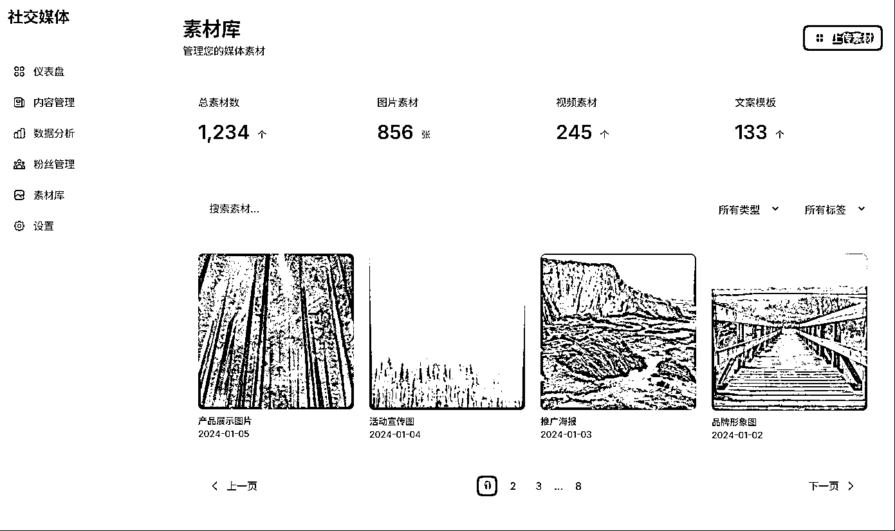
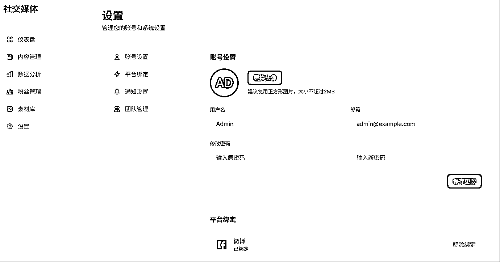

# 你的 AI 还在“开盲盒”式生成 UI？一张参考图就能让它乖乖听话
作者：龙哥

每次用 Cursor、Trae 这类 AI 编辑器生成界面，是不是总有种“抽卡”的刺激感？风格靠运气，布局看缘分。网上教程虽然不少，但大多只教你怎么“生成”，很少讲怎么“控制”。我最近摸索出一个好用的思路：用参考图圈定视觉基调，再让 AI 把成品固化成一套可复用的 UI 规范指令。

具体怎么做？很简单。我从网上随手找了一张后台管理系统的设计稿，把它喂给 AI，并要求它严格沿用这张图的风格与排版。先看这张参考图：

AI 交出的答卷长这样：

更有意思的是，这套 UI 不只是一次性产物——我让 AI 把效果转化成了 UI 规范指令。也就是说，之后无论是开新项目，还是给现有项目“换皮”，都能直接复用这套规范，保持视觉统一。下面几张图就是落地效果：

因为指令完整版篇幅较长，已经放到飞书文档里了，需要的朋友直接自取：

如果你也在为“AI 画界面不可控”发愁，不妨试试这个思路。评论区里已经有人说“有用”了，希望它也能帮到你。