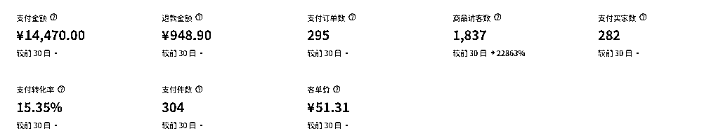

# 两周做到 6000+ 利润，我是怎么靠📕电商实拍蓝海项目起步的

作者：风声
日期：2025-05-27

先简单介绍下我自己。加入赚钱之前，我一直在四大类会计师事务所做审计，带队参与过不少企业的 IPO 申报、年度审计、专项审计等项目。长期高频出差让我逐渐吃不消，于是开始琢磨转型。后来经书豪老师介绍接触到赚钱后，我就正式入圈了。

在赚钱里，我大量翻阅精华帖、跟着航海项目实操，思维被打开了不少，也因此完成了从体制化工作到自由探索的过渡。现在手里并行着两条线，一条是之前积累的专业方向，另外一条就是同城家教中介，和最近在做的**📕电商**。

这次是受赚钱团队宝芙的邀请，把我刚在《📕电商-蓝海实拍》航海里取得的一点点进展做个复盘。两周时间下来，利润已经来到 6000+，虽然体量不大，但对我来说是持续投入后第一次看到正反馈。

复盘内容我整理到了飞书文档里，方便大家系统查看：
`vx6swdb957w.feishu.cn/docx/BZIJd7kk2oqOUGxTmZXcuW4JnX0?from=from_copylink`

我想跟新来的圈友说一句，真的别只看不动手。**把手弄脏、直接上航海**，比反复收藏要有效得多。航海的价值不在于结束那一刻，而在于它逼你把想法落地。

原文参考：[`www.yuque.com/for_lazy/zhoubao/gutuq1egk55nb6lz`](https://www.yuque.com/for_lazy/zhoubao/gutuq1egk55nb6lz)

* * *

评论区精选：

亮哥 AI : 链接打不开

风声 : 收到提醒，已修复，感谢～

田园幼儿园 80224* : 看完很有共鸣

JIE : 我也参加过航海但没做出成绩，想学习下成功案例是怎么落地的

风声 : 航海只是起点，结束后坚持复盘迭代才有结果，加油

火火🔥 : 厉害了

风声 : 感谢支持，这只是小步快跑，大家一起交流进步