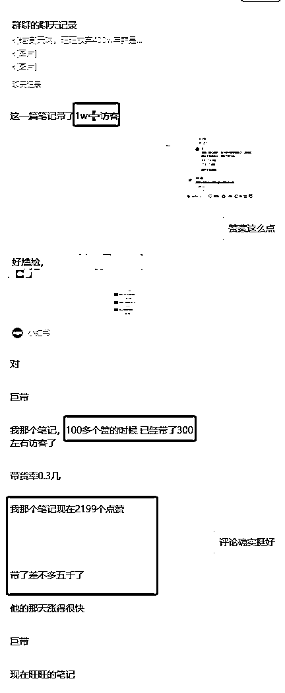
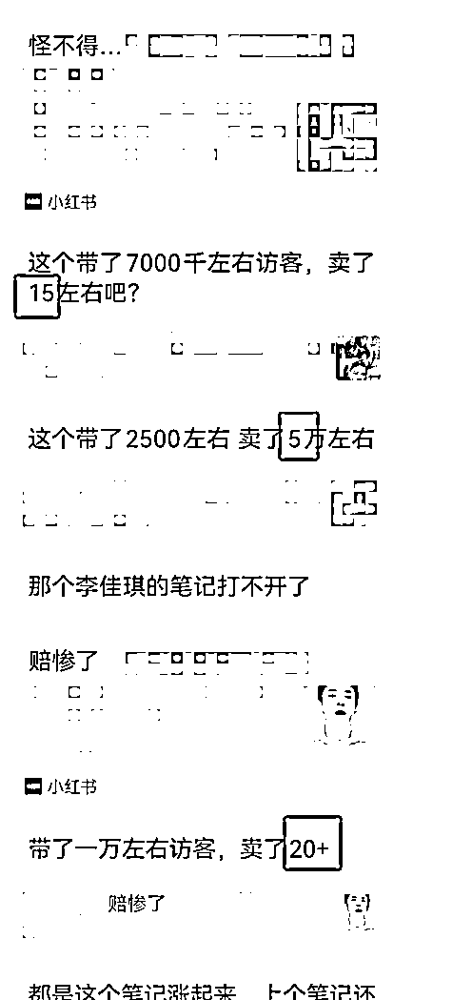
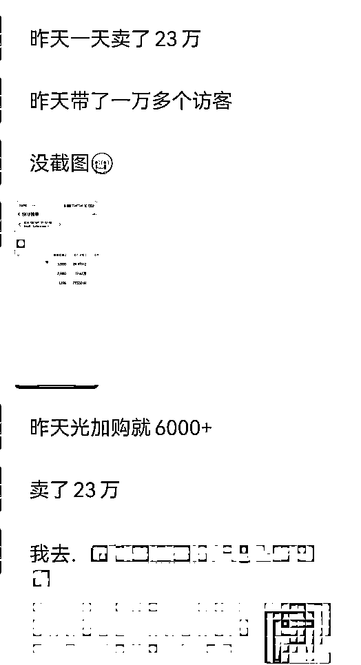
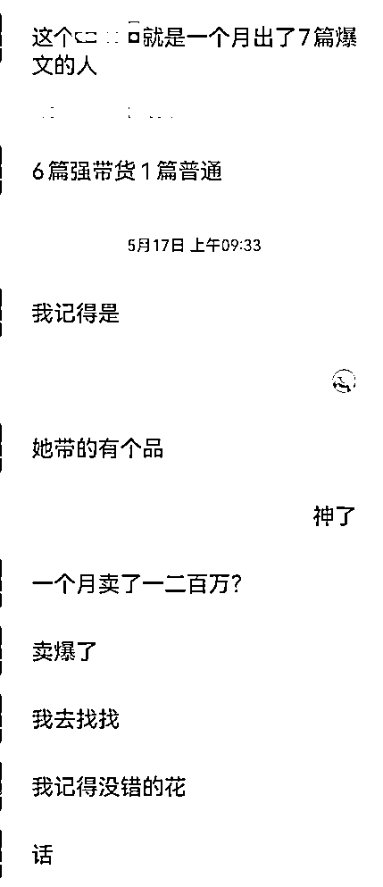

# 📕冷启动也能打爆单：一个 20-50 人小团队年入 3000 万的实操拆解

在📕商单和店铺玩法泛滥的当下，其实还有一条被严重低估的赛道，它门槛不高、启动快，而且非常适合组队干。

我混📕圈子五年了，之前分享过商单相关的内容，偶然进了传术师俱乐部。最近看到关于聚光和品牌投放的讨论，发现大家对📕的兴趣又起来了。那除了接商单和开店铺，有没有更适合 20-50 人规模团队去做的增量生意？

有。投入很轻，但产出极其夸张。保守估算下来，一个 50 人左右的团队，一年稳定做到 3000 万 GMV 并不夸张，利润空间自己算就知道了。

下面就用一组 618 开场两天的真实运营数据，从最微观的单点切入，拆解一下：**1 个执行人 + 0 粉丝账号 + 1 条笔记，是怎么撬动 20 万以上 GMV 的。**

## 先看真实转化数据

先把聊天记录里最关键的部分摊开：

1、带货率大概在 0.3 左右，简单理解就是 0.3 个赞就能换来 1 个进店访客。一条 3000 点赞的笔记，轻松带来 1 万+的精准流量；

2、这个账号一次性连爆三篇，单日 GMV 直接拉满：15 万 + 5 万 + 20 万 = 40 万，其中一篇首日就冲到 23 万+；

3、换成日常体量，团队里表现好的员工，单月 GMV 也能稳定在 100 万以上，而且这还是没有 618 活动加持的数据。

为什么我把转化率放最前面讲？因为很多做抖音的同学会误区📕。抖音内容爆了，未必能进店；📕不一样，点赞数和进店量基本是正相关，而且评论区运营到位的话，客单价和复购率都会被拉高。成套卖和单件卖的 GMV，往往能差出好几倍。

0.3 左右的进店率，甚至她们团队里更极致的 0.1 几，放在短视频平台里看都是离谱的。

细节拆解篇幅比较长，没法全部平铺在这里，有需要的朋友可以直接去飞书文档里看完整版。

[`r0w01nn96m.feishu.cn/docx/R313d4RQJow7IPx74HrcozI4nte?from=from_copylink`](https://r0w01nn96m.feishu.cn/docx/R313d4RQJow7IPx74HrcozI4nte?from=from_copylink)