# 👸号 AI 爆文还在赚钱，我把 5 位数变现拆开了给你看
作者：龙哥

作者：何老师
日期：2025-05-29

**👸号 AI 爆文持续变现 5 位数 复盘与思考**

文章首发：何老师

# 1. 现在进场👸号，时机比你想的更好

自媒体形式很多，有人出书，有人接稿，为什么我一直押注👸号？

想看点有深度的东西，大家第一反应还是打开👸号。手机里人人都装着🛰️，而且几乎没人会删。👸号就嵌在🛰️里，这是覆盖面最广、最稳定的触达路径。

我做👸号写了 7 年，每年产出几十万到上百万字，为什么停不下来？因为运营👸号等于给自己做个人传播，不做就等于放弃自我增值的机会。

我身边不少学弟、同事做自媒体，穿越周期，稳定年入百万，每天就操盘几个小时，没有领导压着，不用固定打卡，自由度极高。

这里很干净。🛰️渗透到支付、生活、社交、新闻等方方面面，平台一直在做强审核，到目前为止这是内容环境最纯净的阵地之一。

更关键的是，新人友好。推荐机制、爆款机制、原创扶持都在，零粉丝的新号一样有机会冲 10 万+。

**比如我靠 AI 辅助写的这几篇，连续炸了。**

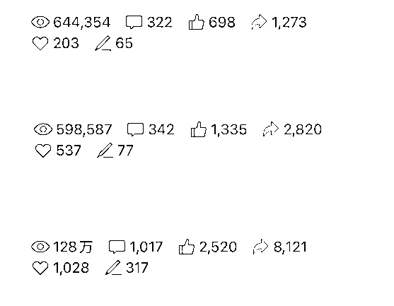

很多人喊👸号红利没了，其实是他们没赶上。我亲身验证，红利不仅还在，而且在变大。

👸号门槛极低，一部手机会打字就能开写。但想进阶变现，就得学方法。

结论很清晰：👸号红利持续中，叠加 AI 风口，现在入局正是黄金期。

# 2. 会用 AI 写作，基本等于躺赚

“会用 AI 的人会淘汰不会用 AI 的人。” 这不是我发明的，是行业共识。大量从业者被迫转 AI，不转就出局。

自媒体的本质是写作。以前一篇高质量文章要花 4 个小时，投入产出比太低。现在 AI 能辅助成稿，高效产出，很多人靠它实现百万级变现。

这也是我们做「百天 AI 爆款写作变现训练营」的初衷。

AI 时代，掌握使用方法是把内容、产品、IP 卖出去的核心能力。

我用 AI 写了三个月，累计 12 篇 10 万+，2 篇百万+，单篇最高过万，已经跑通了 AI 写作打法。

**比如今年开年这几篇。**

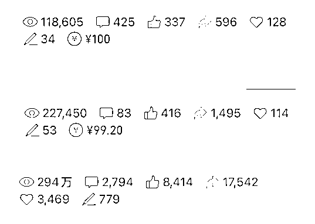

过去这很难想象。因为写作曾被视作艺术，属于作家的专利。

掌握写作艺术的人才能成作家，才能投稿、出书。以前这门手艺很难下沉到个人，更不可能大规模传授。但 AI 把这门艺术平权了，每个人都能用。

平台只管价值，只要你的内容有用、满足需求、有能量，平台就会留存。

**用 AI 写爆文，就像拿了把开路利剑，创富之路畅通无阻。**

# 3. 能做一辈子的赛道

**现代人物**

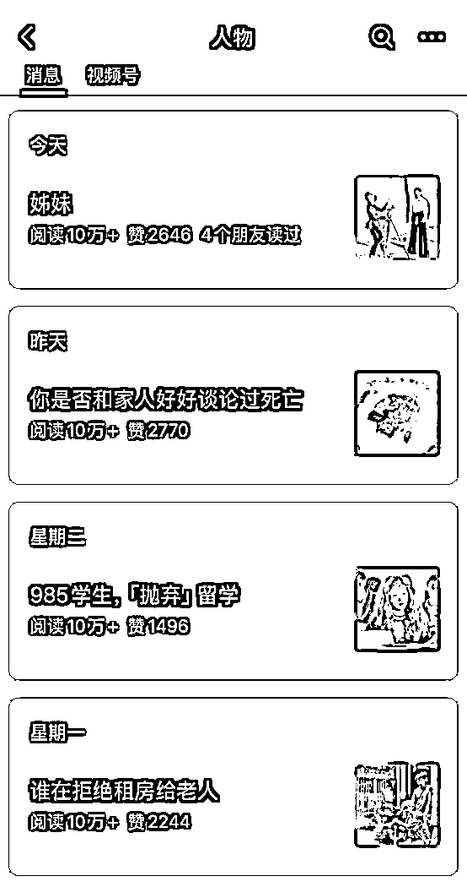

**国际局势**

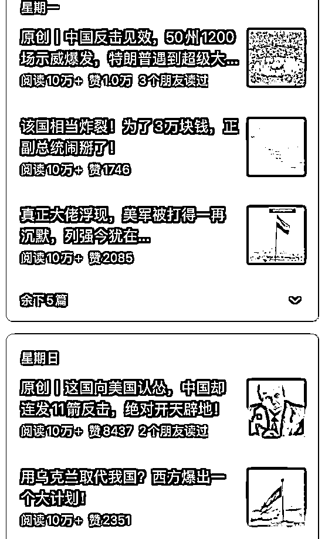

**与「钱」相关的随笔**

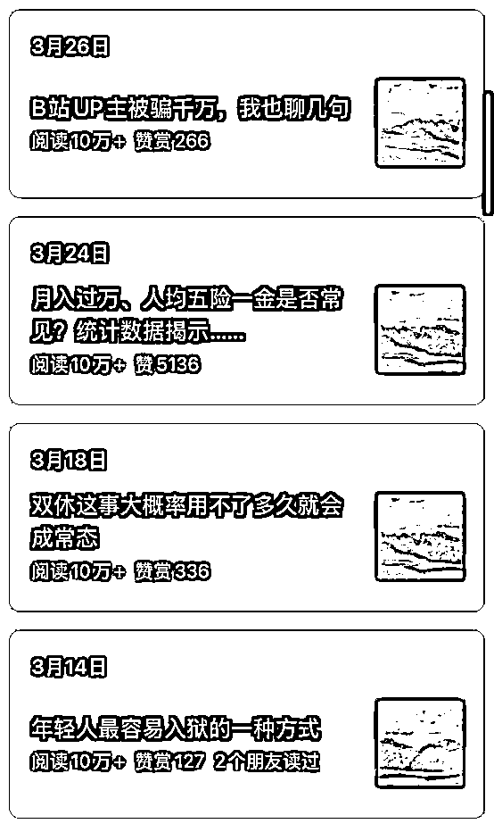

**社会现象解读**

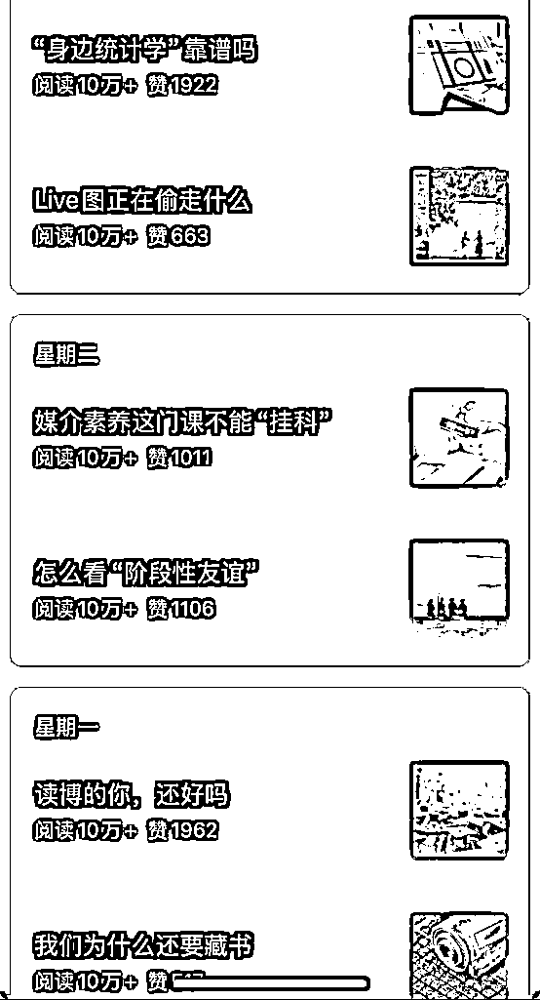

**创意风格漫画**

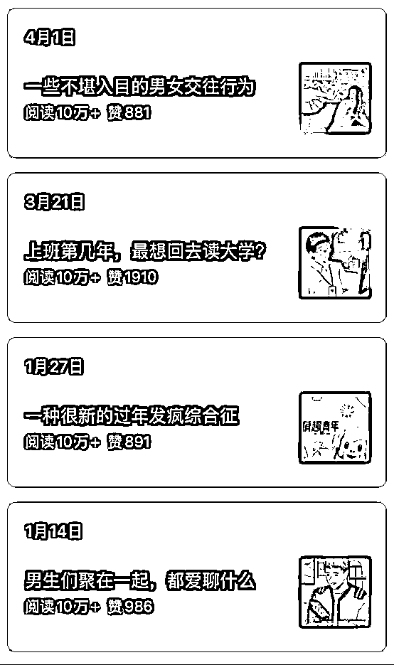

**夜听系列**

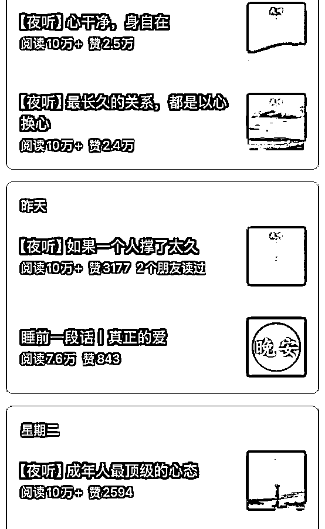

**特定历史文化**

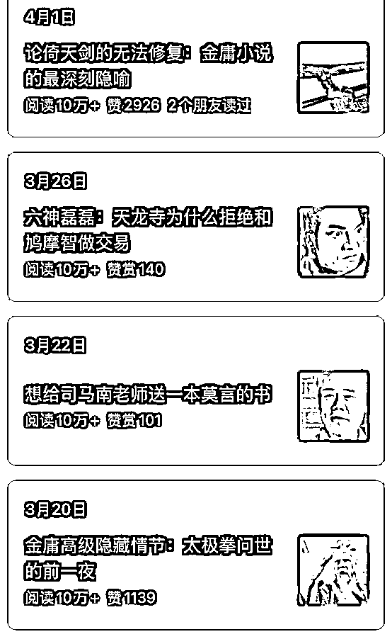

# 4. AI 爆文实操拆解

## 4.1 AI 生成的文章能直接发吗？

**能直接发。**

在你有实质性干预的前提下生成的内容，可以标注原创，不会被限流。我很多 10 万+都有 AI 参与。

如果你只是丢个题目让 AI 全自动写，那最好别标原创，实事求是地标 AI 创作即可。

所谓干预，就是你分步骤提要求、不断优化、形成最终版本。或者你先写框架，让 AI 扩写润色，也算原创。最高效的是口述初稿，让 AI 改错润色，我常这么干，也能出爆款。

## 4.2 平台能识别 AI 吗？

**能识别。**

各平台都在做 AI 文本识别，会统计每篇文章 AI 概率，综合判断是否推荐。但别恐慌，最终推荐还是看用户反馈，用户喜欢，算法就会推。

## 4.3 怎么产生收益？

**500 粉丝就能开流量主。**

不急变现就靠自然涨粉到 500 再开；想快一点，学会 AI 爆文后可以小额补 500 真实粉，成本远低于爆文收益。

爆了之后会有商单找上门。初期背调不清的一律不接，或先问老师。拒绝不靠谱广告，先把账号做大，有底气再接单，这才是长期变现。

## 4.4 哪些 AI 工具可用？

**DeepSeek、kimi、文心一言、通义千问、GPT 系列、Gemini 等都行。**

各家各有风格，看你习惯。我主力用 kimi。APP、🛰️小程序、网页版都可用。

## 4.5 违规了还能继续写吗？

**能写。**

看违规次数和严重程度。我有一篇 10 万+因门票价格写错被投诉违规，对后续流量和收益几乎没影响。只要不碰红线，放心写即可。建议把平台发布规范多看几遍。

## 4.6 可以重复发文吗？

**可以。**

热点还在，话题还在，旧爆文完全可以再火。二次发布别偷懒，至少让 AI 调整逻辑、重写表达，避免原样搬运。长期主义，做经得起推敲的内容。

## 4.7 一天发 8 篇可以吗？

**可以。**

👸号一次最多发 8 篇，没人限制。AI 方法一篇爆文最快 30 分钟，8 篇约 4 小时，全职写作者完全能承受。「十点读书」起号期就是日更 8 篇。

致敬所有硬核输出的人。

## 4.8 每天怎么涨粉？

**写文章就行。**

公域就靠👸号持续输出，一周至少 3 更；私域就靠朋友圈日更。坚持是最核心的打法。

粉丝是用户，不是付费用户，别被数字绑架。先把内容质量和排版做好。

## 4.9 文章多长合适？

短到几百字也能到将近 10 万阅读，长到上万字反而效果差。

我多数文章集中在**1000-5000 字**，爆款基本在这个区间。能用最短的话讲清复杂事，是核心能力，也能降低创作压力。

## 4.10 怎么提升收益？

**阅读量就是收益。**

标题、质量、话题热度、广告单价、传播广度都影响收益。先做到 100 篇原创，让内容稳定。

## 4.11 需要认证吗？

**能认就认。**

认证是权威标签，对外提升信任，对内有流量倾斜。

## 4.12 没进流量池怎么办？

**别纠结。**

按 AI 爆文方法论写、发、做互动留言，文章自然在池子里。行动起来就好。

## 4.13 找对标账号去哪找？

**🛰️搜一搜就是最好的搜索引擎。**

当百度用，搜关键词，看新榜排名，拆解头部账号的领域细分和选题，学习模仿再超越。

# 5. 单篇持续收益 4 位数复盘

比如我口述后用 AI 整理的这篇：

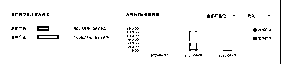

典型收入结构是文中广告+底部广告。

建议字数控制在 1000 左右，方便插两条广告。注意底部广告占比约 36%，所以**文章底部别放无关符号、图片、作者介绍、打赏等**，起号期最好全关。

这篇是 10 万+，真实阅读 35 万。要想单篇 4 位数收入，基本需要爆款，除非广告 eCPM 极高。我这篇 eCPM 是 6.49，也就是 1000 阅读约 6.49 元。

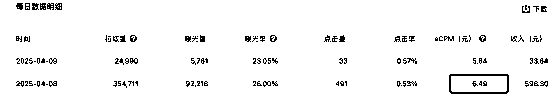

想提高广告单价，先把内容打磨好。内容为王。

这篇不蹭即时热点，而是行业恒温话题。这就是另一个规律：**热点赚快钱，认知赚大钱**。

大家都爱蹭热点，但分即时热点和长期热点。把握住长期热点，你的文章才能持续被搜到。别盲目跟流，别吃剩饭。

发表时间不必过度纠结。写完排版审核完就发。我不少爆款是凌晨发的，和时间赛跑，保持频率最重要。

# 6. 单篇持续收益 5 位数复盘

这篇花了 1 小时反复修正逻辑，用 AI 完成，阅读 294 万。

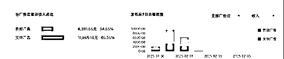

除了之前说的要点，补充几个关键。

灵感来自今日头条。凌晨 1 点找不到选题，我刷头条看到李子柒上春晚的消息，经过思考，选了个**带情绪的选题**。

标题带着嫉妒感，内容却写得正向，这是欲扬先抑的写法。

收入结构上文中广告占比大，字数 2000+，放了两个广告，结尾干净，用户能直接看到底部广告。末尾放了一张有情感共鸣的动图，吸睛。

关于流量推荐，别以为只推三天。我有一篇 10 万+的一个月后才爆发，从几百阅读冲到 10 万+，是用户把文章推起来的，不是算法。

所以别焦虑，文章没立刻爆，可能只是时机未到。

# 7. 如何持续写出 10 万+复盘

我把后台几篇代表性 10 万+放出来：

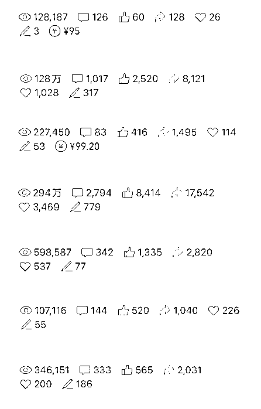

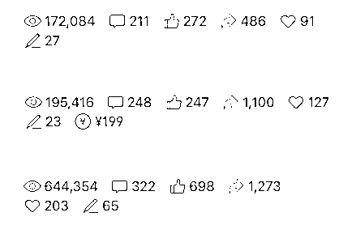

共同点是热点+人物+情绪+价值。

养一个 10 万+像养孩子，很难。我总结几点：

1、**标题决定生死**。用户只给你 1 秒，点不进就没阅读。阅读是裂变传播的。
2、**排版要克制**。初创号别花里胡哨，默认字体、默认间距，把功夫放在内容。
3、**有大局观**。没选题时看官媒在推什么，用户认知圈就在那，官媒定调，你切入。
4、**把握趋势**。我写哪吒、饺子、李子柒、德国竞选、泰国总理访华，都是事件前或节点上，这叫预测。
5、**用 AI 提效**。不借助 AI 要 2-4 小时一篇，有 AI 只要 30 分钟-1 小时，省下的时间更自由。
6、**学会营销**。多数富人都有销售基因，会把作品、产品甚至自己卖出去的人才赚大钱。

……

可找鱼丸链接何老师~

* * *

评论区：

向上 : 何老师在这里看到你啦[得意][呲牙]

向上 : 我是 AI 爆款训练营第一期的[偷笑]

奔跑的 Robin : 怎么联系呢

大坤 : 干货呢[困]