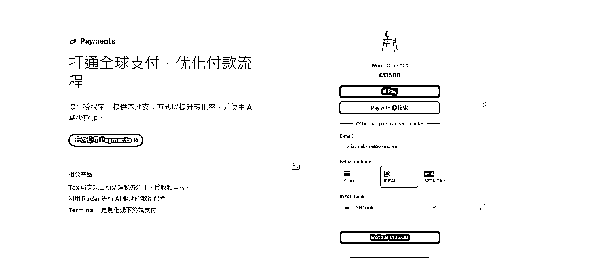
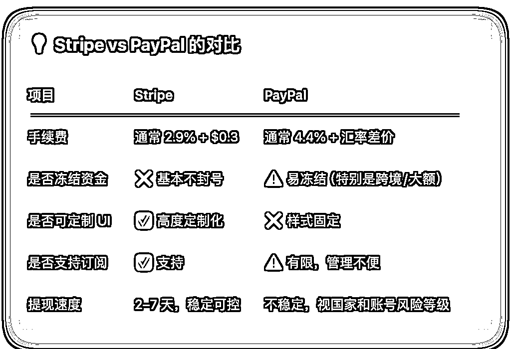
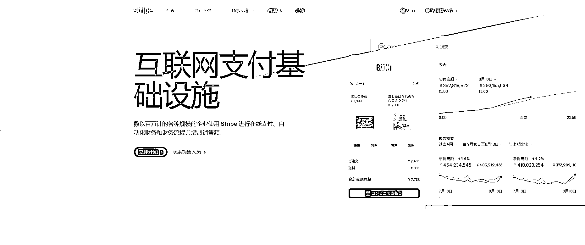
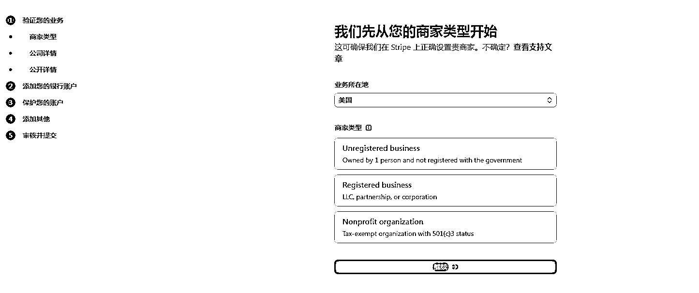
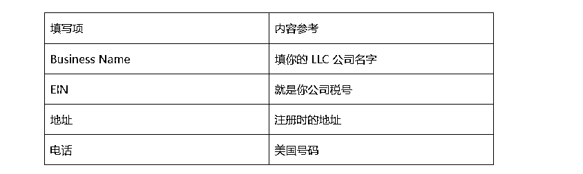
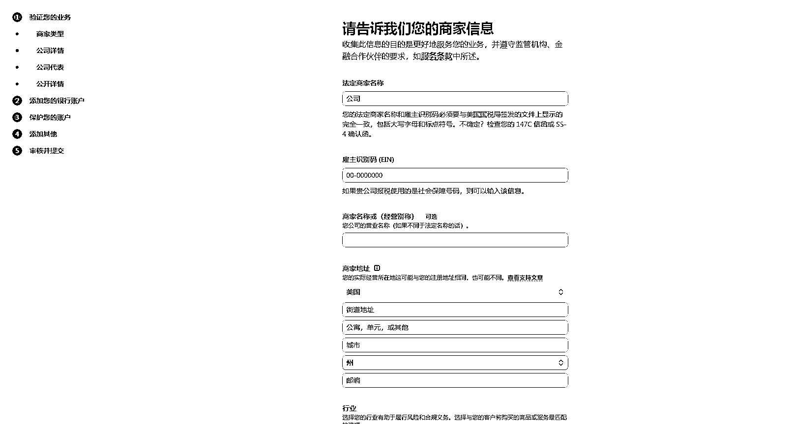

# Stripe 商业账户开通指南：资料准备到审核，一篇讲清

还在把 PayPal 当作跨境业务的唯一收款渠道？如果你经营海外电商、数字内容、订阅服务或软件产品，Stripe 往往能提供更灵活的支付方案。

无论你使用 Shopify、WooCommerce、TikTok Shop，还是通过 Notion 搭建销售页面，只要拥有符合要求的美国主体，就有机会申请美国地区的 Stripe 商业账户。整个流程并不复杂，关键是提前准备好资料，并按照实际业务情况填写。

## 为什么值得配置 Stripe？

### 1. 支持多种国际付款方式

Stripe 可以处理 Visa、Mastercard、American Express 等银行卡支付，同时兼容 Apple Pay、Google Pay 等钱包服务。顾客只要能够完成线上刷卡，商家就有机会在全球范围内完成收款。

你还可以把付款页面或结账入口放到自己的销售页面中，减少跳转步骤，从而改善用户付款体验。

### 2. 适合搭配多种线上业务场景

Shopify、WooCommerce 等平台通常能够较快完成支付配置；如果你使用 Notion 展示商品，也可以通过外部付款页面承接订单。

模板、插件、电子书、PDF、课程资料以及软件服务，都可以借助 Stripe 完成付款流程，后续再结合自动化工具交付内容或开通权限。

### 3. 商户管理功能更完整

与单一收款工具相比，Stripe 提供了更细致的交易管理、退款处理、争议处理和风险控制功能。账户能否长期稳定使用，仍取决于业务真实性、资料完整度以及是否遵守平台规则，但规范经营通常比临时个人收款更适合商业项目。

### 4. 数字产品和订阅业务更方便

如果你经营 SaaS、软件订阅、AI 类服务或数字资源，Stripe 可以作为付款环节的一部分，并与自己的系统衔接，实现付款后自动开通账号、分配权限或发送内容。

下面这张图可以帮助你快速了解 Stripe 商业账户的主要能力：

再通过这张图看看它与 PayPal 的差异：

## 开始申请前，需要准备哪些资料？

建议提前准备以下内容：

### 1. 美国企业主体

通常建议使用美国 LLC 作为申请主体。尚未设立公司的朋友，可以查看这篇美国公司注册指南，费用约 150 美元：

[`articles.zsxq.com/id_exggkcb30j69.html`](https://articles.zsxq.com/id_exggkcb30j69.html)

### 2. EIN 雇主识别号

EIN 是美国企业常用的税务识别信息。可以委托服务机构办理，通常费用约为 20—30 美元，也可以自行申请。相关办理入口已整理在华美官方代理处。

### 3. 美国商业银行账户

用于接收 Stripe 结算款。水星银行是许多跨境经营者会考虑的选择之一，实际能否使用需以银行及平台审核结果为准。

### 4. 可接收短信的美国号码

购买及使用前，建议确认号码能够长期接收验证信息，并符合相关平台的验证要求。

号码购买资料：

[`docs.qq.com/doc/DZENab0xoV2R0TVlx`](https://docs.qq.com/doc/DZENab0xoV2R0TVlx)

另外也可以查看：

[`articles.zsxq.com/id_o6rg0ckprm5u.html`](https://articles.zsxq.com/id_o6rg0ckprm5u.html)

[`articles.zsxq.com/id_wna8dwxwoxki.html`](https://articles.zsxq.com/id_wna8dwxwoxki.html)

### 5. 可公开访问的业务页面

建议准备一个简单的企业官网、商品页或 Shopify 店铺，让审核人员能够了解你的经营内容、产品类型和销售方式。

## 申请操作步骤

### 第一步：进入 Stripe 官方网站

打开：

[`stripe.com`](https://stripe.com)

在首页找到注册入口，填写邮箱并设置登录密码。

建议使用稳定的国际邮箱服务，例如 Gmail 或 Outlook。部分国内邮箱可能存在收不到验证邮件的情况。

### 第二步：选择商业用途

当页面询问账户类型时，应根据实际情况选择企业或公司主体，而不是个人用途。若你的申请主体是 LLC，就应选择与公司账户对应的选项。

### 第三步：录入企业资料

按照公司注册文件中的内容填写，包括企业名称、注册地址、注册州以及其他主体信息。

这里最重要的是保持前后一致：Stripe 表单里的内容，应与公司文件、EIN 信息及银行资料相互匹配。

### 第四步：完善负责人信息

负责人资料需要按照真实情况填写，通常包括：

- 法定代表人的姓名与出生日期
- 居住地址：可按照实际情况填写中国地址
- SSN：如果没有，可选择系统提供的“没有 SSN”选项

不要为了通过审核而编造身份或地址信息，资料不一致反而可能触发额外验证。

### 第五步：添加结算银行账户

按照页面提示绑定用于接收款项的美国银行账户，并核对账户名称、企业主体和银行信息是否一致。

### 第六步：提交业务网站

将企业官网、商品页面或店铺地址填入系统。

如果暂时没有完整网站，可以先制作一个简洁的 Notion 展示页，至少说明经营内容、产品形式、价格和联系方式。业务描述可参考：

“We sell consumer goods via online store to US customers”

填写时应如实反映实际经营范围。涉及加密货币、金融类服务、成人内容等受限制行业时，平台通常会进行更严格的审核，不能通过隐藏业务类型来规避规则。

### 第七步：等待平台审核

提交后，审核时间因账户情况而异。部分申请可能在一小时左右完成，也有少数会在更短时间内得到结果；如果平台要求补充资料，应按提示及时提交。

通过后，进入 Stripe Dashboard，即可根据业务需求创建付款页面、生成结账链接、配置按钮，或将支付功能接入自己的网站和应用。

## 最后总结

开通 Stripe 商业账户的关键，不在于复杂技术，而在于准备好真实、完整且彼此匹配的企业资料。

通常需要美国公司、EIN、可用的美国银行账户、验证号码以及能够说明业务内容的网站。对于跨境电商、数字商品、软件服务和订阅项目来说，提前配置好收款基础设施，后续接入销售渠道和自动化交付都会更顺畅。

不过，平台审核政策可能随时调整，最终结果应以 Stripe 官方页面及审核通知为准。

## 更多跨境创业资料

**个人创业者从 0 到 1000w+ 的认知分享**

[`articles.zsxq.com/id_8n2o7gax71fr.html`](https://articles.zsxq.com/id_8n2o7gax71fr.html)

**美国公司注册指南：约 150 美元完成**

[`articles.zsxq.com/id_exggkcb30j69.html`](https://articles.zsxq.com/id_exggkcb30j69.html)

**远程开设美国实体银行账户及入金奖励介绍**

[`articles.zsxq.com/id_ubk2osmj6wzb.html`](https://articles.zsxq.com/id_ubk2osmj6wzb.html)

**美国收款工具：Venmo 使用介绍**

[`articles.zsxq.com/id_x73bbkhkkzau.html`](https://articles.zsxq.com/id_x73bbkhkkzau.html)