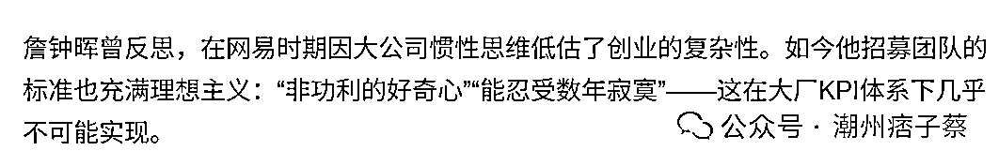

# (11 赞)成功将项目里盈利的投放方法论“复制”给了优化师
作者：龙哥

最近刚收尾了一个中型项目，说它难，是真的难——在广告买量这个圈子里，能跟它比复杂度的赛道真不多。

为什么这么讲？一般的投放生意，无非左手变现、右手获客，两大变量抓住就能玩转。但这个业务呢？中间变量多到让人头皮发麻，变量一多，可控性就直线下降，盈利自然成了硬骨头。

我特意把变量拆了拆，大家感受一下：

产品多，还不是标品；各省份卖得还不一样；有的产品每天限量，跑快了预算就白烧；需求本身不算刚需；价格高低不齐；账户里不是单一产品，模型很难养；素材只能走诱导路线；流量只能靠联盟；落地页还有一堆讲究；最要命的是，对优化师的要求极高，市面上面试一百个都未必能挑出一个完全对口的——招进来的人，必须重新教、重新带、重新磨。而且说白了，这种业务想赚钱，不靠扣量根本走不通。

这些还只是“包括但不限于”的困难。

当年在网易时，丁磊讲过一句话：创业要选变现链条短的业务，这样更容易成。我在这里补一条：除了链条短，变量少的业务更值得做。链条短、变量少，成功的概率才高。

那这项目最后盈利了吗？大概率能。但问题在于，投放思维和操作习惯没办法凭空长出来，尤其是一个新团队，想短期速成，几乎不可能。

团队里确实有一两个优化师，靠着某些打法，在特定天数、特定账户上做出了利润。这背后是有方法可循的，只是对低 ROI 项目的及时管理做得不够，这又牵扯到考核机制——除了 ROI，消耗量也得看，外部因素被动调整的情况另说。

于是我把这套打法提炼了出来。投放方法有很多种，我自己归纳下来，大致有这么几类：

一类是精细化运营。底层是强数据支撑，你得清楚数据背后的变量，还得知道变量背后是什么在影响。这个难度高，市面上大多团队做不到。但在现在的经济环境和流量环境下，想稳赚，必须往这个方向走。项目里的优化师就跟我说过，以前以为投放就是大开大合，没想到还能精细到这种程度，难怪很多项目就是这么“S”掉的。

还有一类是粗糙投放+精细化扣量。前半段只要堆量，后半段再靠计划和扣量抠利润。

再有就是通过计划与素材的合理组合，配一定比例的扣量，同时盯着人群转化，也能跑出盈利空间。

这还只是三种，两两组合又能多出三种。投放方法从来不是死的，关键是你适不适合、会不会用。

方法论提炼出来后，有意思的事来了：新招的优化师，各种表现都让我哭笑不得。

有人直接抗拒，不信这套，觉得自己以前那套才是对的。可事实上，绝大多数优化师过去根本没受过系统培训，都是从自己摸索或别人嘴里零散听来的招。结果呢？不执行，没效果。

有人觉得这套方法是变相否定他的能力，怀疑他的水平，于是继续我行我素，最后也没跑出什么结果。

有人听了，但理解不透，跑不出效果就又退回到自己熟悉的打法。说白了，只知其然，不知其所以然，很难真正消化。

有人听了也听了，不懂也不问，闷头照自己的方式搞，性格也好，习惯也好，最后照样没效果。

真正能被这套方法论赋能的，是那些认可打法、愿意接受过程管理、在数据分析里不断调整的人。他们最终验证了一件事：优化师的成功方法论，是可以被“复制”的。

当然，能复制的前提，是“人”得对。不是谁都能复制。

巧的是，今天刚好刷到一个视频，博主采访金枪大叔，他提到人才的几个特点，我很认同：

第一，人才只能筛选，不能培养。

第二，听到方法论后，先别急着下判断。这是别人跑出来的成功经验，你听话照做，边做边调。

第三，听完立刻动手。光听不做，等于没听。时间一长，精髓忘了，执行也就越来越偏。

我对投放的理解，一直有自己的逻辑框架。这个👸号写的东西，也大多是用逻辑性内容来分享。想要方法论的人会觉得很受益；但如果只想找“术”，可能文章里看不到，得私下聊。

但投放要想做好，逻辑性真的太重要了。这一点，我专门写过一篇《你看完这篇之后，就应该明白广告投放是要讲“道”的，是要讲逻辑的！》。

所以面试优化师时，我特意有意识招理科背景的，也招本科的，还招过一名硕士。结果都不太理想。

硕士、985、211 背景的优化师，在广深其实不多见。学历高，可选择的工作多，未必愿意来干这个。一旦碰上这种超难业务，遇到点难题，要么自己走，要么被逼走。

还有些学历不错的，之前做的是高客单价传统公司，表单为主，不需要多账户操作。一上来就要多账户、多基建计划，就受不了，直接放弃。

对于接受方法论赋能的优化师，投放过程里还是需要陪伴和及时指引。这业务变量太多，新人适应期差不多要 10 到 16 周。

等赋能成功、“复制”出第一批优化师后，剩下的就是筛选更多合适的人、批量复制，业务就顺了。

整条链路走下来就是：提炼方法论 → 赋能优化师 → 筛选执行 → 赋能成功。这足够证明，投放是有方法论可循的，而且可以通过提炼后有效传递给优化师。

这么难的业务都能跑通，其他行业只会更容易。

这件事的核心，从来只有两个：一个是“有效”方法论的“准确”提取，另一个是“合适”优化师的“人”本身。

我不禁想，如果未来有公司能做出自动按需求生成素材、上下线计划、自动暂停的工具，并且理解我的算法逻辑，成本又不高，那很多行业的投放盈利就没那么难了。这特别适合“小而美”团队。只是小团队对媒体算法的深刻理解往往又是短板，两难。

这个赛道未来也可能通过自动化系统、精细化运营、精细化扣量、产品账户高匹配、算法出价等多种手段实现盈利，这值得以后继续探索。

当然，同样的动作放到难度低很多的赛道里，盈利就轻松多了。就像我们此前已经“破解”了一些 IAP、付费订单类产品的投放算法，盈利上有了一定保障，这条也会继续挖下去。

说到底，广告投放买量看起来简单，实则藏着无数变量和值得深挖的地方。我们一直做这件事，一是真心感兴趣，二是觉得它有价值。这几年我坚持研究它，从不以 KPI 为导向——一旦有 KPI，研究动作必然变形。这点和我在网易的前同事叮当最近说的很像，他说想做感兴趣的游戏也会受此影响，道理一模一样。

当投放理解透了，你会发现底层逻辑是可以迁移的。不止某个赛道、某个平台，甚至不只在国内——还能延伸到海外去。