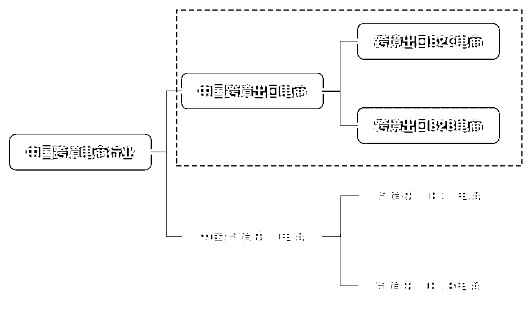
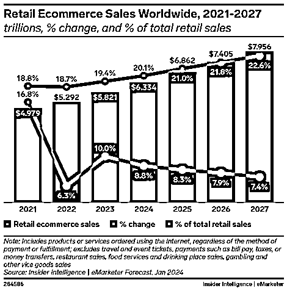
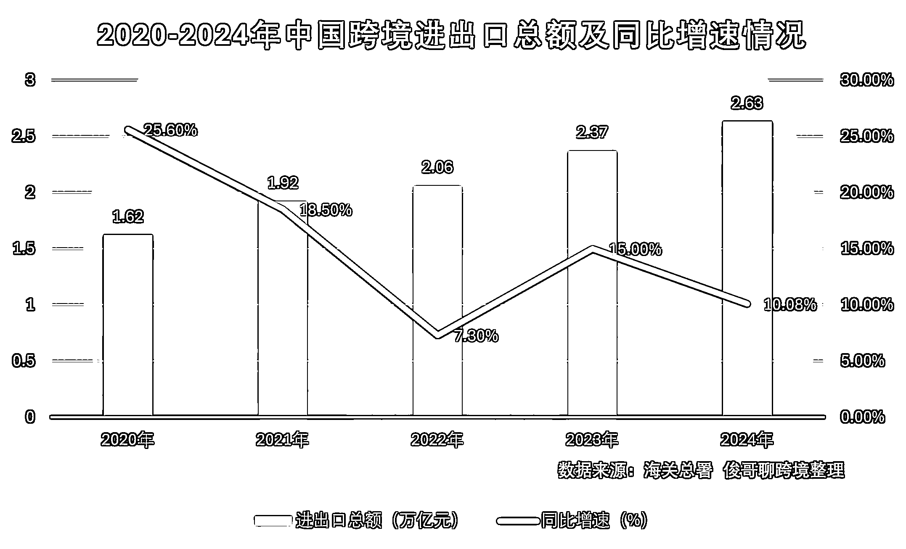
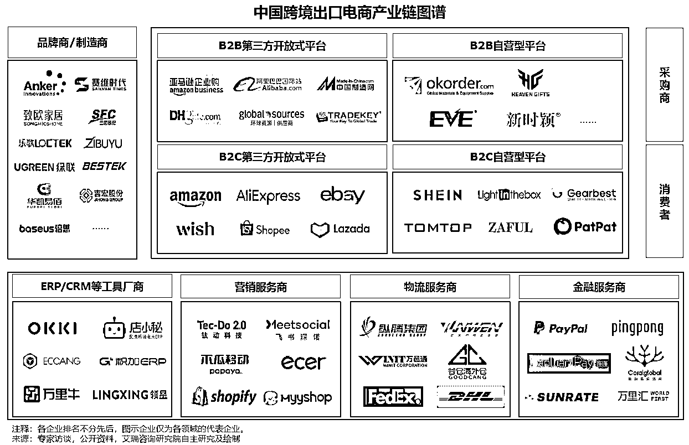
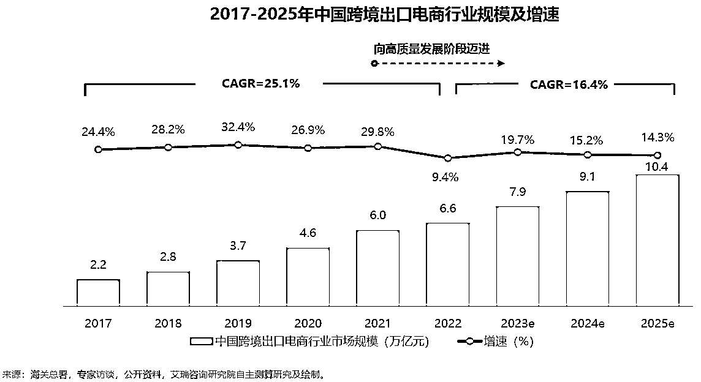
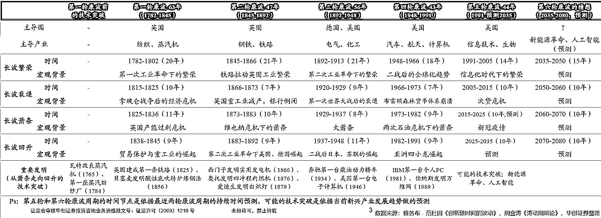
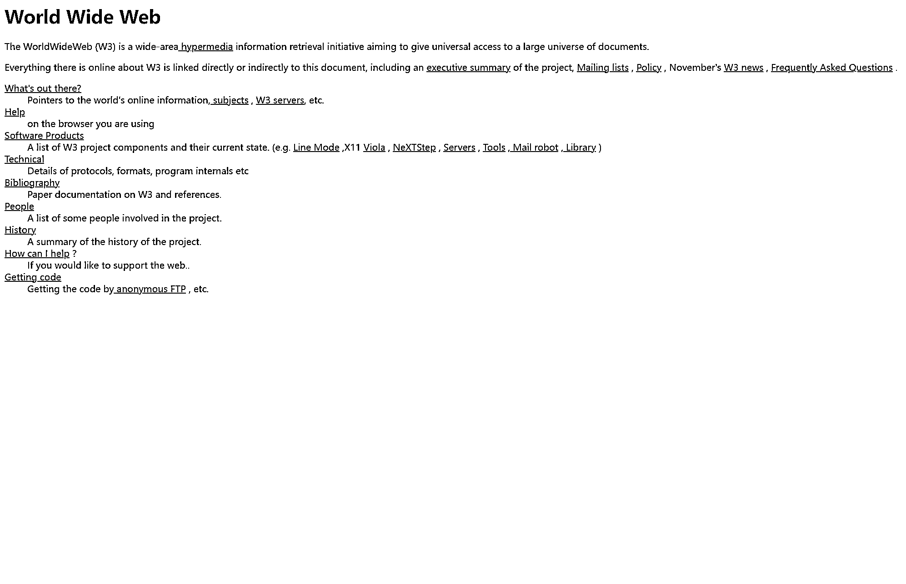
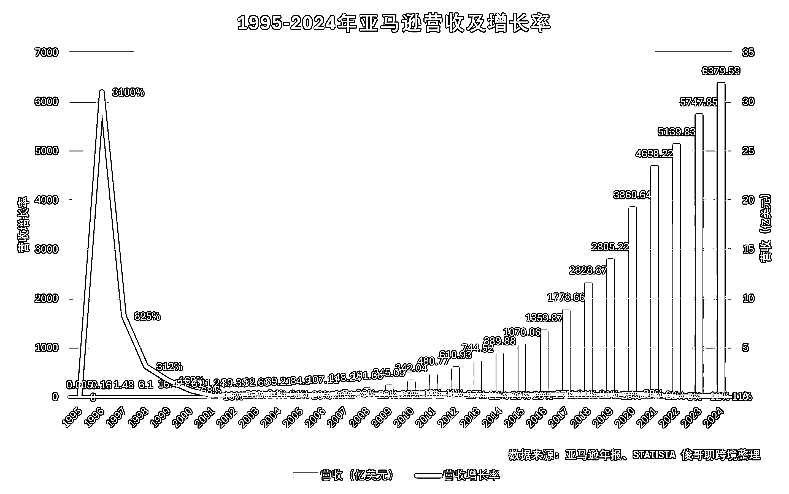
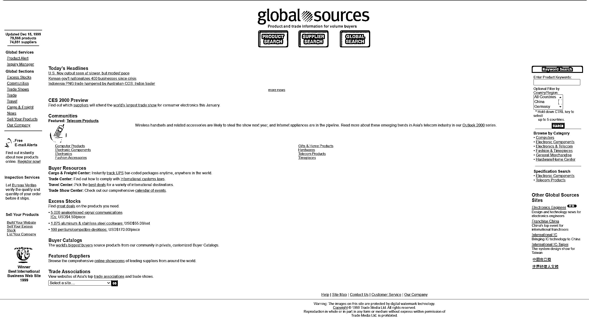
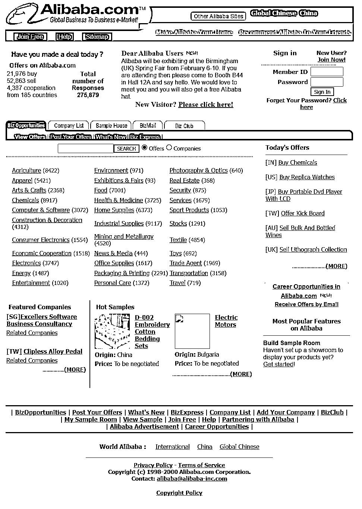

# 跨境电商：从互联网萌芽到AI重塑，30年发生了什么？
作者：龙哥

跨境生意从来不是一条平滑上升的曲线。

有人借助平台早期红利迅速放大，也有人在规则变化、库存积压或资金风险中出局；有人靠一套方法赚到第一桶金，却发现几年后，原本有效的打法已经变成了陷阱。

回看1991年至今的互联网商业史，会发现跨境电商的成长，几乎与第五次康波周期同步：经历高速扩张，也走过调整、收缩和重构。今天，我们试着把这条漫长而复杂的路径重新拼起来。

我是龙哥，进入跨境领域已有十年，做过品牌、创业，也在探索AI时代的个人出海模式。过去这些年，我越来越确定一件事：

**如果不了解行业从哪里来，就很难判断它接下来会走向哪里。**

很多人认识跨境电商，是从某个平台、某个爆款或某条短视频开始的。但平台只是表层，背后还牵涉支付、物流、政策、供应链、人才、金融和本地服务。只看其中一环，容易把偶然当规律，把风口当能力。

因此，我准备推出《狂飙30年：跨境电商发展史》系列，尝试用时间线和案例，把这个行业的关键转折讲清楚。

这组文章不会满足于罗列数字，而是希望还原行业真正的运行轨迹。我会参考政策文本、上市公司披露、创业者访谈以及历史报道，回到一个个重要节点，看看当时发生了什么、哪些选择改变了结果，以及那些经验今天是否仍然有效。

文章中的关键判断会尽可能注明出处。对于无法核实的传闻，不会把它包装成结论。如果你经历过早期平台、物流产品、品牌出海或创业转型阶段，也欢迎提供线索。许多被忽略的细节，往往比宏大叙事更能解释行业变化。

这套内容希望服务三类读者：

- 刚入行的人，可以先建立完整框架，避免只学到零散技巧；
- 已经在一线作战的人，可以从历史案例中寻找判断周期的参照；
- 研究行业或配置资金的人，可以更好区分短期热度和长期趋势。

过去并没有消失，只是被埋在不断刷新的数据、订单和流量之下。把旧经验重新整理，才有机会看清下一轮变化。

## 这套系列，主要回答三个问题

### 一、把碎片事件放回完整产业结构

跨境电商不是单独存在的“卖货渠道”。它连接着供给端、交易端和交付端，也受到政策、资本和技术的共同影响。

后续内容会把进出口业务、支付结算、国际运输、海外仓、平台运营、人才服务、产业园区和金融支持等环节放在同一张图里，观察它们如何互相配合，又如何彼此制约。

为了方便理解，整个行业可以大致分成四个时期：

**探索期（1995—2004）**  
搜索流量、线上黄页和早期零售网站开始出现，网络卖货逐步从概念变成生意。

**平台扩张期（2005—2014）**  
大型交易平台成为主要入口，PayPal等工具降低了跨境收款门槛，独立网站和本地搜索运营也开始发展。

**加速期（2015—2024）**  
柔性生产、数据分析、内容传播、品牌化经营和合规要求同时推进，行业规模快速放大。

**再组织期（2025年以后）**  
人工智能、智能化管理、本地履约、个性化定制以及轻量化品牌模式，将重新分配行业机会。

### 二、解释变化背后的推动力

表面上看，行业是在不断更换平台和工具；更深一层看，真正决定方向的通常是三股力量：

- **制度环境**：加入WTO、共建“一带一路”、欧洲增值税调整、RCEP以及中美贸易摩擦等；
- **技术基础**：线上支付、云服务、算法、大模型和分布式技术；
- **消费与渠道**：平台经营、内容推荐、独立商城、品牌直达消费者等模式的变化。

只有把这三条线放在一起，才能解释为什么某些模式曾经迅速扩张，后来却突然失效。

### 三、从成败案例中提炼方法

行业里既有可复制的能力，也有不能重复的偶然。

亚马逊的关键不只是卖货，而是持续建设交易基础设施和商业生态；SHEIN把需求数据、产品开发和供应商协同连成一体；Anker则通过技术积累、知识产权和当地内容运营，在成熟市场建立认知。

反面的案例同样值得研究。兰亭集势过度集中于婚纱等品类，又没有及时补上多语种自有渠道，2018年退市时毛利率仅约15%；环球易购长期偏重电脑端流量，移动端搜索布局不足，2021年披露的库存滞销率达到60%。

接下来，人工智能可能会承担大量商品筛选、客户响应和内容生产工作；生成式工具会压缩日常运营成本；欧洲数字监管、碳成本和本地制造要求，则会提高合规门槛。与此同时，围绕个人创作者的小型品牌、低库存经营和社交传播，也可能成为新的组织形态。

## 跨境电商到底是什么？

简单说，它是发生在不同国家或地区之间的线上商业交易。

买方与卖方通过网络完成展示、沟通、下单和收款，商品再经国际运输、报关及末端配送抵达消费者或采购商手中。它把传统外贸中的部分环节搬到线上，并借助数字工具提升交易效率。

按照客户类型，可以分为：

- **B2B**：面向海外企业、采购商或渠道商；
- **B2C**：直接服务境外个人用户。

按照货物流向，又可分为进口和出口。这个系列主要聚焦中国企业面向海外市场的出口业务。

市场体量仍在扩大。eMarketer预计，2024年全球线上零售成交额约为**6.3万亿美元**，占全球零售额20.1%，同比提升8.76%。预计2024年至2027年间，整体保持7.8%的年复合增速，**2027年规模或达到8万亿美元**。

Built With统计显示，截至2024年，全球电商网站数量约为2720万个，较上一年增加6.16%。换句话说，在这段时间里，平均每天约有2685个新站点进入市场。

中国跨境业务也已成为外贸增长的重要组成部分。

海关总署数据显示，2024年我国货物贸易进出口总值达到43.85万亿元，同比增长5%，总额再创纪录。出口金额为25.45万亿元，同比增长7.1%，连续八年保持上升，且首次站上25万亿元关口。

同年，跨境电商进出口额达到**2.63万亿元**，增幅为10.8%，相比2020年增加了1万亿元。

所谓全产业链，指的是围绕跨境交易形成的一整套协作体系：货源与出口业务、国际运输、收付款、监管政策、店铺和品牌运营、专业人才、融资工具以及产业园区等，都包含其中。

今天，中国跨境电商已经不再是单一平台上的卖家生意，而是逐渐形成覆盖生产、交易、履约、服务和资本的综合生态。进口与出口两侧，都仍有大量细分机会。

中商产业研究院预测，2024年中国跨境电商全产业链规模约为**17.66万亿元**，同比增长约7.32%。

其中，2022年跨境出口电商相关产业链规模达到**6.6万亿元**，年均复合增速约16.4%，预计到2025年有望超过**10万亿元**。

## 从早期黄页到全球化经营

中国出口型跨境生意的起点，并不是今天熟悉的短视频直播或大型平台。

1995年前后，《环球资源》通过线上黄页帮助企业寻找海外订单；2000年前后，已有创业者尝试在网络上销售软件产品；随后，eBay上的影像资料交易成为早期零售探索之一。

随着香港邮政小包等服务出现，电子产品开始具备更低门槛的国际寄送条件。物流产品不断丰富，垂直平台陆续建立，跨境零售企业开始尝试资本市场，速卖通、Wish等平台相继登场，海外仓也逐渐成为解决末端履约的重要方案。

这条路并不总是向上。出口模式经历过资本追捧，也遭遇过冷却；经历过低成本扩张，也被库存、规则、资金和合规问题反复教育。

从更长的经济周期看，这段发展过程也对应着第五次康波周期由繁盛走向低谷的阶段。如今，新的技术变量已经出现：人工智能、海量数据与自动化系统，正在改变选品、生产、营销和交付。

未来，小团队乃至个人，借助中国成熟的制造能力和智能工具，打造面向全球的品牌，可能成为越来越普遍的现象。

今天的出口跨境业务，正处于重新洗牌的关口。

关税政策、本国法规、海外仓和运输费用、平台治理、支付安全、融资风险、品牌建设以及当地竞争，都会影响企业能否持续经营。人工智能带来效率，也会淘汰单纯依赖信息差的旧方法。

这些问题，将在后续文章中逐一展开。

## 第一批电商故事，是怎样发生的？

### 互联网基础设施出现

1991年8月6日，蒂姆·伯纳斯-李发布了首个网站info.cern.ch。这个看似简单的页面，后来成为万维网发展的重要起点，也为电子商务提供了基础条件。

互联网从科研网络逐渐走向公众使用，信息传播、远程沟通和线上交易因此有了共同的技术底座。跨境电商，正是在这样的环境中慢慢长出来的。

### 贝索斯与线上书店

1994年7月5日，30岁的杰夫·贝索斯离开华尔街，驾车前往西雅图，并在贝尔维尤租下一处简陋空间，开始筹备自己的互联网项目。

当时，网络仍主要服务于高校和科研机构，商业模式远未成熟。贝索斯选择图书作为切入口，是因为图书品类数量庞大，实体书店不可能全部陈列，而网络理论上可以承载一个“没有货架上限的书店”。

1995年7月16日，Amazon.com正式上线，售出的第一件商品是Douglas Hofstadter所著的《Fluid Concepts and Creative Analogies》。

上线后的第一个月，订单来自美国50个州以及45个国家，金额超过6万美元。1995年全年销售额约51.1万美元，1996年增长至1570万美元。

此后，亚马逊从线上书店逐渐扩展为综合零售、云服务和数字生态巨头。其销售额由1995年的51.1万美元增加到2024年的6380亿美元，年均复合增长率约62.23%，累计增长约124.8万倍。

### eBay验证了另一种交易逻辑

1995年9月3日，Pierre Omidyar上线AuctionWeb，后来发展为eBay。

平台早期成交的代表性商品，是一支售价14.83美元、已经损坏的激光笔。这个故事之所以被反复提及，并不是因为商品本身有多特别，而是它展示了一个重要事实：只要买卖双方愿意在线匹配，传统商场之外也可以形成有效交易。

eBay的月收入随后从约1000美元增长到1万美元，线上拍卖由此证明了自身的吸引力。

## 中国市场开始接入世界网络

1994年4月20日，中国正式接入国际互联网，为后来的跨境信息流通和线上交易铺设了基础。

1995年，《环球资源》推出B2B交易网站，帮助中国企业接触海外买家。那时，许多企业还在通过纸质目录、电话和传真寻找订单，网络平台提供了新的连接方式。

1999年6月，Alibaba.com成立，重点连接中国中小制造商与海外采购商。这一事件通常被视为中国跨境电商正式起步的重要标志。

根据海关总署数据，2024年我国跨境电商进出口额为2.63万亿元，同比增长10.8%。其中，企业间交易约占65%，面向个人消费者的交易约占35%。

过去五年，中国跨境电商贸易规模增长超过十倍。如今，相关企业数量已超过12万家，企业在海外累计注册商标超过3万个。

## 结语：别只追风口，先理解周期

跨境电商的机会，从来不是固定在某个平台、某个品类或某一种流量工具上。

三十年的变化说明：每一轮增长都会带来新的红利，但红利也会随着规则、技术和竞争环境变化而消失。真正能够留下来的，往往不是最会追热点的人，而是能理解产业结构、识别周期信号，并持续建立能力的人。

如果你希望把行业脉络看得更完整，减少盲目试错，欢迎关注「俊哥聊跨境」。

下一篇Vol.001《全球电商平台演化简史》，将继续梳理Amazon、速卖通、Shein、TikTok Shop和Temu等平台的成长路径，看看它们如何改变商家的经营方式，也如何重新塑造全球贸易。

**— 俊哥聊跨境**  
10年跨境实践者 × AI时代个人创业探索者 × 全球品牌出海践行者

**参考资料：**

1. 华创证券：《康波周期复盘：康波周期与中国式现代化》
2. 艾瑞咨询：《2023年中国跨境出口电商行业研究报告》
3. 中国海关总署：历年进出口数据

#跨境电商 #独立站 #品牌出海 #人工智能