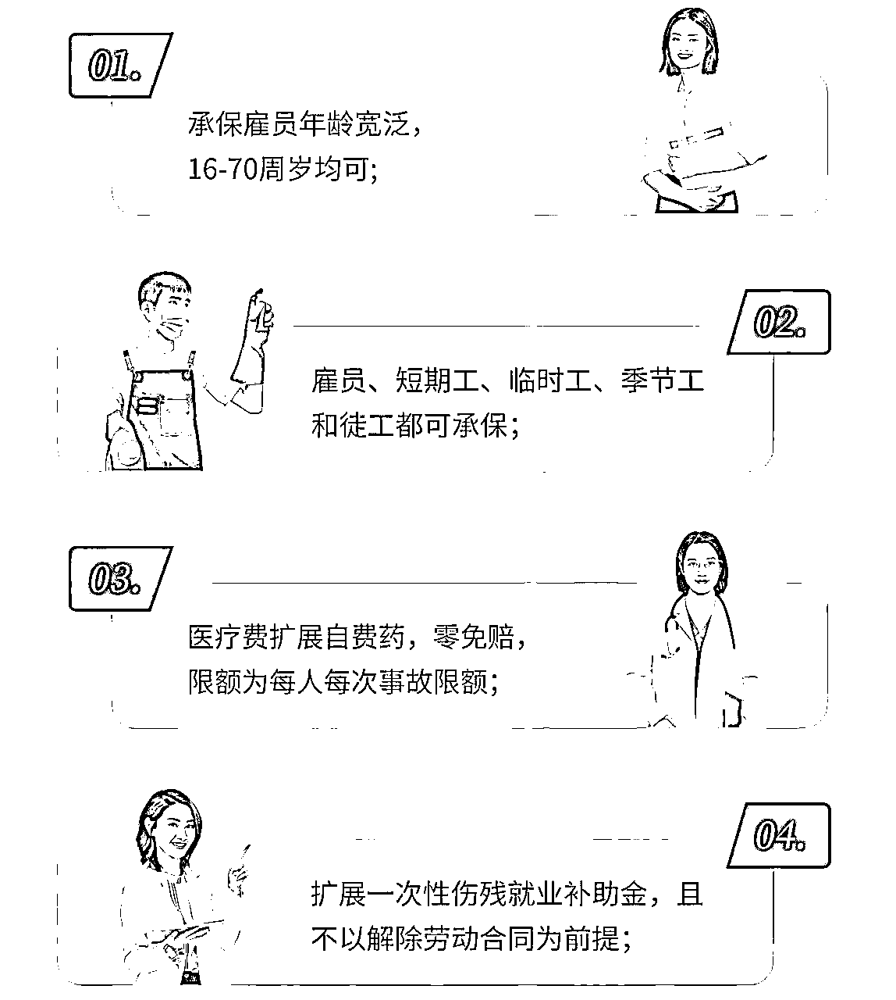
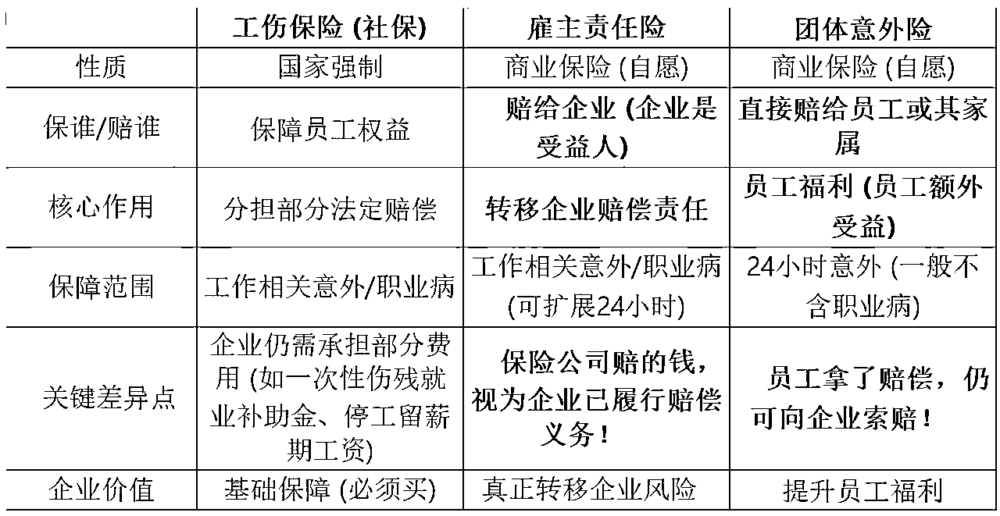
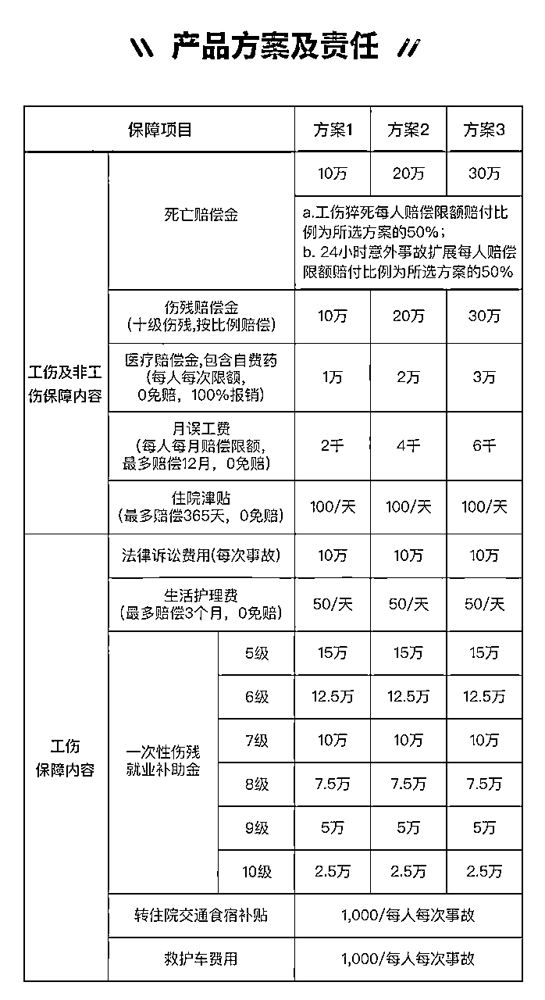
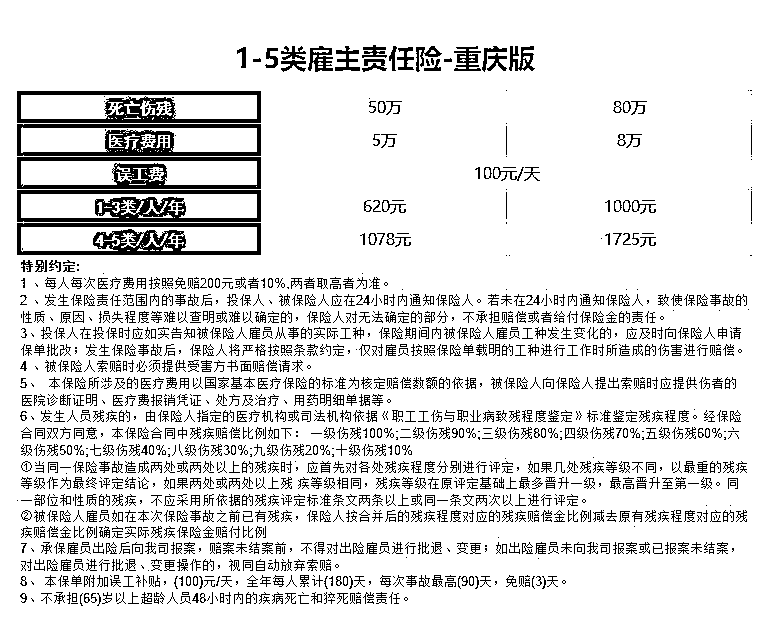
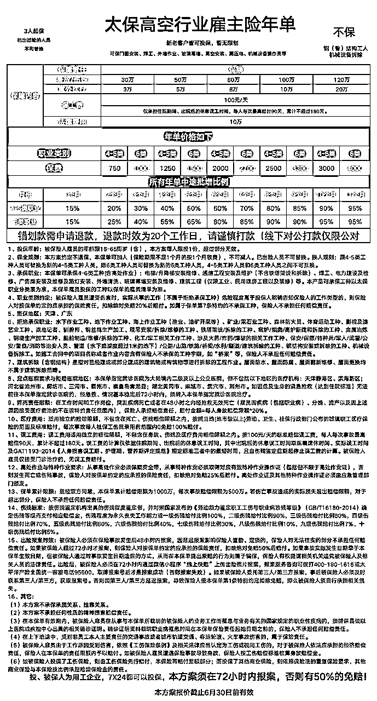
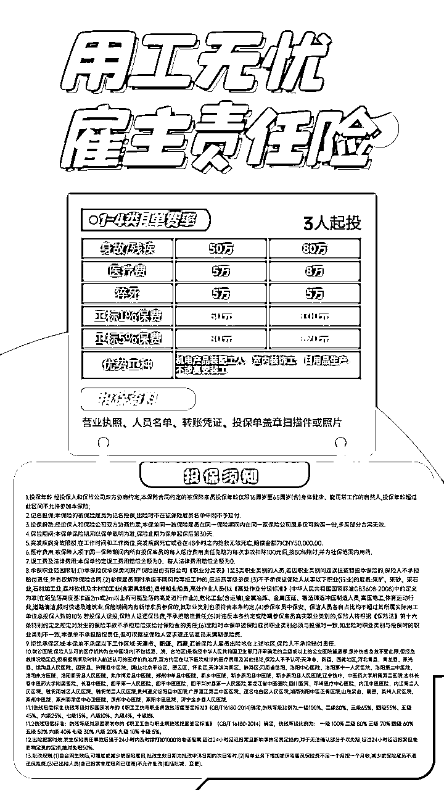
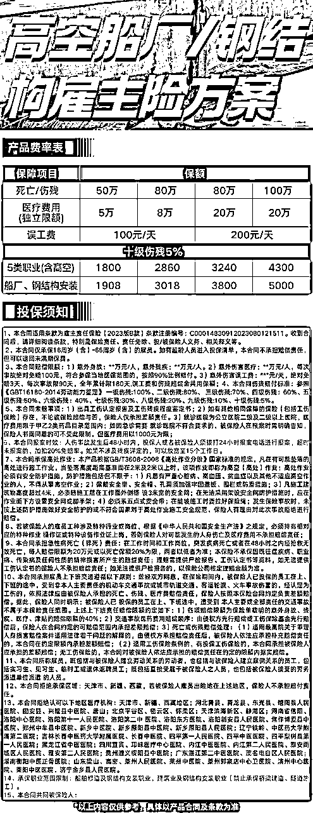
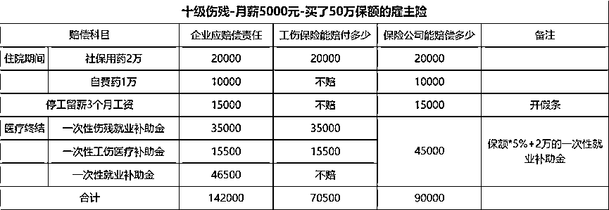

# 员工出事，老板背锅？这篇把雇主责任险说得明明白白

老板们，先想象一个场景：公司里一个实习生前几天刚离职，结果后脚就出了事，家属话里话外都暗示公司要负责。你会怎么应对？最近就有位圈友差点被套话，让公司赔掉底儿。说实话，这种风险离我们并不远。

我是龙哥，在保险行业摸爬滚打了十年，目前是一名第三方保险经纪人，专注站在客户立场做方案。手上握着全国优势渠道，这些年帮企业省下两百多万保费，累计理赔金额也超过两千万。入圈赚钱两年多，感谢龙哥老师搭的平台，也通过这里认识了不少靠谱的朋友，感觉自己的“天灵盖”都被打开了。

前几天群里有人吐槽离职实习生的事，我一边替恒一老铁捏把汗，一边想：这种问题，很多老板可能都会遇到，而我正好专业对口，干脆写一篇科普帮大家扫扫盲。

感谢谢总和语文王老师的推荐，我把这篇分享整理出来，同步给赚钱的圈友。希望大家既能保护好自己，也能保护好企业，少踩坑、不踩坑。

接下来我用最快的方式讲清楚：雇主责任险是什么？保什么？谁最需要买？和工伤保险、团体意外险有何不同？投保又有哪些坑？

## 一、雇主责任险，到底在保什么？

说白了，它是一种责任保险，保的是“雇主应当承担的责任”。

别误会，不是发工资那种责任，而是员工在受雇期间出现意外受伤、伤残、身故，或者发生工伤医疗费用时，老板依法要负的赔偿责任。

买了它，保险公司就会替你把这些赔偿扛下来，包括医疗费、误工费、伤残赔偿金、死亡赔偿金，还有打官司产生的律师费、诉讼费、仲裁费等。

## 二、核心保障和附加保障，分别怎么赔？

### 核心保障是这五块：

1. **死亡赔偿金**：员工因工身故，赔一笔钱给家属。
2. **伤残赔偿金**：按国家《劳动能力鉴定标准》把伤残分成1-10级，按比例赔。比如十级赔10%，一级伤残或死亡赔100%。
3. **误工费**：员工受伤上不了班，保险公司按天赔工资，比如每天100元，但有天数上限。
4. **医疗费**：工伤后合理的医药费、手术费等，通常有独立限额，常见3万、5万、10万、20万档位。医院一般要求二级及以上公立医院普通部。
5. **法律诉讼费用**：因工伤赔偿引发的官司，合理且必要的律师费、诉讼费、仲裁费也能赔，一样有单独限额。

### 附加保障，大多很实用：

1. **24小时意外扩展**：把保障延伸到非工作时间，员工福利感会强很多。
2. **住院津贴**：住院期间每天给一笔补贴。
3. **生活护理费**：停工留薪期内需要人照顾的开支。
4. **一次性伤残就业补助金**：这是《工伤保险条例》规定企业要付的一笔钱，当五至十级伤残员工被解除或终止劳动合同时，雇主责任险可以帮你出。
5. **转院就医交通食宿费、救护车费**：工伤处理过程中的必要开支，也能报销。

## 三、谁最该买？先看看你的企业属于哪类

原则上，只要你有员工，用工风险就存在，雇主责任险就是刚需。

特别是以下这些劳动密集、风险偏高的行业，建议尽早配置：

- **制造业、建筑业**：工人在高处或机械周边作业，太容易出意外。
- **物流运输**：司机天天在路上，风险天然高。
- **安装维修**：空调安装、钢结构、设备拆除，涉及高空或机械操作。
- **餐饮酒店**：后厨、服务环节容易滑倒、烫伤。
- **物业保洁**：清洁和维修工作也藏着不少风险。

此外，个体工商户、劳务派遣公司、临时工或季节工较多的企业，还有员工年龄偏大（比如60-70岁返聘人员）的团队，也是重点关注对象。这类员工一旦出工伤，处理起来更棘手，更需要保障。人员越杂，风险越难盯，越需要提前兜底。

## 四、有了工伤保险，还要不要雇主责任险？

先把结论放前面：这三个险种定位完全不同，团体意外险、雇主责任险也不能互相替代，区别可以看这张图：

团体意外险本质是员工福利，赔给员工本人；雇主责任险保的是老板的责任，赔的是企业该承担的部分。买的时候别混为一谈。

至于工伤保险，它是国家强制要求，肯定要交。但交过不代表万事大吉：

1. **它覆盖不全**：员工一旦评残，企业依然要承担不少赔偿项目，尤其是评残等级在四级以下的，企业要掏大头，比如一次性伤残就业补助金。
2. **它覆盖不到某些人**：临时工、学徒、返聘退休人员，以及没能及时参保的人，工伤险往往管不上，雇主责任险正好补位。
3. **商业险更好用**：雇主责任险是商业保险，手续比工伤险简单，赔付速度快，还能减少扯皮摩擦。关键是，它的保费可以进企业生产成本，税前列支，不挤占公司费用。

就像医保之外还要配商业医疗险一样，工伤保险是底线，雇主责任险是补充，组合起来才安心。

## 五、投保时最容易踩的坑，一次讲清楚

### 1. 承保方式，别选错

- **定员定名**：投保时写死每个员工的名字。好处是人员清晰、理赔简单；坏处是员工流动大时，要频繁做批改。适合人员稳定的办公室企业。
- **定员不定名（按工种）**：只确定人数和工种，比如“钢结构安装工10人”。好处是人员流动时，同工种、同风险等级的人可以直接替换，非常灵活；坏处是理赔时要先确认出险人是否在投保范围内。建筑工地、安装队、临时工多的企业，选这种更香。

### 2. 免责条款，一定要看清

这些情况通常不赔：员工故意犯罪、自残、醉酒、吸毒出事；非工作原因做美容整形出问题；参加攀岩、蹦极、职业赛车等高风险运动；战争、暴乱、核辐射等。

还要特别确认两点：**高空作业保不保？如果不系安全带出了事，赔不赔？** 很多纠纷就出在这里。

### 3. 费率高低，受这些因素影响

行业风险等级、员工的具体工种、保额大小、投保人数、保障区域、保险期限，都会影响报价。比如办公室文职和建筑工人的保费肯定不同；同样是制造业，一线操作工和行政人员的价格也不同；保额从10万到100万，医疗限额从1万到10万，每上一档保费都会增加；人数越多总保费越高，但人均可能略便宜；有些方案还会按山东、河南、河北、湖北和其他地区分别定价。短期项目也能按1个月、3个月、6个月来投，相当灵活。

这里放几款常见产品方案，给大家看看具体的责任内容和大概保费：

## 六、算一笔账，看看能挡掉多少钱

假设有个员工因工造成十级伤残，月薪5000元，企业已经上了工伤保险。那老板自己还要掏钱吗？

我们来盘一盘：

- 企业没有任何保障：要自己承担约14.2万元的赔偿。
- 只买了工伤保险：工伤赔付约7.05万元，能覆盖一半的支出。
- 只买雇主责任险：能赔约9万元，覆盖六成多。
- 两个都有：工伤赔7.05万+雇主险赔1万自费药+1.5万误工费+2万一次性伤残就业补助金，合计11.55万元，能覆盖81%的支出。

这还是个简化例子，实际操作会更复杂，各地工伤赔偿标准也有差异。但结论很清楚：组合参保，老板自掏腰包的金额能大幅下降。

## 七、最后，四条“一定”请记住

1. **一定**要如实告知具体工种、是否涉及高空作业。
2. **一定**要提前摸清特别约定、投保须知、免责条款，尤其注意小字部分。
3. **一定**要问清楚十级伤残赔的是10%、5%还是1%，不同产品差距很大。
4. **一定**要附加扩展24小时，把非工作时间也纳入保障。

## 写在最后

给员工买保障，是老板的责任；给企业买保障，是老板的智慧。花小钱防大风险，企业才能走得更远。

具体到方案选择，不同行业、工种、人数的报价都不一样。关于雇主责任险有任何问题，欢迎通过鱼丸来找我，知无不言、言无不尽。作为保险经纪人，我会一直保持客观、中立，给你合适的建议。

我是贾继赛，希望今天这篇能帮到各位老板。祝大家龙哥盟，稳稳落袋！