# 猫咪疗愈长视频拆解 & 频道运营技巧

大家好，我是轻舟。在YouTube深海圈里做教练，同时也是一名赚钱传术师。圈里已经有非常多的伙伴通过了YPP，甚至有好几个人同时运营着多个频道。过了开通这道坎，怎么把收益做起来就成了下一个课题。实话讲，中长视频是绕不过去的一道关卡。作为教练团的成员，我在这方面的探索比大部分人早一些。今天就打算用猫咪疗愈这条赛道来做个完整的拆解，再延伸聊聊频道的运营思路，希望能抛砖引玉，给各位带来点启发。

# 猫咪疗愈类长视频：从拆解到实操

## 参考频道的数据表现

先来看几个对标频道的具体情况。

对标频道一：  
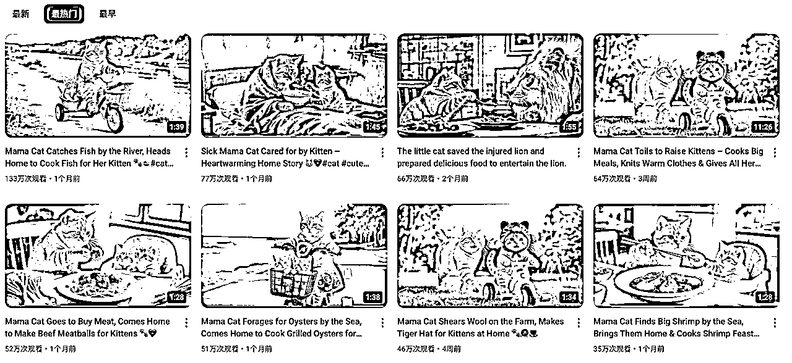  
https://www.youtube.com/@Yangxiaohui520

对标频道二：  
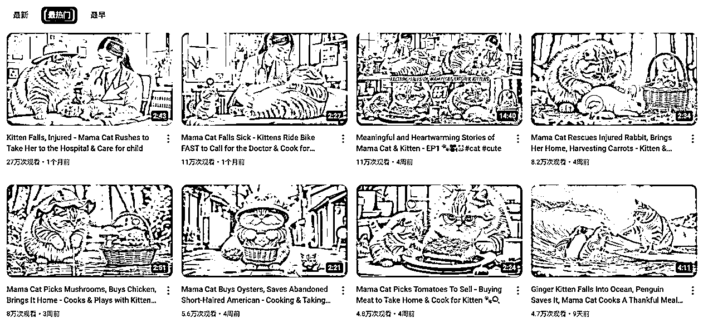  
https://www.youtube.com/@MeowMemoirs97/videos

对标频道三：  
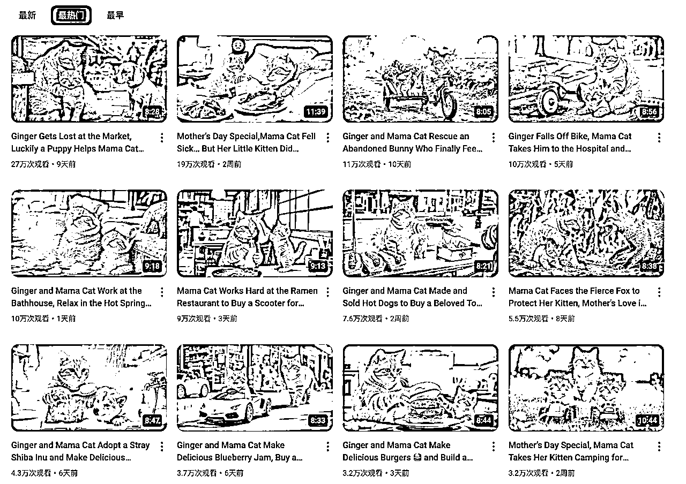  
https://www.youtube.com/@StarAndManny

用我自己赛道的真实RPM粗略估算一下这三个频道的收益（只按截图里的数据算）：

- 第一个频道：约5200美元。算法是524×10×1，RPM按1美元估算。
- 第二个频道：约960美元。具体为80×10×1.2，因为视频时长稍长，RPM按1.2算。
- 第三个频道：约2270美元。公式是113.5×10×2，视频超过8分钟，RPM按2计算。

必须说明的是，做对标分析时，这些数字更适合当作参考上限。实际情况往往只有这个数的10%到50%，不同类目差异不小，心理预期要合理。

## 我自己频道的起步

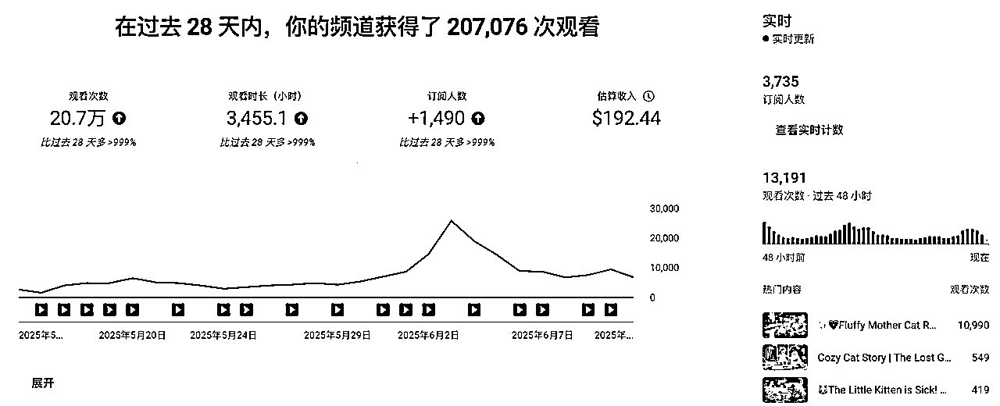  
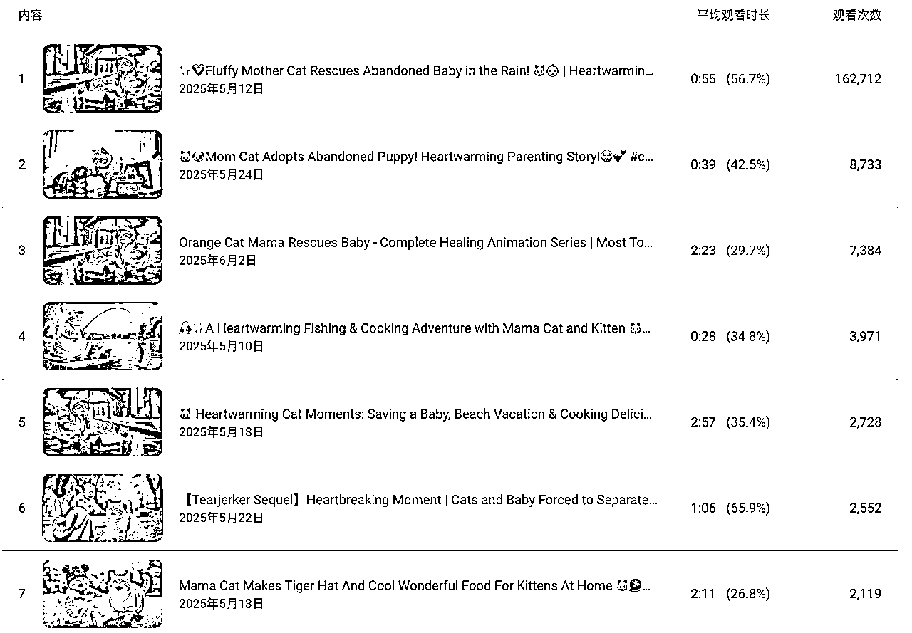  
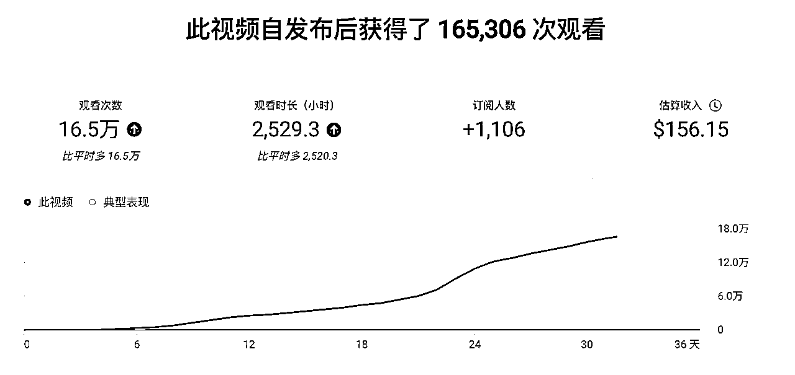  

我的起点足够低，这条赛道几乎是从零起步，跟多数圈友的状态非常接近。数据在慢慢爬坡，但没有出现过爆款。正因为如此，这套打法相当接地气——只要照着执行，做到上面那些成绩并不是难事。

## 这个赛道是怎么发现的

灵感来自深海圈风向标。当时刷到一支非常火的猫咪视频，顺着它的推荐位继续看，无意间发现了这个赛道。数据表现亮眼，拆解下来制作难度也低，于是我就开始着手做了。

# 制作流程全拆解

## 1. 故事创作与分镜生成

**有对标视频时：**

可以直接用AI Studio来做拆解。我通常这样指令：

“帮我拆解这个视频，输出各分镜的描述、各分镜文生图的提示词、各分镜图生视频的提示词，多一些细节，中英文输出。”

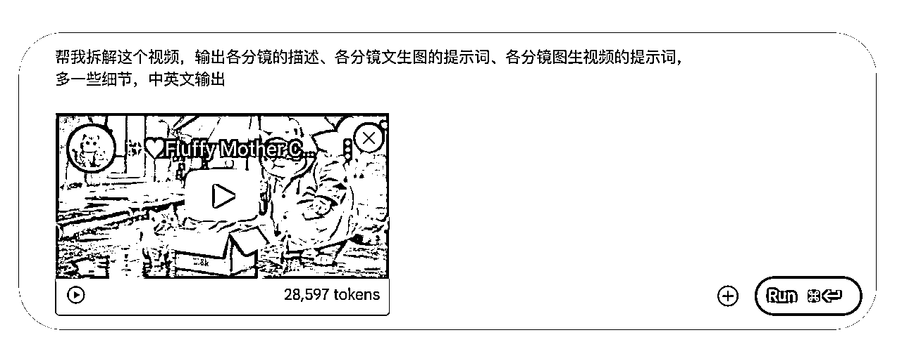  

如果担心跟对标太过接近，可以稍作调整，把角色或场景都替换掉，这样也能规避一些版权隐患。比如：

“帮我把故事中的成年橘猫换成超级胖的姜黄色成年猫咪，小橘色虎斑猫换成一只胖乎乎的姜黄色小奶猫，重新输出故事。”

**没有对标时：**

可以直接让AI来创作故事。举个例子（用Claude 4.0）：

“再创作一个故事，内容是：在一个下雨天，超级胖的姜黄色成年猫咪和胖乎乎的姜黄色小奶猫发现了一个被抛弃的婴儿，成年猫咪把婴儿带回了家，回家后先冲了奶粉给婴儿和小奶猫，最后又煮了米糊给婴儿，饭后婴儿和小奶猫一起玩耍。帮我拆成各分镜，给出各分镜用即梦3.0文生图片的描述词。”

## 2. 图片生成环节

我推荐使用即梦3.0的故事创作功能：

https://jimeng.jianying.com/ai-tool/story-editor

把提示词依次填进分镜即可。

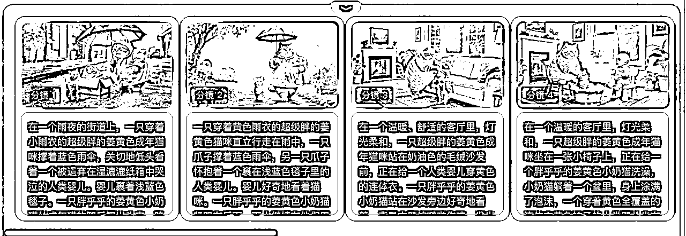  
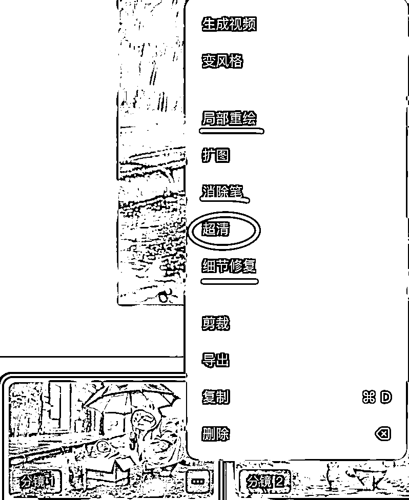  

有两点要留意：

1. 故事创作内置了智能画布，可以方便地做局部重绘、消除笔和细节修复。
2. 图片下载前，记得先做超清处理。

这里补一个实用技能——即梦3.0的角色一致性保持，其实就一个公式：**角色描述（外貌、衣着、状态）+ 动作或场景**。

例如这样写提示词：

“温馨卧室内，金色阳光透过白色蕾丝窗帘洒入，成年猫咪（超级胖，姜黄色）温柔地轻抚一个人类婴儿（穿黄色连体衣），旁边还有一只小奶猫（胖乎乎，姜黄色）在柔软床边伸懒腰，床上有粉色小枕头和毛绒玩具，墙上挂着姜黄猫咪的家庭照片，写实风格，柔和暖光，超高清细腻画质，治愈系氛围”

再比如：

“美丽的樱花大道上，成年猫咪（超级胖，姜黄色）用精美的并排式双人婴儿车推着一个人类婴儿（穿黄色连体衣）和一只小奶猫（胖乎乎，姜黄色），车上装饰着彩虹色气球和小风车，粉色樱花瓣飞舞，蓝天白云，写实风格，明亮温暖色调，电影级画质”

场景换成旋转木马也一样：

“华丽的旋转木马场景，精美的粉色独角兽木马配金色装饰，成年猫咪（超级胖，姜黄色）温柔抱着一个人类婴儿（穿黄色连体衣），婴儿怀里抱着一只小奶猫（胖乎乎，姜黄色），背景是梦幻的童话城堡和彩虹拱门，旋转的彩灯营造魔幻氛围，写实风格，丰富色彩，专业摄影级别”

或者来一段观光小火车：

“精致的儿童观光小火车内部，红色天鹅绒座椅，成年猫咪（超级胖，姜黄色）和一个人类婴儿（穿黄色连体衣）并肩而坐，一只小奶猫（胖乎乎，姜黄色）趴在窗台上，窗外是奇幻的童话世界：彩色糖果屋、巨大蘑菇森林、会发光的花朵，隧道内有星星点点的装饰灯，写实风格，梦幻光影效果，高饱和度色彩”

这样写出来的提示词，角色形象基本不会跑偏。

## 3. 图生视频

工具方面我用的是可灵1.6，其他平台也可以自行摸索。每张图生成10秒钟的视频片段，动作幅度要压到非常低，这正是疗愈赛道的特色。

## 4. 剪辑

把视频素材稍作裁剪，简单拼接即可。背景音乐要选疗愈风格的，可以自己生成，也可以直接用对标视频里的纯音乐。大家都在用，基本没有版权问题。

## 5. 上传与包装

标题和简介用Claude 4.0来写，上架前可以做SEO优化，内容要有吸引力、配上标签，简介分段并适当加表情，中英文各出一版。上传时记得设置片尾动画，把订阅频道、播放列表、推荐视频都关联好。

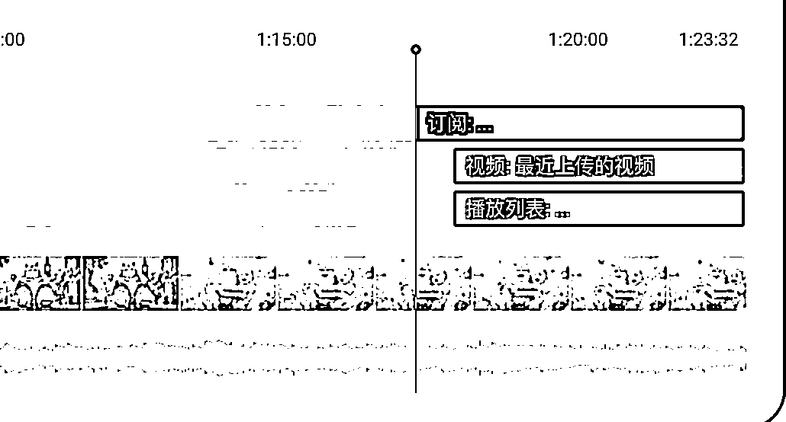  

额外建议：
- 标题和简介让AI代劳没问题，但SEO优化是必须的。
- 视频一定要加上片尾画面。
- 缩略图可以做对比测试，点击率影响非常大。

## 6. 关于赛道的理解

这不只是单纯的猫咪视频赛道，本质上更是疗愈赛道。观点可以从评论区的反馈得到验证。

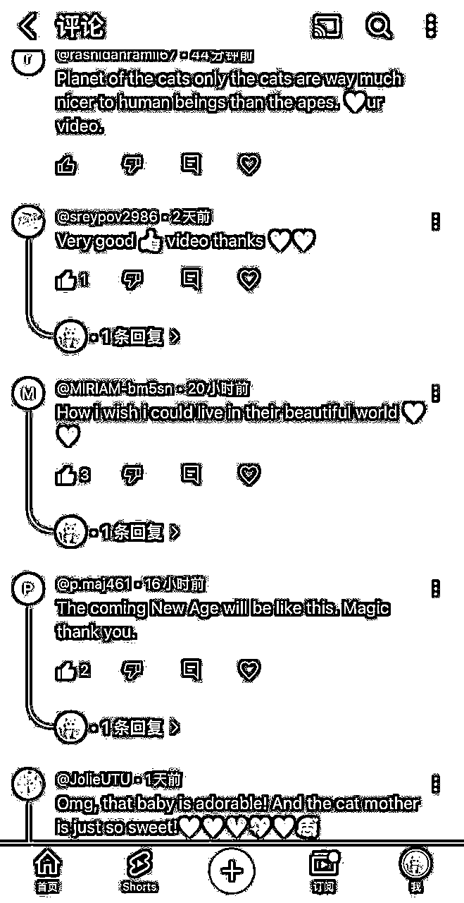  

疗愈赛道也被称为ASMR，核心特点是安抚情绪、治愈人心，外在表现就是视频特别长，甚至可以拿来直播。

# 小结与延伸

- 制作过程不复杂，赛道又安全，日更完全没有压力。
- 既然疗愈赛道天然吃“长尾”，是不是可以把视频做得更长？
- 以前做爆款重组的思路，放到长视频里还行得通吗？
- 现在拆的这支视频，就用了经典爆款元素——婴儿。
- 能不能在爆款重组的基础上再玩出些新东西，建立起自己的竞争壁垒？下面频道运营技巧里会有答案。

# 频道运营技巧

## 1. 素材重复利用

在这里要特别提醒：YouTube推行715政策后，对重复内容的打击力度明显加大，重复使用素材要格外谨慎。如果拿不准，干脆放弃更保险。

但合理的拼接利用，机会仍然存在。

**方式一：把视频拼接后再发布**

将几条1~2分钟的视频拼成超过8分钟的长视频，流量表现基本不会受影响。

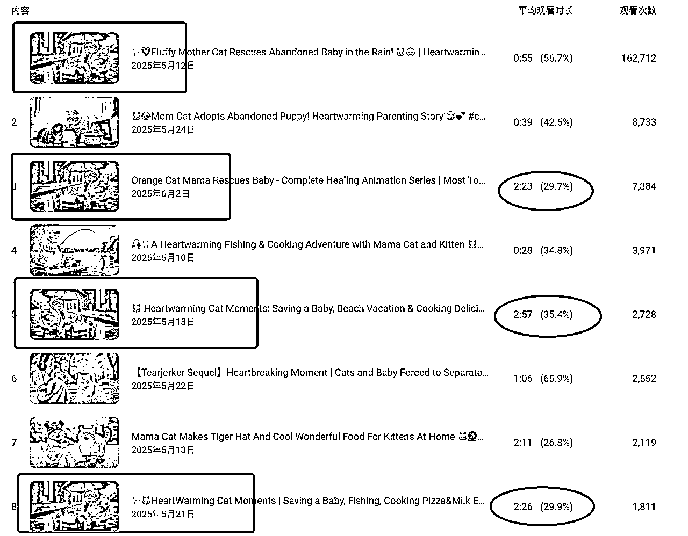  

可以加一些简单处理，比如镜像翻转。实测下来，直接拼接也不影响播放。比较有趣的是，8分钟以上的拼接视频，数据反而普遍比原本1~2分钟的版本更好，这算是个异常值。而且8分钟视频的RPM，通常是1~2分钟视频的2到3倍。缩略图对点击的影响依然很大，可以做对比测试。

**方式二：新视频拼老视频**

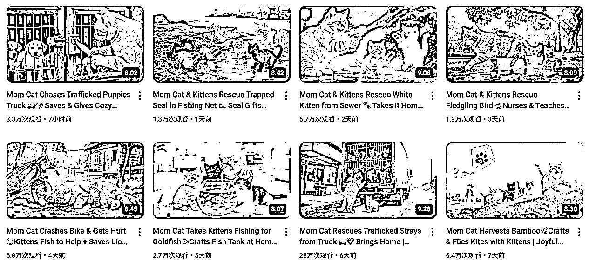  
https://www.youtube.com/@Yangxiaohui520

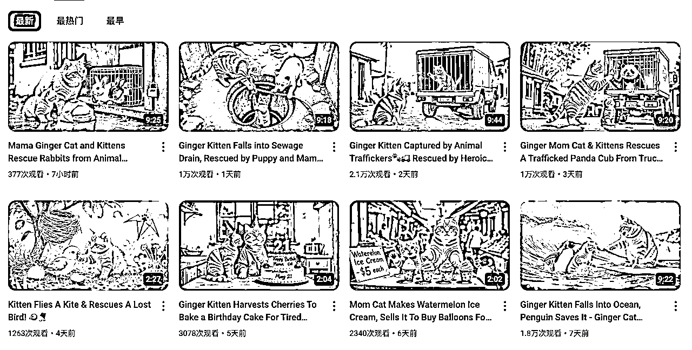  
https://www.youtube.com/@MeowMemoirs97/videos

这两个频道表面看都是8分钟以上的长视频，但仔细拆开会发现，真正新录的其实只有前面一分多钟，后面的内容全部来自以前的旧素材。

**关于异常值的一点分析**

为什么拼凑出来的长视频反而数据更好？我专门跟曹教练讨论过，他的判断是：这个赛道8分钟以上的内容本身就稀缺，而竞争是按时长区间划分的，8分钟以上这个区间几乎没有人卷，所以才会出现这种反常现象。既然如此，那做到20分钟呢？这里直接给你看个例子。

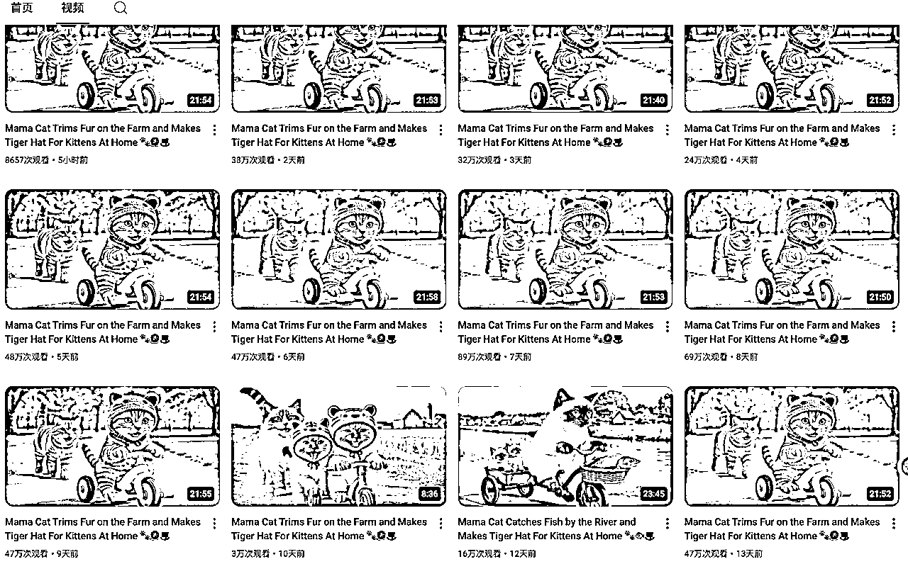  
https://www.youtube.com/@gameplus8897/videos

## 2. 发帖玩法

频道动态是个被低估的运营位置，能做的事不少。

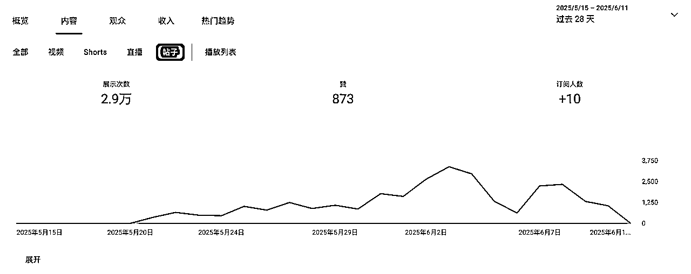  
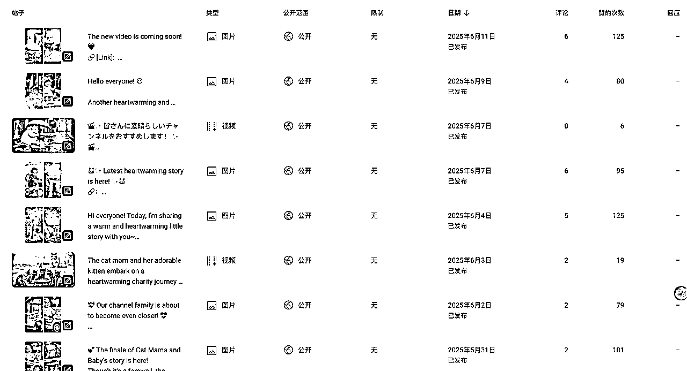  

**视频预告：** 提前公布要发布的内容，附上一两张视频里的截图，相当于电影的预告片，可以为正式视频引流。

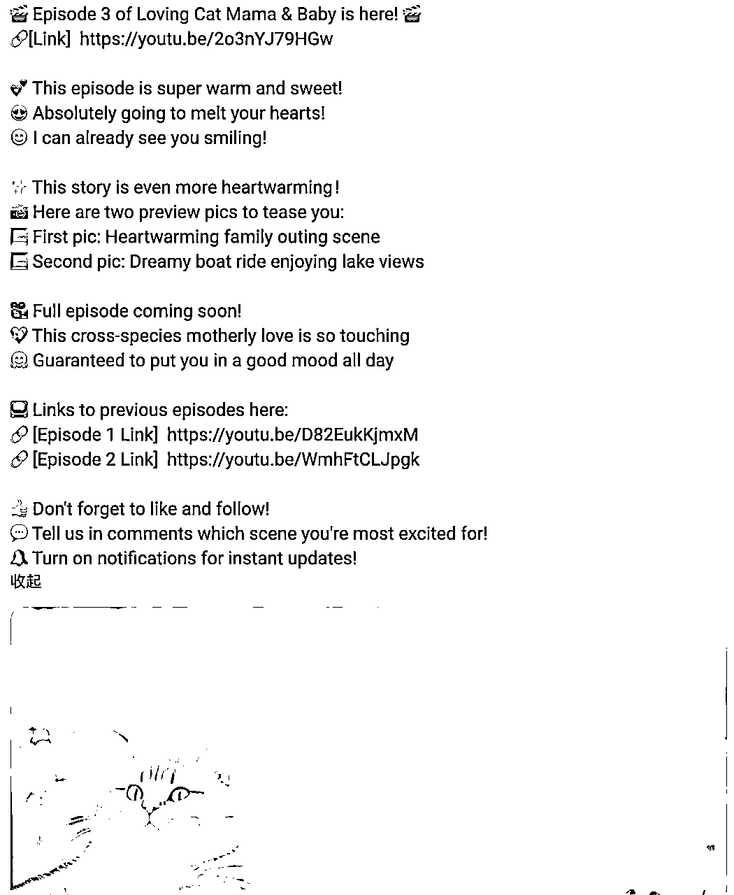  

**发起投票：** 抛出故事走向或角色去留的问题。比如猫妈妈捡到一个婴儿，和它度过了一段美好时光，就可以发起征求，问大家要不要把婴儿送还给父母，或者继续留在猫咪身边。投票还可以设置门槛，比如票数超过100才生效，会员一票顶两票等。

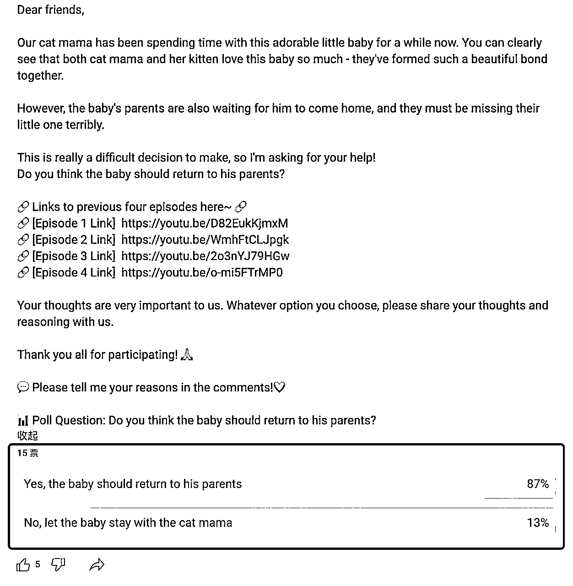  

**视频推荐：** 可以推荐自己的内容，也可以推荐其他频道。这样既能给自己的视频引流，也能帮助小号或者转赛道的账号完成冷启动。

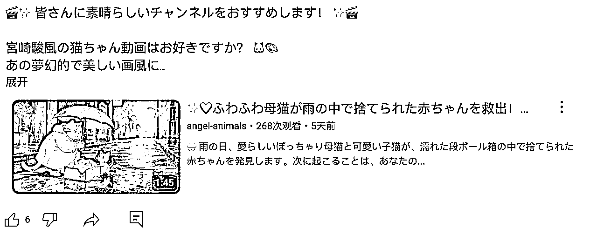  

**粉丝互动：**
- 做会员招募和会员福利预告，用福利吸引普通订阅者转化为付费会员。
- 发起故事征集，让大家在评论区留言想看的故事，会员的故事更容易被选中，拍摄时还会在视频里标注来源。
- 定期做感谢贴，对做出贡献的会员点名致谢。

帖子的价值总结起来就是：给视频引流、提高观众黏性、转化会员收入。更多的玩法，欢迎大家一起琢磨。

## 3. 地理位置调整

不少创作者都会遇到一个头疼的问题：印度地区的播放占比高得离谱。我之前也一样，后来通过一系列运营手段，情况有了明显改善。

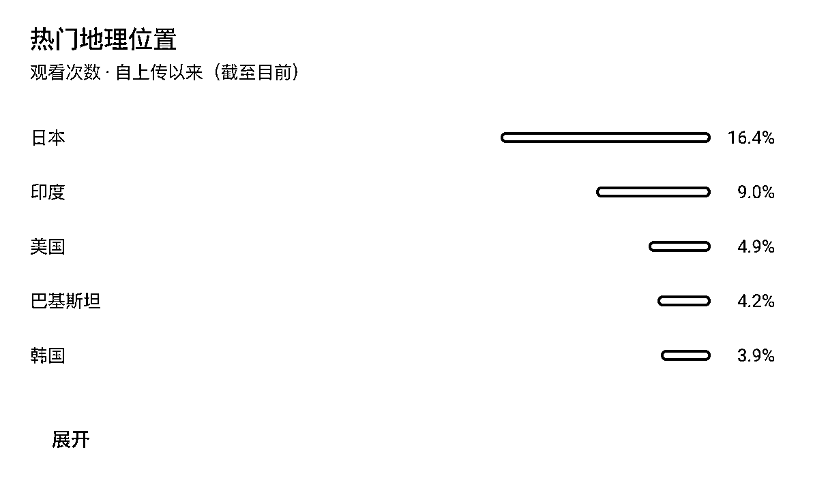  
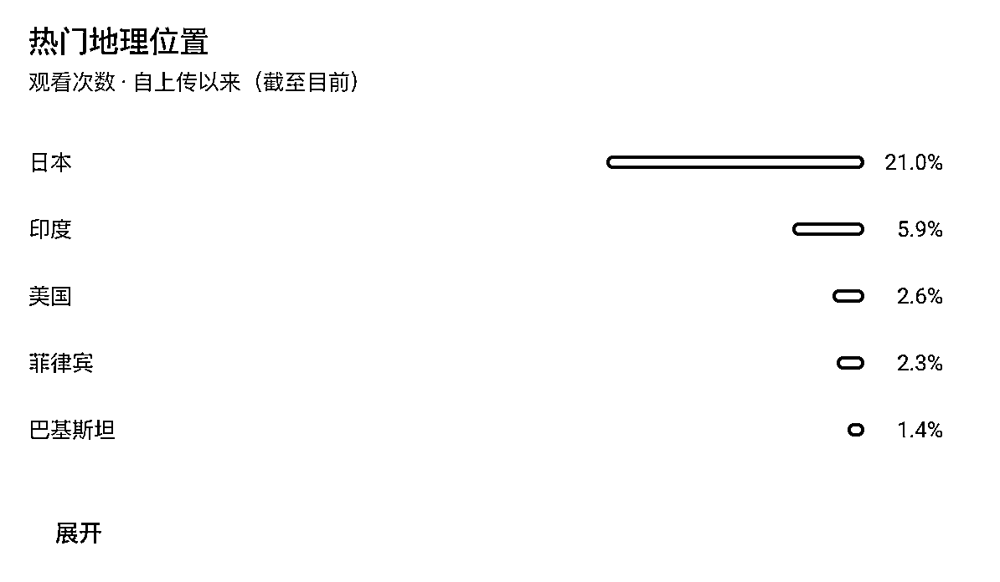  
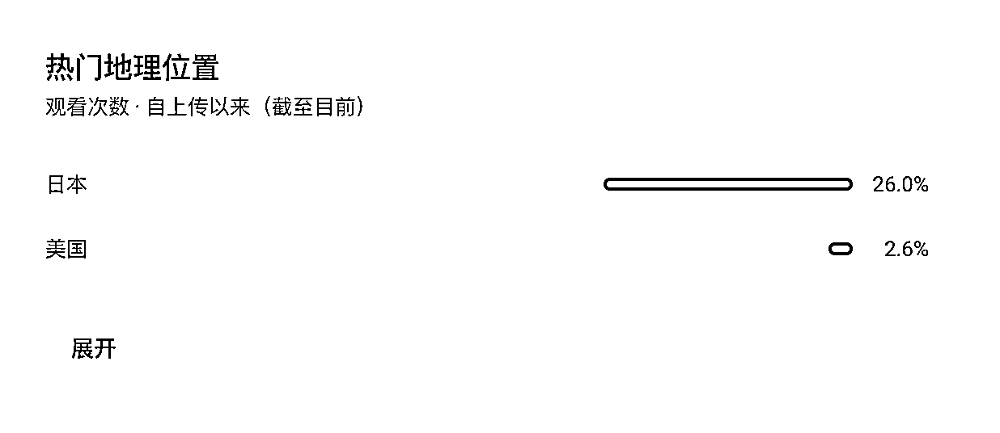  
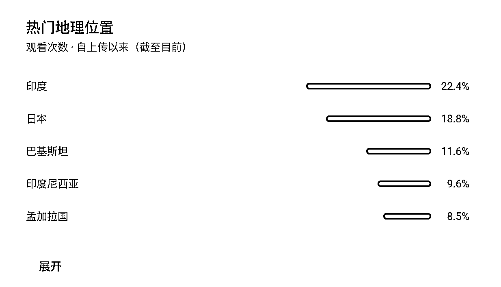  

调整思路是这样的：
- 先从后台数据里找出印度以外、你更看重的热门区域。
- 再去分析目标区域观众的评论，搞清楚他们吃哪一套，比如画面精美、内容治愈、宠物可爱。
- 发布视频时，除了英文，再加一版目标区域的语言，发帖也同样处理。
- 持续微调，多和目标区域的观众互动，回复时也可以用他们的语言。

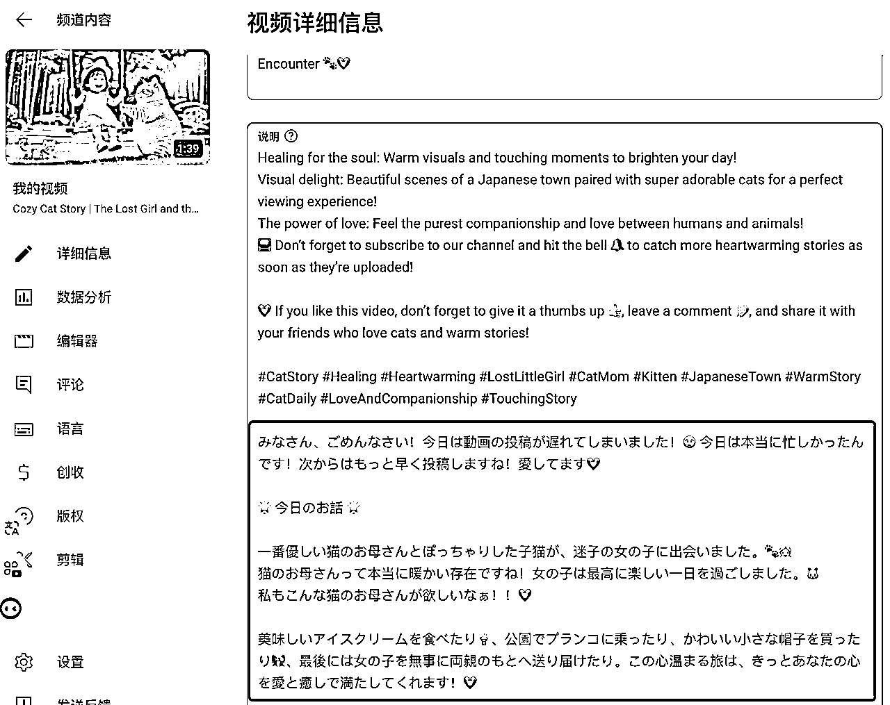  

## 4. 会员玩法（还在探索）

可以设想几个方向：会员提前看视频、专门给会员做的内容、全集打包福利，以及更多的惊喜，之后慢慢开发。

# 总结与思考

说点最后的体会：

- 要精准理解赛道，最好的方式是靠近用户，多翻互动和评论。
- “时长错位竞争”是个很有用的思路——避开拥挤的赛道，去没人的区间找优势。
- 长视频同样可以沿用爆款重组的逻辑。
- 运营技巧的核心之一，是把老用户的体验放在心上。

也留几个问题给大家思考：

- 既然猫咪疗愈赛道里的素材能反复利用，这个方法能不能平移到其他赛道？
- 你在做长视频的时候，对赛道的理解够深吗？还能不能挖出更多玩法？
- 频道的运营到底要怎么做，做到哪一步才算合适？

希望这次的拆解能给你带来一些不同的视角，也期待跟大家一起探索更多的可能性。

最后，感谢YouTube赚钱深海圈的方波妮总教练、Gary曹淦总教练的指导，也谢谢七天老师对这篇内容用心细致的帮助。