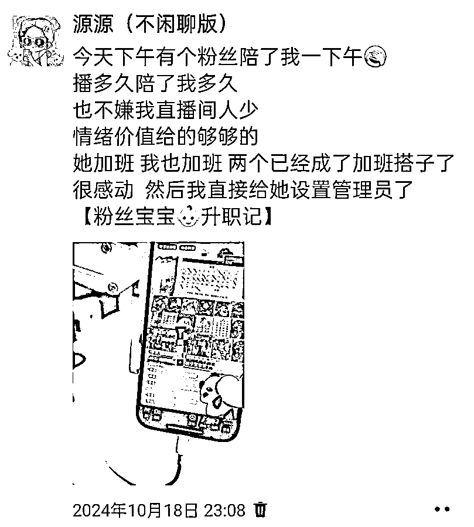
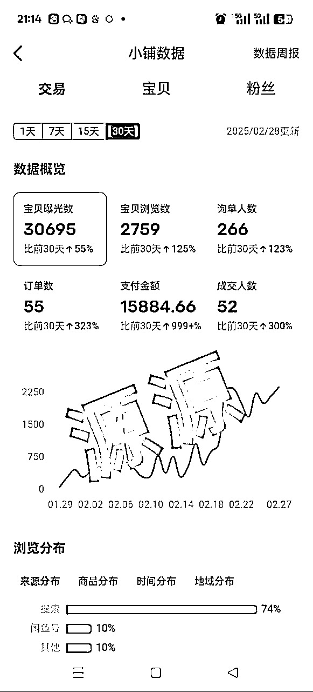
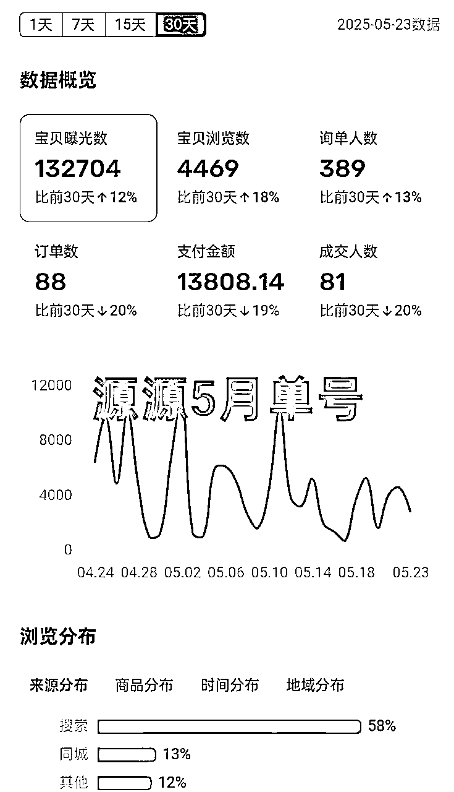
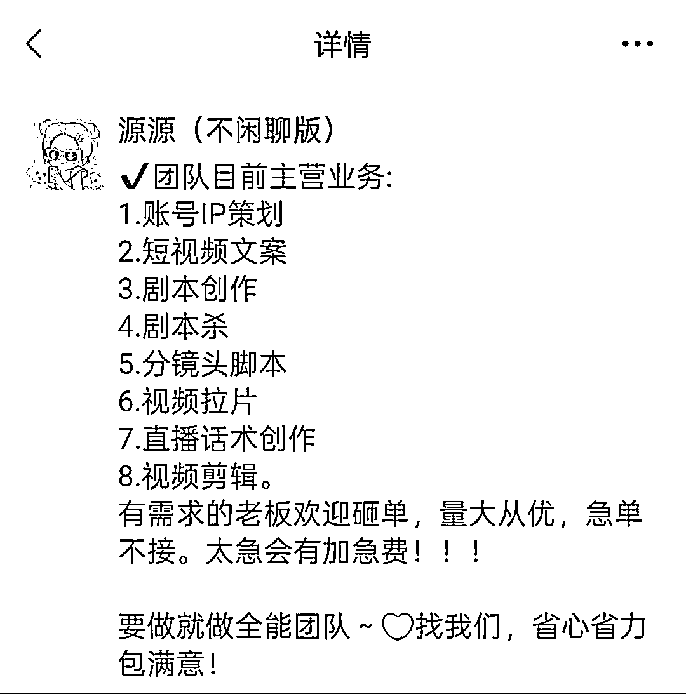
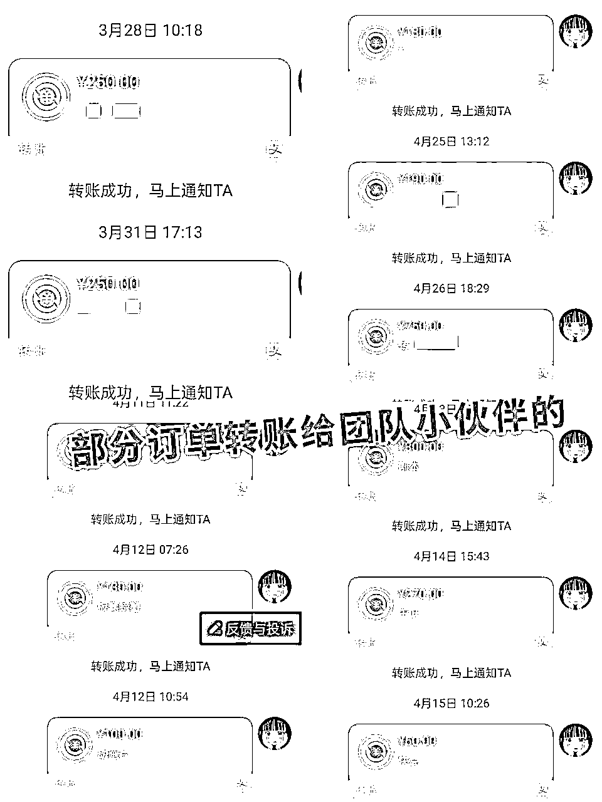
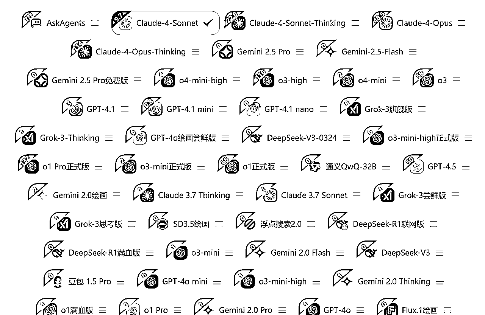
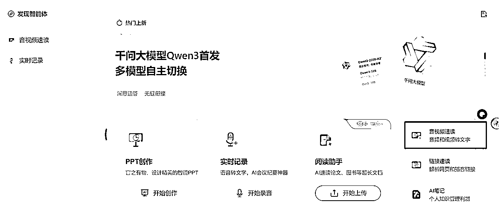
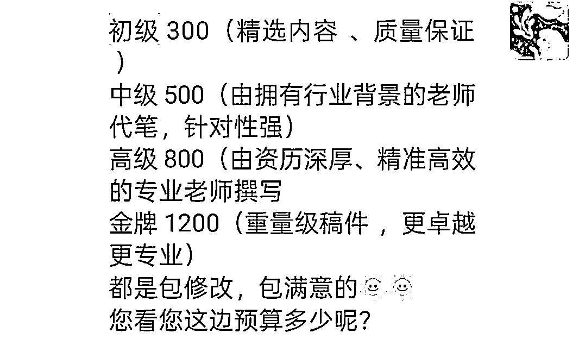

# 月薪5千到短视频月入2W+：AI编导，让我把热爱变成了硬核业务
作者：龙哥

大家好，我是龙哥，赚钱编号104443。在龙哥盟待了两年多，我从以前只会在风向标下面“水帖”的圈友，到如今有了自己的短视频文案小团队，这中间的变化，连我自己都觉得像做梦。很多朋友问我怎么做到的，我这篇帖子就把走过的弯路、试对的方法，都摊开讲一讲。

先说说以前吧。我做过探店博主，那个圈子大家也知道，拼资源、拼颜值、拼价格，收入像坐过山车，心里特别不踏实。为了找一条稳定的路，我前前后后试过闲鱼无货源、📕虚拟资料、👸号爆文，还做过一个四千多粉的AIP账号，但都没能真正解决问题。后来没办法，只能重新找工作，去一家小公司当拆卡主播，每天在镜头前播六七个小时，底薪只有四千块，外加一点点提成。

那时候的生活，用“一眼望到头”来形容都是轻的，甚至比牛马还累。我也花了不少钱报课学习，结果大部分都没用上，心里又慌又累。但很奇怪，我始终没放下内容创作这件事。从2021年到2024年，将近三年的时间里，我所有的短视频文案和分镜头脚本都是自己一字一句“手搓”出来的，这也让我对自己的内容质量一直有底气。转机来得挺偶然的：有天我在闲鱼上瞎逛，鬼使神差地搜了一下“短视频文案”，结果发现这个类目几乎没人发帖——蓝海啊！我马上试着挂了一条链接，没想到直接爆单了。从去年11月到现在，我一直在做这件事，也是唯一深耕并拿到持续结果的赛道。它带给我的，是一种从未有过的确定性。

我不是什么天选之子，也没有资源和人脉背书。像我这样的普通人，能依赖的只有不停地试错和那一点点“明知不容易也要干”的倔强。我给自己立过一个规矩：不贪多，一次只选一个项目。选定短视频文案之后，我就把所有精力砸进去。与其反复纠结，不如先干起来再说。刚开始因为没经验，好几个单子都报了“一口价”，少赚了不少钱，但也正是这种“笨功夫”，让我快速摸清了客户要什么。也有过连续几天零咨询的日子，心态确实很崩，但一想到不用回去过那种坐牢一样的生活，我就又撑住了。有时候一天涌进来好几单，几天的空缺一下子就补回来了。当时我的目标也很朴素：一天能赚100多、能自由安排时间就行，结果运气好时，一天也能突破千元。我也从不跟别人比，只要求自己今天比昨天走得稳一点。

## 我是怎么在闲鱼杀出一条路的

在闲鱼上，我给自己写的身份是“传媒专业”，这样更容易让客户产生信任。但说真的，我清楚自己是典型的“野路子选手”，没有学院派那套框架，所有经验都来自一个个真实项目。或许正因为这样，我反而更接地气，更懂得用最直接的方法解决客户的问题。慢慢的，同行也开始认可我的文案质量，甚至会主动加🛰️找我帮忙，这让我对自己的核心能力更有信心。

真正的爆发点还是在11月。我在闲鱼搜索框里打入“短视频文案”，发现同行数量少得可怜，明显是个蓝海。我马上把之前学的闲鱼运营方法用起来，不再只是观望，直接开干。第一条链接爆掉之后，问询一下子涌进来。从那时起，我的业务范围也越来越宽：从最初只写文案、做分镜，到后来接剧本、拉片、直播稿，现在短视频全链路的活儿都能接。我也把自己当成一个不停做实验的小白鼠，什么环节都能上手。

这里也把我在闲鱼上的冷启动方法分享出来，一共四步：

**第一步：开干前先“踩点”。** 用“短视频文案”“脚本策划”“分镜头”“探店文案”“口播稿”这类关键词去搜，看看前排同行怎么设置标题和主图、怎么写描述、怎么定价，他们强调的是哪些卖点，评论区又在问什么。再琢磨自己能从哪个角度做出差异化。记住，别照搬爆款，要形成自己的切入点。我那时候就是靠“同行少”这个信号，判断出蓝海的机会。

**第二步：把链接当成你的“门面”。** 标题里要有核心关键词，还要带上你能解决的问题，比如“AI辅助高效短视频文案定制，提升播放转化”。主图要清晰、专业，可以放作品案例、服务流程图、AI工具界面，甚至“传媒专业”这种信任背书。描述部分，我建议说清楚四件事：我是谁、我能提供什么、我的优势/案例有哪些、怎么合作。最后一定要给一个行动指令，比如“点我想要私聊”。

**第三步：让链接“活”起来。** 闲鱼的基本功是每天擦亮、持续上新。不要只挂一条链接，可以围绕探店、口播、剧情等不同方向多建几条，测一测哪条流量更好。关于“补单”，确实是不补单几乎没流量，但别猛补。初期可以找真实朋友或互助群做少量“想要”和“咨询”，模拟正常用户路径；中期有了真实客户，就引导他们完成小额单，攒下真实评价。频率上，每天一两个就行，太猛容易被平台识别。另外，回复速度会影响权重，建议设置快捷回复。如果某条链接数据不错，可以小额投流试试，但核心还是服务本身要好。新号也要养一养，先像正常用户一样活跃几天。每天记得看曝光、点击、咨询数据，找到最合适的发布时间和链接方向。

**第四步：把客户转到私域再成交。** 引流话术要自然，先给价值再提加🛰️，比如“方便发案例/详细沟通需求，加V：XXX，备注闲鱼文案”。加过去之后，🛰️的头像、昵称、朋友圈都要有专业感，并且提前准备好欢迎语和服务介绍。注意，在闲鱼上不要直接发二维码或提“🛰️”“转账”这些敏感词，可以用谐音、图片或引导看个人简介。

## 从单打独斗到组建小团队

一个人干活的时候，我主要接文案和分镜头，一个月GMV大概在5000到6000块。后来问询量上来，有些“太专业”的单子我接不住，比如毕设解说词、复杂剧本。怎么办？我去淘宝找专业的人帮忙。结果因为咨询次数太多，有个客服主动来找我长期合作，给的价格比之前合作的还低很多，几乎就是底价。从那以后，我们形成了“我管流量、他管交付”的初步模型。

再往后，我又通过项目认识了更多伙伴，有写剧本的、做拉片的、写直播话术的。大家各有长处，慢慢就组成了一个小团队。现在还是这个模式：我在前面接单、分单，后面交给团队执行，算是一个“一人公司”。朋友们都打趣叫我“源总”。

这段经历还帮我这个重度“社恐”完成了蜕变。以前我连主动加厉害的人🛰️都不敢，但为了不让到手的高质量订单流失，我逼着自己去私聊、去认识那些专业人才。没想到，因为共同目标聊到了一起，大家不仅合作，还成了朋友，交流项目、交流赚钱经验，实现了资源整合和共赢。

## AI，是我效率翻倍的“武器”

说到这里，可能有人会问：你不是手搓文案很厉害吗，为什么还要用AI？其实去年5月我就接触过AI写作，但当时又懒，又嫌淘宝结款周期太长，加上探店收入不稳，就没坚持下来。后来短视频文案订单越来越多，纯手搓的效率真的不够用了，我才重新把AI捡起来。以前写一个1分钟的脚本，顺利时要一小时，不顺利时半天都磨不出来；现在用AI给我灵感和初稿，一天写十几篇也没问题。AI对我来说，不只是工具，更像一个并肩作战的同伴。它让我能更快响应客户、接更多订单，甚至能接住那些特别复杂的需求。

工具方面，我一直在迭代：最早用Kimi，后来换GPT，再后来用Claude，因为Claude生成的文案更符合人的说话习惯，语言也优美，没有那么多AI味。现在我最常用的是Ask Many AI这个聚合平台，可以同时打开好几个AI工具网页，让它们一起出稿，我快速对比初稿，筛掉不理想的，留下1到2个版本做精修。这个过程里，AI不只是给答案，还在不断帮我打开思路、拓展边界。

我也有一些具体的小工具：写视频旁白文案，我用国外的Aistudio；想提取一个视频里的文案，我会用“蜗牛去水印”小程序；针对没有链接的视频，就用通义千问的“音视频速读”。AI还能帮我快速提取视频重点、生成字幕、做数据分析，这些都能让效率翻倍。

我的AI文案创作流程，可以叫“三板斧”：

**第一板斧：把需求讲清楚。** 动手前先跟客户确认主题、受众、风格（幽默还是干货还是情感）、时长、核心卖点、有没有参考视频。然后给AI下指令，告诉它“你现在是一位资深短视频编导”，接着描述任务：“请撰写一个关于XX的1分钟口播文案”，再补充目标人群和他们的痛点、风格要求、必须包含的信息点，要求按“黄金3秒开头—主体分点—价值总结—引导行动”的结构来写，还要控制字数/时长，甚至可以加一句“不要用专业术语”。Prompt越具体，输出越准。如果觉得开头不吸引人，就追问一句“能换个更悬念式的开头吗？”

**第二板斧：多模型一起跑。** 拿到Prompt之后，把它复制到Ask Many AI，同时调用GPT、Claude等好几个模型，看他们各自的初稿。A的开头好，B的一个观点新，那就把优点拆出来融合。这个阶段不要怕多，初稿越多样化，后面精修的空间越大。

**第三板斧：人工精修，注入灵魂。** AI的初稿要经过几道检查：有没有事实错误？逻辑顺不顺？语言是不是太机械、太像模板？把那些“首先其次最后”的套话删掉，换成更口语、更有网感、更代表你个人风格的表达。如果适合，还可以融入当下热梗和真实情绪。客户有需要的话，我会顺手给出分镜、画面和字幕建议。最后再检查一遍错别字和标点。我一直有个观点：AI帮你完成60%-80%，剩下的20%-40%必须靠人。创意和情感，是AI永远替代不了的，这也是我们不被淘汰的底气。最终交付时，一定要确保是经过深度修改的原创内容，别直接搬运AI输出，否则很容易同质化。

## 流量和转化，一个都不能少

最后说说变现。我的模型其实就是从闲鱼获客，再引流到私域成交。因为话术和承接做得比较用心，我的转私率很高，十个客户里大概有八个愿意加🛰️。GMV要放大，无非两条路：要么提高客单价，要么提高客单量。以前单兵作战时，我只做文案和分镜，GMV只有五六千；后来开始接剧本、拉片、直播稿这类高客单价的服务，整盘收入才明显上去。而且，经过大量沟通和报价练习，我练出了一项很值钱的能力：一眼就能判断对方是不是目标客户，知道该把时间花在谁身上。这样一来，谈单转化率也高了不少。

最后想跟你们说：热爱不是玄学，把它变成能交付的价值，再用AI去放大效率，普通人也有机会抓住自己的蓝海。希望我的经历能给你一点勇气和方法，咱们都可以在喜欢的领域里，闯出点名堂。

以前接到咨询，我几乎是来者不拒——不管是谁，先报价再说。可时间一长就发现，这种“广撒网”的做法，其实是在悄悄透支自己。最典型的就是遇到一些预算极低的学生客户，二三十块钱的预算，开口却要三百块的服务，沟通起来特别费劲，最后还不一定成交。不仅时间搭进去了，心力也耗得厉害，尤其是同时要应付好几个催得急的客户时，整个人都被拖垮了。

真正让我扭转局面的，是学会了“阶梯报价”。这招用好了，成交率和利润都能明显上一个台阶。

一、先筛选，再深聊：把精力留给对的人
现在我不会一上来就报价。先看对方的咨询方式、头像昵称、平台信用这些细节，心里做个大概判断。接着用几个标准问题快速摸底，比如“你要写什么类型？剧本还是分镜？大概多长？预算大概在什么范围？”如果发现对方是学生作业，预算又低得离谱，我会礼貌地说明“目前档期比较满，这类小需求暂时接不了”，或者引导到基础服务（如果有的话）。别不好意思拒绝——时间才是最大的成本，把精力留给真正有诚意的客户，才是划算的买卖。

二、问得够细，报价才够准
在聊需求阶段，我会想办法让客户多说：项目背景、目标、痛点、期待的效果，越详细越好。聊的过程里，也会穿插一些专业建议和同类案例，让客户觉得你是有经验的。千万别急着报价格，先把平台、风格、对标账号这些细节都确认清楚，再给出方案。这样报出来的价更有依据，客户也会觉得你很专业。

三、阶梯报价：给客户选择，也给自己空间

话术可以参考这个逻辑：“根据您的需求，我推荐这款套餐，性价比最高；当然，如果您对XX有更高要求，可以选择更高级的套餐。”或者用促销感更强的说法：“今天店铺有活动，拍初级直接给您升中级，拍中级升高级，您预算大概多少呢？”阶梯报价并不是为了套路任何人，而是让不同需求的人都能找到合适的选择，同时也能让客户感受到更高价值的服务。价格体系要相对固定，但可以根据复杂程度微调；每个套餐承诺什么标准，就必须做到什么标准。

四、成交后要做的事：确认、约定、留证据
成交以后，我会用🛰️文字把服务内容、价格、交付时间、修改次数重新梳理一遍发给客户，双方心里都有数。接着设定清晰的流程，比如“收到定金后X小时出初稿，反馈后X小时内修改”。面对“是不是AI写的”这类问题，直接说“都是专业老师手写的”。还有一条很关键：客户没确认签收前，绝不发原稿，发出去的一律是带水印打码的PDF，等对方确认没问题并签收，再给源文件。这样既能减少后期扯皮，也能把沟通记录保存好，遇到想白嫖的人，这就是底气。

私域这块，我也会用心经营。每次加到新客户，欢迎语里都会附上我们的业务介绍，让他知道我是做什么的，以后有需要第一时间就能想到我。朋友圈也慢慢养起来了，复购越来越多。

做这一行，话术太重要了。从引流、问询到成交确认，我都会把常用话术沉淀下来，存进便捷输入法里，每天沟通效率高了很多。这里也分享一个平台防风险的话术：“亲，还在的，写稿很忙，遵守平台规定不要发违禁词，发了请撤回，请直接+xxx（备注闲鱼），说明你的需求，我将第一时间答复你。”这套话术是我吃过亏之后总结出来的，现在遇到有人发“代写、作业、毕设、论文”这些敏感词，就直接让他撤回，安全第一。

复盘这一路，效率靠的是SOP思维。把引流、沟通、成交的流程标准化，加上便捷输入法，一个人也能顶好几个人。组建小团队之后，承接量和效率又上了一层。踩过的坑也不少：最开始“一口价”报价，少赚了很多钱；后来研究流量，发现很多人说“所有链接必须在同一个城市”，其实并不对，我大胆在全国范围发品，配合精细化补单和适度投流，效果反而很好。这段经历让我明白：别人的经验可以参考，但最重要的是自己下场去试，因为适合别人的不一定适合你。

很多新手朋友容易在这几个地方卡住：
一是贪多，同时做好几个项目，结果哪个都没做透。我自己就是聚焦到短视频文案这一个赛道，才真正跑出结果的。一次只选一个方向，先打透再拓展。
二是完美主义，总想准备好再开始。我发第一条链接时根本没想太多，就想着“发的人少，是个机会”，结果直接爆了。先干起来，再在过程中迭代，比空想有用一百倍。
三是玻璃心，被拒绝几次就受不了。其实拒绝和失败都是升级的机会，客户拒绝你，可能帮你优化报价；流量波动，可能逼你去研究规则。心态建设是必修课。
四是急于求成，几天没看到钱就换项目。我这个赛道从去年11月做到现在，才有了持续稳定的结果。普通人不烧资源，更需要耐心，量变才能引起质变。
五是轻视基础，总想找捷径。比如补单，我亲测过，不补就是没流量。那些看起来笨的方法，往往是最靠谱的。认真研究规则，把每个细节做好，项目才能长久。

最后想说，回头看这条路，最初是热爱点燃了火种，后来是孤勇撑着我往前走。从做过一堆项目却变现平平的迷茫者，到如今专注短视频文案、有了自己的小团队，中间每一次跌倒都成了宝贵的积累。没背景没资源，就只能靠自己摸索，直到闯出属于自己的路。

短视频文案这个赛道，我非常看好。博主、商家、实体企业，都需要通过短视频放大影响力，提升品牌知名度，这是一个可以长期深耕、持续创造价值的方向。这条路对我来说还远没到终点，只要心里的热爱没灭，只要还保有那点闯劲，我就会继续走下去。

也特别感谢龙哥盟这个平台，让我看到项目与副业的更多可能，也结识了很多良师益友。这里的真诚、务实、分享，是我能坚持下来的重要支撑。如果你也心怀热爱，想在这里闯出点名堂，那就勇敢开始吧。善用工具，带上初心，坚持下去。我也欢迎对这个赛道感兴趣的朋友一起交流，共同探索未来的可能。