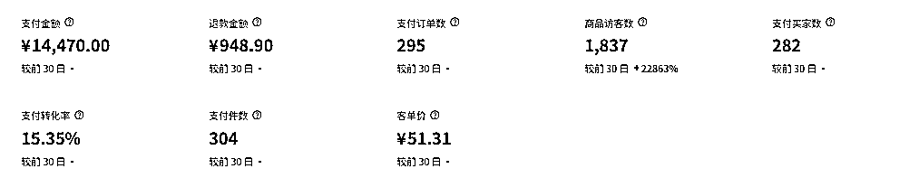
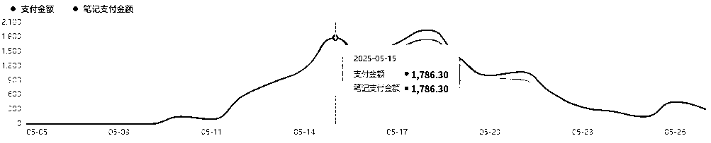
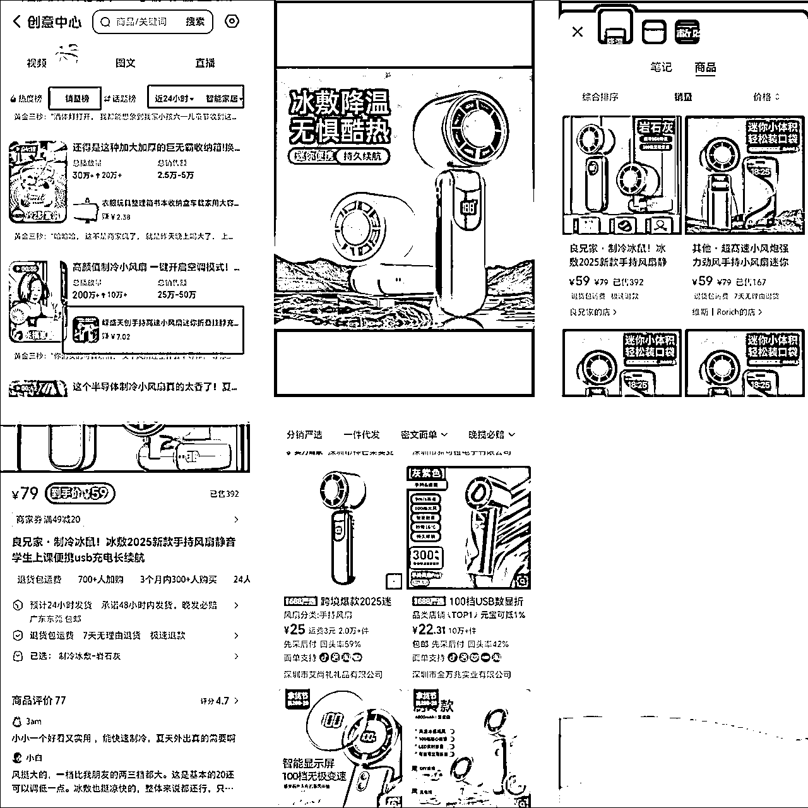
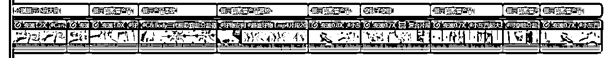
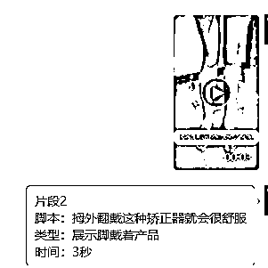

# 从小红书电商小白到两周赚6000+，我复盘了这次爆单的全过程

大家好，我是风声。在认识生财之前，我一直在会计师事务所做审计，带过不少企业的IPO、年审、专审项目。后来因为实在受不了频繁出差，开始琢磨别的出路，机缘巧合下通过书豪老师知道了生财，并正式加入了进来。

在生财这段时间，我读了不少精华帖，也参加了好几次航海，视野一下子打开了很多，甚至顺势完成了从职场到自由职业的转变。现在除了做一些老本行的业务，还在运营同城家教中介和小红书电商。这次应宝芙的邀请，把自己最近做出一点小成绩的小红书电商项目做个复盘，也想对刚进生财的圈友说一句：别光看，把手弄脏，参加航海真的值得。

其实我在23年年底就接触过小红书电商，当时也出了几十单，但因为主业要出差，加上没爆单，就没坚持下去。后来看圈友们一个个拿到大结果，心里又痒痒了。为了解最新玩法，也为了有人交流，我报名了今年3月的航海。说实话我不算勤奋，并没有每天雷打不动地更新（大家别学我），只是有空的时候选选品、批量做点笔记来测。就这样一直磨到5月10号，终于等来了第一次小爆。这是最近半个月单篇笔记小眼睛破10万之后的成绩：

笔记一旦爆了，销售额起来非常快，几天之内日GMV就冲到1700，最高到过1900：

我清楚这次爆单有不少运气成分。我们能做的，就是把品选好、把视频剪好、把人工干预做好，剩下的交给时间。我自己的节奏是前期混剪、后期转实拍，下面分几个环节好好复盘一下。

## 一、航海精华和实操技能，一定要啃透

航海手册、精华帖、热门帖，都是拿到过结果的人反复打磨出来的，又经过生财团队和大量圈友验证筛选，参考价值真的非常高。每个人的方法会有细微差别，但你翻得越多，脑子里拼出来的细节就越完整。

这次航海给我最大的收获，是刷新了对玩法的认知——现在已经不是单号每天狂发十几条的时代了。新账号一天发3到5条，慢慢再加到8条左右；而且发十条笔记时，最好夹一条不带商品的，这样系统不容易把你判定成纯营销号。

## 二、选品要跟着市场走，别自嗨

很多圈友一直不出单，问题基本出在选品上。那怎么选？我的答案很简单：一定要选被市场验证过的品。

选品方法很多，但最重要还是“验证”。你非要去打一个红海品，后面再好也很难爆，因为对手太多了。我这次能小爆，很大程度上就是因为我选的那个品竞争少。像淘宝榜单、小红书站内、抖音创意中心、考古加、灰豚数据这些工具，我都会用，只要能选到符合标准的产品就行。

拿我这次的产品举例，它是在抖音创意中心发现的。流程大概是：打开抖音创意中心看销量榜，截图产品主图，再用小红书识图搜一下，看看这个品最近有没有爆单（可以参考航海手册里的蓝海品标准），接着去1688识图搜同款，算算利润空间。

比如最近这种手持风扇，好多链接销量都过万。这类品是季节性的，只有夏天才爆：

只要能通过上面这套流程验证，你跟爆的概率就会大很多。不过我这个产品，小红书里之前没看到同款爆过，所以能爆还真是有点运气成分。但当时我还是决定测它，主要是考虑了三点：

1. 有同类型的产品最近爆过。
2. 我这个产品解决了一个同类品解决不了的痛点。比如带制冷功能的手持小风扇，以前那种普通风扇吹起来不够凉，带制冷的就解决了“夏天风扇不够凉爽”的问题，所以它成了爆款。
3. 我观察到最近已经有人发过一两条这个产品的笔记，只是简单拍了下功能图和主图，居然也卖了几单。

运气也确实不错，它真是个蓝海品，我从发第一条笔记开始就出单了。

## 三、笔记混剪与实拍，其实不难

发笔记之前，第一步是找素材。

我主要发视频笔记，素材最开始是从抖音找的，混剪方法学的是书豪老师分享的技巧：用剪映一个小时剪出20条带货视频，一次做好二十条素材来测品。

后来爆单了，怕后面违规，我就去民宿开了个钟点房，实拍了几百条素材。实拍真的不复杂，我拍摄方面是纯小白，就用自己手机拍。原则就是尽量还原原视频，能做到像素级模仿最好。我的步骤是这样的：

1. 在剪映里把原视频智能切割，然后按脚本和画面内容给每个片段做标注。比如我之前测过的一个拇外翻分趾器，就分成了9个片段：

2. 挑好要实拍的片段，一个一个单独导出。第一个片段作为吸引人的黄金三秒我没实拍，还是用原素材，整体保证70%以上实拍度就行。

3. 导出后把每个片段发到手机上，标好脚本、片段类型、时间等信息，拍摄时方便对照：

4. 找个合适的场景开拍，尽量在动作、角度、灯光上贴近原视频。家里不合适就出去找场地，民宿、茶馆、公园都可以。提前准备好，拍几百个素材也花不了太久。拍的时候可以稍微变一下背景、摆件或者位置。可以一个片段一个片段拍，也可以一直重复同一个动作拍个长视频，后期再分割，然后就能用了。

封面和标题方面，我会参考小红书站内同类型产品的风格，也会去抖音找一些封面，多测试。

## 四、人工干预，非常重要

这里我强调一下：人工干预真的非常非常关键！

出单的笔记一定要及时补评论，这样能大大延长笔记的生命周期，还能拉高转化。小红书用户的购买路径通常是：封面标题吸引她点进来，有购买意向就会习惯性翻评论，然后再看看产品评价和晒单笔记。这些环节你补得越完善，转化就越高，平台给的推流也会更猛。

## 五、店铺日常维护别偷懒

单量多起来后，一定要把千帆客服在线打开，及时回消息。尽量不要用默认机器人客服，就算要用，也得把它设置好。不然机器人答非所问，用户一火就给你差评，差评非常影响转化。

遇到差评，尽量打电话跟用户沟通，给足情绪价值，这样对方删评的几率会大不少。处理差评的具体方法，可以学一下书豪老师分享的这套，我个人亲测有效。

另外还要多关注小红书的品质负反馈，指标太高同样会影响流量权重和转化。具体规则可以看小红书的品质负反馈规则解读。

## 六、一点心得体会

任何项目，都是坚持到最后才会有结果！先从最简单的动作做起，后面再慢慢优化，不断测品、不断调整，终会拿到属于自己的那份回报。

还有一点很重要：有人交流真的能省很多事。遇到问题及时找教练、找圈友沟通。有些卡点你自己想破头、查半天资料都解决不了，别人可能随口一句就点醒你了。所以我特别推荐新加入生财的圈友去参加航海——有好几位拿到过结果的教练带着，还有几百位圈友在群里一起学，遇到问题随时问，这种氛围太难得了。