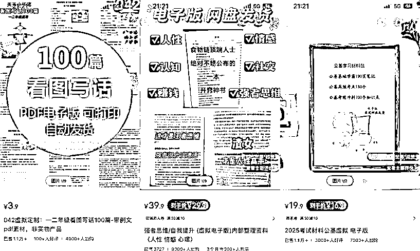
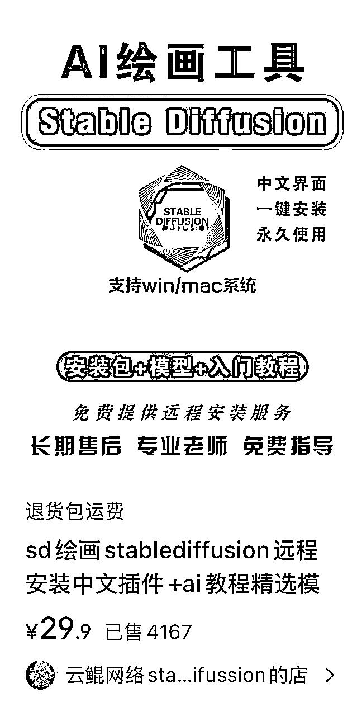
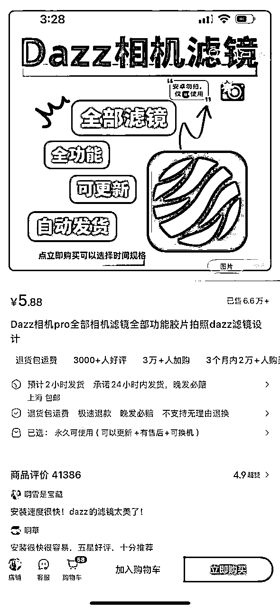
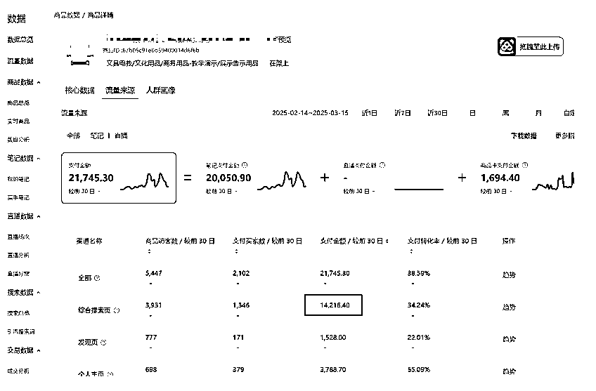

# 在📕做虚拟生意，先吃透这套底层规则
作者：龙哥

把做生意比作比赛，下场前把规则摸透，才能知道得分点在哪。想在📕里做虚拟生意，先搞清楚平台的运行逻辑，后续才有机会把项目跑通。

## 为什么个人可以做📕的虚拟生意

1. 起步门槛很低，前期单兵作战就能运转，不需要组建团队也不需要大量资金
2. 当前📕入驻不需要交纳保证金，虚拟资料类商品无需囤货垫资，真正做到零成本启动
3. 平台今年在重点扶持内部电商，尤其是虚拟类目，持续加码运营，窗口期比较明显
4. 虚拟商品属于数字资产，一次制作可反复派发，无需管理供应链与仓配，售后退货几乎为零，很适合想低风险试水或寻找副业的人
5. 入门可从客单价不高、容易上手的资料类开始，梳理好标准化流程并吃透用户需求后，再去拓展高客单的课程、应用、软件等品类，甚至和机构/厂商合作
6. 如果目标是打造个人品牌，拥有一套自制的虚拟资料，能有效提升外界对专业度的认可

## 📕虚拟资料项目指什么

在📕完成店铺入驻 → 上架虚拟资料类商品，例如各式模板、题库、攻略等 → 撰写相关笔记触达潜在买家 → 买家下单成交。

## 客单价不高，还能有利润吗？

先厘清两个概念。

虚拟资料多指考试资料、PPT模板、表格、简历模板等同质化程度高的内容，单价普遍偏低，但适合新手启动。

虚拟产品的边界更宽，除文档类外，还可涵盖在线课程、APP、软件账号、游戏类商品等，部分课程定价可达千元以上。也可以在现有资料基础上做差异化包装，提升售价。

因此别被“一元一份”的卖法吓退。把选品、测款、内容创作的核心环节跑顺后，完全可以迁移到更高售价的虚拟品类，底层的打法是相通的。

## 有必要开店吗？

必须走官方店铺路径。

依靠引流至私域变现的做法难以持久，且容易导致账号异常。开店后，即便销售低价资料，也能合规把顾客引导至私域。

很多人担心现在入局太晚，其实时机仍然存在。

其一，需求会周期性再生。比如求职简历模板，每年都有新毕业生产生需求。
其二，📕是内容分发平台，持续需要新鲜内容，不像传统电商那样头部店铺垄断流量。
其三，新需求持续涌现，例如AI提示词模板、AI工具合集，都是增量机会。
其四，可做差异化竞争。市面上已有资料虽销量好，但用户仍有不满意之处，若能针对痛点优化升级并获得付费意愿，就能实现弯道超车。

## 做成生意的关键点是什么

从某虚拟品销售数据来看，搜索流量占比常超过50%，而发现页的自然推流占比很低。

这说明出单的核心在于：挑选当下存在真实需求的商品 + 用笔记精准覆盖用户搜索关键词 + 保持耐心等待搜索流量累积。

所以需要具备发满百条笔记的执行力与耐心。

## 收入现状如何

资料类单价低，单账号的上限大致在数千元区间，但成交稳定、内容制作门槛低。熟练后可做矩阵操作，5-6个账号同时运转。

初期可先从个人店铺练手，后期熟练后转企业店铺做矩阵更方便。

## 所需配置与账号

原则上建议一机一号。

新手可先从一家店铺起步，若想提升成功率，可用两台设备、两个账号、两家店铺并行测试。

## 见效周期

选对品后成交很快，但要形成爆发心里预期需先发布100条笔记打底。

📕图文+搜索的流量建立非常缓慢，前期发布二三十条笔记仅有少量播放是正常现象。

## 货源渠道

主要来自同行采购或直接购买现成资源包。具体的操作细则后续手册会展开说明。

## 资质合规要点

上架前先明确类目归属。若销售教辅类资料，如幼小衔接、中小学练习题、成人教育资料等，需提供相关资质与合同。若随意归类至虚拟产品定制，通常次日就会被下架，尤其是缺少教师资格证的情况。

解决路径较为成熟，去淘宝或闲鱼搜索“📕虚拟店铺”“📕虚拟资质”，可找到代办服务并承诺通过。我曾使用过一家，费用约320元/店，通过后各类虚拟资料均可正常上架。

## 粉丝量是否影响转化

粉丝数量与成交量并非绝对挂钩。已有粉丝基础会让冷启动更顺畅，但零粉丝账号只要内容与关键词做得足够精准，一样可以实现成交。