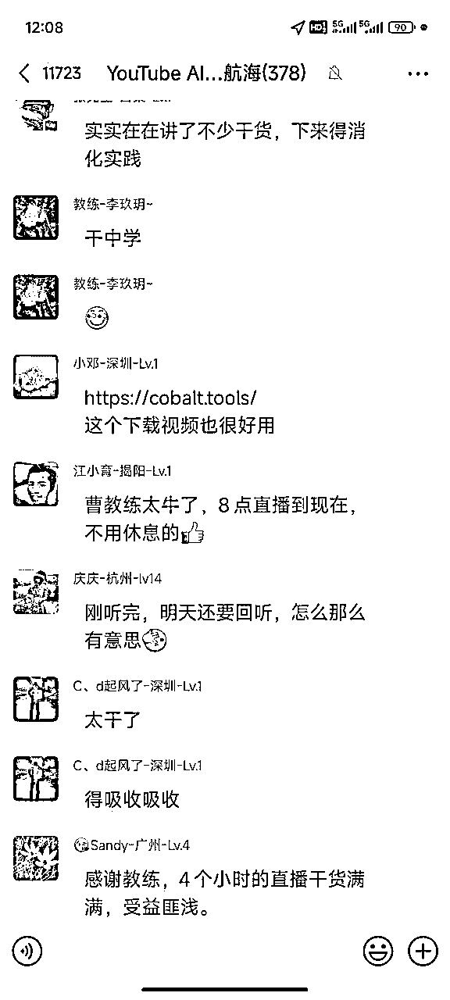
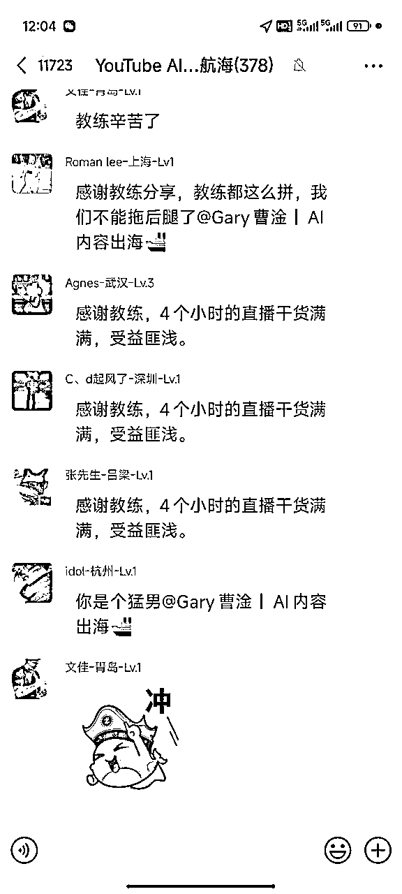
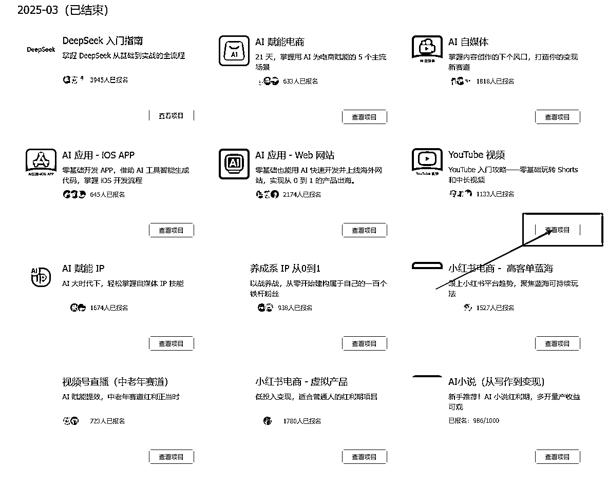
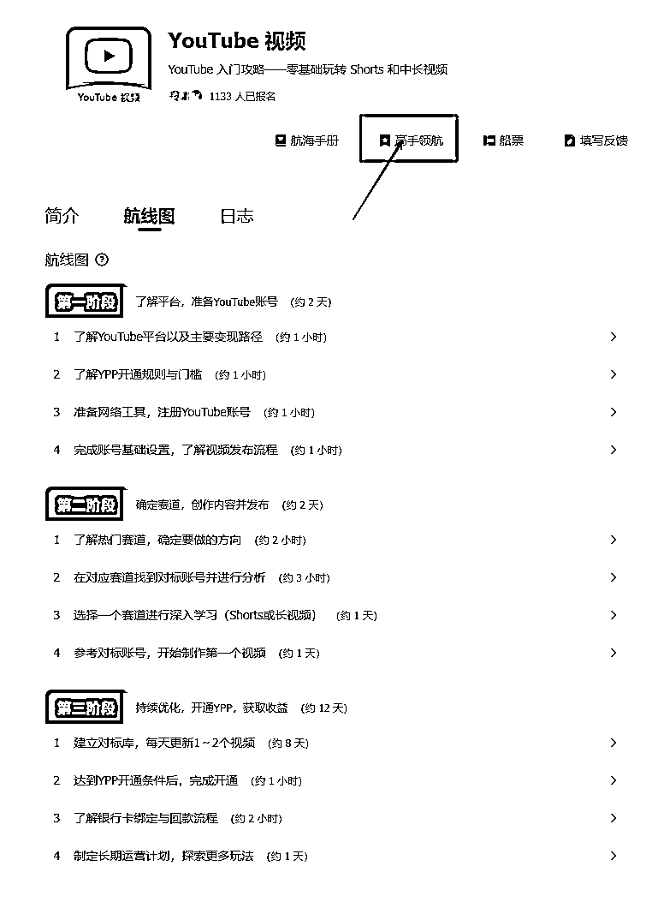
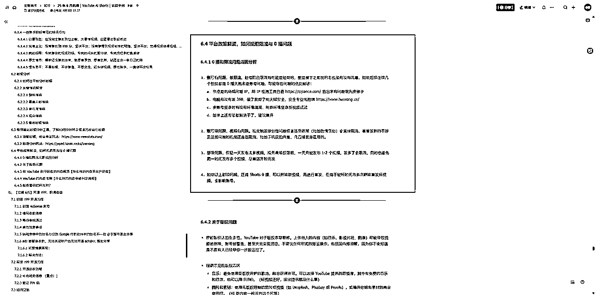
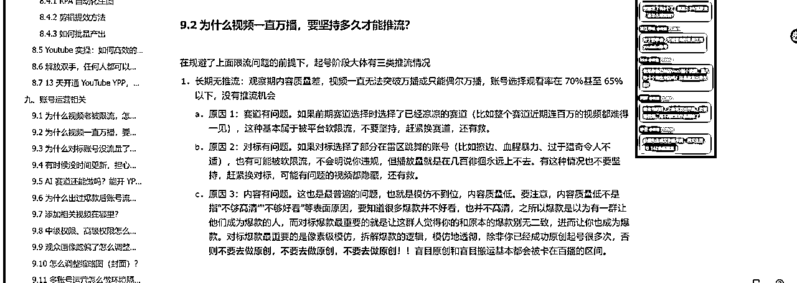
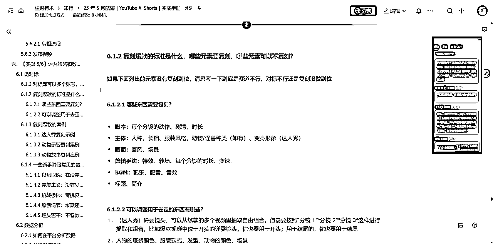
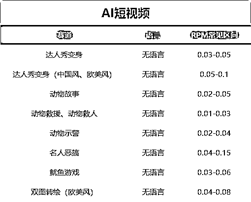
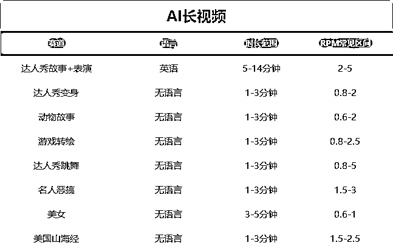
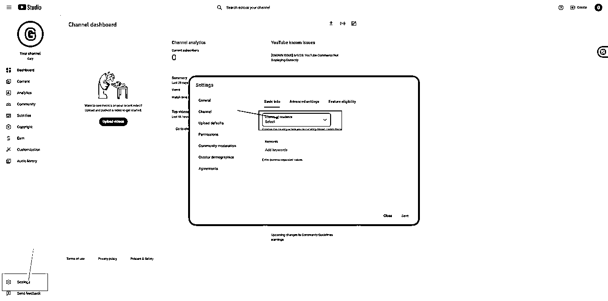

# 从零做YouTube，这一篇把新人的坑几乎讲全了
作者：龙哥

你有没有见过一个直播间，开播前说要回答问题，结果一口气答到半夜十二点？

这件事就发生在赚钱YouTube航海群的直播间里。群里的提问多到什么程度呢？很多答案明明手册里白纸黑字写着，大家还是习惯开口就问。为了让沟通更高效，教练Gary曹淦（也就是赚钱YouTube深海圈总教练）干脆把三个群的人都叫到直播间，有什么问题现场提、当场答，答完才下播。结果，一份覆盖新人起步各阶段疑问的“百问百答”就这么被问了出来。

直播结束后，Gary原本打算让这些内容留在直播记录里就好。但第二天回头一看，他觉得这些被当场问出来的问题，恰恰是最鲜活、最真实的新手困惑——几乎覆盖了刚入局时大家能碰到、能想到的所有典型问题。于是他把内容重新整理、补充，写成了一份87问的YouTube新人入门宝典。老话说得好：解决一个具体问题的价值，远大于闷头看完一大堆资料。这也是他愿意花时间把现场问答变成这篇帖子的原因。

> 不过，最好的解决问题方式，是让问题根本不出现。所以手册和各位前辈的精华帖，仍然是主粮，这篇帖子更适合用来查漏补缺。

整理出来的内容一共六大块：学习路径3问、运营策略34问、赛道推荐15问、内容诊断14问、工具相关12问、收益与收款9问，合计87问。干货密度相当高，建议刚上船的新船员、以及所有对YouTube感兴趣但还在观望的朋友，通篇过一遍，确认自己没有什么搞不清楚的问题——省下的都是以后要踩的坑。

**新人上手，别把力气花在纠结上**

有船员问：新手到底怎么开始？Gary的答案很朴素：手册打底，工具帖扫盲，自己需要的直播回放抽空补上，然后实操跟上。四条线并进，比什么都强。

他拿自己举例。去年11月刚开始的时候，头半个月他几乎每天投入六到八个小时，学什么？范围很杂：用GPT生成文本、用Midjourney和ComfyUI出图、研究Runway这类视频生成工具、读YouTube生态相关的所有历史精华帖和教程、刷对标账号、请教拿到过结果的人、在国内多平台分发内容，同步复盘每天的数据和视频效果。基本是一天一复盘，不是埋头做，而是边做边调。

说到选赛道，他的建议更干脆：别纠结，随便选一个，先做起来再说。赛道会变、风向会变、当下的爆款逻辑也会变，但你的技能和理解会沉淀下来。前期做视频、试赛道这件事本身，就是一笔学费极低的学习投资。

**运营路上，这些问题几乎人人都会遇到**

赛道能不能换来换去？可以换，但别高频地换。你今天发宠物、明天发财经、后天发美食，YouTube根本不知道把你的内容推给谁，受众也就找不到你。

几个账号开始需要指纹浏览器？门槛是四个。四个号或以上，建议上指纹浏览器加IP隔离；三个号及以下，同一个浏览器直接管就行。

注册账号时IP要不要管？一个IP别同时注册多个号，两三个封顶了。如果不想费劲批量起号，直接买号反而省事。

运营过程中IP要求高不高？不用追求极度纯净。除非你碰到限流、封号这种异常情况，才需要特意排查IP。另外，同一个IP管两三个账号是没问题的，观众看到什么内容是根据账号设置和内容走的，与你频道所在地区、IP位置毫无关系。

有些新人会问，做一个YouTube账号，是不是要同时运营好几个号？前期因为不确定哪个号会被限流，多开几个去筛，是合理的。筛出来有流量的号之后，重点集中在一到两个号上持续更新，别把精力摊得太薄。记住一句话：一个千万播放的视频，抵得上一千个一万播放的视频。

一个谷歌账号能开几个频道？能开，但别贪多。三个差不多是上限，不然一封就是一堆。

老频道之前没流量，现在重启能用吗？能用。先随便发点东西测测流量：实拍镜头、家里的猫猫狗狗、风景，都行。连续两三条播放都能破五百，基本就不是限流号。除非运气特别差，发几条之后又掉回零播——碰到这种情况，还是老老实实重新筛号最稳妥。

还有一个很多人验证过的事实：用老频道发视频，更容易起来，也更不容易被限流。

国际内容分发，也是新人常问的点。如果你在国内平台已经有内容基础，同步分发到YouTube是可以的，但有两件事要留意：第一，以后的新内容，一定要设定同一个时间点全网同步发布，否则一定有人搬运你；第二，以前发过的内容有没有被搬过？大概率有。但你想试也可以，反正没成本——只不过真的被搬了，你想申诉拿回来，大概率也申诉不回来。

多平台分发这件事，核心是“别丢西瓜捡芝麻”：有时间有精力，就同步发，但别为了国内平台把自己的节奏打乱。

还有件事值得说：批量发布可以用RPA搞自动化，但不太推荐，因为有可能被平台识别出是机器人。目前市面上也没有正经的发视频API。

YPP开通之后会被取消吗？如果你违规或者内容出问题，确实会被收回。比如之前有些账号专门做“宝宝掉进动物园被救援”这类内容，就被平台收回了一部分号。

又有人问：一个视频能不能同时发两个号？如果目的是重复利用素材，那真没必要——等于搬运，毫无意义。除非你是在测流量、筛账号。

关于对标账号，新人最容易犯的错是同时看太多。Gary的原话是“往死里对标”——就盯一个目标频道，狠狠分析、狠狠模仿。另外，手机会员和电脑上传的版权区别，本质上要看音乐的版权管理方式，版权政策不同，结果也不同；如果你选的是不参与分成的音乐，那用手机和电脑效果完全一样。短视频标题没有长视频那么重要，但它影响平台的推流方向，所以直接参考对标来写就行。

你问网上的YPP信息怎么都对不上？网上查的很多都不准。一般标准就是看账号是否在持续更新、是否达到一定的播放体量。毕竟，没有人会为爱发电——那些一直在更新的内容，也没有哪个是纯粹靠爱支撑的。

**关于壁垒：AI让门槛更低了，但这也是最大的机会**

有个问题问得很好：如果做内容的成本越来越低，那YouTube项目的竞争壁垒是不是也会越来越低？

Gary当时聊了不少，总结下来三层意思：第一，成本确实更低了，但真的有多少人知道这件事并且动手做了呢？任何赛道都一样——👸号、虚拟资料、AI自媒体，都是知道的人多，下场的人少。第二，先发本身就是最大的优势。你早点入场，就有更充裕的时间去建立资源壁垒、规模壁垒。第三，你有了先发优势和时间窗口，选择权就多了——做知识付费、做培训、卖铲子、做工具，都可以。事实是，这个极低的成本和极大的增量空间，让YouTube变成了当下最蓝海的赛道之一。不然，也不会有他这样一个零出海基础、零视频基础的普通人，跑来做分享了。

**赛道怎么选：什么能做，什么别碰**

长视频赛道做哪个方向？去看手册，看精华帖，上面有教程、有人跑通过。

中文类内容推不推荐？大方向是不推荐。中文内容基本都是中国人自己在做，而中国人最卷——做小语种都比做中文强。当然，如果你有不可替代的核心优势，另当别论。情感鸡汤类，中文赛道已经挤满了人，不推荐。狗狗救婴儿这类故事型内容，建议转型：往更广义的“故事类”走，救别的对象、讲别的故事，都行。

短剧赛道怎么样？卡点太多了：版权、账号、CMS机构号、内容质量、翻译，一道一道全是坎。

知识IP方向可以。AI自媒体，建议去隔壁AI自媒体航海偷学一下手册和直播回放，然后把同样的玩法搬到海外市场——这绝对算得上YouTube目前的蓝海，其他方向太卷了。

AI机器人美女能不能做？现在可以重新做起来了。模型性能迭代了一轮，AI美女更精致、更生动，所以这个赛道又活了。流量虽然不算特别爆炸，但属于“可以做”的状态。

AI音乐对普通人完全谈不上友好，历来是内卷最严重的AI赛道之一——不建议碰。但如果把AI音乐叠加到其他内容上，反而有戏。比如“达人秀”长视频：故事加上音乐表演，运气教练就从零做出了一条200万播放的长视频。

猫咪故事还能不能做？能，但别被“猫咪”这两个字框住了。动物故事的核心从来都是故事本身。故事足够精彩，跟主角长什么样、是什么物种、甚至是不是动物，都没关系。去搜搜brainrot、美国山海经故事，包括真人博主的实拍小故事，就能理解其中逻辑。

小说推文呢？传统玩法打了这么多年，普通人进场就是送人头，不推荐。但创新版本可以试试：数字人出镜的、配AI动画动漫的，都有空间。

名人恶搞还可以，目前流量状况来说能做。但风险在于你用了真实人物的肖像做AI内容——国外四月份出台的内容管理政策里，已经明确谈到要管控这个问题。想规避，就改成动漫化、非真人画风的形式。

疗愈赛道、AI心理学可以做吗？这个说法太泛了。具体要看内容形态——其实什么都可以做，只要你有对标、有市场、有相应能力。这个类目的细分方向多到可怕：火柴人动画、科普、真人博主讲解、动漫、音乐……找一个上限高、自己够得着的切口进去，边做边调整方向就行了。

想做NBA球星内容？那要看有没有头部频道已经验证过这条路：第一，有人做成功了（有对标）；第二，他做了一段时间没出事（没有版权和政策风险）。两个条件都满足，才有入局的前提。

动漫向的赛道同样要看版权：有些动漫有严格的版权管理，做了可能被禁播或吃警告。判断标准就是对标：看别人做得多不多、做得久的频道用的是怎样的方式。赛道本身能做，但要注意玩法。

**内容诊断：流量卡住了，问题出在哪？**

有船员问：AI宠物号，日更三条，更新了26天，一直卡在4000播放，怎么办？4000播放说明内容质量还不够。建议降低发布频率，把精力放在打磨精品上，盯着平均观看时长百分比和选择观看率这两个指标来优化内容。核心还是三个维度：赛道、内容、账号，有多平台条件的就做一下交叉检验。

短视频做多长？跟着对标走就对了。对标5秒，你就剪5秒；对标50秒，你就剪50秒——镜头切换的时间点，也要跟对标一模一样。这才是真正的对标。

老频道发新赛道，要不要删掉以前的视频？不用删，放着就行。直接转赛道没有关系，不用有任何心理负担。

图生图可以做，但不能复制粘贴。如果图生图做出来跟原图几乎一样，肯定被判搬运。要有足够的差异化，复刻的具体标准手册里写了。

关于儿童内容，有一条红线要讲清楚：不是说不能做儿童内容，而是不能把儿童置于危险环境中——掉进水里、掉进动物园、被扔下悬崖、房子着火……这类内容绝对不行。宝宝走秀、宝宝变身、宝宝播客，这些都没问题。

那已经做了救婴儿类赛道的人怎么办？如果刚开始，直接隐藏或删掉；如果已经做了很多、甚至已经开通了YPP，那就转型吧。都不用删，也不用藏。反正伸头一刀、缩头一刀——你不做了，等于之前白干；你继续做，可能被封、可能不被查、有可能白干。既然概率上吃亏，那肯定选择继续做：要么转型，要么只差一口气的话，冲完YPP再说。

AI动物救援婴儿为什么不能做？这个问题已经讲过很多次了，结论就是：不能做。

NBA剪辑二创为什么零播放？因为大量电视节目、影视、音乐都有版权，YouTube的版权管理系统是全网最强大的之一，它会通过内容ID识别和阻断所有复刻使用的素材。那些专业团队怎么做版权风险内容？深度剪辑去重，一个片段不超过5秒、多个电影剪成一部解说之类的手段来降低被识别的概率——这本身是道门槛。对普通人来说，最优方案就是不碰。

AI换脸搬运可以吗？只要你做了二创并且拿得出二创证据，就可以。但换脸本身不算二创，而且还有未授权使用他人形象的风险。真正的二创必须叠加其他动作，比如二次解说、二次剪辑。

怎么看自己的内容及不及格？有个通用标准：观察期播放量过1万是及格线，过2万算优秀。如果连500播都过不了，那就是限流问题，先排查限流。

音频音效能直接用对标账号的吗？前期可以，为了熟流程可以接受。但过一段时间，还是自己动手做，不然被人发现后举报就麻烦了——系统虽然不会自动查，但人类会手动举报。

视频上传后画质模糊怎么办？最大可能是观看时清晰度没调到高清。其次，也可能是视频还没被处理成高清格式你就点开看了。

版权问题的体现到底有哪几种？简单梳理一下：发了，没提示，但0播——可能被设置了禁止转载，但没有任何惩罚；发了，没提示，但隔了一段时间收到版权警告——这是最难防的，说明版权方检测到但没立即行动；发了，有提示，部分地区禁播——只影响部分地区，别的地区正常看，一般没额外处罚；发了，有提示，全球禁播——系统层面直接不允许发布；发了，有提示，不限制播放但分钱——没开YPP没影响，开了的话会分走收益，常见于音乐版权；发了，有提示，不限制播放但所有钱被拿走——也一样是音乐版权的重灾区。

核心原则就一句话：新手还摸不清YouTube生态之前，别碰影视、电视节目、综艺、短剧、动漫、小说、音乐这些版权雷区。这也是为什么AI赛道这么受欢迎——AI天然原创，没有版权烦恼。

**关于儿童与版权，还有几件重要的事**

上面那条“不做儿童”的逻辑，再展开讲一层：它不是限制你拍儿童，而是不允许你让儿童置身风险之中。把孩子放进危险的场景，比如落水、坠崖、大火、动物园围栏，这类内容绝对不能做。但宝宝走秀、宝宝变装、宝宝播客这类正常内容，做起来没有任何问题。

如果已经做了救婴儿类的内容，怎么办？分成两种情况：如果你刚起步，视频不多，直接隐藏或删除；如果你已经做了很久、甚至已经开通了YPP，那就转型，但不用删除已有的内容。道理很简单：停下等于之前白干，继续做有概率被封、也有概率没事——既然撤不撤都可能是白干，那就接着做，能转型就转型，就差一点的话冲完YPP再考虑别的。

AI动物救援婴儿，这个方向已经被反复强调过多次了：不要做。

NBA二创剪辑为什么零播？因为大量体育赛事、电视节目、音乐都有明确版权。YouTube的版权识别系统号称全网最强，它会根据内容特征来识别和拦截所有使用该素材的画面。专业工作室面对有版权风险的内容，通常会做深度剪辑去重——比如单个片段不超过5秒、把多部片子拼成一部解说片，这些手段能降低被识别出来的概率，但这本身就是有门槛的技术活。对于普通创作者，最省心的方式就是彻底避开版权内容。

AI换脸搬运能行吗？有真实二创行为、并且留下了证据，才算数——换脸本身不算二创，还附加了未授权使用他人生肖形象的风险。你要叠加上二次解说、二次剪辑等真正的二次创作过程才说得过去。

AI内容的及格线怎么定？其实绝大多数非AI的常规shorts赛道也是一样的标准：观察期内1万播放是及格门槛，2万以上算优秀。限流的情况一般是不会超过500播的——所以一旦超过500播，就可以用1万这条线来反推自己的赛道和内容合不合格。

能不能直接用对标账号的音频音效？流程不熟的时候可以，先跑通再说；等稳定了一段时间，还是自己制作比较好。系统不一定会主动发现，但被发现了之后，账号可能会被手动举报。

上传的视频清晰度为什么看起来很低？你先检查一下播放端是不是没设置成高清。另一种可能是视频还在转码处理中，你打开得太早了。

版权问题到底怎么判断？常见的表现有好几种：第一种，发布后没有收到任何提示，但一直零播放——可能被内容所有者设置了禁止转载和再利用，只是平台没有惩罚；第二种，发布时没提示，但发布后过了一会儿收到了版权警告——版权方检测到了但没有立刻处理，这种最难防；第三种，发布时提示部分地区禁播——只有部分地区的观众看不到，其他地区正常，一般也没有额外处罚；第四种，全球禁播——平台直接不给发布；第五种，不限播放但被分走一部分收益——没开YPP无所谓，开了的话收益会被分成，常见于歌曲版权；第六种，不限制播放、收入全部归对方，同样是音乐类内容常见。

说到底一句话：新手期别碰影视类、电视节目、综艺、短剧、动漫、小说、音乐。这也是为什么AI赛道这么受欢迎——AI产出的内容天然属于原创，不会踩版权红线。

**工具怎么搭：按用途来选**

问得多的工具问题，Gary直接给了他的常用清单：

首尾帧方面，PixVerse 4.5是目前性能和性价比最适合的选择。

故事类内容，不需要首尾帧的话：省钱方案是即梦3.0、智谱清影和Veo 2（Aistudio 可用）。

需要自动化、大批量产出视频的，Vidu Q1值得考虑——它支持无限生成，性能还比Runway强。

批量下载素材这件事，航海手册里阿龙教练写过现成程序，你要是懂一点技术，自己用Cursor写一个也行。想省事、又能接受付费的，直接在闲鱼上买哼哼猫——Gary自己就是这么干的。

顺便提醒：直播回放、航海手册和历史航海直播都放在配套资料里，除非你自己确定已经全部掌握，不然还是值得都过一遍。

这篇帖子定位是“新手向”，为了保证执行起来不模糊，个别表述可能说得比较绝对，不一定放之四海而皆准。有疑问欢迎在评论区讨论，看到会继续补充分享。

如果你还想看另一种玩法——把航海群里成千上万条的聊天记录整理成随时可查的问答知识库，可以参考邵先森教练的精华帖：《航海期间，我用AI把N个天天999+的🛰️群聊做成了共享问答知识库》。

祝大家都能在自己的YouTube之旅上，少走弯路，早日赚到第一桶金。

# AI内容创作与YouTube变现实用指南：从零成本试水到稳定收款

## 一、做AI内容，前期到底要准备多少预算？

如果只是想先验证方向，完全可以从零成本开始。

Google AI Studio可以用于拆解参考脚本、分析内容结构、反推提示词，而且目前这些功能基本都能免费使用。它还支持图片和视频生成，只是成片质量相对有限。即梦、可灵海外版等平台，也通常会给新注册账号提供一定免费额度。

只要愿意多注册账号、合理利用免费次数，前期甚至可以长期低成本测试。等你真正需要提高产出效率、节省时间，或者追求更稳定、更高质量的视频效果时，再考虑购买付费工具，会更划算。

## 二、Veo 3每月能生成多少内容？

以Gemini会员为例，Pro版本大致包含每月10个免费额度，同时每天还可能有3个额度，具体规则会根据平台调整。

如果选择价格较高的Ultra会员，目前每月大约有12500积分，折算下来，约等于125条Veo 3视频。实际额度和兑换规则建议以官方最新说明为准。

## 三、动物故事赛道，最简单的工具组合

如果做的是动物故事类内容，可以采用一套比较容易上手的流程：

- 用Google AI Studio生成或复刻脚本；
- 用豆包批量生成一整套图片；
- 使用豆包或即梦制作动态视频；
- 最后交给剪映完成剪辑、配乐、字幕和包装。

这套组合不复杂，适合新手先跑通完整流程，而不是一开始就把大量时间花在研究复杂技术上。

## 四、英文配音工具怎么选？

英文旁白可以考虑：

- ElevenLabs；
- MiniMax，也就是海螺的海外版本。

两者都适合用于英文口播、故事叙述和短视频配音，具体选择可以根据音色、价格和使用习惯决定。

## 五、工作流应该用扣子，还是自己写代码？

判断标准其实很简单：

如果你还在纠结这个问题，说明现阶段更适合直接使用成熟的工作流或现成脚本，先把内容做出来。

真正能够自己搭建工作流、编写自动化脚本的人，通常已经非常清楚自己的需求，也知道什么时候该用扣子，什么时候需要自行开发。因此，新手没必要为了“看起来专业”而强行从零搭建。

## 六、香港节点能不能使用谷歌AI工具？

香港节点虽然可以访问YouTube，但并不适合完整使用Google系AI产品。

例如AI Studio、Gemini、Whisk、ImageFX等服务，可能都会受到限制。因此，如果你的目标是使用完整的谷歌AI工具链，香港节点并不是优先推荐的方案。

## 七、新手要不要学Stable Diffusion和ComfyUI？

目前不建议新人一开始就投入大量时间学习Stable Diffusion或ComfyUI。

原因是现在很多闭源平台已经足够强大，使用门槛更低，出图和生成视频的效率也更高。除非你有非常明确的定制化需求，否则先把内容生产和账号运营跑通，比研究复杂节点更重要。

## 八、Runway还有购买必要吗？

Runway并不是当前必须使用的工具，在不少场景下，它的优势已经没有以前那么明显。

除非能够买到价格非常低的一次性账号，比如无限额度账号低于400元，否则不建议把它作为优先购买对象。

## 九、常用浏览器插件推荐

日常做海外内容时，以下两个插件比较实用：

- 沉浸式翻译：方便查看英文网页和资料；
- Viewstats：用于分析YouTube视频及频道数据。

## 十、达人秀评委素材从哪里找？

可以从AGT官方账号以及其他创作者发布的视频中寻找相关素材。

建议不要每次临时搜索，而是逐步建立属于自己的素材库，按照人物、表情、反应、情绪和场景进行分类。后续剪辑时会更加高效。

# 收款与收益相关问题

## 一、美元收入可以提现吗？

可以。具体操作按照相关收款手册执行，之后通过线上方式办理结汇即可。

## 二、YouTube AI赛道，一个人每月能做到多少收益？

在当前阶段，如果做的是AI内容，但不是单纯依赖自动化批量铺量，而是认真做精品内容，单人月收入达到3000—4000美元，属于相对不错的水平。

而且现在这个时间点，AI赛道依然存在较大的发展空间。

## 三、收外汇选择哪家银行？

优先推荐招商银行，因为目前使用的人较多，整体流程相对成熟。

不太建议优先选择传统四大行，部分业务可能需要到柜台办理，结汇过程也可能更繁琐。

如果没有招行，也可以考虑兴业银行等其他银行。开户或收款前，最好先电话确认以下事项：

- 是否支持收取海外汇款；
- 能否在线办理结汇；
- 是否需要额外证明材料；
- 是否必须到柜台处理。

提前问清楚，能避免后续反复跑银行。

## 四、开通YPP后，隐藏视频会有什么影响？

如果已经加入YPP，之后把视频隐藏，导致播放量或观看时长低于平台要求，可能会被取消YPP资格。

以婴儿救援类赛道为例，如果你计划转型，建议先做其他类型的内容，把频道重新积累到1000万播放，再考虑恢复之前隐藏的视频。不要过早把原有视频全部隐藏，避免影响资格。

## 五、如何估算YouTube收益？

下面是相对实用的粗略计算方法。

### 短视频收益

YPP开通之后的有效互动观看次数，乘以对应赛道的RPM，就是大致收入。

计算时通常可以先从总播放量中扣除1000万播放作为参考门槛，实际情况可能会高于这个数字。互动观看次数可以粗略按照总播放量的一半估算。

公式可以理解为：

**短视频收益≈YPP开通后的互动观看次数×对应赛道RPM**

### 长视频收益

长视频则主要参考YPP开通后的有效观看次数，再乘以该赛道的RPM。

一般可以先扣除约10万次观看作为估算起点，具体需要结合视频时长来判断，因为4000小时观看时长对应的观看次数并不是固定值。

公式为：

**长视频收益≈YPP开通后的有效观看次数×对应赛道RPM**

## 六、YPP数据考核周期是多久？

不同内容类型的要求不一样：

- Shorts：需要在3个月内达到1000万次有效观看；
- 长视频：需要在12个月内累计达到4000小时有效观看时长。

## 七、Ads和YPP应该如何绑定？

通常建议一个Ads账号绑定5个YPP频道。

从实际操作来看，绑定数量也可能更多，但如果是刚开始运营，先按照5个频道进行规划会更稳妥。

## 八、一个人可以注册多少个Ads账号？

按照一套身份信息，通常只能注册一个Ads账号。

如果确实需要多个账号，可以使用父母或祖父母等家庭成员的真实身份信息分别注册，但必须确保资料真实、合规，并妥善管理账号之间的关系。

## 九、在国内收YouTube收入有没有风险？

YPP申请时，账号地区不能设置为中国大陆。不过这个地区选项可以调整，并不会直接影响后续收款。

需要明确的是：YPP目前并不向中国大陆地区开放申请，但这不等于大陆用户不能获得海外收入。

真正需要注意的是税务问题。收到收入后，应按照规定在年底进行报税，否则可能产生相应的税务风险。

