# 【YouTube新手实操指南】借助 Google AI Studio，从拆解爆款到发布视频
作者：龙哥

大家好，我是龙哥，一名正在摸索中的 YouTube 创作者。虽然还算不上什么大佬，但已经独立做出过几条播放量破万的视频。

这篇内容，主要分享我如何从零开始，借助 Google AI Studio，完成一条对标爆款视频的完整制作流程。

如果你已经非常熟悉 AI 视频制作，这篇文章可能比较基础；但如果你正处于“想做、不会做、不知道从哪里开始”的阶段，希望下面这套流程能帮你少走一些弯路。

我会按照“找赛道—拆解对标—构思故事—生成画面—制作视频—剪辑优化—复盘上传”的顺序展开，尽可能把步骤讲得清楚。

# 一、找到合适赛道，先把爆款研究透

## 1.选赛道并不难，关键是学会拆解

以 AI 内容为例，只要掌握了正确的方法，即使没有专门老师带，也可以通过研究已有爆款，快速摸清内容模式。

这里最重要的工具之一，就是 Google AI Studio，以下简称 GAS。

关于它的基础界面和功能，可以参考其他创作者整理的教程，我这里就不重复展开了。

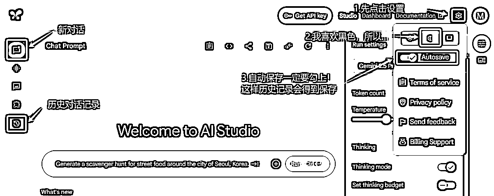

## 2.批量导入爆款视频进行分析

GAS 支持一次添加多个视频。最简单的方式，就是把目标频道中表现最好的视频链接集中复制下来，再粘贴到对话框里。

建议尽量多放一些样本。参考视频越丰富，GAS 能够提炼出的规律就越完整，包括：

- 内容主题和常见叙事方式
- 视频的镜头数量与节奏
- 开头几秒的吸引方式
- 画面风格和视觉特点
- 故事结构与情绪变化
- 可能使用的制作工具和流程

目前一次最多可以保留十个视频。不过，这个限制并不代表只能分析十条。

如果已经达到上限，可以在后续对话中删除部分旧视频，再继续加入新的素材。之前的聊天记忆通常仍会保留，因此可以分批完成分析。

但要注意，历史记录里的视频数量不能超过十个，否则可能出现 internal error。遇到这种情况，删除多余视频后，通常就能继续使用。

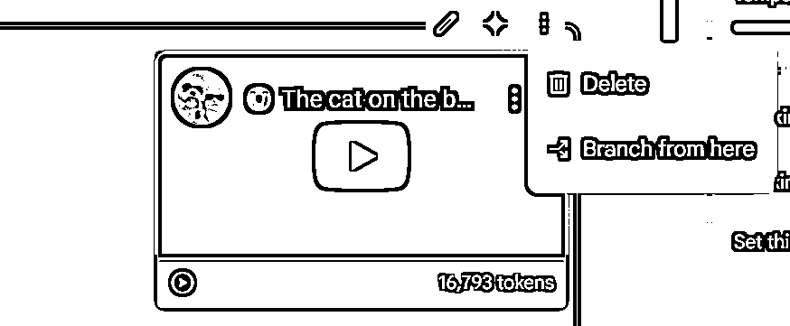

我这次制作的视频，就是把目标账号中播放量超过 120 万的作品，集中交给 GAS 进行分析。单个对话大约会消耗 20 万 Token，因此素材越多，分析结果也会越细致。

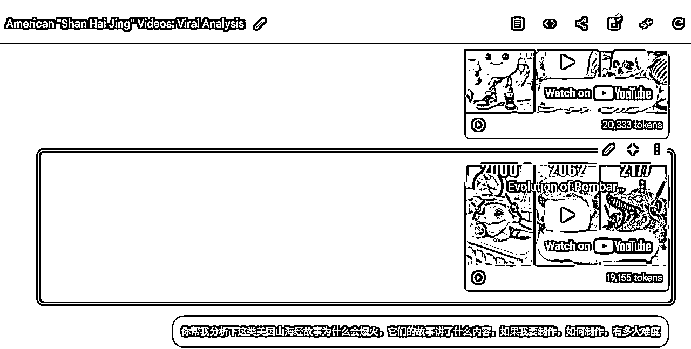

经过这一步，你可以基本弄清楚一个爆款频道究竟在讲什么、为什么能够吸引观众，以及如果自己想做类似内容，应当采用什么制作路径。

GAS 通常会把内容拆得非常具体，从整体框架到具体执行方式，都会给出相应建议。

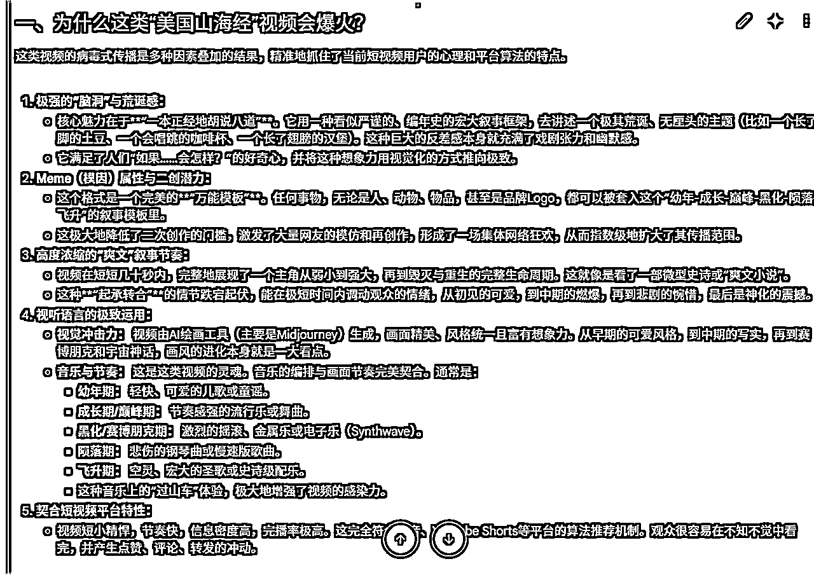

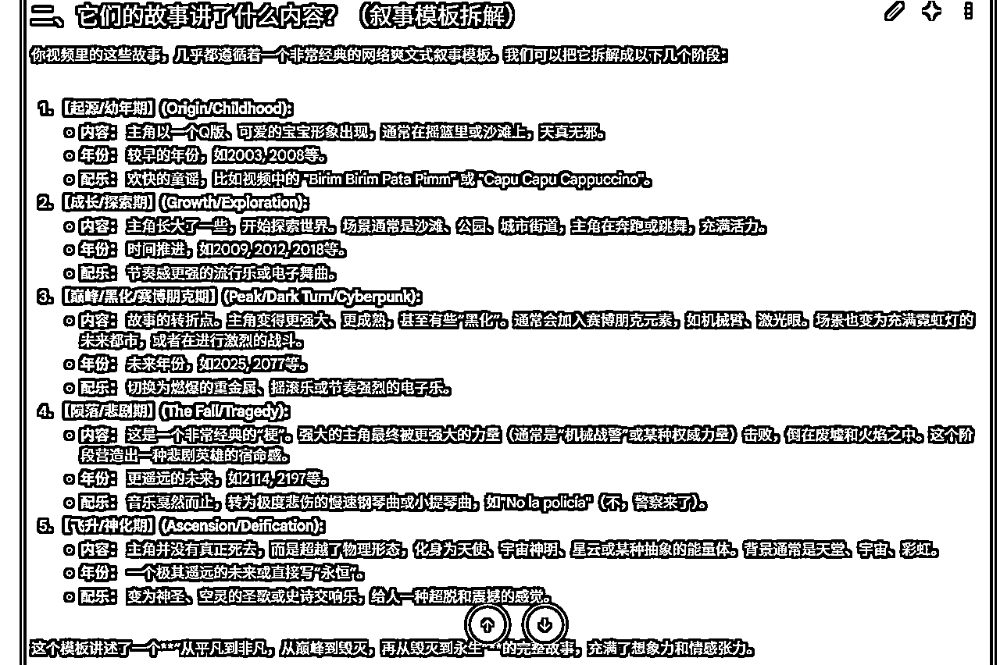

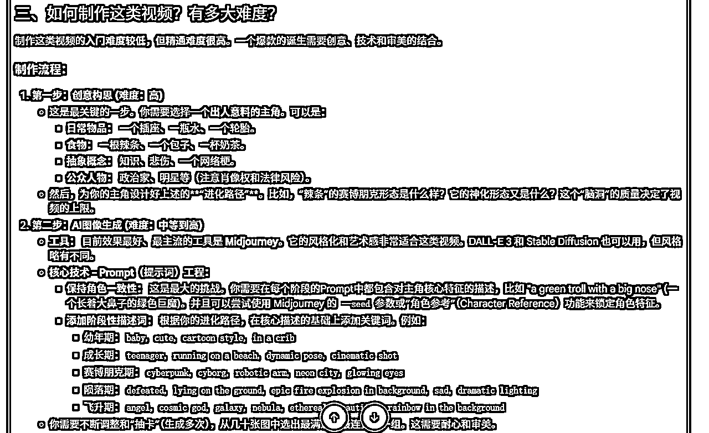

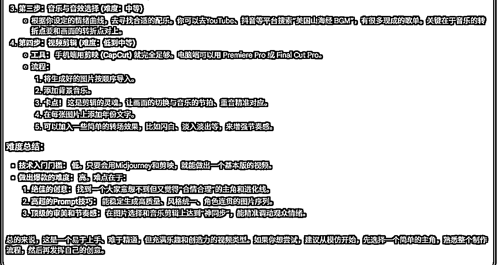

当你确认这个方向在自己的能力和工具范围内可以完成，就可以进入下一步。

# 二、先定故事，再开始制作

## 1.让 GAS 根据对标内容帮你构思

在完成爆款分析后，不要立刻让 AI 随便发挥。

GAS 已经记住了前面的视频内容和分析结果，这时可以把自己的工具、预算和制作能力告诉它，让它在对标风格的基础上，帮你设计新的故事。

我当时使用的思路大致如下：

我可以熟练使用多种 AI 工具完成制作，但目前没有开通 Midjourney。我的组合方案主要是即梦、GPT 和 Runway。不过，山海经类内容中的角色在不同片段里不一定需要保持完全一致，因此我准备使用即梦生成图片，再结合可灵完成图生视频。

现在请你帮我设计故事。故事必须具备足够强的视觉冲击力，主体要奇特、反常，同时能够吸引 YouTube 观众。尤其要重视开头三秒，因为这部分会直接影响观众是否继续观看。

请给出三个具有明显差异、足够怪异且具备传播潜力的故事方案，让我进行选择或修改。

如果第一次生成的内容不理想，可以继续补充自己的限制条件，让 GAS 重新设计。但有一个原则不能忘：不要完全脱离目标爆款的内容逻辑，不能变成毫无关联的自由创作。

最后，通常可以让它把故事整理成一段简短的剧情概述。这个阶段非常关键，因为后续所有镜头、图片和视频，都会建立在这个故事之上。

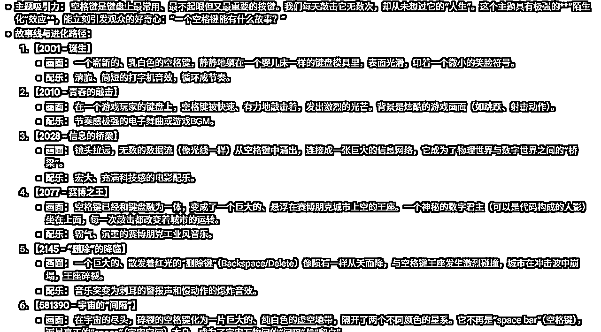

## 2.前三秒和前十秒，决定观众是否留下

短视频也好，长视频也好，开头都是最需要投入精力的地方。

前三秒负责让观众停下来，前十秒则决定观众是否继续看。因此，开头不能慢慢铺垫，而要尽快呈现反常、奇特、有冲击力的画面或情节。

可以采用：

- 更快的镜头切换
- 一眼就能看出不寻常的视觉主体
- 观众难以预料的场景
- 直接抛出冲突或悬念

下面这两幕之所以有吸引力，就是因为它们一开始就展示了不常见的主体和环境，观众不需要等很久，就能意识到“这里有故事”。

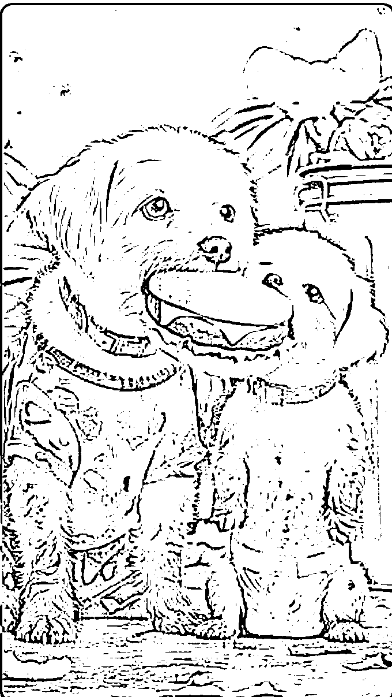

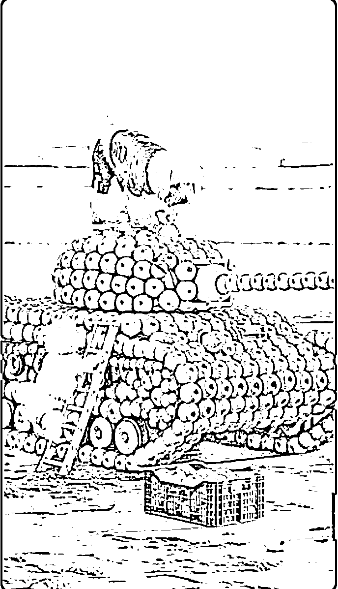

# 三、用 GAS 设计文生图分镜

故事确认后，就要把它拆分成一个个静态镜头。

这一步建议继续参考目标频道，让 GAS 帮你分析：

- 大概包含多少个镜头
- 每个镜头持续多长时间
- 远景、中景、近景如何分配
- 画面风格和色彩倾向
- 哪些视觉元素构成了账号特色

不过，参考不等于照搬。直接复制对方的画面和故事，可能带来版权风险。更稳妥的做法，是学习它的节奏和表现方式，再重新设计自己的内容。

## 1.文生图提示词的基本结构

我采用的是“先生成一张静态图片，再使用图片生成视频”的方式。

因此，提示词首先要把每个画面描述准确。可以要求 GAS 按照以下七个维度输出：

1. **主体 Subject**：画面中最重要的角色或物体是什么？
2. **细节 Details**：主体的外观、服装、表情、姿态等。
3. **环境 Environment**：主体所处的地点，以及背景中的具体元素。
4. **构图 Composition**：景别、视角、画面范围和取景方式。
5. **风格 Style**：电影感、概念艺术、写实、插画等视觉方向。
6. **光影 Lighting**：光线来源、色调、氛围以及明暗关系。
7. **参数 Parameters**：清晰度、画面比例、细节质量等要求。

提示词可以要求中英文同时生成，并且直接输出为一整段，方便复制到生图工具中使用。

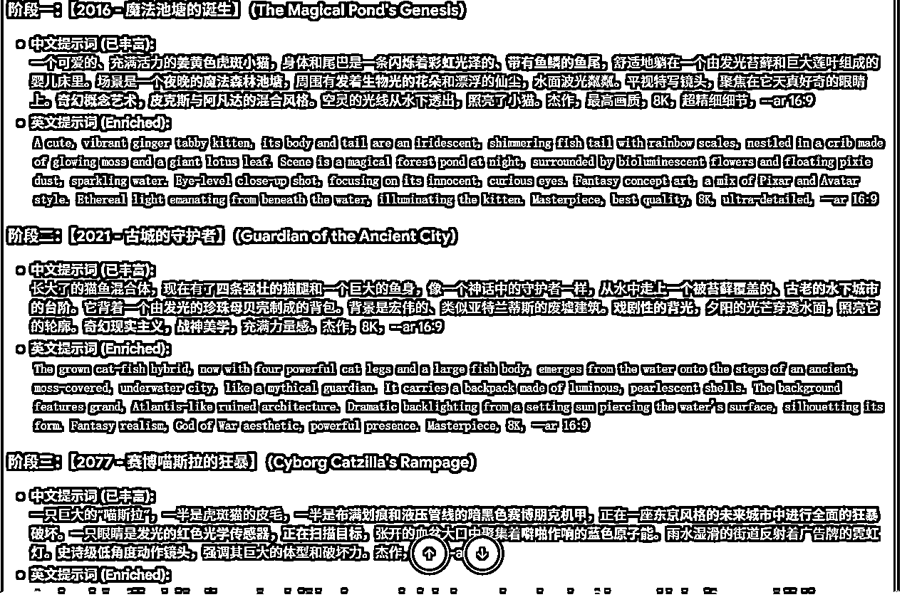

## 2.保持角色、场景和画面逻辑稳定

分镜提示词中，有几个细节非常容易被忽略。

### 角色描述必须重复

如果第一张图中写的是“一只穿着蓝色菊花短裤的小猫”，后续镜头不要只写“这只小猫”，而应该继续完整重复“一只穿着蓝色菊花短裤的小猫”。

这样做虽然看起来有些啰嗦，但有助于提升角色特征的一致性。

### 相同场景也要完整复述

比如第一个镜头描述的是“一个普通房间，里面有沙发和花盆”，那么后续再次出现同一房间时，不要只写“房间里”，而应继续重复完整的背景信息。

### 背景细节越具体越好

画面中的环境元素应尽可能明确，例如：

- 仓库里有几排货架
- 货架上摆放哪些物品
- 地面是否有灰尘
- 墙面是什么材质
- 是否存在螺丝、头盔、箱子等道具
- 光线来自哪里

环境描述越稳定，前后镜头的连续感越强。

### 静态图提示词不要写成动作指令

文生图生成的是一帧画面，因此应尽量避免“推门”“奔跑”“穿过”等连续性动词。

可以改写为：

“一只小猫的爪子放在门把手上，身体微微前倾，头部低垂，呈现即将推门的姿态。”

重点是描述一个瞬间，而不是一段连续动作。

另外，所有画面元素最好整合成一段完整文字输出，不要拆成多段，方便直接复制使用。

# 四、文生图阶段：不断抽卡，直到画面过关

## 1.图片质量会直接影响观众感受

在 AI 视频里，图片是观众接触到的第一层内容。即使后面的动画和剪辑不错，如果原始画面模糊、构图混乱、角色变形，也会影响整体完成度。

因此，抽卡不是简单地生成一次就结束，而是要反复调整提示词、构图和细节。

我的做法是先把提示词打磨得足够准确，再进行批量生成。这样虽然前期多花一点时间，但后续返工会少很多，整体效率反而更高。

如果想进一步提高批量操作效率，也可以尝试一些自动化插件。例如支持 GPT、即梦、MJ 等工具的 Chrome 插件，能够帮助自动提交任务和加快生成流程。

官方文档：

https://www.yuque.com/autojourney/docs/pkil2i72vcqfweld

Chrome 商店可以搜索：AutoGPT

即梦生图我使用的是会员功能，通常建议选择一积分的标清模式。

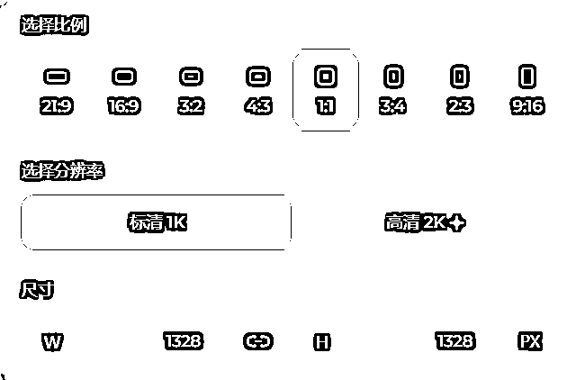

如果对清晰度有更高要求，也可以使用超清功能，让画面更加锐利。

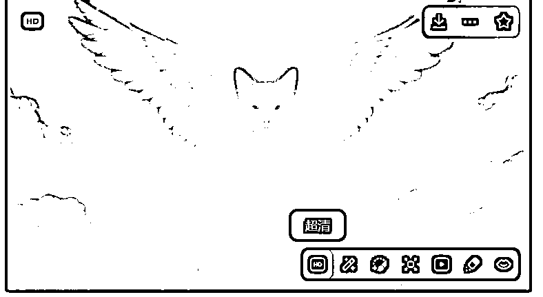

## 2.处理图片水印

即使开通会员，即梦图片左上角仍可能保留“AI”水印，因此后续通常需要进行处理。

这里推荐三个可以尝试的免费工具。如果对画质要求不高，可以使用 Google 商店中的插件，但它只能输出 720p，对我来说清晰度不够理想。

下面两个工具的画质相对稳定：

- https://online.niuxuezhang.cn/online-photo-watermark-remover/detail/
- https://www.arkthinker.com/zh/watermark-remover/

它们的共同限制是一次通常只能处理一张图片，因此可以交替使用，提高效率。

## 3.人物一致性怎么解决

山海经类题材对角色连续性的要求相对较低，所以我直接使用即梦生成图片，也能满足需求。

但如果制作的是连续故事、动物剧情或人物叙事，就需要更加重视角色一致性。

我尝试过 GPT、即梦、可灵、豆包、Runway、Vidu、智谱清言等工具，现阶段的实际体验是：

1. GPT
2. Runway

这两个工具在角色参考方面表现比较稳定。

具体做法是，先上传一张确定好的角色参考图，再告诉工具：后续提示词中的主体，都要使用这张图中的角色。之后，再附上每个分镜的文生图描述。

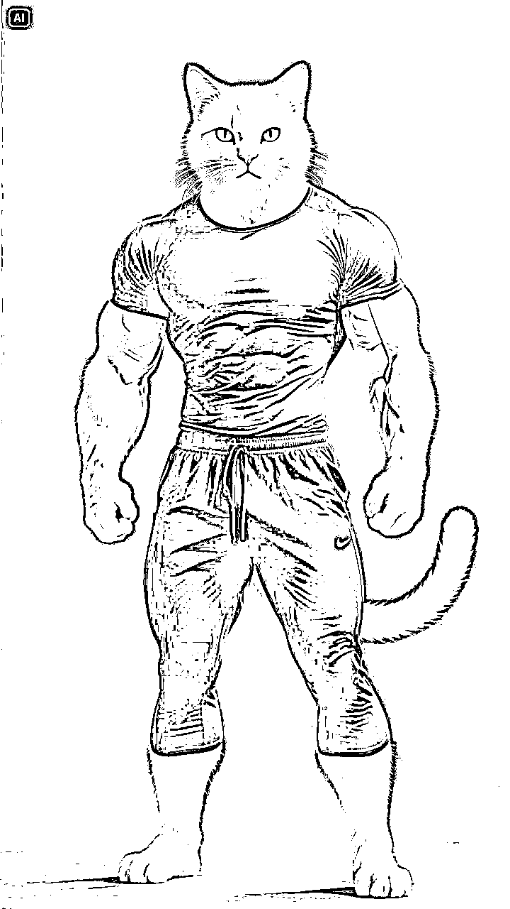

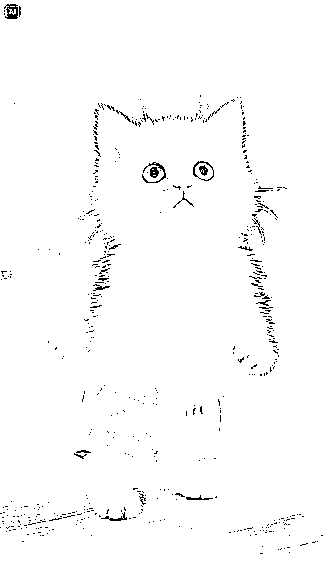

当然，这些工具也有使用限制。

GPT 一个账号大约只能生成十张左右的图片；Runway 最高支持 1080p，但每次会消耗积分，720p 大约消耗 5 积分，1080p 大约消耗 8 积分。

如果预算有限，只能多准备几个账号；如果不太在意成本，也可以结合前面提到的自动化工具，提高批量制作速度。

# 五、图生视频：不要急着直接生成

## 1.先让 GAS 根据图片写动画提示词

很多人会把图片生成完成后，直接把图生视频提示词一起提交。这个方法虽然省步骤，但并不一定精准。

更好的流程是：

1. 先完成全部静态图片
2. 把这些图片重新上传到 Google AI Studio
3. 让 GAS 根据真实画面，逐张生成图生视频提示词
4. 再把提示词交给图生视频工具制作

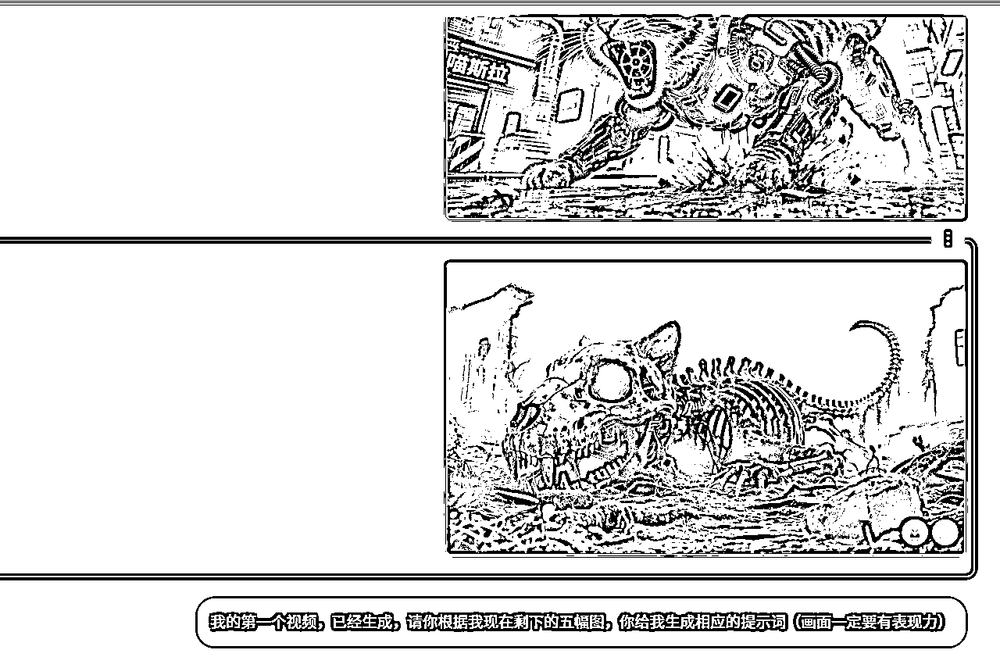

这样做的好处是，GAS 能够基于已经生成的画面设计动作，不容易出现提示词和实际图片不匹配的问题。

## 2.图生视频提示词需要包含哪些内容

相比文生图，图生视频提示词除了描述画面，还必须说明时间变化、主体动作和镜头运动。

可以让 GAS 按照以下结构输出：

- **初始画面**：视频开始时，画面中有什么。
- **时间变化**：烟雾出现、光线变化、花朵盛开、天色转变等。
- **主体动作**：角色或物体在画面中发生什么动作。
- **镜头运动**：推近、拉远、平移、环绕、跟拍等。
- **景别变化**：远景转中景、中景切特写等。
- **转场方式**：淡入、淡出、叠化或其他衔接方式。
- **结束画面**：视频最后停留在什么状态。

可以直接使用这样的公式：

**初始状态 + 时间推移 + 角色动作 + 镜头运动 + 景别变化 + 过渡方式 + 最终状态 + 风格参数**

要求 GAS 将所有信息整合成一段完整文字，避免输出过于零散。

## 3.不同图生视频工具的体验

我目前主要使用即梦、智谱清言和可灵。

按现阶段的使用体验，我个人的排序是：

**可灵 > 即梦 > 智谱清言**

即梦最近推出了 Pro 模型，单次需要 50 积分，我暂时还没有舍得尝试。但从模型定位来看，效果可能会进一步提升。

即梦还有一个比较实用的新功能：可以自动生成音效。目前这个功能仍然比较友好，一条视频可以生成三个音效，对于不想额外购买音效素材的创作者来说很方便。

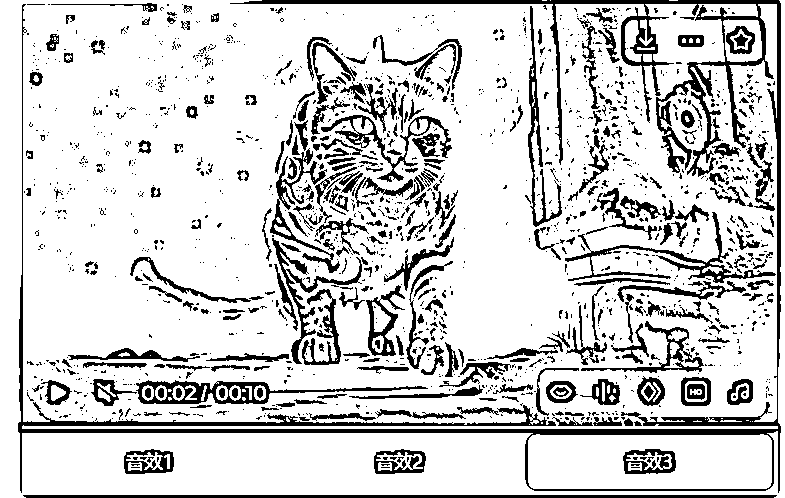

# 六、剪辑阶段：让 GAS 也参与进来

## 1.用 GAS 学习复杂剪辑效果

很多新手会把剪辑看成最难的一步，尤其是看到对标视频中的回忆片段、特殊转场和节奏效果时，往往不知道该如何复现。

其实可以直接把参考视频或相关片段上传给 GAS，让它分析这个效果是如何完成的，再要求它用剪映的操作方式，按照小白能够理解的程度，一步一步说明。

我之前看到某个对标视频结尾的回忆片段时，也认为自己很难做出来。但把视频交给 GAS 后，它很快就拆解出了操作流程，包括使用哪些功能、如何设置时间线、怎样完成转场。

所以，看到不会做的效果，不妨先把它交给 GAS 分析。即使没有剪辑基础，也能按照步骤慢慢复现。

## 2.让 GAS 帮你安排音效

对于动物故事、无对白视频而言，音效的重要性尤其明显。

因为画面中没有人物对话和字幕来解释情节，声音就承担了很大一部分叙事功能。合适的环境音、动作音和情绪音效，甚至可能影响视频最终效果的三成左右。

但音效选择往往不容易。剪映音效库很大，却不一定知道该搜索什么关键词。

这时候可以把视频片段或剧情描述交给 GAS，让它为每一个镜头推荐适合的音效类型和搜索名称。

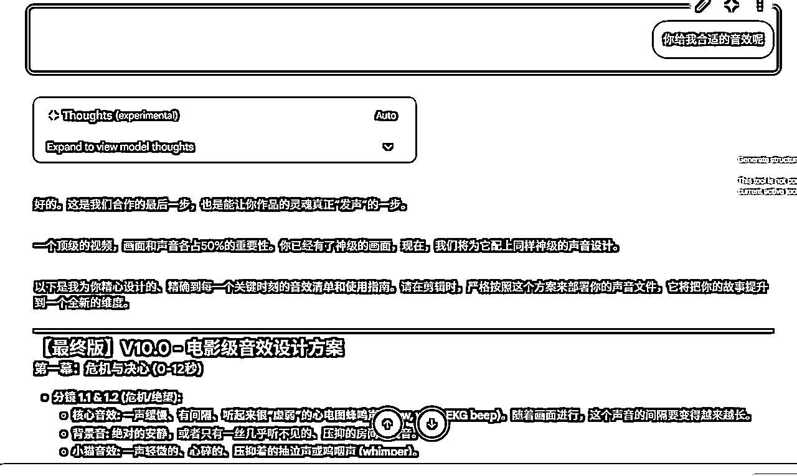

之后，只要按照它给出的关键词到剪映音效库中搜索，通常比自己盲目翻找更高效。

# 七、发布前别急着上传，先做一次复盘

视频剪完并不意味着制作结束。

在正式发布之前，最好把成片再次上传给 GAS，让它结合之前分析过的爆款视频，检查你的作品在哪些方面存在差距。

可以重点让它评估：

- 开头是否足够吸引人
- 故事是否清晰
- 镜头节奏是否拖沓
- 画面是否存在重复
- 角色和背景是否稳定
- 音效是否与动作匹配
- 转场是否自然
- 情绪是否逐步推进
- 结尾是否具有记忆点

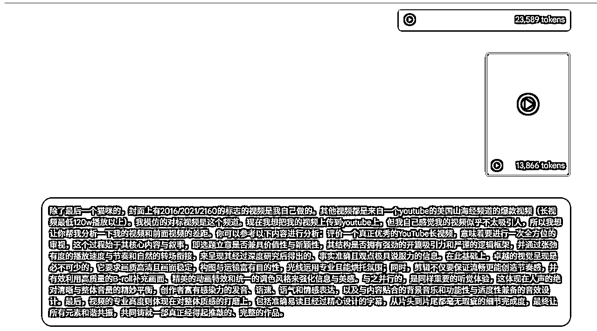

我的提示词大致是：

除了最后一个带有 2016、2021、2160 标志的猫咪视频是我自己制作的，其余视频均来自一个美国 YouTube 山海经频道，并且都是播放量超过 120 万的长视频。我的作品参考了这个频道。

现在我准备把视频发布到 YouTube，但我觉得成片的吸引力还不够。请你对比前面上传的爆款视频，全面分析我的作品存在的问题，并给出具体修改建议。

评价一条优秀的 YouTube 长视频，需要从多个方面进行判断，包括：

- 主题是否有价值，同时具备新鲜感
- 开头是否迅速建立吸引力
- 故事结构是否清楚，逻辑是否顺畅
- 节奏是否合理，镜头衔接是否自然
- 信息与观点是否准确、有说服力
- 画面是否清晰稳定
- 构图和镜头运动是否服务于内容
- 光线、色彩和氛围是否统一
- 剪辑是否具有节奏感
- B-roll、动画和特效是否真正起到补充作用
- 人声是否清楚，音量是否平衡
- 语速、情绪和表达是否自然
- 背景音乐与音效是否匹配
- 字幕是否准确、易读、美观
- 视频从开头到结尾是否保持完整度和专业感

GAS 会根据这些维度给出一份修改清单。

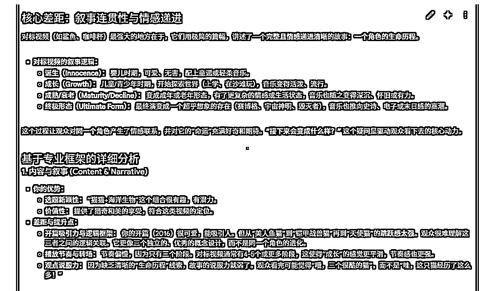

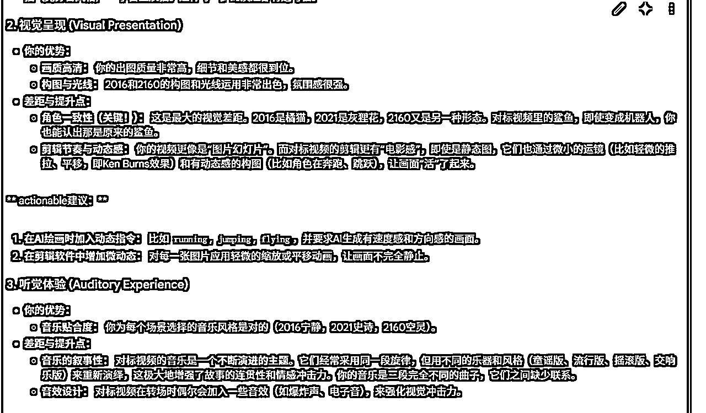

建议通常会比较多，不必一次全部修改完。可以先挑最影响观感的问题，在剪映中完成调整，再导出第二版重新检查。

这里还有一个小技巧：用于诊断的视频，不需要输出高分辨率。选择 480p、25fps 基本就够了。这样既能减少文件体积，也能加快上传和分析速度。

# 八、发布视频时的设置

## 1.导出参数

最终发布时可以根据自己的需求选择合适的清晰度。

但如果只是交给 GAS 做诊断，没有必要导出高分辨率版本。480p、25fps 足以让它判断节奏、画面和结构，不会因为文件太大而浪费时间。

正式上传时，按照自己的成片需求导出即可。

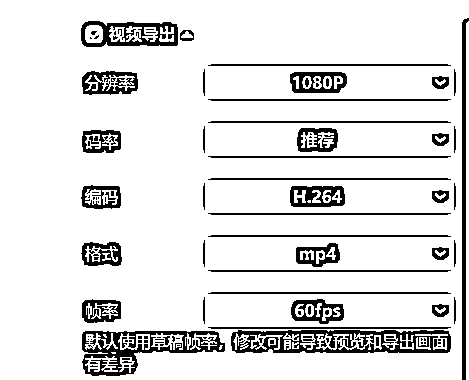

## 2.让 GAS 协助生成标题和简介

标题不仅是视频的门面，也会影响搜索曝光。

一个包含核心关键词、符合观众搜索习惯的标题，更容易让潜在观众找到视频。可以把故事内容、目标受众和参考频道交给 GAS，让它一次生成多个标题方案，再选择最适合的版本。

视频简介虽然不一定直接带来更多曝光，但它可以帮助观众快速理解剧情和主题。特别是故事类视频，如果简介把核心冲突和看点描述清楚，可能会提升观众的认可度和点赞意愿。

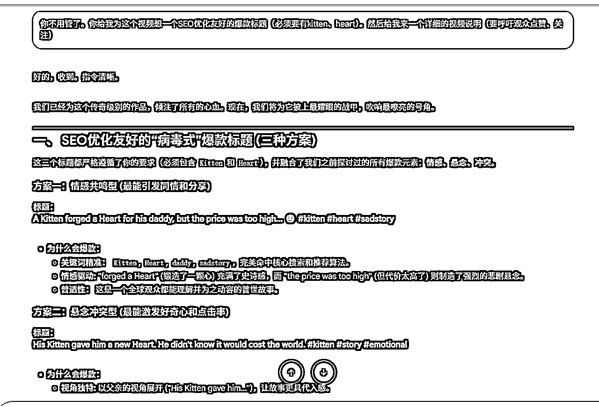

# 九、最后总结

用 AI 做 YouTube 视频，并不是把素材丢进工具里等待结果，而是一套完整的生产流程：

1. 找到合适赛道
2. 批量研究目标频道
3. 拆解爆款的视频结构
4. 结合自身能力设计故事
5. 重点打磨前三秒和前十秒
6. 生成详细的静态分镜
7. 反复抽卡，保证画面质量
8. 处理角色和背景一致性
9. 根据成片图片生成动画提示词
10. 完成图生视频
11. 用 GAS 学习剪辑和音效搭配
12. 上传成片再次复盘
13. 修改问题后再正式发布
14. 优化标题和视频说明

真正提高效率的关键，不是盲目使用更多工具，而是让每个工具承担明确任务。

Google AI Studio 可以用来拆解爆款、构思故事、设计分镜、生成图生视频提示词、分析剪辑、匹配音效，还能在发布前帮助你检查成片。

对于刚开始做 YouTube 的新人来说，只要按照流程不断尝试，先完成一条，再根据数据和反馈持续优化，做出第一条万播视频并没有想象中那么遥不可及。

嘿嘿，我最喜欢分享这些实用小技巧了。之前也整理过一篇 AI 提效方法，感兴趣的朋友可以继续看看。

做 YouTube 内容时，素材获取、封面设计和视频细节制作，往往都需要一些实用工具来辅助。今天把几个我自己用过的方法整理出来，供大家参考。

## 1.如何下载 YouTube 视频与音频

群里经常有人询问 YouTube 视频该怎么保存。其实有一个操作非常简单的工具，只是很多人还不知道，今天直接分享给大家。

打开目标 YouTube 视频页面后，复制顶部的网址。

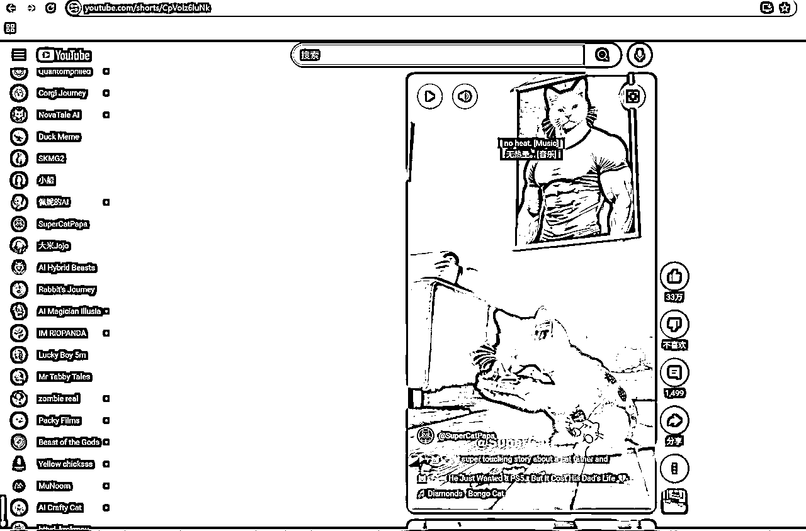

接着点击浏览器上方的地址栏。

把网址中的“ube”删掉，再按下回车键。

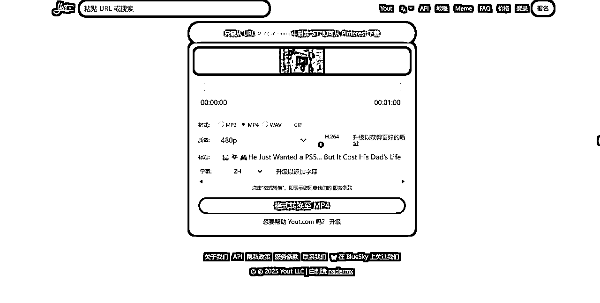

随后页面会跳转到下载界面，视频和音频都可以单独保存。

需要说明的是，免费版本存在一定限制：视频最高支持 480p，音频最高为 128kbit/s。如果愿意付费，最高可以下载 8K 清晰度的视频。价格方面，包年折算下来每月 9 美元，包月则是 12 美元，更适合对画质要求较高、或者经常处理素材的用户。

如果只是偶尔提取音频，或者对清晰度没有特别高的要求，免费功能基本已经够用了。

另外，也可以试试这个网站：

https://tiqu.cc/

整体使用起来比较方便，日常做素材整理、提取内容都可以考虑。

至于去水印等相关操作，后面的内容里其实也会涉及，这里就不再单独展开了。

## 2.用 Canva 设计 YouTube 封面

长视频的封面很值得花时间优化。一个清晰、有重点、视觉吸引力强的封面，往往会直接影响观众是否愿意点击。

比如我之前做过的一张封面：

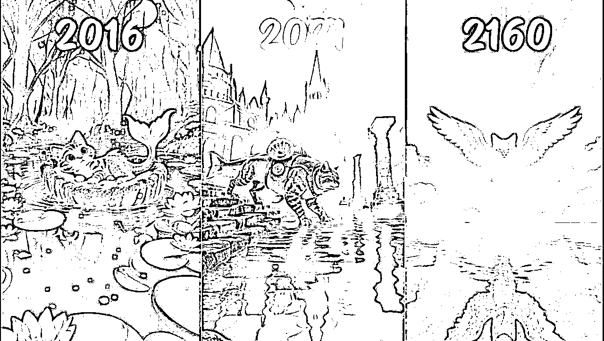

这张图是我用 Canva 进一步调整完成的。

我的做法是：先在制作视频时生成一张 16:9 的画面，再借助即梦进行扩图，将它调整成 9:16 的比例。处理时记得勾选或添加超清效果，成片会更加清晰。

之后可以在闲鱼上购买一个 Canva 会员，价格通常很低，我当时花了一块钱。开通后，就能直接选择 YouTube 封面模板：

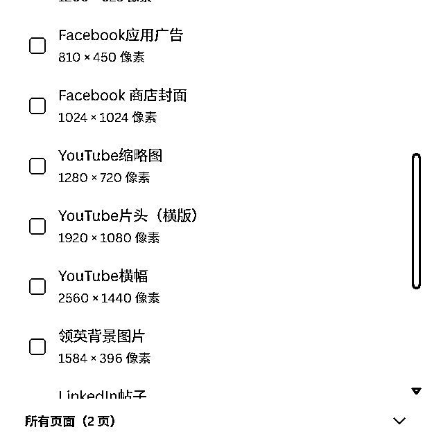

接下来把前面生成的图片导入 Canva，再按照自己的想法进行组合和排版即可。整个过程不复杂，基本拖拽几下就能完成，最后选择高清格式导出。

## 3.Canva 也能参与视频内容制作

Canva 不只是用来做封面，它同样可以制作视频中的一些画面素材。

比如我之前做的“熊猫最后一个回忆”片段里，有一个信件画面：

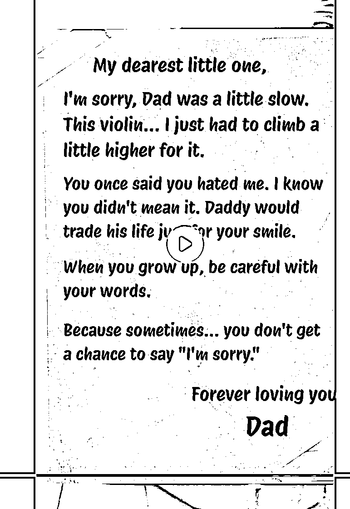

这封信就是用 Canva 完成的。操作方法很简单，先搜索一个牛皮纸风格的模板，然后替换文字内容，加入英文文案，再根据视频节奏设置关键帧，就能做出类似的动态效果。

当然，关于如何进一步提升 YouTube 视频制作能力，以及怎样系统获取更多创作认知，其实还有不少内容可以分享。只是这一部分涉及的内容比较多，也属于另一个主题，后面再单独整理一篇。

如果这次分享对你有所帮助，欢迎顺手点个赞赞！😘❤️

当然，如果大家发现其中有不够完善的地方，或者有哪些操作存在问题，也欢迎指出来，辛苦各位大佬帮忙斧正。