做游戏站最难的，不是把网站搭起来，而是不知道往哪个方向使劲——这也是我自己踩了几个月坑之后最深的体会。如果你也在做海外小游戏站，或者正打算入这个方向，这篇文章不聊怎么“找游戏文件”，聊的是更上游的问题：怎么挑到一座有潜力的金矿。

早在航海营里，不少人用AI做出了人生中第一个小游戏站点，但航海结束之后，真正的关卡才刚开始。下面这套选品思路，是我自己跑出来的经验，同样适用于工具站。

先说结论：越来越多人选择游戏方向，不是没理由的。

第一，反馈来得特别快。一个新游戏关键词站，只要做好基础SEO、不做任何推广，谷歌就会主动送流量。我4月中旬上了一个叫Crazy Cattle 3D的词，页面发布24小时内，后台已经能看到搜索数据了。

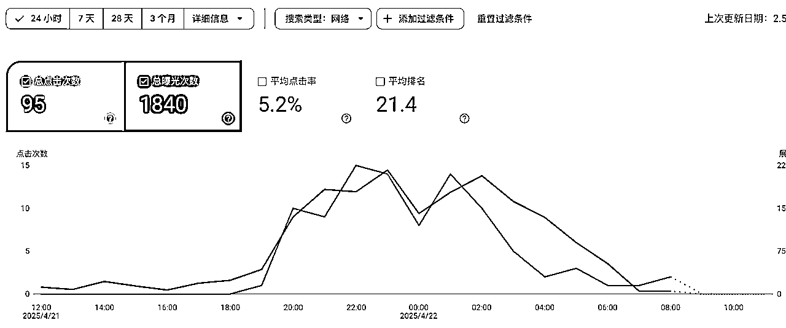

第二，技术门槛被AI削平了一大截。GPT-4o能直接生成透明背景素材，拿来当游戏配图完全够用；AI写代码的能力也让建站变得轻松，一个iframe就能快速挂起一个小游戏页面；再加上Cloudflare、Vercel、GitHub这些免费托管资源，一个人干活基本零成本。

第三，回报确实诱人。过去一年，已经有不少人靠游戏站SEO稳定做到月入数百美元、数千美元，甚至有人冲到过万。但你千万别看到“万刀”就上头，这活儿并没有字面上那么轻巧。

第四，生态足够大。对普通人来说，能玩的不只是iframe游戏站，还有开源游戏、游戏周边工具、内容社区……路子宽得很。

目前普通人能玩的，大概三种模式。常规打法：做综合或垂直类游戏站，持续更新，从SEO、社媒拿流量，靠广告、会员、分销变现。第二种是做新游戏关键词站：新游戏出来，马上围绕它的关键词布局页面，主要吃自然搜索流量，用AdSense收钱。别觉得老套——2024年照样有人靠这招月入几万。第三种是付费流量玩法：低买高卖，把TikTok等渠道的便宜流量引到站里，赚AdSense差价，本质是流量套利。对新手来说，前两种最稳。

在动手之前，有两个概念得先盘明白。一个是流量结构：网站流量一般来自社媒、自然搜索、直接访问、引荐、付费投放和邮件几种渠道。对游戏站来说，自然搜索、直接访问和引荐通常是大头。

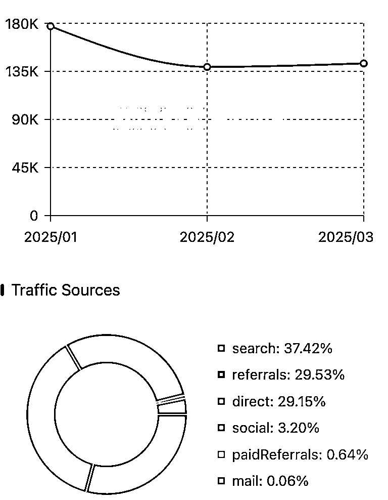

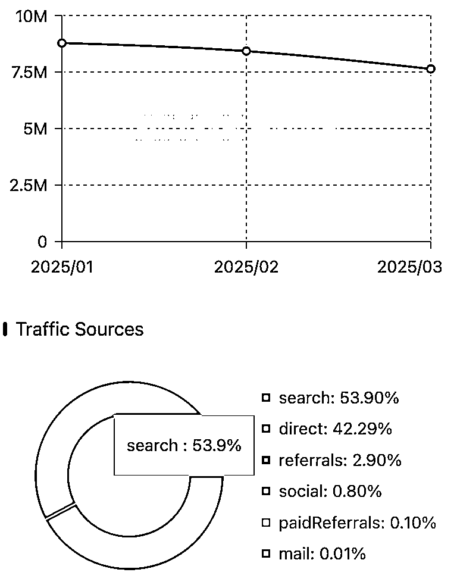

另一个叫“蓝海”。刘小排老师那句话说得精辟：“不过就是找软柿子捏。”找到一个需求旺盛、供应稀缺的领域，换上更好的方案打进去。顶级蓝海，就是满级大佬屠杀新手村。

新游戏词站的底层逻辑，就藏在这句话里。一个新游戏火了，用户会疯狂搜索它，而早期提供资源的网站极少。你愿意第一时间把内容挂出来，谷歌自然愿意给你位置。需求强、供给弱，新手才能捡到便宜。

但机会不会自己跑到你面前，得靠翻。选品就像翻石头，翻十块才能见到一块有东西的。下面聊几个我一直在用的挖掘入口。

1. 谷歌趋势，基本功。很多人问：干嘛不用SEMrush？因为新游戏词太新，第三方工具数据更新有滞后，根本来不及。谷歌趋势才是实时风向标。重点盯两块：一个是“探索”，从词根延伸去找飙升词和做对比分析；一个是“时下流行”，直接看当下游戏热点。微信有搜索指数，谷歌有Trends，本质都一样：搜索即需求。凡是搜索量可观、趋势向上蹿的，就值得下场——做错的成本很小，错过的代价太大。

2. 游戏聚合站。像CrazyGames这类平台，本身就是现成的选品库。怎么看？翻它们的sitemap、最近更新页面、分类榜单。推荐用aitdk浏览器插件快速找sitemap，也可以直接访问这个在线工具提取：https://sitemap-extractor.gsctool.com/。想精准一点，就用高级搜索指令找那些“最近更新且已收录”的页面。再点进New Games榜，看玩家数量、评分、上线时间。挑出关键词，丢回谷歌趋势验证，趋势和预估体量都行，就做。

3. 社媒论坛。谷歌趋势其实也有延迟——很多游戏先在TikTok、YouTube这些地方烧起来，用户才会去谷歌搜，趋势数据才有反应。所以社媒要前置。方法有四招：把算法喂熟，让系统自动给你推；用关键词搜索异常数据，重点盯近期低粉但数据突然爆表的帖子；刷标签话题；关注测评类博主、重度玩家和游戏开发者。举个现成例子：Crazy Cattle 3D最早发布在itch.io，但那边数据平平，根本看不出爆款相，谷歌趋势早期也是一片安静。真正的引爆点是TikTok。与此同时，YouTube上很多平时流量一般的小UP主，发这个游戏的视频却突然天量播放。这种异常值，就是信号。

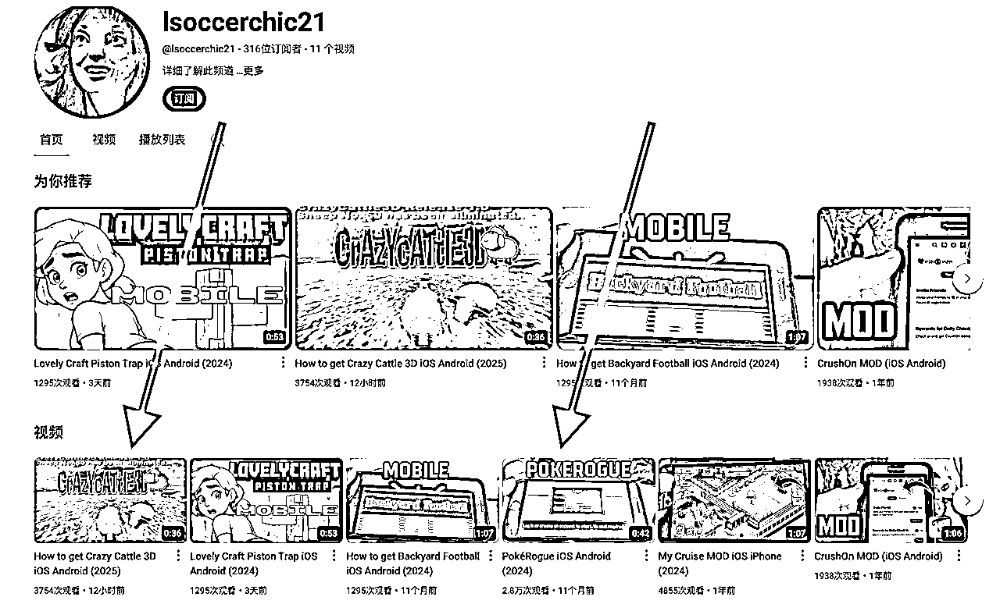

上面这位博主的页面里，除了Crazy Cattle 3D，还有一个叫Pokerogue的词也异常爆过，感兴趣可以自己去挖。

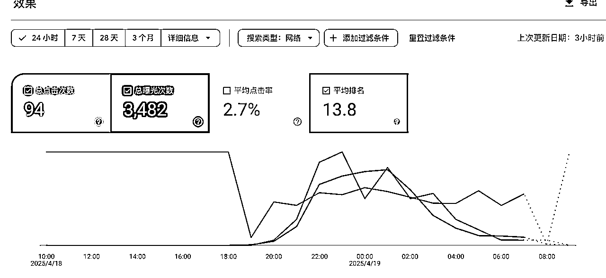

我当时跟了这个游戏，哪怕比同行晚了一两天上线，依然拿到了可观的正向反馈，零外链、零推广。同行里有网站上线90来天就拿下百万访问量，数据相当惊人。

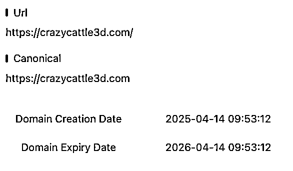

4. 盯住优秀开发者和团队。关注那些出过爆款的创作者。他们有粉丝、有口碑，每次发新游戏都更容易起量。比如neal.fun，今年年初的Stimulation Clicker又火了一波。还有Infinite Craft，2024年1月上线就炸了。爆款总是惊人相似，新瓶装旧酒一样能赢。

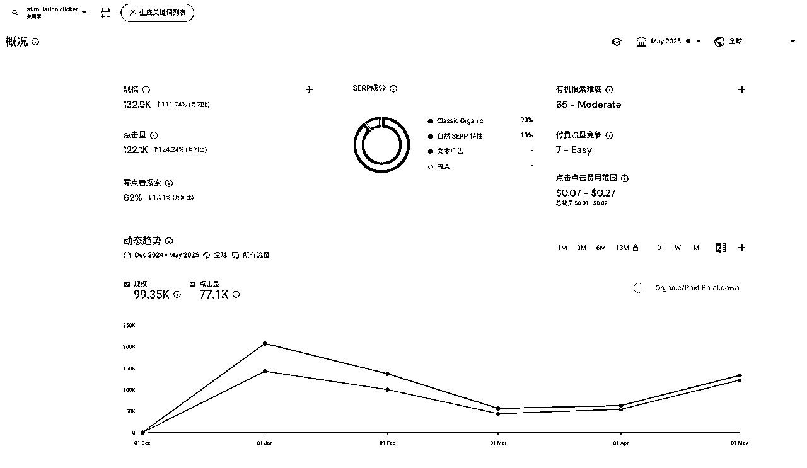
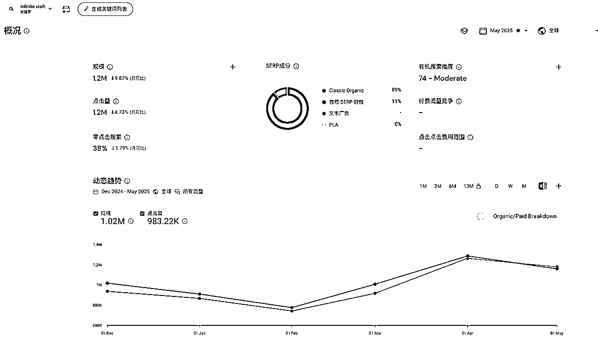

但这里必须提个醒：版权问题。DMCA投诉一旦成立，GitHub会删仓库，谷歌会撤你的网页。前三月份，Stimulation Clicker的正主neal.fun就向谷歌投诉了抢占搜索结果的第三方站点，那个站的首页直接从SERP里消失了。我自己的站也在被投诉名单里，但没被处理，活了下来——说明这坑能躲。

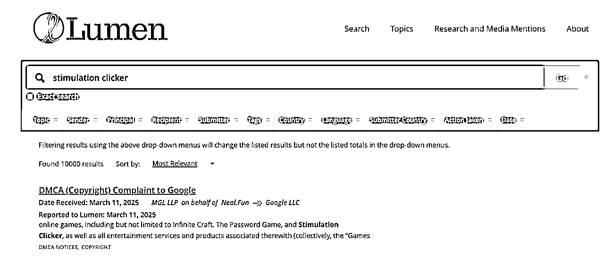
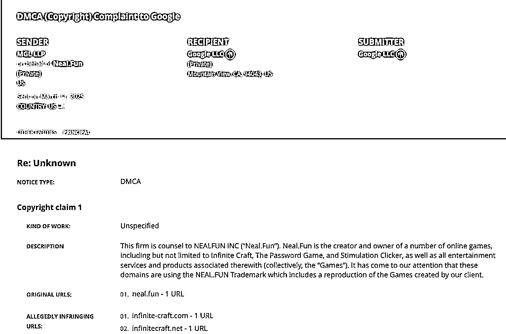

5. 顺藤摸瓜，看整个生态。上游有开发者、游戏引擎、素材工具；下游有游戏平台、玩家、广告联盟、变现平台、社区。每个环节都能长出机会。游戏界还有黑客松一类活动，多参与、多观察，这些地方往往藏着别人没注意的渠道——这才是拉开差距的所在。

6. 数据工具配合用。前面说第三方工具有滞后，但也不是不能用。关键是数据更新后要第一时间去看，重点盯“最近流量飙升的新页面/新网站”。可以用Similarweb或SEMrush，从词找站，从站找页面，再从页面反推关键词，来回循环好几圈。

7. 经典爆款二创。游戏圈的“新瓶装旧酒”现象特别普遍。Wordle、扫雷这类经典小游戏，每隔一阵就被翻新一次，照样能火。搜索关键词可以直接用“某某游戏 alternative / similar / like”。比如Little Alchemy是2010年上线的组合玩法，而Infinite Craft用的几乎是同一套逻辑，2024年1月上线，照样霸屏——经典的玩法从来不缺新用户。除了做仿品，还有一条路是语言本地化，拿开源游戏翻译成小语种版本，流量洼地依然存在。

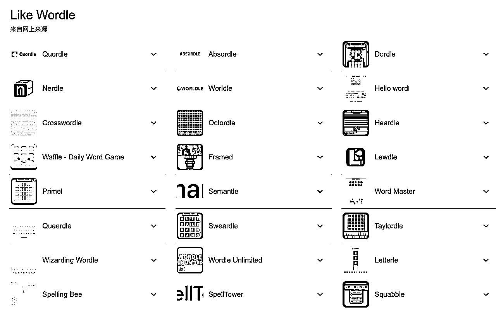

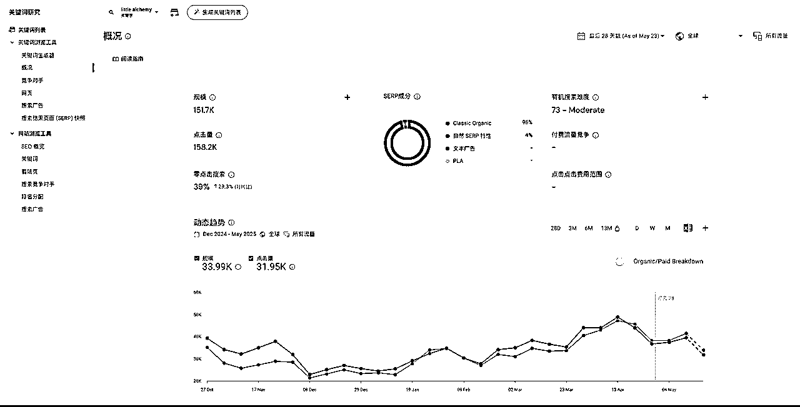
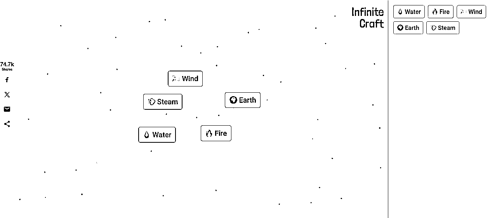
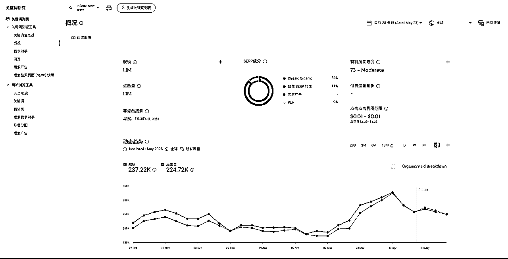

8. 预告游戏。投资要提前埋伏，游戏站也一样。最简单的提前量，就是官方预告。但风险也在：团队可能解散，成品可能不及预期。判断标准很简单：看预告片出来时玩家的反应。《黑神话：悟空》就是典型的预告即惊艳，上线即爆。

9. AI游戏。这个方向近两年爆款频出，分两大类：一类是AI驱动的游戏，比如AI Dungeon这类文本冒险网页游戏；想深挖可以搜“AI Text Adventure Games”。另一类是AI生成的游戏，比如独立开发者Pieter Levels做的fly.pieter.com。再想一层：以前那么多文字对话游戏，其实都可以用AI重做一遍。

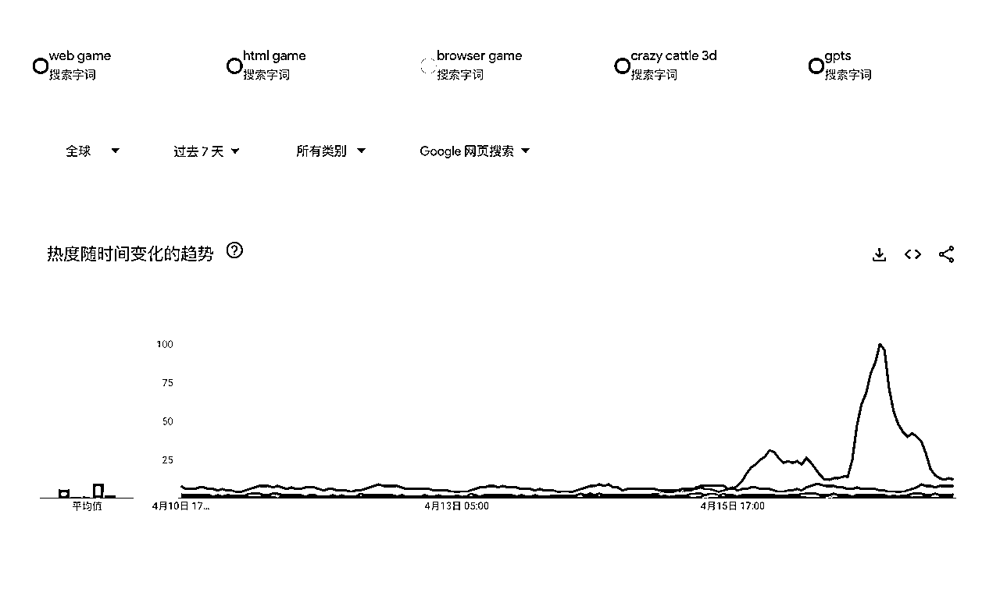

说到这，可能有人要问：怎么分析它到底值不值得做？

你不必是资深游戏玩家，也未必看得懂某个游戏“为什么火”——没必要懂，只要能识别出“它火了”就够了。保持对异常值的敏感，发现某个游戏在多个信息源出现异常集中流量后，把关键词拿到谷歌趋势里看搜索体量和走势，再对比几个同类词。确认搜索量大、趋势向上、竞品也还不多时，赶紧去查域名，发现好域名还没被抢注，就立刻下手。我当时跟进的那个Crazy Cattle 3D，就是这样一步步验证过来的。

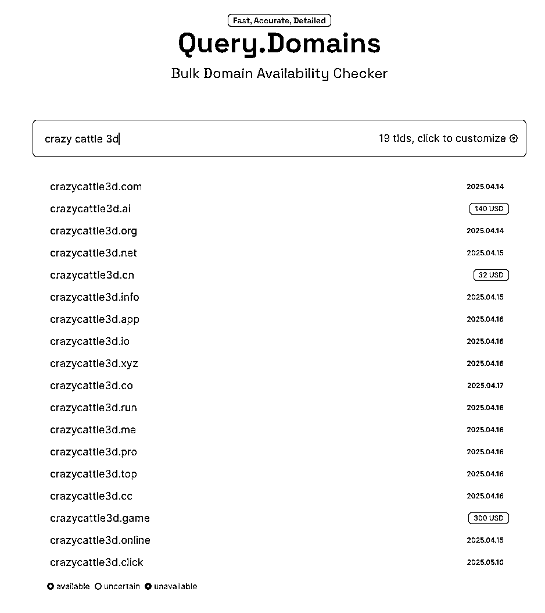

同行网站名单也值得反复研究，我整理了一批做成参考，数据收集于5月8日。多看同行的布局，能少走很多弯路。

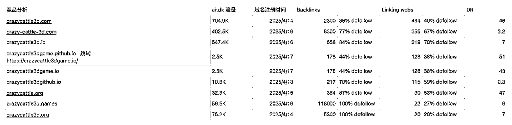

说到底，找到潜力爆款只是起点。后面拼的是供应链和运营——持续更新、持续满足搜索需求，把一波流量慢慢滚成一个稳定的内容资产。只要用户需求还在，游戏热度没退，就别停更。

但选品过程中也会遇到尴尬：很多热点词是主机游戏、小程序或App，浏览器里根本玩不了。这时要想，能不能让用户不用下载、直接在网页里体验？主机游戏可以接云游戏服务。不愿意折腾，也可以做内容站、资源站、工具站、图片站。思路放开一点，别一提游戏站就只能做小游戏，完全可以“以游戏为切入点找需求，然后做网站、做产品”。

想做游戏内容站又没灵感？拿中文游戏词去搜游民星空、3DM，看看老牌同行是怎么做的，同行就是最好的老师。而一个大型主机游戏背后，往往埋着一堆细分需求。比如2024年初爆火的《幻兽帕鲁》，热度一度压过GTA5，对应的“Palworld Breeding Calculator”计算器站专门解决繁殖配对问题。

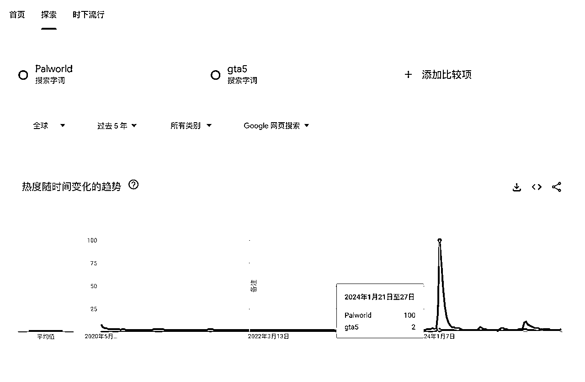
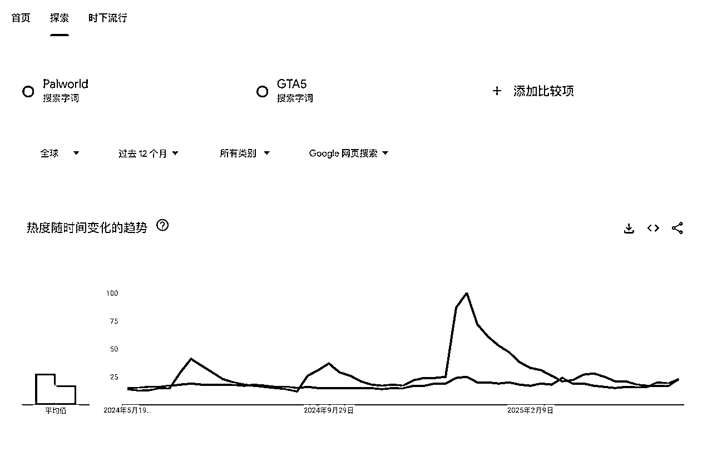

再举个例子，《方舟：生存进化》都发布十年了，当年有站长做了个驯服计算器，把网站做成了品牌，还配了App，现在仍然是百万访问级别——我自己就是这游戏的老玩家，所以特别留意到了这个站。宝可梦伤害计算器这种知名IP衍生品就更不用说了。

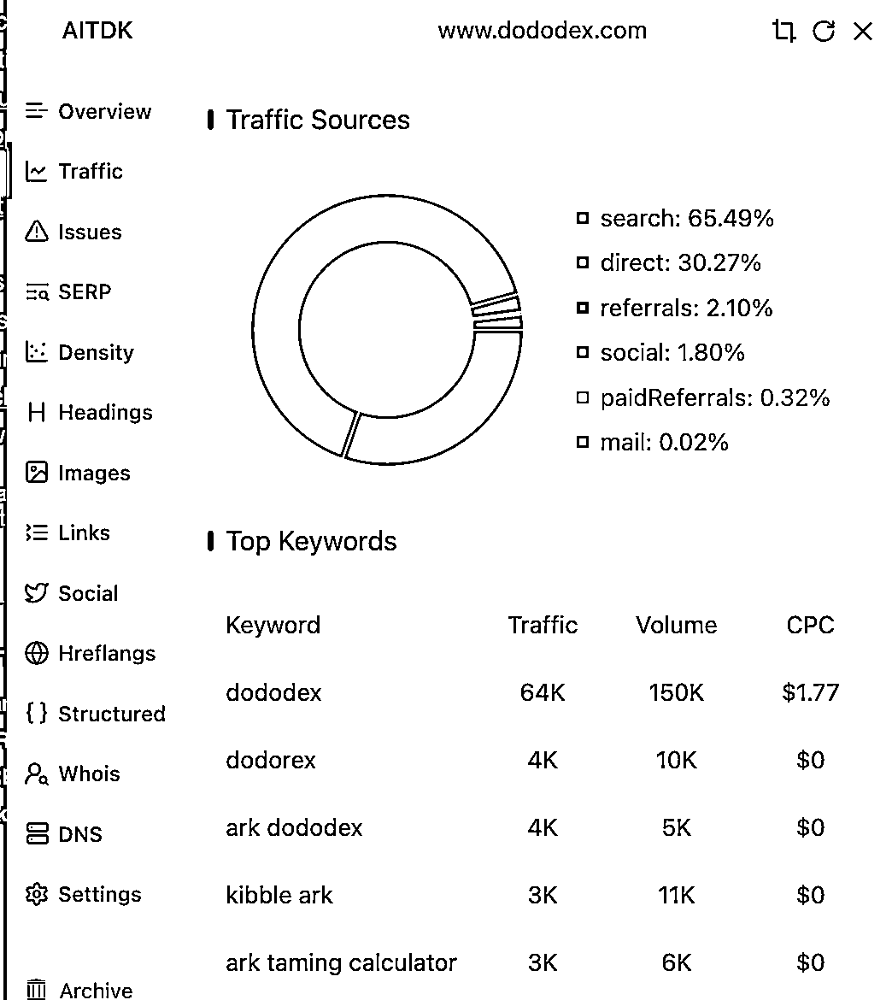
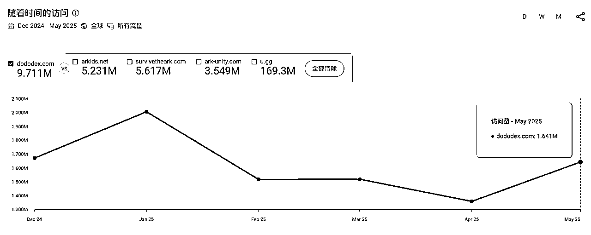

类似的隐藏需求还有不少：游戏免费礼包兑换码、游戏内交易市场、MOD资源……只要玩家想玩得更好、玩得更爽，需求就一直在。

回想起来，游戏站选品这件事，本质不是“找游戏”，而是“找需求”。这套方法不只能用在游戏方向，放到工具站、内容站里，同样成立。翻石头的动作不复杂，难的是持续去翻。下一款Crazy Cattle 3D，也许就被你翻到了。

做网站，先别急着追求复杂功能，最重要的是从用户真实需求出发，并持续运营。

这里分享一个寻找游戏工具站项目的思路：优先关注玩家基数大、讨论热度高，同时具备驯养、繁育、战斗等系统的游戏。围绕这些游戏观察玩家有没有明确需求，再判断是否值得开发对应工具。很多事情，都可以先交给 AI 帮你调研、分析和验证。

# 游戏资源从哪里来？

发现一款有潜力的热门游戏，只是第一步。真正决定项目能否持续的，往往是资源供给、获客能力以及后续运营。

只要游戏仍然保持一定热度，并且项目的投入产出比尚可，就可以继续迭代。至于游戏内容和功能的获取，大致可以从以下几个方向入手。

## 1.使用 iframe 嵌入

这是比较常见的一种方式。可以参考相关教程，也可以研究其他同行制作的 iframe 提取工具和游戏分发站点。

不过，iframe 并不是对所有游戏都适用。有些游戏会限制第三方网站嵌入，导致页面无法正常加载。

遇到这种情况，可以尝试联系原站站长获得授权；如果沟通无果，就需要考虑其他接入方案。

## 2.通过链接引导用户

如果找不到可用的 iframe，也没有现成游戏资源，可以采用普通链接跳转。

用户通过搜索关键词来到你的网站，通常不是为了浏览一堆介绍，而是带着明确目标来的。只要网站能够帮助他完成这件事，就有价值。

例如，用户想玩 ABC 游戏，但搜索结果大多只是资讯文章。如果你的网站能够直接提供进入 ABC 游戏的入口，即使没有把游戏嵌入页面，也同样能够满足需求。

## 3.寻找开源项目与分发资源

部分游戏会公开源代码，可以从开源社区寻找相关项目。GitHub 是常见渠道，除此之外，也可以继续挖掘其他代码平台和资源社区。

一些游戏分发平台也提供了可使用的内容，例如：

- https://gamedistribution.com/
- https://html5games.com/

使用这些资源时，仍然要注意授权范围、使用规则和版权问题。

## 4.自己开发，或借助 AI 完成

如果始终找不到合适的 iframe 资源，同时又担心版权风险，可以考虑自己做一个相似方向的版本，AI 可以在原型、代码和内容改写等环节提供帮助。

例如 LovePawsona，它是一款测试类小游戏。有些网站直接通过 iframe 接入，有些则采用 AI 辅助模仿和重构的方式制作自己的版本。

自行开发的一个优势是：项目早期，用户未必能马上分辨不同版本的来源。如果你的版本上线更早、体验更好，就有机会获得传播。

现在可用于制作游戏的平台很多，例如：

- https://godotengine.org/
- https://unity.com/
- https://phaser.io/
- https://gamemaker.io/
- https://gdevelop.io/
- Scratch 等

选择哪种工具，取决于游戏类型、开发能力和项目周期。先做出可用版本，再根据用户反馈继续完善，通常比一开始追求完美更重要。

## 5.直接购买现成源码

如果希望节省开发时间，也可以在交易平台购买游戏源码或成品项目。

国内可以关注淘宝、闲鱼等渠道；海外则可以看看：

- https://buy.html5games.com/
- https://codecanyon.net/category/html5/games?sort=date
- https://www.fiverr.com/

购买前要确认源码是否完整、是否支持商用、是否包含授权，以及后续是否方便修改和部署。

# 最后想说

做电商，选品看得多了，慢慢就能判断什么产品具备潜力。

做自媒体，研究过足够多的爆款内容，也会逐渐掌握选题和表达的规律。

做网站同样如此。见过的网站越多，分析过的项目越多，越容易理解一个产品该如何定位、如何搭建、如何获得流量。

多观察，多拆解，多实践。

Ship Fast, Ship More。

很多人会阅读项目分享，但真正愿意动手的人并不多。

即便有人把流程写成保姆级教程，从阅读到启动执行，已经会筛掉一批人；真正开始做之后，遇到技术、流量、资源等问题，又会有一部分人选择放弃。

留下来的人中，有些只是反复做低效动作，用忙碌制造“正在努力”的感觉；另一些人会根据数据和反馈调整方法，持续解决实际问题。

最终能够拿到结果的，往往不是一开始最懂的人，而是那些不断行动、不断验证、不断修正的人。

所以，行动起来，认真执行，把知道的东西真正做出来。

值得继续阅读的资料：

- 蓝海挖掘手册
- 出海工具站航海手册