# n8n+fastgpt RAG = 王炸！！！用最强AI知识库MCP Server补全 n8n短板
作者：龙哥

暑假临近，我的教培生意也即将进入旺季。📕和👸号都急需暑假相关内容储备。

可内容创作又成了头疼的事。怎么才能写出既有干货又不空泛、还带着垂直领域实战经验的文章，真正打动目标客户？

答案就是用RAG：把行业经验文章做成知识库，每次动笔之前，先到知识库检索相关素材，再基于检索结果进行创作。这样一来，AI的幻觉问题和内容同质化问题都能被有效压制。

昨天的文章提到过，我的业务工作流已经全部搬进了n8n，但n8n本身的知识库能力比较薄弱。

而之前也聊过，目前最适合个人或小团队使用的知识库是FastGPT。最近FastGPT升级了MCP Server，支持外部工作流直接调用。

解法自然就出来了：把FastGPT里的知识库封装成MCP Server，供n8n在内容生产时随时取用。

现在的实际效果是：n8n里的AI Agent可以通过MCP调用FastGPT里的知识库工作流。

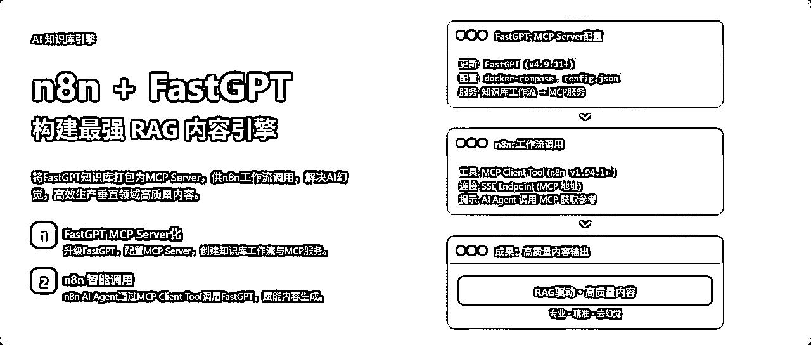

## 一、FastGPT MCP Server

FastGPT可以用docker-compose方式部署。如果你已经装过，需要升级到最新版本——当前最新是4.9.11。

https://github.com/labring/FastGPT/pkgs/container/fastgpt

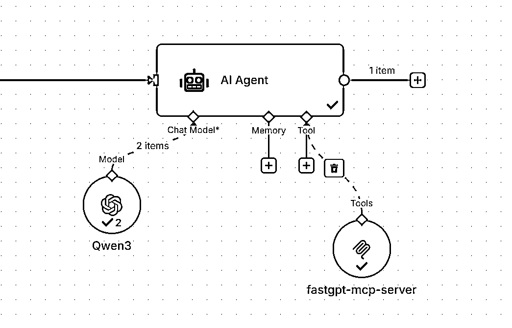

### 升级FastGPT

以宝塔面板为例，打开“docker-容器编排”页面。下图所示的位置就是docker-compose配置内容，先复制一份备份好。

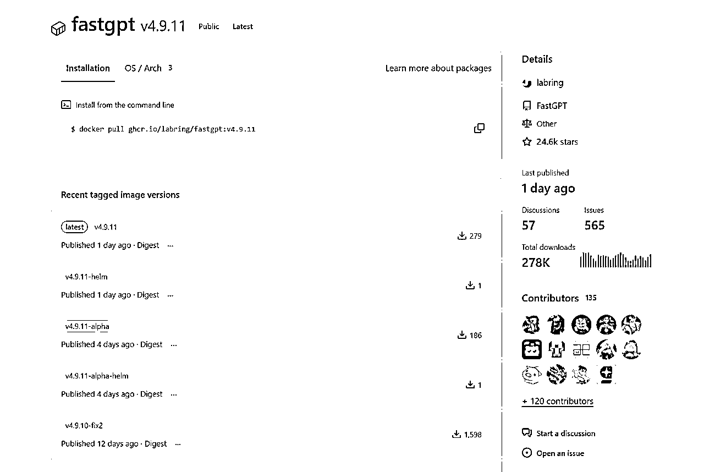

然后去这里获取最新的docker-compose文件：

https://github.com/labring/FastGPT/blob/main/deploy/docker/docker-compose-pgvector.yml

如果你是全新安装，直接用这份文件部署即可。

建议用Cursor对比两个文件的差异，确保我们自定义的设置能同步到新配置里。比如我之前自定义了root默认密码，这个新yml里也一定要保留。

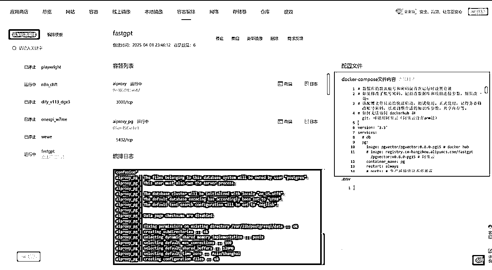

改好docker-compose文件后，粘贴到图中指定位置。

再点“跳转目录”，接下来要设置config.json。

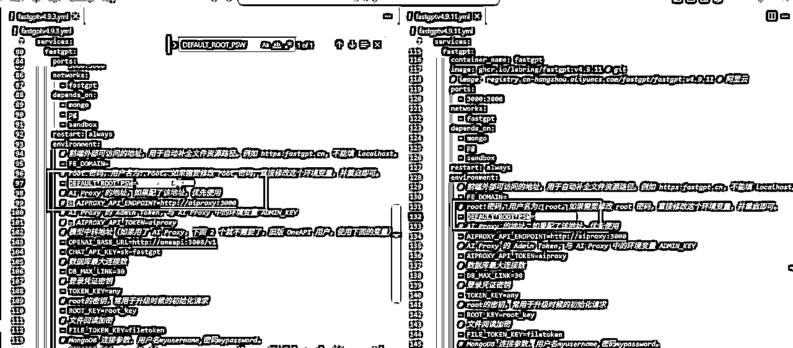

在这个地址下载模板：

https://raw.githubusercontent.com/labring/FastGPT/refs/heads/main/projects/app/data/config.json

然后修改其中“mcpServerProxyEndpoint”字段，换成你的服务器IP。这个地址就是后续n8n工作流要调用的入口。

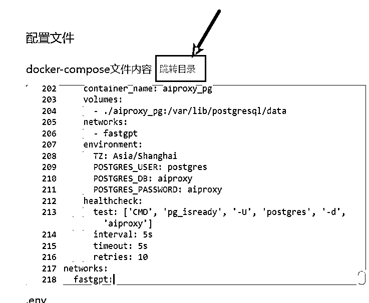

注意，这里暴露的是3005端口。需要在宝塔面板放行相应端口，确保外部能正常访问。

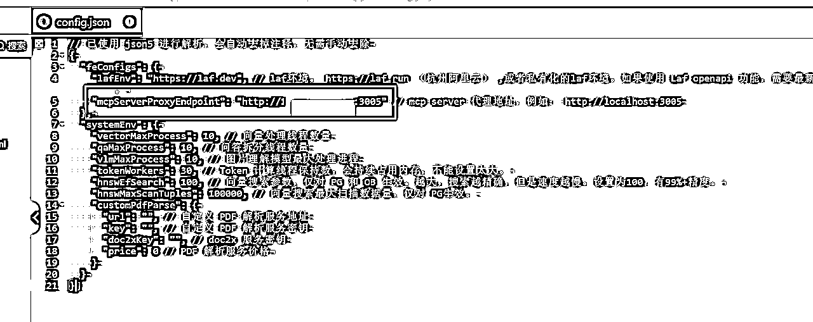

改好的config.json，放到和FastGPT的docker-compose文件同目录下，也就是刚才“跳转目录”打开的路径里。

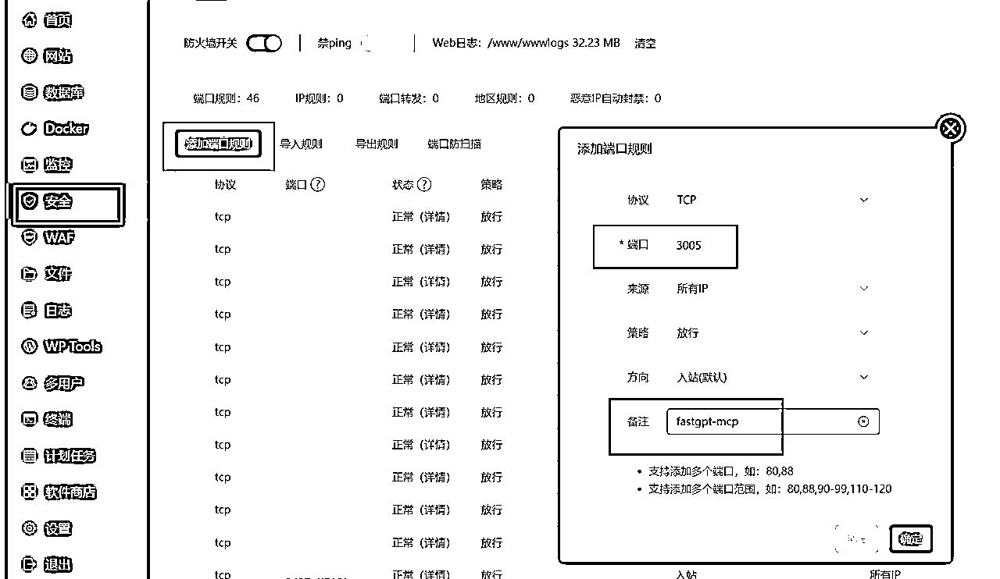

最后回到docker面板，点击“停止-更新镜像”，等它跑完即可。

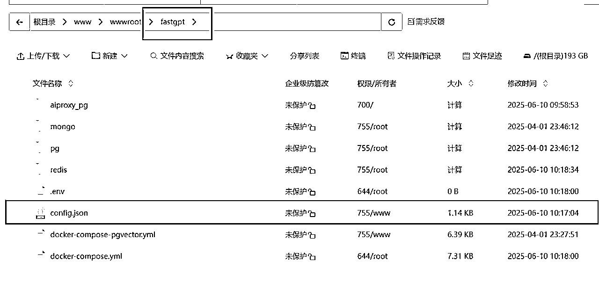

此时打开FastGPT，就能看到已经更新到最新版了。

### 搭建知识库工作流

这里有个关键点：不能直接使用知识库应用，因为那样返回的是经过AI加工后的结果。

我们想要的是知识库中原汁原味、精准匹配到的片段，所以必须通过工作流的形式，把知识库引用结果直接返回。

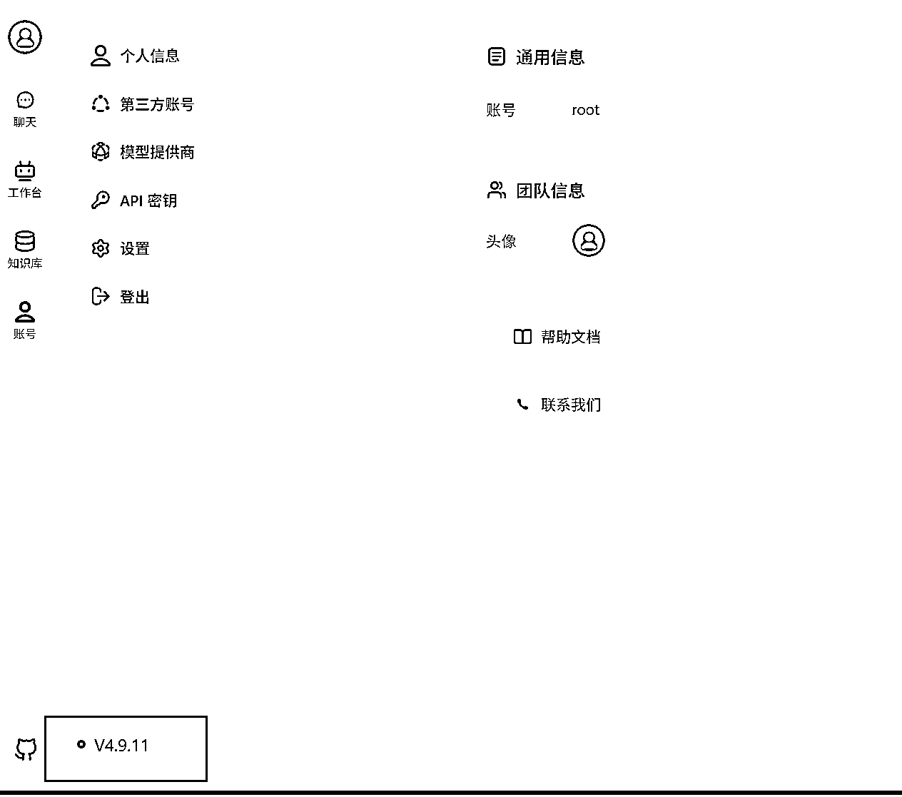

配置好以后，一定要记得点“保存并发布”——不点发布的话，亲测是拿不到返回结果的。

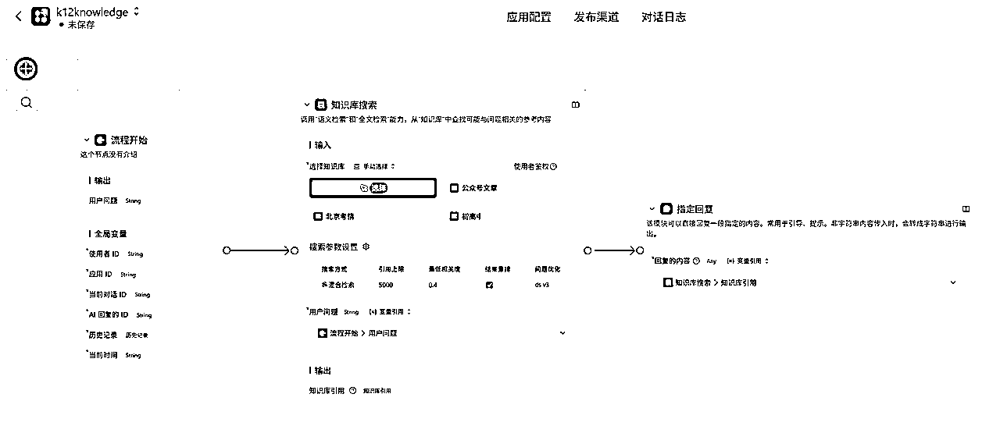

### 创建MCP服务

接下来，在工作台点击“MCP服务-新建服务”。

这里有个坑：名称必须用英文。因为n8n是纯海外平台，再加上大模型对中文本来就敏感度不高，用中文名称很容易导致调用失败。

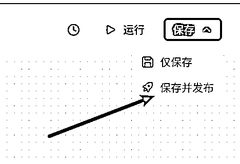

创建完成后，点“开始使用”，切换到SSE标签页。这个接入地址就是我们后面要用的。

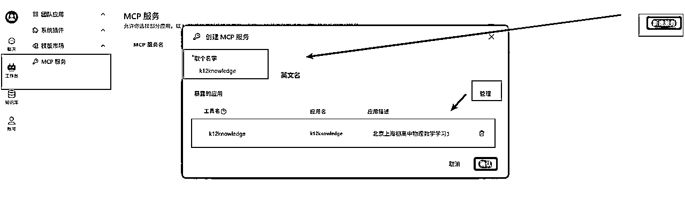

## 二、n8n工作流调用

现在回到n8n工作流。

这是我这边的📕模板工作流：先生成多个方向的选题标题，再依据标题产出正文，接下来根据内容生成多张配图，最后统一存入飞书多维表格，再调用矩阵工具读取飞书表格做批量发布。

今天要解决的是“生成正文”这一步——把知识库作为参考接入，让AI产出更靠谱的内容。

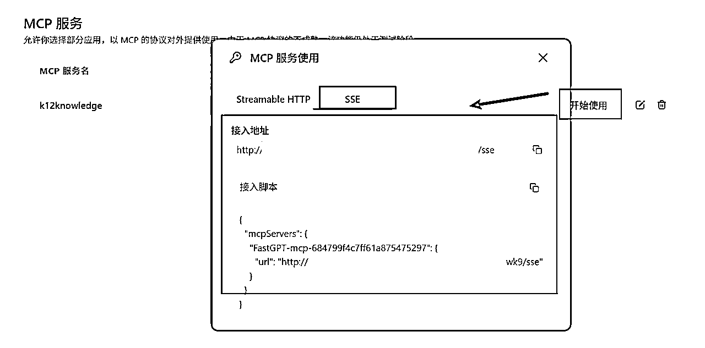

（预告一下：后面如何把内容批量生成图片的流程，明天也会分享，欢迎关注催更。）

在AI Agent的Tool里搜索MCP，找到“MCP Client Tool”节点。

同时注意，n8n版本必须在1.94.1或以上才具备MCP能力。

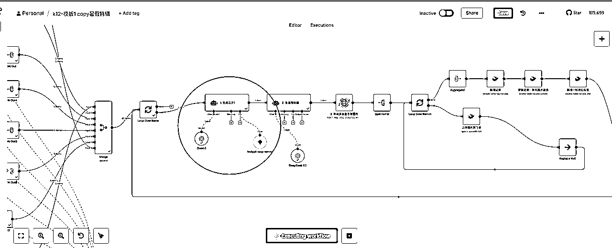

然后在SSE Endpoint里填入刚才在FastGPT准备好的调用地址。

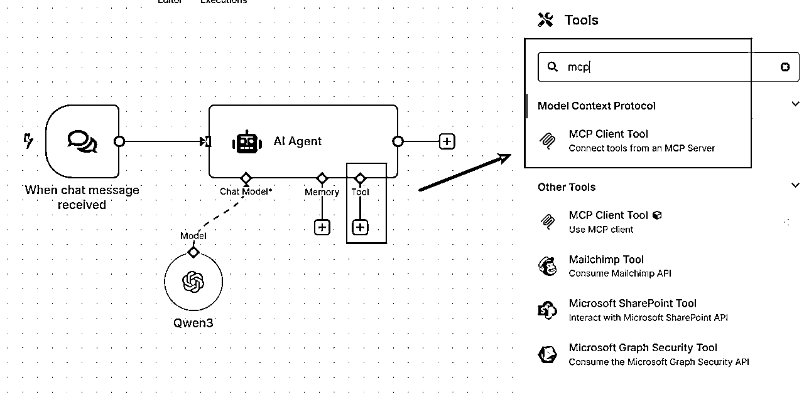

点“Execute step”测试一下——随便输入一个内容标题。

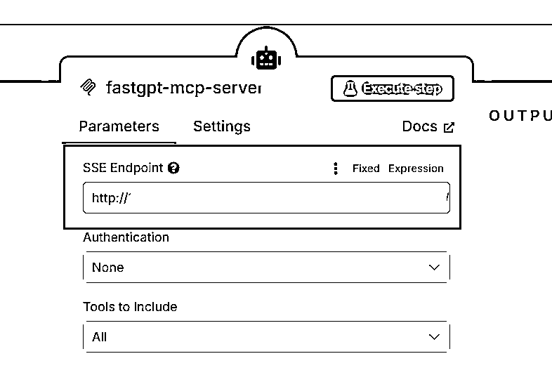

看到内容能正常返回了。每个业务对“返回内容是否精准”的判断标准不一样，我这里就隐去了具体结果。具体效果好不好，直接在FastGPT里调优即可。

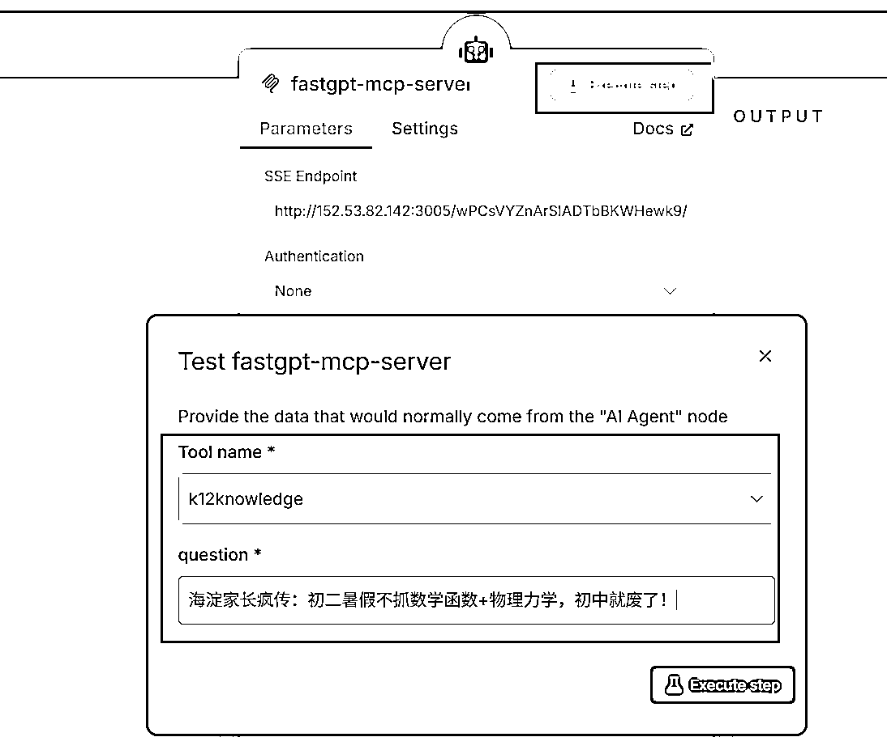

接下来回到AI Agent节点，测试大模型的回答能力。

这里有两个要点：

第一，大模型必须具备工具调用能力。我目前用的是魔塔社区里的API——DeepSeek R1 0528虽然很强，但可惜不支持工具调用，只能放弃。我现在用的是Qwen3-235B-A22B。

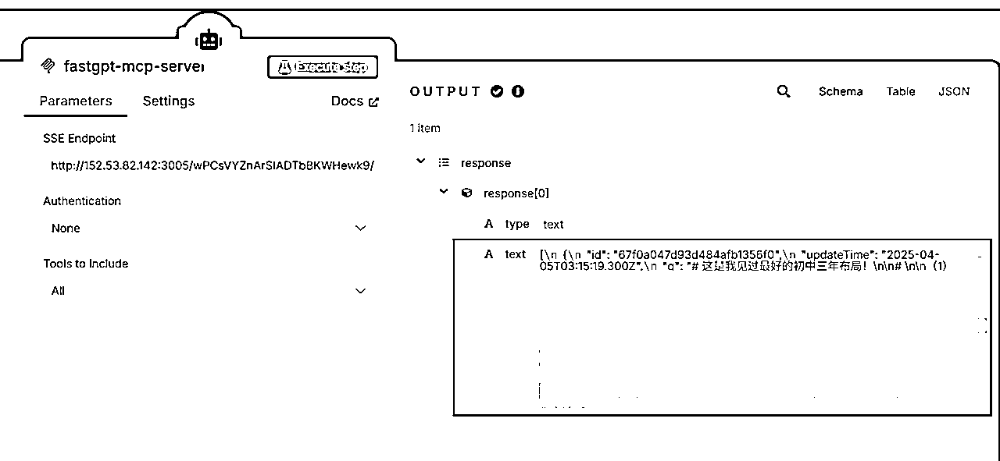

第二，提示词里必须明确要求AI主动调用MCP工具来获取参考内容。

除非你把MCP的名称和简介写得足够清楚、和当前场景高度匹配，否则绝大多数模型不会自发去调用它。

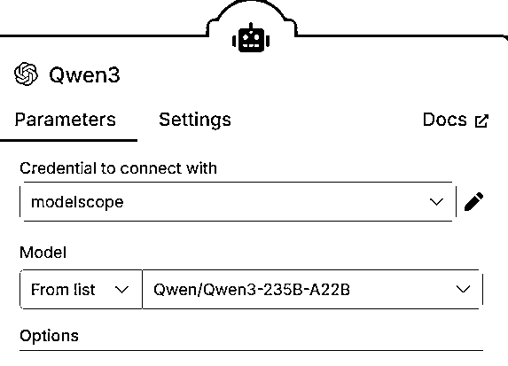

最后能看到大模型正常调用了MCP，就算大功告成。

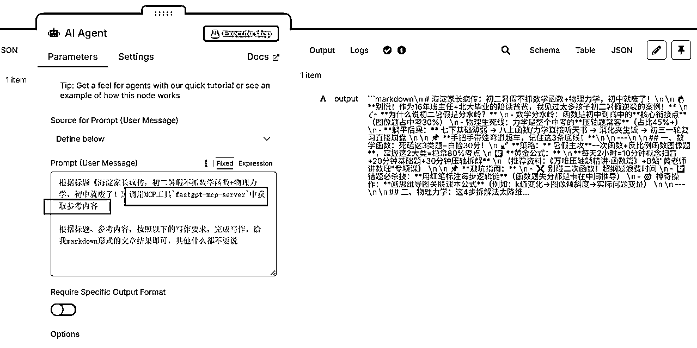

到这一步，FastGPT通过MCP Server的形式，已经完整整合进了n8n工作流中。

原本就好用的n8n，这下把知识库这块短板也补上了，变得更全面了。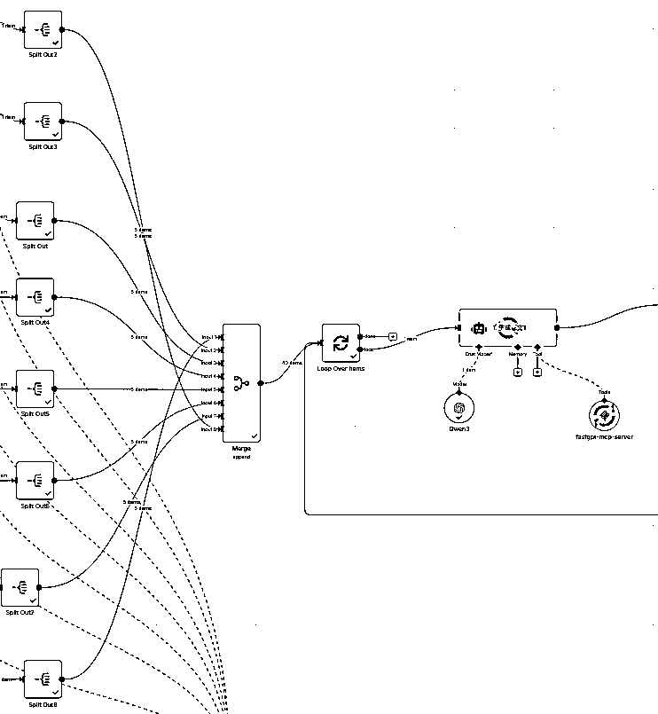