# 3000字解析🛰️电商：一个服务商视角对平台的认知
作者：龙哥

别再把🛰️电商当“视频号直播”了，一个抖音服务商的深度观察

做了多年抖音电商，我最近越来越确定一件事：流量的下一个洼地，可能就在🛰️里。电商的底层逻辑很简单，无非是流量×转化率×客单价。2020年入局抖音，近两年几乎所有品牌都在同一个问题上犯难——抖音的流量和销量双双触及天花板，想再有大的增长，必须找新的战场。

### 为什么是🛰️？

先看底牌。腾讯财报显示，2025年Q1🛰️月活已经达到14.02亿，是中国当之无愧的国民级应用。它不仅是高频社交工具，还长出了👸号、小程序、视频号、搜一搜、支付等一系列场景。这个生态最大的价值在于，账号体系、社交关系、阅读习惯、支付和购物心智早已被打通，C端用户可以在一个App里完成从种草到成交的全链路。

更重要的是时间窗口。2024年🛰️小店的交易规模预估在2000多亿元，听起来不小，但渗透率仍然很低，对比抖音、快手，显然还是蓝海。

除了小店本身，还有一个被低估的流量池：小程序商城。我们接触过某国际美妆品牌，他们对视频号直播一直比较谨慎。原因并不复杂：他们的小程序商城一年能卖一个多亿，第一不想被平台抽佣，第二不想把用户数据交给平台——一旦数据到了平台手里，竞品也可能触达这批人。这其实是品牌和平台之间的博弈。但平台释放的信号是，接下来所有小程序都要和🛰️小店打通。也就是说，这场博弈迟早会有一个结果，长远看，提前布局很有必要。

还有一个细节值得注意：平台今年对服务商的激励都围绕“开店入驻”展开，说明平台目前最缺的是商品供给。搜一搜已经能搜到商品了，但只有足够丰富的商品，才能把这个货架电商的流量真正释放出来。

### 🛰️电商 ≠ 视频号直播

跟品牌方沟通时，我发现一个普遍误区：很多人一说🛰️电商，就自动等同于“做视频号直播”。这恰恰是平台不希望看到的。

我们这些年沉淀出一个认知：直播这个场域天然适合非标品，标品如果硬要做商业化直播，最后只能卷价格、卷机制，商家不赚钱，钱全被平台拿走。所有直播平台都是从服装类目起家的，后来标品越来越多，最终陷入内卷。🛰️显然不想重走这条路。

张小龙在《🛰️背后的产品观》里说过一段话：

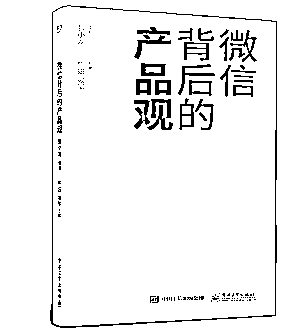

“产品要像一个社会一样可以自己运作，因此需要建立一个系统并制定规则，让群体在系统中自我演化，能够自我演化才最重要。”

这段话解释了🛰️电商在过去几年的“拧巴”：商业化的强介入，本质上和🛰️的产品观相悖。🛰️想构建的底层逻辑是“普惠、平权、生态”，让用户群体在系统里自我演化。🛰️小店目前的三步棋——礼物功能、推客联盟、全民小店——也都是在围绕这三个关键词布局：送礼功能是社交软件的天然优势，推客联盟是一套去中心化的分销体系，全民小店则试图让人人都能成为销售员。所以，不要用直播电商的思维去定义🛰️电商。

### 健康的卖货体系，是公域+私域的深度结合

如果非要把🛰️和抖音放在一起对比，可以从三个维度看：

**商业流量**：抖音流量内卷严重，付费和免费流量的协同并不理想，很多商家陷入“不付费就没流量”的困境。而且抖音本质上没有私域，哪怕你有几百万粉丝，想触达他们还是要付钱。🛰️则不同，商家可以结合私域渠道沉淀用户，获得更多免费流量协同，商业流量的成本也相对更低。

**产品客单**：抖音平台整体客单价在100元左右，除了少数高奢和耐消品牌，很难往上探。🛰️这边目前多是白牌商家，价格带集中在100到200元，部分类目能上探到300元左右，品牌商家入场后，高客单空间更大。

**渠道触点**：抖音的有效触点基本只有直播间和短视频，几乎没有私域价值。🛰️则是触点密集：👸号、小程序、朋友圈、企业🛰️、私聊、群聊、搜一搜、视频号短视频、视频号直播、团长……每一个触点都可能成为成交入口。

### 直播间里的真实差异

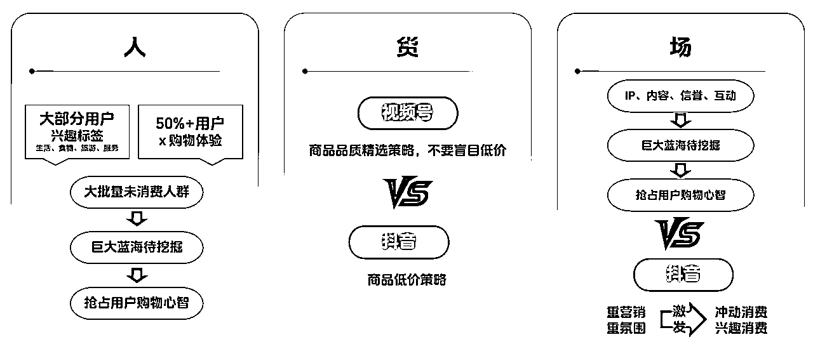

我们运营中观察到两个很直观的差异。

一个是快消品牌集团店，卖的是卫生巾。后台人群画像显示，大部分是40+的新锐白领，这个数据本身可能有问题，但也说明平台的基建和用户数据还不够丰富。在🛰️做直播，不能直接把抖音的打法搬过来，只能多测试。我们前期测试的时候，也卖了好几场零蛋。

另一个是头部奶企直播间。同样的产品，抖音也在卖，但视频号这边有大量静默下单的用户。这些用户年龄偏大，不怎么互动，但默默看、默默买，复购率很高。运营几个月后，老客占比越来越高，这和抖音完全不同。抖音用户对价格非常敏感，但视频号只要产品机制好，平销也能走量。

### 🛰️电商的独特红利

🛰️平台还有一个特点：去中心化。无论是店铺、账号还是直播间，都很难出现垄断性的头部，马太效应不明显。另外，平台不公开数据榜单，市面上所有三方工具的数据都和真实数据对不上，不像抖音那么透明——你无法快速看到竞品的素材和直播机制，但这也意味着，早期入局的品牌有空间。

目前很多KA品牌还没有正式入驻运营，平台刚开放了保健品类目，早一步进来，可能就能早一步吃到红利。

用户行为上，🛰️的用户粘性更高，老粉占比大，因为有私域沉淀，触达更容易。而且🛰️用户有更强的囤货心态，商家可以铺更丰富的产品梯队，老客的客单价也往往高于新客，不像抖音直播间只能靠一两个爆品打天下。

### 🛰️小店不是“直播间”，而是原子组件

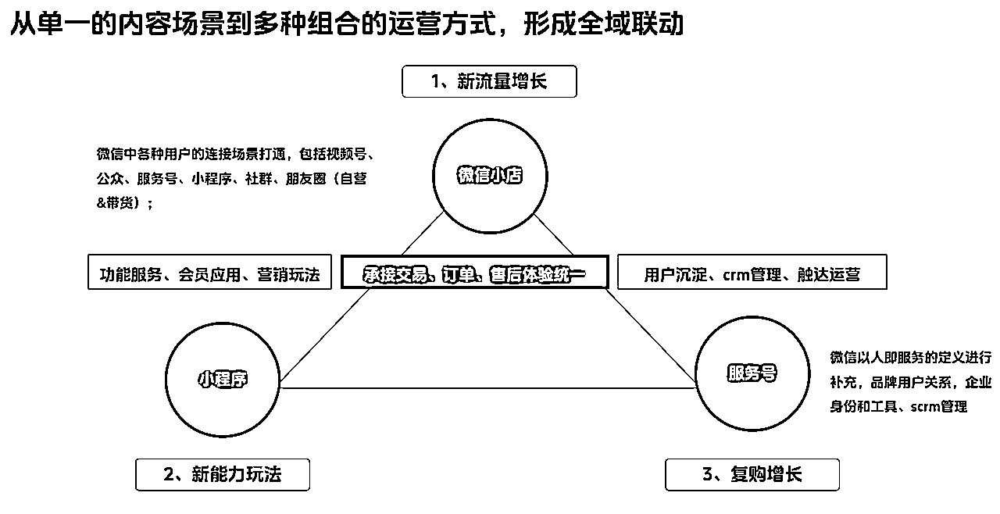

🛰️小店其实和小程序、服务号一样，是平台的原子组件，而且是打通全平台不同渠道的原子组件。

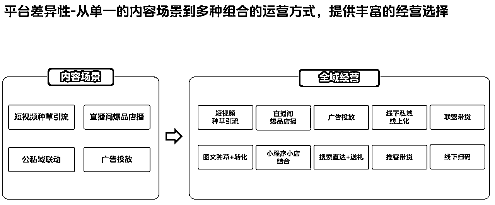

这也是我们一直跟合作品牌传递的核心观点：把视角从单一直播间里拉出来。🛰️小店能连接的不只是内容场，还有货架场、社交场。短视频、直播间、社群、团长合作、线下引流、送礼、达播、图文带货……这些都能做。一开始不用全都做满，找到自己有优势的渠道先吃透，然后再慢慢拓展。

### 价值与打法

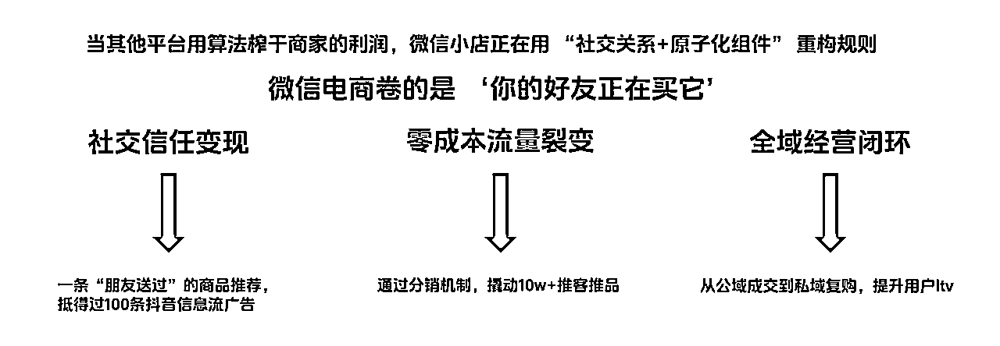

我理解的🛰️电商生态链，用一句话说就是：把🛰️小店作为交易的基石场景，连接公域、私域和分销生态，让流量形成闭环，最终实现品效销协同，并沉淀用户资产。

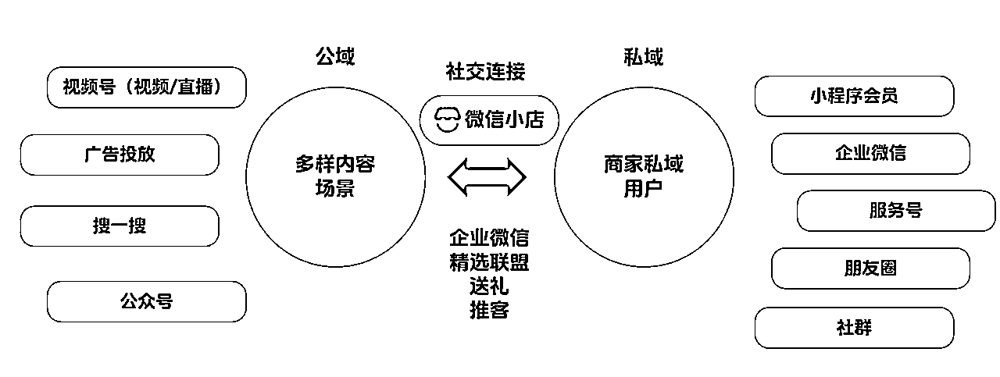

运营策略同样可以概括成一句话：借助社交关系链，让流量在公域和私域之间自由切换。具体拆成三个动作：

1. **公域负责曝光**：让商品通过搜一搜、内容推荐、👸号文章，被10亿用户看见；
2. **私域负责转化**：用户点击商品后，自动沉淀到社群、企业🛰️、个人号，提升复购率；
3. **社交负责裂变**：借助推客带货、送礼物等功能，让每个用户都变成“移动分销节点”。

### 案例里的真实打法

具体看几个已经在🛰️电商跑出成绩的品牌案例。

**霞湖世家：短视频种草引流**
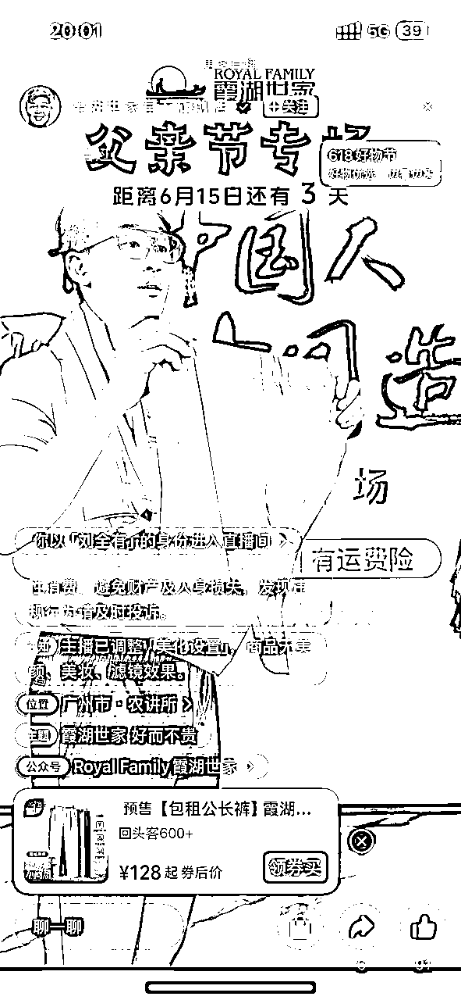
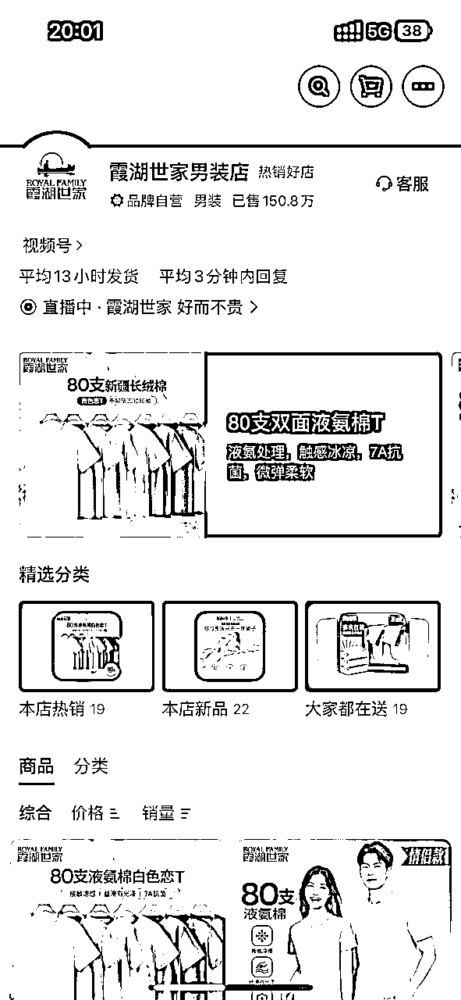
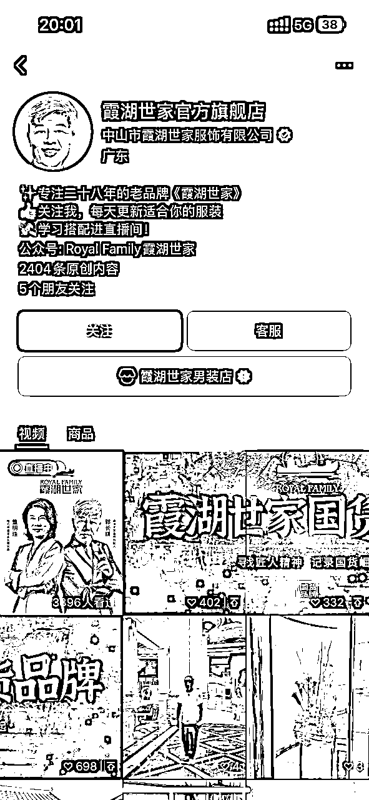
通过优质短视频创作+矩阵分发快速建立品牌声量，再用爆款短视频引流直播间。2024年8月开店至今，🛰️小店GMV突破1亿元。

**康宁餐具：直播间爆品店播**
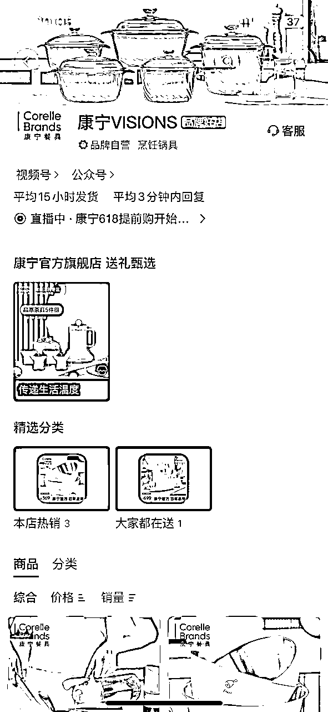
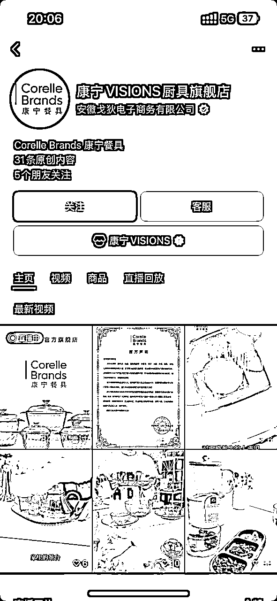
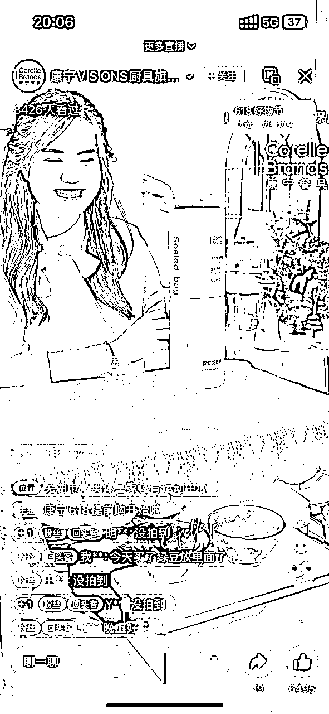
用陪伴式直播风格，全年销售超5000万，DSR达到4.81，同比增长4倍。

**巴拉巴拉：经销商矩阵直播**
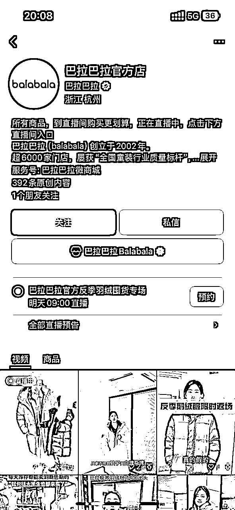
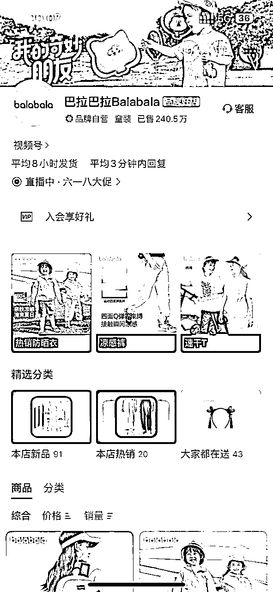
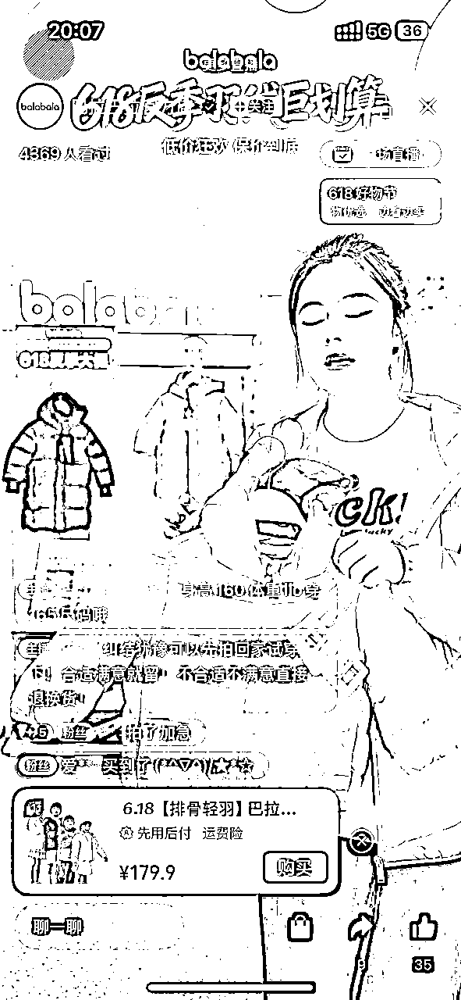
2024年持续增长，50多家经销商组成矩阵，直播内容涵盖发布会、溯源等多种形式。

**EP雅莹：线下私域线上化**
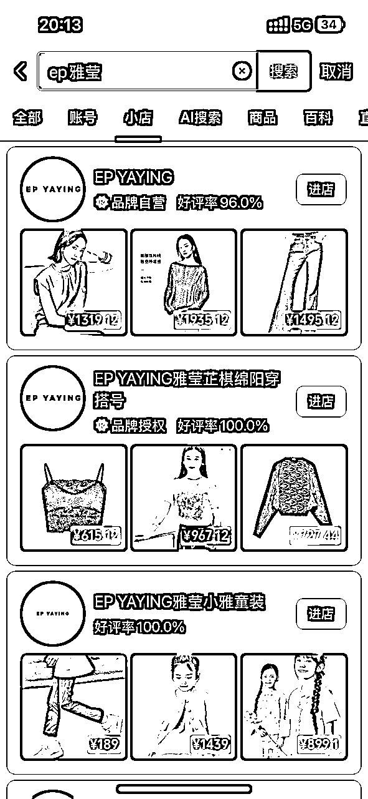
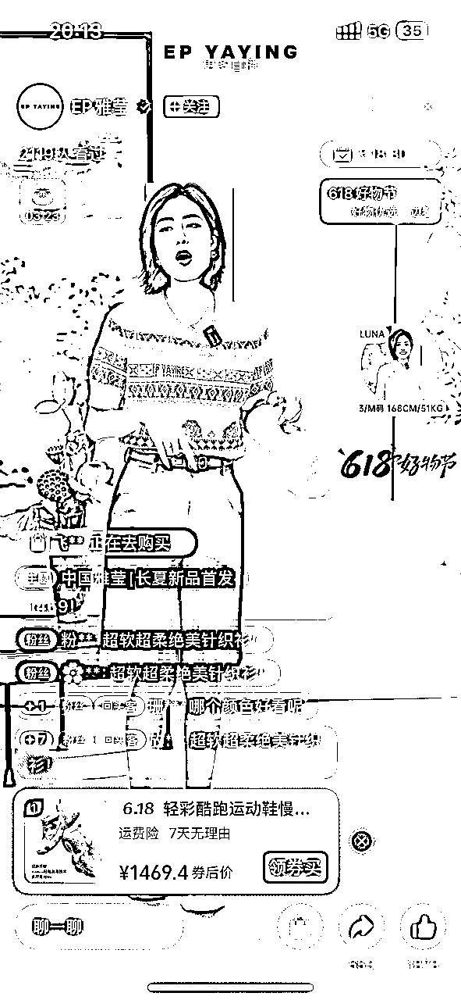
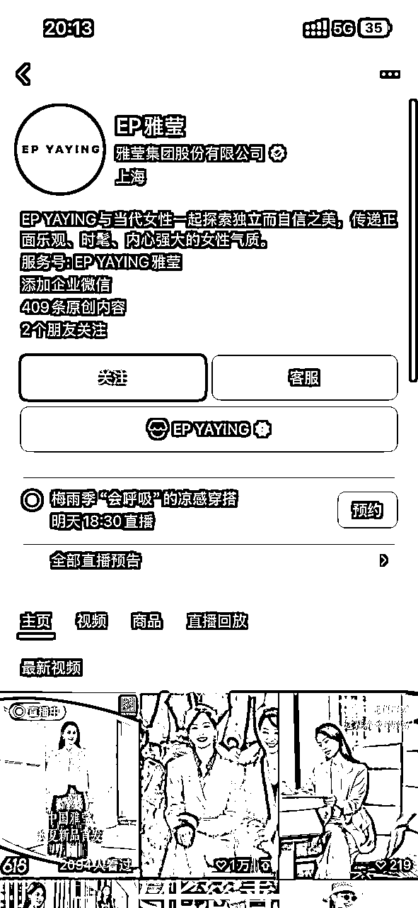
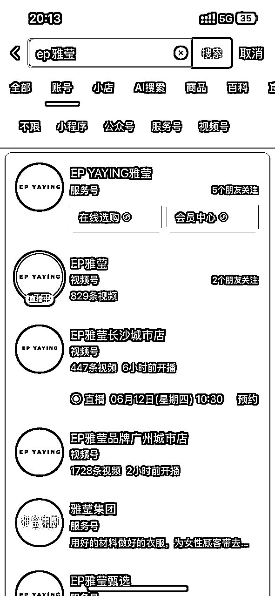
🛰️小店全年销售额超2亿，同比提升100%。具体做法有三层：一是线下矩阵开播，联合各地门店开设10大区域账号、共55个直播间；二是导购门店联动，联合400家线下门店和1500名客户经理，通过VIP归属合理界定业绩；三是打通🛰️生态圈，精准链接顾客，适应线上购物趋势，用更有温度的服务实现高转化。

**三只松鼠：联盟带货**
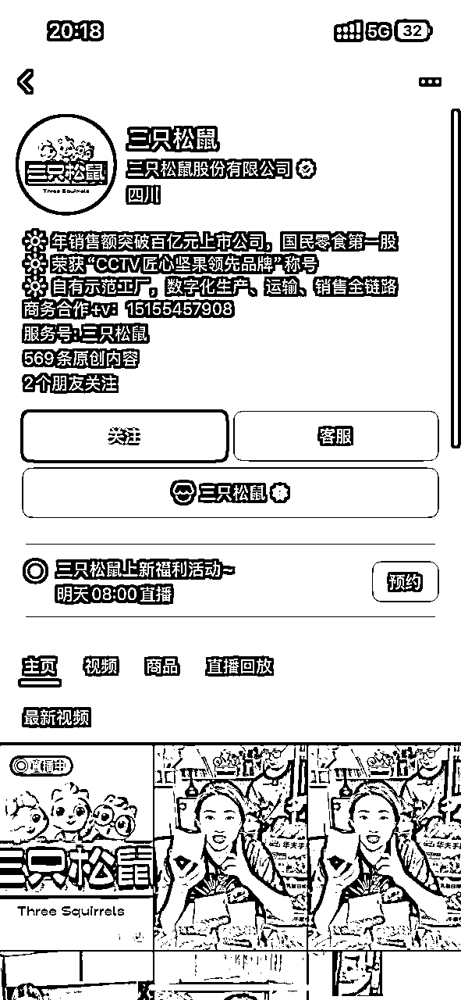
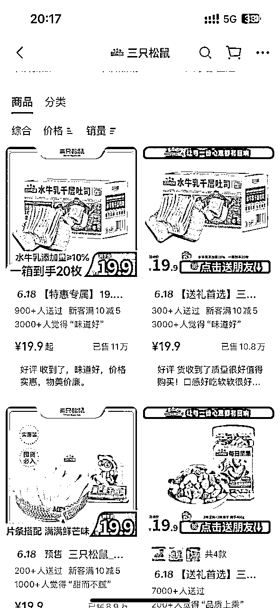

通过联盟带货和达人矩阵共建，24年同比23年增长500%。他们依靠团长带货铺开商务团队，触达广大的腰尾部达人，覆盖近5000个小矩阵账号日常开播。同时针对不同达人匹配差异化货盘：尾部小达人打9.9-19.9元品牌爆款，比如“水牛乳千层吐司”；头部达人钟丽缇则带“高端大满坚果系列”，快速铺开产品线，最终成为坚果零食类Top1。选品上主打健康、配料干净，推出高端+质价比的168全坚果礼盒、850松子、A160腰果等。

**花点时间：图文种草+转化**
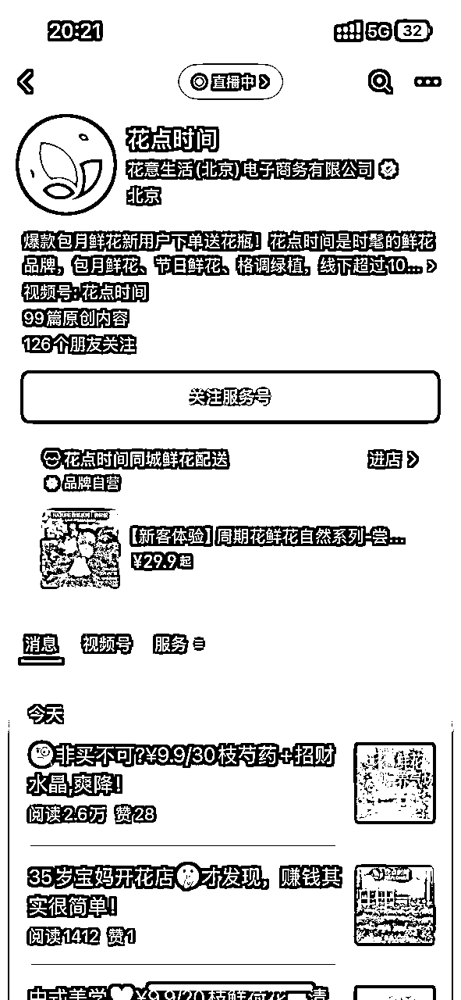
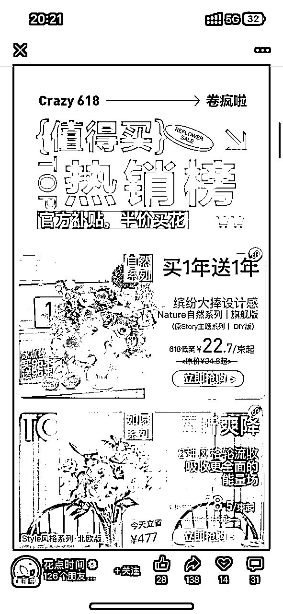
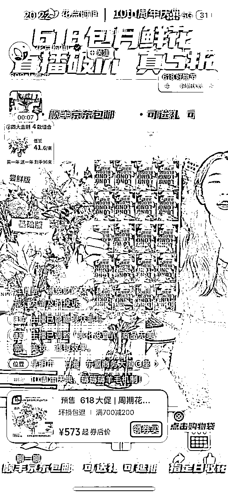
靠服务号图文内容获客拉新，配合直播预约，实现预约观看转化率45%+。其中“限时活动”发布图文带货，单条图文单天浏览量破5万，单笔记单天成交2.1万元。服务号预约让直播间人群更精准，单场预约近3000人，预约观看转化率45%+，GPM达到万元。此外，用AI技术结合用户理解产出多篇10万+阅读，最高30万+，其中80%是🛰️小店下单用户。

**认养一头牛：推客带货**
单期专场做到200万+，推客贡献占比65%，ROI 4.57。他们选品组货能力强，围绕节日做货盘，配合高复购、日常消耗的商品如鲜奶新年礼盒、0蔗糖酸奶礼盒，且全网可比价；同时明确机制，选优质推客机构，配合推客专用券玩法，最终打爆单期大场。

### 写在最后

以上是一个抖音代运营服务商，带品牌入局🛰️电商的一些思考。很多细节因为涉及客户项目信息，没办法展开讲，权当是平台基础信息分享，算是给大家敲开一条缝。如果能在某一点上帮到你，这篇文章就有价值了。