# 7天，从编程小白到海外AI产品上线：我的Micro SaaS 0-1复盘

先放上产品，欢迎大家体验和提出建议：

https://www.babypodcast.pro/

这是一个输入宝宝性格设定和博客主题，就能生成“宝宝形象+反差感博客内容”的AI视频工具。

项目开发周期是5月18日到5月24日，整整一周。两个月前，我还是一个连代码都几乎看不懂的人；两个月后，我完成了自己的第一个Micro SaaS MVP。

这篇文章会完整记录这个项目从想法到上线的过程，包括技术选型、开发路径、踩过的坑，以及我作为新手的一些真实感受，希望能给同样想做海外AI产品的朋友提供参考。

项目主要涉及前端、工作流后端、AI API、登录注册、数据库、云存储、支付和部署等环节。

```
*   **前端**: Next.js
*   **部署**: Vercel
*   **数据库**: supabase
*   **登录/注册**: supabase-Email/Google
*   **后端**:
    *   n8n (cloud)
    *   文字API: gpt4.1
    *   音频API: Murf AI
    *   图片API: flux.1.1-pro
    *   视频API: Hedra
*   **云存储**: Cloudflare r2
*   **支付**: creem
```

# 一、我为什么开始做AI产品

我之前在投资行业工作，今年2月因为看到了AI领域的机会，选择辞职。

辞职之后，我尝试过AI写作、AI自媒体等方向，但始终没有找到真正适合自己的路径。直到3月份参加了赚钱的航海活动，我才逐渐确定了自己想做海外AI产品。

过去做To B投资时，我曾经尽调过几家国内知名大模型公司。但那时总觉得，大模型距离普通人仍然比较遥远。后来随着AI应用快速发展，我才意识到，真正属于普通人的机会，可能并不在训练大模型，而在于利用现有能力做出具体的AI产品。

刘小排老师在海外AI产品深海圈航海手册里说过一句话，我非常认同：

> “有人说，所有的产品，都可以用 AI 重新做一遍，我深以为然。”

尤其是现在AI编程工具发展得非常快，普通人独立做出一个AI应用，已经不像过去那样遥不可及。

3月到5月期间，我陆续做了五六个网站。不过那些项目大多只是简单的HTML游戏站、个人博客，和真正的产品还有很大距离。

后来看到赚钱SCAI实验室招募，我马上报名参加。事实证明，这是我当时非常重要的一次选择。

附1：这是我来到杭州SCAI实验室后的每日复盘，建议大家结合阅读。

# 二、项目是怎么开始的

## 2.1 为什么选择AI Baby Podcast

一个周六下午，我刷到一篇👸号文章，介绍海外TikTok和YouTube上正在流行的一类视频内容：让宝宝形象去讨论各种成年人话题。

我进一步研究后发现，这其实是Hedra策划的一次营销事件，随后在海外社交媒体上迅速传播。Hedra同时提供相关API，这让我意识到：

这可能不是一个需要长期重投入的大项目，但很可能是一个值得快速验证的小机会。

除此之外，我也想借这个项目补齐完整的产品开发经验。

过去我虽然做过几个简单网站，但从来没有真正经历过一个产品从0到1的完整过程。于是，我希望通过这个项目把数据库、登录注册、积分系统、支付、后端流程等环节全部走一遍，顺便完成自己的第一个Micro SaaS。

后来我才知道，良辰美老师在那天上午就已经在赚钱风向标里发布了相关趋势。所以这里也再次提醒大家：赚钱风向标值得持续关注，里面的信息经常比外部公开渠道更早。

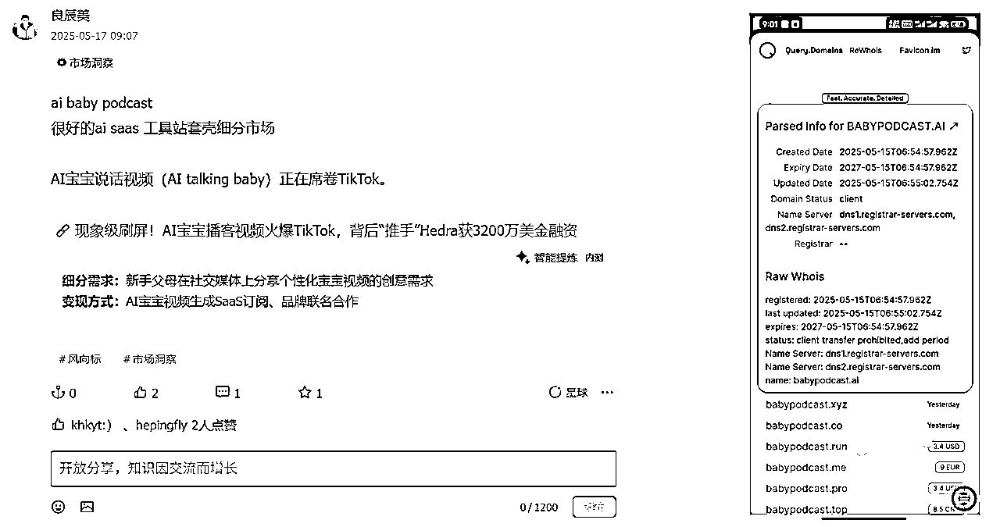

## 2.2 我的开发计划

最初的计划很简单：

- 3天完成前后端基础功能；
- 尽快把产品发布出去；
- 一周内接入登录注册和支付功能。

结果来看，时间目标基本完成了，但实际难度远远高于我的预期。

下面分别介绍各个模块的实现方式，以及过程中遇到的问题。

# 三、技术开发过程

## 3.1 前端：Next.js + AI辅助生成

前端部分是整个项目里相对轻松的环节。

之前我曾经用Next.js完成过赚钱SCAI的面试题，这次直接沿用了之前的设计思路，再根据产品需求做修改。

如果完全没有前端基础，也可以使用小排老师课程里提到的Bolt、v0等工具。我这次主要通过Cursor生成页面，给它的提示词大致是：

> 请参考目标网站的视觉风格和页面结构，为我生成一个首页。页面需要包含Header、Hero、Features、WhatIs、HowTo、Why、Pricing、FAQ、Footer等模块。

然后再补充产品名称、核心功能、目标用户等信息，让AI把各个区域的文字和内容替换成适合自己项目的版本。

参考网站不一定要找同类型产品，重点是结构清晰、布局合理。前期先把页面骨架和基础样式跑出来，之后再逐步优化视觉细节。

我的项目组件主要包括首页组件和功能页组件，后续通过不同页面的page.tsx调用对应模块。这样做的好处是目录和代码结构比较清晰，也便于后续维护。

Dashboard页面则参考了Medeo的设计，调整了部分配色和内容。对于新手来说，先借鉴成熟产品的页面结构是非常高效的方式，不需要一开始就从零设计所有界面，也可以直接使用现成模板。

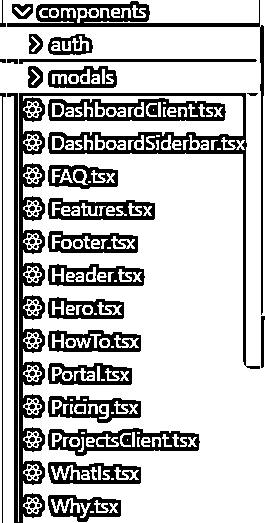

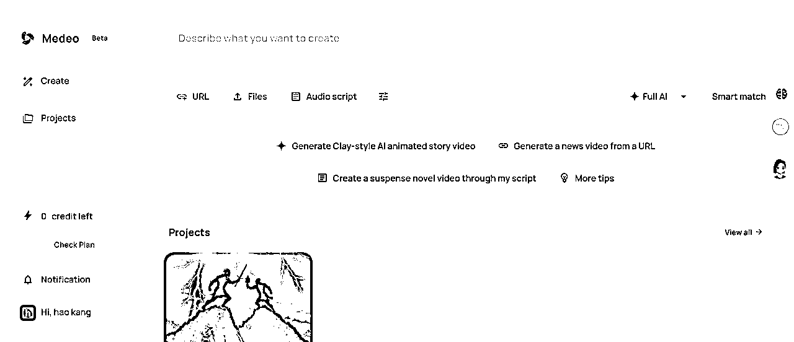

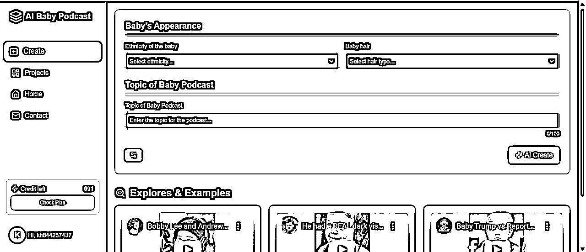

项目里除了tsx文件之外，主要还包括处理函数、API请求相关的ts文件，以及CSS文件。

很多教程会建议新手理解AI生成的每一行代码，但我认为这更适合进阶阶段。刚开始做项目时，不一定要立刻弄懂全部细节，至少要先理解：

- src目录下每个文件负责什么；
- 每个组件对应页面的哪个区域；
- 哪些文件负责交互；
- 数据是如何在页面和API之间流转的。

先建立整体认知，再逐步深入代码，学习效率会更高。

## 3.2 后端：用n8n搭建工作流

### 为什么没有直接使用Next.js API路由

最初我考虑过直接通过Next.js的API路由调用外部AI接口。

但后来发现，Vercel部署的函数存在最大响应时间限制，而视频生成通常需要较长时间，远远超过免费方案所允许的执行时长。

当时我对异步任务、间歇式触发以及API回调机制还不够熟悉，直接用代码实现会比较复杂。于是我开始寻找一种更适合快速搭建MVP的方式，最后接触到了n8n。

n8n可以理解为一种自动化工作流工具，使用方式和Coze、Dify有些相似。

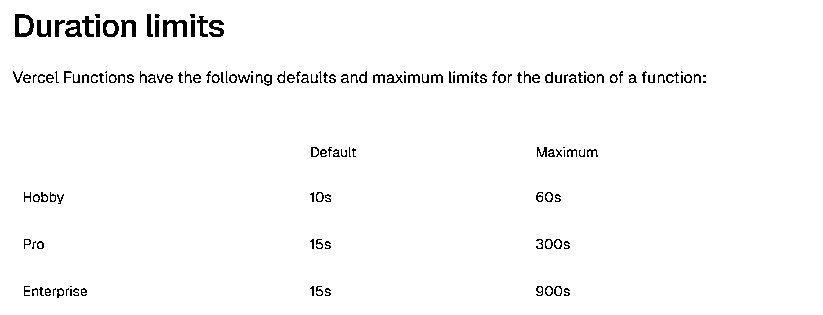

附2：Vercel官方文档

https://vercel.com/docs/functions/configuring-functions/duration

我在YouTube上搜索时，刚好找到了一个使用n8n制作AI Baby Podcast的视频。

第二天，我按照视频内容复刻出了一个基础版本。原视频大约43分钟，我实际花了2到3个小时完成复现。由于视频里有些官方文档没有展开，我就一边查资料，一边补齐流程。

如果大家在复刻过程中遇到看不懂的地方，也可以继续搜索官方文档，或者直接把截图和报错交给AI分析。

顺便说一句，视频作者正是通过这类教程为自己的Skool社群引流，收费77美元/月，目前大约有960名成员。这个案例也能说明，海外用户对知识付费的接受度确实很高。

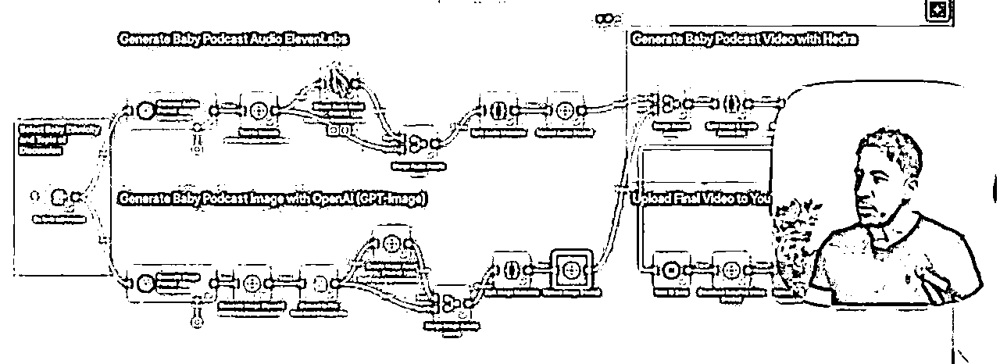

附3：YouTube n8n生成AIbabypodcast视频

https://www.youtube.com/watch?v=syoM1CVV1-c&t=2468s

### 我的n8n流程是怎么设计的

整体逻辑参考了视频中的方案，但我又根据产品化需求做了一些改造。

例如：

- 全流程传递jobid；
- 用jobid校验开始请求和最终结果是否属于同一任务；
- 根据生成视频的duration计算积分消耗；
- 将任务结果同步回Supabase；
- 最终把视频链接返回到前端展示。

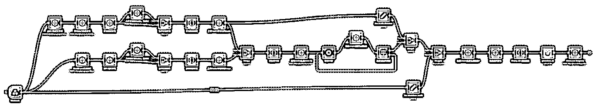

n8n对于新手来说最大的优势，是整个流程的可视化程度很高。你可以清楚看到一个请求从哪里进入、经过哪些节点、调用了什么API，以及最终如何返回结果。

它的基本流程是：

1. 通过Webhook接收前端请求；
2. 启动工作流；
3. 依次调用文字、图片、音频和视频API；
4. 处理生成结果；
5. 通过HTTP Request请求前端API；
6. 将任务信息写入Supabase；
7. 把视频地址和相关数据返回给用户。

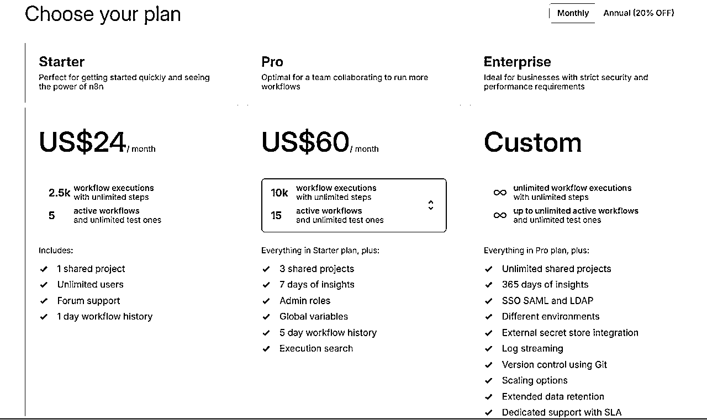

n8n提供新人14天免费试用期，包含1000次工作流执行。后续费用大约是24美元/月。对于新手来说，利用这两周完成开发和测试，基本已经足够。

### 我调用了哪些API

这次流程一共使用了四类API：

- 文本生成；
- 图片生成；
- 音频生成；
- 视频生成。

在n8n中，只需要根据官方文档配置请求头、请求体和参数即可。如果某个节点配置不正确，可以把报错截图发给AI，也可以让AI直接生成符合要求的JSON请求体。

n8n还支持把前一个节点的输出作为变量传给后续节点，因此搭建复杂流程时非常方便。

我平时接触较多的平台包括：

- OpenRouter
- Replicate
- fal.ai
- Rapid
- V-API
- 麻雀API

其中后两个是中文API平台，优势是价格比较低，缺点是可调用的模型相对少。具体选择哪家，可以根据模型、价格和稳定性自行判断。

音频和视频部分，我使用的是官方API。

当你真正跑通一套API流程之后，会发现很多AI产品的底层逻辑是相通的：

图片生成会了，就能继续研究换脸、修复、去水印；音频生成会了，就能继续尝试声音克隆和数字人；API调用熟悉之后，登录、支付、云存储等功能，本质上也都是按照文档发送不同的数据和密钥。

## 3.3 登录与注册：Supabase Auth

登录注册功能直接使用Supabase完成。

如果目标用户是海外用户，Google登录基本是必选项。相比之下，邮箱注册还涉及验证邮件、跳转页面等步骤，会增加用户操作成本。

这里有两个比较典型的坑。

第一个是AI可能会使用旧的依赖包，而不是官方目前推荐的：

`@supabase/supabase-js`

所以最稳妥的做法，是先找到Supabase官方文档，再让Cursor严格按照官方方案实现。

第二个问题是客户端和服务端函数的同步、异步调用方式。这个问题本身不算复杂，只要保证函数调用方式和对应运行环境的要求一致即可。

我比较推荐新手采用下面这种开发方式：

1. 每增加一个功能，先查官方文档；
2. 把文档交给Cursor；
3. 让它根据当前项目结构整理实现方案；
4. 生成一份独立说明文档；
5. 按步骤逐项完成；
6. 出错后继续核对是否遵循官方方案。

比如可以分别建立：

- `login.md`
- `payment.md`
- `database.md`

这样后续排查问题、复盘过程都会容易很多。

附4：Supabase登录注册官方指导文档

https://supabase.com/docs/guides/auth/server-side/nextjs

## 3.4 数据库：让AI生成SQL，但自己必须看懂

数据库部分，我主要让Cursor生成SQL，然后复制到Supabase后台执行。

虽然没有亲自手写SQL，但每一张表、每个字段、每个函数的用途，我都会让AI解释清楚。

AI可以代替你写代码，但不能代替你理解系统。

目前项目里还有一些功能重复的表，因为暂时不影响使用，所以还没有立即删除，后续会统一清理。

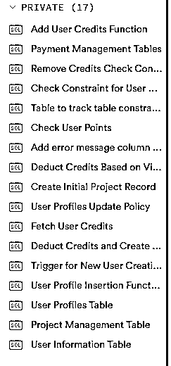

数据库中有一个非常重要的设置：RLS，也就是行级安全策略。

简单来说，RLS决定了：

- 谁可以读取数据；
- 谁可以新增数据；
- 谁可以修改数据；
- 谁可以删除数据；
- 执行操作时需要验证什么身份。

这一部分不能完全依赖AI自动生成。尤其是insert和update相关权限，最好要求AI解释每条策略的作用，并确认只有经过服务端身份验证后才能执行。

我自己测试下来，AI自动生成的RLS策略并不总是可靠，必须人工理解和检查。

## 3.5 云存储：Cloudflare R2

云存储使用的是Cloudflare R2。

起步阶段，免费提供的10GB存储空间已经足够大多数项目使用。

此前Web航海中也有人推荐过适合独立开发者的低成本套餐。至于为什么选择R2，我没有做过特别复杂的对比，更多是因为业内使用较多、整体口碑不错。

在早期项目没有特殊需求时，先选择一个成熟、便宜、够用的方案即可，不必一开始就过度研究。

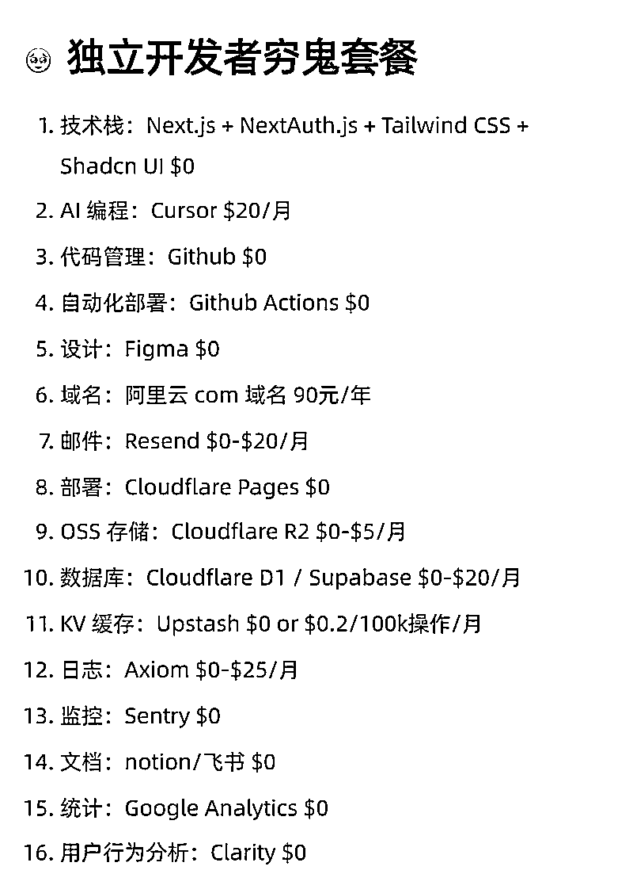

## 3.6 支付：Creem和Stripe

### 最终采用Creem

我前后尝试了Creem、Paddle和PayPal。

最终Creem审核通过，Paddle因为涉及AI图片内容，存在被拒风险；PayPal当时还在审核中。

我名下有一家小公司，因此也可以尝试其他方案。个人开发者则可以优先参考小排老师课程里提到的支付路径。

Stripe个人版需要港澳通行证等材料，办理周期大约20天；公司版则需要超过1000元的成本，所以现阶段我先接入了Creem。

使用Creem时，有几个地方必须注意：

- 测试环境和正式环境的产品ID不同；
- 两套环境的API地址不同；
- 测试API Key和正式API Key不同；
- 上线前一定要逐项替换；
- 支付成功后的回调地址也要再次检查。

我采用的是官方文档里相对直接的一种方式：支付成功后请求success URL，再通过API路由将用户重定向回指定页面，并完成签名信息验证。

这种方式从开发角度看比较省时间。

这部分同样建议让Cursor先生成完整的step by step文档，再根据文档逐步实现。每完成一个步骤就打勾，出错时也能快速定位。

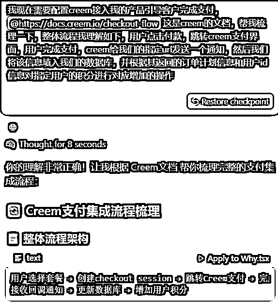

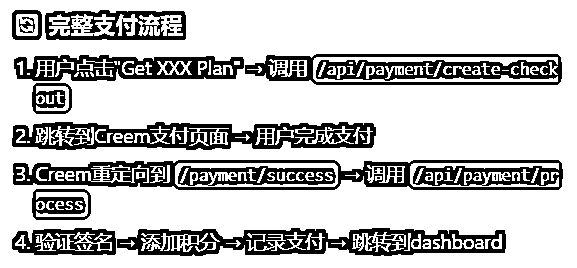

附5：Creem官方文档

https://docs.creem.io/checkout-flow

### 如果条件允许，Stripe仍然是更优选择

Stripe主要有个人申请和公司申请两条路径。

个人开发者可以考虑去香港办理一张银行卡，再申请个人Stripe。

公司申请则通常有英国公司和美国公司两种方案，成本大约在1000到2000元以上：

- 英国公司约1200至1500元；
- 美国公司约2100元以上；
- 后续每年还可能产生约400美元的注册代理和税务费用。

我之前花了很多时间研究Stripe，后来发现，最快、成本最低的路径其实已经写在赚钱的经验贴和小排老师的课程里。

公司账户通常不需要亲自出境，线上就可以办理。当然，如果能去香港并办理港卡，整体会更方便。

附6：

附7：

附8：https://mp.weixin.qq.com/s/y_XRFa8pzkgV-GqttSotqw（艾逗笔大佬的经验贴）

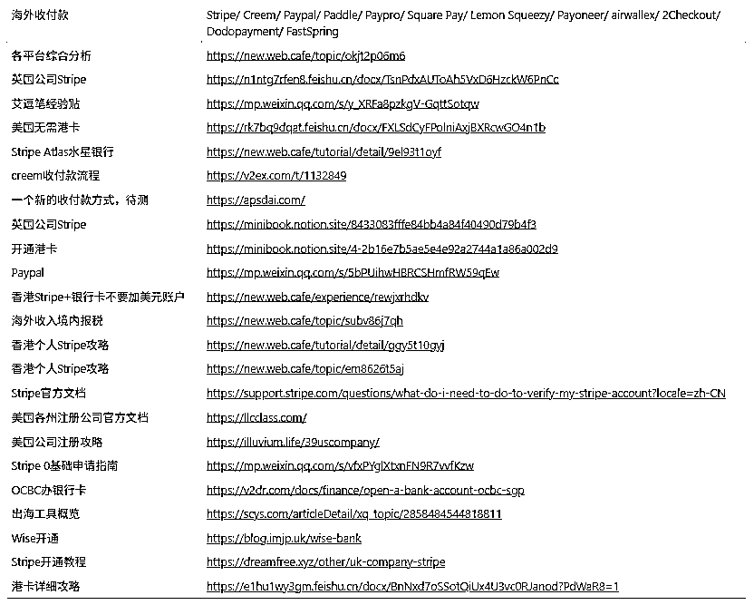

# 四、开发过程中最值得记住的经验

## 4.1 API Key一定要多处备份

所有API密钥都要妥善保存，千万不要只放在一个地方。

我通常会保留三份：

- 本地的`.env.local`；
- Vercel环境变量；
- 自己的项目文档。

这样既能避免遗失，也方便后续排查。

另外，每个平台对API Key的格式和请求方式可能都有特殊要求，一定要对照官方文档检查。

我曾经遇到过一个非常低级的问题：本地测试明明成功了，部署到Vercel后却无法运行。

后来排查了四五个小时，尝试了各种可能，最后才发现是环境变量中的`-`和`_`写错了。

这种问题和技术难度无关，纯粹是细节疏忽，却非常浪费时间。部署前一定要逐项核对。

## 4.2 新手不一定要一开始就深入Git

意识到版本管理的重要性后，我曾经专门找视频学习Git，但很快发现对于完全没有基础的人来说，学习成本并不低。

在项目初期，我认为Github Desktop配合Cursor的Restore Checkpoint已经够用。

具体可以这样理解：

- 如果只是当前文件改乱了，可以用Cursor的Restore Checkpoint恢复；
- 如果涉及新文件、删除文件或依赖环境变化，导致项目整体混乱，Cursor恢复可能不够用；
- 这时可以在Github Desktop里Discard Changes，让项目回到上一次保存的本地状态；
- 如果想回到更早的版本，可以找到对应的版本说明和哈希值，再让Cursor协助恢复。

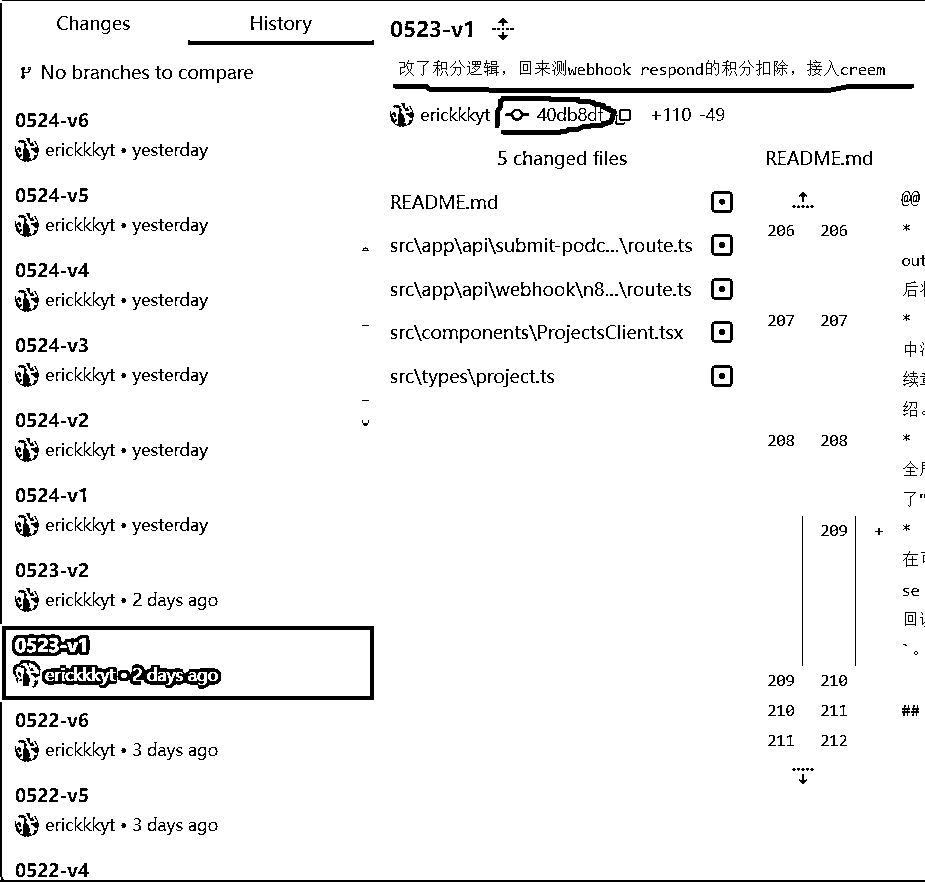

对于刚开始做项目的人来说，先掌握一套能用的版本回退方案，比一开始系统学习完整Git体系更重要。

## 4.3 功能没验证完整，不要急着上线

我在接入支付之前就提前发布了产品。

当时因为熬夜太晚，本地测试成功后，直接部署完就去睡觉了。结果第二天醒来才发现，n8n工作流里的回调URL没有替换成线上地址。

那天网站来了7个用户，但他们全部无法正常使用产品。从Clarity里可以看到，用户进入后很快就离开了。

后来我赶紧给这些用户发邮件，并赠送积分，希望挽回体验，但目前看还没有真正追回来。

这件事给我的教训非常深：

产品可以快速上线，但上线前一定要把完整链路跑通。

至少要模拟真实用户走完：

- 注册；
- 登录；
- 提交任务；
- 等待生成；
- 接收回调；
- 查看结果；
- 扣除积分；
- 发起支付；
- 支付完成后恢复权益。

不要因为本地测试成功，就默认线上环境也一定没问题。

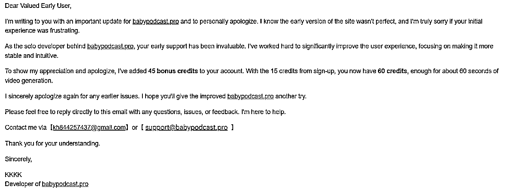

## 4.4 早期用户一定要认真维护

产品在Product Hunt上获得Feature的当天，网站迎来了一波明显流量，也带来了我的第一个付费用户。

这位用户来自日本，是一家TikTok工作室的负责人。他购买了99美元/月的最高级订阅，并主动发邮件，希望我为他定制一些功能。

为了方便沟通，我连夜购买了一张Giffgaff电话卡，并注册Telegram。因为中国手机号无法直接注册Telegram。

之后，我基本每天都会根据他的需求更新一个小功能。

后来我复盘Notion等海外成熟产品，以及Flowith这类新兴AI产品时发现，它们在社区建设和用户维护方面都做得非常好。

无论是在产品内部建立社区，还是搭建Discord、Telegram等用户群，持续沟通都几乎是产品早期最重要的工作之一。

早期用户提供的每一条反馈，都可能直接影响产品后续的发展方向。

他们不仅是付费者，也是最接近真实需求的产品顾问。

# 五、关于AI编程工具和模型的选择

根据我自己的体验：

- Claude 3.7/4 Sonnet：适合大型项目、多个文件协同开发；
- Gemini 2.5 Pro：非常适合针对具体问题进行Debug；
- Gemini 2.5 Pro + o3：适合进行方案讨论、逻辑梳理和学习。

我个人在实际开发中主要使用Claude和Gemini。

其中，Gemini 2.5 Pro和o3的思考能力让我印象比较深。它们给出的建议通常逻辑清楚，步骤完整，适合用来讨论架构、拆解任务和学习新技术。

我还尝试过同时打开Cursor和Trae。

比如让Cursor负责接入支付功能，同时用Trae修改首页文案或布局。这样确实可以提高一点效率，但风险也比较明显。

如果你还不熟悉项目结构，不建议这么做。两个AI同时修改同一个项目，很容易产生冲突。

如果一定要使用，最好限制Trae只修改指定组件，而且只安排简单任务，例如：

- 把列表从左侧移动到右侧；
- 调整文字换行；
- 修改标题粗细；
- 微调简单交互。

整体来看，Trae的使用体验目前还是明显弱于Cursor，所以这种方式要谨慎使用。

# 六、最后的一些心态变化

## 6.1 不要把“完全看懂代码”当成开始的前提

刚开始做项目时，我也会担心自己基础太差，很多代码看不懂，是否根本不适合独立开发。

但实际做下来，我发现新手最初不需要理解所有实现细节。

更重要的是先知道：

- 项目由哪些模块组成；
- 每个文件负责什么；
- 数据从哪里来、到哪里去；
- 哪些地方会触发API；
- 出问题时应该去哪里排查。

先建立整体地图，再逐渐补充局部知识，比一开始钻进每一行代码更容易坚持。

## 6.2 AI不是替你做产品，而是放大你的执行能力

Cursor、n8n以及各种API，确实让开发门槛下降了很多。

但它们并不会自动替你完成产品决策。你仍然需要自己判断：

- 做什么方向；
- 用户是谁；
- 哪些功能必须保留；
- 技术方案是否适合；
- API是否稳定；
- 产品是否真正解决问题。

AI能帮你写代码、查文档、生成方案，但最终是否能把产品跑起来，依然取决于你能不能持续拆解问题、验证结果、修复错误。

## 6.3 先完成一个能用的版本，再慢慢优化

我以前容易陷入一个误区：总想把页面、功能和技术方案一次性做到最好。

但真正做完这个项目后，我发现更有效的方式是：

先做出一个可以运行的版本，尽快让真实用户使用，再根据反馈继续改进。

产品开发不是一次性考试，而是一个持续迭代的过程。

从0到1最重要的，不是代码多漂亮、页面多精致，而是你能不能把想法变成一个用户可以实际使用的产品。

这次项目让我第一次真正走完了一个海外AI产品从想法、开发、部署到用户反馈的完整闭环。

对一个编程小白来说，这一周最大的收获并不是学会了某一门技术，而是终于确认了一件事：

只要愿意拆解问题、查官方文档、借助AI不断试错，普通人也可以完成一个AI产品的0-1。

《从0到1做产品，真正的门槛不是技术，是心态》

从零开始学一门技术，或者从0到1做一个产品，最考验人的东西其实不是智力，而是心性。哪怕今天有AI帮忙打下手，真正实践中该冒的问题也一个都不会少。所以我越来越不提倡“爆发式信心”和“超高预期”，反而更相信一种细水长流的状态：每天推进一点，每天给自己攒一点微小的正反馈。做产品的反馈周期本来就长，你不可能今天播种、明天收割。这条路很难，但我确认它是正确的。

刘小排老师有段话，我特别认同：获胜的诀窍，是要做到情绪稳定，打无记忆的牌。连续输几把冤家牌，人就容易急；连续赢几把，又容易飘，连筹码都不当回事，这些都是业余玩家最常见的毛病。已经发生的事你改不了，这一手抓到什么牌你也改变不了，唯一能决定的，就是忘掉上一手、不怨天尤人，把眼前这手牌认认真真打好。

我过去打德州时也是这个感受。像tan xuan、毒王那种牌风很凶、经常用冤家牌河杀甚至偷鸡的玩家，我从来不羡慕。把样本量拉大之后你会发现，在同水平选手里，他们的胜率和收益率往往是排在后面那批。请注意，是同水平。

我们这代人多多少少被校园教育塑造成了一种“短平快”思维：以为熬两个大夜，就能把考试和大部分工作问题一次性解决。可等真正出来自己做事情，才知道什么叫学无止境。这是一场看不到终点的长跑，某一小段跑得快或者慢，真的不重要；重要的是你始终没下牌桌。流水不争先，争的是滔滔不绝。

如果把视线拉远一点看“成功”，我以前做投资尽调、接触过不少上市公司高管，发现绝大多数在世俗意义上混得不错的人，都有一个共同点：对自己正在做的事坚定不移。我甚至总结过一条公式：选对赛道+能力突出+心态坚韧+持续努力。四项里你只要能同时满足任意三项，结果大概率不会差；四项全占，基本就是各自赛道里的大佬了。

对多数普通人来说，“能力突出”往往要用时间、经验、失败和刻意练习慢慢换，甚至需要点天赋。但另外三项——赛道、心态、持续力——是绝大多数人可以主动选的。心态和持续力先不展开，龙哥盟里相关的帖子已经很多了。我想重点说说“选赛道”。

选赛道有一个特别重要的逻辑：顺势而为。人不能和趋势对抗。早些年跟着移动互联网走，跟着淘宝走，跟着抖音走的人，大多拿到了不错的结果。

我自己的教训也很典型。2022年底ChatGPT出来的时候，我第一时间就注意到了；2023年，我之前的公司调研过智谱、百川、月之暗面、面壁等当时很热的国内大模型公司，也看过几家刚开始做AI应用的团队。当时我们得出的结论是：国内AI应用还要再等等，底层大模型还差火候；而大模型公司的估值区间又超出了我们的投资范围。于是，机会就这样错过了。

放到当时，我的确判断不准AI到底会不会成为大趋势。可仅仅过去两年多，世界已经变得面目全非。国外OpenAI、Google、微软，国内字节、腾讯、阿里，都在基础大模型上押注了巨大的人力、物力、财力。到今天你不需要再问“AI是不是未来”了——世界上最聪明的那批人已经用脚投过票。我们跟着往前走就是了，把纠结要不要上车的时间，省下来亲手做点事。

这也是我对龙哥盟特别有好感的原因：它是国内把AI讲得最落地的地方。没有高门槛，不搬高大上的概念，就是踏踏实实带着普通人一步步融入AI浪潮。AI本来就不该是可望不可即的抽象名词，它应该成为普通人生活里随手可用的工具。后续的SCAI实验室，也欢迎大家来申请。


PS：附一张雷总的签名照，愿我们都能在浪潮里顺势而为。

最后，简单同步一下我手头这个产品的后续计划。

复盘下来，我这个产品的逻辑其实是倒置的：前期跳过了竞品调研和需求确认，闷头先把产品做出来了。后面得老老实实把流程补上——先找到需求，再验证需求，然后开发MVP，收集用户反馈，一步步逼近PMF。换句话说，找需求、验证需求这段路，我还要从头走一遍。

需求确认之后，我准备给产品多加一些功能，试着实现更复杂的玩法，比如face swap、voice cloning，顺带研究一下不同开源项目的用法。网站性能也有不少优化空间：多语言支持、SEO结构、关键词建设，都得慢慢调。

营销方面，我之前对SEO和社媒营销只停留在“听说过、没真练过”。这个产品刚好拿来当试验田，等有阶段性成果了，我再回来分享。

大家有什么问题，欢迎评论区聊，或者直接来找我，知无不言。文末我也整理了这次用到的资料，有需要可以直接点开：

- Vercel Functions 配置文档：https://vercel.com/docs/functions/configuring-functions/duration
- n8n 生成 AI 播客视频：https://www.youtube.com/watch?v=syoM1CVV1-c&t=2468s
- Supabase 登录注册指南：https://supabase.com/docs/guides/auth/server-side/nextjs
- Creem 官方文档：https://docs.creem.io/checkout-flow
- 艾逗笔的海外收款经验帖：https://mp.weixin.qq.com/s/y_XRFa8pzkgV-GqttSotqw