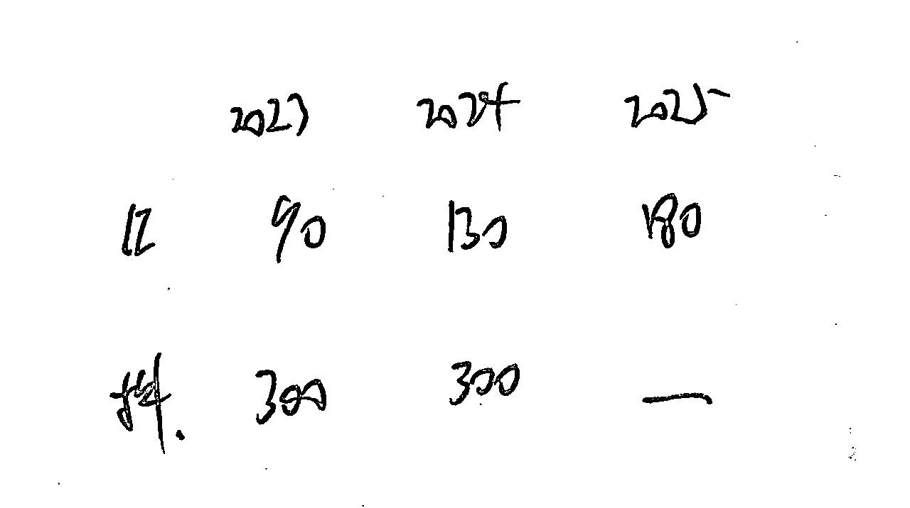
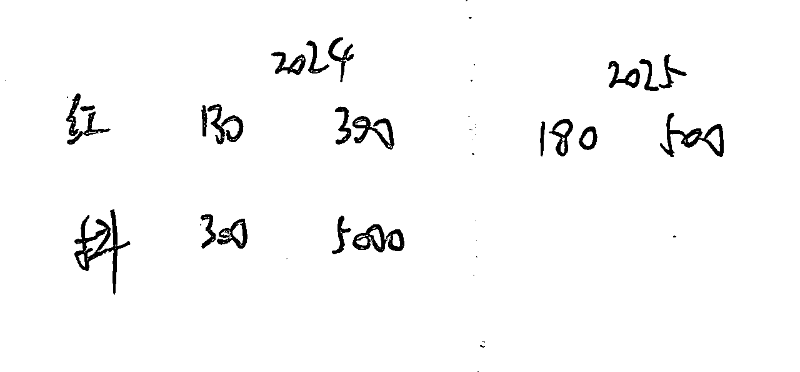
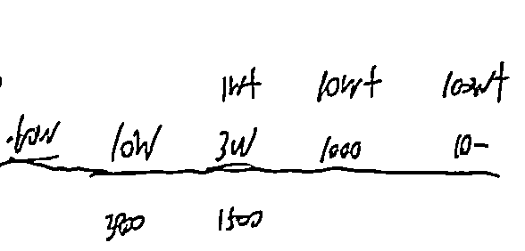

# 为什么📕商单赛道能保持两年以上的高速扩张

我是方片新媒体的创始人金虎。目前团队自营孵化的IP大约六七十个，已签约的达人账号超过三千，整体管理规模接近四千。在📕MCN范畴里，孵化与签约板块的体量都处在第一梯队。

就在文稿发布时，我们单月营收刚过一千万，后续已做到四千万左右。后面每季度都会复盘一次公司动态，方便大家了解这类业务的真实样貌。

下面进入正题。

# 一、从哪里走来

大学一年级开始接触🛰️公众平台，十八九岁时起步，大三创办首家自媒体公司，算下来已经十多年。经历过👸号、今日头条、百家号、企鹅号、大鱼号，再到抖音、📕。广告分成、平台补贴、拉新、电商带货、知识付费等玩法都试过。

# 二、为什么押注商单

📕的商业化形态多样：带货、直播、私域沉淀、知识付费、秀场、品牌商单。

经过多轮验证，我更看好商单。链路短，账期健康。

商单的逻辑是先把账号养起来，再撮合品牌或媒介，把产品自然接入内容，不需要囤货、做品效投放，也不用把大部分收益让给平台。利润结构清晰，自孵化达人抽成大概十分到二成，编导剪辑运营占一成左右，其余归公司。

基于此判断，两年前我把重心定在📕；再往下聚焦到商单；商单里自孵化与签约并存，我先做自孵化，因为团队本身就是内容驱动型MCN。

自孵化成绩出来后，我们开始扩建商务。账号做到一定体量后，商务资源也要跟上。方向就两条：把内容与流量做大，把客户与订单做深。

2024年我们两个月拿下蒲公英涨粉榜首。商务团队由此从二三十人扩张到上百人，最终到180多人。

纯自孵化很快遇到天花板，内容产能与商务资源都有闲置，于是启动签约业务。

抖音的签约市场我很早就看过，竞争白热化，利润微薄甚至亏损，所以早期没重仓。后来发现📕签约仍处红利期，于是加大投入。

# 三、市场现状与机会

签约业务去年营收约1.8-1.9亿，净利润约千万元，净利率约5%。今年看仍有较大上升空间。经济环境不佳，达人单兵接单越来越卷，品牌预算审慎，MCN的中介价值在放大。同时创作者持续净增。

### 1. 创作者盘子在扩

这是此前在三亚参加📕内部闭门会时得到的公开分享。数据能看出，除山东外区域竞争也在升温，2024年新增博主同比增60%，今年仍在走快。

内部测算认为增长依然坚挺，所以今年给出6-8亿营收目标。

想分享一个盘子判断：2023年蒲公英商单约90亿，2024年约130亿，2025年预估约180亿。抖音星图这两年基本横盘，去年约101%，预计25年下滑或持平。

📕2024年蒲公英130亿，信息流投放300亿；2025年目标180亿，信息流投放500亿。比例在三分之一到二分之一之间。

抖音星图去年300亿，广告投放却在4000-5000亿量级。对比能看出，📕更像🛰️生态，克制、有调性、持续增长。我们在抖音时期已累积1.3亿粉丝且盈利，但预判一两年会被卷掉，于是提前迁移。

核心盘子：开通蒲公英的博主约60-80万，其中能稳定变现的约10万。单月变现过万的约3万多个，这是签约主战场。

我们累计签约约3800人，其中可稳定变现约1500人。3万里占1500，仍不足二十分之一，市场空旷。

### 2. 业务拆解

我们统计到单月过10万的账号行业里约1000个，单月过100万的个位数。以前能做到30-50个，现在明显下降。头部达人的投放效率在走弱，过去50-100万粉就能高变现，现在被稀释。

品牌预算结构在变：不愿把钱集中给超头部，更倾向于用数千到万元级别投放中腰部矩阵。达人端建议是，单条报价过2-3万，合作量会受影响，可考虑降低主号更新频率，孵化垂直小号，如美妆博主开Vlog或母婴号，表演爱好者做剧情号。

公司签约方向也从超头部转向中腰部，市场容量大，目前头部MCN整体市占率仍不足5%。

支撑判断的三个信号：

第一，📕订单量年增预计超150%，品牌在加码种草，投放📕做认知，抖音做转化。

第二，达人增速快，新人不断进入，老账号因更新质量问题被淘汰。

第三，市场分散，头部机构份额有限。

我们定签约板块营收约1.9亿，净利率5%，毛利率10%左右。每签约100人，毛利约8-10万。

### 3. 难点与应对

签约公司数量在增加，平台今年还会引入数百到上千家MCN，竞争加剧。

经济下行期，服务权重上升。商务团队已百人以上，客户交付要求更高。过去误区是账号签到就结束，其实MCN交付两件产品：达人内容与对客户的服务。提报速度、精准度、下单响应、沟通顺畅度、改稿效率都影响复购。

达人流动性高，解约主因是商单不足。即使商务能力强，博主仍可能因体感差而离开。头部MCN有规模优势，客户资源多、边际成本低、流程成熟。

我们的做法：疯狂扩充商务与执行团队，完善内容运营，参与选题改稿剪辑；组建技术团队，去年开始布局，今年8人；同步跟进官方节奏，参与讲师与达人输出；走访行业前20签约MCN交流打法。

创业初衷是成长，相信“路上没有敌人，只有朋友与老师”。保持开放，才能持续进化。

下月7号我会去广州航海家新流量大会分享，欢迎对📕有疑问的朋友交流。