# 用 Trae 搭桥，把多账号矩阵管理工具无缝连上 MultiPost 自动发布

> 来源：[https://udxxg5rx5m.feishu.cn/docx/J7WTdmRetolugfx25HUc6lEpngg](https://udxxg5rx5m.feishu.cn/docx/J7WTdmRetolugfx25HUc6lEpngg)

连上 MultiPost 之后，
矩阵端负责管账号和环境：切换号源、给每个子窗口分配独立浏览器环境、独立 IP、独立指纹与缓存，然后把标题、文案、素材喂给插件；
MultiPost 插件则专职处理对外发布的事。

插件本身覆盖了全网的图文视频类平台，都可以被直接调度。

做完这次对接，我脑子里蹿出一个新想法：
能不能做一个零代码的自动化向导，让完全不懂编程的新手，只需要写一段通俗的“操作指令”就能跑完整套流程？

比如写成这样就行：

点击指定按钮》
输入标题》
点击指定按钮》
输入内容》
点击指定按钮》
上传文件》
设置标签》
点击发布按钮

有了这种脚本化描述，就能快速拼装出符合自己习惯的自动化发布链路。

技术上这条路是走得通的，核心看需求量够不够大。
实现难度不算高，但工作量会很琐碎：既要解析用户自然语言的指令，又要把指令精确转译成可执行的操作序列。
先记在未来计划里。

# MultiPost 插件是什么

MultiPost-Extension 是今年 2 月在 GitHub 上开源的项目。
装上体验了一下，效果很在线。
它除了扩展本身，还有一个 Web 版后台，可以做内容同步。

该插件能一键发到 40+ 平台，涵盖视频、图片、图文等多种形态，核心能力包括：

* 一次性同步到知乎、微博、小红书、抖音等十几家主流平台
* 无需登录、无需注册、无需 API Key，完全免费使用
* 支持文字、图片、视频等多类型素材发布
* 支持网页联动，自建网页即可调用扩展的发布能力，例如：
* 自动抓取网页内容并分发到多平台
* 定时排期发布
* 与 AI 生成内容联动

对内容创作者来说，它直击多平台分发的痛点：一次编辑，多端同步，效率大幅提升。

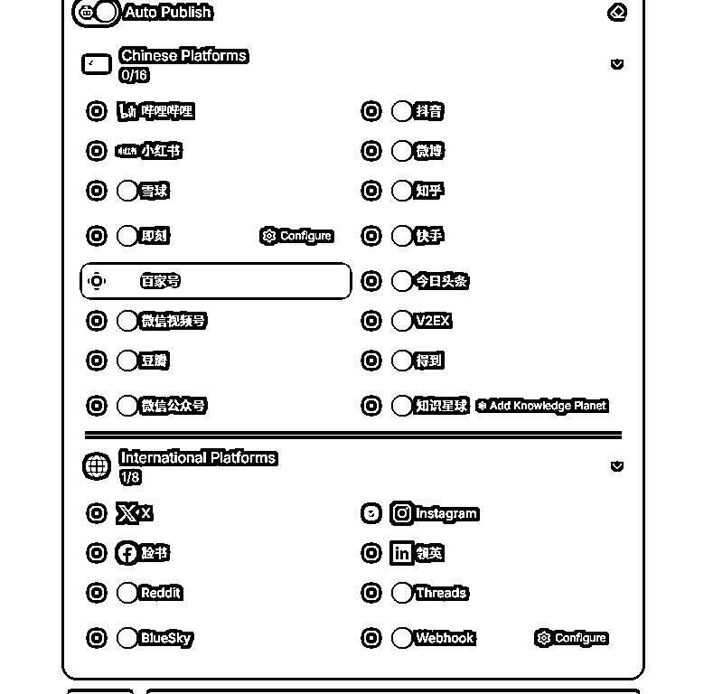

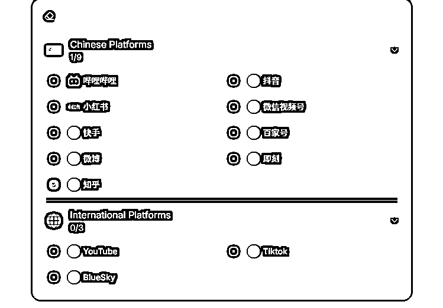

# 多账号矩阵管理工具介绍

### 🌟 全程免费，无任何付费模式 🚫💰​​

### 🔥 多账号管理工具 🔥

---------------------------------------------------------------------------------------------------------------------------

🚀 可创建多个子窗口保存账号，窗口之间独立运行
---------------------------------------------------------------------------------------------------------------------------

子窗口隔离系统：🔒 独立 Cookie | 💾 专属缓存 | 🌐 独立 IP 地址 | 🖐️ 独立设备指纹
---------------------------------------------------------------------------------------------------------------------------

♾️ 无限多开窗口：💻 上限取决于硬件配置，配置越高可开窗口越多
---------------------------------------------------------------------------------------------------------------------------

📂 智能窗口管理：🏷️ 分组标签 | 📝 自定义备注 | ⚙️ 批量设置窗口尺寸 | 🧩 自动排列布局
---------------------------------------------------------------------------------------------------------------------------

📌 窗口置顶功能，支持钉选任意窗口
---------------------------------------------------------------------------------------------------------------------------

🤖 自动化矩阵发布：

📲 内置部分主流平台的自动发布引擎。更新节奏会跟随我的实际需求。
🌐 已接入 MultiPost，覆盖绝大多数主流平台的自动化发布。插件开源可二次开发，且持续更新。
---------------------------------------------------------------------------------------------------------------------------

🎞️ 素材数据库：🗂️ 可为单个账号单独配置素材 | 📦 亦可一键批量配置多账号素材
---------------------------------------------------------------------------------------------------------------------------

🛠️ 插件扩展中心：🔌 支持自定义加载 Chrome 插件
---------------------------------------------------------------------------------------------------------------------------

📡 飞书生态互联：

⚠️ 异常预警系统，监控视频号数据并推送飞书消息报警
📈 视频号数据统计，自动同步到飞书表格
🚧 飞书接口已预留，后续可扩展
---------------------------------------------------------------------------------------------------------------------------

统计账号任意信息：

🔄 轮巡抓取账号信息并记录在软件内

软件的付费版本早已完成，只是被我屏蔽了。
最初做这个工具的初衷，是为了快速搭建任意平台项目的通用开发环境，所以先做了一个通用的账号管理壳。

后来考虑到投入成本，也想把它做成收费产品，于是不断打磨操作体验，让它更贴近普通用户。

但细节实在太多，很难兼顾所有人的使用习惯。
版本迭代频繁，功能会增删改，导致我懒得录制完整说明。
于是多次出现用户反馈需求，我才发现功能其实早就有了，只是入口藏得深，教程里也没写清楚。

有些用户惊讶于我早已藏好很多小优化点。
其实软件支持双击空白区隐藏，仅保留浮窗；右键空白区可切换简易模式；软件本身也可置顶。
双击账号列表最左侧可快速打开独立账号窗口。
账号多时支持模糊搜索，可按任意字段检索。
支持 CK 注入，可直接复制浏览器内 CK 粘贴导入。
支持账号信息导出到表格，编辑后再导入回软件。
账号列表里看似固定的备注字段，标题名也能自定义，方便用户自行定义信息项。

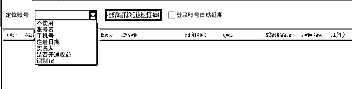

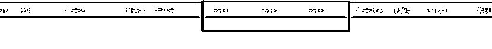

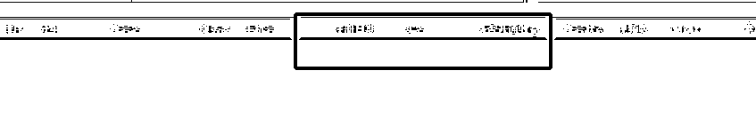

以上都是为了让使用者能按自己的习惯做标记。
还有很多细节，等有空再补充。

随着时间推移，我发现精力有限。
如果收费就很难保证及时维护和更新，还要投入推广精力，市场上竞品也很多。
目前不打算变现，就一直免费提供给大家使用。

# 矩阵工具接入 MultiPost 的操作指南

## 如何接入

矩阵管理工具在 MultiPost-Extension 的设置页预留了自定义接口。
你只需在编写自动发布代码时把调用参数定义清楚，放进矩阵工具里，就能被软件调度。

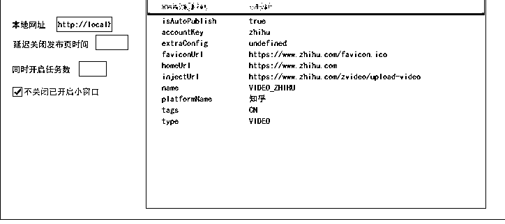

MultiPost 的相关参数可通过控制台抓取。
我的矩阵工具已内置该插件，目前适配到 1.1.4 版本。插件更新快，所以适配节奏放缓了。
启动浏览器时勾选此项，浏览器就会加载插件。

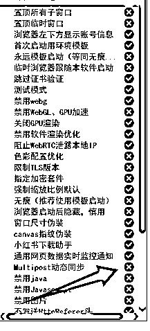

点左上角插件图标会跳转到官方网页 https://multipost.app/dashboard/publish/dynamic 。
未登录可先登录。
登录后点顶部的 publish，

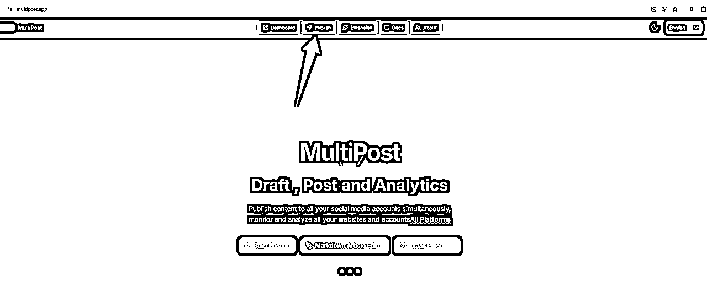

即可进入填写标题、内容和素材的界面。

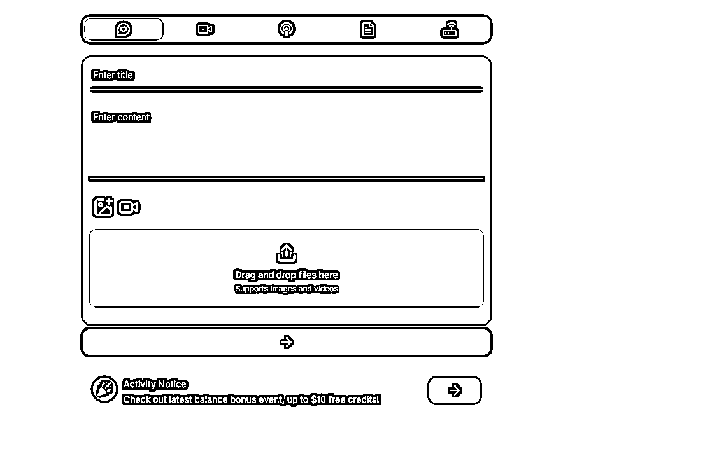

填好内容点下一步，选择目标发布平台。分类众多，可自行探索。国外的 Facebook、Instagram、X 等也都支持。

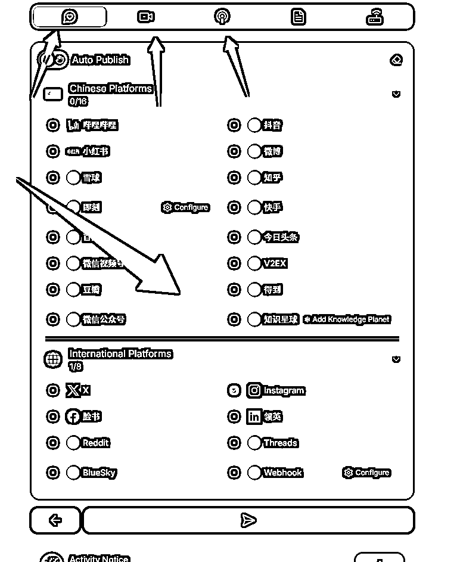

在此界面按 F12 打开控制台，输入下面代码来监听消息，方便观察插件调用时的参数。

```
window.addEventListener('message', (e) => {
    console.log('收到扩展响应:', e.data);
})
```

若出现此提示


说明需要先在控制台输入 allow pasting 回车。
注意不能复制粘贴，必须手动输入，

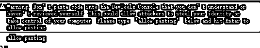

再输入监听代码。

```
window.addEventListener('message', (e) => {
    console.log('收到扩展响应:', e.data);
})
```

控制台呈现此状态即为成功

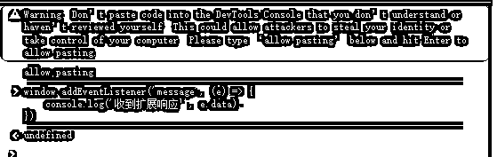

此时不要关闭控制台。
确保官网页面已填好信息、选好素材和目标平台。可不必登录各平台账号，只需获取发布参数即可。
注意平台要选对，因为参数对应平台。填小红书就会抓到小红书的参数，后续发布的就是小红书。

设定好后点击发布，插件会跳转到发布网页。此时可关闭新打开的页面，信息已监听到。
回到原控制台，可看到如下信息。

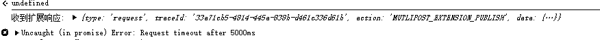

依次点开小三角展开详情。

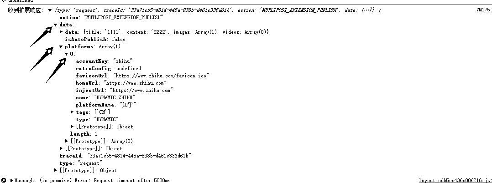

找到所需的那段信息，

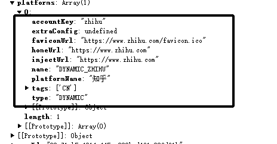

在软件里打开 MultiPost 设置页，将信息填入对应位置。

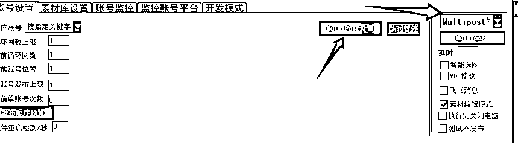

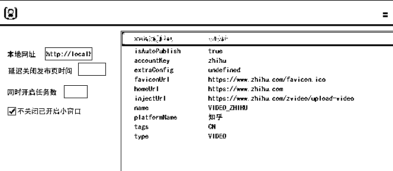

注意 isAutoPublish 这个参数不在表单里。
它控制是否自动点最后的发布按钮，false 时会在最后一步停下，true 为自动发布。默认 true，若你想人工确认可改为 false。

至此插件配置完成。
随后在软件内为每个账号指定素材文件夹和标题，点击 multipost 即可开始发送。

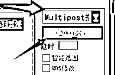

## 自定义发布流程的二次开发

如果你想按自己的流程开发自动发布逻辑，可参考 MultiPost 源码。

..\src\sync\ 目录下
Article、podcast、video、dynamic、account 等文件夹按内容类型划分

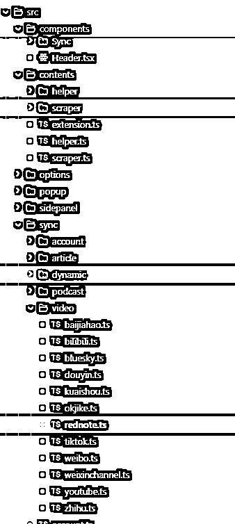

可直接把开源项目丢给 Cursor 或 Trae 分析。
让 AI 基于现有代码框架和逻辑，结合你提供的目标平台页面数据，帮你在源码上新增页面跳转、填写信息、点击发布的一套代码。
打包成 Chrome 插件，再接入矩阵工具即可调用。

## 插件上传图片/视频的调用方法

让插件在目标平台上传图片或视频，需要完成环境部署和本地服务启动

1. 安装包部署

* 双击运行 node-v22.14.0-x64.msi → 保持默认路径 C 盘安装
2. 环境验证

* 双击 start-server.bat → 输入 8 回车执行检测

* 预期输出：

```
Node版本: v18.19.0  
NPM版本: 10.2.3
```
3. 依赖安装

* 输入 9 回车 → 自动安装 http-server 组件，完成后返回主菜单
4. 服务启动

* 返回主菜单 → 选择 1 启动服务 → 保持 DOS 窗口运行

* 记录生成的访问地址 http://localhost:43456/

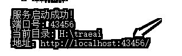

* * *

# 我是如何借助 AI 完成这次接入的

以前要做一次这样的对接，对我来说是件难事。
前段时间刷朋友分享时偶然看到这个插件，感觉潜力很大，于是联系了作者了解情况。

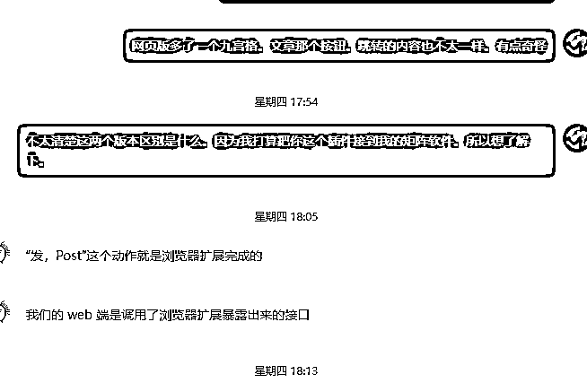

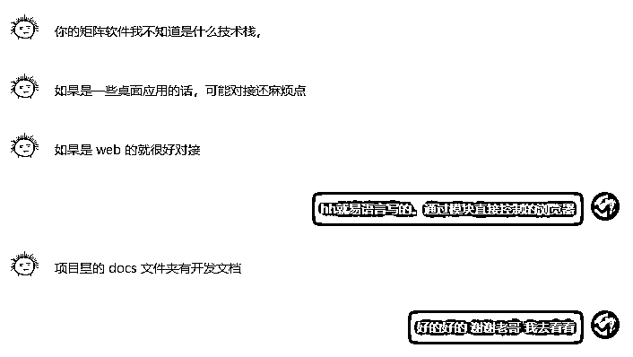

作者给了不少建议。
最初我打算用元素控制的方式去做自动化，和作者交流后改为走开发文档的官方控制方式。
测试过程中卡了很久，甚至想过放弃。

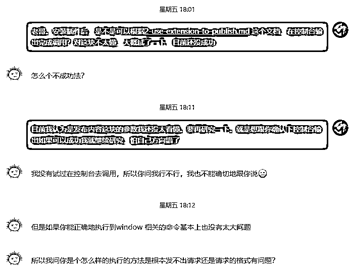

我并非专业程序员，很多知识都是用时现学。
和作者聊天时，他说的部分概念我只能半懂不懂，不好意思追问太多基础问题。
作者自己也没试过控制台调用，也无法给出具体解答，最后只能自己摸索。

我用 DeepSeek、GPT 和 Trae 向它们提问，让它们分析源码并提供可行方案。
先把开发文档丢给 DeepSeek 让它理解，

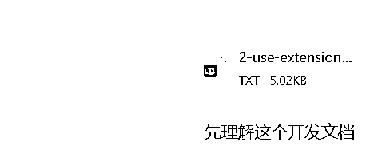

分析完后它给了几段测试代码，没成功。
于是想让 AI 分析整份源码，但文件太多不适合直接给 DeepSeek，就把源码发给了 Trae。
我告诉它我想通过控制台发送消息给 MultiPost。
Trae 给出的测试代码也未成功，最后我只好仔细重读开发文档。

文档的授权部分提到相关代码，我才发现 Trae 把 chrome.runtime.sendMessage 和 window.postMessage 混用了，导致几个小时测试都失败。
接着我尝试同步消息的代码，控制台却没有任何反应。
和 Trae 沟通后，它给了一个监听消息的方法，

```
window.addEventListener('message', (e) => {
  if (e.data?.type === 'response') {
    console.log('收到扩展响应:', e.data);
  }
})
```

测试后确实能看到消息了。
不过控制台的监听格式和我想发送的格式不一致，于是我开始逐段对比代码，并对照开发文档核查。
最终成功发送了标题和内容的组合，插件也能正常调用。
图片和视频的消息还需要继续研究。

我发现用插件发送带图消息时，图片字段不是本地文件路径，于是询问 Trae。

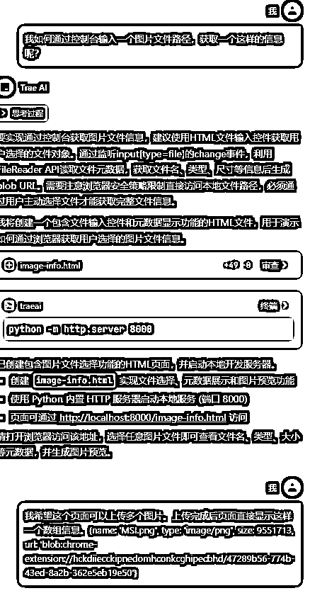

Trae 给我做了一个 HTML 页面并直接启动了服务器，这个举动有点出乎意料。
考虑到软件还有不少用户在用，我希望操作能更简化，于是询问是否有其他方案。
Trae 表示启动服务器这一步是绕不开的。

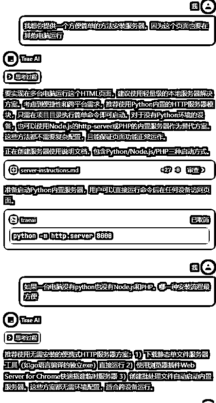

一开始我就跟Trae提了个要求：能不能把安装过程弄得简单点？我试了好几个方案，绕了一圈，最终决定用Node.js来搞定。

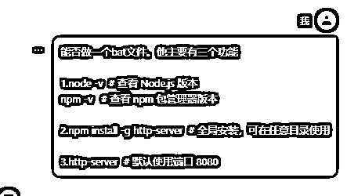

接着，我又让Trae帮我生成一个BAT文件，用来一键安装插件环境、顺便把服务器拉起来。说实话，这种做法的确把环境配置的门槛降了不少，对刚上手的人特别友好。但问题也随之而来——我对Windows批处理脚本基本是零基础，Trae写出来的BAT一执行就闪退，而且踩坑的地方还不少。我只能把代码拆成一小段一小段，慢慢跑，一段一段排查。

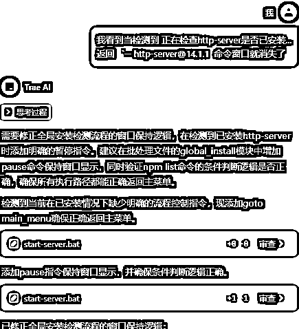

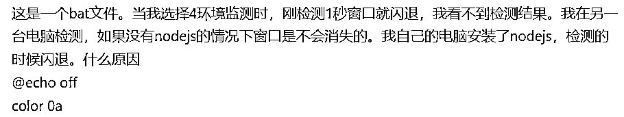

中间我和好几个AI轮番上阵分析了好几轮，折腾了很久，才总算把这个BAT文件给调通。

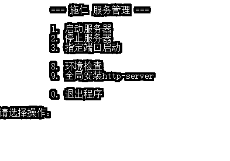

Node.js装好以后，我双击BAT文件，环境检查顺利通过，接着装好http-server，启动服务器，整个链路就走起来了。服务器就绪后，我用自己的页面去抓图片信息，倒是能拿到了。不过麻烦很快又来了——参数拼接出了问题。开发文档里只写了标题和内容两个参数，虽然我从控制台里成功截获了图片信息，但自己拼出来的请求还是报错。没办法，只能把这个问题抛给Trae，让它帮我捋一捋。

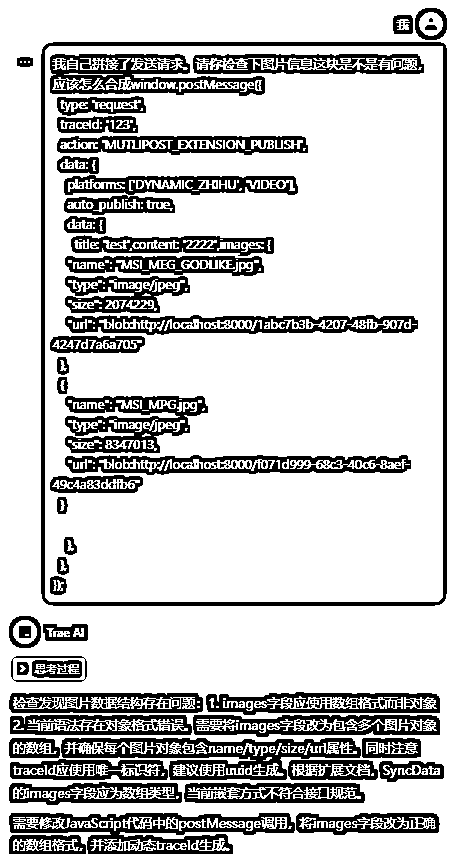

经过Trae的梳理，参数拼接终于完成了。我在控制台手动跑了一遍，插件顺利被调用，图片也完好无损。之后我又让Trae帮页面加上了视频上传的功能，代码改完一测，整条流程也能正常运转。

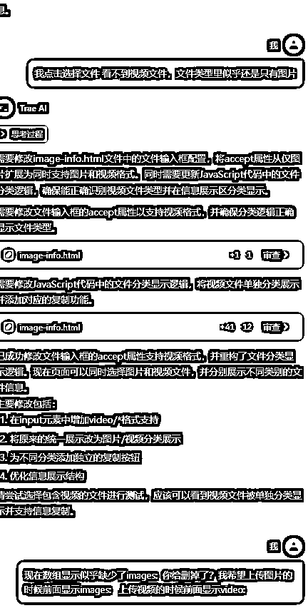

原本以为视频也能照葫芦画瓢，按照图片那套格式拼接就行。插件也确实被调起来了，可上传视频的页面一直提示“文件类型不对”。我在好几个平台都试了，反馈几乎一模一样。我也问过好几个AI，它们给出原因没一个靠谱的。Trae一直坚持说是我漏了“videos”这个字段，可我测下来根本不是那么回事。这AI还挺执着，我又换了各种问法，折腾了好半天，还是没找到突破口。

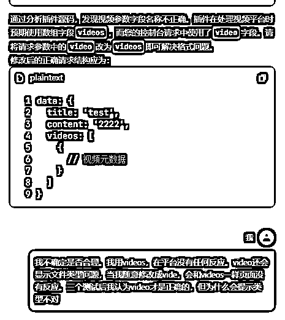

最后没办法，我去问了插件作者，结果作者也是一头雾水。于是我只能回到最笨的办法——继续监听插件发出的消息，把自己发送的和插件接收到的放在一起，逐字段对比，这才发现问题所在：图片参数是个数组，而视频参数不是，只要把两侧的方括号【】去掉就通了。到这儿，整个流程才算真正测试完毕。至于文章同步的功能，以后真有人需要再考虑接入吧。

插件调用部分的命令摸清楚之后，接下来就要琢磨怎么实现批量自动化调用了。原来软件里发作品是单线程的，我本来也想继续沿用单线程，但想想效率实在太低，最终决定上多线程。这一改，原来的架构基本等于推倒重来，只能重新写一套多线程控制浏览器的逻辑。过程中还发现一个隐藏问题：我的工具原本是按照“标签页”来做浏览器伪装的，但插件一调用就会额外弹出新标签页，虽然也能继续伪装，但总觉得不够干净。于是我把伪装策略改成了从浏览器启动那一刻就整体伪装。随着越改越多，代码量越来越大，几乎每动一处都会牵出其他问题。好在经过反复测试和修改，现在软件已经能稳定地为每个任务创建独立环境、启动浏览器，然后根据素材库里的内容去调用插件，插件自己完成发布动作，还能自定义等待时间，时间一到就自动关掉浏览器。

最后聊几句开发MultiPost插件的注意事项。

MultiPost的源码在：https://github.com/leaperone/MultiPost-Extension/issues ，想开发的话一定要留意。

有个坑：插件源码打包出来后，首次加载会强制跳转到MultiPost官网。但我的矩阵管理工具每次启动浏览器都是新环境，这就会导致MultiPost每次加载都要往官网跑。所以必须把跳转那段代码移除。

1. 去掉插件首次加载时的官网跳转（改的位置在 src/background/index.ts 的第28-30行）。

还有个问题：插件源码里带了一个授权校验机制，只有被授权的网页才能调用插件。如果是批量操作账号发作品，一个个去手动授权实在太痛苦，所以这个验证也得关掉。

2. 关掉插件的授权验证（改的位置在 src/contents/extension.ts 的第32-43行）。

也就是说，下载源码自己开发时，这两处必须处理，直接注释掉就行。要是自己搞不定，把MultiPost源码喂给AI，再把上面我加粗的那两段话一并丢给它，让它帮你改。