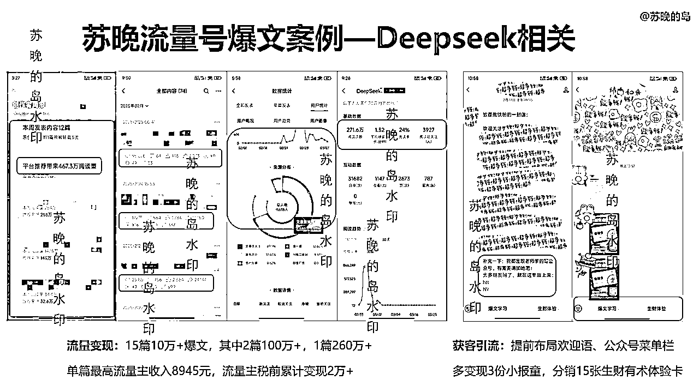
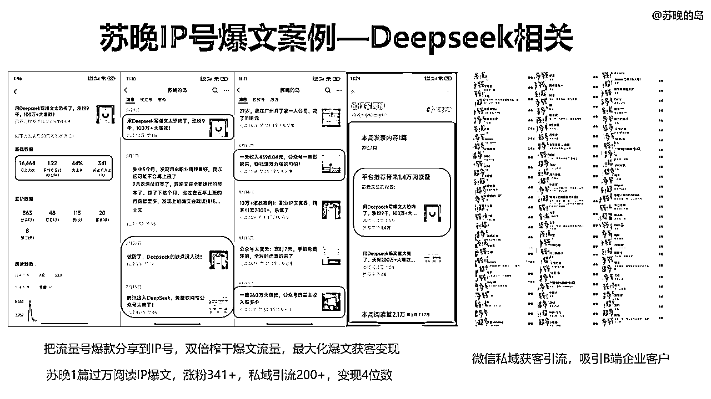
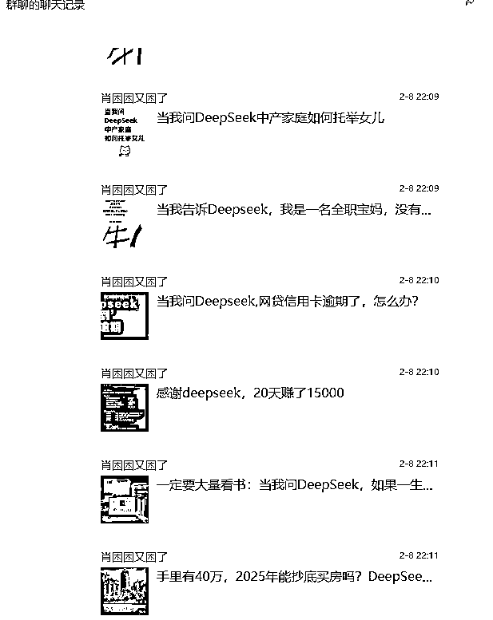
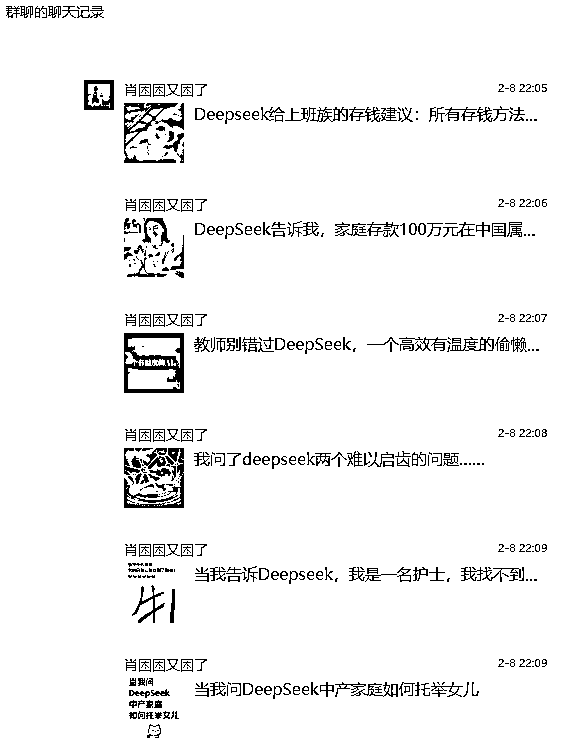
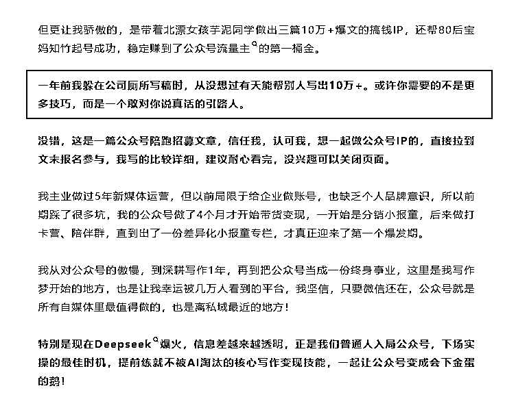
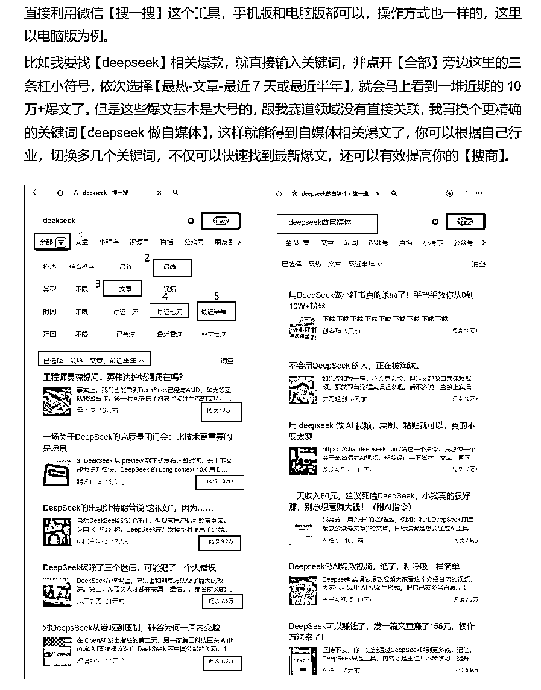
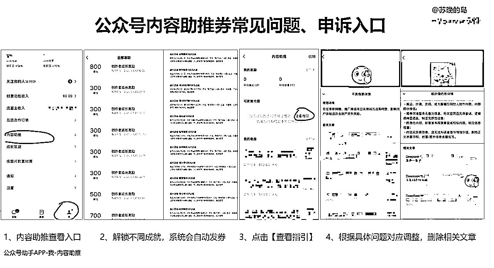
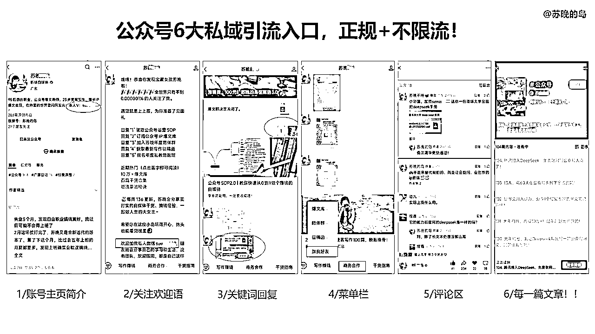

# 用 AI 搭👸号矩阵的实操复盘：3 篇阅读破百万、12 天涨粉近万，税前变现超 2 万

各位朋友好，我是苏晚。

过去五年我一直做企业端的运营，两年前开始起自己的👸号。坚持下班后打磨了一年多，副业才转成全职自由职业。期间我尝试过📕带货、👸号爆文两条线，都有一定收获，📕还做出了精华帖。如今我更聚焦在👸号内容变现这条赛道，先用 IP 爆文冷启动卖出 1300 份小报童，把 0 到 1 的闭环跑通，接下去要冲 1 到 10 的放大阶段。

从今年 DeepSeek 走红开始，👸号里也冒出不少大流量文章。我留意到这是个窗口期，连我老家全职宝妈的堂妹都在问我怎么用 AI 写👸号。于是 2025 年的 2 月到 4 月，我用 AI 去做账号矩阵，一条走泛流量一条做个人 IP。最终的结果是：

- 写出 3 篇阅读量破百万的文章，最高一篇 260 万+
- 账号 12 天内涨粉约 9000
- 流量主税前收入 2 万+
- 还借助这波流量分销了十几张赚钱体验卡，获客效率很高

当然过程并非直线上升。账号经历过高峰期，也碰到推荐骤降、被移出推荐池、收到待优化提示等状况。我会把助推券的利弊、掉池后的申诉与调整思路一起讲清楚，都是亲身踩过的坑。

## 这篇复盘能帮你回答 5 个关键问题

1. 怎样借助 DeepSeek 提高爆文的产出频率？
2. AI 写作是否会被限流？助推券该用吗？限流后如何修复？
3. 泛流量号如何把曝光转化为变现与导流？
4. IP 号如何兼顾涨粉和转化？
5. 怎么用 AI 给矩阵赋能，实现一波内容多次收益？

## 一、矩阵的底层思路：先定变现，再定内容

做👸号的首要前提是明确要卖什么。

我的商业定位是围绕爆文变现，核心产品是爆文拆解专栏和变现课程。

矩阵目前有 6 个号：

* 2 个个人 IP 号：苏晚的岛、苏晚姑娘
* 4 个泛流量号：分别切不同的细分领域，负责拿曝光、做引流、承接广告

矩阵的价值在于分散风险、叠加收益。🛰️推荐机制波动很大，一个号卡住，另外的号仍能跑。泛流量号追求热点快速出爆款，IP 号追求信任沉淀与高转化。两者配合起来：

* 泛流号测试题材、吸客
* 泛流号把一部分用户导向 IP 号
* IP 号做深度内容沉淀
* 最终通过课程、专栏完成转化

这样既能吃到平台红利，也能守护长期品牌。

AI 在其中扮演的角色：

* 生产效率提升：一天可出 3-5 篇初稿
* 横向拓展选题：快速进入不熟悉的领域
* 模式复用：成功结构可在不同号间迁移

需要纠正一个误区：AI 不是万能的。它是强者更强的工具，没有选题判断与人工打磨，最后内容会高度同质化。我现在更多用 Claude 负责 IP 文的语言衔接与人物表达，DeepSeek 更多用于发散灵感与大纲。

我的工作流是：先定主题与核心观点 → 让 AI 扩框架 → 生成初稿 → 加入个人经历、案例与判断 → 人工润色节奏与细节 → 检查事实与原创度。IP 文通常 AI 完成 60% 后，我会花 20-30 分钟重写，确保 AI 检测为零。流量文也按同标准处理，不敢直接标记原创。

## 二、3 篇百万阅读是怎么来的

春节后 DeepSeek 相关内容爆发，我新开一个流量号，最初让朋友试发。看到几百阅读后我接手，半个月内连出 3 篇百万+，最高 260 万。账号 12 天涨 9 千粉，流量主收入 2 万+。

### 选题决定入场资格

爆文关键在于选题+标题。能爆的核心组合是【DeepSeek+存款/金钱】，踩中了腾讯当时大力推广 AI 的窗口期。那段时间朋友圈、👸号、电脑端全是元宝的广告，平台明显在给相关内容倾斜。

选题之所以有效，因为：

* 受众面足够大
* 贴合用户利益点
* 与平台当前扶持方向一致
* 标题具备强吸引力

我当时是持续追踪近 1-2 个月的低粉爆款，对标后快速出系列。爆了之后立刻追加同主题内容，保持热度。有篇文章一天内冲到百万，根本停不下来。

### 泛流量号也能做人设

很多人做泛流量号只求阅读，我在简介、开头、结尾都加入了人物介绍与故事，用金句强化共鸣，文末引导留言。这样文章不仅被读，还被记住，解开了流量号难涨粉的困局。

### 如何找到可对标的低粉爆款账号

最直接的方法是搜一搜。输入核心关键词，看最近 7 天/半年的表现，记录阅读、点赞、在看数据。进入作者主页，如果原创篇数不多但过万文章很多，就是很好的对标对象。

重点拆的是：题材为何有吸引力、标题结构、开头钩子、中段情绪推进、结尾互动设计、是否踩中平台热点。

标题能力靠大量对比训练。每天搜同类标题，看差异点，长期手感会起来。

## 三、AI 写稿的实操方法

指令不必复杂。我常用一个简版模板：

写一篇👸号爆文，主题是《用 DeepSeek 写爆文太疯狂了，3 篇 100 万+，收入 5 位数（附指令）》，语言通俗幽默，传递正能量，多用热梗金句，说人话，配 2-3 个案例，重点讲做法，约 1200 字。

这样的提示通常能拿到 50-60% 可用内容，余下靠人工。

更高效的做法是先要大纲再写正文：给主题 → 让 AI 出多版大纲 → 选定框架 → 补充个人观点 → 再生成初稿 → 人工修改。

如果想让风格更像自己，可把过往写得好的文章喂给 AI，让它总结你的句式、节奏、高频表达，然后据此生成写作指令。但最终的判断、案例、观点仍要自己把控。

把 AI 当成 24 小时合伙人，每天花半小时对话，灵感枯竭时用它拓展开头、标题、切入角度。提问能力会随实操提升，情绪不好时它也能提供正向反馈。

## 四、助推券与限流问题处理

### 被移出推荐池该怎么做

我的百万号用过助推券，爆后被提示低质量内容，无法继续使用助推券。操作是：删除疑似低质文章 → 发起申诉 → 降频更新 → 停止日更 → 同步测试其他号。第一次申诉未通过，阅读跌回几百。随后把重心转到新号，相近选题后来又出了 5 万+。

矩阵的意义就在这里，一个号受限，另一个号还在跑。流量号生命周期通常 3-6 个月，停更一段时间、转型 IP 或换赛道测试都是选项。

### 助推券能否用

针对万粉以下新号，平台会灰度发放流量助推券。并非必须使用，用了可能带来人工审核风险。

我的经验：

* 内容质量与原创度过关可谨慎尝试
* 文末带二维码、购买图、强引导时风险升高
* 出现“账号待优化”，先点进提示看具体原因：低质内容、重复度高、疑似营销引流等。先删相关文章，分批处理，撤掉二维码，暂停助推券，持续发优质原创。
* 若连续半个月几乎零推荐，可停更一段时间再测。

总体原则：只要内容足够原创、有价值、用户愿意互动，AI 生成并不必然被限流。关键是人工改写比例，建议保留 20-40% 的个人化加工。

## 五、如何把流量榨干到变现

自媒体的终点是👸号，因为它承接私域最顺滑。

泛流量号不止能赚流量主：

* 测试热点
* 验证需求
* 提前做产品认知
* 为 IP 号导流

IP 号负责稳定转化，通过真实案例拆解、复盘失败、输出判断来建立信任。

同一个选题可以多次复用：泛流号发热点版，IP 号发复盘版，社群发方法总结，📕发短观点，产品里做深度实操。一鱼多吃。

## 结语

👸号仍是普通人做影响力与变现的好地方。平台的内容生命周期长、阅读深度高、适合养品牌。

想持续做大，不能只靠提示词，也不能押注单篇文章。核心是持续找选题、观察趋势、构建矩阵、让 AI 提升效率而非替代思考、保留真实经历、限流后及时调整、用优质内容换取长期推荐、把泛流量沉淀为精准用户。

我花一年多才摸清门路，后来新号能快速涨粉，靠的是前期积累的能力。AI 降低了门槛，但结果仍来自不断测试、反复修改、长期行动。

一个👸号，远不只是发布文章的平台。

它至少可以承载6类合规的私域入口，而且不会因为正常布局而被限流。每写完一篇文章，都能放入🛰️号和二维码。假设持续创作了200篇，就等于拥有了200个长期在线的免费广告位。

这些内容不会只被看一次。某篇文章一旦获得大量传播，可能触达几千、几万，甚至上百万读者。相同的创作成果可以反复带来曝光、获客与成交，让一次投入持续产生回报。

那么，怎样才能把👸号爆文带来的流量尽可能承接下来，并转化成收入？下面分享几个苏晚一直在实践的方法。

## 4.1 流量型👸号，提前设计好变现链路

不少人认为流量号只能依靠流量主赚钱，其实不然。

流量号同样可以成为稳定的引流入口，甚至具备非常强的商业转化能力。关键在于，不能等文章爆了以后才临时想办法，而要提前规划好产品、入口和转化路径。这样流量一旦涌入，才能迅速接住。

我通常会提前做好这几件事：

*   **开启流量主功能**：我曾有一篇阅读量达到260万+的文章，仅广告收益就接近9000元。

*   **利用菜单栏承接产品**：把小报童专栏、龙哥盟体验卡等产品放进去，让读者能够直接了解和购买。

*   **在自动欢迎语中留下🛰️入口**：方便筛选出真正有需求的读者，再进行后续私域沟通。

*   **通过文章留言区制造互动**：引导读者讨论，并推荐相关旧文，让内容形成二次传播，同时逐步建立信任。

## 4.2 IP型👸号，用爆款案例吸引精准客户

对我来说，IP👸号一直是主要的变现阵地。

通过持续拆解爆文、分享实战经验和真实结果，可以不断强化专业形象。一篇足够精准的IP文章，阅读量达到1万，通常能够带来100—300个新增粉丝，以及50—150个私域用户。当然，具体效果还会受到内容质量和引流路径的影响。我也见过单篇1万阅读的文章，直接涨粉超过1000人。

IP账号真正的价值，不只是展示知识，而是让读者看到一个可信的人：你的经历、你的案例、你的方法，以及你是否真的做出过结果。

比如我分享自己使用Deepseek创作爆文的过程，让读者看到从选题、写作到打磨的完整路径，也看到最终取得的成绩。真实过程越清晰，信任感和转化率往往越高。

👸号里的每一篇文章，都可以成为一个隐形销售页面。优秀的IP文章，本身就是广告，只不过不会让人产生强烈的推销感。

经过一年多的测试，我总结出一个比较通用的IP爆文框架：

**痛点 + 方法 + 案例 + 价值观**

以我发布过的文章《用Deepseek写爆文太恐怖了，涨粉9千，100万+大爆款！》为例，它和其他同样达到1万+阅读量的文章相比，涨粉和引流效果高出了三四倍。

它的结构大致是：

- **先击中困惑**：很多人想涨粉，却不知道如何借助AI写出爆文；
- **再给出方法**：提供两个明确、可执行的解决思路；
- **补充亲身案例**：讲述我自己的实践过程，以及如何反复修改文章；
- **最后完成升华**：提醒大家，不要低估持续一年、两年成长的力量。

整篇文章甚至没有直接推销产品，我只是在结尾放入固定的产品介绍模板。但因为文章主题、案例和产品本身高度相关，最后不仅多卖出了几十份小报童，还新增了350多个粉丝，并引流了200多人进入私域。

最近我还写过一篇关于一人公司的文章，成功获得了大量传播，私域新增接近200人。其中有不少是创业者，甚至因此接触到了企业端客户，目前相关合作还在进一步沟通合同细节。

这也要感谢靠谱姐的建议：持续输出一人公司相关内容，更容易吸引高客单价的老板和创业人群。

所以，IP文章想要提升涨粉和获客效率，可以重点抓住下面5点：

▪️把个人经历讲成有吸引力的故事

▪️持续提供情绪价值和精神支持

▪️展示真实成绩，形成专业背书

▪️在结尾用有力量的观点完成升华

▪️提前埋好产品入口和行动钩子

### 

持续测试爆文，最终目的并不是单纯追求阅读量，而是帮助更多人建立完整的爆文变现闭环。

如果想通过👸号精准获客，不能只依赖工具自动找选题。Deepseek确实可以辅助发现潜在爆款，但真正重要的是，你自己要形成判断力和内容手感。

我的建议是：每天至少花30分钟浏览爆款，慢慢建立自己的选题资料库。

除此之外，我还建立了两个只用于个人研究的对标群：

一个专门观察流量号；

另一个专门研究IP号。

每天记录最新的低粉爆款，每周再统一整理复盘。这样做的核心目的，是持续训练自己的爆款网感。

这件事看似简单，却是每天都要完成的基本功，也是AI暂时难以替代的能力。

爆款流量，是一个IP个体最重要的底气之一。

未来👸号的竞争很可能会越来越激烈，流量成本也会不断上升，尤其是在那些上限高、商业价值强的赛道。越早开始布局，越有机会提前占据位置。

更重要的是，自媒体竞争到最后，往往都会回到私域。而距离私域最近的内容平台之一，就是👸号。

👸号还能和视频号、直播等🛰️生态工具联动，把内容、粉丝、成交和复购串联起来。真正能沉淀客户、培养铁粉、积累口碑的地方，依然是私域。

我也是通过持续写👸号，慢慢开启了一人公司的生活，打造出一门即使规模不大，也足以长期养活自己的小生意。

当你掌握了靠内容独立赚钱的能力，就不必过度担心失业、裁员或中年危机。一个IP，能够撬动十倍、百倍，甚至千倍、万倍的长期价值。

以上就是苏晚的分享。

如果这篇内容对你有启发，欢迎点个赞给我鼓励，也可以在评论区留下你的看法。希望大家都能持续产出爆文，顺利完成流量积累与财富增长！