# 网站上线就完事？一个程序员踩过的坑，告诉你 AI 网站运营到底该怎么做

做技术的人，很容易把“上线”当成终点。代码提交、域名绑定、网站能打开——好，完事了。但真正的麻烦恰恰从这一刻开始：没人访问、没有反馈、没有收入，网站慢慢变成一座数字孤岛。

我之前也是这个状态。在生财群看到一句话：“程序员的习惯就是做出来就放着了。”瞬间被击中。回过头想想，大部分程序员建完网站就搁置，原因无非两点：一是职业惯性，在大公司里前端、后端、产品、测试、运营各管一摊，很少有人能跳出来用上帝视角审视整个项目；二是没有正反馈，辛苦拉外链、写内容，忙了半个月，域名评分还是十几分，流量少得可怜，自然坚持不下去。我也曾用“及时止损”安慰过自己，后来看到别人靠同样赛道拿到几十万流量，才清醒过来——路没问题，方法和重点搞错了。

这篇文章不聊虚的，直接拆解我自己跑通的优化路径，围绕功能、外链、内容三个板块展开。

## 一、功能优化：MVP 只是起点，迭代才是常态

做网站先跑通 MVP，这个不用多讲。直接找模板，配合 AI 工具，一天就能上线；再不济去闲鱼或淘宝买一个 AI 网站脚手架，速度更快。但 MVP 上线后 100% 需要迭代，迭代的重心放在落地页和功能页。

### 落地页：承接流量、促成转化

落地页是数字营销的核心环节，它负责接住广告流量，让用户不迷路，专注指向转化。前期功能单一，主页基本就是落地页。

优化落地页，推荐用 aITdk 这个免费 Chrome 插件，它能自动生成 title、description、keyword、FAQ 等内容。这里有几个关键指标：关键词密度要达标，落地页中与网站功能相关的关键词占比最好在 5% 以上，我见过有人做到 12%；整页单词量控制在 1500 词左右。同时注意 heading 结构，H1 里要尽量包含核心关键词。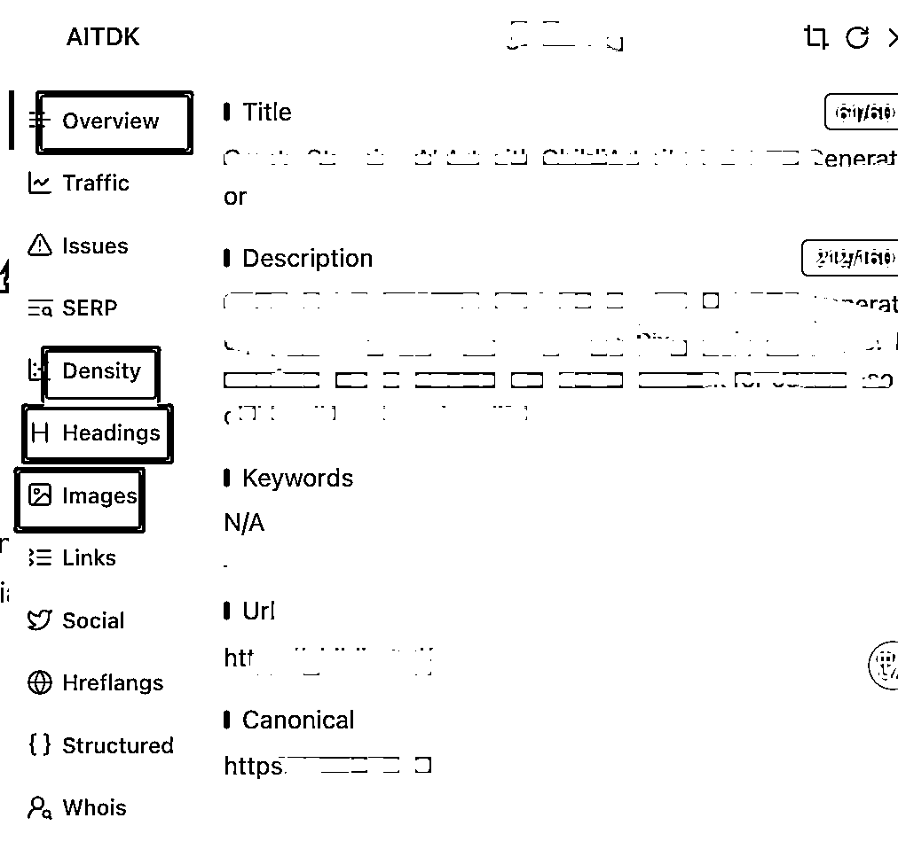

### 功能页：用户体验怎么简单怎么来

功能页的核心是“让用户用得爽，愿意掏钱”。我的思路很简单：

1. 借鉴同行。去 Google 搜关键词，看排名第一的网站怎么做交互，直接抄。前期千万别自嗨，别觉得自己设计的就是最好的。
2. 迭代学习。通过行业文章和播客补充认知。比如我听播客时学到：用户登录前展示 feature、faq、examples，登录后切换成沉浸式体验，这个细节非常妙。更进一步，还可以思考登录用户和付费用户是否要分层体验。
3. 收集反馈。前期用户少，不用专门开发反馈系统。我直接用 Google Excel 收集意见，再通过 iframe 嵌到页面上，成本几乎为零。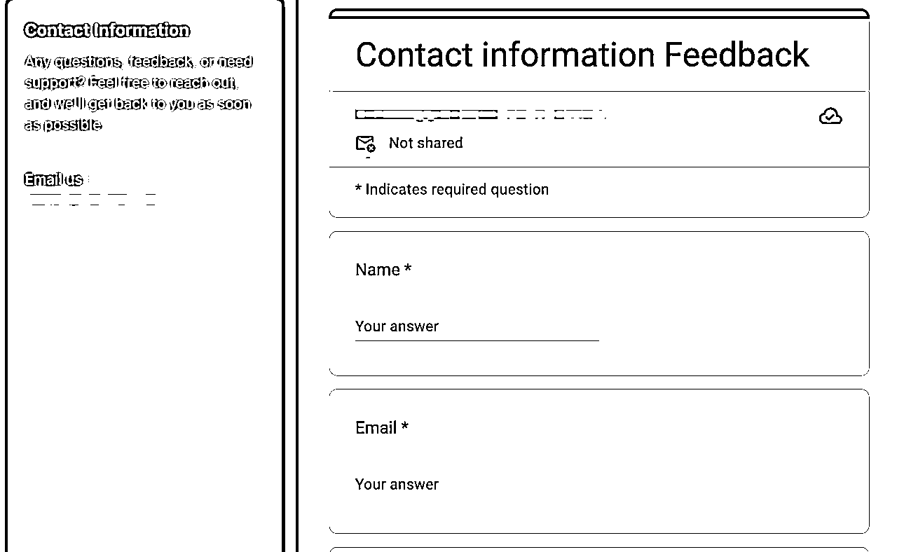

日常管理也很重要。我会用微信笔记记录待修复项，打开快、随手改。每天只推进一个进度，在没有外部用户反馈时，自己先充当用户走一遍流程，用内部反馈逼着自己往前走。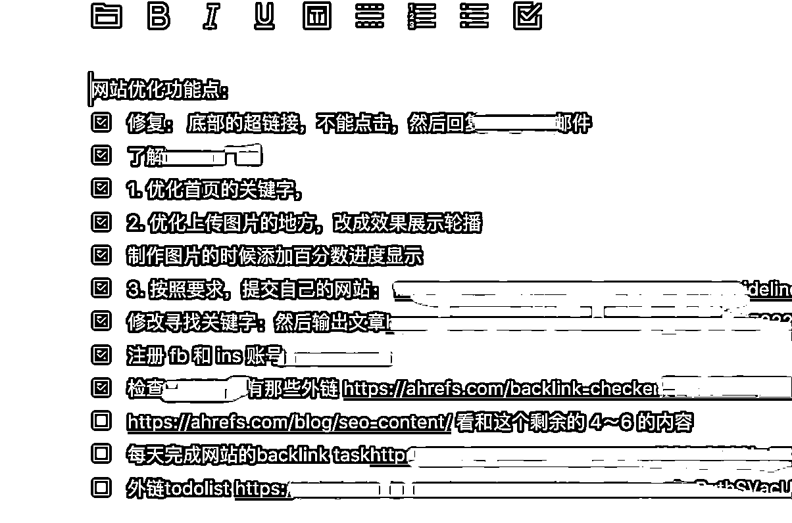

### 性能优化：Google 偏爱快网站

性能直接影响排名。用 Google PageSpeed 分析域名，先集中优化 PC 端，移动端可以往后放。我的目标是 Performance 分数至少 80 以上。页面下方会列出具体优化建议，照着改就行；看不懂就直接截图丢给 AI，比如用 Cursor 截图配合代码让 AI 优化，效果立竿见影。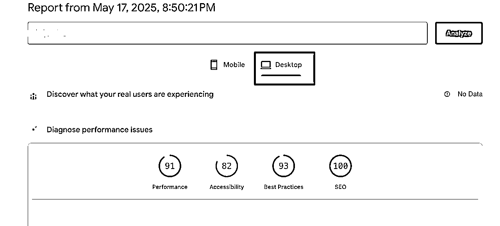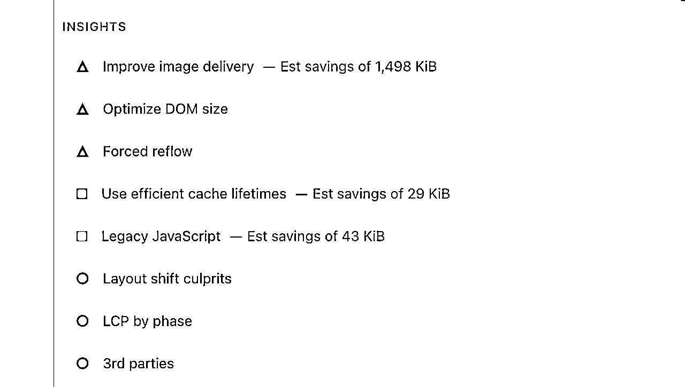

### 网站诊断：用工具排查硬伤

推荐用 Ahrefs 的 Site Audit，免费功能就够用。输入域名，点击 new crawl 开始爬取，稍等片刻就能看到诊断结果。打开链接，按 top issues 的优先级逐项修复，目标是整体健康度达到 80% 以上，把所有红色问题清零。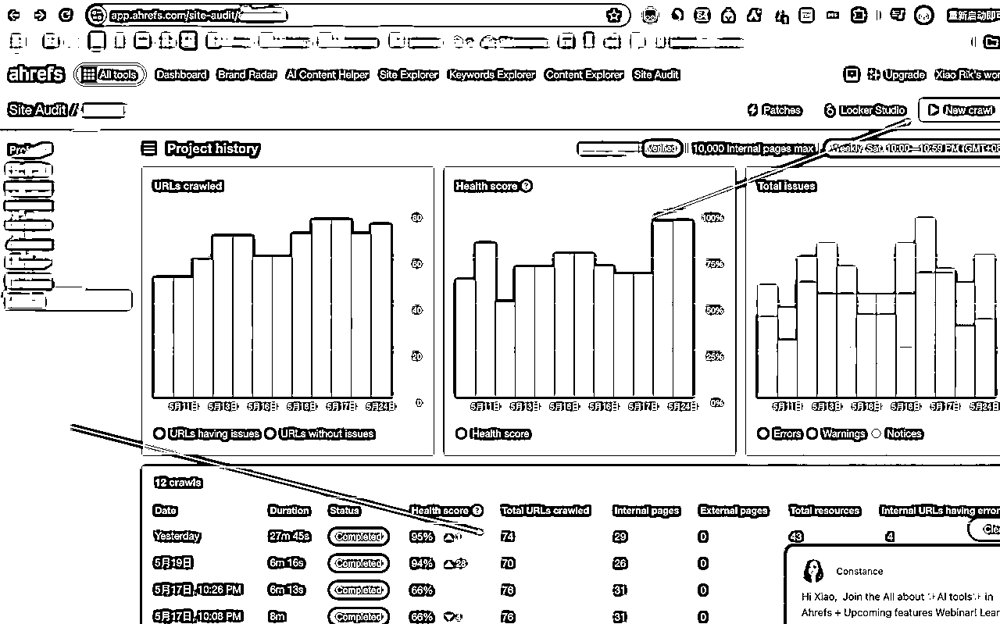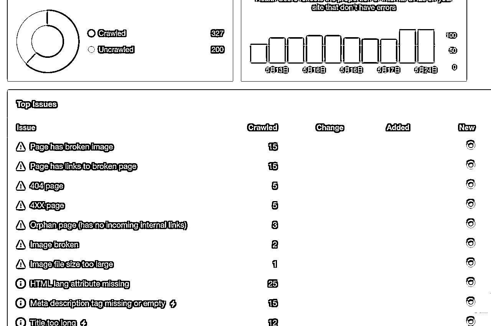 我早前截图时还是一堆红色，现在已经全部解决了。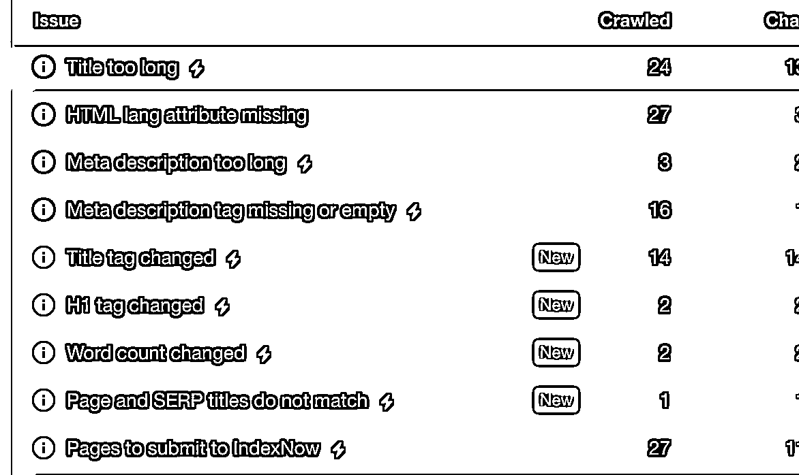

## 二、外链优化：别做无效劳动

外链是 SEO 的重头戏，网上的教程也很多，不懂的地方直接用 AI 搜索就能搞清楚。我的实操路径是这样的：

用 Ahrefs 免费版的外链检查工具，输入竞品域名，可以看到对方的部分外链。一个网站大约能看 20～40 条，多查几个网站、去掉重复项，就能积累几百条外链线索。我的计划是每天增加 10 条外链，几十天就能铺完。免费额度用完后，也可以去淘宝买一个月的付费账号，一百多块，性价比很高。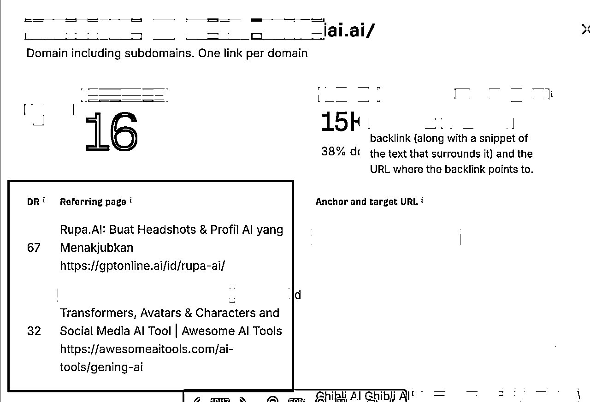

还有一个野路子技巧：用 Google 搜索指令，在无痕窗口里搜：
`inurl:resources OR inurl:links OR inurl:tools + 关键词`，能挖出不少资源聚合页。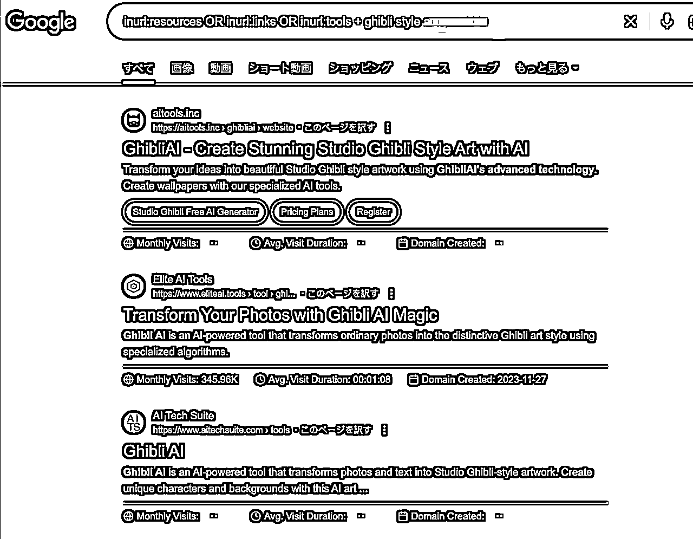

拿到外链数据后，导出到 Excel，按 DR 值降序排列，筛选出 DR≥30 且相关性强的来源，比如行业博客、资源汇总站；电报群这类低质量来源直接忽略。新手阶段别急着花钱，省下的就是赚到的。先找免费提交入口，慢慢积累。这个过程一定要做好文档管理，既能看到进展产生正反馈，以后做同类项目还能直接复用。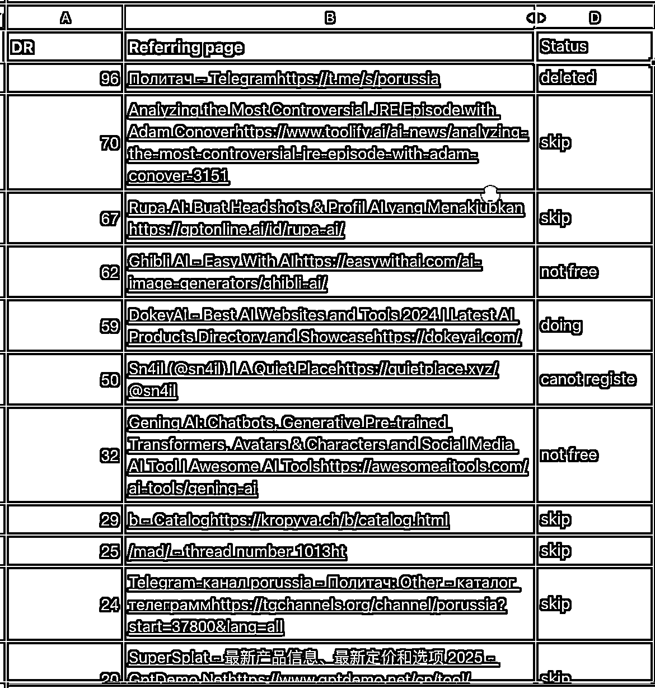

这里有个大坑要提醒：外链分为 do-follow 和 no-follow。评论区、社交媒体上的链接大多是 no-follow，不会传递权重，对 SEO 排名提升非常有限。我早期不知道，在评论区吭哧吭哧留了几百条链接，过了好几天一点变化都没有，后来搜索才明白是白费力气。真正有效的是文章正文里植入的 do-follow 链接。

至于替换对手 404 死链、付费买外链这些进阶玩法，都需要预算，我目前还没启动。现阶段，免费策略已经够用。

有了外链，内链也不能忽视。内链的作用是把权重导向核心页面。比如你的网站流量主要来自某个功能页，那么首页和其他高权重页面就应该用包含关键词的锚文本链接到那个子目录。举个例子，如果核心功能是 Chibi 风格生成，就可以把内链指向 `/chibi_app`，锚文本写“Chibi Style”。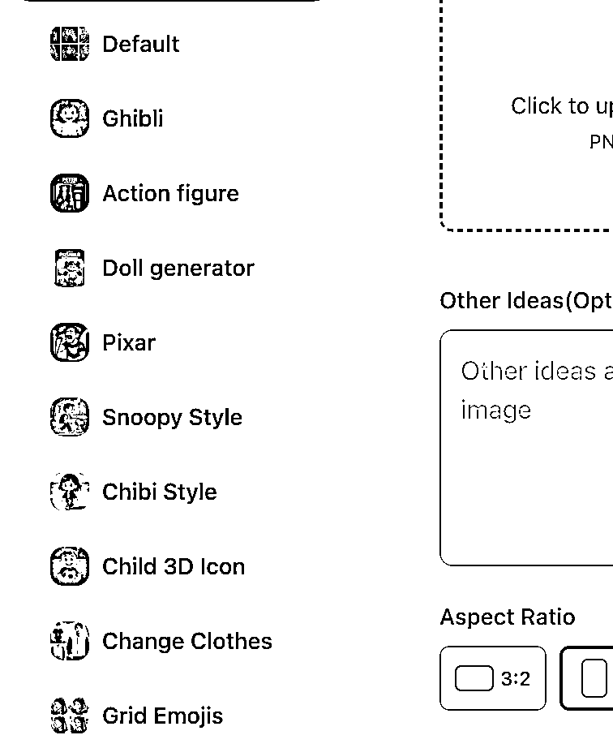

## 三、内容优化：用关键词指导创作

内容优化的流程是：先找关键词，再判断难度，最后用 AI 批量产出文章。

### 先看竞品有哪些关键词

用 Ahrefs 的 Traffic Checker 输入竞品域名，查看它的流量来源词。免费用户也能看到不少核心词和长尾词，把这些全部保存到 Excel。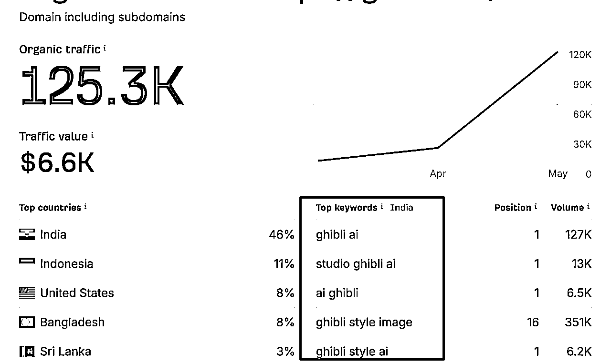```
"ghibli style ai"
"photo to ghibli style ai"
"ghibli ai generator free"
"convert image to ghibli style"
"ghibli style ai chatgpt"
"chatgpt ghibli style ai generator"
``````
"ghibli style ai prompt"
"naruto ghibli style ai"
"leonardo ai ghibli style"
"what is ghibli style"
"studio ghibli logo meaning"
"is it ghibli or ghibli"
"studio ghibli ranking"
"ai ghibli"
"ghibli ai art"
"studio ghibli style ai"
"studio ghibli style ai prompt"
"ghibli style airbnb"
"ghibli-style"
"ghibli style animation"
"ghibli art style ai"
"what is ghibli art"
"studio ghibli hayao miyazaki quotes"
"studio ghibli full list"
```

### 再看关键词难度

不同地区的关键词难度不一样，这里用印度和美国举例。用 Ahrefs 的关键字难度工具查询，顺便解释几个概念：UR（URL Rating）是单页链接强度，DR（Domain Rating）是整站权重，二者都是 1～100 的数值；Backlinks 是外链总数；Referring Domain 是外链来源网站数。比如某个网站有 9.4k 条外链，但只来自 46 个网站，那它的 Referring Domain 就是 46。

以某个关键词为例，KD 是 33，大约需要 41 个外链就能进入 TOP10。印度人口多但付费力弱，美国流量少但难度也低。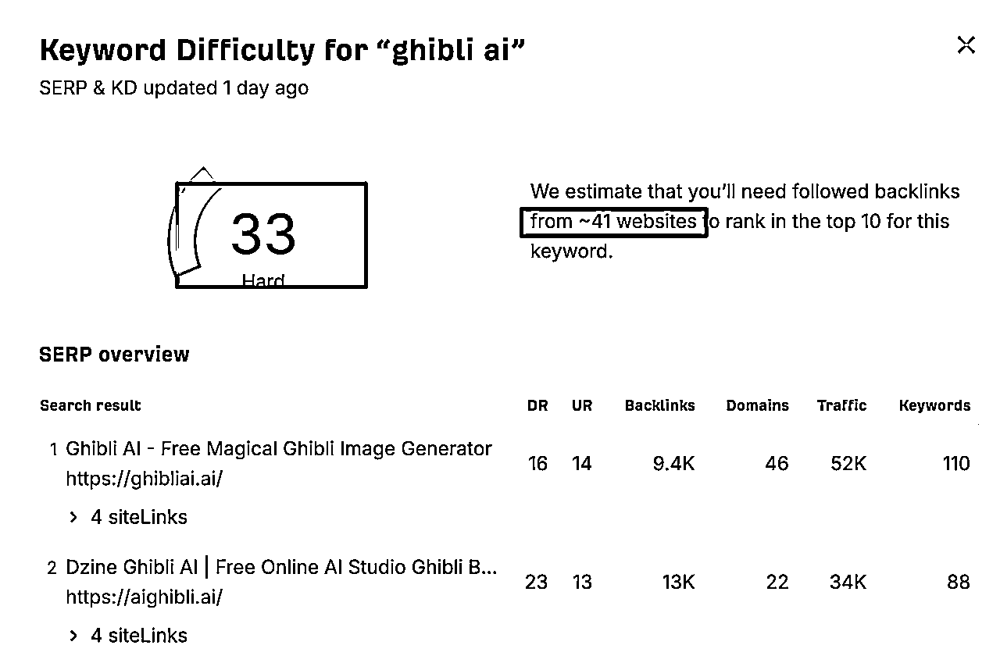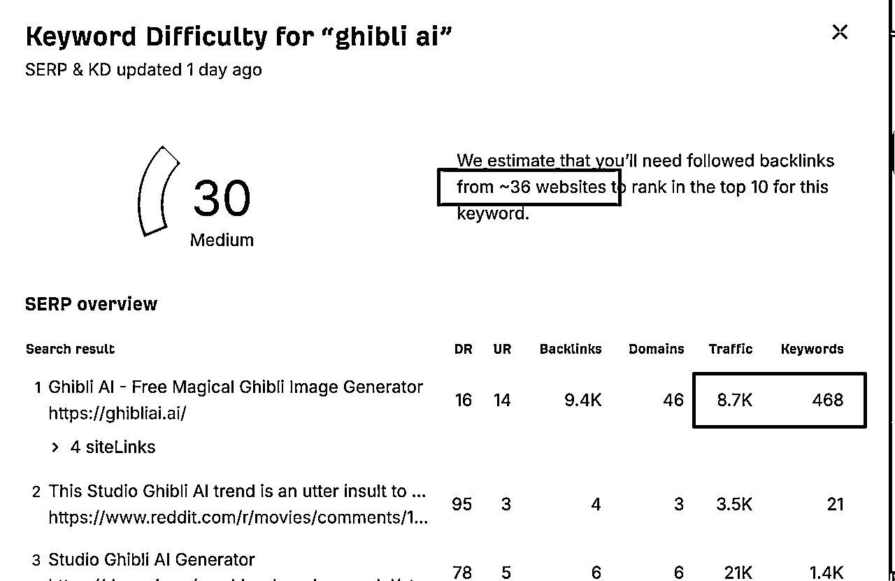

你可能会问：Ahrefs 显示的外链数量是全球的还是特定地区的？通常是全球统计，但可以通过筛选功能限定国家。如果你选择“美国地区”作为分析条件，平台会优先展示与美国相关的外链来源。

### 扩展更多关键词和问题

除了竞品词，还可以用 Ahrefs 的关键词生成器挖掘联想词、变体词，再逐个查询 KD 难度。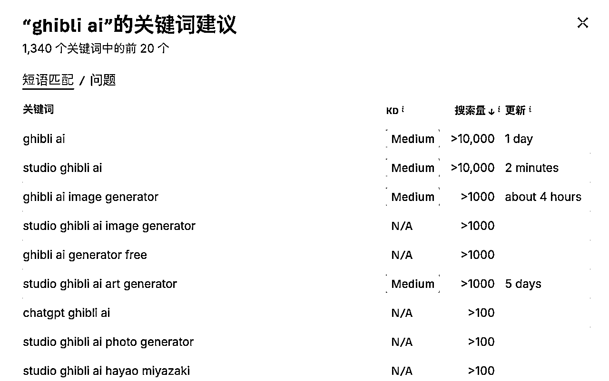 用户常问的问题也属于长尾词，同样值得收集。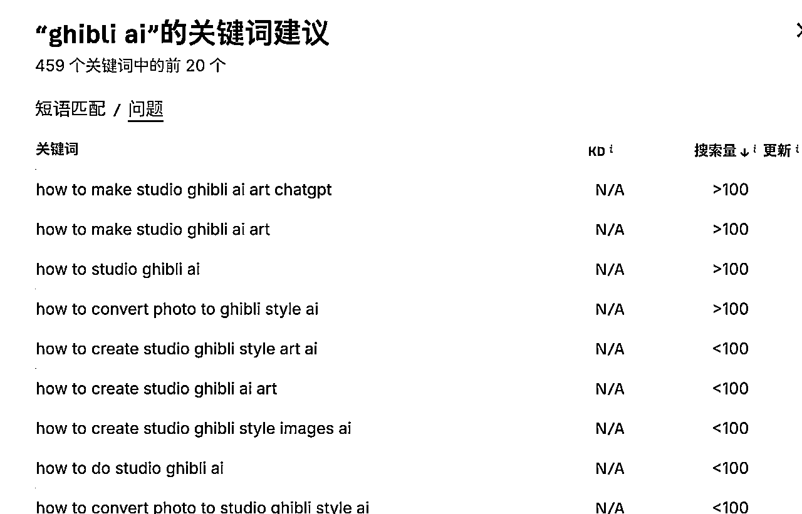

### 利用搜索结果精彩片段

搜索结果里的精彩片段能帮你抓住用户意图。比如搜索“openai coding agent”，页面里加粗的文字就是用户最关注的信息，把这些关键词放到博客文章里，能显著提升内容相关性。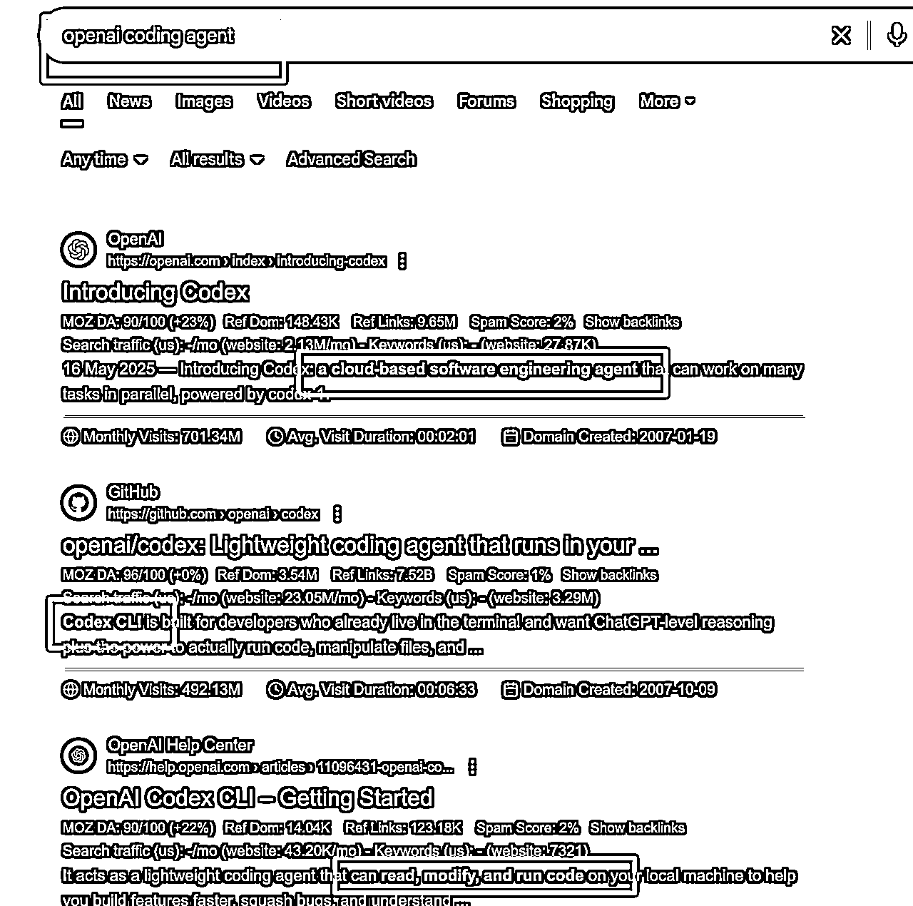

技术优化也要跟上：检查页面加载速度、移动端适配、代码质量。用 Ahrefs 可以抓出技术问题，图片太大就压缩，套上 CloudFlare 免费 CDN，香得很。

最后是内容策略，我自己的打法很简单：

- 流量排名 1～3 的关键词，选择 KD 20～40 的中低难度词；
- 流量排名 4～6 的关键词，选择 KD≤20 的极低难度词。

内容创作直接用 AI 生成，速度快，但别贪多。我保持 1～2 天发一篇，发得太频繁容易被搜索引擎判违规。

以上就是我这段时间的实战复盘，算是抛砖引玉。网站上线从来不是结束，持续运营才是真正的开始。希望这篇指南能帮你把网站“做活”，而不是“做完了就放着”的另一个项目。

最近有朋友问我，为什么做起来感觉流量起色不大？

我自己的看法是，现在做博客内容，AIGC 工具已经太普及了，基本人人都能批量产出。Google 也不是傻子，它很清楚这一点，所以在同质化严重的情况下，天然会把更多权重倾斜给 DR 高、历史沉淀好的老域名。做当然是能做出的效果，但对于新站来说，增幅往往没你想象的那么快。

不过换个角度想，这对新入局的人反而是一条可走的路。别想着一口吃成胖子，欲速则不达，稳扎稳打才重要。

如果专门聊博客文章的写作思路，提示词的打磨最关键，而且每个项目都要单独调。我常用的思路大概有这三点：

第一，先把读者画像拆细。越具体越好，TA 的痛点、场景和真实需求是什么，要写在提示词里。

第二，关键词要偏问题化。How、What、Why 这类问法必备，文章里的 FAQ 区块也能顺带吃到这部分流量。

第三，关联词要做布局。可以围绕竞品、Top X 榜单、Rank X 排名、alternative 替代方案这些词型去延展，让内容在搜索图谱里更完整。

就先分享到这里了，抛砖引玉，欢迎大家一起交流，合作把它做大，继续一起赚美金。

最后问一句灵魂拷问：今天，你把站优化了吗？