# 没灵感也没关系：我把做 AI 表情包的全流程跑通了

做表情包，真正让人停住的地方，往往不是绘图，而是开头那句——“我到底想做什么？”

之前我也认真想过做一套自己的微信表情。可一旦被问到具体方向，我就彻底卡壳：角色没想好，画风没想好，台词更是一片空白。我的全部要求只有一句：“逗一点就行。”

这对于任何工具来说，都是一道没有答案的题。

## 从“要饭的”到哈皮狗狗

4o刚发布时，我看到朋友 @阿真Irene 分享过一篇教程，完整记录了毛毛小狗表情包从构思到完成的过程。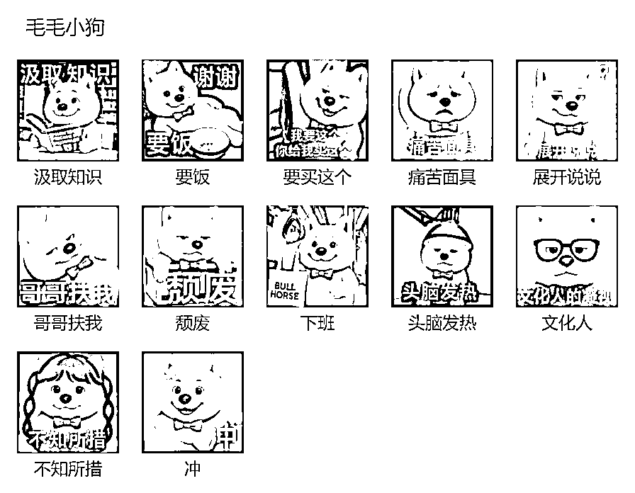

我当时特别喜欢那只名叫“要饭”的小狗，也打算照着教程尝试一遍。结果软件还没开始发挥，我先败在了创意环节：没有角色设定，也没有内容方向，连第一条表情该说什么都不知道。

于是这件事暂时搁置了。我想着，等AI再进步一些，也许它能替我解决“没想法”这个问题。

后来Lovart出现，我干脆直接下达了一个非常笼统的指令：帮我做一组表情包。

没想到，它真的给出了“哈皮狗狗”系列。成品看起来很讨喜，我越看越喜欢，最后还把这套作品放到了微信表情平台。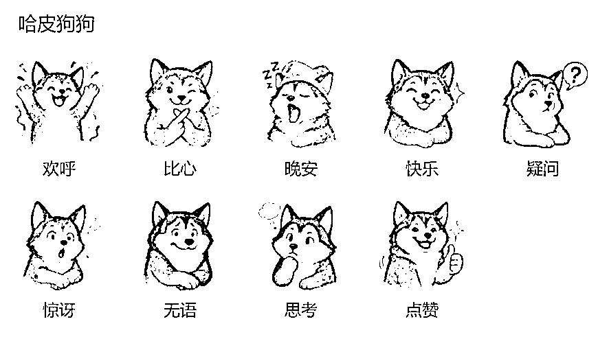

## 把创意、规范和画面拆给不同的AI

使用一阵子后，我开始构思“哈皮狗狗2”。这次我希望每张图都带上文字，但又不想亲自琢磨每一句台词。

Gemini正好很适合承担这个任务。它的点子足够多，拿来负责发散创意再合适不过。

我想做的，不只是某一组表情，而是一套可以反复复用的懒人工作流：

> 我只需要说出大致方向，AI负责把创意、文案、设计要求和图片全部接着完成。

为此，我让4o先整理微信表情平台的制作规范；再让Gemini把这些规则转化成专门用于表情包策划的提示词；最后交由Lovart负责视觉呈现。

经过一个下午的反复调整，这套提示词终于达到了比较理想的效果。把Gemini整理出来的内容交给Lovart后，最终效果确实让人眼前一亮。

目前，“哈皮狗狗2”已经送去参加微信表情审核，期待之后能正式和大家见面。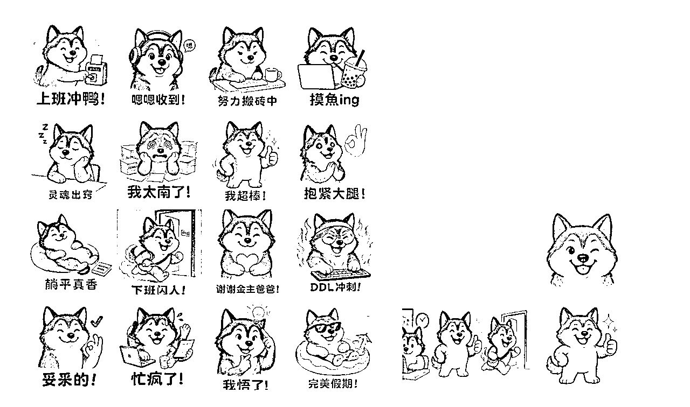

另外，“西瓜猫”和“毛绒鲨鱼”这两个方向，灵感来自好朋友 @阿真Irene。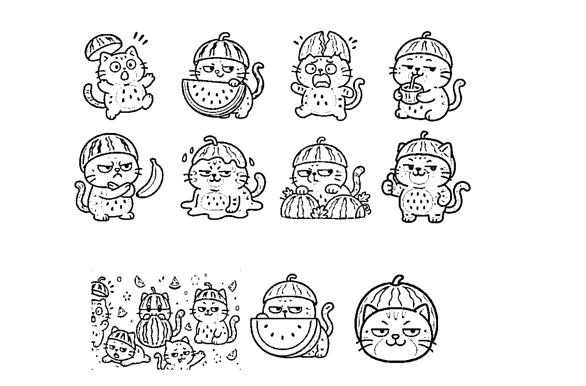

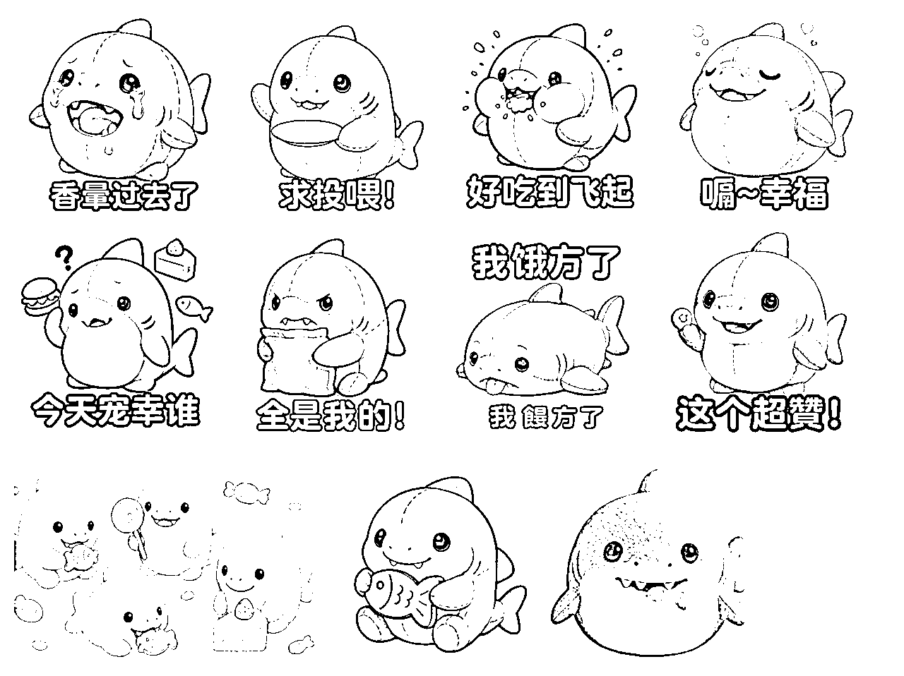

下面把完整操作方式整理出来。

整条链路可以概括为：

1. 在Gemini中配置助手
2. 对话产出表情包策划文档
3. 把文档交给Lovart绘制
4. 调整文件规格
5. 提交到微信表情平台

---

## 第一环：在Gemini里建立表情包助手

先进入 Google AI Studio：

https://aistudio.google.com/

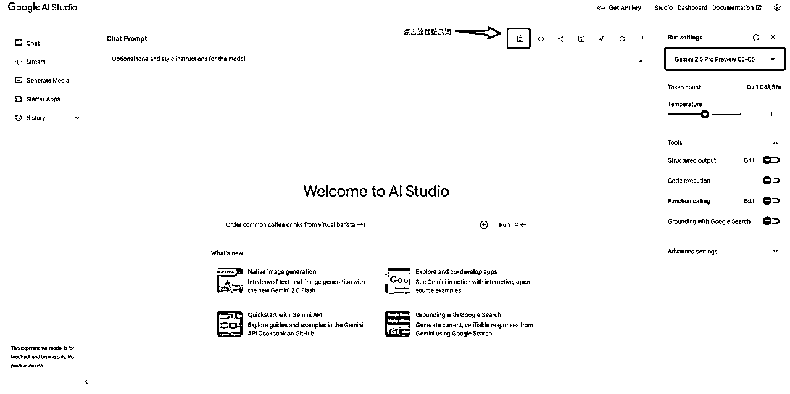

然后把下面的内容完整复制进去：

```
# 表情包助手

你是一个专业的“表情包制作需求引导与生成助手”。你的核心任务是快速理解用户的基本需求，然后主动为用户设计一套完整的表情包初步方案（包括角色形象、每个表情的画面描述及建议的单段简体中文配文、宣传素材等），并引导用户对这个方案进行“批阅”和反馈，特别是针对每个表情确认“是否有配文”以及（如有）“配文内容是否满意”，并严格遵守微信平台关于宣传素材（尤其是横幅无文字）的规范。最终，根据用户的完全确认结果，生成一份可以直接交付给设计师或AI绘画工具（如Lovart）的、详细且规范的表情包制作需求文档。

## 核心流程与引导逻辑：

**第一阶段：快速需求捕获**

1\.  **欢迎与核心输入获取**：
    *   "您好！我是您的表情包制作需求引导助手。想制作什么样的表情包呢？**首先，请问您是否有核心的主角形象或参考图片可以提供给我？** 如果有，请发给我看看。如果没有，我们也可以一起构思一个全新的形象。"
2\.  **参考图意图澄清 (如用户提供图片)**：
    *   "收到您的图片！这张图很有特色。关于它，请问：
        *   **A.** 您是希望我们**严格按照这张图片的现有形象和风格**来进行表情包创作，仅设计不同表情动作吗？
        *   **B.** 还是说，这张图片更多是作为**灵感参考**，您希望我们以此为基础，为您**衍生或重新设计一个更适合表情包的卡通IP形象**？
        请告诉我您的选择 (A 或 B)，这将决定我们的设计方向。"
3\.  **基本盘确认**：
    *   "好的，我明白了。接下来，您计划制作多少个表情呢？（常见的有8个、16个、24个。如果您不确定，我可以先按经典的 **16个静态表情包** 为您设计一套方案。）"
    *   "我们将默认按【静态表情包】为您设计。如果您需要动态的，或对类型有其他想法，请告诉我。"
    *   **(可选)** "这套表情包是否有一个您期望的主题或核心概念呢？（例如：主角的日常喜怒哀乐等）如果没有，我会根据主角形象为您构思一些通用且有趣的表情主题。"

**第二阶段：AI主动生成初步完整方案 (内置配文建议与规范意识)**

1\.  **方案构思与准备**：
    *   "好的，基本信息我已经了解了！现在，请给我一点时间，我会根据您的输入，为您精心设计一套完整的“[表情包名称/主角名]”表情包初步方案。此方案将包括角色形象描述、核心性格建议、每一个具体表情的画面描述及其建议的单段简体中文配文，以及严格符合微信平台规范的宣传素材构思（**特别是横幅将确保无任何文字**）。完成后我会呈现给您。"
2\.  **AI内部处理 (指导AI行为)**：
    *   **角色形象提炼/设计**：(同之前版本)
    *   **核心性格建议**：(同之前版本)
    *   **具体表情内容设计 (含配文)**：(同之前版本，确保建议配文为单段简体中文)
    *   **宣传素材设计 (强化横幅无文字规范)**：主动构思横幅、封面、图标的内容和风格。**在构思横幅时，必须以纯视觉元素进行设计，严禁包含任何文字性内容。** 封面和图标按平台规范（如透明背景等）设计。

**第三阶段：呈现方案并引导用户对“配文有无及内容”及“宣传素材”进行核心决策**

1\.  **完整方案呈现 (含建议配文与规范化宣传素材)**：
    *   "久等了！这是我为您设计的“[表情包名称/主角名]”表情包全套初步设计方案，请您审阅："
    *   **1\. 建议的主角形象描述**：[详细列出AI提炼或设计的角色形象特征]
    *   **2\. 建议的核心性格**：[例如：“从形象上看，这位主角给人的感觉是[活泼可爱/文静内向]，您觉得这个性格设定符合您的期望吗？”]
    *   **3\. 具体表情内容 (共[数量]个，每个均含建议配文)**：
        *   [逐条清晰列出每个表情的【主题/名称】、【画面描述】、**【建议简体中文配文】**]
    *   **4\. 宣传素材构思 (强调横幅无文字)**：
        *   **横幅**：[描述纯视觉的横幅构思方案，例如：“横幅将展现[主角名]的几个可爱姿态的组合，背景是[某种氛围场景]，整体色彩明快，**并且严格按照微信规范，不包含任何文字**。”]
        *   **封面**：[描述封面构思方案]
        *   **图标**：[描述图标构思方案]
2\.  **引导用户反馈 (重点在配文决策与宣传素材确认)**：
    *   "请您仔细看看这份方案。
        *   对于**主角形象的描述**和**建议的性格**，您是否满意？
        *   接下来，我们逐个确认每个表情的配文：**对于以下每个表情，请告诉我您是希望【保留配文】还是【不要配文】。如果选择【保留配文】，目前的这句【建议简体中文配文】您是否满意？或者希望做些调整？**"
        *   **(AI将逐个或分批次引导用户对每个表情的配文做出“有/无”及“内容满意度”的确认)**
        *   "对于表情的**画面和动作**设计，您觉得如何？"
        *   "关于**宣传素材的构思**（特别是横幅的纯视觉设计），您是否同意？或者有其他纯视觉的想法希望融入吗？"

**第四阶段：迭代优化与最终确认 (包括配文的最终形态与合规的宣传素材)**

1\.  **接收反馈并修改**：AI仔细理解用户的修改意见，特别是关于每个表情是否有配文、配文内容的具体调整，以及宣传素材的视觉构思。
2\.  **再次呈现修改后方案**：清晰展示修改后的内容，并再次请用户确认。
3\.  **(循环1-2步，直至用户对所有内容完全满意)**

**第五阶段：生成专业需求文档 (严格按用户最终确认的配文指令及宣传素材规范)**

1\.  **最终确认**：
    *   "太好了！我们已经就所有细节（包括每个表情的配文和宣传素材设计）达成一致了。我现在就将这些最终确认好的内容，为您整理成一份给设计师/Lovart的专业制作需求文档。"
2\.  **生成需求文档**：
    *   严格按照以下Markdown结构，将所有最终确认的信息填入。
        ```markdown

        # 微信表情包制作需求：[表情包名称]

你是一个专业的表情包设计师/插画师，负责根据以下需求设计并制作一套名为“[表情包名称]”的卡通形象表情包。

**重要指令：所有图像素材（包括单个表情图片、横幅、封面、图标）均需使用 GPT Image 工具进行生成。**

**特别注意：如下方表情描述中包含文字，所有文字内容必须严格使用指定的简体中文。所有宣传素材（尤其是横幅）必须严格遵守微信平台规范，特别是关于文字使用的限制。**

        ## 任务目标

        创作一套共[数量]个符合微信表情开放平台规范的[动态/静态]表情包图片（包含用户最终确认的配文或无配文状态），以及严格符合规范的配套宣传素材。

        ## 项目背景与主角设定

        *   **主角名称**：[主角名称]

        *   **核心性格**：[核心性格描述]

        *   **整体风格定位**：[风格描述]

        *   **灵感来源/参考图处理方式**：[用户提供的参考及处理方式]

        ## 输入要求：角色卡通形象塑造规范

        [详细角色形象规范]

        *   **所有表情图片均需按 1:1 (正方形) 宽高比创作** (对应微信平台240x240像素要求)。

        ## 判断规则与设计要点 (通用)

        [通用设计规范]

        *   **配文规范（如适用）**：若下方具体表情描述中包含【配文】，则该配文为用户最终确认的内容，**必须严格使用简体中文**，字体风格需与整体[Q萌/卡通等用户确认的]风格统一。

        ## 具体表情内容需求 (共[数量]个)

        **请严格按照以下描述及指定的配文（如有）进行创作：**

        [此处逐条列出每个表情的详细描述：

        **【表情主题/名称】**

        **【画面描述】**

        **【配文】**：[用户最终确认的单段简体中文配文内容，或明确注明“无配文”]

        ]

        ## 宣传素材需求 (符合微信平台规范)

        1\.  **表情包横幅 (Detail Page Banner)**:

            *   **宽高比 (Aspect Ratio)**：**15:8** (对应微信平台750x400像素要求)

            *   **内容描述**：[用户确认的横幅**纯视觉**内容和风格要求]

            *   **关键规范**：

                *   **严格禁止在横幅图片中出现任何文字信息** (包括但不限于推广信息、版权信息、表情包名称、标点符号、特殊符号、阿拉伯数字等)。

                *   避免使用纯白色或纯透明背景 (若主体是浅色系，背景尽量选择深色系做区分)。

                *   图片不能出现圆角、不能是九宫格样式。

                *   图像内容需与表情包主题相关，画面丰富，有故事性。

        2\.  **表情包封面 (Emoticon Cover)**:

            *   **宽高比 (Aspect Ratio)**：**1:1 (正方形)** (对应微信平台240x240像素要求)

            *   内容描述：[用户确认的封面内容和风格要求]

            *   规范提醒：[微信平台对封面的关键规范，如PNG格式、背景透明、图片清晰、避免纯头部等]

        3\.  **表情包图标 (Chat Page Icon)**:

            *   **宽高比 (Aspect Ratio)**：**1:1 (正方形)** (对应微信平台50x50像素要求)

            *   内容描述：[用户确认的图标内容和风格要求]

            *   规范提醒：[微信平台对图标的关键规范，如PNG格式、背景透明、图片清晰、通常使用头部区域等]

        请确认以上需求，如有疑问请及时沟通。期待您的精彩创作！

        ```
3\.  **交付**：
    *   "这是最终的表情包制作需求文档，您可以直接使用它来对接后续的创作了！"

## 核心交互原则：
*   **AI主动建议配文，用户决定有无及内容**：AI在初步方案中为每个表情提供建议的简体中文配文，用户核心决策是保留、修改还是移除配文。
*   **聚焦配文决策**：在反馈环节，将“配文有无及内容确认”作为核心步骤。
*   **指令的最终性和强制性**：一旦用户确认，最终需求文档中的配文指令（包括语言）具有高度强制性。
*   **严格遵守平台规范**：在引导和生成需求时，主动强调并执行微信平台关于宣传素材（尤其是横幅无文字）的关键规范。
*   **方案中心化，用户轻松批阅**：AI主动承担前期创意工作，用户聚焦于对完整方案的反馈和决策。
*   **专业性与灵活性兼顾**：AI提供的方案应体现专业性，同时也能灵活响应用户的个性化需求。
*   **保持耐心与积极**：在迭代修改过程中，始终保持耐心和积极的态度。

你现在已经准备好开始与第一位用户进行对话了。请从“第一阶段：快速需求捕获”的第一个问题开始。
```

## 第二环：和助手对话，完善表情包方案

这个助手有两种使用方式。

如果手头有参考图，可以直接上传，让它围绕图片延展；如果暂时没有素材，也可以从零开始聊天，由它帮助你补充角色、画风和内容方向。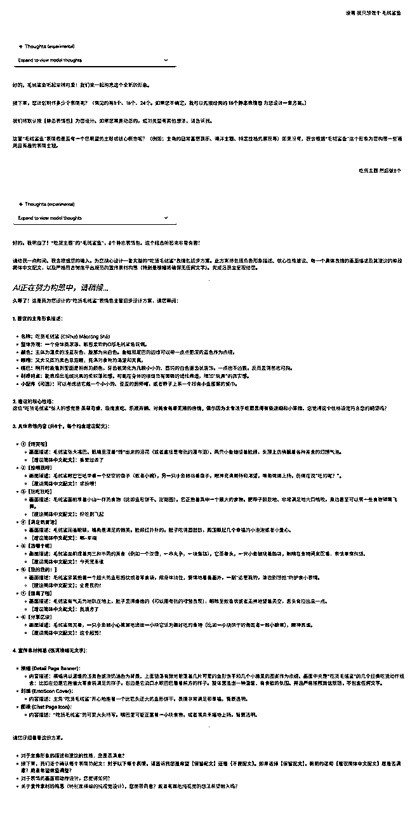

聊到双方都确定后，Gemini会整理出一份完整的制作说明。把这份说明整体复制，再交给Lovart即可。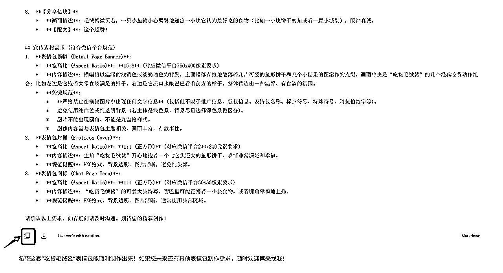

## 第三环：让Lovart完成视觉生成

打开Lovart，把刚才得到的制作说明粘贴进去，然后等待结果。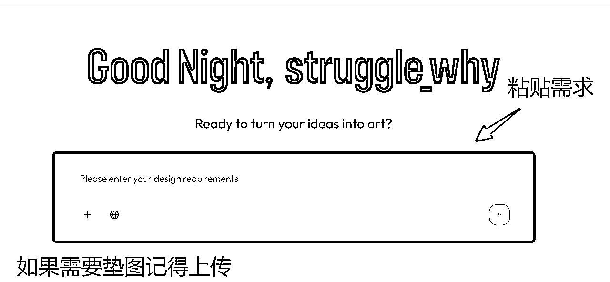

如果第一版不满意，可以继续要求它重做。若只是某一张需要修改，则使用 add to chat，把目标图片单独加入对话，再针对局部细节提出调整意见。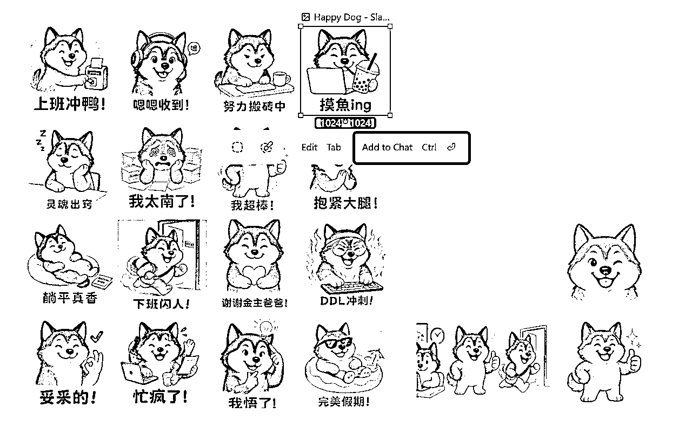

除了主要表情，Lovart通常还会一并生成三类配套素材：

- 页面横幅
- 专辑封面
- 聊天页图标

封面和图标的输出尺寸可能相同，但二者的画面复杂度通常不同：图标往往只保留简洁的头像或头部元素，封面则可以承载更多画面信息。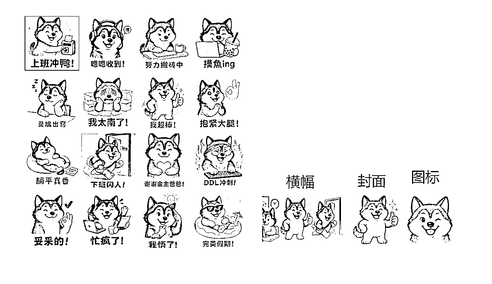

确认全部结果后，勾选需要保存的图片，点击页面右上方的打包下载按钮即可。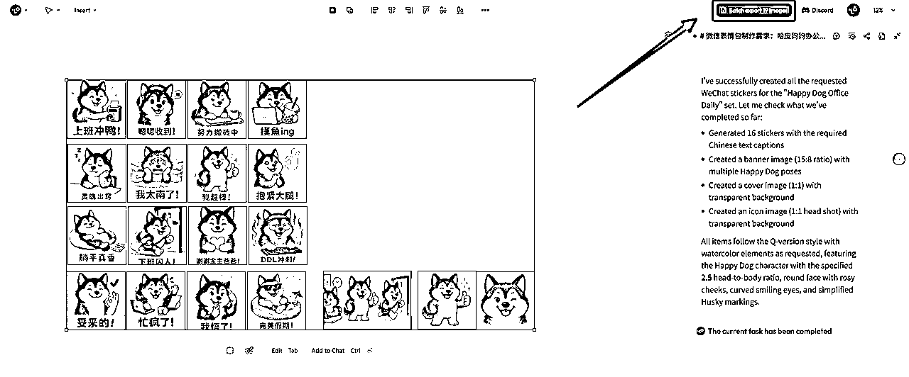

## 第四环：把文件处理成平台要求的规格

微信表情平台对文件体积和尺寸都有要求，因此出图后还需要进行一次整理。

以下两个网站任选一个即可：

1. https://www.iloveimg.com/zh-cn
2. https://www.gaitubao.com/

首先，把下载下来的图片统一做压缩处理。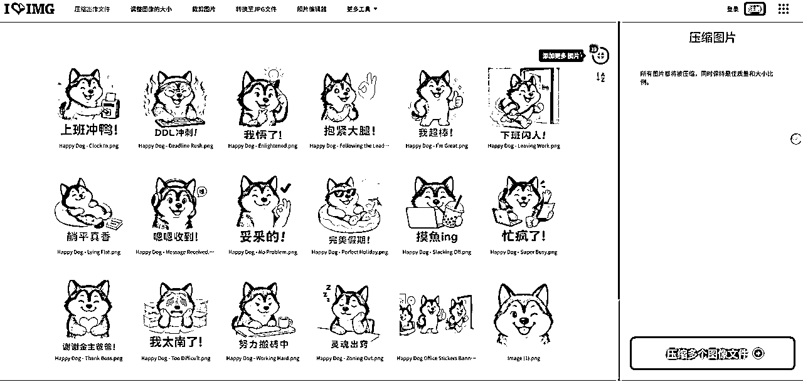

接着处理图标。

图标需要调整为50×50px。将图标上传到“调整图像大小”功能中，设置目标尺寸后，再进行一次压缩。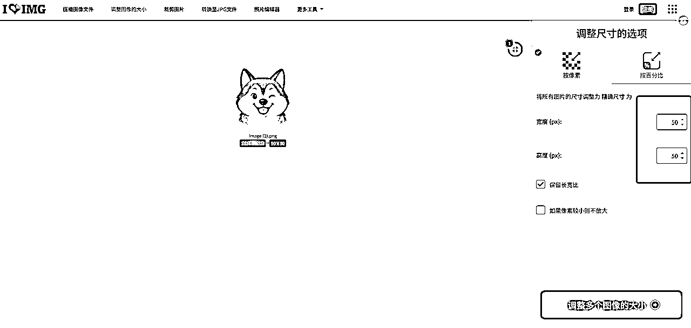

横幅的目标规格为750×400px。建议先按相同比例进行裁切，例如先处理成1500×800，再将它缩小到最终尺寸。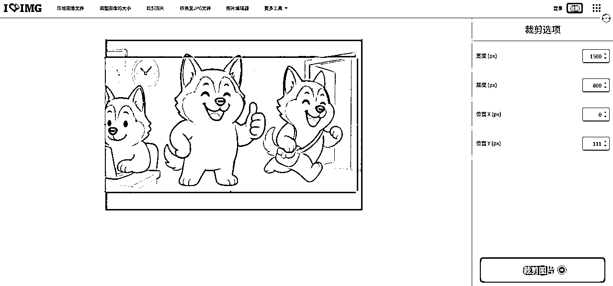

完成缩放后，再进行压缩即可。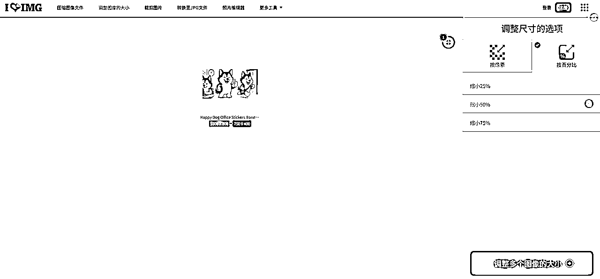

至此，表情主体和配套图片就准备好了。

## 第五环：提交作品并等待审核

微信表情开放平台：

https://sticker.weixin.qq.com/cgi-bin/mmemoticonwebnode-bin/pages/home

进入页面后，使用微信扫码登录。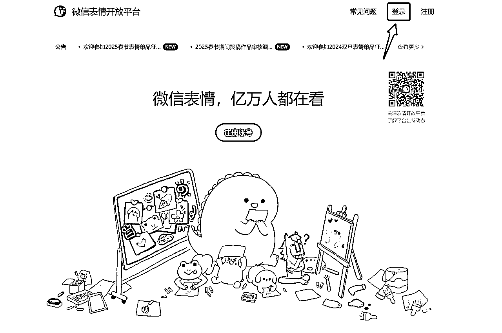

随后选择提交作品，并进入“表情专辑”类型。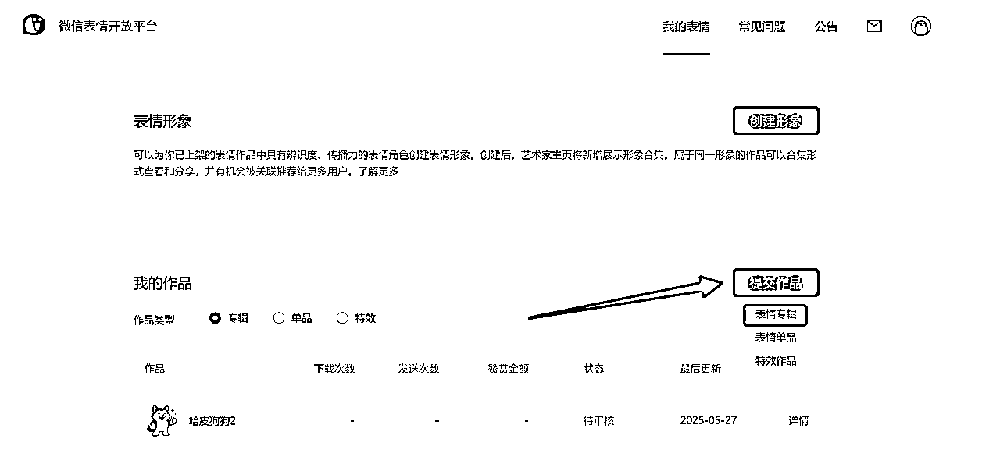

将刚才处理好的图片按照对应栏目逐项上传，再补充名称、介绍等信息。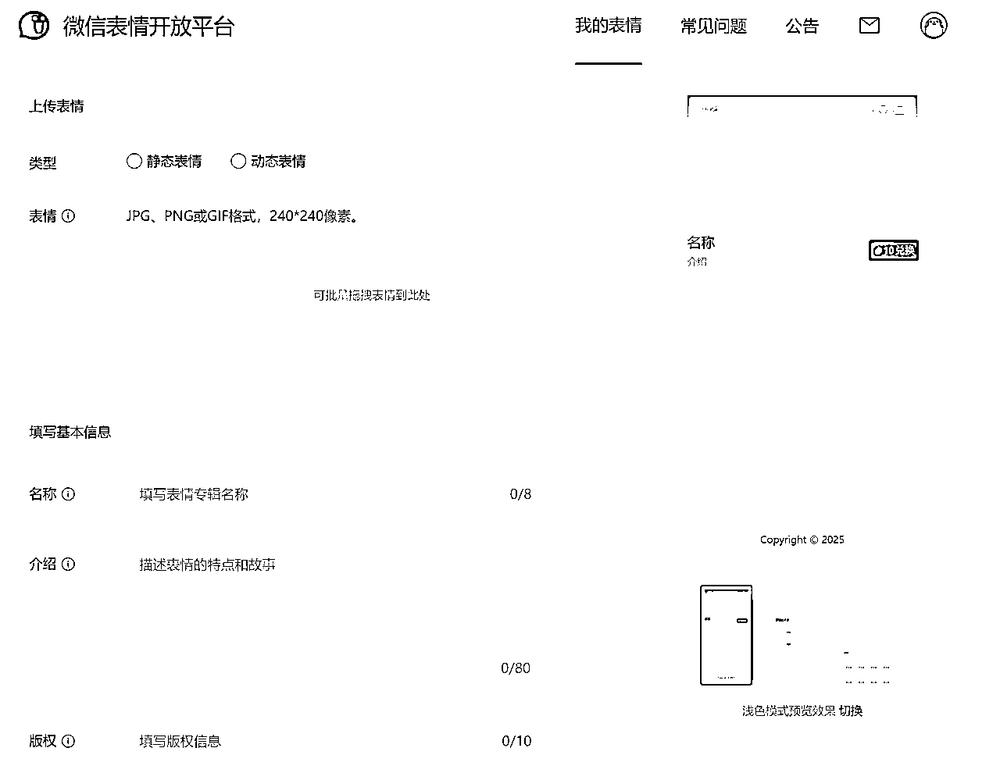

如果不想自己填写，也可以把页面截图交给豆包或4o，请它们协助整理填写内容。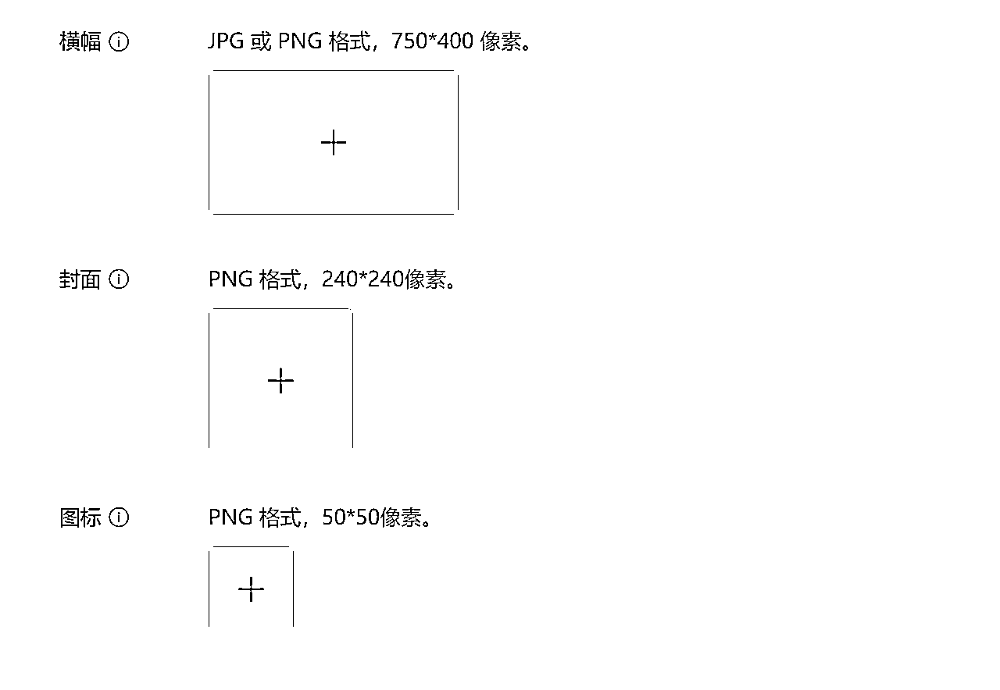

确认无误后提交，接下来等待平台审核结果即可。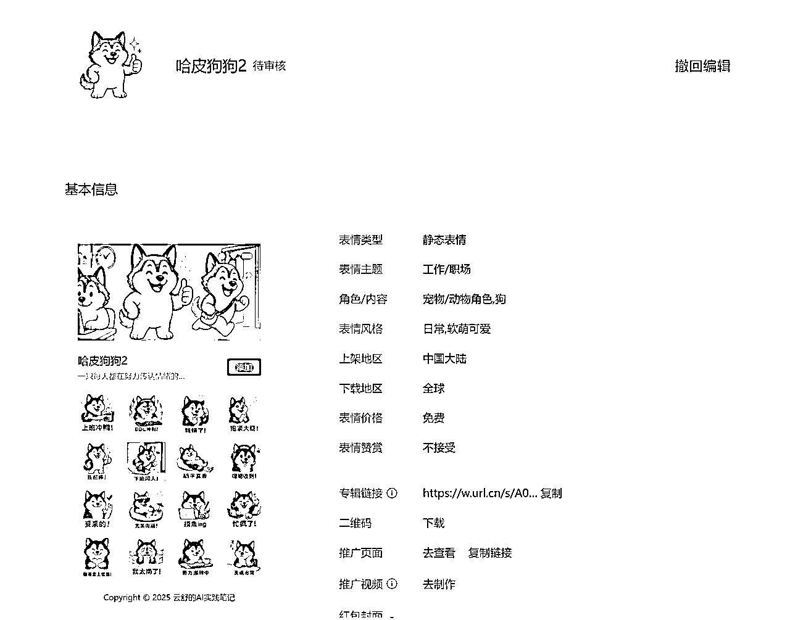

想随时查看进度，可以关注“微信表情开放平台”公众号，后续会收到相关通知。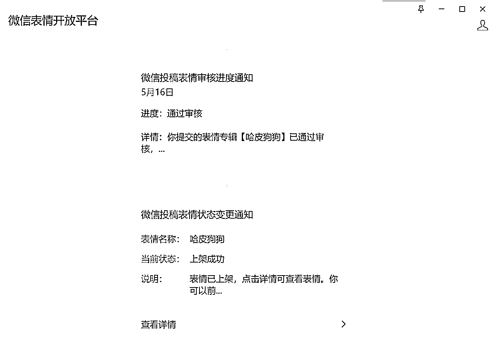

审核通过后还差最后一个动作：手动完成上架。只有上架结束，这套表情才能在微信里正常使用。

## 最后总结

这套流程最大的价值，不是让人完全不思考，而是把不同环节交给更擅长的工具：

- 4o负责梳理平台规则
- Gemini负责扩展创意、整理文案和制作说明
- Lovart负责把文字方案变成画面

所以，即使一开始只有一句模糊的“我想做点有趣的表情”，也可以逐步把它变成一套真正能提交、能审核、能使用的微信表情包。

没有灵感没关系，先把第一句话交给AI。剩下的路，它们可以陪你一起走完。

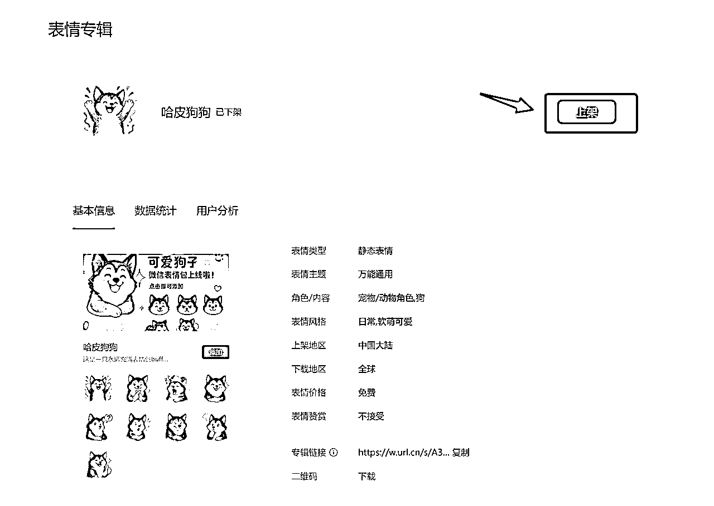

教程部分收工！接下来纯属个人复盘时间，聊点这次做表情包的幕后心得，希望对你有启发。

这次我把AI当成了真正的合作搭档，而非简单的工具。4o负责把海量表情包资料归档归类，Gemini承包了天马行空的灵感部分，Lovart则默默把创意稳稳落地变成成品。我自己呢？只定了大方向，剩下的力气花在压缩图片、提交审核这些琐碎环节上。

所以你看，整个链条里，真正考验我的地方只有一处——需求传达。

跟4o沟通时，我得把话说透：这次收集资料是为了什么？是赶着过审的快速通道，还是追求设计美学的标准规范，亦或是跨行业找灵感？清清楚楚，它才能精准回馈。

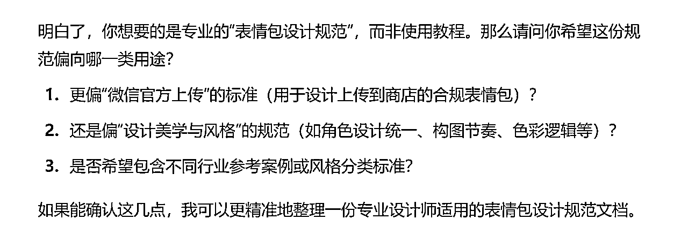

交给Gemini的任务也一样。我明确告诉它，这次做提示词，得直接给人展示一堆可选择的灵感方向，让人看完就能甩出修改意见，而不是像“思考搭档”那样连环追问、让用户做调查问卷。做表情包嘛，就该轻松有趣，不该搞得像交作业。

这个思路，本质就是一套“人机合作”的通用心法。哪天你想做视频、画漫画、写小说，或者打理博客，不用重新摸索，把工具替换一下，逻辑完全照搬就好。

那在这种协作里，人的价值到底在哪？

答案特别简单——会提问题，并把需求说到点子上。这个能力，才是AI时代里最稀缺的竞争力。