# 在📕做虚拟资料，选品才是起跑线
作者：龙哥

选品最怕卡在原地反复纠结。记住两件事：多看，多动手。

别指望一个关键词看一篇笔记就下结论，要沿着一个词往深里刷、往宽里找，才能摸到真正能卖的点。也不用追求一次选到完美品，前期给自己设个小目标，比如先锁定3个方向上手实操，后续在跑的过程中滚动选品，越做越准。

## 选品要过三道关

这三条是通用的普适法则，做虚拟也做实物都适用。

1. 用户是否真有这个需求。看笔记底下的互动，点赞收藏高不高，评论区里是否频繁出现“求分享”、“求带一下”、“怎么领取”等话术。
2. 这个需求是不是当下急的。看求分享类评论集中在哪个时间段，越近期、越密集，说明痛点越刚。
3. 用户愿不愿意掏钱。需求再大，如果只能白嫖，变现就难。必须确认付费意愿存在。

## 新手可复制的7步选品流程

这套打法既能用在虚拟资料，也能套用到📕电商的实物选品。

### 七步总览
第一步：搭建关键词池
第二步：用关键词去搜笔记
第三步：拆解笔记
第四步：锁定具体上架品
第五步：检验付费意愿
第六步：确定售价
第七步：排查版权风险

### 第一步：搭建关键词池
关键词池是后续搜索的发动机。

准备一个Excel表格，先定一个种子词。种子词可以很简单，比如 表格、PPT、家长会、早教、幼小衔接、四六级考试，只要和你赛道相关即可。也可以用组合公式：人群+需求+延伸词，比如 大学生+四六级考试+作文模板。

把种子词丢进📕搜索框，从四个地方扩词：下拉框的长尾词、话题页的关联词、爆款笔记里的核心词、搜索框下方的推荐词。

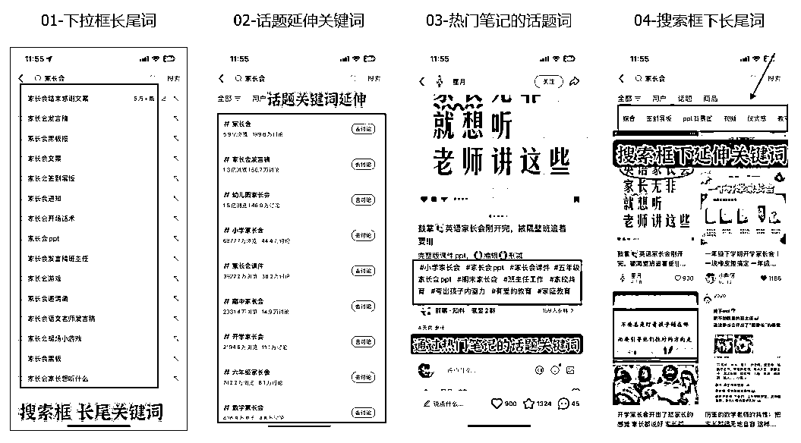

把这些更细的词全部收拢到表格里，就形成了一张属于自己的关键词库。

### 第二步：搜索笔记
无论是种子词还是扩出来的长尾词，搜完都要看数据。起步阶段建议用综合排序或最多评论排序来看，先筛出互动高的内容。如果对时效有要求，就在筛选里限定发布时间。

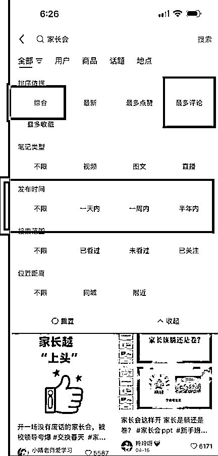

### 第三步：拆解笔记
看笔记主要看三件事：笔记和评论的时间分布、评论区的对话、笔记是否带货、挂车商品的销量。

笔记时间为什么重要？需求是跟着时间走的。越是近期仍有热度，越值得做。爆款笔记不必太老，只要评论区最近1-2个月还有人问“怎么买”“怎么领”，需求就还在。比如去年的爆款，可以看它具体是几月发的，规律类需求大概率今年同一时间会复现，可以先记到选品表里等节点。

注意发布时间不等于需求期。很多笔记是提前布局的，例如3月开学的内容，1月底就开始发了，这时要看评论区集中互动的时间来判断真实需求点。

看发布时间有两种常见情况：
情况1：直接在笔记底部能看到发布时间，同时看评论区是否仍有求分享互动。如果像24年11月的笔记，1月评论区还在密集求资料，说明该主题1月仍有需求，可继续深挖同主题笔记判断当下热度。

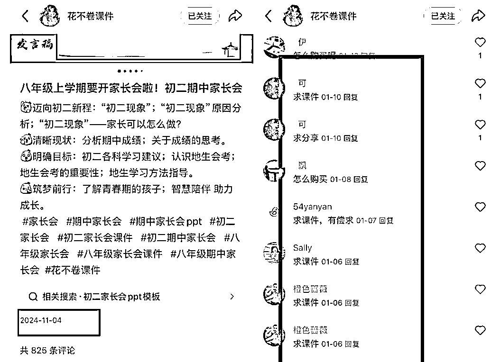

情况2：笔记显示编辑于。只能靠评论区最早互动时间推断大概发布时间。如笔记显示编辑于2月23日，评论却从去年11月开始，说明11月就有需求，最近3天仍有人求分享，基本可以判定现在仍有市场，需再搜更多笔记验证热度。

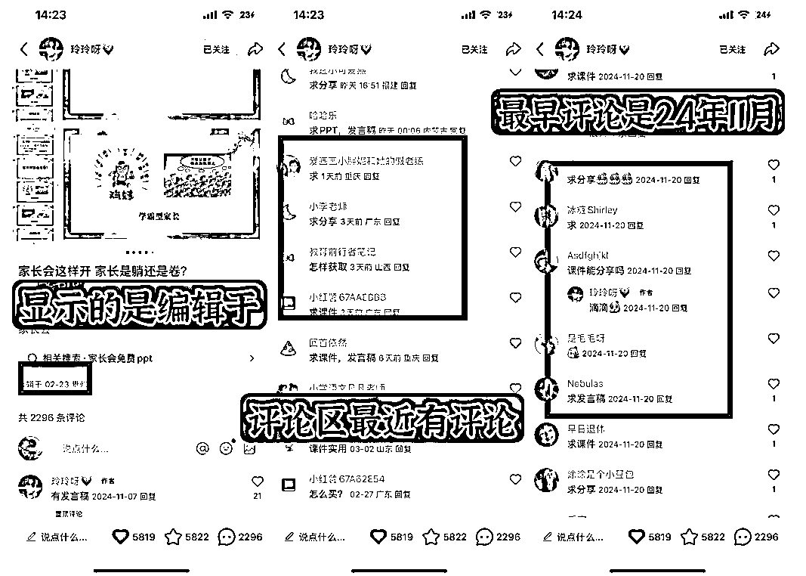

再看笔记是否挂车。

情况1：笔记没挂车。看点赞和评论质量。近期多篇点赞过500，说明内容需求被认可。评论区是否全是求资料型留言，这类笔记往往说明供给不足。如果点赞高但评论区没人说话，多半是干货自取型，需求已被满足。特殊情况是笔记放了群链接或🛰️，评论区安静但不代表没人要。

比如两个点赞都过千的近期笔记，一个评论区全是“已关求分享”，一个评论区在求搭子。显然第一个更值得跟进。

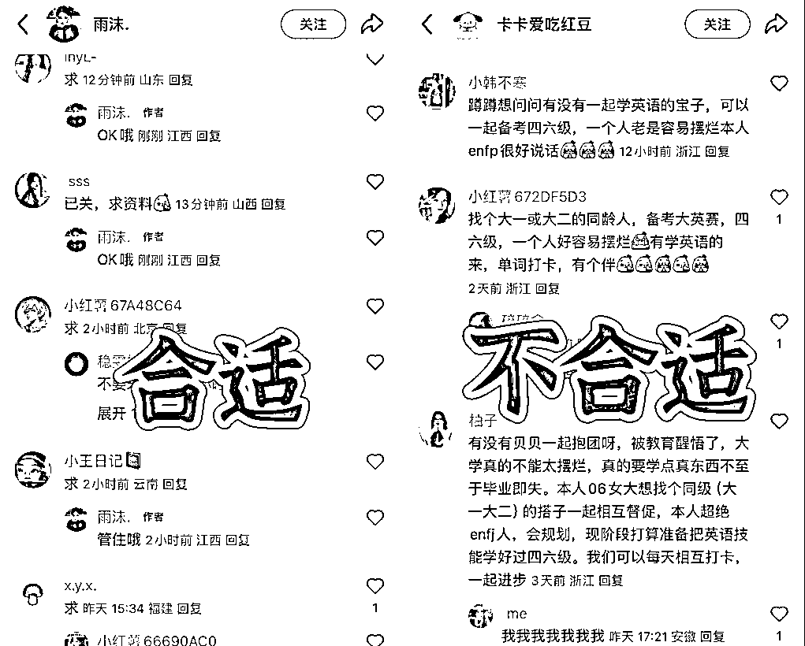

情况2：笔记已挂车。重点看商品销量。有销量的挂车笔记，即使点赞不高也要记录。单篇销量往往是账号多篇内容叠加的结果，可以顺着账号主页、换关键词再去找爆款时间。同时结合笔记数据和商品销量判断转化情况，有的笔记数据好看但转化差。

### 第四步：确定要上架的具体产品
笔记已挂车，直接参考同款即可。笔记未挂车，就要从正文内容反推用户到底想要什么，或加同行的引流🛰️看后端实际在卖什么。

从笔记内容判断选品方向。比如笔记主打核心1500词、听力技巧，用户要的是考试重点知识的整理。

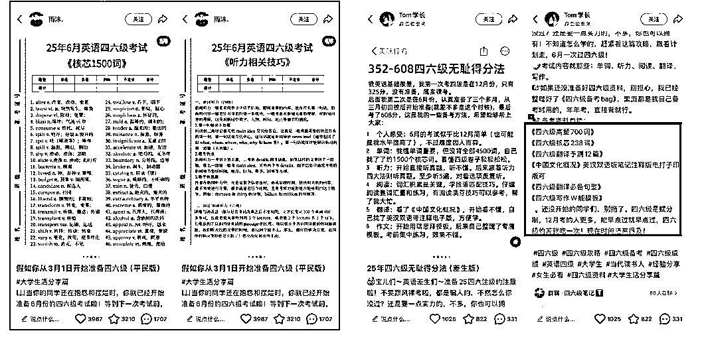

有的笔记会更直接，明确写出可以获得的备考资料。

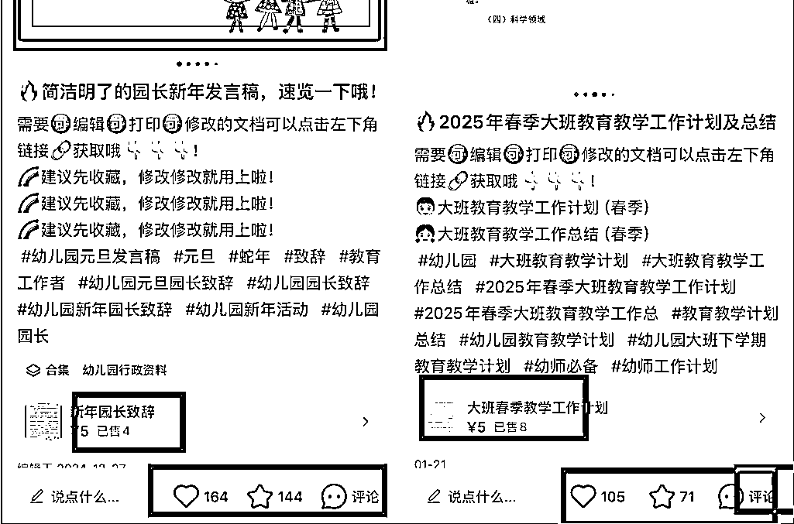

### 第五步：验证付费意愿
点赞多、评论求分享，不等于愿意付费。有些资料同行直接白送，后端卖的是试听课、会员合集，你单独卖资料就没人买。有的资料内容很薄，客单价只能做1.9、2.9，难以规模化。还有的虽然有数据但转化极低。

比如单篇笔记点赞近200，销量却只有个位数，转化就很薄弱。

### 第六步：定价策略
虚拟资料边际成本趋近于零，卖1元赚1元，卖5元赚5元，但也不能乱标价。

01 参考同行价格
优先看📕站内有销量的链接价格区间，若找不到再看私域同行成交价。

01.1 站内同行
如四六级核心词汇，有同行卖2.9元/份，销量1279份。客单价低但设置了多个SKU，有高价组合可选，这类品就可以作为参考。

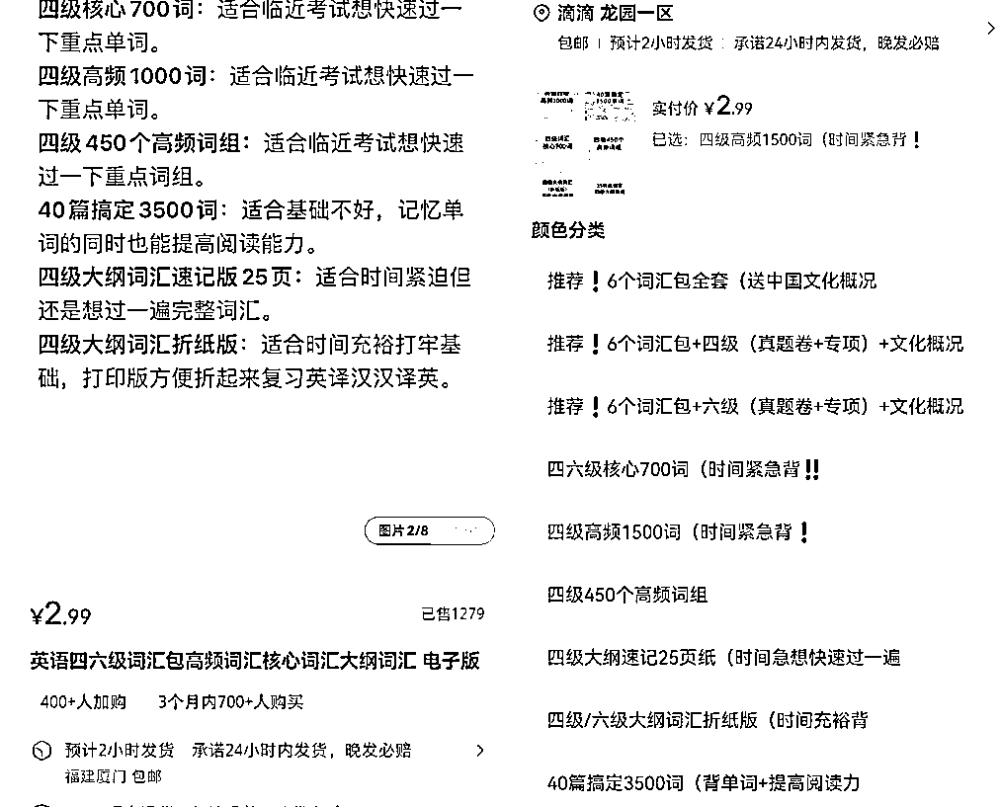

01.2 私域同行
关键词搜不到站内产品，不代表没机会。很多商家更习惯引流到🛰️卖。建议至少加20个以上同行🛰️，看后端卖什么、怎么定价。

开店相比引流，少了1对1成交环节，50元以上产品在📕笔记卖起来难度更大。所以要先搞清楚同行的打法，后续起号稳定后再考虑把付费用户沉到私域升单。

考试类后端多推课程或题库APP；教学教务类多做赛道会员；K12家长赛道常以免费资料引流，卖试听课。

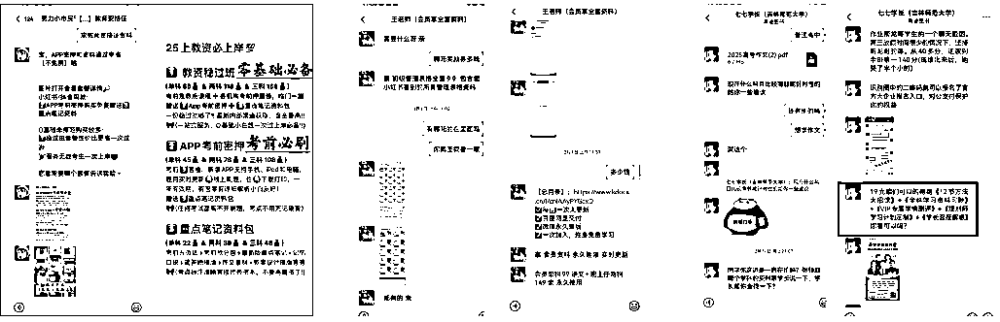

02 低价截流
兴趣电商的逻辑是用户对内容感兴趣会反复刷到。同一品类里价格略低于同行，成交概率会更高。平台已有热度销量的商品，适度降价更容易抢量。

03 梯度设计拉客单
虚拟资料单份价格普遍不高，可以用打包更优惠的组合提升客单。如家长会PPT单份9.9，30套19.9，全店会员39.9。用户为求划算会直接买套装。

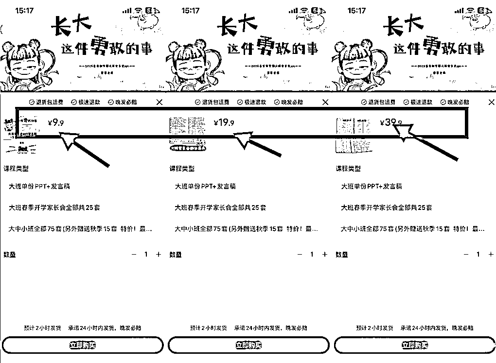

这就是典型的套装/会员拉升策略。

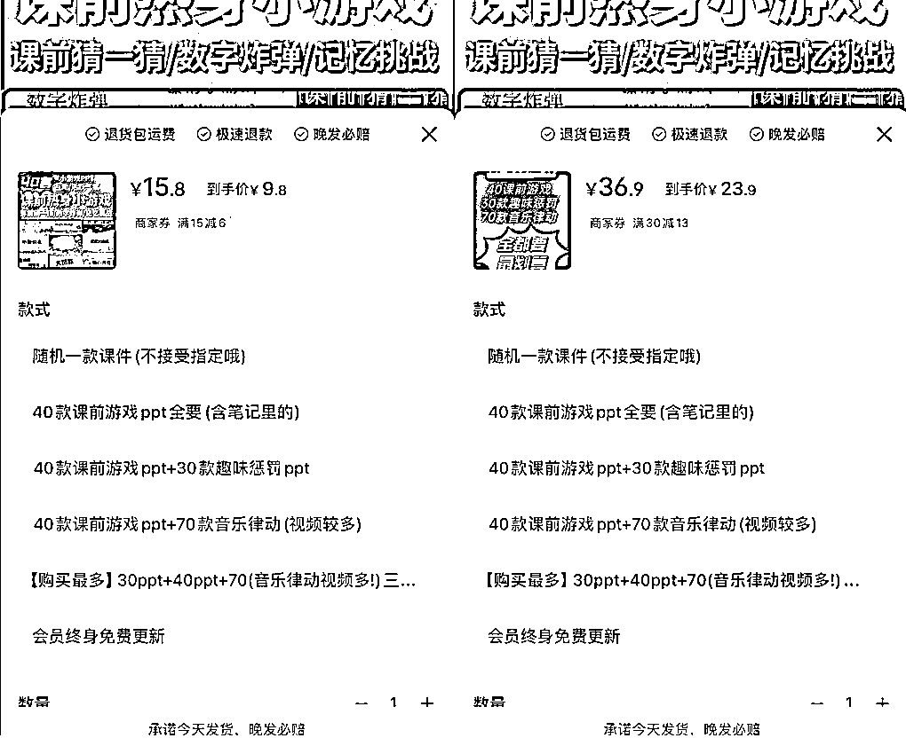

### 第七步：确认版权
别碰带版权的产品，安全第一才能持续。

整理了业内高风险品类提示：

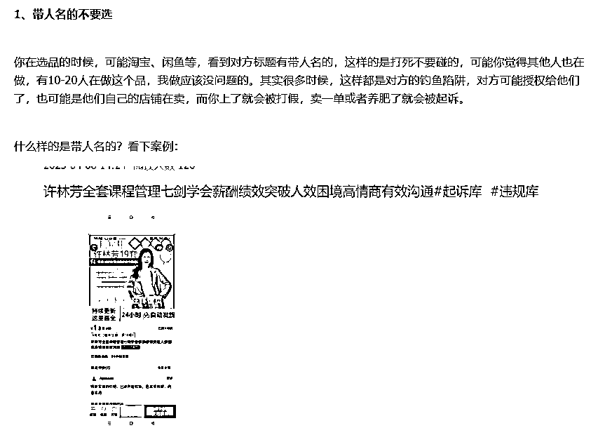

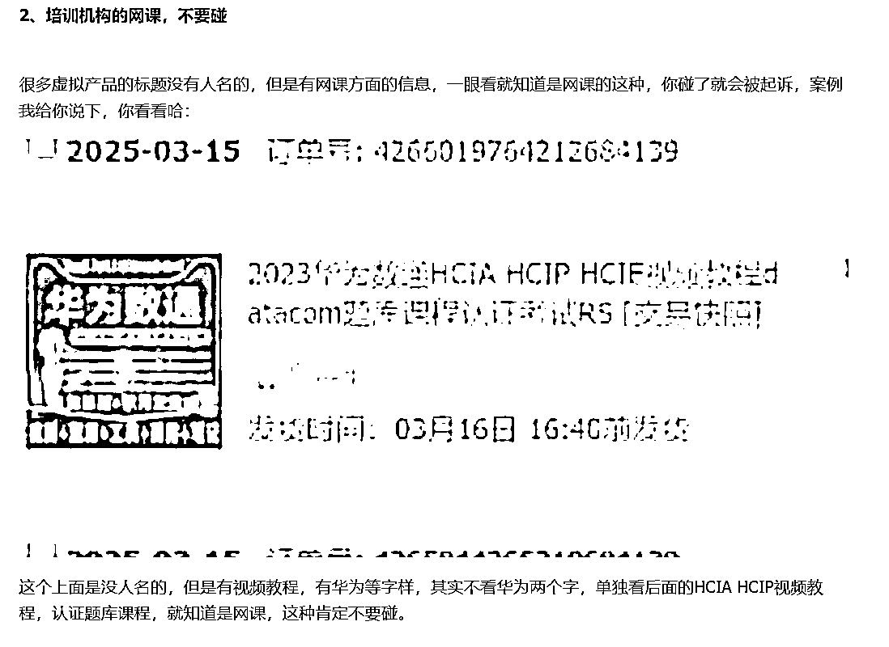

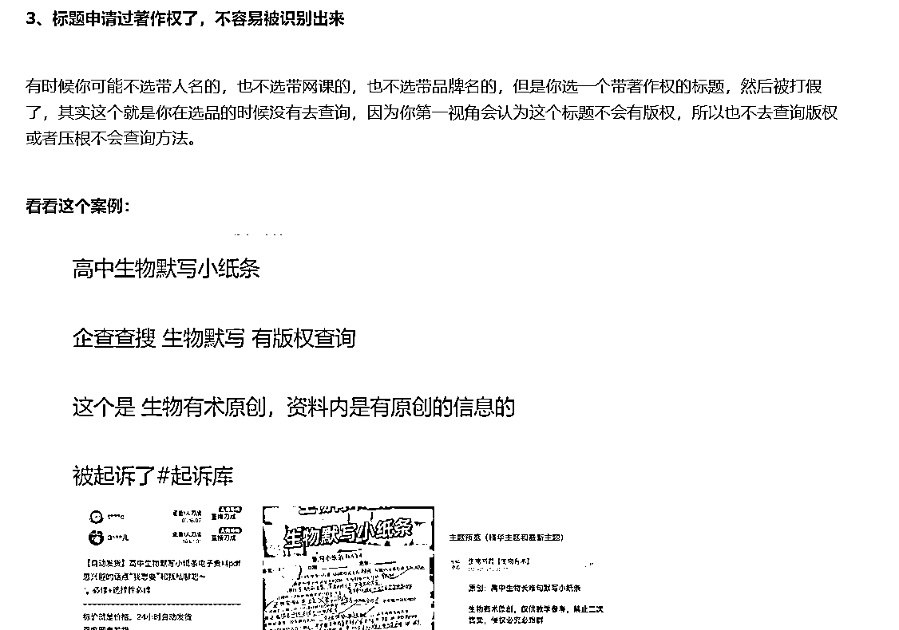

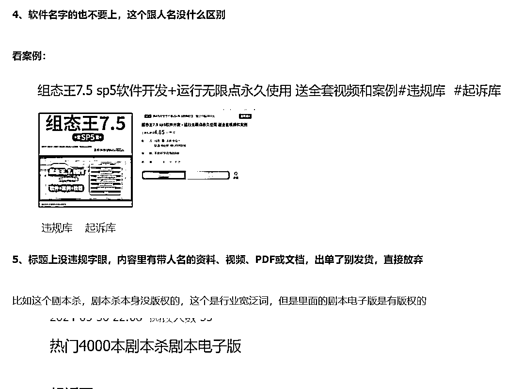

## 围追堵截式选品法

选品别指望工具一键解决，靠手动搜索和大量浏览去找机会。

第一步：关键词搜索找爆款笔记，再从笔记延伸到账号，在账号里继续淘品。
第二步：搜索相关商品，从商品延伸到店铺，收集店铺爆款。
第三步：用小号关注30个以上同赛道优秀账号，跟他们的内容和选品节奏。
第四步：找到15个以上运营1年以上的老号，扒他们去年的选品和内容。需求是周期性的，期末要期末资料，考试要考前冲刺。提前布局需要参考老号的年度规律。
第五步：加多个同行🛰️，看朋友圈的售卖动作。

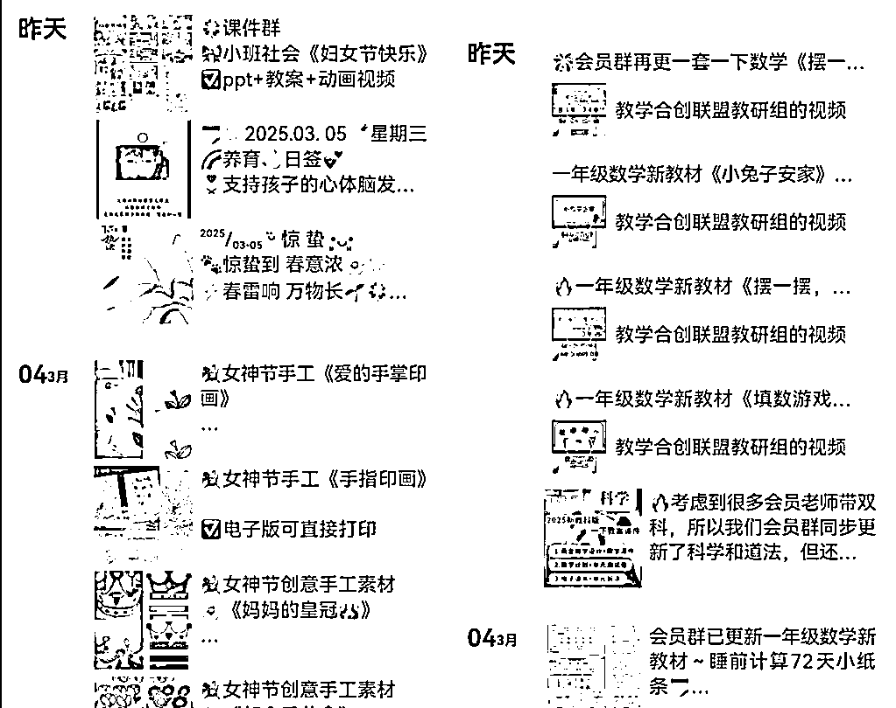

第六步：加入同行群聊，通过群内消息感知用户真实需求。

## 跨平台验证法

淘宝、拼多多上很多虚拟资料在卖，销量好的品往往也能在📕验证。

第一步：找电商平台高销量产品。确定赛道后用关键词搜高销量店铺；没有明确赛道就搜电子资料、PPT模板等大词，多刷多收藏，平台会不断推送相关品。

第二步：验证📕需求。用产品名或内容关键词在📕搜，看笔记表现。📕用户基数大，很少出现需求很大但没人发帖的情况。通过点赞评论判断需求大小。

再看是否已有销量，有销量就能确认需求存在，再结合时间窗口判断是否适合现在入场。

需求时间要对齐，比如考研资料要跟着备考进度走，开学期卖期末复习就不合适。通过爆文发布时间和评论区求资料时间来锚定窗口，也可参考考试时间线来反推。

## 100+个📕虚拟资料/产品