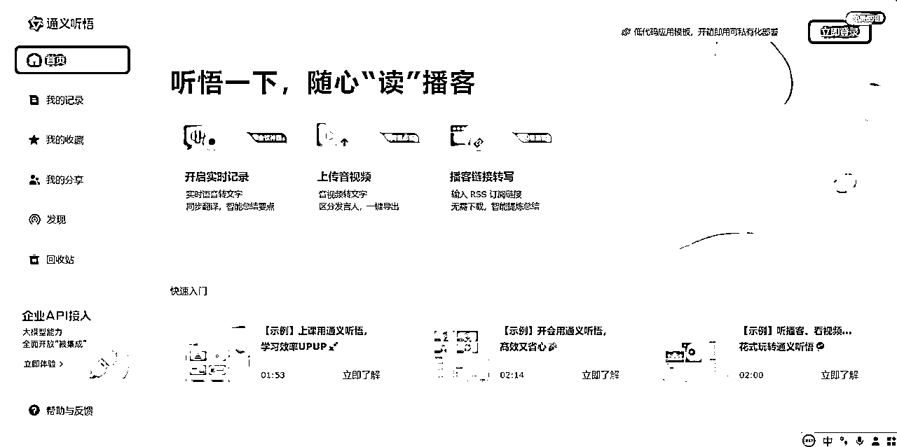
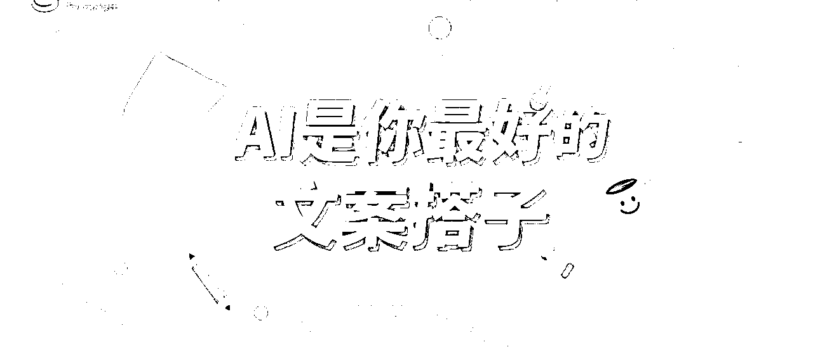
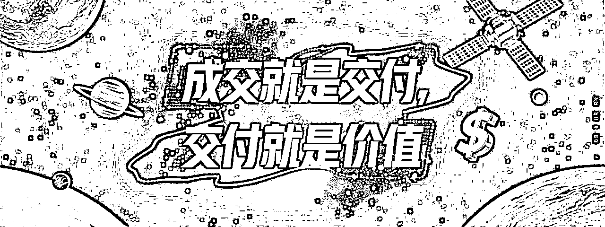
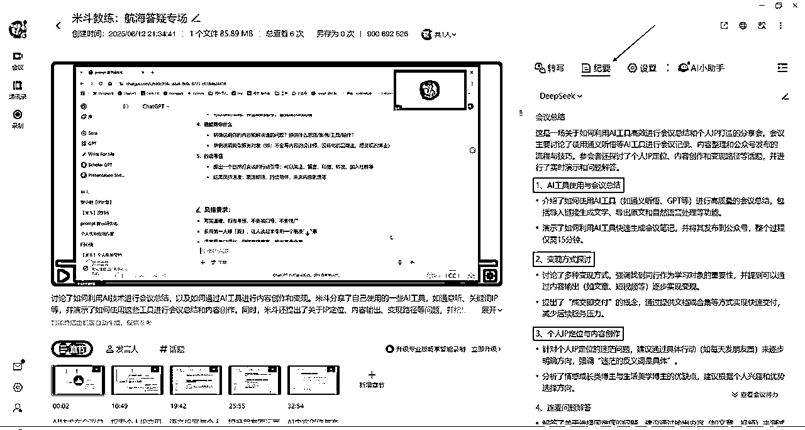
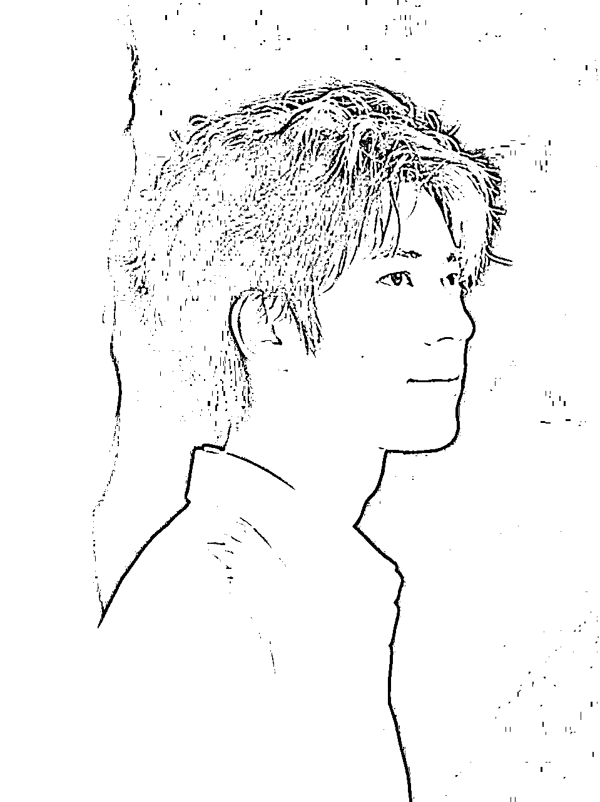
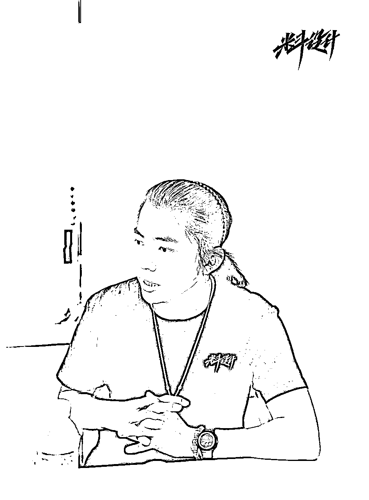

你有没有想过：那些看起来轻轻松松就能靠内容赚钱的人，其实并不是比你有才华，而是比你先搭好了一条“流水线”？

最近我把米斗老师的一场干货分享反复看了三遍，越看越觉得，普通人做IP这件事，真的没想象中那么玄乎。这期内容我整理成了一份保姆级攻略，不管你是0基础小白，还是做了很久内容但不知道怎么变现的创作者，都建议认真看完——因为这套方法论，真的能直接照做。

# 一、AI到底怎么帮你写内容？比你想象中简单太多

很多人问我：我不会写东西，是不是就和IP无缘了？

其实，写内容根本不需要你变成文豪。你需要的是——一套系统。这件事得借用米斗老师反复强调的一组“工具组合拳”：

**第一步，打开“通义听悟”。**

这玩意儿是阿里出的，简直是语音界的“速记神助攻”。开会、直播、口播，你对着它讲就完事儿，它能同步产出文字稿，还会顺手帮你提炼出关键信息和结构脉络。就像配了个不需要发工资的私人秘书。

**第二步，把文字稿扔给ChatGPT。**

你不是要写“惊天动地”的深度长文，你只是需要一篇结构清晰、观点明确的内容。把听悟生成的稿子复制进去，加上一句提示词：“帮我整理成一篇适合公众号发布的文章”——好了，初稿就出来了。

**第三步，配图+排版，直接发。**

现在连配图都可以用AI生成。整套下来，一篇文章从构思到发布，不到10分钟，而且排版干净，几乎不用怎么改。

以前我写篇推文，磨2小时起步，现在呢？10分钟，一篇有模有样的雏形就出来了。

这套流程就是米斗老师说的——“内容流水线”：不拼灵感、不拼熬夜，拼系统操作。

他说过一句话我特别认同：“你不是写不好内容，而是没有一套写内容的系统。” 这句话值多少钱？我觉得值好几个“走弯路”的夜晚。

# 二、光有内容不赚钱？关键的变现设计来了

你是不是也有过这种阶段：内容发了，粉丝涨了，但就是不知道钱从哪来？

这里有个最扎心的真相：内容本身不值钱，成交和交付才值钱。

米斗老师的建议是，别一上来就想卖高价课，用“三层变现梯度”起步，最稳妥的方式就是——**先做一个99块钱的东西出来**。

别看不起这99块。它就是你的试验田、你的敲门砖、你的第一桶金。

比如：你把你最常用的50个AI提示词，整理成文档，加上操作截图和说明，一页页弄成PDF或飞书文档——这就是一个能卖钱的产品。

我们来看一组真实数字：米斗老师的AI合集文档，上线后访问量打了4000多，里面约52000字，价格正是99元。日售几十单，累计收入几千块。而且，这文档不是终点，它是一个“钩子”：买了文档的人，会被引导进社群，再通过咨询和高阶实战营做后端转化。

这就是“前端产品引流，后端服务赚钱”的玩法。

有句话很扎心也很真实：“你连99块钱的文档都不愿意好好交付，怎么可能卖得了2980的实战营？” 成交不是嘴上说说的，交付本身就是价值。

# 三、懒得动手？来点具体的行动清单

学干货最怕的就是“脑子里爽了，手却原封不动”。现在可以跟着做这三步：

1.去注册一个通义听悟账号，找一段你聊天/讲题的录音，转成文字稿。

2.打开ChatGPT，复制这段文字，输入以下提示词：“帮我整理成一篇适合公众号发表的干货文章。”

3.把文章发出去。别管排版酷不酷、措辞美不美，发了就是第一步。

变现的动作，也不复杂：

1.写5个你最常被问的问题，每道题配一页解决方案。

2.打包成合集文档，定价99元，发朋友圈、发社群。

3.文末留下个人微信，把买家导入私域，后续再做高阶转化。

记住：用户买的从来不是内容本身，而是你解决问题的本事。你把复杂的讲清楚、把零散的系统化，本身就是价值。

# 写在最后

回看这条IP之路，我发现废掉一个人最狠的方式，不是让他不够厉害，而是让他永远只学不做、只看不练。你缺的不是天赋，是具体路径；你缺的不是努力，是第一步之后的下一步。

从今天开始，用AI帮你搞定第一稿，用你的经验和认真去做打磨。先赚回第一个99，之后才会有后面的2980，甚至更多。

“知识不值钱，改变才值钱。”

诚实地问自己：看完这篇文章，你是准备划走，还是准备动手？

我是米斗老师内容的受益者，也希望你是下一个把内容变成产品的人。只要跑起来，你一点都不普通。

