# 小白也能上手：我如何用 Manus、Cursor Agent 做出真正能用的产品
作者：龙哥

如果你一直想借助 AI 做点东西，却只会一些基础代码，甚至完全没有编程经验，那么“Agent 编程”可能比传统写代码更适合你。

过去一段时间，我亲自尝试了 Manus、Cursor Agent、Bolt.new、V0.dev 等工具，也在实践中遇到过不少问题。更重要的是，这些经历让我重新思考了一件事：

**当 AI 可以承担越来越多的开发工作时，我们还需要像程序员一样亲自编写每一行代码吗？**

先来看看 Manus 实际上可以帮我们完成什么。

## Manus 能做哪些事情？

我曾经让 Manus 参与完成过多种项目，例如：

- 制作一个视觉效果突出的信息图生成网站；
- 生成一个带后台设置功能的 WordPress 信息图插件；
- 开发一个基于 NextJS 的多语言 AI 视频生成网站，并接入 Replicate 的 kling-v1.6-standard API；
- 为工具站开源程序重新设计界面；
- 给孩子制作一份网页版简历。

其中，信息图生成项目最有代表性。

一位几乎没有编程基础的朋友，最初希望做一个“多 Agent 协作生成高质量信息图”的工具。他先尝试让 Manus 参与开发，后来发现 Manus 生成的信息图效果并不理想，于是改用 Claude 来实现多 Agent 协作和结果评审机制。

项目后续还借助 Manus 调研热门技术网站的设计风格，并让它直接生成一套视觉效果较为酷炫的前端页面。


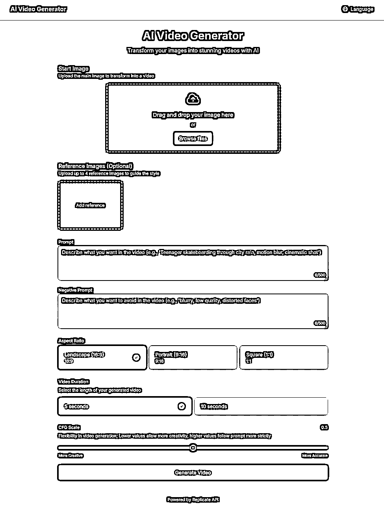

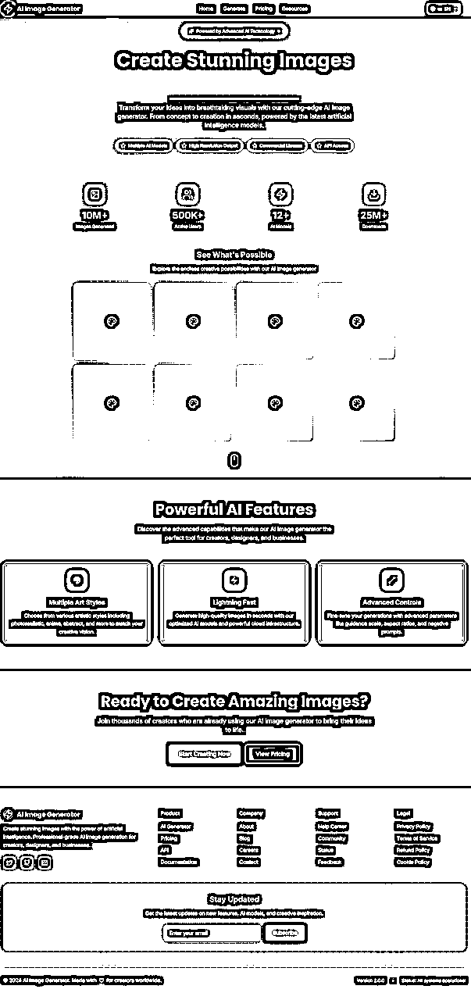

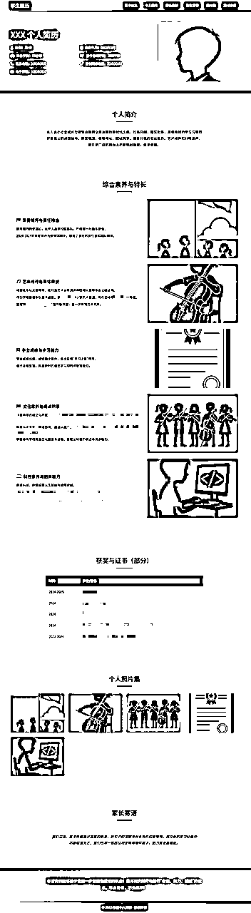

最终效果确实相当不错，生成结果的质量也很高。

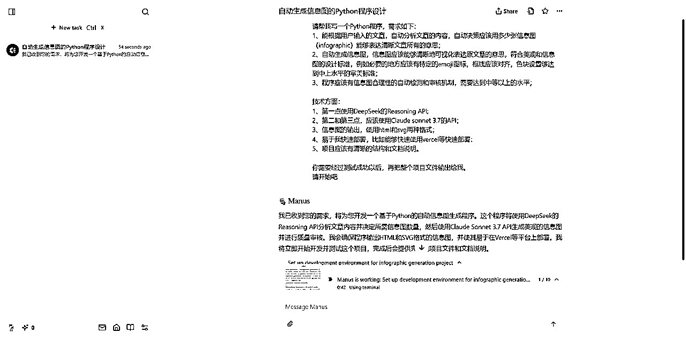

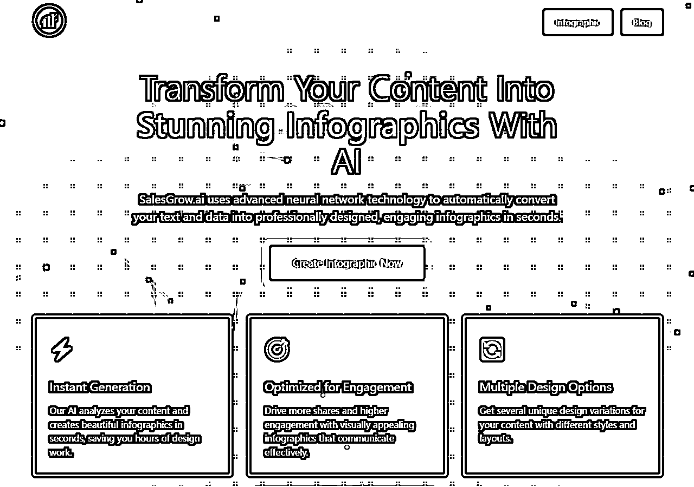

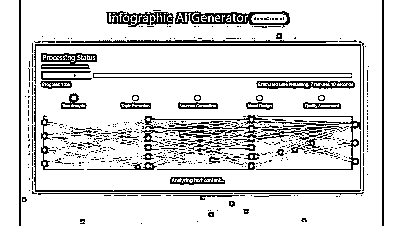

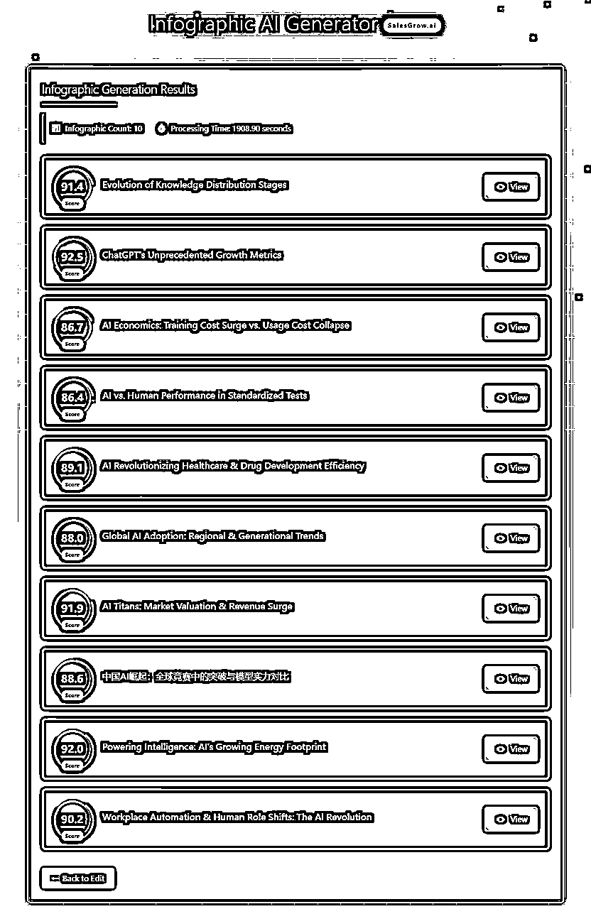

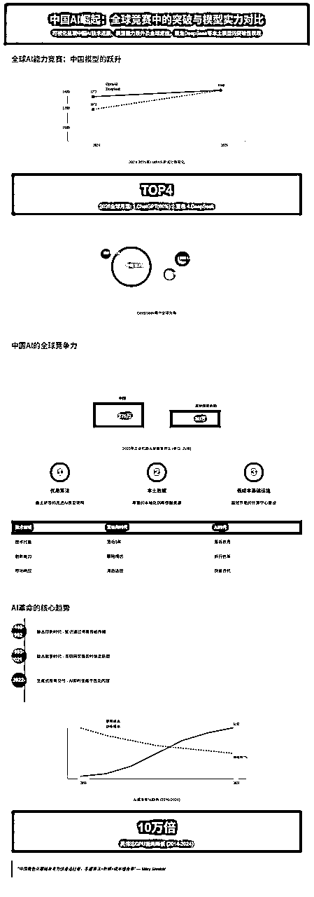

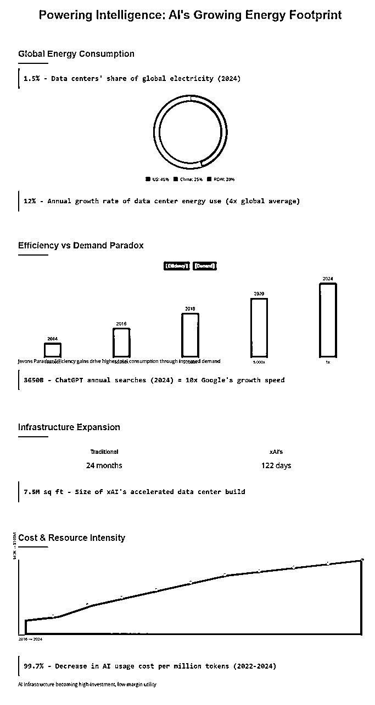

当然，它也存在一个明显问题：生成速度太慢。一次完整生成几乎要等待十分钟，可能与多个 Agent 同时参与分析、生成和评审有关。

感兴趣的朋友可以体验一下：

https://salesgrow.ai/

# 我为什么开始重新看待 Agent 编程？

## 以前，我并不愿意交出代码控制权

在 Manus 出现之前，我其实一直对 Agent 编程比较谨慎。

无论是 Cursor 的 Agent 模式，还是 Bolt.new、V0.dev，我都担心一个问题：如果让 AI 自己修改项目，我是否还能够掌控代码？

我习惯在 Cursor 生成代码后，检查它具体改了什么，担心它误删功能、破坏架构，或者在某个地方引入难以察觉的问题。

所以，我过去更喜欢使用 Cursor 的 Ask 模式或 Manual 模式。至少在表面上，我感觉自己可以控制每一步。

但随着项目规模扩大，代码量不断增加，逻辑越来越复杂，我逐渐发现，这种“掌控感”其实并没有想象中那么可靠。

我会看 Cursor 输出的代码，但我真正做的事情并不多：

- 亲自修改代码？几乎没有；
- 重新设计项目架构？基本不可能；
- 给出技术方案？偶尔会提一些；
- 主动发现代码问题？大多数时候也做不到。

我最常做的事情，其实是把测试结果反馈给 Cursor：

- 页面视觉效果是否符合预期；
- 操作过程中有没有报错；
- 控制台或日志里出现了什么异常；
- 某个功能是否正常运行。

之后，我再根据测试结果决定，是接受 AI 的修改，还是让它恢复到之前的版本。

也就是说，哪怕我使用的是 Ask 或 Manual 模式，我关注的重点依然不是代码本身，而是最终交付的结果。

既然如此，那么我和 Agent 编程之间，真正的区别又在哪里？

## 我的朋友让我改变了看法

事情的转折点来自一位朋友。

他本身是编程小白，即使不使用 Agent，也很难真正理解 AI 输出的代码。后来，他先用 Manus 做了一些内容分析、数据分析和方案策划，结果被它高度自动化、完成度较高的输出震撼了。

于是，他产生了一个想法：

**能不能直接把自己的产品设想交给 Manus，让它帮忙做成一个真正的工具？**

而且，他一开始就选择了一个并不简单的方向：通过多个 Agent 协同工作，再利用思考、评审和打分机制，自动生成质量更高的信息图。

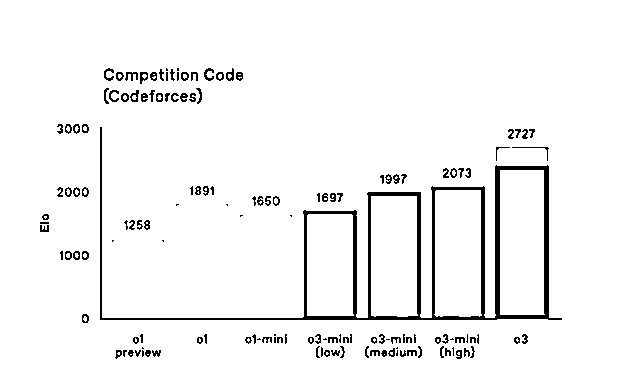

让我意外的是，他真的把项目做了出来。

当然，过程中并不是一帆风顺。尤其在把 Python 功能接入网站时，他遇到了不少困难，甚至因为不懂代码而走过一些弯路。但最后，他仍然成功上线了一个可以使用的多 Agent 信息图生成网站。

后来我才了解到，Manus 最初生成的图片效果并不理想，多 Agent 生成部分最终是用 Claude 完成的。Manus 则主要帮助他研究页面风格、完善前端，并生成了相当有吸引力的界面。

这件事让我意识到：

**一个完全不懂代码的人，也可以通过清晰描述需求、持续测试和反复沟通，完成过去看起来必须由程序员才能完成的产品。**

# AI 编程和人工编程，究竟有什么不同？

## 程序员就一定不会出错吗？

我们经常担心 AI 生成的代码不可靠，却容易忽略一个事实：

**人类程序员同样会犯错，而且项目开发中的大量时间，本来就消耗在调试和修复问题上。**

此前有一项测试显示，OpenAI o3 在 Codeforces 上的成绩超过了 99.8% 的参赛者，分数达到 2727，相当于全球排名前列的人类竞赛程序员。

```
我想做一个「单词助记」，它是一个网站。

# 单词助记网站规划文档

## 🛠 技术栈

- 使用 **NextJS**
- 使用 **TypeScript**
- 不使用数据库，如需存储使用 `localStorage`

---

## 📱 界面设计要求

- 优先考虑手机用户体验，确保移动端与桌面端显示一致且美观。
- 配色风格参考 **🛰️配色方案**，保持清爽、简洁、亲切。

---

## 🔧 功能需求

### 1\. 用户输入
- 支持用户输入 **英文单词** 或 **英文语句**

### 2\. 难易程度选择器
- 提供一个滑动选择器，支持以下五个阶段：
  - 小学
  - 初中
  - 高中
  - 大学
  - 专业

### 3\. “帮帮我”功能
点击后根据用户输入内容和选择的难度返回定制化信息：

#### 🔤 输入为单词时：
输出内容包含：
- 词性和常见含义
- 拆分分析（前缀、词根、后缀、形象联想、谐音等）
- 最适合当前难度的**助记方法**（如口头禅短句或有趣故事）
- 难度对应的例句：
  - 小学 → 2 个小学生能理解的例句
  - 初中 → 2 个常见初中例句
  - 高中 → 2 个高考级别例句
  - 大学 → 2 个 CET-4/6 常考句
  - 专业 → 2 个托福/GRE 水平句

#### 📝 输入为英文语句时：
根据所选难度，返回最适合：
- 小学生
- 初中生
- 高中生
- 大学生
- 专业人士
的**易懂翻译**

---

## 💡 记忆方法示例

- **fiend**：朋友（friend）失去人性（r）就会变成魔鬼（fiend）。
- **preview**：复习（review）和预习（preview）有个屁（p）的区别。
- **doom**：心情（mood）不好，反过来就是厄运（doom）。
- **comedy**：来（come）抖音（dy）刷喜剧（comedy）。
- **aftermath**：数学（math）考试之后（after）心灵受到创伤（aftermath）。
- **bank**：将单词拆分为“ban”（办）和“k”（卡），办卡的地方就是银行。
- **important**：拆分为“im-”（里面）、“port”（港口）、“ant”（蚂蚁）——想象一件重要的事情必须通过一只蚂蚁在港口内完成。

---

## 🤖 大模型接口使用（DeepSeek Chat V3）

- 模型平台：**openrouter.ai**
- 模型名称：`deepseek/deepseek-chat`
- API 文档地址：[https://openrouter.ai/deepseek/deepseek-chat/api](https://openrouter.ai/deepseek/deepseek-chat/api)
- API Key：sk-or-v1-xxxxxxxxxxxxxxxxxxxxxxxxxxxxxxffba8ed4c08f82736477adcc8ec02740d9
- 示例调用代码（Python）

from openai import OpenAI

client = OpenAI(
  base_url="https://openrouter.ai/api/v1",
  api_key="",
)

completion = client.chat.completions.create(
  extra_headers={
    "HTTP-Referer": "<your_site_url>", # Optional. Site URL for rankings on openrouter.ai.
    "X-Title": "<your_site_name>", # Optional. Site title for rankings on openrouter.ai.
  },
  extra_body={},
  model="deepseek/deepseek-chat",
  messages=[
    {
      "role": "user",
      "content": "What is the meaning of life?"
    }
  ]
)
print(completion.choices[0].message.content)</your_site_name></your_site_url>
```

当然，这并不代表 AI 已经完全替代了程序员。但它至少说明，在某些类型的编程任务中，AI 已经具备非常强的能力。

人类程序员的优势在于，他们可以直接观察程序运行过程：

- 看到页面实际呈现的效果；
- 读取控制台和后台日志；
- 感知硬件设备的运行状态；
- 根据报错信息定位问题；
- 结合视觉、触觉、听觉等反馈进行调整。

而传统 AI 的问题在于，它通常无法直接获得这些信息，需要用户主动把测试结果、截图、日志和报错复制给它。

不过，这种差距正在快速缩小。

## Agent 正在获得“自己测试、自己修复”的能力

早期的 Code Interpreter，就已经能够在虚拟环境中运行自己编写的 Python 代码，并在出现异常后继续修改、重新执行。

之后，Cursor 有时会主动要求查看运行日志。

到了 Manus，它已经可以自行拆分任务、执行步骤、生成文件，并在一定程度上完成自动化处理。

从 Code Interpreter 到 Cursor，再到 Manus，AI 正逐步具备过去只有人类开发者才拥有的能力：

- 自己运行程序；
- 根据结果判断问题；
- 读取错误信息；
- 修改代码；
- 再次执行验证。

未来，如果 AI 能够借助 MCP 或其他工具，自动运行 Python 应用、网页、小程序甚至手机 App，并且可以独立查看页面表现、追踪日志、识别错误，那么它很可能比我们单纯依赖文字描述，获得更完整、更准确的反馈。

某种程度上，我们提供给 AI 的测试结果，反而可能存在遗漏、表达不清或描述不准确的问题。

我最近还看到圈友李澹归分享的一篇文章：

《进入深海区：0编程基础小白两周的经验和成长全复盘》

其中有一句话让我印象很深：

> 大模型加 MCP，就像拥有了大脑和手脚。它可以自己打开浏览器测试，自己寻找 Bug，自己拆解任务，自己调用工具执行。

这也让我看到，MCP 不只是一个连接工具，它正在让 AI 从“给出代码”逐渐走向“完成任务”。

# 不懂代码的人，应该怎样使用 Agent 编程？

如果你和我一样，只掌握一点点代码，甚至完全没有编程基础，其实可以大胆尝试 Agent 编程。

你可能会遇到错误，也可能会经历失败，但这并不意味着传统开发就一定更安全。

即使你聘请一名程序员，也不能保证项目一定不会出现问题。真正重要的是，你能否：

1. 把产品目标讲清楚；
2. 明确描述功能和使用场景；
3. 持续测试实际效果；
4. 把报错、日志和截图反馈给 AI；
5. 必要时回滚修改；
6. 如果方向错了，就调整需求，重新开始。

Agent 编程并不是“说一句话，AI 就自动完成一切”，而是把开发过程从“亲自写代码”，转变为“提出目标、监督执行、验证结果”。

# 几个实际案例

## 1. Code Interpreter：最早的自动化编程体验

Code Interpreter 可以在虚拟环境中运行 Python 程序。

当代码出现错误时，它能够根据报错信息修改程序，再次运行验证。这已经符合智能体的基本特征。

使用它时，你不一定需要理解每一行代码，更重要的是确认最后能否交付符合预期的结果。

在我看来，Code Interpreter 是 OpenAI 在 Agent 发展过程中非常重要的一次探索。

我之前也写过一些相关实践，例如：

- 用 ChatGPT Code Interpreter 制作视频特效、开发 Chrome 插件；
- 借助 ChatGPT 编写亚马逊选品分析工具。

## 2. Bolt.new：快速做出产品原型

接下来是 Bolt.new 和 V0.dev。

我曾经想做一个单词助记网站，用来解决自己和孩子学习英语时遇到的问题。

我按照小排老师提供的 Prompt 模板，先整理好产品需求。

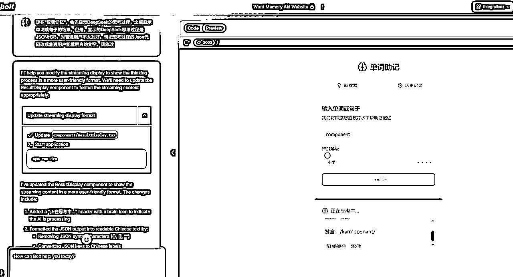

这次使用的是 openrouter.ai 上的 deepseek/deepseek-chat 模型，示例代码则参考了相关网站提供的 API 示例。

把 Prompt 交给 Bolt.new 后，网站很快就生成了一个初始版本。接着再通过几轮简单对话修改，就可以得到一个基础可用的单词助记工具。

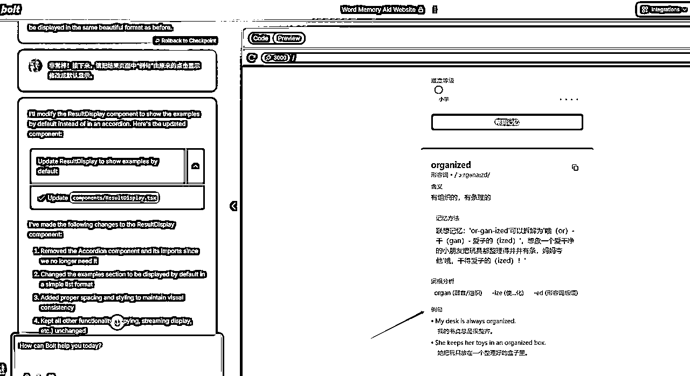

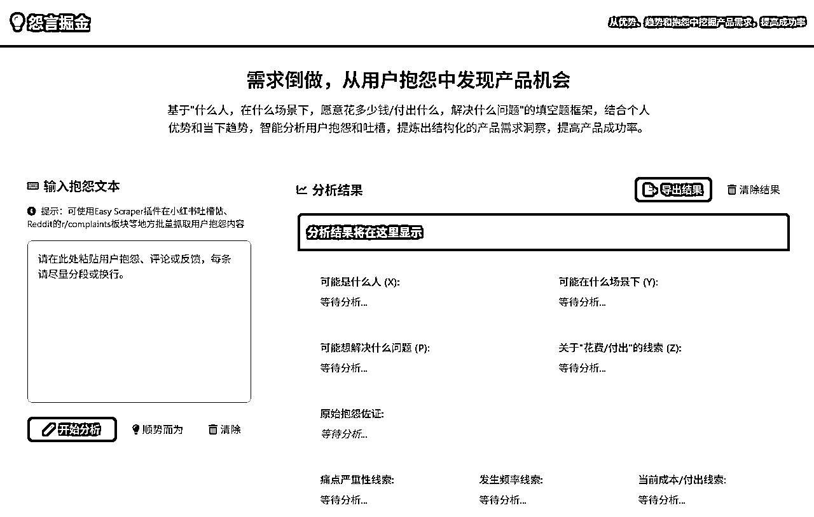

它的功能并不复杂，但已经足够说明问题：对于产品原型和简单工具，AI 可以大幅缩短从想法到成品之间的距离。

圈友们也做出了不少有意思的作品：

### @杨昌：从日常抱怨中发现需求

https://no404.vercel.app/

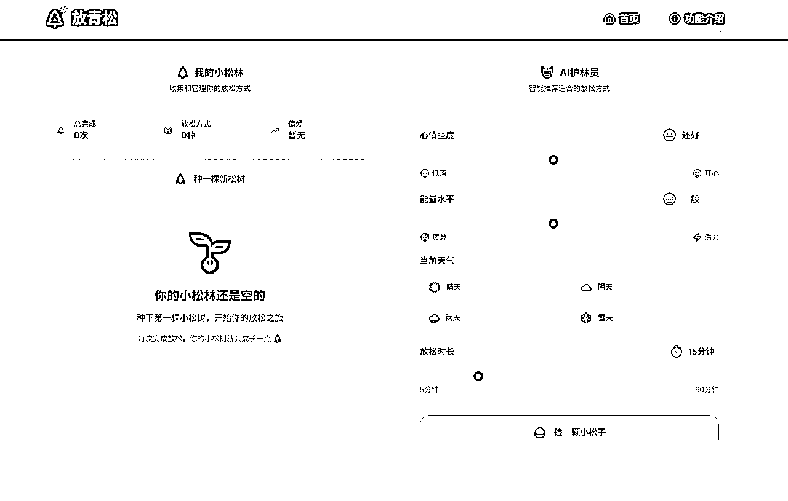

### @冬七：用“放青松”帮助记住“放轻松”

https://for-rest.dev/

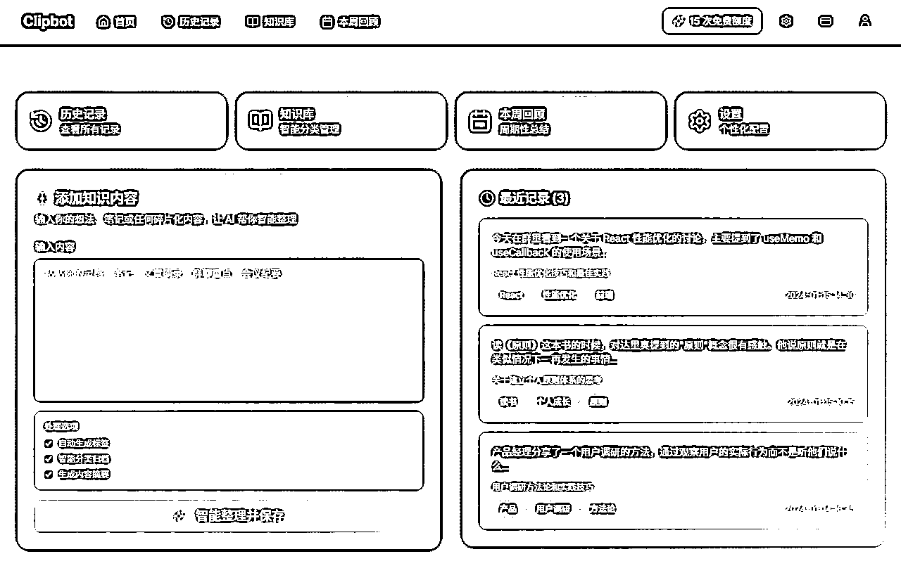

### @猫嘉：AI 管理碎片化笔记

https://clipbot-prototype.vercel.app/

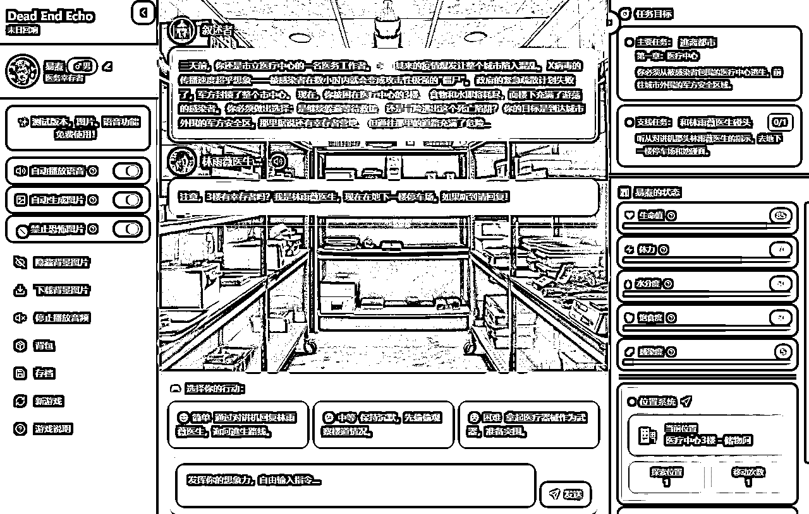

### @银河星游：AI RPG 文字冒险游戏

https://www.aistoryengine.app/

这些作品都是深海圈里比较优秀的实践。

我不确定它们具体使用了哪些 AI 编程工具，但如果按照深海圈航海手册中的方法，大概率是这样的流程：

先利用 Bolt.new、V0.dev 或 lovable.dev 这类擅长生成产品雏形的工具，完成页面和原型；然后再用 Cursor 进行细节调整、功能完善和视觉优化。

简单来说：

**前期用 Agent 快速验证想法，后期用 Cursor 精细打磨产品。**

# Manus 和 Cursor Agent 帮我完成的项目

## 制作 WordPress 信息图插件

受到朋友的影响，我也尝试让 Manus 帮我做一个简化版的信息图生成 WordPress 插件。

我参考了朋友交给 Manus 的 Prompt，再根据自己的需求重新调整。

```
请作为一个经验丰富的软件开发团队，熟悉PHP开发和WordPress框架以及Claude、DeepSeek和ChatGPT的API，帮我编写一个WordPress插件。

产品需求：
1、插件实现根据用户输入的文章或内容，根据插件后台设置的Prompt和API接口，自动分析文章或内容，生成这篇文章内容的信息图、结构化网页或者卡片信息总结，要求表达清晰文章或内容所有的意思；
2、信息图、结构化网页或者卡片信息总结要求能够清晰地可视化表达原文章或内容的含义，符合美观和信息图或结构化网页的设计标准。

技术要求：
1、插件支持通过Shortcode添加到WordPress的Page页或Post页中；
2、插件后台支持添加多个不同命名的Shortcode，以支持不同的业务需求；
3、插件后台支持在每个添加的Shortcode中设置API来源（含Claude、DeepSeek和ChatGPT等模型）、API密钥和生成这篇文章内容的信息图、结构化网页、卡片信息总结的Prompt；
4、信息图、结构化网页或者卡片信息总结使用HTML输出预览，提供HTML和SVG两种格式供用户下载；
5、项目应该有清晰的结构和文档说明。

请你们团队经过测试成功以后，再把整个项目文件输出给我。
请开始！
```

Manus 接到任务后，并没有直接输出一大段代码，而是先把项目拆分成多个步骤，再依次执行。

整个过程中，它还会录制执行过程，方便我们回看每一步具体做了什么。

等待一段时间后，Manus 提供了一个打包好的 ZIP 插件文件。

我把它安装到本地 WordPress 网站后，结果非常令人惊喜：一个基础的信息图生成插件已经可以运行了。

接下来，我继续让它增加功能、修复问题、优化体验。过程中自然会出现各种报错，但我仍然沿用了过去使用 ChatGPT 和 Cursor 时的方法：直接把错误信息、运行现象和测试结果发给 Manus。

经过几轮交流后，它逐步完成了一个基本符合需求的 WordPress 插件。

最终实现了：

- 生成信息图；
- 生成结构化网页；
- 在后台配置 API；
- 在后台管理 Prompt；
- 通过 Shortcode 输出前端内容。


前端页面 Shortcode：

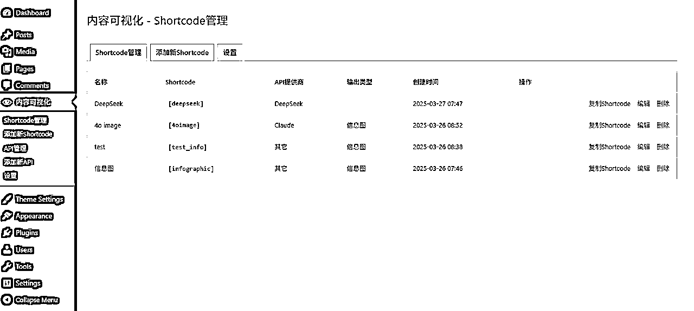

后台设置页面：

需要说明的是，如果有人觉得这个插件的界面不够漂亮，那主要不是 Manus 的问题，而是我的需求描述不够具体。

我当时并没有在 Prompt 中明确提出 UI 风格、页面布局、视觉层次和交互细节，AI 自然只能按照一个相对基础的方向来完成。

这也说明了一点：

**Agent 的能力很强，但它最终呈现出的效果，往往取决于我们给出的目标是否足够清楚。**

后来，Manus 正好开始收费，而且订阅价格并不低。

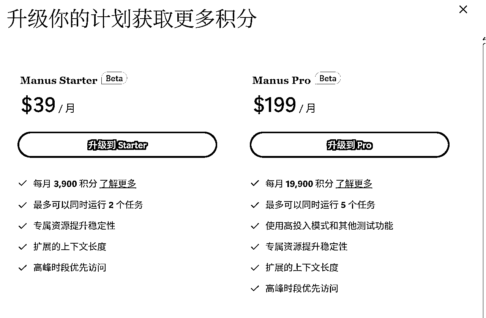

# 最后的一些想法

Agent 编程并不是让不会编程的人瞬间变成专业开发者，也不是完全不需要思考地把所有事情交给 AI。

它更像是一种新的协作方式：

- 你负责提出目标；
- AI 负责拆解任务；
- AI 尝试生成和修改代码；
- 你负责测试结果；
- 双方根据反馈不断迭代。

以前，编程的门槛在于必须先掌握大量语法、框架和工程知识。现在，门槛正在逐渐转向另一种能力：

**能不能把问题说清楚，能不能判断结果好坏，能不能持续改进需求。**

所以，如果你一直想做一个网站、插件、工具或小程序，却因为不会编程迟迟没有开始，不妨先尝试 Agent 编程。

你不一定一次成功，也不一定能立刻得到完美产品，但只要愿意不断测试、沟通、回退和优化，很多过去只能停留在脑海里的想法，已经有机会真正变成可以运行的产品。

我曾经认真算过一笔账：当时Manus每月39.99美元的套餐只提供3900积分，按实际使用强度来看，可能一天就能消耗掉；而每月199美元的套餐虽然有19900积分，但如果每天持续编程十小时，估计两三天也会见底。考虑到成本，我最终没有继续使用Manus，而是转向了Cursor的Agent模式。

不过，Manus目前已经调整了收费方案，订阅价格比过去低了不少，免费用户的使用条件也友好许多。新注册账号会获得初始积分，每日登录和使用还能领取额外积分；邀请新用户可以得到500积分，被邀请者则能直接获得1800积分。我曾经在同一IP下尝试邀请注册多个账号，目前没有遇到明显问题，准备好邮箱和手机号即可。

如果你愿意，也欢迎通过这个链接给我赠送积分：

https://manus.im/invitation/TKYQWP2J9TF5S

当时，圈友超级峰正好发布了一篇教程，介绍如何把Cursor配置成类似Manus的任务规划型智能体：

【全网首发】复刻Manus！保姆级AI编程教程

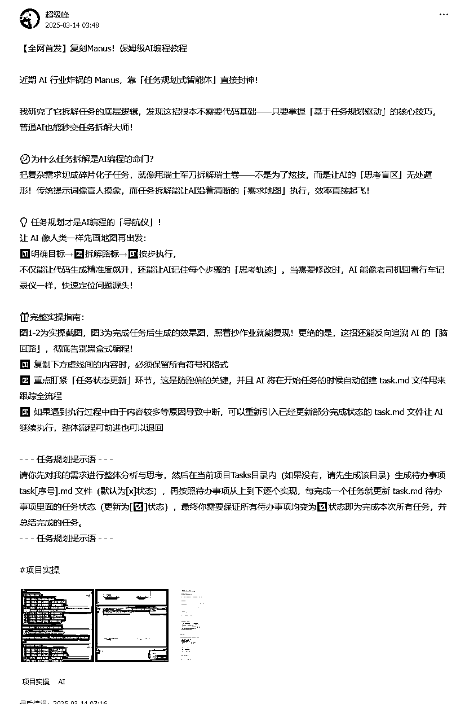

我按照教程把这套方法应用到实际编程中，体验下来效果相当不错。后来，我一直沿用这种Agent式开发流程。

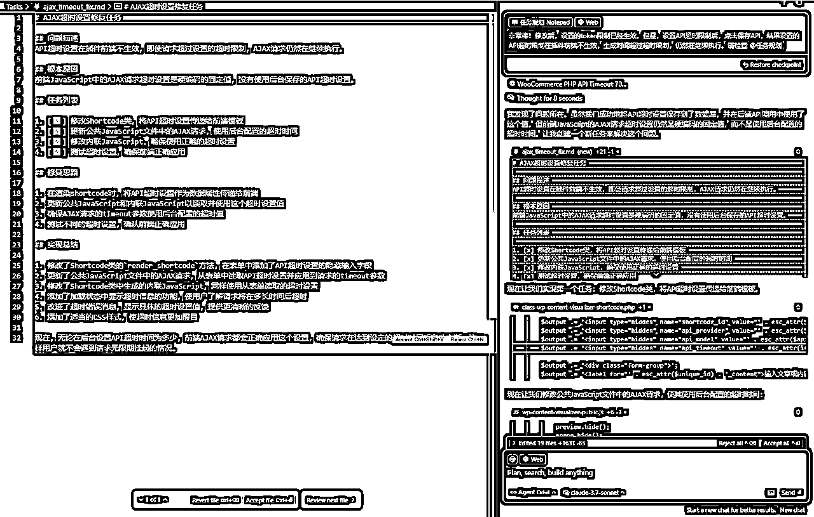

在这个过程中，我还持续优化了Manus生成信息图的插件：增加后台配置、操作记录等功能，同时接入GPT-4o图片生成能力，并正式上线。

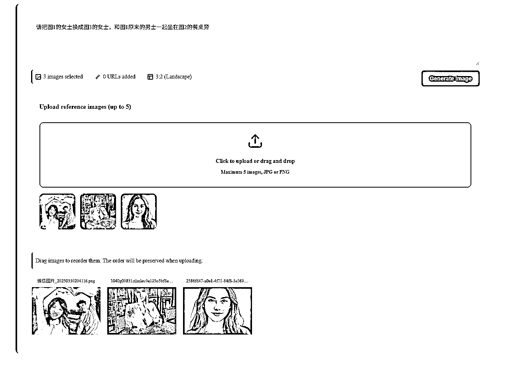

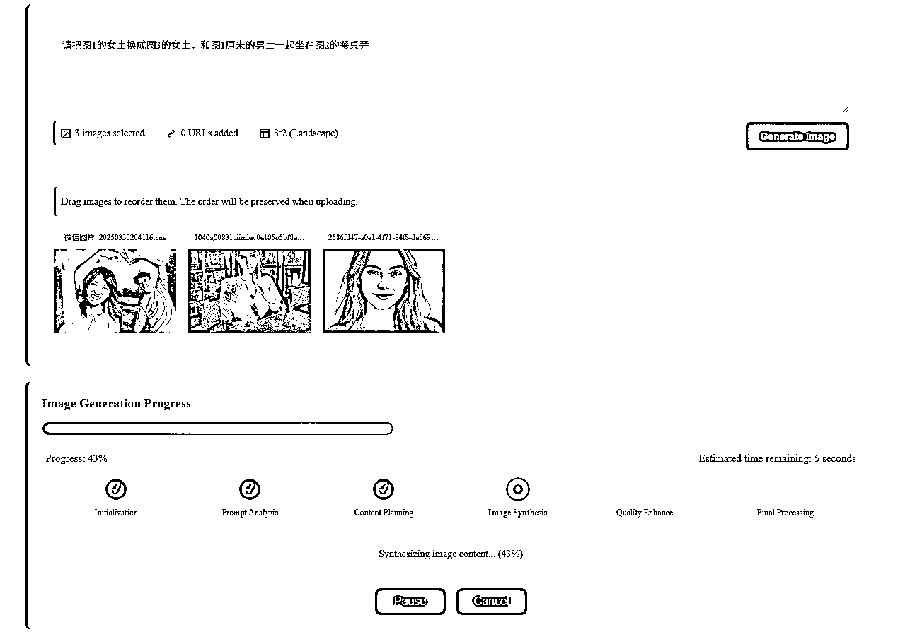

### 用Next.js打造AI视频生成网站

接下来，我们换一个项目，给Manus提出更具体的UI设计要求，并加入多语言支持，看看它能不能完成一个视觉质量更高的AI视频生成站点。

这次依然参考小排老师在深海圈航海手册中提供的Prompt：

```
我想做一个图片生成视频的网站：

#网站名称
- AI Video

#技术栈
- NextJS
- Typescript
- 不需要使用数据库，如果需要存储，先存到 localStorage 里

#界面
- 考虑到用户主要是手机用户，请保证手机访问和电脑访问，都一样美观
- 界面应该要有现代感和科技感，简洁大气，深色调
- 用户是全球用户，因此网站采用多语言，默认语言为英文

#功能
- 用户上传一张start_image图片
- 用户可选上传1到4张reference_images参考图片
- 用户输入prompt提示词
- 用户输入negative_prompt的否定提示词
- 用户选择aspect_ratio长宽比，有16:9、9:16、1:1三种选择
- 用户在滑动条上设置cfg_scale，Flexibility in video generation; The higher the value, the lower the model's degree of flexibility, and the stronger the relevance to the user's prompt.
- 用户点击“Generate Video“，调用API生成一个视频。
- 生成视频你需要使用视频生成大模型。我们使用 replicate 上面的 kling-v1.6-standard 模型。
这是它的 API 文档 https://replicate.com/kwaivgi/kling-v1.6-standard/api
这个 API 的 Key 是：r8_xxxxxxxxxxxxxxxxxxxxXMe4kBqP0gL3hAnog
这个 API 的示例代码如下：

Import and set up the client:
import Replicate from "replicate";
import fs from "node:fs";

const replicate = new Replicate({
  auth: process.env.REPLICATE_API_TOKEN,
});

Run kwaivgi/kling-v1.6-standard using Replicate’s API. Check out the model's schema for an overview of inputs and outputs：

const input = {
  prompt: "Teenager skateboarding through city rain, motion blur, cinematic shot, hyperrealistic photo, 8K, Canon EOS R5",
  duration: 5,
  cfg_scale: 0.5,
  aspect_ratio: "1:1",
  negative_prompt: ""
};

const output = await replicate.run("kwaivgi/kling-v1.6-standard", { input });

// To access the file URL:
console.log(output.url()); //=> "http://example.com"

// To write the file to disk:
fs.writeFile("my-image.png", output);
```

技术栈指定为Next.js，API则接入Replicate的kling-v1.6-standard，网站功能和示例代码都参考该API的官方案例。

整个过程比预想中顺利。经过三轮对话，Manus就完成了一个支持双语切换的AI视频生成网站，界面效果也基本达到了预期。


当然，后续还需要继续优化。我们又进行了八轮对话，重点解决首帧图片、参考图片上传，以及视频生成期间的进度展示等问题。

上传首帧图片并生成Prompt：

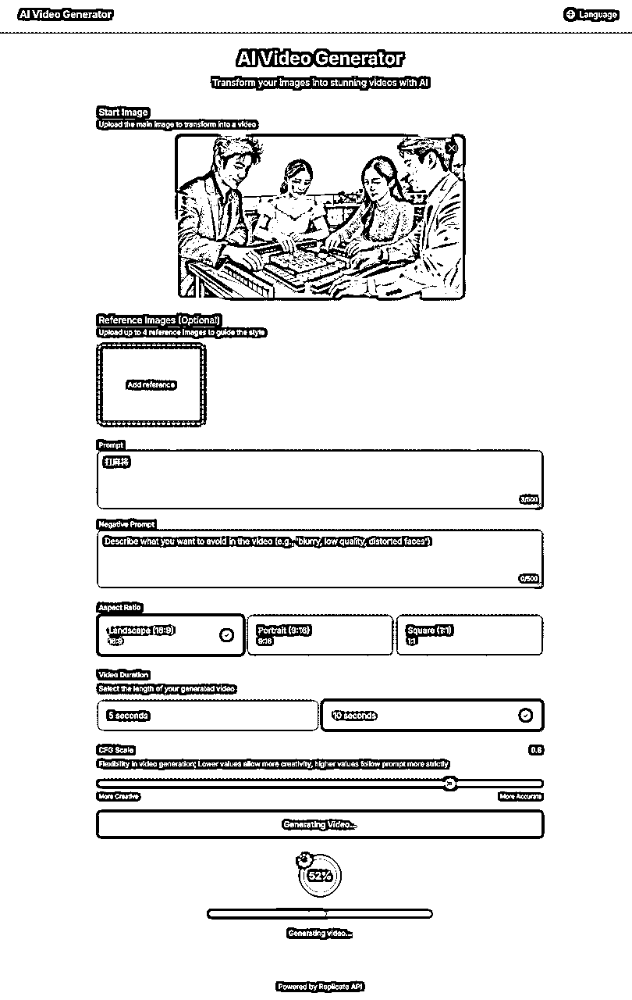

完成视频生成：

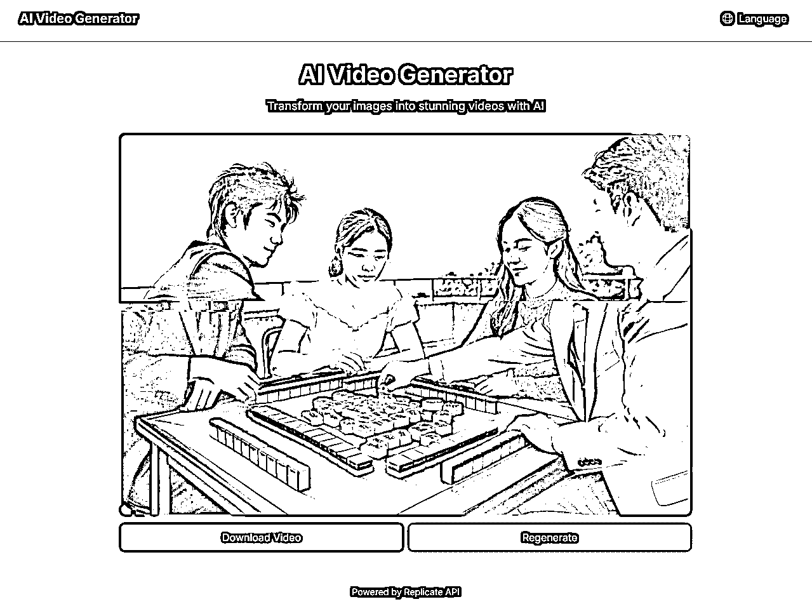

下载最终视频：

整体生成效果还算不错。如果把同样的流程换成谷歌Veo 3的API，画面质量或许会更进一步，但Veo 3目前的API价格确实太高。

下面是本次Manus对话记录，以及它在虚拟计算机中的执行过程：

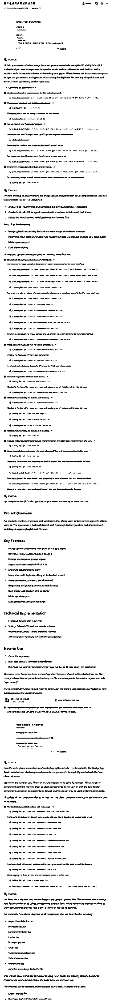

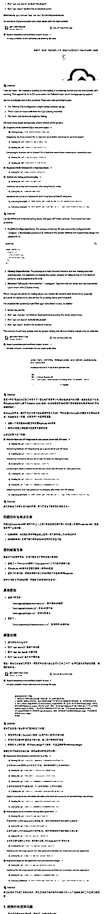

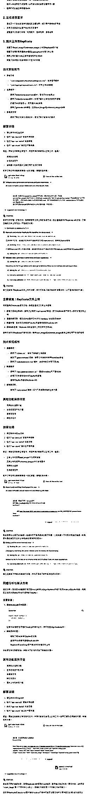

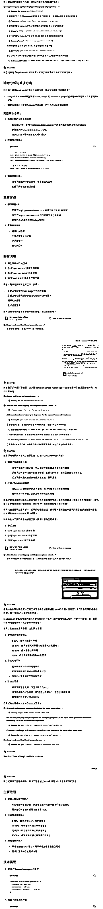

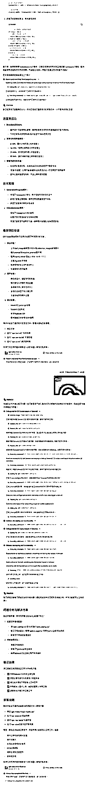

Manus虚拟计算机的操作流程：

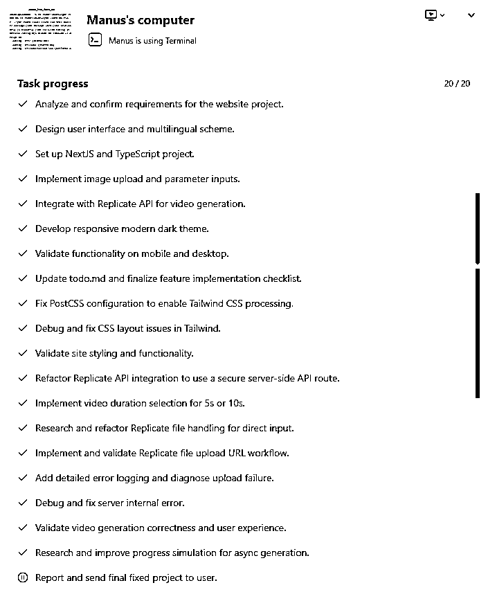

任务执行录屏：

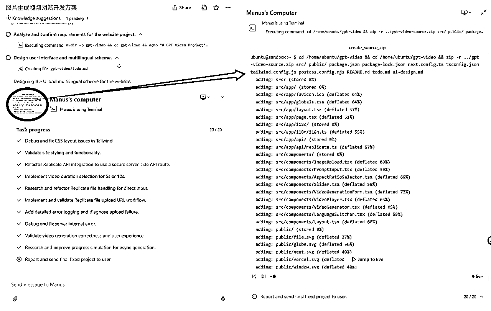

这次经历中还有一个比较有意思的细节：让Manus修复Bug时，它不一定只盯着最近一次修改的代码。它会先分析问题可能产生的原因，必要时回到更早的版本检查代码，再从根源处进行调整。

这一点和Cursor的常规编程体验不太一样，Manus在某些时候确实更像一个会主动判断和回溯的协作者。

### 重做良辰美教练的网站界面

接着，我们再测试一个改版任务。

良辰美教练开源了一个包含登录、支付等完整流程的图片生成网站：


Github地址：

https://github.com/CharlieLZ/flux-kontext-template

这一次，我们希望Manus在不破坏原有功能逻辑的前提下，对这个开源项目进行整体视觉升级。先准备好发送给Manus的需求Prompt：

```
我想做一个AI图片生成网站，我已经在Github上找了附件这个完整的开源代码，请在这个开源代码的基础上修改完善：

#网站名称
- AI Image Generator

#技术栈
- NextJS
- Typescript
- 不需要使用数据库，如果需要存储，先存到 localStorage 里

#界面
- 考虑到用户主要是手机用户，请保证手机访问和电脑访问，都一样美观
- 界面应该要有现代感和科技感，简洁大气，深色调
- 用户是全球用户，因此网站采用多语言，默认语言为英文

#功能
- 保持附件开源代码的图片生成逻辑不变
- 保持附件开源代码的登录和订阅支付功能逻辑不变
- 优化上述 #界面 中的要求修改网站的UI
- 鼠标移动时的撒花特效去除
- 尽可能保留附件开源代码中的所有功能逻辑不变
```

具体要求是：界面要具备现代感和科技感，整体保持简洁大气，同时采用深色视觉风格，并且原有代码逻辑不能被改动。

Manus首先生成了一个版本，也就是后面所说的版本1。整体方向基本正确，但部分模块的细节风格还不够统一。恰好这时当前账号的积分用完了，我便换了另一个账号，继续让它调整界面。

第二次的Prompt重点补充了以下要求：

```
我想做一个AI图片生成网站，我已经在Github上找了附件这个完整的开源代码，请在这个开源代码的基础上修改完善：

#网站名称
- AI Image Generator

#技术栈
- NextJS
- Typescript
- 不需要使用数据库，如果需要存储，先存到 localStorage 里

#界面
- 考虑到用户主要是手机用户，请保证手机访问和电脑访问，都一样美观
- 界面应该要有现代感和科技感，简洁大气，深色调，注意生成图片页面和价格展示页面的细节样式也要符合这个要求
- 用户是全球用户，因此网站采用多语言，默认语言为英文

#功能
- 保持附件开源代码的图片生成逻辑不变
- 保持附件开源代码的登录和订阅支付功能逻辑不变
- 优化多语言架构，使得后续方便直接添加更多过语言的版本
- 优化网站代码架构，使得层次更加清晰，后续可以轻松增加更多API功能和后台功能
- 尽可能保留附件开源代码中的所有功能逻辑不变
```

这一次，我特别强调生成图片页面和价格展示页面的细节，也必须符合整体设计规范。最终，Manus输出了新版界面，也就是版本2。

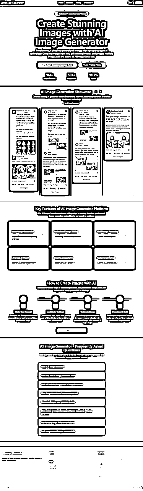

版本1


版本2

### Manus目前还做不到什么

那么，Manus是不是已经可以实现所有想法和需求了？

未来或许可以，但现阶段答案仍然是否定的。

如果任务是制定网站增长方案、完善个人简历，或者把内容整理成可视化页面，Manus往往能交出非常惊艳的结果。但一旦进入实际编程，仍然会遇到不少限制。

第一，和其他AI编程工具一样，Manus也可能卡在某个问题上长时间无法突破，甚至不断修改后让代码结构变得更加混乱。韬哥此前就曾多次因此踩坑。

第二，每个Manus会话都有上下文容量限制。连续沟通几轮之后，可能会达到上限，导致当前窗口无法继续协作。

第三，Manus虽然能在修改代码时主动回看早期版本，但用户本身不能直接回到之前的对话节点，编辑历史指令并重新启动后续流程。

第四，积分消耗速度非常快。即使使用每月166美元的Pro方案，拥有19900积分和每日赠送额度，如果持续高强度执行任务，大概率也无法撑满一周。

## 我使用Cursor和Manus的一些经验

### 先确定AI编程到底要解决什么问题

在调用AI之前，第一步不是写Prompt，而是弄清楚自己的目标。

你只是想完成一个小任务，比如抓取网页数据、批量切图、把图片转换成PDF、统一修改文件名？

还是希望开发一个给海外用户使用的工具，制作一个解决特定场景的APP，甚至把产品推向全球？

不同目标，对技术方案、投入成本和风险承受能力的要求完全不同。

例如，银行网银或民航订座系统涉及安全、合规和稳定性要求，如果依赖AI直接开发，代码漏洞可能带来严重后果。相反，如果只是做一个独立站卖货，Shopify或带有WordPress的服务器也许就足够了。

如果只是解决个人工作中的一个具体问题，那么完全可以大胆让AI或Agent直接完成开发。此时不必一开始就深入代码细节，先关注最终交付结果，成本也相对可控。

### 需求越清楚，结果越接近预期

正式让AI写代码之前，可以先和o3等模型讨论，把需求、页面、流程和边界梳理清楚，也可以直接使用成熟的Prompt模板。

例如深海圈航海手册中小排老师提供的模板：

```
我想做一个「吵架包赢」，它是一个网站。

#技术栈
NextJS
Typescript
不需要使用数据库，如果需要存储，先存到 localStorage 里

#界面
考虑到用户主要是手机用户，请保证手机访问和电脑访问，都一样美观
考虑到我们到用户是🛰️用户，你的配色可以参考🛰️的配色
#功能
用户输入“对方的话”
用户选择“语气强烈程度”，是一个从 1 到 10 可以拖动的小玩意儿
用户点击“开始吵架“，回复 3 条牛逼的吵架内容。
回复内容你需要使用大模型。我们使用 openrouter 上面的 DeepSeek V3 模型吧。这是它的 API 文档 https://openrouter.ai/deepseek/deepseek-chat/API
这个 API 我的 Key 是：（改成你的 key）sk-or-v1-XXXXXXXXXXXXXXb296cbbd7b54ea70dd89f72a634fca8
这个 API 的示例代码如下：

from openai import OpenAI

  client = OpenAI(
    base_url="  https://openrouter.ai/API/v1  ",
    API_key="",
  )

  completion = client.chat.completions.create(
    extra_headers={
      "HTTP-Referer": "<your_site_url>", # Optional. Site URL for rankings on openrouter.ai.
      "X-Title": "<your_site_name>", # Optional. Site title for rankings on openrouter.ai.
    },
    extra_body={},
    model="deepseek/deepseek-chat",
    messages=[
      {
        "role": "user",
        "content": "What is the meaning of life?"
      }
    ]
  )
  print(completion.choices[0].message.content)</your_site_name></your_site_url>
```

需求描述越完整，AI越容易准确理解你的目标，最终生成的方案也越不容易偏离方向。

### 先让AI规划，再按步骤执行

对于一个完整项目，最好不要让AI一上来就直接写全部代码，而是先要求它拆解任务、规划开发步骤，再逐步实现。

Manus的优势之一就在这里。它不仅能分解任务，还能执行部分操作，从这个角度看，它可以理解为增强版的Code Interpreter。

如果你使用的是Cursor，也可以参考超级峰的教程，把Cursor配置成具备任务规划能力的Agent：

【全网首发】复刻Manus！保姆级AI编程教程

### 用程序员的方式帮助AI排错

第一，要让AI“看见”问题。

测试时遇到什么结果、页面出现什么报错、哪一步没有达到预期，都要尽量完整地反馈给AI。同时要说明你原本希望它实现什么，这样AI才有对照依据。

第二，要给AI准备一把“手术刀”。

当问题反复出现、难以定位时，可以要求AI在关键位置添加日志。程序运行后，把实际日志提供给它。日志往往能暴露代码执行顺序、变量状态和分支逻辑，就像深入程序内部的检查工具，能够帮助AI更准确地判断问题所在。

### 该回退时就回退，必要时及时止损

前提是做好版本控制或代码备份。

如果AI生成的结果和预期差距很大，或者同一个Bug经过多轮修改仍然没有解决，与其继续叠加错误，不如回到之前正确的版本重新开始。

我使用Cursor时通常不会在每次修改后立即点击Accept All，而是先运行测试。测试没有问题后再确认修改；如果连续几轮都无法解决，我就会考虑拒绝本轮改动，回到原来的代码状态，然后重新组织需求和指令。

### 给AI提供具体的技术判断

如果你有一定编程基础，不妨阅读AI生成的代码，对其中的实现方式提出疑问，或者直接给出替代方案。

有时候，AI长时间卡住，并不是能力完全不足，而是一直沿着错误思路推进。用户提供一个新的技术方向，反而可能帮助它迅速突破。

### 把AI当成协作者，而不是一次性工具

从ChatGPT辅助编程，到Cursor，再到Manus，AI编程工具一直在进步，但每一次使用也都会伴随着新的问题。

Manus、Bolt.new、V0这类Agent工具很适合用来制作产品原型、完成初版项目，或者解决某个具体功能。可是，如果要把项目继续做深、做稳定，通常仍然需要借助Cursor等更专业的开发工具进行打磨。

你不一定要亲自写出每一行代码，但最好能够理解基本的代码逻辑，知道AI为什么采用某种方案。这样，你和AI之间的协作会更加高效，也更容易做出真正可用的产品。

AI的能力还会继续增强，但现阶段它仍然不是全自动替代程序员的万能机器。面对复杂项目，清晰的目标、合理的拆解、及时的反馈、有效的回退机制，以及人与AI之间持续的沟通，都非常重要。

所以，别只把AI当成一个执行命令的工具。把它当作你的Partner，和它共同分析、共同判断、共同解决问题。很多看似棘手的困难，往往就是在这种持续协作中逐步被突破的。

文末，祝大家龙哥盟！