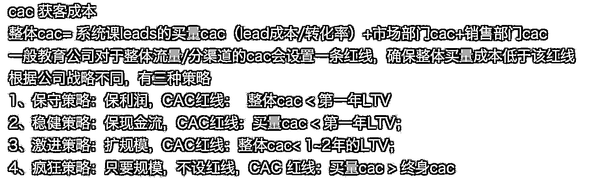

# 先胜而后战，创业先算账 —— 写给出了新手村的圈友们

先算后干，还是先干再算？这是两种截然不同的创业姿势。

很多人一听到“算账”就头疼，觉得那是财务的事，跟搞项目没关系。但真正的商业高手，往往不是靠拼命试错杀出重围的，而是早在动手之前，就已经把这场仗的胜负推演了个七七八八。

《孙子兵法》开篇就讲：“夫未战而庙算胜者，得算多也。”什么意思？就是仗还没打，先在庙堂上做沙盘推演，谁算得清楚，谁就赢了大半。会算的人，赢在开战之前；不会算的人，往往要拿真金白银和血泪去填坑。做项目也一样：真正的高手，是算好了能赢才出手，动手之后不过是把已经算好的结果一步步实现出来而已。而新手恰恰相反——不做论证，先冲上去肉搏，最后用自己惨痛的失败，给后来者提供了宝贵的“调研数据”。这也就是所谓的“胜兵先胜而后战，败兵先战而后求胜”。只要你会算账、算好账，你就能从“败兵”慢慢变成“胜兵”，提高项目的胜率。

不过，这里要做一个认知切换。因为赚钱里常听到两句话：“干就完了”和“先胜后战”，这不矛盾吗？其实分阶段。

我把赚钱大致分成三个阶段。第一，新手阶段：还没在工资之外赚到过第一万块钱，这时候建议少想多做，把手弄脏，先跑通一个完整的闭环，拿到真实体感。不要晚上想千条路，早上走老路，干起来是第一位的。第二，出了新手村的熟手阶段：已经能跑通0到1，赚到过至少一万块，下一步瞄准年入百万。这时候就要反过来，多看少动，克制住自己“干了再说”的冲动，把时间花在研究项目、调研市场上。好项目不是干出来的，是选出来的。很多个体能赚钱，是因为那些机会高手看不上；等你能力上来了，就要学会挑更好的项目。第三，高手阶段：已经有基本盘、年入稳定百万，朝着千万走，这时候拼的是组织、战略、找人。到这个层级，算账早已内化成本能了。我自己还够不上高手，就不多班门弄斧了。

说到算账，先得有数据。数据从哪来？靠调研。很多人以为看几个精华帖、搜一下小红书抖音、再瞄一眼同行就算调研了，然后凭“我感觉”“我觉得”就开干——大错特错。你在调研时省下的每一分钟，做项目时都会十倍百倍还回去。《毛选》里说：“调查就像十月怀胎，解决问题就像一朝分娩。”前期充分调研，能直接帮你毙掉一个不该做的项目，省下几个月的试错时间。对熟手来说，调研项目的时间和做项目的时间，可以五五开。

怎么做好调研？记住大原则：默认公开信息都是错的，要去找私密信息。公开信息只能帮你搭个框架，真正做决策靠的是私密信息——比如跟同行聊出来的真实数据，并且要交叉验证。

具体有四个方法。第一，研究至少10个对标，装作客户走完流程。找到同行，加私域，以真实客户的身份体验他们的购买和转化路径，深度观察话术、朋友圈、转化策略和客户反馈。我们以前做教培时，经常一个部门几个人扮成不同身份的家长去试探竞品销售。有个圈友听完分享后去调研自己的客户，发现自己100块的服务，对方转身卖300块，才发现定价偏低了。这就是“一线有神明”。

第二，付费咨询获取核心信息。市面上有专门做竞品调研的咨询公司，一对一访谈对方中高层，一小时几千块，就是为了拿具体数据。如果你想做某个项目，找到从业者，发个红包或付点咨询费，拿到真实的转化率、复购率，比你自己瞎试划算太多了。

第三，巧用招聘“套取”信息。有团队的话，可以发布一个高title高薪资的岗位，吸引对标公司的中层来面试，聊十来个人，行业数据就清楚了。想了解销售链路，就发个销售岗，SKU设计、客单价、转化率全都能聊出来。个体户虽然用不了这招，但反过来去对标公司面试，也能获取信息。

第四，快速MVP验证，先卖再干。如果前几招还判断不了，那就做一个最小可行产品，拿到市场上试。核心原则是：所有产品先卖再干，验证能卖出去再投入开发。一个注定失败的事，就让它快速失败。比如知识付费项目的第一个动作永远是卖海报，而不是先做好产品再开卖。

举两个案例。第一个是包子老师的“AI+IP提效线下课”。3月30号航海家AI大会上，包子老师分享了自己用AI一个人干完一个团队活的方法，现场很多人感兴趣。虽然我们关注AI落地场景，但无法百分百确定大家愿意买课，所以龙哥老师当场拍板做预售：交500元定金，就开发这门课。结果130多位老板交了定金，需求被验证，后来才有了两期线下课落地。这就是先卖再干的典型。

第二个案例是核桃编程课程出海。“双减”之后教育公司纷纷出海，核桃也想验证自己的课程在海外有没有市场。他们没有花几个月把课程全部翻译适配完再推出，而是先只做了3节体验课的海外适配，投流获客测转化率。结果几期测下来，体验课转化率只有3%，模型走不通，就果断放弃，给已付费用户全额退款。虽然项目失败了，但这是非常成功的失败——花一点点成本，省下几百万研发投入。公司资源那么丰富都这么谨慎，个体创业者资源更少，更应该在开干前慎之又慎。

接下来是算账本身，核心要看几个指标：营收、利润空间、CAC、LTV和人效。

营收是判断天花板的参考。营收=客单价×单量，再拆一下就是客单价×线索数×转化率。客单价越高，项目越好——这就是为什么说“要赚有钱人的零花钱”。单量和交付能力、流量能力挂钩，很多实体项目承接能力有限，流量多了也没用。当有人说自己月入十万，你只要拆一下客单价和流量来源，再估个10%转化率，就知道他是不是吹牛了。

高客单价远好于低客单价。同样100万营收，1万×100个 vs 100元×1万个，难度天差地别。卖1万个产品，流量要求是十万量级的，低客单价能给出的CAC也很低，容易亏损。利润的推算要难一些，因为成本结构差异大，可以参考同行业毛利率，比如知识付费毛利80%以上，电商20-30%就不错了。

CAC是获取一个付费客户的全部成本，包含买量、销售、市场成本。比如花20元买一条线索，转化率10%，那买量CAC就是200元。ROI就是客单价除以买量成本。但注意，销售成本和市场成本往往不低，所以抖音上很多商家投放ROI趋近1时，公司整体其实是亏的。不同渠道CAC差异很大，如果你在一个平台上有优势，CAC就会比较低，可以优先切入。

与CAC相对的是LTV，客户终身价值，包括首次购买、续费、增购。有复购、续费、升单的生意远好于一次性买卖。一次性买卖每年都要买新流量，流量成本越来越高，利润越做越薄；有复购的生意，只要交付做好，就能做得长久。赚钱就是个典型，服务好圈友，商业价值自然来，所以能走到第九年。

只有当LTV大于CAC时，项目才可能盈利；LTV远大于CAC，才有扩张潜力。比值越高，业务越健康，或者正处在红利期。

人效就是每个员工平均创造的收入或利润，总营收除以员工数。部门拆分的话，市场和销售的人效最好算。举例：一个销售每月卖20单，客单价5000，人效就是10万。这种人效下，你完全花1万去招个好销售来扩张。反过来，有些项目人效太低，比如引流100人转化20%、客单价19.9、一天产值400元，一个月人效才1万多，就很难通过雇人放大。要不要招人、花多少成本招人，都跟人效挂钩。

最后说说怎么基于算账做决策。当你把客单价、利润、CAC、LTV、人效都算清楚了，很多难题就迎刃而解。选项目时，用极限思维测天花板：极限好的情况，上帝帮你，最多能赚多少？极限差的情况，喝水都塞牙缝，最多亏多少？这样推演下来，项目分四种。其中最好的情况是：上限高、下限也高——做得好的能赚很多，初始投入低，亏损风险小。比如海外AI产品，靠流量就能做高营收，顶多亏时间成本；知识付费也类似，做好课程后剩下的就是买量和交付。

所以，回到开头那句话：先胜而后战。创业不是赌运气，而是算概率。把账算清楚了再出手，你的每一次努力，才是在为胜利添砖加瓦。

选项目、做项目，别只看能赚多少，也要看能不能亏得起。把“赚钱上限”和“亏损下限”放在一起看，项目其实就分成了几类。

一类是上限低、下限也低。天花板一眼望到头，总共能赚的钱被结构锁死；但真要亏起来，租金、装修、人工全都得打水漂。比如开一家餐饮单店，座位数决定了收入上限，一旦经营不善，几十万一下子就没了。这种投入产出严重不对等的项目，赚钱圈友大概率看不上，但很多没有信息优势的人，只能在这些项目里兜圈子。

一类是上限高、下限低，典型代表是大型风险投资和前沿创新领域。这类项目可能一夜暴富，也可能一夜归零，需要极强的资金实力和心理承受力，和大多数普通人没什么关系。

一类是上限低、下限高，很适合练手。像搬运混剪、IP切片、个人咨询这类项目，门槛不高，赚钱空间有限，但试错成本可控。赚钱精华帖里这类项目特别多，项目方因为赚得不够多、人效也不高，往往要靠阿米巴式地多招人、多开摊子，用规模换总量。

最理想的是上限高、下限也高，但新手一上来就想做这种项目，明显不现实，好项目的对手也更强。更务实的路径是：先拿“上限低、下限高”的项目练能力、搭盘子，再切换到“上限高、下限也高”的项目。选项目之前先把变现上限算清楚，你就会有合理的预期和踏实的心态；遇到问题不会急着否定项目、频繁切换赛道。

再聊流量。

很多人觉得自然流量是免费的，但“免费”这个词其实很有迷惑性。为了获取自然流量，你得投入设备、人力、时间。把自己做流量的成本按月折算成工资，比如一个月五千，换来五百条线索，那一条线索的成本就是十块，不是零。你可以拿这笔钱去做小规模付费投放，看看效果，说不定投出来的线索成本还不到十块。

从CAC的角度看，这个逻辑更清晰。CAC = 获客总成本 ÷ 成交客户数 = 买量CAC + 销售CAC + 市场CAC = 线索成本÷转化率 + 销售部门成本÷成交客户数 + 市场部门成本÷成交客户数。等你有了团队，销售和私域运营每天都要消耗线索，线索不够，人效就被闲置浪费了。这时候哪怕你不买量，买量CAC很低，销售CAC也会被拉高，整体CAC不一定更低。项目做大的尽头，一定绕不开付费流量，还不如早点尝试。

付费流量比自然流量稳定、可控、量大。只要ROI为正，理论上想要多少量就能买多少量。而且付费流量顺应平台商业化趋势：平台越商业化，付费流量占比越高，自然流量越少；除非你的内容能一直保持高质量，否则流量只会越来越稀缺。另外，付费流量也不一定只从平台买，还可以从有现成目标用户的合作伙伴那里买。我之前认识一位创业者，自己招兼职大学生做推广、搞裂变，流量一直起不来；后来他直接和有大学生私域资源的团队合作，按成交付费，成本更低、量更大，还省心。

怎么判断项目是不是还在红利期？我的简单方法是看CAC占第一年LTV的比重。

在线教育行业给了我非常深的体感。2018到2019年，获客成本很低，两三千客单价的产品，获客只要几百块，基本来一单赚一单，剩下的事就是投放、扩张。到了2021年最疯狂的时候，抖音上9.9元的小课包，线索成本500元，转化率10%，CAC直接冲到5000元，流量成本比两年前涨了十倍。双减之后资本撤退，流量成本回落，现在稳定在CAC和第一年LTV基本持平，相当于第一年的营收全部拿去买量，只能赚后续复购的钱，这种玩法只有大公司扛得住。

具体看比例：
- CAC/首年LTV小于20%，是绝佳红利期，应该全力投放、快速抢占市场。很多人在这种时候还保守，等于发现了金矿却只带小铲子。
- 20%到35%，属于健康区间，可以加大买量力度，向平台买、向合作伙伴买。只要获客成本占比低于35%，甚至可以容忍一些投放浪费，核心目标是抢规模，而不是死磕精细化运营。
- 35%到50%，正常投放，盯紧ROI，持续优化效率。
- 50%到70%，进入临界状态，要重点降低获客成本或提升LTV。
- 超过70%，基本就是给平台打工，除非有复购，否则利润所剩无几。

要不要“通投拉满”？除了看CAC/LTV，还要看现阶段要规模还是要利润。

拿教培行业举例。现在很多教培公司买量CAC约等于第一年LTV，表面看是亏的，亏掉团队成本，靠复购赚回来。如果公司更想要利润，就会压低CAC，让整体CAC小于第一年LTV，当年就不亏，但买量的钱变少，规模也会收缩；如果公司要扩张，可以接受前两年亏损，只要整体CAC小于两年LTV，第三年靠复购赚钱。通投拉满通常发生在两种情况：一是项目正处于红利期，CAC/LTV很健康，必须抓住窗口；二是当CAC/LTV稳定下来后，公司决定牺牲短期利润换规模。当然，现在也有越来越多公司不再追求规模，踏踏实实做利润。

想降低CAC/LTV，除了压低CAC，还可以提升LTV。LTV越高，比值越健康，你能拿出来买量的钱就越多。

提升LTV有四个方向。

第一，提价。这是最直接也最容易被忽略的方法。提价多出来的部分，几乎全部变成净利润。比如产品成本300元，卖500元，毛利200元；提到700元，毛利直接变400元，翻了一倍。提价不一定导致转化率大跌，但多出来的每一块钱都是利润，可以投入交付或买量，形成良性循环。产品价值足够，就大胆提价。

分享一个真实又反直觉的案例，这个教训值几千万。我做过核桃编程，后来去了火花编程。火花做出了和核桃品质差不多的产品，一个卖2499元，一个只卖999元，想用极致性价比打穿市场。结果999元的产品根本影响不到2499元的销量。

为什么？因为消费者根本没机会看到999元。2499元利润高，能拿更多钱买量，全行业的教育KOL都在推它，一单佣金能拿2000元；999元的产品想铺这些渠道，会巨亏。火花只能在自家家长私域池里触达几十万家长，其他潜在客户根本没机会被曝光。很残酷，但这就是真实商业。火花后来花了两年时间，把产品从999元一路涨到2999元，比核桃还贵，但最佳扩张窗口已经错过了。

这个案例告诉我们：产品LTV太低，你能承受的CAC就低，很难做买量动作。低价竞争到最后，只会卷死自己。真正该想的是如何不断提升产品价值、持续提价，让自己进入正向循环。

第二，续费。能续费就不要做一次性买断生意，让客户第二年、第三年继续贡献LTV。有续费，流量焦虑会小很多。对客户来说也是双赢——你为了让他续费，会把服务做得更好，他自然也有更好的体验。

第三，转介绍。让满意的客户带来新客户，获客成本低、转化率通常很高。前提是产品体验足够好、奖励机制有吸引力、分享流程足够简单。不过转介绍增长很慢，做到极致也很难，对LTV的提升幅度相对有限。

第四，拓展SKU。向已经信任你的同一批客户销售更多产品。可以是升单，也可以是同一人群需要的其他产品。比如几十元的体验课升几千元的社群，几千元线下课升几万元的陪跑，今天卖你一个抖音红利项目、明天卖你一个小红书红利项目，本质上都是为了增加LTV。但想做到这一步，通常得有私域池和个人IP，否则反复触达客户很难，转化率也不高。

赚钱在提升LTV上就做得不错：会员价格逐年上涨，从2465到2765再到3365；续费率超过65%；产品好带来大量转介绍，佣金只有25%；还拓展了航海家、YouTube深海圈、海外AI深海圈等垂直产品。

项目想放大，团队杠杆必不可少。不会组团队的人，项目最多做成夫妻店，很难做大。衡量能不能组团队的核心指标，是人效。所以调研项目时，就要把人效大概算出来，搞清楚跑通0-1之后，能不能把任务拆成流量、销售、交付，用分工把盘子放大。

很多个体创业者不敢组团队，要么是算不清账、人效太低，招人进来就是亏钱；要么是人效没问题，但不会管理人、不会分钱，心里有恐惧。团队管理是创业很重要的一块拼图，肯定会踩坑，但不迈出这步就永远学不会。先招十个人，再开掉十个人，管理手感自然就练出来了。

这里给一个部门成本占营收比例的参考标准：
- 交付部门一般不超过20%。比如一门课年费5000元，一个助教每月服务100个客户，产值约4.2万，就能拿出8400元月薪去招助教。
- 销售部门一般不超过10%。客单价越高、产值越高，这个占比还会下降。比如产品客单价5000元，销售一个月卖20单，月产值10万，10%就能拿出一万工资，在二三线城市能招到不错的销售；如果产值到20万，同样一万工资只占5%。
- 流量和市场部门波动较大，通常占20%到50%。流量成本基本是公司最大的成本，直接决定利润空间。控制在20%，扣掉销售和交付成本后还有50%利润；如果占50%，利润只剩20%，基本就是给平台打工。
- 管理成本尽量控制在10%以内，不同行业有差异。

这篇文章很枯燥，通篇都在算账。线下分享时，我的联合办公伙伴说：“很干货、很系统。以前总听人说做项目要先算账，却没人告诉怎么算。这次终于知道要算哪些账、怎么算。”

希望你看完也有同样的感受，至少心里留一个钩子：下次选项目、做项目时，不要只凭感觉，先去做调研、拿真实数据，算清营收、利润、CAC、LTV和人效，再决定要不要干。按方法论去创业，先胜后战，不做炮灰。

如果你在项目选择、团队搭建、业务放大等方面有具体困惑，欢迎和我交流。

关于我个人（20250612更新）
之前：深耕少儿编程教育8年，深度参与两家创业公司0-1，熟悉教培流量销转模型。
现在：赚钱投资孵化业务负责人，负责高阶航海合作、赚钱联合办公空间、SCAI实验室。
其他精华文章：
借鉴在线教育公司的扩张路径和组织模式，做一个赚钱商学院，会是个10X战略吗？
摆脱小作坊状态，核桃编程从月营收50万到1000万的几点启发
怎么从零搭建和管理一个“正规军”的销售团队