# 📕虚拟资料店铺：从零启动到稳定出单的完整拆解

大家好，我是龙哥。今天想把我们团队运营📕虚拟资料店铺的一次真实实践，完整记录下来。

我从今年2月底正式启动店铺，到5月份实现单店月收益2万元以上，前后大约用了3个月。期间并没有持续高频更新笔记，店铺主要依靠前期内容积累带来的搜索流量持续成交。

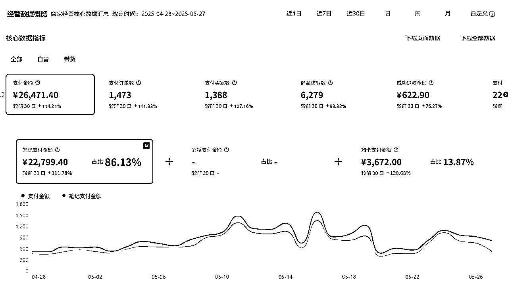

下面会从店铺数据、选品逻辑、笔记制作、流量来源和运营节奏几个方面，复盘这个项目是如何从无到有跑起来的。希望正在考虑进入📕虚拟电商的朋友，可以借此了解一个店铺真实起盘的过程。

# 先说说我的经历

2023年，我从互联网大厂产品经理岗位离职，原本打算进入新消费行业，后来误打误撞做起了电商。

我先后尝试过抖音短视频带货和电商直播，但当时入局时间并不理想，加上供应链基础薄弱，虽然通过投放做到过百万GMV，最后核算利润却并不理想。相比之下，📕当时仍然存在不少机会，我也因此逐渐获得了一些结果。

2023年初，我在📕做过一个内容模板，主题是《每天认识一款茶》。这个系列一周涨粉超过1万，一个月涨粉超过3万。不过，图文账号的商业化空间相对有限，所以持续了一个多月后，我没有继续深挖，而是转向了真人口播内容。

后来，这个内容形式被很多同行参考，甚至被迁移到了其他领域，不少账号也因此积累了几万粉丝。直到现在，这类内容依然能获得持续流量。

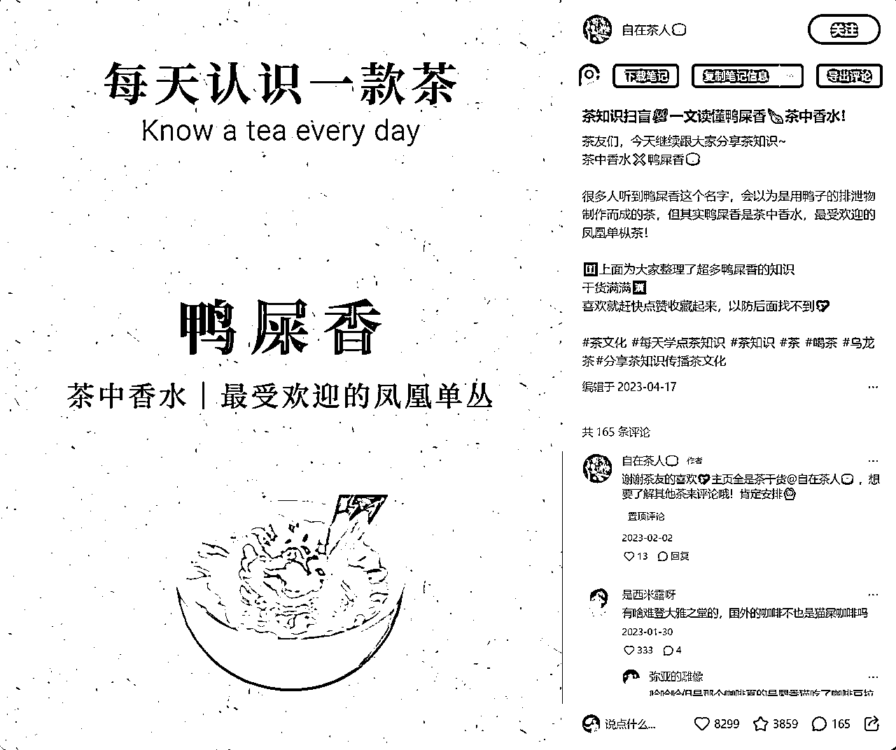

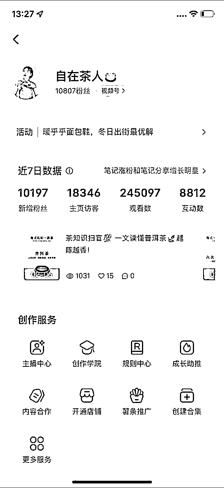

因为当时没有找到更合适的方向，我决定继续在茶叶领域发展，于是一个人去了武夷山。过去在抖音电商中暴露出来的供应链问题，到达源产地后反而得到了很好的解决。

大约在2023年7月，我开始尝试投放📕聚光，也是较早使用这一工具的一批人。当时获取一个私域客户的成本只有几元，确实赶上了早期红利。现在同样的获客成本已经上涨到二三十元左右。

后来，我们通过“爆款笔记模板+多账号矩阵+聚光投放”的方式，在一年时间里沉淀了4万多条私域客资。由于很多客户反复询问购买链接，我们顺势开通了📕店铺。到目前为止，店铺累计成交超过2万单，GMV接近200万元。

当然，茶叶项目的主要成交仍然来自私域，因为茶叶具备较强的复购属性。不过，这个过程中也让我积累了不少📕电商运营经验。

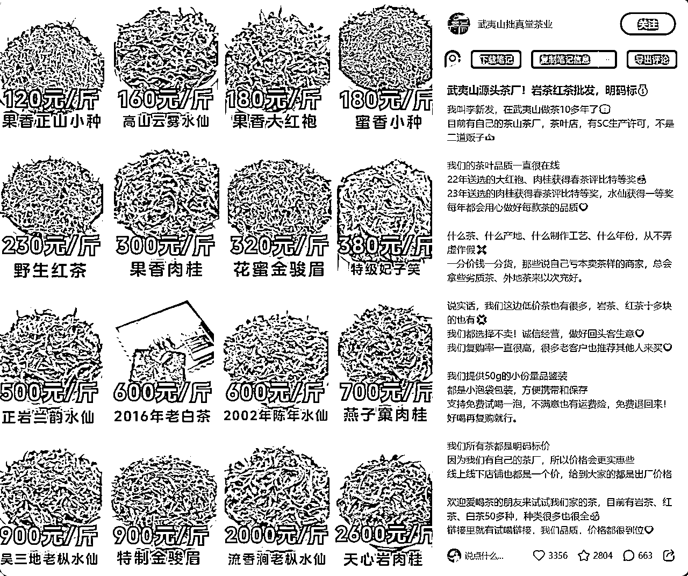

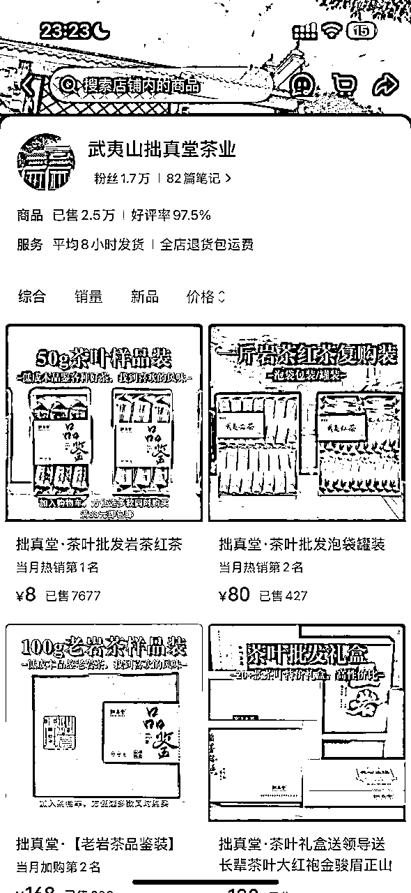

当时有一篇商品笔记，从最初只有100个赞开始投放，最终涨到3000多个赞，后来也被不少商家模仿。

茶叶项目的完整复盘，可以参考这篇文章：

https://scys.com/articleDetail/xq_topic/4848282444454558

2024年，我一直在武夷山打磨供应链，参与了生产、设计、销售和用户运营等多个环节。越深入参与，我越清楚地看到实体供应链的复杂性：

- 生产周期长；
- 库存压力大；
- 品控管理难；
- 资金占用高；
- 系统能力需要长期沉淀。

如果想真正建立起一套成熟的实体供应链体系，往往需要多年时间。这让我开始重新思考更轻量的线上项目。

📕虚拟电商具备成本低、迭代快、库存风险小等特点，也更符合我过去在互联网行业积累的能力，因此我开始把注意力转移到这个方向。

另外，我也是更绪的合伙人。他在📕虚拟店铺领域已经有了较深入的探索，而我过去主要精力放在茶叶项目上。虽然这次店铺同样是从零开始，但在他的指导下，我避开了不少弯路，整体启动速度也更快。

之所以把这些经历讲出来，是想说明：这个店铺虽然3个月左右就跑出了结果，但并不是完全没有基础地从零试错。我之前已经有📕内容、电商、投放和私域运营经验，同时还有合伙人的经验支持。

好了，背景介绍到这里，下面进入具体方法。

# 店铺起盘过程

## 一、赛道怎么选

📕虚拟电商的品类非常多，常见的包括：

- 考研资料；
- 公考题库；
- K12学习资料；
- PS、PPT模板；
- 职场技能课程；
- 头像和壁纸；
- 课件教案；
- 知识服务；
- AI工具与提示词；
- Coze插件；
- 各类考试资料。

基本上，只要有明确需求，就可能有人把它做成虚拟商品。

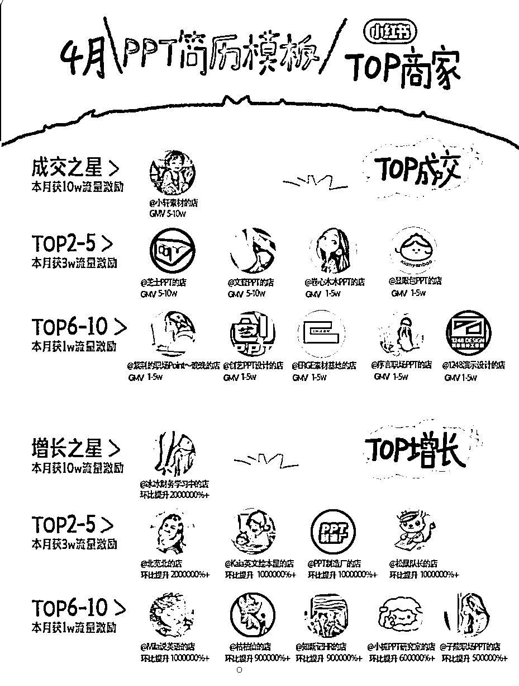

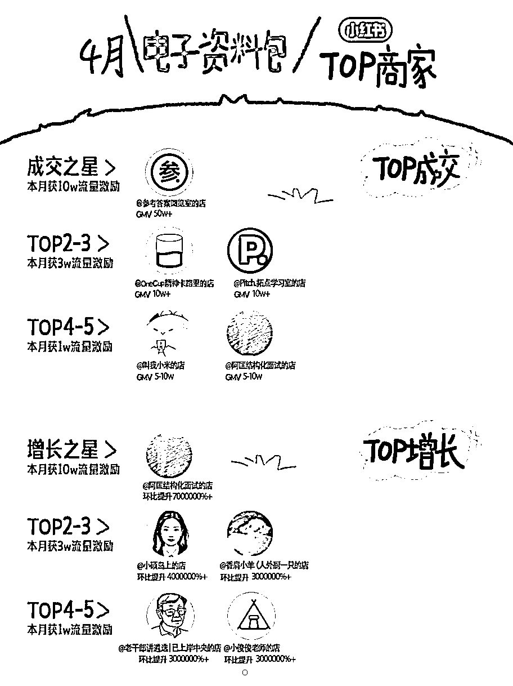

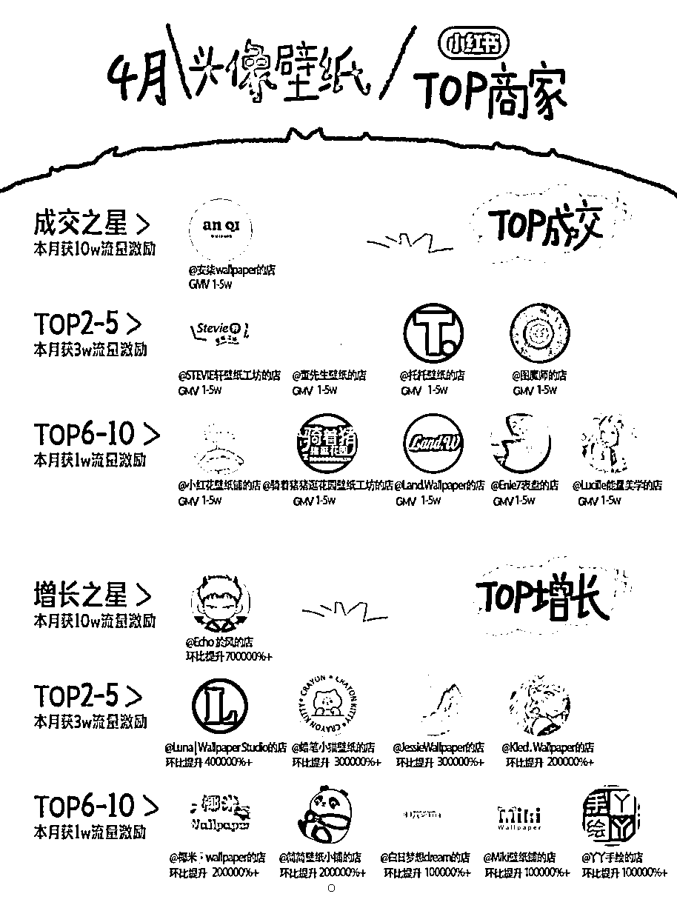

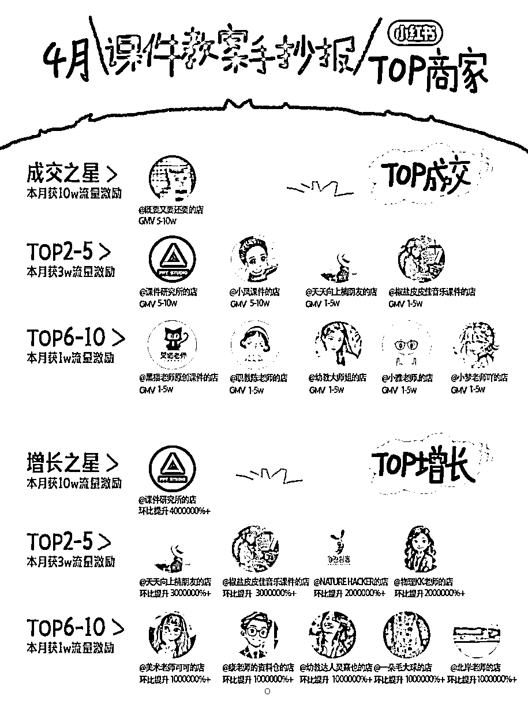

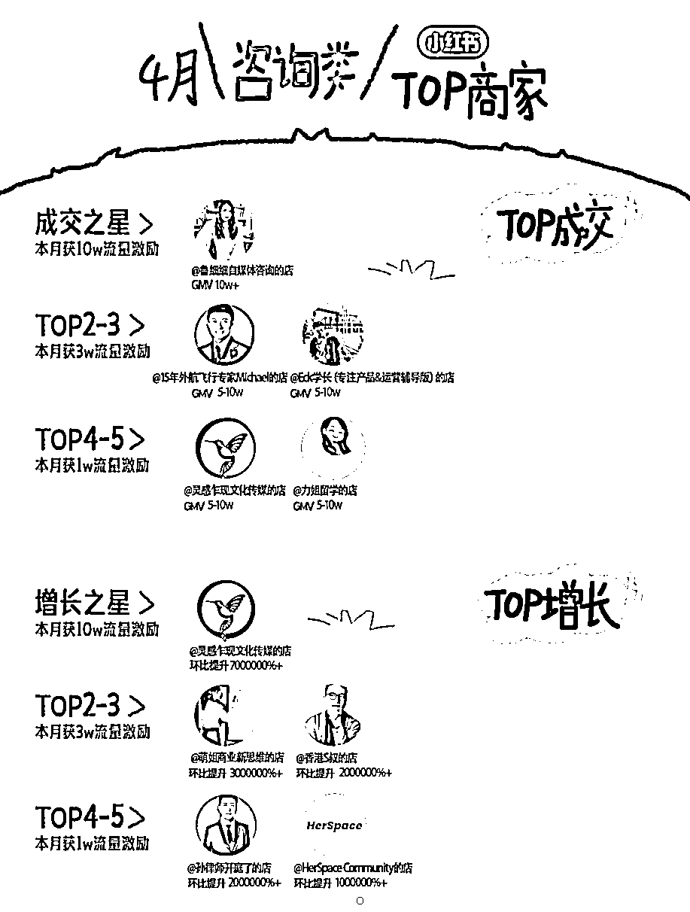

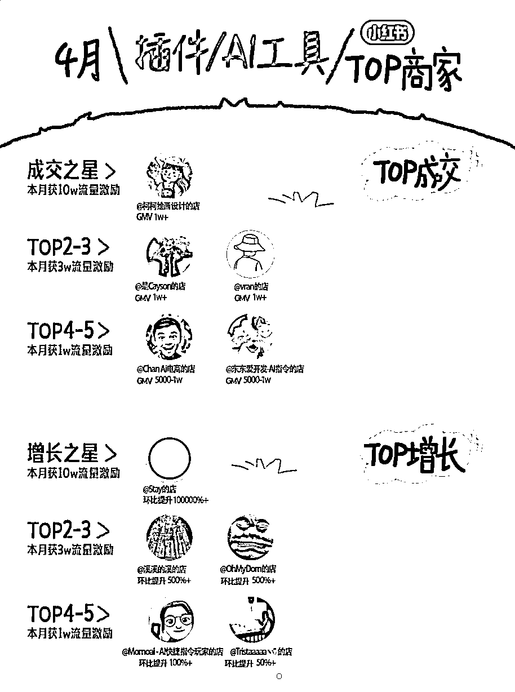

刚开始面对这么多方向，我也并不知道应该从哪里切入。后来连续测试了几个领域，才发现一个问题：

有热度，不代表适合普通人。

有些赛道表面看起来很简单，实际需要大量整理、专业能力或长期积累。比如“参考答案阅览室”这类产品，看似只是把公开的商业文章和名人内容进行归纳，实际上背后的资料搜集、分类和整理工作量非常大。

最终，我选择了中考和高考相关资料，主要有三个原因。

### 1. 自己对用户有真实理解

中高考几乎是大多数人都经历过的阶段。熬夜刷题、成绩波动、距离目标学校只差几分的焦虑，我都亲身经历过。

因为有过这些经历，所以更容易理解学生和家长真正关注什么，也能判断哪些资料只是“看起来有用”，哪些内容确实能解决问题。

### 2. 需求属于强刚性

什么叫刚需？

就是即使不喜欢，用户也必须面对。

用户可以暂时不学PS，也可以不考某个证书，但中考和高考无法回避。每年参加高考的学生超过千万，中考人数更多。对于学生和家长来说，只要资料能够帮助提升几分，就有可能产生购买意愿。

### 3. 市场规模大，需求持续变化

中高考涉及的科目多、知识点多，考试形式也会持续变化。某一套资料卖得好，并不意味着整个市场就没有机会了。

此外，这类用户主要是学生和家长，需求相对直接。相比部分大学生资料赛道，用户往往不会过度比价，购买目的也更加明确。

所以，选择赛道时可以重点看三个指标：

1. 自己是否有一定理解；
2. 用户是否存在刚性需求；
3. 市场是否足够大且持续变化。

赛道选得合适，后续选品、内容和转化都会轻松很多。

## 二、如何找到合适的产品

选品的本质，是寻找供需之间的空档。

可以把它理解成：需求已经被市场验证，但竞争还没有完全拥挤。

我主要通过以下几种方式找产品：

- 看📕上低粉但销量不错的商品；
- 观察近期出现热度的资料；
- 查看淘宝中销量很高的虚拟商品；
- 对比这些商品在📕上的竞争情况。

淘宝的销量可以作为一个重要的需求验证依据。如果一个资料包已经在淘宝卖出几万单，说明它不是偶然需求，而是市场中确实存在稳定购买人群。

但淘宝卖家未必擅长📕运营，有些人甚至根本没有在📕布局。这就给了我们机会。

我曾经发现，淘宝上一些月销上千单的虚拟资料，在📕上几乎没有明显竞争。测试下来，很多已经在淘宝被验证过的需求，换到📕后依然可以获得搜索流量。

我们使用的部分资料，是从淘宝购买后重新整理的弱版权资料，且不会涉及机构内部资料。像中考真题、高考真题等，本身已有公开整理版本，相关产品会优先考虑版权和合规风险，存在明显侵权问题的资料一般不会碰。

下面是店铺近一个月的部分数据。

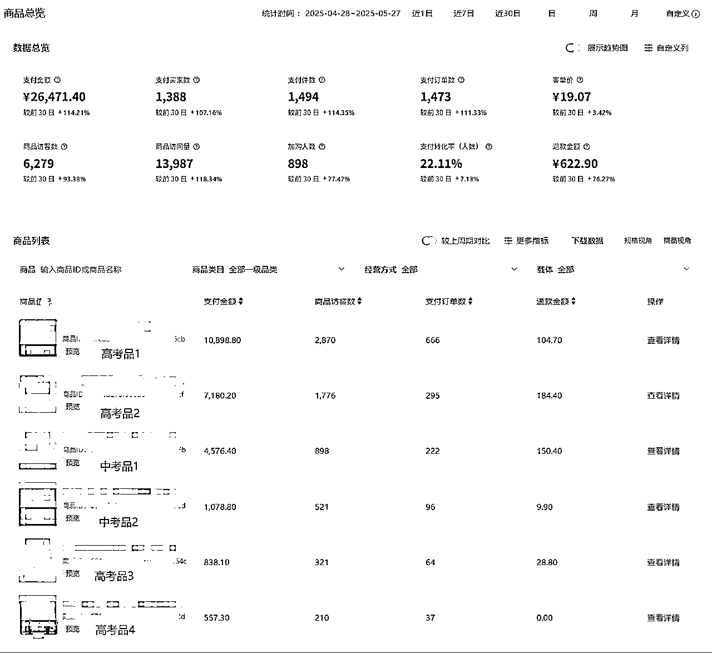

其中有几个产品主要依靠长尾关键词获得流量，销量和转化表现都不错。更关键的是，刚开始制作时，📕上几乎没有直接竞争者。

当然，选品也不可能全部成功。

比如高中答题模板，我连续发布了100篇笔记，最后只成交了几十单，整体表现远低于预期。

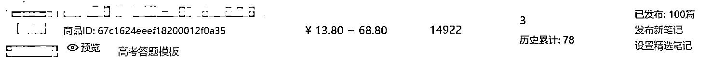

后来我开始思考：既然高考产品能够跑通，中考资料是否也有机会？

两者本质上都是升学考试，中考生和家长的焦虑程度并不低，而且中考人数比高考生更多。于是，我按照高考资料的思路，开始补充中考产品。

经过一段时间测试，中考相关产品的数据也逐渐增长。

## 三、笔记应该怎么发布

很多人做📕，会选择一次性批量发布，先发几十篇，再不断扩大数量，最后可能铺到几百甚至上千篇。

我的做法相对精细一些。

我会先找对标内容，再拆解商品卖点，确定用户搜索场景和内容角度，而不是单纯追求数量。

在📕上，封面和标题决定用户是否愿意点击。用户刷到一篇笔记后，通常只有不到一秒的判断时间。如果第一眼没有看到价值，后面的内容再好也没有意义。

因此，每个商品前期一般会先发布5到10篇笔记。

这样做主要是为了测试：

- 哪个标题更容易获得点击；
- 哪种封面更吸引目标用户；
- 哪个关键词能带来搜索；
- 哪个内容角度更容易成交。

📕存在一定随机性，同样的内容换一个时间发布，数据可能完全不同。如果某篇笔记开始稳定出单，我就会围绕这个方向继续扩展。

表现较好的产品，后续可能发布几十篇，甚至上百篇。

这些笔记也不是全部由一个账号发布，而是采用“一拖三”的方式：一个店铺账号关联3个主理人账号，多个账号共同测试和承接流量。

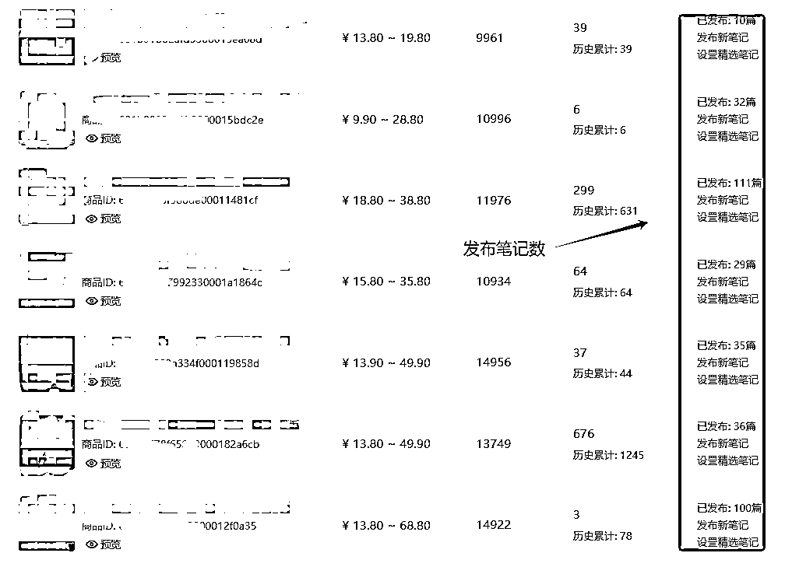

整个过程中，我们发布了几百篇内容，但其实没有出现真正意义上的千赞爆款，最高的一篇也只有200多个赞。

不过，这并不妨碍成交。有几篇笔记累计带来的销售额超过千元，原因在于它们精准覆盖了搜索关键词。

从流量来源来看，店铺大部分流量，甚至80%以上，都来自搜索。

搜索流量的特点是持续性更强。虽然单篇笔记的曝光未必很高，但只要关键词匹配用户需求，就可能持续带来订单。由于搜索用户本身已经有明确需求，整体转化率也比较高，大约在20%左右。

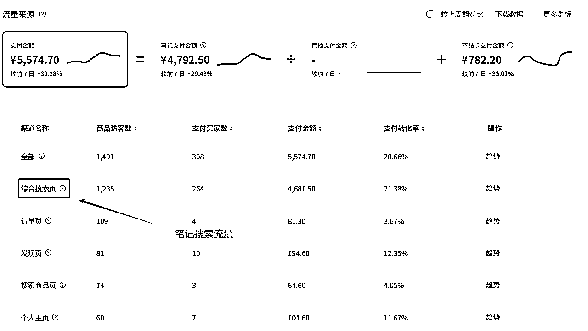

整个店铺的笔记数量其实不算多，大约三四百篇，其中还有100多篇属于无效内容。

相比简单堆数量，更重要的是：

- 关键词是否布局准确；
- 封面是否能够吸引目标人群；
- 商品卖点是否表达清楚；
- 内容是否匹配真实搜索需求。

# 店铺经营数据复盘

## 2月底：正式启动

之前参加过小航海，也尝试运营过一段时间，但因为主业繁忙，没有持续推进。不过，之前发布的内容一直在获得一些长尾搜索流量。

直到2月底，我才开始正式投入时间运营店铺。

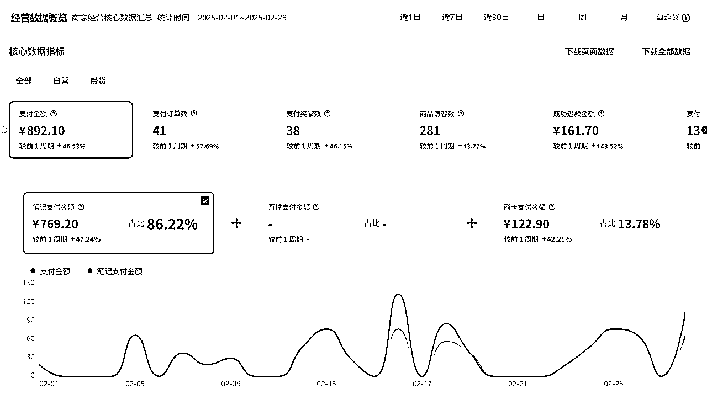

## 3月：测试3个产品

3月进入正式运营阶段，店铺一共上架了3个产品。

其中一个产品投入了较多精力制作笔记，但方向没有跑通；另外两个产品逐渐获得了流量和订单。

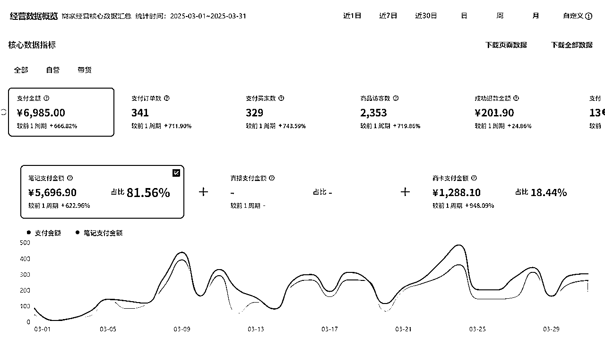

## 4月：高考资料开始积累搜索流量

4月补充了中考资料，并制作了一批相关笔记。

不过，当月主要成交的仍然是高考产品，因为前期发布的内容开始持续获得长尾搜索曝光。

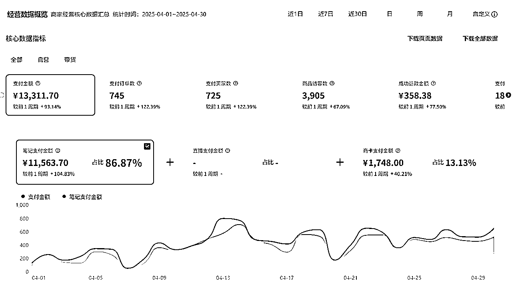

## 5月：扩展专项训练和期末复习

5月开始增加初高中专项训练、期末复习等产品。

当时店铺的主要订单仍然来自之前布局的中高考资料。由于中高考进入高热度阶段，整体销量继续上升。

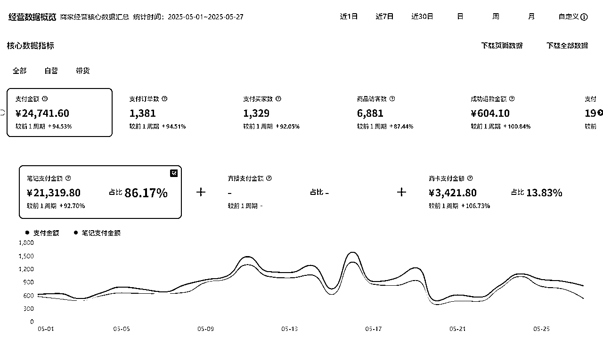

后续，我们也准备引入一些客单价更高的产品。例如高考志愿填报在特定时间段会产生较强需求，可以先通过店铺销售AI志愿卡，再将部分用户承接到私域，进一步转化高客单服务。

不过需要提醒大家：如果现在才开始做中高考资料，时间窗口已经接近尾声，不建议再盲目跟进同一方向。

# 关于选品的进一步思考

选品是很多新手最容易卡住的环节。

有人一上来就问：

“现在什么产品最好卖？”

“哪个赛道最热门？”

但真正决定结果的，通常不是单纯追逐热门，而是你是否能找到适合自己、需求真实、竞争可控的产品。

## 方向一：优先考虑自己熟悉的领域

很多人看到别人卖什么，就马上复制什么。结果客户一提问，自己无法回答，售后问题也会接连出现。

任何赛道都有人做得好，关键在于操盘者是否理解用户和产品。

你可以先从自己的经历出发：

- 过去从事过什么工作；
- 曾经参加过哪些考试；
- 有哪些兴趣爱好；
- 对哪些行业比较了解；
- 哪些问题你自己曾经解决过。

熟悉的领域更容易让你找到真实痛点，也更容易判断产品质量。

如果对某个领域完全不了解，也不是不能做。可以先利用DeepSeek梳理目标人群、使用场景、典型问题和购买动机，再去📕查看相关笔记和评论区，逐步建立基本认知。

## 方向二：寻找刚需和高痛点

用户愿意主动付费解决的问题，才是真需求。

📕本身具有较强的搜索属性，很多用户遇到问题后，会直接在平台上寻找答案。因此，能够对应主动搜索行为的产品，通常更容易获得精准流量。

考试资料就是典型案例。

中国人对考试的重视程度很高。从年初到年末，几乎每个月都有不同类型的考试：

- 公务员考试；
- 教师资格证；
- 建造师考试；
- 会计师考试；
- 医师资格考试；
- 法律职业资格考试；
- 考研等。

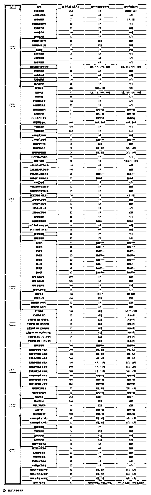

图源：赚钱虚拟航海

除了考试资料，PPT模板、简历模板、表格工具、设计素材等也容易产生购买需求，因为它们往往对应明确的工作场景和时间压力。

之前我还看到过“高校求职信息差”这类产品，在📕上已经卖出了上万份。

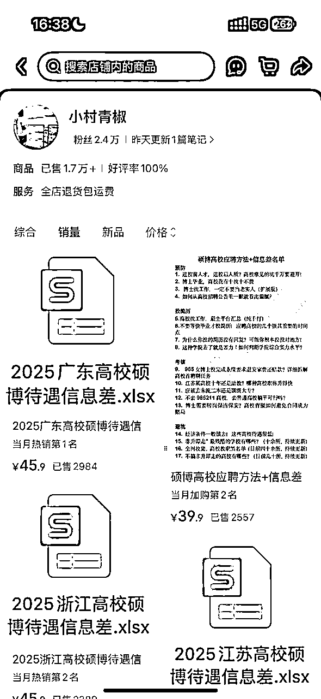

## 方向三：关注阶段性热点

热点产品的优势在于需求短时间内快速增长，平台也会出现大量主动搜索。

例如：

- ChatGPT出现后，提示词教程迅速走红；
- DeepSeek火起来后，相关使用教程立即出现；
- 高考季到来后，志愿填报服务成为阶段性热门。

这类机会的关键是速度。等所有人都反应过来，最容易获取流量的阶段往往已经过去。

不过，热点不能只做表面跟风。

DeepSeek可能只是短期热点，但AI工具使用能力会长期存在；高考志愿填报集中在6月，但学习方法和考试技巧全年都有需求。

更稳妥的方式是：

用热点获取注意力，用长期价值承接用户。

## 其他选品参考

除了以上三种方法，还可以重点关注：

- 📕站内低粉高销量商品；
- 淘宝上销量高但📕竞争较小的资料；
- 近期搜索量明显上升的关键词；
- 即将到来的考试、求职、升学和职场节点。

我们团队也开发了一个工具，可以批量抓取📕站内的爆款商品，帮助筛选不同领域的热门虚拟产品。

下面列出几个方向，供大家找产品时参考：

小学领域：

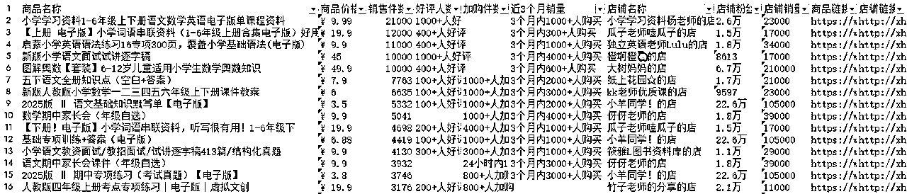

初高中领域：

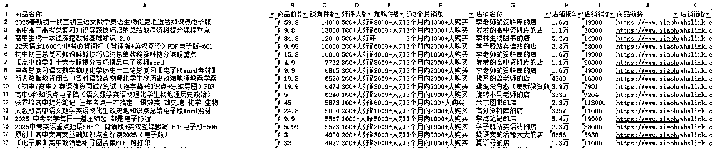

大学生与成人考试领域：

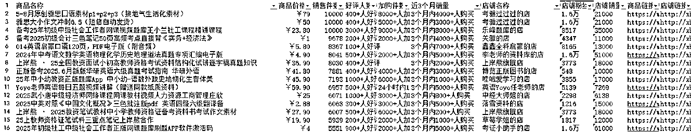

教师教案和备考领域：

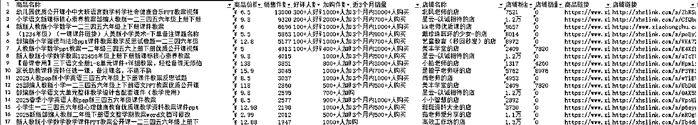

模板、素材和教程领域：

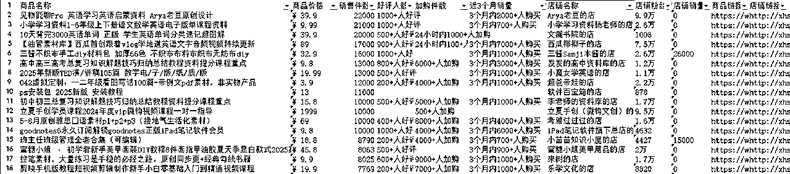

这里还要特别提醒一点：

时间节点类产品，最好提前一个月开始准备。

很多店铺不是产品不好，而是没有把握好节奏。等需求全面爆发后才开始上架，往往已经错过了最好的销售窗口。

# 关于笔记制作

## 1. 先找到真正有效的对标

不论是选品还是做内容，都应该先研究同行。

先模仿成熟结构，再逐步形成自己的表达方式，是新手比较高效的起步方法。

很多人寻找对标时，只盯着“低粉高赞”。看到一个几百粉账号发出几千赞的内容，就认为这一定是赚钱笔记。

但点赞高不等于成交高。

有些内容的目标只是涨粉，评论区没有购买意向，最终转化可能非常低。

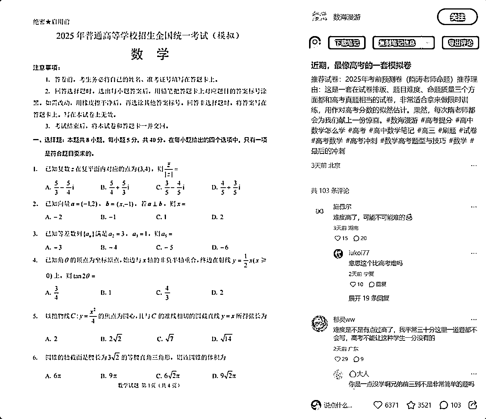

高赞、高收藏，但成交能力弱的内容

真正值得研究的，是那些投入不高、成交稳定的笔记。可以重点观察以下特征：

- 制作简单：封面清晰，后面展示几页资料；
- 数据适中：几十到几百赞即可，不必执着于超级爆款；
- 评论有购买信号：用户主动询问价格、购买方式或链接。

判断一篇笔记是否值得模仿，建议优先看评论区，而不是只看点赞量。

如果评论区频繁出现：

- “多少钱？”
- “怎么买？”
- “可以发链接吗？”
- “资料在哪里领取？”

通常说明这篇笔记具备较好的转化潜力。

### 两类常见的高转化模板

#### 第一类：高转化规模型

这类内容通常属于大家熟悉的热门笔记，可能有上千点赞，发布时间也比较近。

它们更偏向获取推荐流量，整体曝光较大，成交量也可能较高。但由于竞争者多、模仿者多，复制难度更大，爆发也更依赖平台推荐。

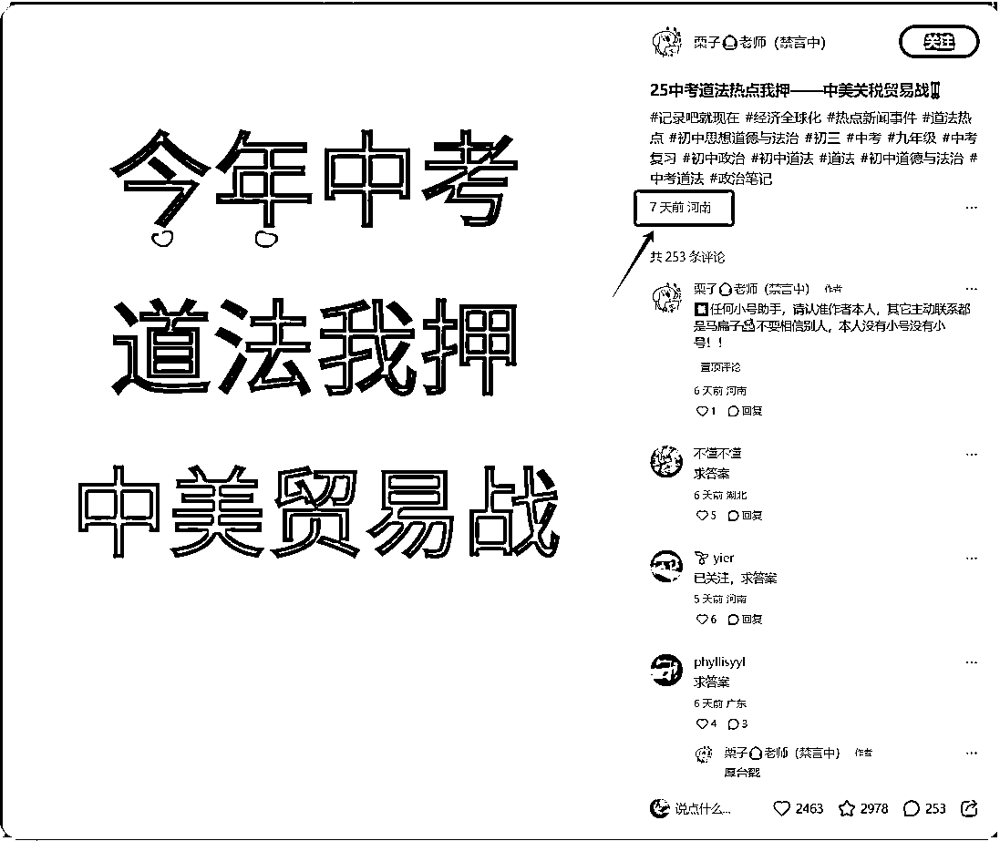

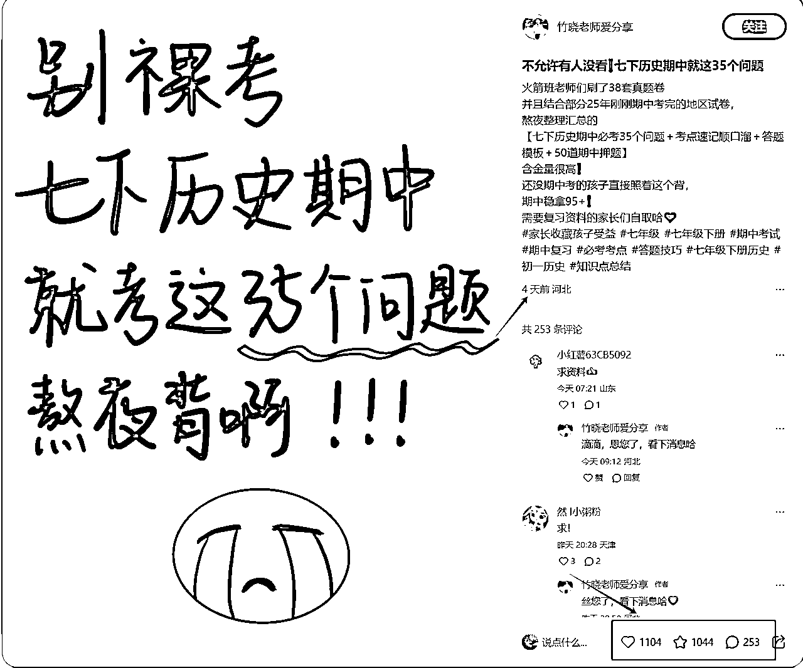

#### 第二类：高转化效率型

这类笔记更多出现在搜索结果中，点赞量通常在30到300之间，有些内容甚至发布数月后仍然能够持续获得订单。

它们的总曝光不一定很大，但因为搜索用户需求明确，成交效率往往更高，稳定性也更强。

从长期运营角度看，这类内容更值得优先研究。

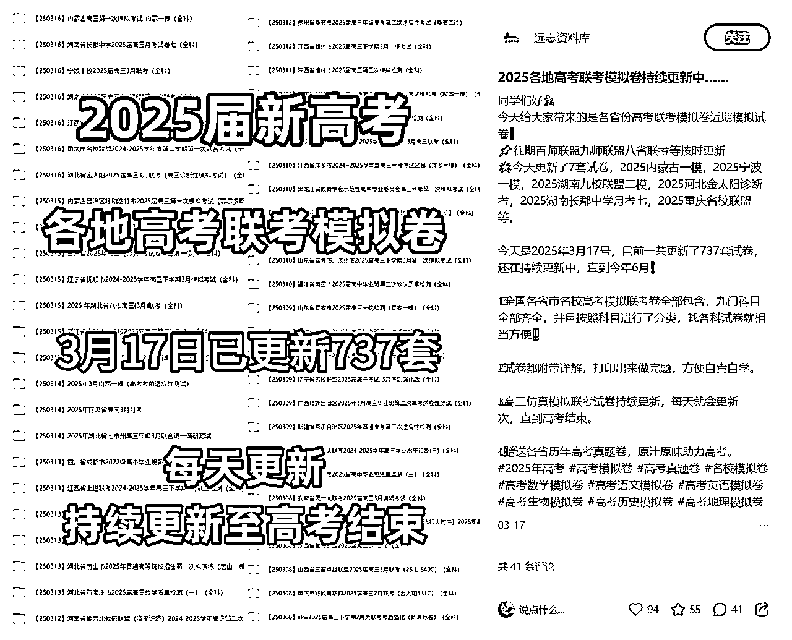

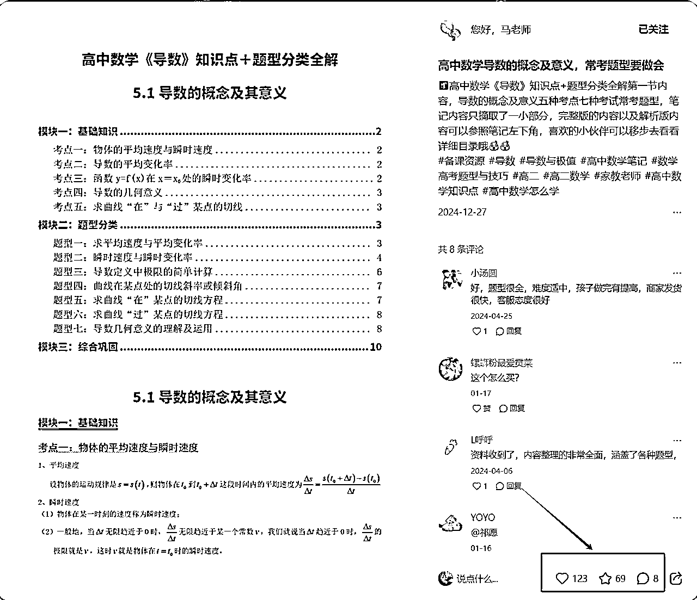

## 2. 封面和标题决定点击

在📕上，用户是否点击，往往先由视觉决定。

无论卖的是哪类虚拟资料，封面和标题都是基础配置。内容再专业，如果封面无法吸引用户，用户甚至不会进入正文。

一个有效的封面通常具备这些特点：

- 字体足够大；
- 重点信息突出；
- 颜色对比明显；
- 版式简洁；
- 信息量适中；
- 用户一眼能看懂产品价值。

封面不是把所有内容都堆上去，而是要让用户快速明白：

“这是什么？”

“能解决什么问题？”

“为什么值得点进去？”

### 三种常见封面方向

#### 方向一：信息丰富型

让用户一眼看到资料覆盖范围、数量、科目或使用场景，从而产生“内容很完整”的感觉，提升停留和点击意愿。

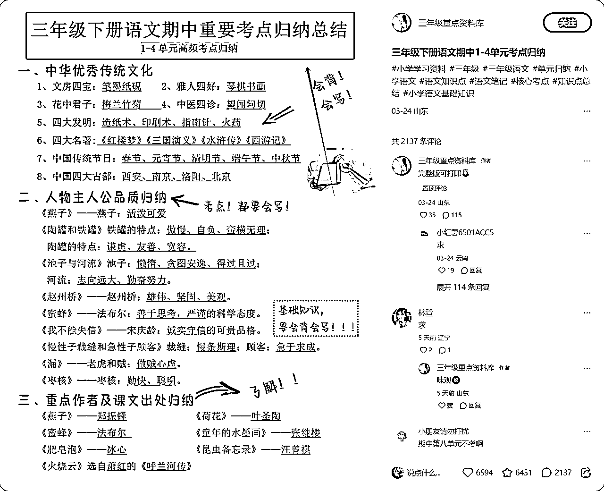

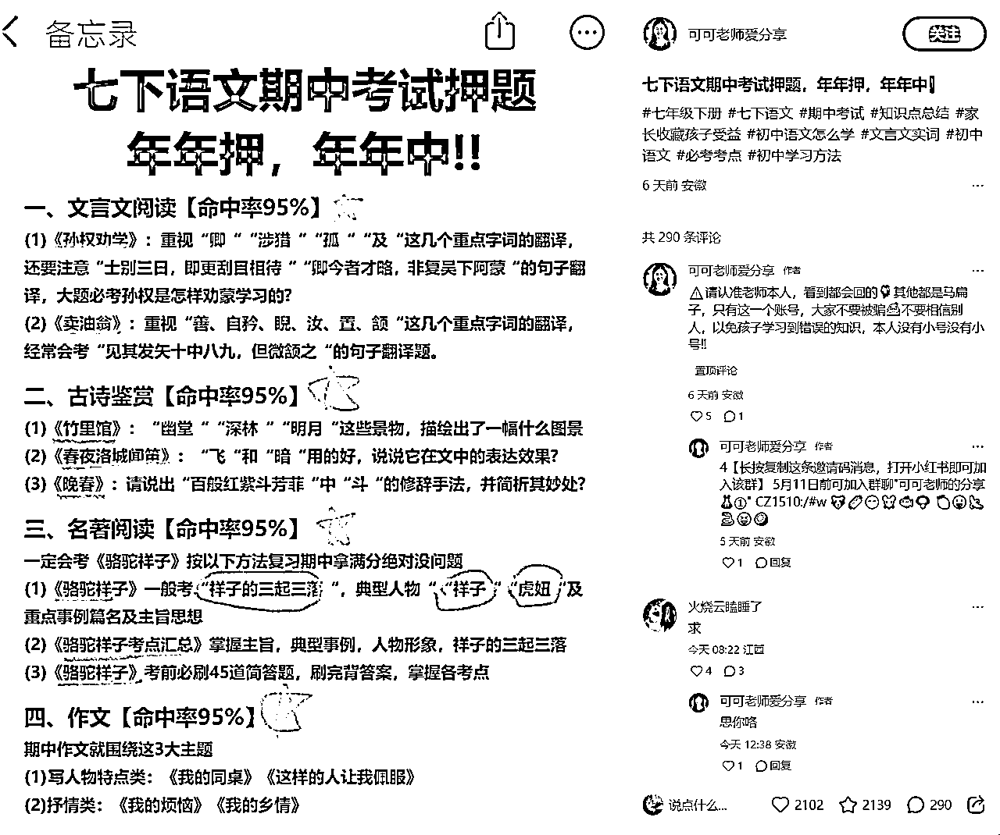

#### 方向二：情绪驱动型

用户刷内容时，很多决策都是瞬间完成的。封面需要在极短时间内唤起焦虑、期待、紧迫感或获得感，让用户产生“我也需要”的想法。

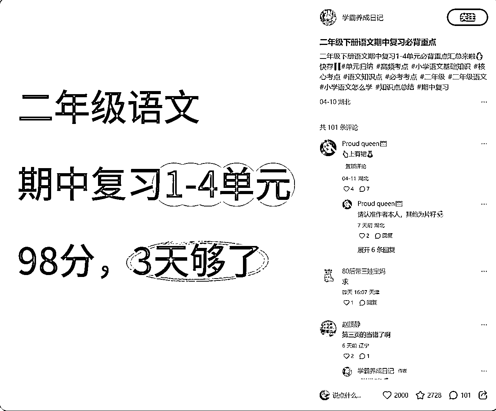

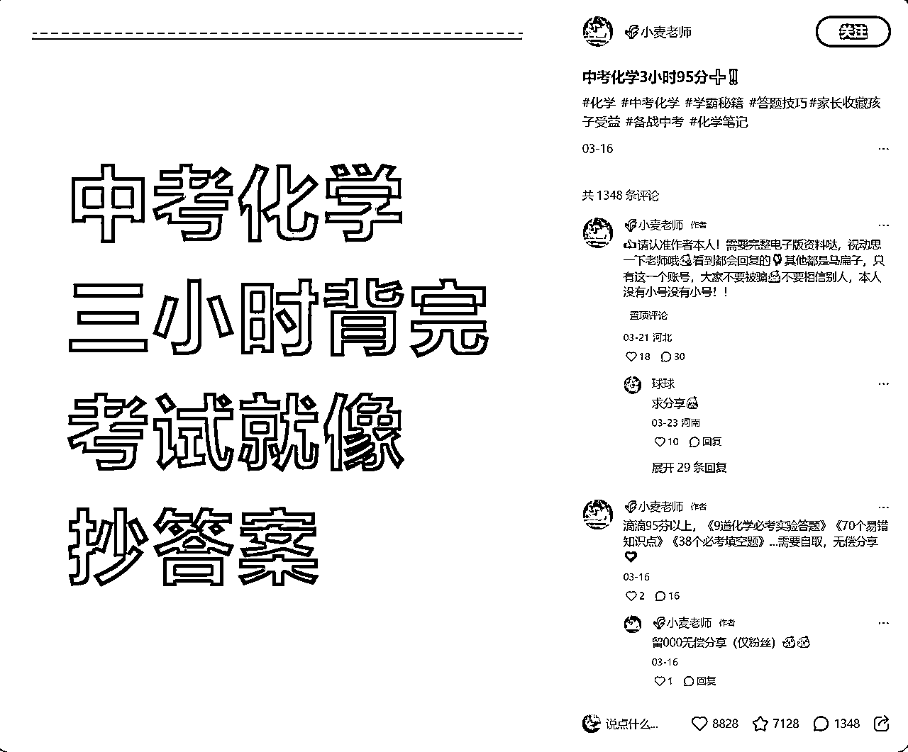

#### 方向三：痛点筛选型

好的封面不仅是为了吸引人，还要筛选出真正匹配的用户。

如果封面吸引来的都是不精准人群，用户进入后快速离开，平台可能会判断内容质量不高，后续分发也会受到影响。

因此，封面的作用有两层：

一是让目标用户愿意点击；

二是让不匹配的人主动离开。

最终留下来的用户越精准，后续的搜索排名、停留和成交表现通常越稳定。

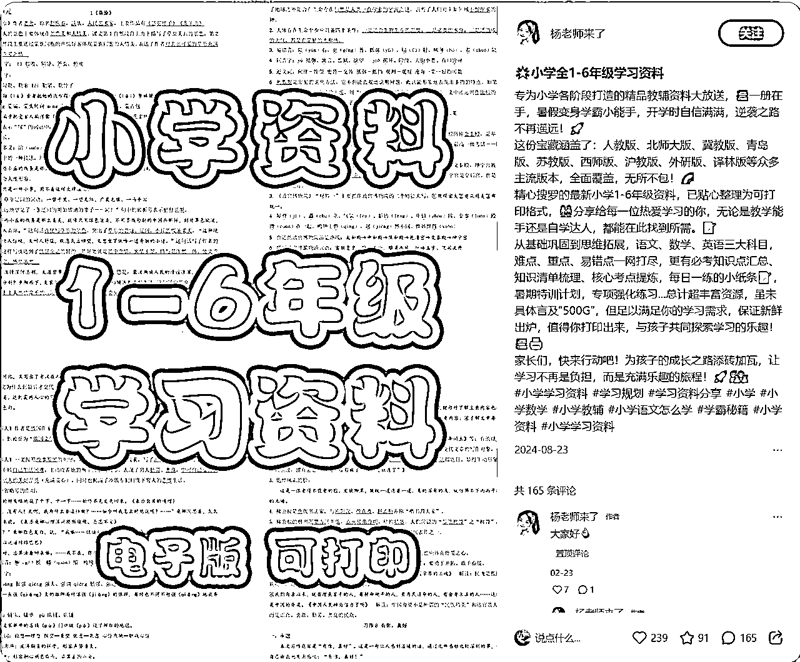

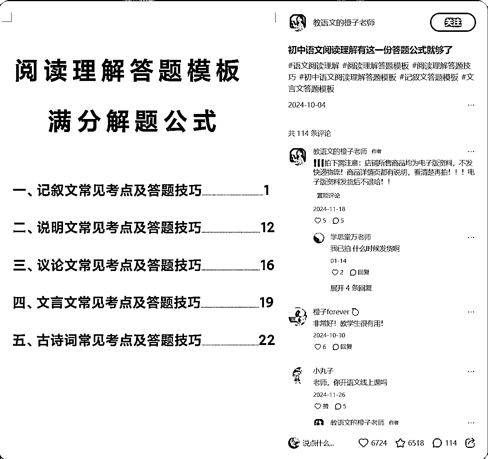

# 📕虚拟资料项目：让搜索需求转化为订单

## 一、标题与封面：先解决“找得到”，再解决“想点击”

标题可以采用这样的组合：

**用户可能输入的检索词 + 明确数字、结果承诺或情绪表达**

前半段承担的是入口作用，让平台知道内容对应什么需求；后半段则负责传递价值、制造期待，推动用户继续浏览。

例如，围绕中考数学资料，可以写成：

**中考数学公式清单，重点内容一次整理齐**

这里的“中考数学”对应需求入口，后面的表达则让用户迅速感受到内容价值。

同样的思路也能用于封面。封面文字别只追求好看，更要把主题讲明白。长期保持这种“需求词+价值信息”的表达方式，有助于提升内容识别度。

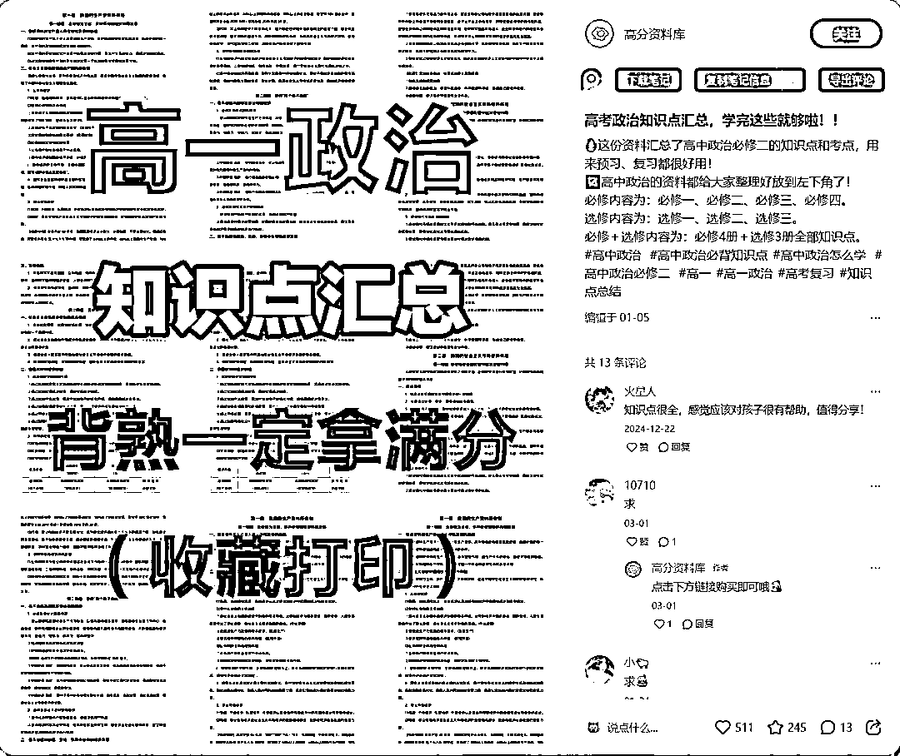

# 搜索优化的完整思路：从找词到布局

## 1. 关键词要从真实需求里来

做搜索内容，第一步不是急着写，而是先确认用户到底会怎样表达需求。

### 方式一：观察平台推荐

在📕搜索栏输入产品名称，查看系统给出的联想结果。

比如输入“小学六年级作文”，可能出现“范文”“优秀作文”“作文素材”等延伸表达。这些词不是主观猜测，而是平台依据用户行为生成的需求提示，值得优先记录。

### 方式二：参考官方数据工具

聚光相关工具需要企业类型账号才能使用，但能提供更有参考意义的数据。

通过官方数据，可以进一步判断某个词的热度、竞争程度以及潜在成交表现。若准备长期经营搜索渠道，这类数据应当成为选词依据之一。

### 方式三：整理客户原话

私信、留言和售前咨询里，往往藏着非常真实的搜索表达。

把客户反复提到的问题、用词和需求记录下来，再按照出现频率进行归类，就能建立属于自己的词库。

## 2. 选词不能只看热度

拿到一批候选词后，还要从三个角度判断是否值得使用。

### 搜索规模是否合适

过热的词通常聚集了大量成熟账号，新账号很难获得位置；过冷的词虽然竞争小，却未必能带来足够访问。

更适合长期经营的，往往是有明确需求、竞争相对可控的中等热度词。

### 是否带有购买倾向

“初中作文素材”通常对应明确的资料需求；“学习方法”则范围太宽，搜索者可能只是想看经验，并没有购买计划。

因此，要优先选择更接近商品决策的表达。

### 是否与商品真正相符

流量词必须和所售内容有直接联系，不能为了曝光强行嫁接。

比如资料确实面向作文学习，就可以围绕相关词展开；如果商品与某个宽泛概念关联很弱，就不应勉强使用。

## 3. 让关键词分布在四个触点

不要把希望全部寄托在标题上。更完整的做法，是让主题信息同时出现在：

- 封面文字
- 标题开头
- 正文表达
- 相关话题

### 封面文字

封面承担快速识别功能。销售中考数学内容时，应直接呈现“中考数学”等核心信息，让用户滑动浏览时也能立即判断主题。

### 标题开头

用户搜索后，标题通常是最先被读取的部分。核心词尽量靠前，例如：

**中考数学公式整理，考前复习直接用**

主题明确，平台与读者都更容易完成匹配。

### 正文表达

关键词要融入语境，而不是反复堆叠。

开篇可以从用户困惑切入，中段介绍资料结构与适用场景，结尾再自然回扣主题。这样的分布既能加强关联，也不会破坏阅读流畅度。

### 话题选择

话题应优先选择和内容主题一致的标签，例如：

- #小学作文素材
- #中考数学复习
- #初中学习资料

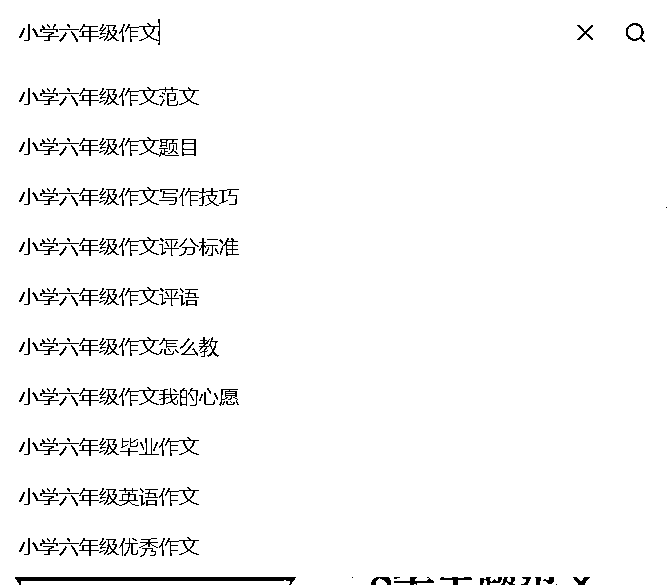

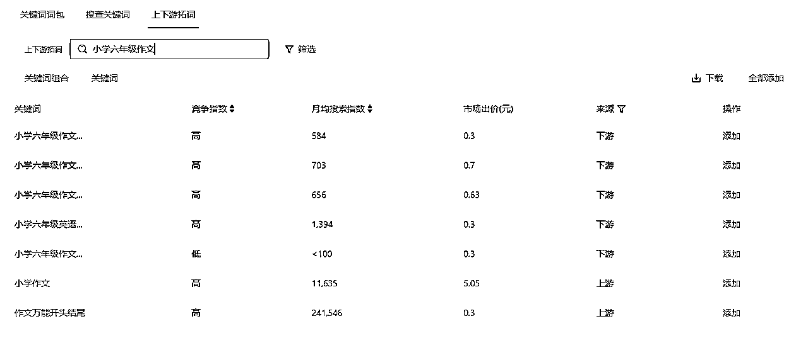

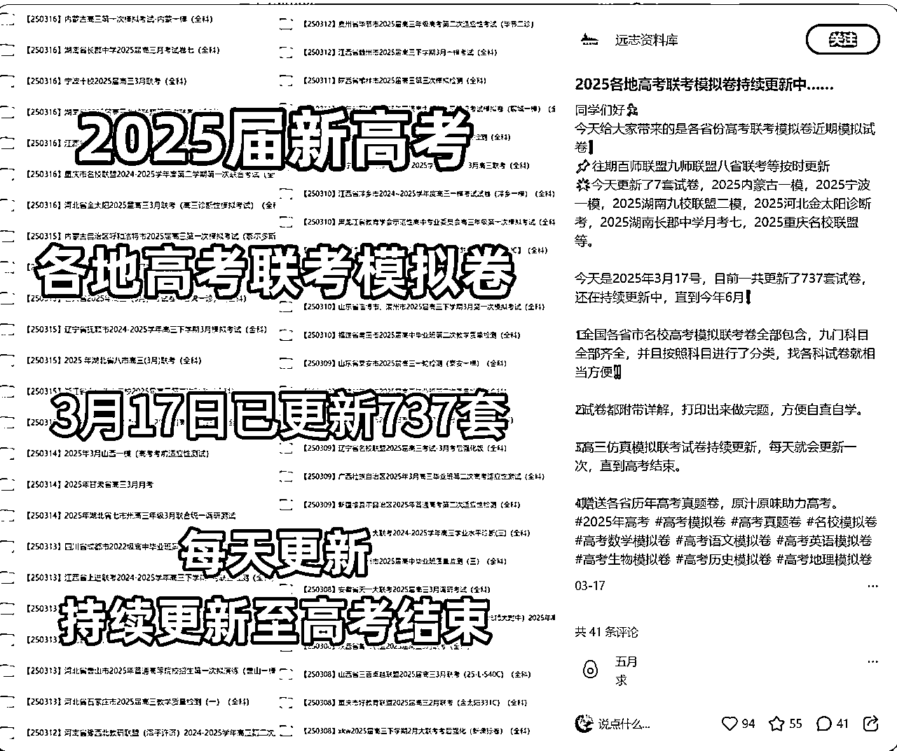

# 虚拟资料的寻找、筛选与重组

## 一、常见资料来源

### 1. 🛰️生态内检索

找资料时，很多人只盯着传统搜索平台，实际上🛰️👸号和相关内容也是一个重要入口。

不少账号会公开分享网盘内容，部分资料包可以通过🛰️内搜索找到。使用时仍需注意内容来源与授权情况，不能因为能够找到就默认可以商用。

### 2. 电商平台与同领域卖家

如果免费检索节省的是资金，那么向成熟卖家购买，节省的就是时间。

淘宝、拼多多都可以作为参考渠道。挑选时可查看销量、评价、买家反馈及商品展示，优先选择整理质量较高的样本。

同时要持续观察市场变化：哪些内容被频繁购买、哪些组合更受欢迎、哪些展示方式更容易促成成交，都可以作为后续改进方向。但借鉴不等于复制，使用前应确认权利边界。

## 二、重组能力决定资料价值

单纯把文件集中到一个压缩包里，很难形成良好体验。真正能提升商品价值的，是筛选、归类、命名和使用路径设计。

### 1. 目录要让人一看就懂

常见的组织方式有三类：

- 依照年级、水平或难度排列
- 按知识模块或应用场景拆分
- 按“讲解—示例—练习—解析”形成完整学习链路

例如，“五年级数学”下面可以进一步划分为知识考点、阶段复习、课后练习、易错内容等，而不是把大量文件无序堆在一起。

层级越清楚，用户查找成本越低，使用体验也越好。

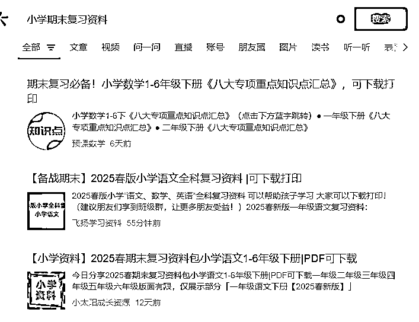

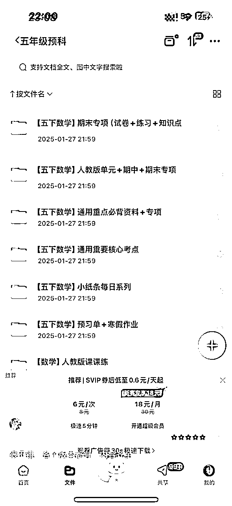

### 2. 展示重点应放在内容质量

单纯强调文件容量，并不能证明资料有用。

发布内容时，可以选择几页具有代表性的页面进行展示，例如目录、核心知识点、典型题目、答案解析和实际使用场景。

图片应保持清楚，信息密度要足，让潜在买家能够判断资料是否适合自己。展示越具体，收藏与咨询通常越容易发生。

# 版权与平台风险：上架前先做检查

虚拟内容经营必须把版权放在前面考虑。

以下类型需要格外谨慎：

- 知名出版社发行的电子出版物
- 教培机构制作的完整课程
- 明确标注版权归属的商业资料

更稳妥的方向，是使用来源清晰、允许传播或处于合理授权范围内的公开内容，并通过合法方式进行整理和加工。

如果权属不明确，可以通过裁判文书公开信息了解相关主体是否有维权记录、案件结果及可能承担的成本，再决定是否继续推进。

商品页面也应如实说明来源、使用范围和交付性质，避免让购买者对版权和服务内容产生误解。

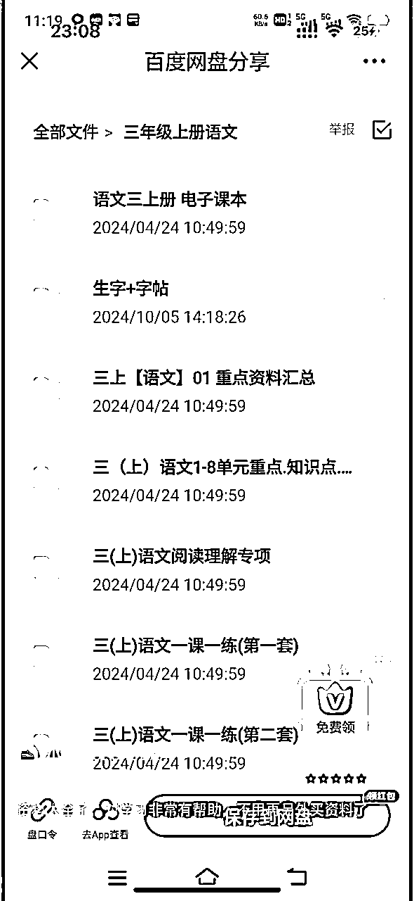

# 发布内容前，店铺基础环节要配置好

## 1. 选择合适的商品分类

数字商品通常覆盖多种虚拟内容，例如：

- 设计资源、滤镜、插件与智能应用
- 课件、教案、手抄报
- 电子学习资料
- 演示文稿、求职文件及其他模板
- 头像、背景图等数字素材

若商品反复出现分类异常或被提示下架，应检查所选类目、商品属性和平台审核要求，按照官方规则调整，不要通过违规方式规避审核。

## 2. 完善收款方式

把后台允许使用的收款渠道尽量配置完整，减少用户因支付选择受限而放弃购买。

一般在店铺后台的支付管理区域即可完成设置，具体以页面显示为准。

## 3. 设置虚拟商品配送

这类商品通常通过线上方式交付，不涉及实体包裹运输。

发货信息应按平台要求填写，运费方案可设置为全国范围免运费。设置时要检查地区限制，避免部分区域因模板规则无法购买。

## 4. 配置自动交付

可以使用阿奇索等第三方工具，完成付款后的链接发送。

运行程序时，需要保持电脑在线，或部署到稳定的远程运行环境。新手可以先利用试用周期测试链接生成、发送和售后流程是否顺畅。

## 5. 建立客服应答机制

在千帆后台的客服工具区域，提前整理好常见咨询及对应话术，例如发货方式、使用方法、文件打不开等问题。

可以让机器人承担基础接待，以提升响应速度；同时保留人工处理复杂问题的入口。

售后环节还可准备礼貌的评价提醒和补充资料说明，但不要用夸大或诱导方式影响用户判断。

## 6. 价格与页面信息

定价时可以参考同类商品，但不能只看别人卖多少钱，还要结合内容完整度、整理成本、交付方式与售后价值综合判断。

例如，线下平台售价9.9元的基础资料，在📕上可以根据展示效果和内容差异，考虑19.9至49.9元的区间，最终仍要通过实际数据验证。

商品页面至少应包含：

- 内容页面示例
- 使用步骤
- 交付形式
- 售后边界
- 风险提示

需要明确告知虚拟商品是否支持退款，以及是否存在实体寄送，避免交易后产生分歧。

## 7. 账号协同

一个店铺可以连接4个📕账号，包括店铺账号与管理账号。

这些账号发布内容时能够共同承接同一店铺商品。将一店配套的账号视作一个运营单元，后续如需扩展，可增加店铺数量并搭建更多运营单元。

目前通常需要通过千帆App内的账号管理功能完成关联，实际权限和门槛应以最新平台规定为准。

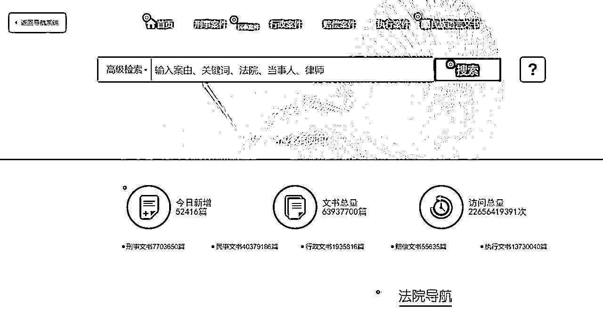

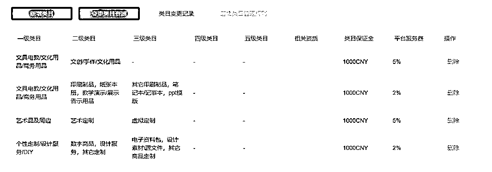

# 兼职制作与自动发布：降低重复劳动

## 一、为什么没有完全依赖智能生成图片？

早期我们也尝试过批量使用智能工具。

文字方面，智能模型可以快速产出大量初稿，稍微调整就能进入编辑环节，确实能节省不少时间。

但图片制作存在明显不确定性：画面容易出现莫名元素，局部修改成本高，整体效果有时看似精致，却缺少真实使用感。

资料类封面往往还要放入大量文字，而智能绘图在汉字准确度、信息排列和版式控制方面仍不够稳定。批量生产时，错字和排版问题尤其明显。

因此，我们后来改为招募线上兼职，协助完成图文内容。

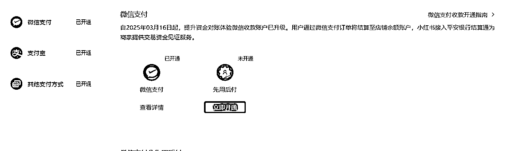

## 二、兼职内容的投入与回报

目前参考成本大致为：

- 单篇图文内容：3至5元
- 工作范围包含文字、图片与基础编排
- 稳定性通常优于未经处理的智能成稿

内容提交后必须经过审核，不符合要求的需要返工或淘汰，避免低质量内容直接发布。

人工制作的优势，在于能补足细节、生活感和表达温度。只要管理到位，账号整体风格也更容易保持统一。

### 用一个简单模型估算

假设每天制作并发布30条：

- 每条按5元计算
- 日投入约150元
- 若平均每条带来1笔订单，就是30笔成交
- 单份商品定价9.9元，流水约为300元

这只是估算，不代表所有账号都能达到同样结果，但可以帮助判断内容生产是否具备测试价值。

低价并不等于划算。只追求便宜，常见结果可能是画面模糊、风格散乱、文案粗糙，后续返工反而更耗时间。

更合理的做法是：

- 先制定验收标准
- 用试稿判断能力
- 对不合格内容及时退回
- 对表现稳定的人持续合作
- 逐步沉淀固定模板和调性

目前大部分内容由5名长期兼职承担，他们熟悉账号要求后，效率和完成度都会逐渐提升。

## 三、用RPA处理重复发布

当内容数量增加，手工上传、填写标题、添加标签和安排时间会变成一项高频消耗。

我们的做法是：

1. 兼职人员将素材整理到飞书表格
2. 统一下载或读取表格内容
3. 交由RPA执行上传与发布
4. 根据账号安排进行排期

这类流程可以支持多个账号，也能减少重复复制粘贴。

部分指令可以借助影刀的“魔法指令”完成；若遇到无法解决的环节，再让Claude协助修改程序。整个调试过程主要通过自然语言描述需求完成。

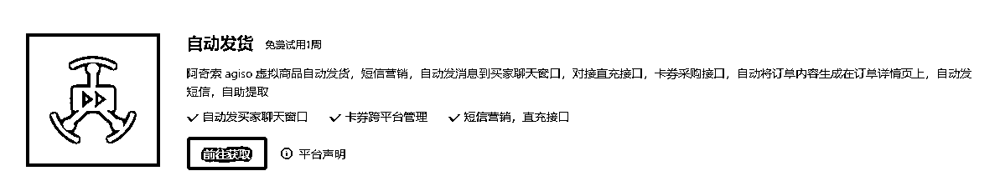

## 四、把各环节组合起来

一套较完整的协作链路可以这样安排：

1. 采集工具追踪站内表现较好的商品和数据变化
2. 兼职人员负责图文制作，单条成本约5元
3. RPA承担排期、发布及部分互动动作
4. 运营者集中精力判断方向、检查内容

过去通常只能照看一组4个账号；经过自动化改造后，同样的管理精力可以覆盖10个以上账号，也就是3至5组运营单元，人效明显提升。

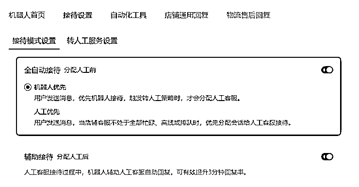

这并不是依赖高深技术，真正需要建立的是三项基础能力：

- 找到愿意长期配合、质量稳定的兼职人员
- 熟悉RPA的基本操作
- 把制作、检查、发布全部写成清晰流程

尤其是人员筛选，宁可前期慢一点，也不要为了几元差价牺牲整体品质。

# 两个常见疑问

## 1. 内容访问量不高，是不是账号出了问题？

这种情况非常普遍。

大量发布后，单日访问只有几十，并不能直接说明被限制，也不代表商品没有成交机会。过度盯着表面浏览数字，容易造成不必要的焦虑。

更值得关注的是主动需求。

用户会搜索高考数学真题、初中物理训练、Excel表格模板、求职简历写法等具体问题。只要商品方向准确，内容结构清楚，主题表达与用户检索习惯相符，就有机会获得持续曝光。

我们的实际情况是，许多产生订单的内容阅读并不高，点赞也只是几百以内，但约八成成交来自搜索入口。

所以，起步阶段访问量有限并不可怕。只要内容能稳定进入目标人群的检索页面，较小的基础流量同样可能带来订单。

## 2. 低价商品是否值得投放推广？

如果单件售价低于20元，建议先把自然渠道做好，再考虑是否付费放量。

平台衡量商业价值，通常会综合参考：

**成交金额 = 单次购买金额 × 成交比例 × 访问规模**

9.9元的数字资料，即使成交比例不错，对平台形成的收入贡献仍有限；相较之下，高价实体商品或课程更容易获得商业推广倾向。

从实际测试来看，低价数字商品通过投放获得大规模稳定流量并不容易。

因此，可以采用分层策略：

- 低价内容：重点经营搜索入口、标题表达和内容匹配
- 高价内容：结合数据少量测试推广，加快验证速度

并不是所有项目都适合用广告解决。对低价资料而言，免费搜索流量往往更接近真实需求，也更有利于控制成本。

以上内容围绕资料整理、平台经营、内容协作和自动发布展开，核心经验都来自实际尝试。希望能为正在测试虚拟资料方向的朋友提供一些可执行的思路。

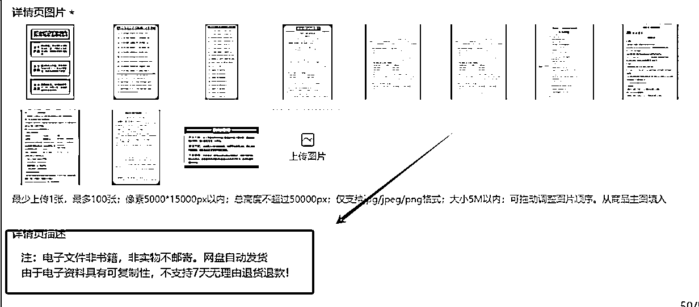

