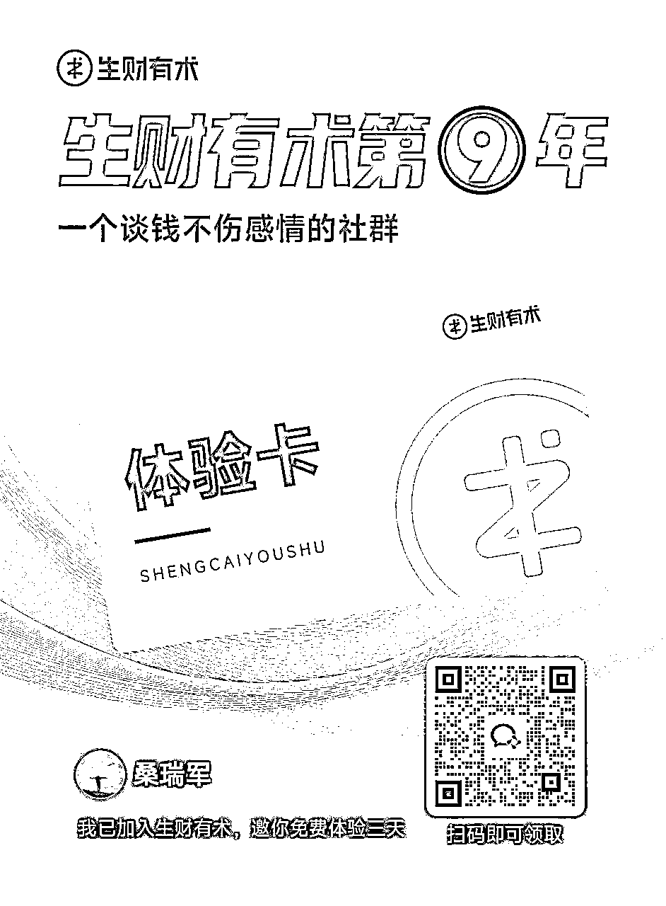
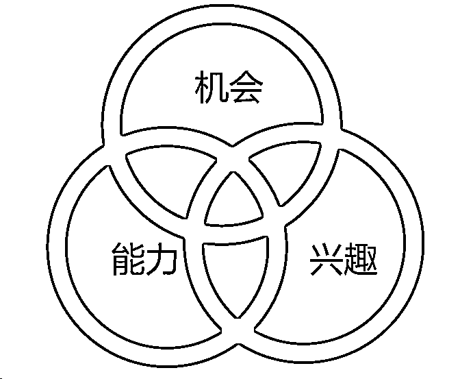

# 离开职场后，普通人如何找到自己的赚钱方向？

刚辞职、被裁，或者只是对朝九晚五越来越疲惫时，最难受的往往不是没时间，而是不知道接下来该往哪里走。

但迷茫并不意味着你走错了。很多人的新阶段，恰恰就是从“暂时没有答案”开始的。下面这套方法，不承诺立刻让你赚到大钱，却能帮你把混乱拆成几个可执行的小动作：先观察，再试做，在真实反馈里逐渐确定方向。

这套路径的实践者是桑瑞军。

他来自普通农村家庭，现居杭州，曾任美妆品牌营销负责人，三十多岁离开职场。过去8年，他积累了品牌策划、短视频推广和直播等经验。如今，他正在访谈100位离职后重新建立收入来源的人，并希望帮助更多脱离职场的人找到适合自己的道路。

他的核心判断很简单：

> 自救不是靠反复思考完成的，而是靠持续行动推进的。  
> 焦虑不会因为想得更多而消失，只有做出小动作、获得真实反馈，方向才会越来越清晰。

整套方法可以浓缩成五个动作：

1. 先观察别人正在靠什么获得收入；
2. 进入相关圈层，接触正在实践的人；
3. 将外部机会与自己的能力、兴趣进行匹配；
4. 拆解成功样本，照着成熟做法练习；
5. 在验证有效后，再逐渐放大并加入自己的创新。

## 第一阶段：扩大视野，先看看外面的赚钱机会

许多人迟迟找不到方向，并非能力不足，而是长期停留在单一的信息环境里。你需要先知道：别人正在做什么、市场愿意为什么付费，以及普通人有哪些低成本的切入口。

### 先进入三个相关圈层

线上可以关注知识星球里的创业社群、自由职业交流群，也可以浏览小红书上的“一人公司”“第二人生梦想家”等主题，去B站寻找自由职业、个人业务相关创作者。

加入圈子的目的，不是盲目报名项目，而是让自己接触不同的工作方式，逐步离开原本的打工语境。你还可以搜索具体关键词，找到真正做出结果的人，再尝试建立联系。很多访谈对象，都是通过这种方式认识的。

线下则可以参加同城创业活动、创意市集、技能交流会等。活动行、Meetup等平台通常能找到相应信息。

与陌生人交流时，可以这样开口：

- “你现在主要在做哪类业务？”
- “刚才的分享很有启发，方便加个联系方式吗？”
- “你当初迈出的第一个关键动作是什么？”
- “如果方便的话，我想请教一下你最初是怎样获得客户的。”

重点不是一次谈出合作，而是多接触真实案例，建立对市场的感知。

### 拆解十个与你相近的案例

从平台和社群里，挑出10位背景与你相似、但已经找到收入路径的人。例如前招聘从业者、设计人员、程序开发者等。

建议记录以下信息：

- 他们究竟提供什么；
- 最初投入了多少；
- 第一批客户从哪里来；
- 收入的大致区间；
- 从开始到拿到第一笔订单，经历了哪些步骤。

不要执着于精确数字，先看清楚业务结构。

还要特别留意两类风险：

第一，谨慎对待强依赖附近客流的项目。餐饮店、健身房、奶茶店等业务，客户半径有限，房租、人力和竞争压力都可能让经营风险迅速上升。

第二，别只看别人“现在赚多少”，更要研究他们最初如何迈出第一步，尤其是首次成交是怎么发生的。

## 第二阶段：把机会与自己匹配起来

看了很多案例后，不要继续泛泛地问“我到底喜欢什么”。更有效的方法，是把现有机会与自己的能力组合起来。

### 做一张“能力—兴趣—机会”匹配表

先列出5个你觉得有可能尝试、门槛也不高的方向，比如：

- 闲鱼代售或无库存交易；
- 商家账号运营；
- 课件、表格或资料整理；
- 文案与内容服务；
- 某个细分领域的信息整理。

然后分别写下三组内容：

1. 你已经掌握、且可以迁移到其他场景的能力，例如表格处理、写作、沟通、组织协调；
2. 你愿意长期投入的兴趣；
3. 你刚刚观察到的市场机会。

最后寻找交汇处：哪些方向既能调用你的现有能力，又不会让你长期感到厌倦？优先从这些方向开始。

### 用排除法减少选择

以下两类项目，可以先暂时放下：

- 必须先掌握一整套陌生技能，才能开始交付的项目；
- 前期投入超过你一个月基本生活开支的项目。

你还可以借助个人商业模式画布、能力盘点表和定位问卷，把判断过程写下来，而不是只在脑中反复犹豫。

## 第三阶段：用72小时做一次低成本验证

不要一开始就注册公司、租办公室、囤大量货物。先找一个最小测试版本，让自己在三天内接触真实用户。

一个合格的测试项目，最好满足两个条件：

- 使用现有能力即可展开；
- 前期花费控制在100元以内。

可以参考以下方向：

- 服务型：在闲鱼提供PPT美化、求职材料修改等服务；
- 信息整理型：制作“城市露营地点清单”等细分资料，低价出售；
- 商品转售型：从批发平台挑选实用小商品，再到二手平台测试需求。

### 三天测试流程

#### 第一天：准备并发布服务

以求职材料优化为例，可以这样设计：

> 曾参与大量招聘筛选，专门帮助互联网、快消及外企求职者优化材料。  
> 低价体验，重点处理格式混乱、重点不突出、岗位匹配度低等问题。  
> 首批用户可获得一份面试表达参考清单。

配图可以使用经过隐私处理的前后对照案例。

#### 第二天：选择一个免费渠道曝光

可以在小红书、闲鱼等平台发布内容，围绕用户正在经历的困惑来写，例如：

- 为什么投递后迟迟没有回应？
- 职业空档期应该怎样解释？
- 被裁之后，面试中如何回答离职原因？

不要一开始追求复杂包装，先让目标人群看见你提供的具体帮助。

#### 第三天：接触几位可能有需求的人

可以在招聘平台寻找近期活跃的求职者，礼貌发送简短说明：

> 看到你正在寻找新机会，如果愿意，我可以先帮你看看材料中有没有明显问题。

如果暂时没有真实客户，可以请熟人体验一次，完成交付并获得评价。完成服务后，也可以询问对方是否同意将案例匿名展示，并用小额返还或其他方式表达感谢。

### 这次测试只看三个结果

- 有人来询问吗？说明问题确实存在；
- 有人愿意付费吗？说明需求具备商业可能；
- 你能按约完成交付吗？说明能力可以转化为服务。

## 第四阶段：从测试结果中提炼出产品

三天测试结束后，不要急着换方向，先复盘整个过程。

可以问自己：

- 哪个环节最容易推进？
- 用户为什么愿意花钱？
- 你究竟替对方解决了什么问题？
- 哪一部分工作让你最投入？

然后用一句话说清楚自己的初始产品：

> 我服务哪一类人，帮助他们解决什么困难，具体通过什么方式完成。

例如：

> 我帮助刚进入职场的求职者改善材料质量，并通过一对一修改和面试演练提升求职表现。

之后，可以把同一项能力拆成不同层级：

- 入门服务：只处理一项明确问题；
- 标准服务：增加沟通、演练或配套资料；
- 深度服务：提供更长周期、更完整的陪跑。

这样既方便用户选择，也能逐步提高客单价。

## 第五阶段：经营个人影响力，让客户更容易找到你

当你确认某项服务确实有人需要，就可以围绕它持续输出内容。个人影响力的作用，不是单纯追求粉丝数量，而是让潜在客户更快理解你是谁、能解决什么问题。

### 先选一个适合自己的平台

判断标准有两个：

- 目标客户平时在哪里获取信息；
- 你更适合用文字、图片、音频还是视频表达。

例如，求职服务可以发布职场避坑、材料优化和面试经验；手工产品则可以展示制作过程、使用场景和搭配方式。

### 内容必须服务于业务

每次发布内容，都尽量回答一个明确问题，并自然地说明你能提供的帮助。

可参考的选题包括：

- 转行时如何调整求职材料；
- 哪些写法容易让招聘方快速跳过；
- 从大量筛选经验中总结出的常见问题。

同时，可以制作一个免费的小工具或清单，引导有需要的人进一步联系你。例如：

- 个人介绍中写清楚服务方向；
- 置顶评论放领取入口；
- 设置关键词回复，发送资料包或检查表。

### 持续输出比偶尔完美更重要

内容不必每次都追求爆发，先确保稳定更新。比起一个月发布一篇“精品”，持续提供实用内容更容易建立信任。

还要记住：

- 先解决问题，再考虑表达是否有趣；
- 主题越聚焦，越容易吸引真正有需求的人；
- 高播放量只是结果，不是最初的唯一目标。

## 第六阶段：稳定执行，避免被情绪牵着走

离开固定工作后，最大的挑战往往不是能力，而是没人催促、没人安排、收入也不再稳定。

因此，需要给自己建立一套日常节奏。

每天记录：

- 今天完成了哪些任务；
- 哪怕只是发布一条内容，也要留下痕迹；
- 今天获得了什么反馈；
- 哪些地方需要调整；
- 明天准备推进哪几件事。

几个重要观念：

- 第一笔真实收入，比遥远的大目标更有意义，因为它说明你的能力已经被市场接住；
- 把每次尝试当作测试，不要急着给自己贴上“失败者”的标签；
- 自由职业或个人业务早期出现收入波动很正常，要观察趋势，而不是被单日数字影响。

还要区分“经营个人品牌”和“成为内容博主”。

内容平台只是传播工具，真正重要的是：你有什么经历、掌握哪些能力、能够为谁创造什么结果。你不必为了做内容而做内容，而要借助内容让合适的人认识你的价值。

在执行过程中，可以给自己设置小奖励；碰到挫折时，不要把一次结果当成最终结论；状态低落时，主动与同行、朋友或前辈交流。很多时候，人与人的连接本身，就是恢复行动力的方式。

## 第七阶段：为什么这套方法适合普通人起步？

它的优势在于，把一件看起来很大的事拆成了许多小步骤：

- 先接触外部信息，避免长期困在原有认知里；
- 再用小规模测试换取市场回应；
- 整个过程不依赖重资产投入，风险相对有限；
- 每完成一次验证，就能多获得一点信心和掌控感。

它不是要求你准备到毫无瑕疵才开始，而是鼓励你先做出一个足够小、可以被真实用户检验的版本。

别再长时间停留在“以后我要做什么”的想象中。今天就列出自己的能力，挑一个能看懂、能接触、能快速验证的方向，完成第一次试做。

## 第八阶段：从雇员思路转向经营自己的事业

从打工状态走向个人事业，核心可以归纳为三件事：

1. 盘点自身优势；
2. 建立清晰的对外形象；
3. 将能力包装成别人愿意购买的解决方案。

### 雇佣关系与个人业务，底层都是价值交换

上班时，通常是组织分配任务，你负责完成；自己做业务时，则需要主动发现需求、设计方案、寻找客户。

两者并没有本质上的高低之分，差别只是主动权更多掌握在谁手里。每个人都有可以交换的价值，真正困难的是把它识别出来，并用市场听得懂的方式表达出来。

### 个人品牌是一项长期资产

机会、人脉和合作，往往会向那些“看起来值得信任”的人靠拢。

这里的“看起来”并不是虚假包装，而是让别人能够迅速了解你的专业方向和可靠程度。如果你确实有能力，却从不展示，外界就很难发现你。

个人品牌至少要回答三个问题：

- 你是谁？
- 你擅长什么？
- 你能为别人带来什么结果？

答案越清晰，越容易吸引匹配的人和资源。

### 建立个人品牌的三个动作

**第一，盘点自己的筹码。**  
工作经验、专业能力、行业见闻、个人性格，甚至某段特殊经历，都有可能转化为差异化优势。

**第二，让优势进入公共视野。**  
现在，文章、直播、短视频都可以成为展示能力的窗口。过去投递材料，可能只能触达少数用人方；如今，一条内容就有机会触达大量潜在客户、合作伙伴和同行。

**第三，持续展示真实价值。**  
不要只说“我很厉害”，而要拿出过程、案例、方法和结果。真正有效的人脉，不是通讯录里多了多少联系人，而是别人看见你的能力后，愿意与你建立长期合作。

## 写在最后

对于普通人来说，现在是一个更容易被看见的时代。传播工具的门槛降低了，个人展示和小规模试错的成本也比过去低得多。

但机会不会因为你收藏了很多方法就自动出现。先从自己的经历和能力里找出一个可交换的部分，再用轻量方式把它放到市场上测试。

如果你正在寻找容易快速验证的方向，可以关注：

- 小红书实物销售；
- 小红书虚拟资料；
- AI辅助文案服务；
- AI辅助短视频制作。

方向只是起点，真正让路径发生变化的，是你今天愿意完成的那一次小测试。