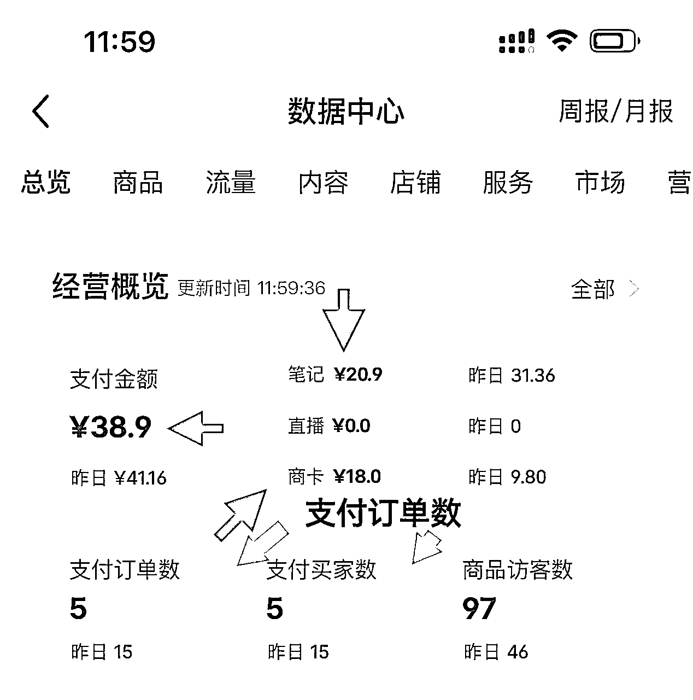
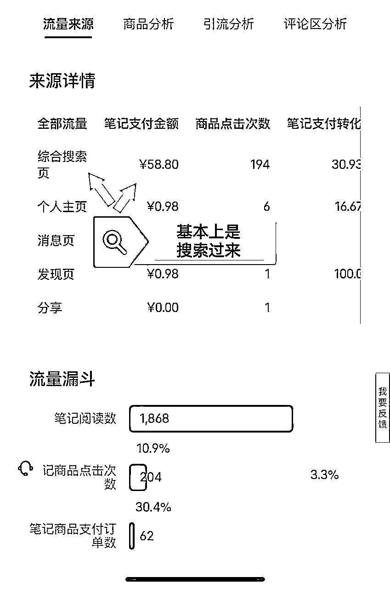
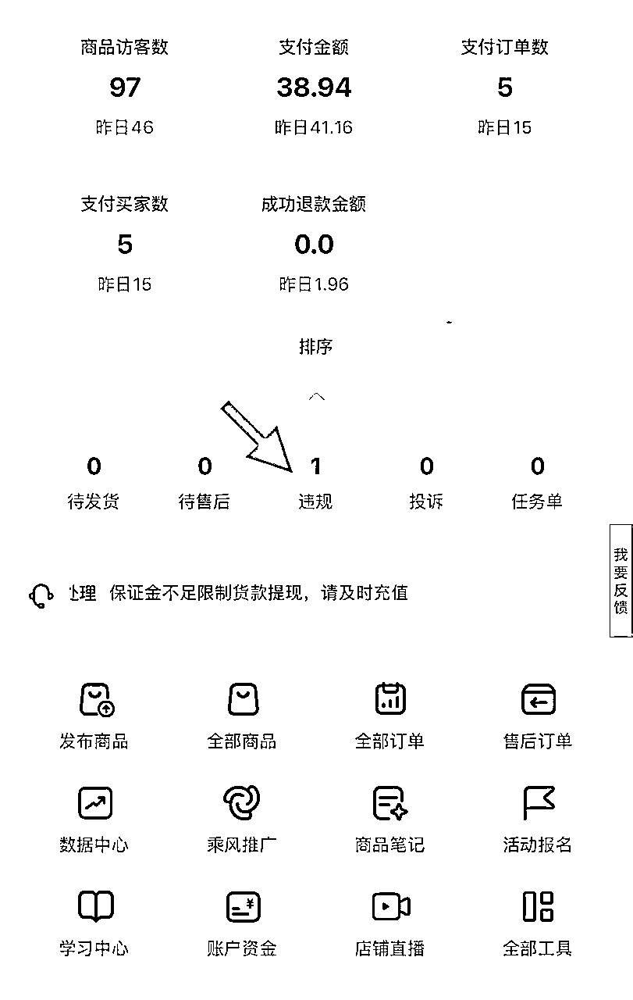
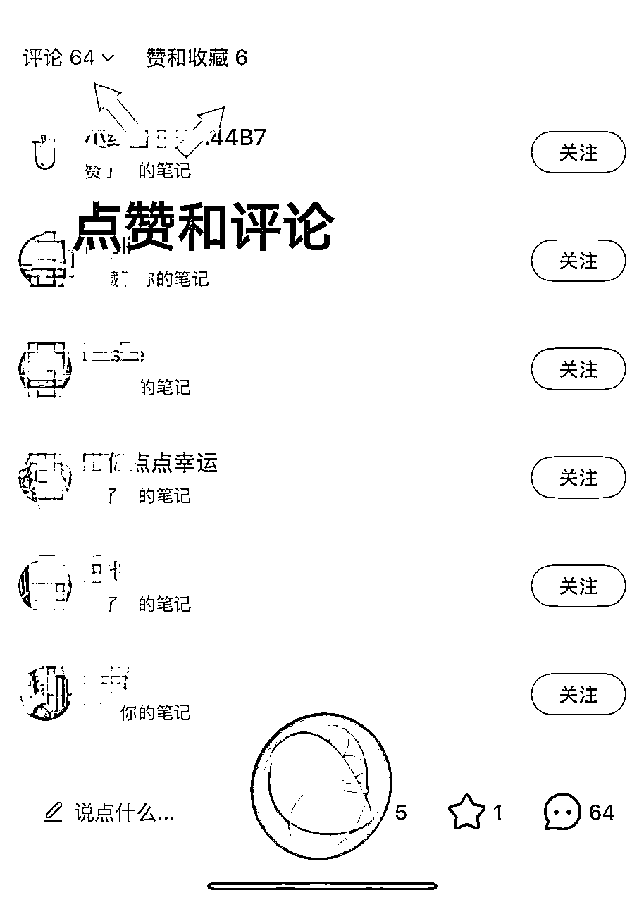
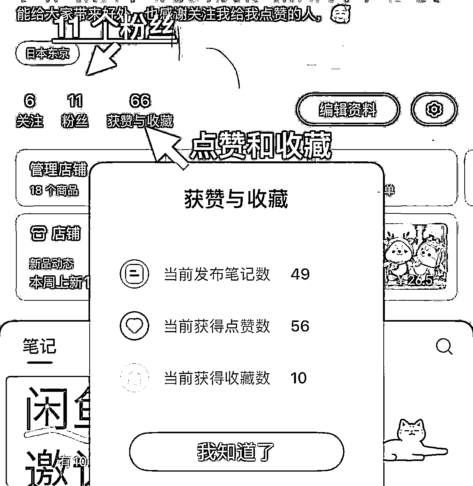
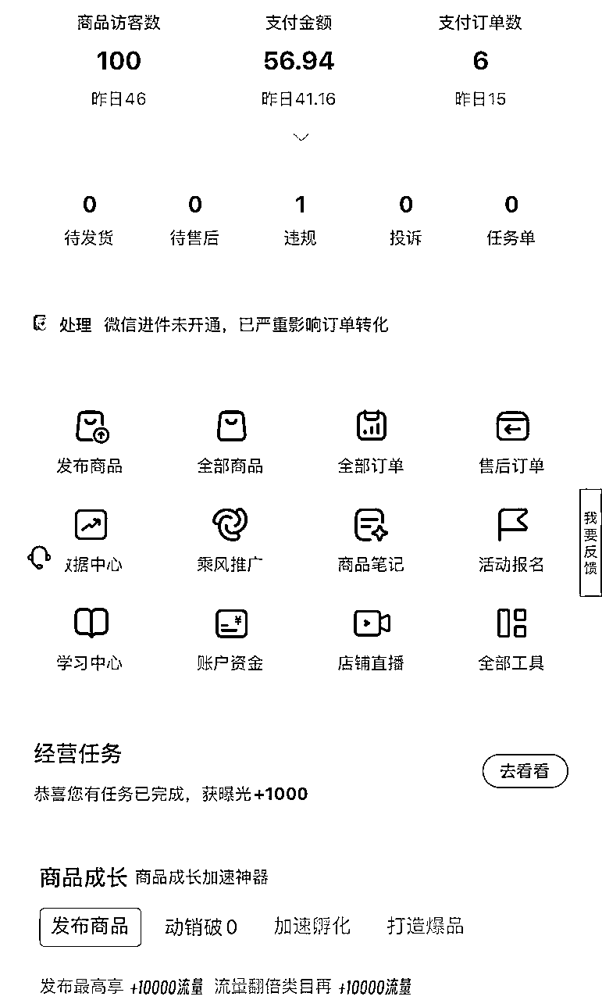
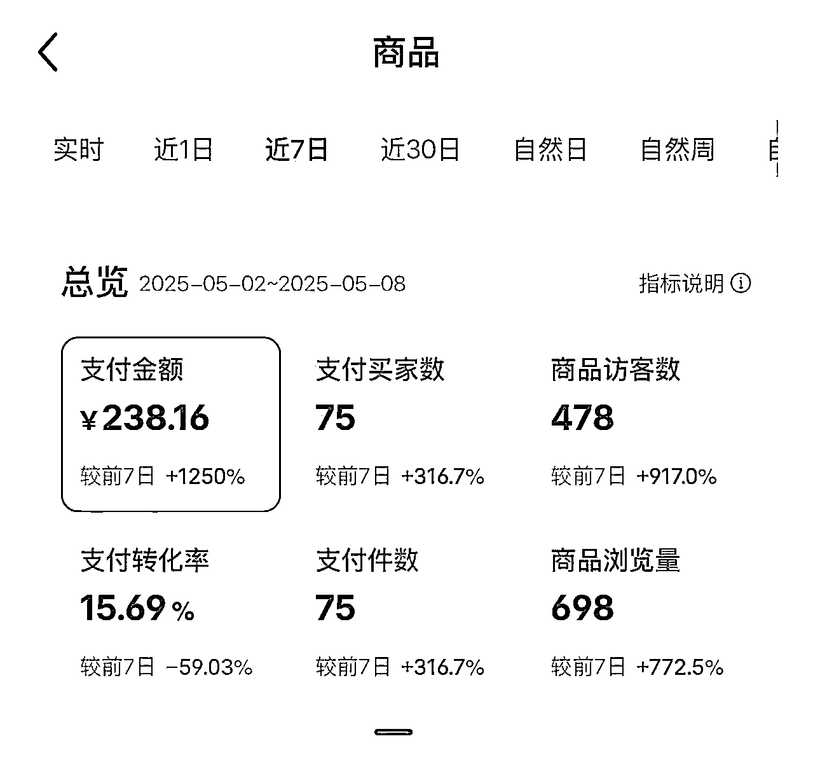

# 从传统建材到电商首单：一个小白的赚钱航海实战笔记

## 一、起航前夜：被行业逼出来的转型

大家好，我是刘雄飞。之前一直在传统建材这行做，后来行业持续收缩，电商冲击下生意越来越难做。一直想找条新路子没着落，直到有一次看直播，无意中接触到龙哥盟，之后就一直有关注。

去年双十一，看到龙哥盟开了航海营，我带着想学点真正能用的东西的心态报了名，算是正式踏进这片陌生水域。第一次上船，我选的是 ComfyUI 文生图。说实话，AI 生图对我来说完全是空白，刚开始满脑子都是懵的。但抱着“先上手再说”的想法，我跟着航海节奏走，紧跟志愿者的安排，每天雷打不动打卡。21 天下来，从对 AI 概念模糊，到能熟练操作基础文生图，再到最终实现从零到一，并拿到三位数收益。这一路很累，但也特别踏实。接下来就把我的实操过程分享一下。

## 二、两段航海，两次跃迁

自从加入龙哥盟，我一共参加过两次航海，每一次都带给我不一样的改变。

第一次 ComfyUI 文生图，更像是一次对项目逻辑的拆解学习。它让我明白，项目能不能成，关键在于能不能在信息噪音里找准自己能扛住的赛道，就像钓鱼，得去有鱼的地方，也得用对工具。

真正让我跑通变现的，是第二次参加的📕电商航海。

这次我同时上了海外 AI 网站和📕电商两个方向，而📕电商成了我第一个真正做到从 0 到 1 的项目。起初选品阶段特别煎熬，换了好几个品类，花了不少时间精力，流量却几乎为零。转机出现在赚钱贴里有人分享扣子邀请码。

我去多个平台逛了一圈，发现求邀请码的人非常多。结合第一次航海养成的判断力，我觉得这就是需求。于是我马上在📕发了笔记，并在标题和正文中埋了大量长尾词，比如“点#号，再加上商品名字，后面也会有很多搜索词，找用的最的多都加上，还可以在搜索词里找排名靠前的，使用追的多”。没想到笔记刚发出去当天晚上就接到第一单。但因为之前没做过虚拟发货，被客户催单时完全不知道怎么操作，只好让客户退了单。吃了亏后我立刻去研究无货源发货的流程，反复测试商品属性和信息填写。到了第三单，我已经能熟练地复制邀请码完成交付了。

更意外的是，我这个📕号之前因为违规被限流过一段时间，这次的内容却被重新推了。点赞数慢慢涨起来，评论区也活跃了，最高一天下单超过 20 单。即使评论区里有人直接免费送码，还是有不少用户愿意付费购买。这让我彻底理解到，好的长尾词能把真正有购买意向的人筛出来，需求被满足了，售后自然就少。最终我拿到了三位数收入，更重要的是，我从一个电商门外汉，真正变成了能独立操盘的小项目实战者。

## 三、实战后我总结的几件事

两次航海下来，我觉得有三点特别重要。

第一，选项目一定要看和自己是否匹配，别盲目追热点。了解真实的市场需求，找到自己能坚持下去的领域，才能保持动力持续做下去。

第二，长尾词是📕获取精准流量的核心武器。它能让内容被对的人看见，提升转化。很多人就是靠长尾词找到想要的商品，通过长尾词搜来的基本上就是精准客户，所以词的布局不能省。

第三，遇到问题时别退缩。像我第一次发货慌乱到让客户退单，到后面能从容处理，都是在一次次试错中磨出来的。保持学习心态和解决问题的韧性，比天赋更重要。

## 最后聊两句

龙哥盟的航海，对我来说就是从互联网小白到能独立变现的成长记录。这里不只有知识和收益，更是学会了怎么在变化很快的互联网里发现机会、抓住机会。今天是 6 月航海报名的最后一天，我知道很多新朋友还在犹豫。站在一个已经实操并拿到结果的角度，我只想说，迈出这一步，你才有可能看见不一样的自己。未来我也会继续在赚钱的平台上探索更多可能，希望我的经历也能给正在路上的人一点点启发和信心。

#航海好事